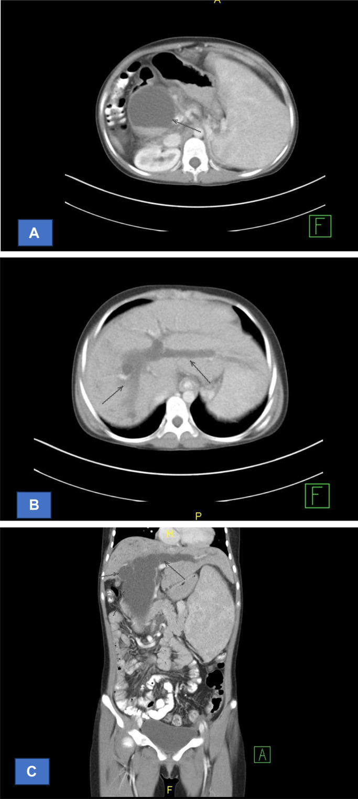
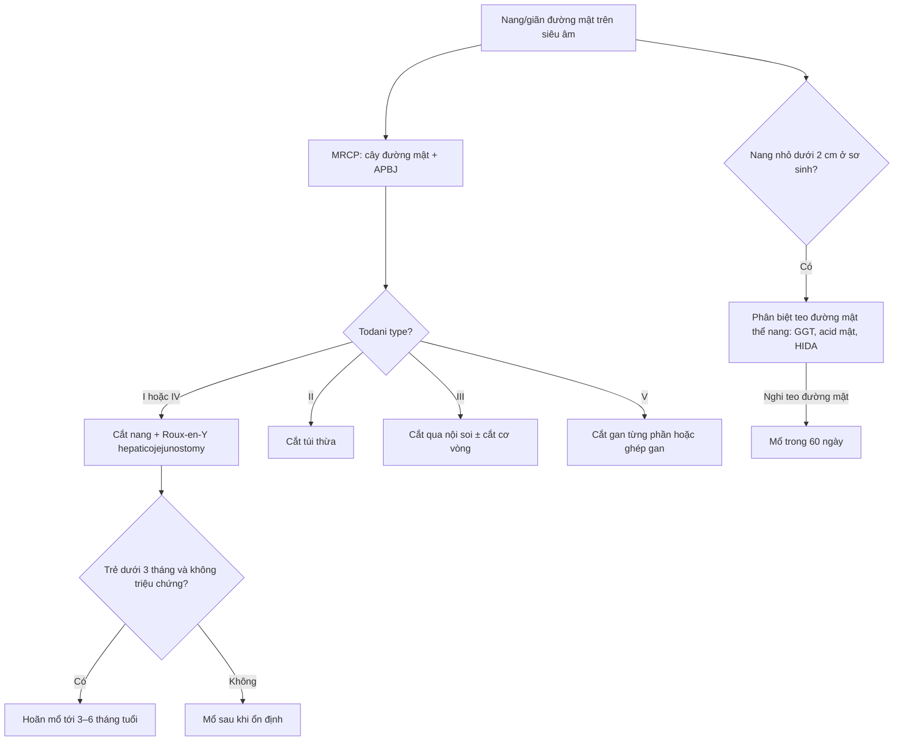
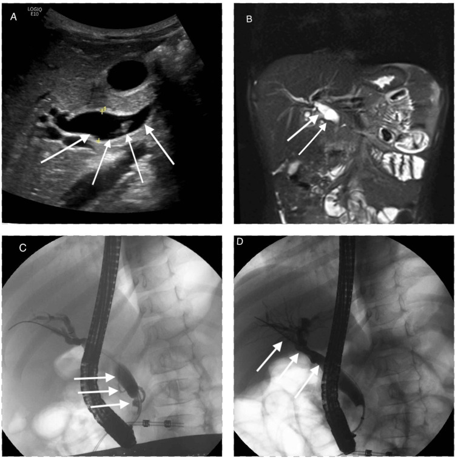
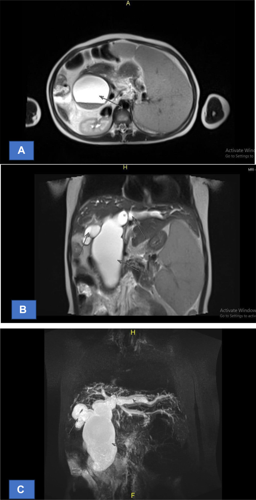

# 6137 — Nang ống mật chủ ở trẻ: phân loại Todani, MRCP trước mổ, nguy cơ ung thư và theo dõi sau nối mật–ruột

**Tags:** `pattern:nang` `pattern:hep-duong-mat` `pattern:gian-duong-mat` `vung:duong-mat` `vung:gan` `vung:thai-nhi` `protocol:SA-bung` `protocol:MRI-MRCP` `protocol:CT-bung` `score:Todani` `incidentaloma:khong`
**Mức chắc chắn (certainty):** tổng hợp y văn (literature synthesis) — ghép **ca trẻ 6 tuổi có ảnh US/MRI/ERCP** (Cureus 2025, **PMC12081121**), **ca 16 tuổi Todani IV có ảnh CT/MRCP** (Radiol Case Rep 2025, **PMC11570900**), **31 thai nhi có MRI** (BMC Med Imaging 2026, **PMC13366937**), **319 trẻ < 60 ngày phân biệt nang ống mật chủ với teo đường mật thể nang** (World J Gastroenterol 2025, **PMC12418004**), **tổng quan phân loại Todani** (Diagnostics 2023, **PMC10047054**), **phân tích gộp nguy cơ ung thư 18 nghiên cứu/2.904 bệnh nhân** (Br J Surg 2018, **PMC5900735**), **457 trẻ sau mổ** (Sci Rep 2025, **PMC11914202**), **phân tích gộp robot vs nội soi 19 nghiên cứu** (Front Pediatr 2026, **PMC13160894**).

> **Câu hỏi thực hành:** bé gái **6 tuổi**, đau bụng lan tỏa 1 tuần, nôn; lipase **3.197 U/L**, AST **317**, ALT **682 U/L**, bilirubin toàn phần **1,4 mg/dL**. Siêu âm: tụy to, phù quanh tụy, **sỏi túi mật**, **ống mật chủ 11 mm**. Bác sĩ hỏi: **đây là viêm tụy do sỏi hay có gì khác, cần chụp gì trước mổ, và nếu là nang ống mật chủ thì mổ khi nào, theo dõi bao lâu?**
> Bài chốt **bốn việc**: **(1) nang ống mật chủ (choledochal cyst) là giãn đường mật bẩm sinh, thường gặp ở bé gái châu Á, và là "kẻ bắt chước" của viêm tụy tái phát — phải nghĩ tới khi ống mật chủ giãn kèm viêm tụy;** **(2) MRCP là chuẩn chẩn đoán (độ nhạy 90–100%) và là bắt buộc trước mổ để xếp Todani I–V — phân loại quyết định kiểu mổ;** **(3) điều trị là cắt toàn bộ nang + nối mật–ruột Roux-en-Y, không dẫn lưu nang (dẫn lưu làm tăng nguy cơ ung thư 4 lần); trẻ không triệu chứng có thể hoãn mổ tới 3–6 tháng tuổi, nhưng teo đường mật thể nang phải mổ trong 60 ngày;** **(4) ung thư đường mật vẫn có thể xuất hiện sau cắt nang — tích lũy 1,6% ở 15 năm, 3,9% ở 20 năm, 11,3% ở 25 năm — nên theo dõi suốt đời, không phải "mổ xong là khỏi".**

## 1. Tổng quan bệnh học – cơ chế hình ảnh: tại sao nang lại "ăn" vào đường mật và sinh ung thư

- **Dịch tễ (số phải nhớ):** **1/100.000–1/150.000** trẻ sinh sống ở phương Tây; **1/13.500** ở Mỹ, **1/15.000** ở Úc, và **tới 1/1.000** ở châu Á — **2/3 ca châu Á ở Nhật** (PMC10047054). **Nữ:nam 3–4:1**; **20–25%** chỉ được chẩn đoán ở tuổi trưởng thành; **~80%** được chẩn đoán trong **thập niên đầu đời** (PMC11570900). Nang ống mật chủ là **dị tật đường mật bẩm sinh phổ biến thứ hai** sau teo đường mật (PMC10047054). Teo đường mật: **1,1–1,48/10.000** trẻ sinh sống; **thể nang (cystic biliary atresia, CBA) chiếm ~10%** teo đường mật (PMC12418004).
- **Cơ chế chính — bất thường nối mật–tụy (anomalous pancreaticobiliary junction, APBJ):** ống mật chủ và ống tụy chính **hợp lưu quá cao, phía trên cơ vòng Oddi**, tạo **kênh chung dài**. Vì chênh áp lực, **dịch tụy trào ngược vào đường mật**; **elastase và phospholipase A2** phá hủy biểu mô, gây viêm mạn, **giãn thành ống mật** và **xơ hóa**. Hệ quả: **(a)** thành nang mất biểu mô trụ bình thường → **sỏi bùn, viêm đường mật, viêm tụy tái phát**; **(b)** biểu mô bị kích thích lâu năm → **dị sản → loạn sản → ung thư biểu mô đường mật**. APBJ gặp chủ yếu ở **Todani IA, IC và IVA** (PMC10047054).
- **TẠI SAO MRCP là chuẩn (vật lý):** MRCP dùng chuỗi **T2 rất nặng (heavily T2-weighted)** — dịch mật **T2 rất sáng**, mô đặc và mạch máu **tối**, nên **toàn bộ cây đường mật hiện ra như "phim âm bản"** mà **không cần thuốc cản quang**. Độ nhạy **90–100%** cho nang ống mật chủ (PMC12081121), và quan trọng hơn siêu âm ở chỗ **thấy được APBJ và ống mật trong gan** — hai thứ quyết định phân loại và kiểu mổ.
- **TẠI SAO siêu âm vẫn là bước đầu:** không bức xạ, rẻ, làm được tại giường, thấy **nang, sỏi, giãn ống mật trong gan** và **dịch quanh tụy**. Nhưng siêu âm **không thấy APBJ** và **không phân biệt tốt nang nhỏ với teo đường mật thể nang** — nên **không dùng siêu âm một mình để quyết định mổ**.
- **TẠI SAO phân loại quan trọng hơn kích thước:** kiểu mổ khác nhau theo Todani — **I/IV: cắt nang + nối gan–ruột Roux-en-Y**; **II: cắt túi thừa**; **III (choledochocele): cắt qua nội soi + cắt cơ vòng**; **V (Caroli): cắt gan từng phần/ghép gan**. Nang "không xếp loại được" (type ID, type VI) đã được báo cáo nhiều, nên **phân loại là công cụ, không phải chân lý** (PMC10047054).
- **Số liệu phân bố Todani (dùng để kiểm tra trước mổ):** **type I 50–80%**, **type IV 12–35%**, **type III 1,4–4,5%**, **type II 2–3%**, **type V tới 20%** trong một số tổng quan (PMC10047054). Nếu MRCP báo "type IV" mà **không thấy giãn ống mật trong gan**, phải xem lại — và ngược lại.
- **Nguy cơ ung thư (số quyết định theo dõi):** phân tích gộp **18 nghiên cứu, 2.904 bệnh nhân**: **312 người (10,7%)** có ung thư; **tỉ lệ hiện mắc 7,3%**, **tỉ lệ chuyển dạng ác tính 3,4%**; **type I và IV** nguy cơ cao hơn (p = 0,016); **dẫn lưu nang (cystic drainage) làm tăng nguy cơ so với cắt toàn bộ: OR 3,97 (2,40–6,55)** (PMC5900735). Sau **cắt nang**, nguy cơ **vẫn còn**: tích lũy **1,6% ở 15 năm, 3,9% ở 20 năm, 11,3% ở 25 năm**, xuất hiện ở **13, 15, 23 và 32 năm** sau mổ; ung thư sau mổ có **sống trung vị 15 tháng** (PMC3816325).
- **Biến chứng sau mổ (số phải nhớ):** loạt nội soi ở trẻ **34/362 (9,39%)** có biến chứng; trong số đó **hẹp miệng nối mật–ruột 35,3%**, **sỏi đường mật 23,5%**, **viêm tụy 20,6%**; yếu tố nguy cơ độc lập: **thành nang > 5 mm OR 4,23**, **viêm túi mật mạn OR 6,42**, **Todani I OR 6,13**, **CRP tăng OR 1,52**, **bilirubin trực tiếp tăng OR 2,05** (PMC13181631). Ở **457 trẻ** sau mổ: **sỏi đường mật trong gan 21 ca (4,6%)**, **81% trong số đó là type IVa**; **4 ca do hẹp miệng nối**; **đường kính miệng nối lớn hơn ở nhóm có sỏi (15,0 vs 8,0 mm, p = 0,03)** — gợi ý **miệng nối quá rộng + ứ trệ** là cơ chế (PMC11914202).

## 2. Mẫu hình + chẩn đoán phân biệt theo Todani và theo tuổi (gamut)

- **Mẫu hình theo Todani (gamut chính):**
  - **Type I (50–80%)** — giãn **ống mật chủ ngoài gan**: **IA** = giãn dạng nang toàn bộ ống mật ngoài gan; **IB** = giãn một đoạn; **IC** = giãn dạng thoi (fusiform) toàn bộ ± ống mật trong gan. **Hay kèm APBJ.**
  - **Type II (2–3%)** — **túi thừa** của ống mật chủ, có cuống; dễ nhầm với **nang ống mật chủ kiểu I nhỏ** hoặc **nang tá tràng**.
  - **Type III (1,4–4,5%)** — **choledochocele**: giãn đoạn cuối ống mật chủ **trong thành tá tràng**, thường **tắc bóng Vater** → viêm tụy/viêm đường mật; **điều trị nội soi cắt cơ vòng** là lựa chọn.
  - **Type IV (12–35%)** — **IVA**: giãn **cả trong và ngoài gan**; **IVB**: nhiều đoạn giãn **chỉ ngoài gan**. **Nguy cơ sỏi trong gan và ung thư cao nhất** → theo dõi sát nhất.
  - **Type V (Caroli)** — giãn **chỉ ống mật trong gan**, ± **xơ gan bẩm sinh** (Caroli syndrome); nguy cơ **sỏi trong gan, viêm đường mật, ung thư**; điều trị **cắt gan/ghép gan**.
- **Gamut theo tuổi (cách trình bày):** **sơ sinh–< 1 tuổi:** vàng da ứ mật, phân bạc màu, khối hạ sườn phải; **1–10 tuổi:** đau bụng tái diễn, **viêm tụy**, viêm đường mật; **> 10 tuổi–người lớn:** đau bụng ± sốt ± vàng da, đôi khi **ung thư đường mật** là triệu chứng đầu. **Tam chứng kinh điển (đau + vàng da + khối) chỉ có ở ~20%**, nhưng **85% trẻ có 2 trong 3 triệu chứng**, so với **25% người lớn** (PMC11570900).
- **Chẩn đoán phân biệt bắt buộc (theo hình ảnh):**
  - **Teo đường mật thể nang (CBA)** — nang nhỏ ở rốn gan, **phải mổ trong 60 ngày**; phân biệt bằng **kích thước nang + GGT + acid mật** (xem mục 3).
  - **Nang ống mật chủ "forme fruste"/type ID/type VI** — bất thường nối mật–tụy **không có giãn rõ** hoặc giãn ở ngã ba ống gan; dễ bị bỏ qua (PMC10047054).
  - **Nang giả tụy (pseudocyst)** — **không có biểu mô lót**, tiền sử viêm tụy, nằm **sau dạ dày/trước thận**, không thông với cây đường mật.
  - **Nang lặp lại đường tiêu hóa (duplication cyst)**, **nang gan đơn thuần**, **nang màng phổi dưới hoành**, **nang thận** — dựa vào **vị trí và không thông với đường mật**.
  - **Túi mật căng nước/trùng lặp túi mật** — **không thấy ống mật chủ giãn**, có cổ túi mật.
  - **Sỏi ống mật chủ đơn thuần** — giãn nhẹ, **không có nang**, có sỏi; nhưng **sỏi ở trẻ phải nghĩ nang ống mật chủ/APBJ** (ca 6 tuổi dưới đây vừa sỏi vừa nang).

## 3. Bảng so sánh phân biệt (ma trận đối chiếu)

| Thực thể (entity) | Hình ảnh điển hình (US/MRCP/CT) | Chốt vào (rule-in) | Chốt loại (rule-out) | Gợi ý xác nhận |
|---|---|---|---|---|
| **Nang ống mật chủ type I** | **Nang/fusiform ống mật chủ**, thông với ống gan; **MRCP thấy toàn bộ cây đường mật**; ± sỏi | **Nang đường mật thông với ống gan + ống mật trong gan bình thường**; **LDC trung vị 4,3 cm** ở trẻ < 60 ngày (PMC12418004) | Nang **không thông** đường mật → nghĩ nang lặp lại/nang gan | MRCP; **ERCP chỉ khi cần can thiệp** |
| **Type IVa** | **Giãn cả trong và ngoài gan**, nhiều đoạn | **Giãn ống mật trong gan + ngoài gan**, thường **sỏi trong gan** | Chỉ giãn ngoài gan → type I; chỉ trong gan → type V | MRCP; theo dõi **sỏi trong gan** lâu dài |
| **Teo đường mật thể nang (CBA)** | Nang **nhỏ** rốn gan, **túi mật xẹp**, không thấy ống mật chủ bình thường | **LDC 1,9 cm vs 4,3 cm**, **TDC 1,4 vs 3,2 cm**, **GGT 482 vs 296,5 U/L**, **acid mật 91,4 vs 16 µmol/L** (CC); mô hình **AUC 0,990, Se 92,9%, Sp 96,3%** | Nang **> 3 cm** + GGT thấp **gần như loại trừ CBA** nhưng không tuyệt đối | **HIDA** (không thấy phóng xạ vào ruột) + **mổ trong 60 ngày** nếu nghi CBA |
| **Nang giả tụy** | Nang **sau dạ dày**, thành mỏng, **không có biểu mô**, dịch tụy; tiền sử viêm tụy | **Tiền sử viêm tụy + nang không thông đường mật + amylase dịch cao** | **Thông với đường mật** → không phải pseudocyst | MRI/CT; theo dõi ≥ 4 tuần (bài 6135) |
| **Nang lặp lại tiêu hóa** | Nang **thành có lớp cơ/niêm mạc**, dính tá tràng, **không thông đường mật** | **Thành dày có lớp + không thông mật** | Thông với ống mật → nang ống mật chủ | MRI + mô bệnh sau mổ |
| **Túi mật căng nước/trùng lặp** | **Túi mật to, không thấy cổ**, ống mật chủ **không giãn** | **Có cổ túi mật + ống mật chủ bình thường** | Có nang ống mật chủ thật → không phải túi mật | Siêu âm + MRCP |
| **Sỏi ống mật chủ** | Ống mật chủ giãn **nhẹ**, **sỏi trong lòng**, không nang | **Sỏi + giãn nhẹ**, không có nang | **Nang/fusiform > 1 cm** → nang ống mật chủ | MRCP; ở trẻ **luôn tìm APBJ/nang** |

*CT 16 tuổi, Todani IV: (A) giãn ống mật chủ ngoài gan; (B) giãn ống mật trong gan hai bên; (C) coronal thấy toàn bộ hệ thống giãn. Nguồn: Radiol Case Rep 2025 (PMC11570900), CC BY 4.0.*

## 4. Protocol chụp + phân loại + chỉ định mổ

- **Bước 1 — siêu âm bụng (nhịn ăn 3–4 giờ):** đo **đường kính nang theo trục dọc và ngang**, tìm **sỏi, giãn ống mật trong gan, túi mật**, dịch quanh tụy. Ở thai: **siêu âm là bước đầu**, MRI thai khi cần chẩn đoán xác định.
- **Bước 2 — MRCP (bắt buộc trước mổ):** chuỗi **T2 nặng 3D**, không cản quang; đánh giá **toàn bộ cây đường mật, APBJ, ống gan, ống tụy**, và **phân loại Todani**. **Độ nhạy 90–100%** (PMC12081121). Nếu trẻ quá nhỏ/không hợp tác: **MRI dưới mê** hoặc **MRCP sau bơm secretin** (không bắt buộc).
- **Bước 3 — CT bụng có cản quang:** **không thường quy**; dùng khi **nghi biến chứng** (vỡ nang, viêm tụy hoại tử, áp-xe) hoặc **không làm được MRI**; CT tốt cho **type IV/V và quy hoạch mổ** (PMC11570900).
- **Bước 4 — HIDA (Tc-99m):** hữu ích ở **sơ sinh** để phân biệt **nang ống mật chủ với teo đường mật** (không thấy phóng xạ xuống ruột trong teo đường mật); **không thay thế MRCP**.
- **Bước 5 — ERCP:** **chẩn đoán ít dùng** (xâm lấn); **điều trị type III** (cắt cơ vòng), lấy sỏi, đặt stent khi viêm đường mật nặng; **không dùng để "dẫn lưu nang"** vì làm tăng nguy cơ ung thư (OR 3,97, PMC5900735).
- **Thời điểm mổ:** **trẻ không triệu chứng: hoãn tới 3–6 tháng tuổi** (PMC12418004); **có triệu chứng/viêm tụy/viêm đường mật: mổ sớm sau khi ổn định**; **nghi teo đường mật thể nang: mổ trong 60 ngày**.
- **Kiểu mổ:** **cắt toàn bộ nang + nối gan–ruột Roux-en-Y (hepaticojejunostomy)** là chuẩn cho type I/IV. **Type II:** cắt túi thừa. **Type III:** cắt qua nội soi ± cắt cơ vòng. **Type V:** cắt gan từng phần/ghép gan. **Nối mật–tá tràng (hepaticoduodenostomy)** là lựa chọn thay thế nhưng **còn tranh luận**: nguy cơ **trào ngược dịch tá tràng/viêm đường mật** được nêu, trong khi bằng chứng so sánh trực tiếp **chưa kết luận** (PMC11546063).
- **Theo dõi sau mổ (suốt đời):** **siêu âm + men gan + GGT mỗi 6–12 tháng**; **MRCP khi nghi hẹp miệng nối/sỏi**; **CA 19-9** không đủ để sàng lọc nhưng dùng khi nghi ung thư; **nội soi/ERCP** khi hẹp miệng nối có triệu chứng.

## 5. Biến thể bình thường và cạm bẫy

- **"Nang nhỏ" ở sơ sinh không phải lúc nào cũng là nang ống mật chủ:** **teo đường mật thể nang** có tiên lượng và **thời điểm mổ hoàn toàn khác** (60 ngày). Dùng **kích thước + GGT + acid mật** (mục 3); **không chờ "nang to lên rồi tính"**.
- **Type ID/type VI "không có trong Todani":** giãn ở **ngã ba ống gan** với ống mật chủ dưới bình thường; **MRCP trước mổ có thể báo sai type II** — ca 35 tuổi trong PMC10047054 mổ nội soi chuyển mở vì vị trí thực tế khác. **Luôn đọc MRCP cùng phẫu thuật viên**, và chấp nhận **phân loại có thể phải sửa trong mổ**.
- **Dấu hiệu "pointed apex" trên MRI thai:** trong **31 thai nhi**, **100%** có **đỉnh nhọn phía trên**, **26/31 hình bầu dục**, **29/31 không vượt bờ dưới gan**, **26/31 hướng từ trên-phải xuống dưới-trái**; **70,9% là thai nữ** (PMC13366937). Đây là dấu hiệu **gợi ý type I**, không phải chẩn đoán mô học — **không dùng để loại trừ teo đường mật**.
- **Nhầm nang ống mật chủ với nang giả tụy:** nang giả **không có biểu mô**, thành mỏng, **không thông đường mật**; cắt nang giả không cần nối mật–ruột, còn **cắt nang ống mật chủ mà không nối mật–ruột là biến chứng chết người** (rò mật, hẹp, xơ gan).
- **"Đã cắt nang là hết nguy cơ ung thư" — SAI:** nguy cơ **tích lũy 11,3% ở 25 năm** (PMC3816325); **ung thư có thể ở ống mật trong gan còn lại, rốn gan, hoặc đoạn trong tụy**. Phải theo dõi **suốt đời**, kể cả khi mổ lúc còn nhỏ.
- **Dẫn lưu nang/đặt stent "tạm" rồi quên:** **dẫn lưu nang làm tăng nguy cơ ung thư OR 3,97** so với cắt toàn bộ (PMC5900735) — chỉ dùng như **cầu nối ngắn** khi viêm đường mật nặng, và **phải có kế hoạch cắt nang**.
- **Miệng nối "càng rộng càng tốt" — SAI:** ở 457 trẻ, **miệng nối lớn hơn ở nhóm có sỏi trong gan (15,0 vs 8,0 mm, p = 0,03)** — gợi ý **ứ trệ + trào ngược**; kích thước miệng nối phải **vừa với ống gan**, không phải tối đa (PMC11914202).

## 6. Tự lượng giá — Blind Quiz

**Ca 1 — Bé gái 6 tuổi, đau bụng 1 tuần, nôn; lipase 3.197 U/L, ALT 682 U/L.**

- Gợi ý: siêu âm thấy **ống mật chủ 11 mm** và **sỏi túi mật**; không sốt, không vàng da rõ.
- Hỏi: (1) mô tả 4 bảng ảnh; (2) đây là viêm tụy do sỏi đơn thuần hay có bệnh nền đường mật; (3) bước tiếp theo trước mổ?

<b>Bấm để hiện đáp án (findings + chẩn đoán)</b>

- **A (siêu âm):** **giãn dạng thoi ống mật chủ** kèm **sỏi/bùn trong lòng** (mũi tên trắng).
- **B (MRI coronal T2):** **nang/fusiform ống mật chủ**, thấy rõ **ống gan** đổ vào; **APBJ** (mũi tên).
- **C–D (ERCP):** **sỏi ống mật chủ** (mũi tên), đường mật giãn; ERCP vừa chẩn đoán vừa lấy sỏi.
- **Chẩn đoán:** **nang ống mật chủ type IA + sỏi + viêm tụy cấp** — viêm tụy là **biến chứng của nang**, không phải nguyên nhân gốc.
- **Vì sao:** sỏi ở trẻ + ống mật chủ giãn = **phải loại trừ nang/APBJ**; MRCP trước mổ để **xếp Todani và quy hoạch cắt nang + nối gan–ruột**.
- Nguồn ảnh: Cureus 2025 (PMC12081121), CC BY 4.0.

**Ca 2 — Nữ 16 tuổi, đau bụng từng đợt 1 năm, vàng da, sờ thấy khối.**

- Hỏi: (1) phân loại Todani; (2) vì sao phải làm MRCP dù đã có CT; (3) nguy cơ dài hạn cần theo dõi?

<b>Bấm để hiện đáp án (findings + chẩn đoán)</b>

- **CT:** giãn **ống mật chủ ngoài gan** (A) và **ống mật trong gan hai bên** (B, C) → **Todani IVa**.
- **MRCP:** xác nhận **giãn cả trong và ngoài gan**, thấy **nhánh trong gan** và **ống tụy**; CT **không đánh giá đủ APBJ** và **không mô tả chi tiết ống mật trong gan**.
- **Điều trị:** **cắt toàn bộ nang + Roux-en-Y hepaticojejunostomy**; **không dẫn lưu nang** (OR ung thư 3,97).
- **Theo dõi:** **sỏi trong gan (81% số ca sỏi trong gan thuộc type IVa)**, **hẹp miệng nối**, và **ung thư đường mật** — tích lũy **1,6% / 3,9% / 11,3%** ở **15 / 20 / 25 năm**.
- Nguồn ảnh: Radiol Case Rep 2025 (PMC11570900), CC BY 4.0.

**Ca 3 — Thai 30 tuần, siêu âm thấy nang rốn gan; MRI thai được chỉ định.**

- Hỏi: (1) dấu hiệu chính trên MRI; (2) chẩn đoán phân biệt quan trọng nhất sau sinh; (3) thời điểm mổ?

<b>Bấm để hiện đáp án</b>

- **Dấu hiệu:** nang **bầu dục, đỉnh nhọn phía trên ("pointed apex sign")** ở rốn gan, **không vượt bờ dưới gan**, hướng **trên-phải → dưới-trái** (31 thai: 100% có đỉnh nhọn, 70,9% nữ).
- **Phân biệt sau sinh:** **teo đường mật thể nang** — nang **nhỏ hơn** (LDC 1,9 vs 4,3 cm; TDC 1,4 vs 3,2 cm), **GGT cao hơn** (482 vs 296,5 U/L), **acid mật cao hơn** (91,4 vs 16 µmol/L).
- **Thời điểm:** nếu **nang ống mật chủ không triệu chứng** → có thể **hoãn tới 3–6 tháng tuổi**; nếu **nghi teo đường mật** → **mổ trong 60 ngày**.
- Nguồn ảnh: BMC Med Imaging 2026 (PMC13366937), CC BY-NC-ND 4.0, nguyên bản.

## Bài liên quan chéo
- [6135 – Viêm tụy cấp ở trẻ: INSPPIRE, NASPGHAN, ổ dịch theo mốc 4 tuần](../6135-viem-tuy-cap-o-tre/lesson.md)
- [6136 – Viêm tụy cấp do thuốc ở trẻ](../6136-viem-tuy-do-thuoc-o-tre/lesson.md)
- [135 – Viêm tụy cấp người lớn theo Atlanta](../135-viem-tuy-Atlanta/lesson.md)
- [136 – U nang tụy](../136-u-nang-tuy/lesson.md)
- [6120 – U tụy ở trẻ](../6120-u-tuy-o-tre/lesson.md)
- [600 – Tổng quan Nhi khoa](../600-tong-quan-nhi-khoa/lesson.md)

> Không dùng để chẩn đoán độc lập khi chưa có người hướng dẫn.
