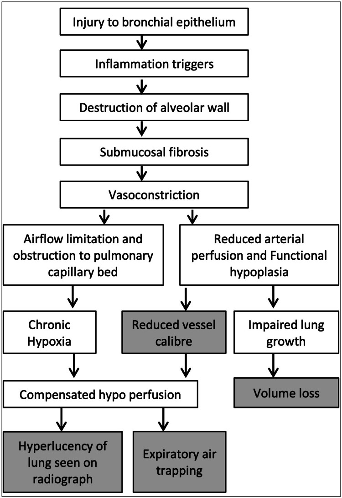
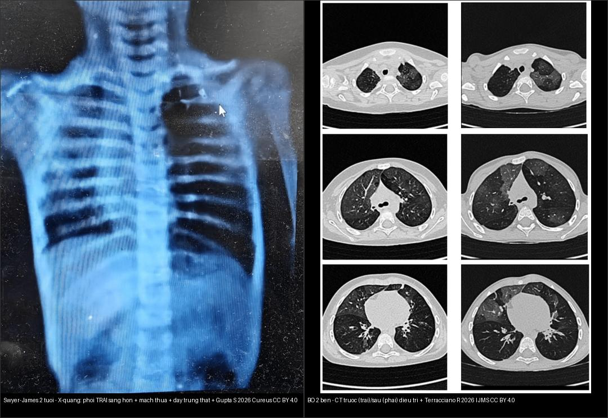
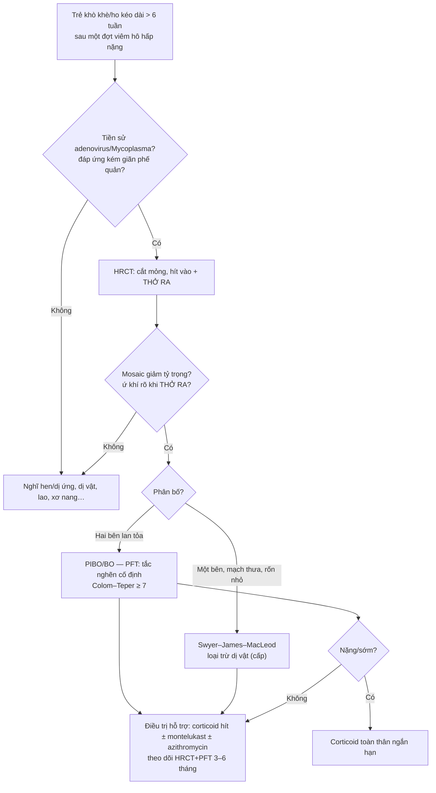
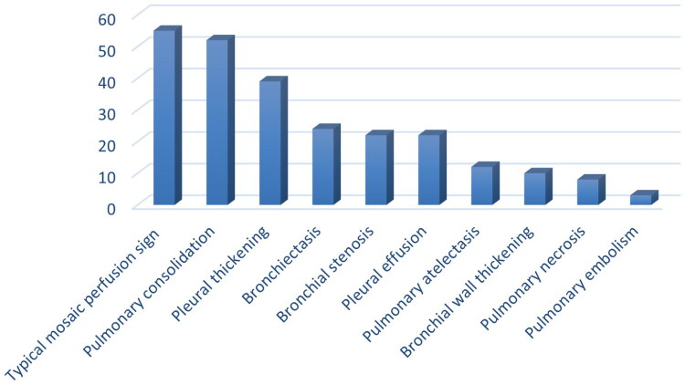
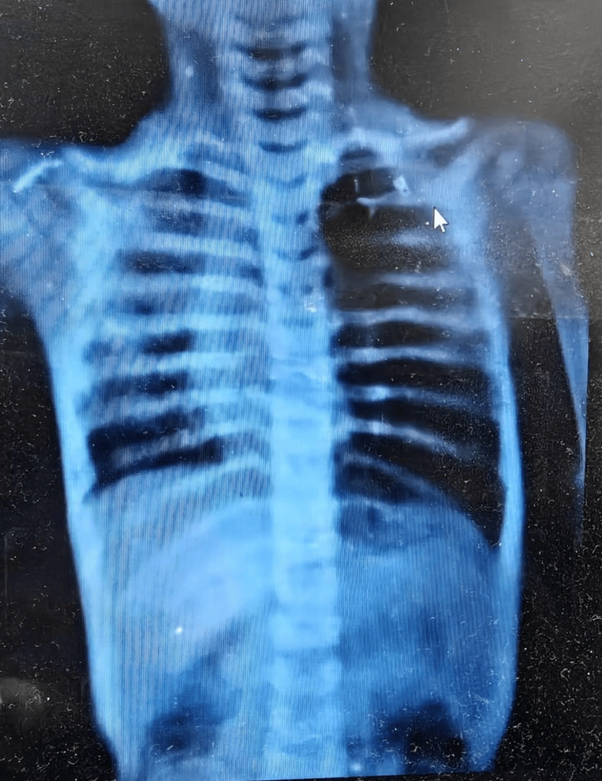
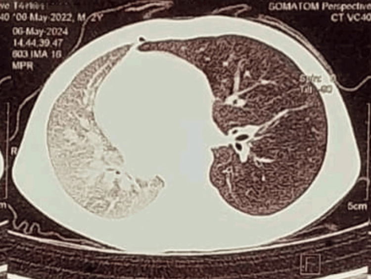
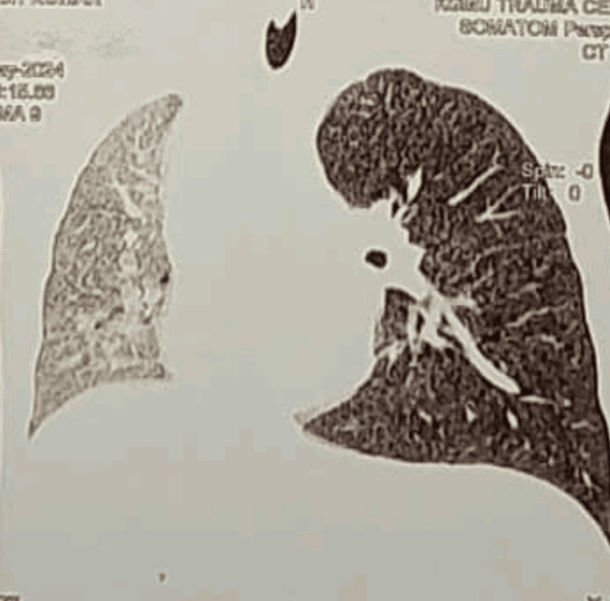
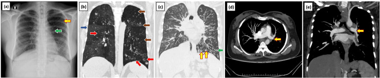
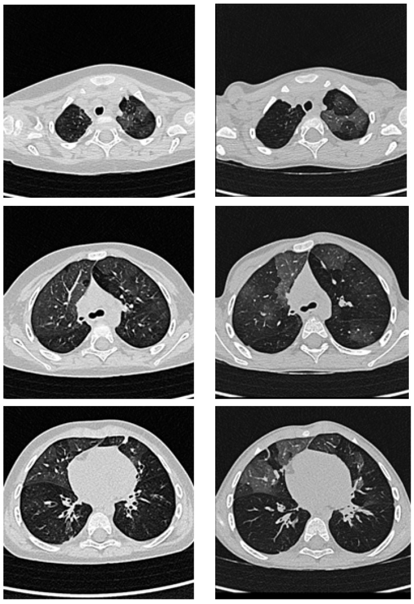

# 614 — Bệnh tiểu phế quản tắc nghẽn (BO) hậu nhiễm trùng & Swyer–James / Post-infectious bronchiolitis obliterans & Swyer–James–MacLeod

**Tags:** `pattern:u-khi` `pattern:viem-tieu-phe-quan` `pattern:phoi-mot-ben-sang` `vung:phoi` `vung:phe-quan` `protocol:HRCT` `protocol:HRCT-thi-tho-ra`
**Mức chắc chắn (certainty):** tổng hợp y văn (literature synthesis) — nhóm tự biên từ các bài tổng quan + case report CC BY 4.0 (Europe PMC); **các ca trong quiz là ca nguyên văn (verbatim case)** chép đúng tuổi – bệnh cảnh – chú thích gốc.

## 1. Tổng quan bệnh học – cơ chế hình ảnh

**Viêm tiểu phế quản tắc nghẽn (bronchiolitis obliterans, BO)** là bệnh tắc nghẽn hô hấp mạn **không hồi phục**: một đợt tổn thương tiểu phế quản (điển hình do nhiễm trùng) → viêm → **xơ hóa dưới niêm mạc (submucosal fibrosis)** → hẹp/bít **một phần hoặc hoàn toàn** lòng tiểu phế quản, kèm **kém đáp ứng với thuốc giãn phế quản** (Wan L, Wang Z — Can Respir J 2025, PMC12259327). Ở trẻ em, thể hay gặp nhất là **BO hậu nhiễm trùng (post-infectious BO, PIBO)**; **Swyer–James–MacLeod (SJMS)** là **thể một bên** của PIBO (Gupta S et al. — Cureus 2026, PMC12988829). Khác nhóm BO **sau ghép** (BOS — bronchiolitis obliterans syndrome sau ghép phổi/tế bào gốc) — cùng cơ chế xơ nhưng khác bối cảnh.

- **Tác nhân (mầm bệnh):** **adenovirus là nguyên nhân hàng đầu**, các type **3, 7, 11, 21 chiếm 20–69% ca PIBO**; kế đến **Mycoplasma pneumoniae** (trẻ lớn hơn, đang tăng ở châu Á); còn **RSV, sởi (measles), cúm, á cúm, HSV, Bordetella pertussis, lao, Chlamydophila, Legionella, SARS-CoV-2** (Wan L, Wang Z 2025).
- **TẠI SAO thấy "mosaic giảm tỷ trọng" (mosaic perfusion/attenuation) trên HRCT:** tiểu phế quản bị xơ/bít **không đều** giữa các tiểu thùy. Vùng phía sau tiểu phế quản bít bị **giữ khí lúc thở ra** (van một chiều) → **co mạch phản xạ do thiếu oxy cục bộ (hypoxic vasoconstriction)** → vùng đó nhận **ít máu hơn** → trên CT **giảm đậm độ (tối hơn)**; xen kẽ là tiểu thùy còn thông khí bình thường (sáng hơn). → **mosaic perfusion** là **dấu hiệu CT mạnh nhất gợi PIBO** ở trẻ có bệnh cảnh điển hình (Wan L, Wang Z 2025). Vì bản chất là **giữ khí thì THỞ RA**, chụp thì thở ra nhìn rõ hơn thì hít vào.
- **TẠI SAO Swyer–James có "phổi một bên sáng hơn":** đợt nhiễm trùng nặng một bên → xơ + tắc tiểu phế quản lan rộng + **co mạch kéo dài → giảm phát triển mạch phổi (hypoplasia mạch máu)** + giữ khí. Kết quả: **tăng độ sáng (hyperlucency) + mạch máu thưa + rốn phổi nhỏ + giảm thể tích nhẹ**, có khi **đẩy trung thất sang bên lành** do căng giãn quá mức. Sơ đồ cơ chế: tổn thương biểu mô → viêm → phá vách phế nang → xơ dưới niêm mạc → co mạch → **hạn chế luồng khí + giảm tưới máu mao mạch → mất thể tích + phổi sáng + ứ khí thì thở ra** (Kumar K et al. — Cureus 2024, PMC11271755).
- **Vì sao KHÔNG dùng MRI:** tổn thương là **bệnh học đường thở nhỏ** (không phải khối/mỡ/máu), không có tín hiệu T1/T2 đặc thù đủ để chốt; **HRCT (đặc biệt thì thở ra) là phương tiện chẩn đoán hình ảnh chính** (Wan L, Wang Z 2025). CT đậm độ chỉ phản ánh **tỷ lệ khí/máu** nên **mosaic giảm đậm độ = giảm tưới máu**, không phải "mờ" thật.

**Ngưỡng định lượng cần nhớ:**
- **Tiêu chuẩn chẩn đoán PIBO** (đồng thuận Trung Quốc 2023, dẫn trong Wan L, Wang Z 2025): (1) tiền sử nhiễm trùng hô hấp dưới nặng; (2) **khò khè/ran ẩm ≥ 6 tuần**, đáp ứng kém giãn phế quản; (3) **FEV₁/FVC < 80% hoặc FEV₁ < 80% dự đoán**, test giãn phế quản **đa số âm tính**; (4) HRCT **mosaic + ứ khí ± dày/giãn phế quản**; (5) loại trừ hen, dị dạng phổi bẩm sinh, lao, viêm tiểu phế quản lan tỏa, xơ nang.
- **Chẩn đoán thường muộn**: từ khởi phát đến lúc chẩn đoán **15,4–87,6 tháng** (Wan L, Wang Z 2025) → **càng trẻ càng dễ bị bỏ sót**.
- **Yếu tố nguy cơ trên một đợt viêm phổi cộng đồng** (Hou J et al. — Ann Med 2025, PMC12576899): **tuổi < 83 tháng** (Se 79,52%/Sp 56,63%) và **nằm viện > 10 ngày** (Se 55,56%/Sp 90,36%); kèm **khó thở, đông đặc phổi, viêm nội phế quản** (AUC riêng 0,70–0,764). Trong nhóm quan sát sau chẩn đoán: **giãn phế quản 24 ca, hẹp phế quản 22 ca, hoại tử phổi 8 ca**, **dày màng phổi 39 ca, dày thành phế quản 10 ca**.
- **Thang dự đoán Colom–Teper ≥ 7 điểm** = nguy cơ PIBO (3 biến: bệnh cảnh điển hình, phơi nhiễm adenovirus, mosaic trên HRCT) (Wan L, Wang Z 2025).
- **Tiên lượng:** **65–80% cải thiện triệu chứng trong 1 năm**; một nghiên cứu 114 trẻ theo dõi 6–110 tháng (trung vị 24 tháng) có **82,5% cải thiện lâm sàng**, một số cải thiện giãn phế quản/xẹp/ứ khí (nhờ phổi còn phát triển).

*Sơ đồ sinh bệnh học Swyer–James: tổn thương biểu mô phế quản → viêm → phá vách phế nang → xơ dưới niêm mạc → co mạch → giới hạn luồng khí + giảm tưới máu mao mạch → **phổi sáng trên phim + ứ khí thì thở ra + mất thể tích**. Nguồn: Kumar K et al., Cureus 2024 (PMC11271755), CC BY 4.0. Giữ nguyên bản.*

## 2. Mẫu hình + chẩn đoán phân biệt theo vị trí (gamut)

**Mẫu hình mở đầu = "mosaic giảm tỷ trọng ± ứ khí thì thở ra".** Gamut theo **phân bố**:

- **Hai bên, lan tỏa (PIBO/BO điển hình):** **mosaic giảm tỷ trọng + ứ khí thì thở ra** ± dày thành phế quản, giãn phế quản, xẹp phân thùy. Nền: sau adenovirus/Mycoplasma nặng; sau ghép phổi/tế bào gốc, GVHD mạn, viêm khớp dạng thấp, sau hít sặc/hơi độc.
- **Một bên (Swyer–James–MacLeod):** **phổi một bên sáng hơn + mạch máu thưa + rốn phổi nhỏ + ứ khí (rõ khi thở ra) + giảm thể tích nhẹ**, đôi khi **đẩy trung thất sang bên lành**. Nền: đợt nhiễm trùng nặng một bên **thời nhỏ** → di chứng muộn.
- **Trung tâm tiểu thùy/nội phổi (cellular bronchiolitis — KHÁC):** nốt **trung tâm tiểu thùy** mờ / **tree-in-bud** (nhiễm trùng, hít sặc) — đây là viêm tiểu phế quản *tế bào*, không phải BO *xơ/tắc nghẽn* (nối bài 613, 011).

**Gamut "PHỔI MỘT BÊN SÁNG HƠN" ở trẻ — gợi nhớ 6 nhóm:** **K**hí phế thũng thùy bẩm sinh (CLE), **S**wyer–James, **D**ị vật đường thở (van một chiều — cấp tính!), **B**ất sản phế quản (bronchial atresia — mucocele + ứ khí), **P**hổi/tim bẩm sinh (thiểu sản mạch phổi, hội chứng Poland), **T**ràn khí màng phổi. Chốt bằng **bệnh cảnh cấp hay mạn**, **tiền sử nhiễm trùng nặng một bên**, và **thì thở ra**.

*Trái: Swyer–James ở bé 2 tuổi — **X-quang: phổi TRÁI sáng hơn + mạch thưa + đẩy trung thất**. Phải: **BO hai bên — CT trước (cột trái) / sau (cột phải) 24 tháng điều trị**, tổn thương mosaic cải thiện một phần. Nguồn: Gupta S et al., Cureus 2026 (PMC12988829) + Terracciano R et al., Int J Mol Sci 2026 (PMC12940845), CC BY 4.0. Ảnh ghép letterbox, giữ tỉ lệ.*

## 3. Bảng so sánh phân biệt (ma trận đối chiếu)

| Thực thể (entity) | Hình ảnh điển hình | Chốt vào (rule-in) | Chốt loại (rule-out) | Gợi ý xác nhận |
|---|---|---|---|---|
| **PIBO/BO hai bên** | **Mosaic giảm tỷ trọng hai bên + ứ khí thì THỞ RA** ± dày thành/giãn phế quản, xẹp phân thùy | **Mosaic + ứ khí thở ra + tiền sử nhiễm trùng nặng (adenovirus/Mycoplasma) + tắc nghẽn cố định > 6 tuần** | Mosaic mà **hết khi thở ra** (đổi đều thì) → nghĩ nguyên nhân mạch máu, không phải BO | **HRCT thì thở ra** + PFT (tắc nghẽn, đáp ứng giãn phế quản âm) |
| **Swyer–James–MacLeod** | **Một bên: sáng hơn + mạch thưa + rốn phổi nhỏ + ứ khí + giảm thể tích**, ± đẩy trung thất | **Một bên + tiền sử viêm hô hấp nặng thời nhỏ + ứ khí thở ra + rốn phổi nhỏ** | Hai bên đối xứng → PIBO; cấp tính + dị vật → dị vật | X-quang + HRCT thở ra + xạ hình thông khí/tưới máu (V/Q) |
| **Khí phế thũng thùy bẩm sinh (CLE)** | Một thùy **căng khí quá mức đè xẹp phổi lành**, mạch máu **thưa nhưng mạch TRONG thùy vẫn còn**, thường **thùy trên trái** | **Sơ sinh/nhũ nhi + một thùy căng + đè thùy lành** | Tiền sử nhiễm trùng nặng một bên + ứ khí lan cả phổi → Swyer–James | CT; thường phải mổ; phân biệt với bất sản phế quản |
| **Dị vật đường thở** | **Một bên tăng sáng + ứ khí (van một chiều)**, thường **phổi phải** (phế quản phải dốc hơn), có khi xẹp/lệch trung thất | **Đột ngột (cấp) + hội chứng xâm nhập + trẻ 6 tháng–3 tuổi** | Tiến triển mạn nhiều năm + tiền sử nhiễm trùng → Swyer–James, KHÔNG nội soi mù | Soi phế quản (chẩn đoán + lấy dị vật); CT nếu nghi |
| **Bất sản phế quản (bronchial atresia)** | **Mucocele (nốt/tổn thương hình nhánh)** + phổi quanh **ứ khí**, thường **thùy trên trái** | **Mucocele + ứ khí quanh, không tiền sử nhiễm trùng** | Mạch máu thưa lan tỏa toàn bên → Swyer–James | CT; thường tình cờ, không mổ |
| **Hen phế quản (asthma)** | Phổi thường **bình thường** hoặc tăng ứ khí nhẹ, **không mosaic khu trú** | **Dao động theo đợt + đáp ứng giãn phế quản DƯƠNG rõ** | Đáp ứng giãn phế quản **âm tính** + mosaic + triệu chứng liên tục → BO | PFT + test giãn phế quản; thử điều trị |

## 4. Protocol chụp + hệ phân độ/điểm chuẩn hóa

- **HRCT ngực là phương tiện chẩn đoán hình ảnh chính**: **cắt mỏng (< 1–1,5 mm), tái tạo đa mặt phẳng, hai thì HÍT VÀO + THỞ RA** (thì thở ra nhạy hơn để lộ ứ khí); **không cần thuốc cản quang** cho mục đích phát hiện tổn thương đường thở nhỏ. Ở trẻ nhỏ **ưu tiên ALARA**: hạn chế số lần CT, cân nhắc **chụp thưa lát (sparse sampling)** và khi trẻ không hợp tác được thì **giảm độ nhạy phải ghi nhận**.
- **PFT (từ 4–6 tuổi):** **tắc nghẽn (FEV₁/FVC < 80%) hoặc hỗn hợp**, **đáp ứng giãn phế quản phần lớn âm tính**; **LCI (lung clearance index) bằng test rửa khí nhiều lần (MBW)** là công cụ bổ trợ nhạy cho **trẻ nhỏ/nhũ nhi**; **FOT/IOS** khả thi ở tuổi mẫu giáo vì không cần động tác thở phức tạp (Wan L, Wang Z 2025).
- **Không cần sinh thiết phổi thường quy**: sinh thiết là "tiêu chuẩn vàng" nhưng xâm lấn, **lấy mẫu có thể bình thường/không chẩn đoán tới ~1/3 ca trẻ** do tổn thương không đều (Wan L, Wang Z 2025).
- **Chẩn đoán là tổng hợp**: bệnh cảnh + tiêu chuẩn Trung Quốc 2023 (mục 1) + **thang Colom–Teper ≥ 7** (dẫn trong Wan L, Wang Z 2025).
- **Theo dõi**: HRCT + PFT **mỗi 3–6 tháng**, giãn dần ra **6–12 tháng** khi bệnh ổn định (guideline BO Trung Quốc); một số guideline khác cắt giảm số lần CT để bảo vệ trẻ (Wan L, Wang Z 2025).
- **Điều trị** (không có thuốc đặc hiệu — "sequel cần hỗ trợ"): **corticoid hít ± montelukast ± azithromycin liều thấp**; corticoid **toàn thân** ở ca nặng/sớm; azithromycin **5 mg/kg/ngày × 3 ngày/tuần, tới 6 tháng** (guideline Trung Quốc 2023), chỉ định khi **bạch cầu trung tính dịch rửa phế quản > 0,15**; giãn phế quản khí dung khi cấp/khởi phát (Wan L, Wang Z 2025).

*Biểu đồ tần suất dấu hiệu CT sau chẩn đoán BO ở trẻ: **mosaic perfusion đứng đầu**, kế đến đông đặc, dày màng phổi, giãn phế quản/hẹp phế quản… Nguồn: Hou J et al., Ann Med 2025 (PMC12576899), CC BY 4.0. Giữ nguyên bản.*

## 5. Biến thể bình thường và cạm bẫy

- **Mosaic KHÔNG phải lúc nào cũng là BO:** **mosaic do mạch máu** (tăng áp phổi, thuyên tắc mạn) cũng tạo vùng giảm đậm độ, nhưng **không đổi/không rõ thêm khi thở ra** (khí không bị giữ). **Chốt: ứ khí thì THỞ RA = đường thở nhỏ; không đổi thì = mạch máu.**
- **Cạm bẫy "phổi sáng một bên do kỹ thuật":** tư thế người bệnh hơi nghiêng, che chắn, hoặc thở ra không đều có thể làm **một bên sáng hơn giả tạo** — đối chiếu phim thẳng với phim chụp bổ sung, **đọc phim trong tư thế chuẩn** trước khi gọi Swyer–James.
- **Cạm bẫy dị vật:** trẻ **ứ khí một bên ĐỘT NGỘT** không phải Swyer–James — **cấp tính + "hội chứng xâm nhập"** → **nội soi phế quản**, không được chẩn đoán "Swyer–James" rồi bỏ qua dị vật.
- **Trẻ nhỏ không hợp tác thở ra** → mất thì thở ra → **giảm độ nhạy**, dễ đọc "âm tính giả"; ghi nhận hạn chế này khi kết luận.
- **Không lạm dụng số lần CT**: cân bằng **giá trị theo dõi** và **ALARA** (liều trẻ em) — ưu tiên PFT/LCI khi có thể.
- **Satisfaction of search:** khi đã thấy mosaic ấn tượng, **vẫn phải tìm** giãn phế quản, xẹp phân thùy, dày thành phế quản và **hạch/khối** kèm theo.

## 6. Tự lượng giá — Blind Quiz

**Ca 1 — Bé trai 2 tuổi, viêm hô hấp dưới tái diễn nhiều đợt. X-quang ngực thẳng dưới đây — mô tả trước khi mở đáp án.**

- Gợi ý lâm sàng (clinical context): nhũ nhi, khò khè/viêm hô hấp tái diễn, không đáp ứng tốt điều trị thường quy.
- Câu hỏi: Hai phổi khác nhau ở điểm nào? Rốn phổi? Đưa 3 chẩn đoán phân biệt — dấu hiệu nào chốt?

<b>Bấm để hiện đáp án (findings + chẩn đoán)</b>

- Dấu hiệu (findings): **phổi TRÁI sáng hơn rõ (hyperlucent) + mạch máu phổi trái thưa** so với phổi phải; phổi phải hơi mờ (kính mờ rải rác). Đây là **phổi một bên sáng + giảm mạch máu**.
- Chẩn đoán (diagnosis): **Swyer–James–MacLeod (di chứng BO hậu nhiễm trùng một bên)** — vì đợt nhiễm trùng nặng một bên gây xơ/tắc tiểu phế quản → **co mạch + giảm phát triển mạch phổi → phổi sáng + mạch thưa** (cơ chế mục 1).
- Đối chiếu CT cùng bé:

- Trên CT: **phổi trái căng giãn quá mức + đẩy/nhường chỗ trung thất sang phải** — phù hợp thể tích phổi trái "một bên" khác thường; ca gốc không kèm giãn phế quản → **thể sớm** (Gupta S et al. 2026).

- Phân biệt (DDx): khí phế thũng thùy bẩm sinh (chỉ một thùy, sơ sinh), dị vật (cấp, "hội chứng xâm nhập"), bất sản phế quản (mucocele).
- Nguồn ảnh: Gupta S, Gupta H, Singh S., *Cureus* 2026 (PMC12988829), CC BY 4.0.

**Ca 2 — Nữ 39 tuổi, tiền sử viêm hô hấp tái diễn thời nhỏ, khó thở khi gắng sức. Xem bộ ảnh X-quang + CT:**

- Câu hỏi: Rốn phổi hai bên khác nhau không? Có giãn phế quản không? Giải thích tại sao phổi sáng hơn.

<b>Bấm để hiện đáp án (findings + chẩn đoán)</b>

- Dấu hiệu (findings): (a) X-quang — **phổi trái sáng hơn + rốn phổi trái NHỎ + mạch máu thưa**; (b)(c) CT vành — **giảm thể tích + ứ khí phổi trái**; (d)(e) CT trục + MIP — **động mạch phổi trái nhỏ, mạch thưa**.
- Chẩn đoán (diagnosis): **Swyer–James–MacLeod syndrome** — bộ ba: **ứ khí + giảm tưới máu (mạch thưa) + tăng sáng một bên**; nguyên nhân là **di chứng viêm tiểu phế quản tắc nghẽn sau nhiễm trùng thời nhỏ**.
- Chốt (clincher): **một bên sáng + rốn phổi nhỏ/mạch thưa + tiền sử nhiễm trùng nặng thời nhỏ** → khác CLE (một thùy, sơ sinh) và dị vật (cấp).
- Nguồn ảnh: Kumar K et al., *Cureus* 2024 (PMC11271755), CC BY 4.0.

**Ca 3 — Bé có BO hậu nhiễm trùng, chụp CT lúc chẩn đoán và sau 24 tháng điều trị hỗ trợ:**

- Câu hỏi: Tổn thương ở 3 mức giải phẫu có thay đổi không? Điều này nói gì về tiên lượng?

<b>Bấm để hiện đáp án (findings + chẩn đoán)</b>

- Dấu hiệu (findings): cột **trái** = CT lúc chẩn đoán (mosaic/ứ khí + tổn thương quanh phế quản); cột **phải** = cùng mức giải phẫu sau 24 tháng — **cải thiện một phần** (không hết hoàn toàn).
- Chẩn đoán (diagnosis): **BO hậu nhiễm trùng ở trẻ** — tổn thương **xơ/tắc nghẽn cố định** nhưng có thể **cải thiện một phần theo thời gian** nhờ phổi còn phát triển; phù hợp dữ liệu **65–80% cải thiện triệu chứng trong 1 năm** và **82,5% cải thiện lâm sàng** (Wan L, Wang Z 2025).
- Phản biện (critique): cải thiện hình ảnh **không đồng nghĩa khỏi bệnh** — vẫn cần theo dõi HRCT + PFT định kỳ và kiểm soát đợt cấp.
- Nguồn ảnh: Terracciano R et al., *Int J Mol Sci* 2026 (PMC12940845), CC BY 4.0.

**Ca 4 — Ca nữ 53 tuổi, sốt + ho có đờm, X-quang phổi trái sáng hơn kèm giảm thể tích. Dùng ảnh ghép đối chiếu để chốt hướng.**

- Câu hỏi: Nhìn 2 khung — "hai bên" vs "một bên" gợi ý gì? Vì sao phải phân biệt cấp hay mạn?

<b>Bấm để hiện đáp án (findings + chẩn đoán)</b>

- Dấu hiệu (findings): khung trái = **một bên sáng + mạch thưa** (mẫu Swyer–James); khung phải = **mosaic hai bên, trước–sau điều trị** (mẫu BO/PIBO).
- Chẩn đoán (diagnosis): **phổi một bên sáng mạn + tiền sử nhiễm trùng → Swyer–James**; **mosaic hai bên + ứ khí thở ra → PIBO/BO**.
- Chốt (clincher): **thời gian** là chìa khóa — **cấp tính** (ứ khí một bên đột ngột) → nghĩ **dị vật** (nội soi!); **mạn** + tiền sử nhiễm trùng nặng thời nhỏ → di chứng BO/Swyer–James.
- Nguồn ảnh: ghép từ Gupta S et al., *Cureus* 2026 (PMC12988829) + Terracciano R et al., *Int J Mol Sci* 2026 (PMC12940845), CC BY 4.0.

## Bài liên quan chéo
- [613 – Viêm tiểu phế quản ở nhũ nhi (RSV)](../613-viem-tieu-phe-quan-nhi/lesson.md) (chặng cấp — BO là chặng mạn)
- [610 – Suy hô hấp sơ sinh & dị dạng phổi bẩm sinh](../610-suy-ho-hap-so-sinh-va-di-dang-phoi/lesson.md) (CLE, CPAM — DDx phổi một bên sáng)
- [616 – Biến chứng viêm phổi nhi: empyema & hoại tử phổi](../616-bien-chung-viem-phoi-nhi-empyema-hoai-tu/lesson.md) (biến chứng đợt cấp)
- [615 – Viêm phổi nhi: round pneumonia, virus vs vi khuẩn & hít sặc dầu hỏa](../615-viem-phoi-nhi-round-pneumonia/lesson.md)
- [050 – Giãn phế quản & kén khí](../050-gian-phe-quan-ken-khi/lesson.md) (giãn phế quản — di chứng muộn)
- [600 – Tổng quan Hệ Nhi khoa](../600-tong-quan-nhi-khoa/lesson.md)

## Ảnh
- Tất cả ảnh **CC BY 4.0**, tải về + attribution từng ảnh trong `images/CREDITS.md`. Tên file `614_slug_Modality_Source.jpg`.
- Không tải được (Radiopaedia — dẫn link) ghi trong `sources.md`.

> Không dùng để chẩn đoán độc lập khi chưa có người hướng dẫn.
