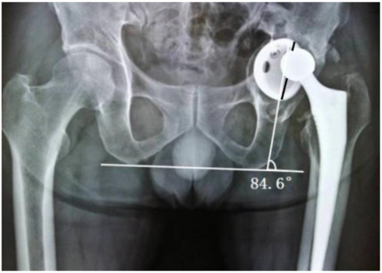
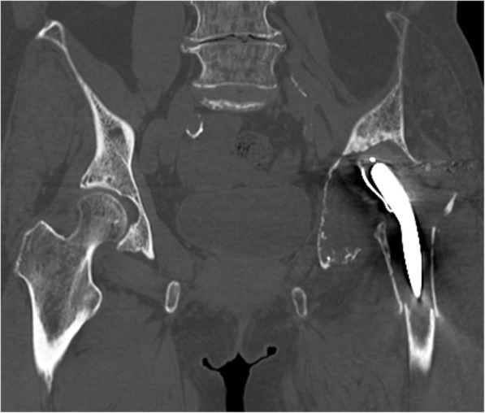
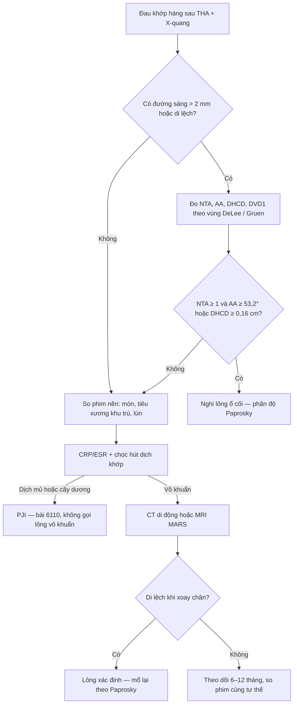
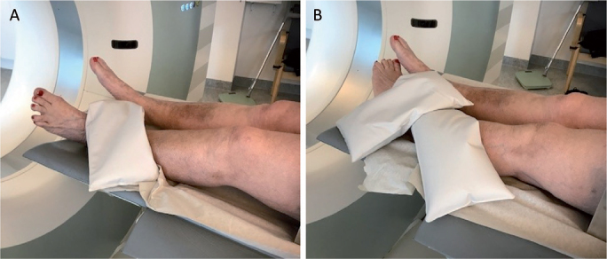
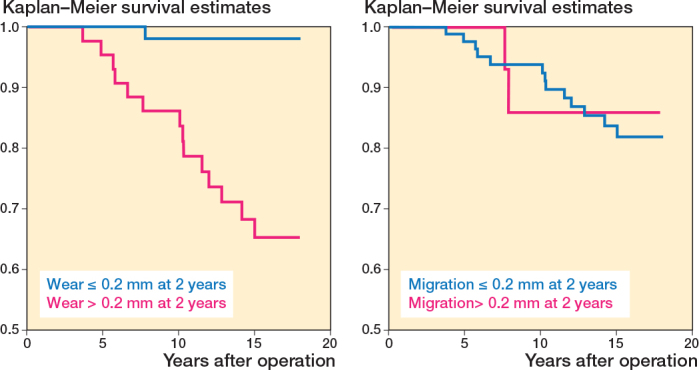
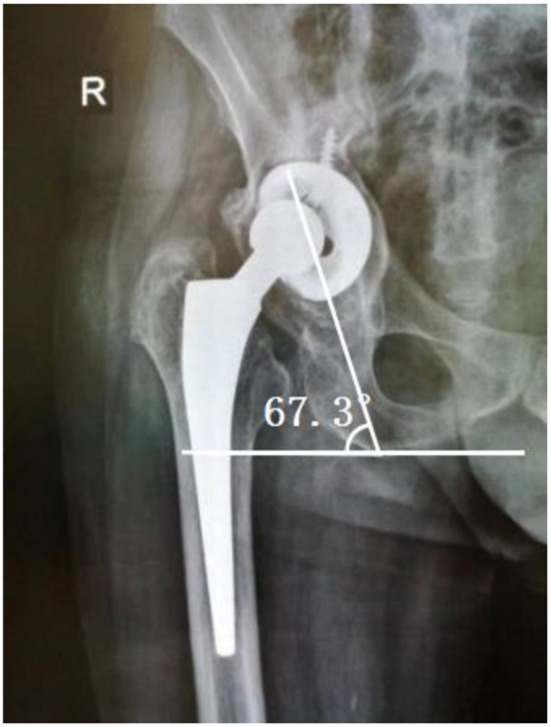
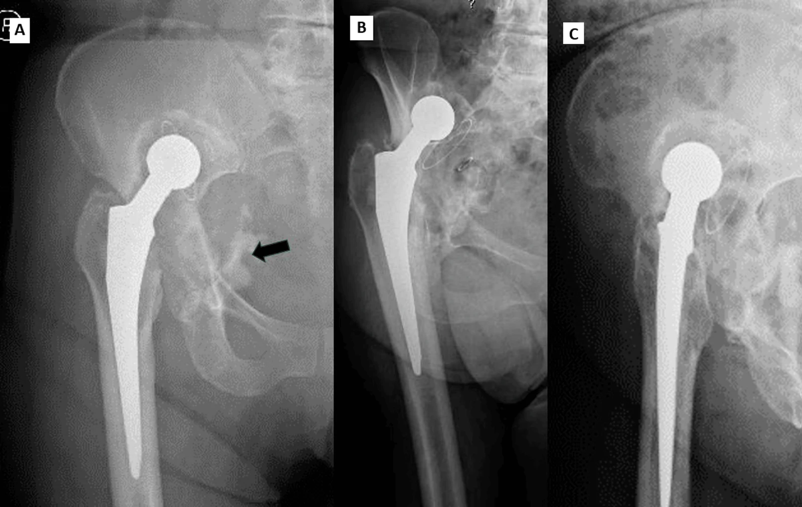

# 6140 — Lỏng vô khuẩn quanh khớp háng nhân tạo ở người trẻ: đường sáng, tiêu xương & chọn mổ lại / Aseptic loosening after total hip arthroplasty

**Tags:** `pattern:long-khop` `pattern:tieu-xuong-quanh-implant` `pattern:duong-sang-quanh-implant` `pattern:di-lech-implant` `pattern:khuyet-xuong-o-coi` `vung:khop-hang` `vung:co-xuong` `score:Paprosky` `score:DeLee-Charnley` `score:Gruen` `protocol:X-quang-khop-hang` `protocol:CT-khop-hang` `protocol:CT-di-dong` `protocol:MRI-MARS` `incidentaloma:khong`
**Mức chắc chắn (certainty):** tổng hợp y văn (literature synthesis) — ghép tổng quan hệ thống yếu tố nguy cơ (Li GQ, Zhang J, Huang Y. World J Orthop 2026;17:114482, PMC12836167), nghiên cứu hình ảnh ổ cối (He A, Zhang Y, Lu C, Cao L, Liu J, Zhong Z. BMC Musculoskelet Disord 2025;26, PMC12013175), RCT RSA 18 năm (Johannessen HG et al., Acta Orthop 2025;96:618–624, PMC12357177), tổng quan người trẻ HXLPE (Deans CF, Buckner BC, Garvin KL. J Clin Med 2023;12:6615, PMC10607435), CT di động (Sandberg O et al., Acta Orthop 2022;93:5240, PMC9620441), đoàn hệ chuôi CFP (Ma Y et al., Orthop Surg 2025;17, PMC12318678), tổng quan mổ lại ổ cối (García-Rey E, Lustig S, Karachalios T, Zagra L. EFORT Open Rev 2026;11, PMC13677250), ca mất xương nặng 17 năm (Caiano P et al., Cureus 2026;18:e115454, PMC13623341) và ca tiêu xương 45 năm (Ishikura H et al., BMC Musculoskelet Disord 2021;22, PMC8152131).

> **Điểm chốt của bài:** "lỏng vô khuẩn" là **chẩn đoán hình ảnh + thời gian**, không phải một con số trên một phim. Chốt cứng: **đường sáng > 2 mm lan rộng dần**, **di lệch/lún implant**, **khuyết xương tiến triển** — nhưng **X-quang chỉ nhạy 59%**, nên khi nghi mà phim chưa rõ thì **CT di động (Se 77%/Sp 100%)** hoặc **so phim nền** mới là bước tiếp theo. Trước khi gọi "vô khuẩn", **phải loại PJI** (bài 6110) — vì **điều trị ngược nhau**.

## 1. Tổng quan — vì sao implant "lỏng" và vì sao hình ảnh trông như vậy

- **Định nghĩa:** lỏng vô khuẩn (aseptic loosening) = **mất vững cơ học của implant mà không có nhiễm trùng**, biểu hiện bằng **đường sáng quanh implant tiến triển**, **di lệch**, và **tiêu xương quanh khớp (periprosthetic osteolysis)**. Đây là **nguyên nhân mổ lại muộn hàng đầu** của thay khớp háng nguyên phát (PMC12836167).
- **Số liệu nền phải nhớ:**
  - Gộp **20 nghiên cứu / 520.789 ca**: tỉ lệ lỏng vô khuẩn **1,96%** (PMC12836167).
  - Yếu tố nguy cơ (OR): **BMI cao hơn = 1,116**; **chỉ số Charlson cao hơn = 1,378**; **yếu tố liên quan implant = 1,497**; **lối sống bất lợi (hút thuốc/rượu) = 2,198**; **nam = 1,232**; bảo vệ: **nhóm không da trắng 0,445**, **yếu tố di truyền thuận lợi 0,723** (PMC12836167).
  - **Người trẻ là nhóm "sống đủ lâu để thấy hỏng"**: polyethylene quy ước (CPE) cho **sống 10 năm thấp tới 83%** và **tiêu xương tới 56%**; polyethylene liên kết chéo cao (HXLPE) gộp 5–15 năm còn **tiêu xương 4,1–6,6%**, **mổ lại vì mòn 0–5,2%**, và ở người **< 50–55 tuổi** nhiều loạt báo **0% mổ lại vì mòn/tiêu xương tới 12 năm** (PMC10607435).
  - **Mòn quyết định hơn di lệch sớm:** trong RCT 150 THA có RSA 10 năm, **mòn PE > 0,2 mm ở 2 năm → HR 19,4 (2,55–147)** cho lỏng về sau, trong khi **di lệch > 0,2 mm → HR 0,88 (0,20–3,89)**; AUC **0,85 vs 0,56**. Sống 18 năm không lỏng: **CPE 65% (48–77) vs XLPE 96% (85–99)** — **nguy cơ gấp 9 lần** (PMC12357177).
- **TẠI SAO đường sáng lại "đen" trên X-quang:** implant kim loại chắn toàn bộ tia; **xương (hydroxyapatit, 200–1.000 HU)** chắn mạnh; còn **màng xơ/granulation tissue (0–60 HU)** và **dịch (0–20 HU)** gần như không chắn → hiện thành **dải sáng**. Vì X-quang là **ảnh chiếu 2D**, màng mỏng chỉ thấy khi **tiếp tuyến** với tia, nên **ngưỡng thực dụng là 2 mm** — dưới ngưỡng này không loại trừ được gì.
- **TẠI SAO tiêu xương tiến triển:** hạt mòn polyethylene (**cỡ 0,1–1 µm**) bị đại thực bào nuốt → giải phóng **TNF-α, IL-1β, IL-6 và RANKL** → biệt hóa hủy cốt bào → **tiêu xương quanh implant**. Hạt và dịch đi theo **"khoảng khớp hiệu dụng" (effective joint space)** — mọi chỗ **xương–implant không áp sát tuyệt đối** đều là đường dẫn, kể cả **lỗ vít ổ cối, đầu chuôi, mấu chuyển**; vì vậy tiêu xương có thể xuất hiện **xa khớp** và **không đối xứng**. **Áp lực dịch** trong khoang kín còn gây **hoại tử xương do chèn ép** → lỗ tiêu xương **lanh (ballooning)**.
- **TẠI SAO ngưỡng mòn lại có ý nghĩa:** mòn **< 0,1 mm/năm** gần như **không gây tiêu xương**; **> 0,2 mm trong 2 năm đầu** là dấu hiệu **"implant sẽ lỏng"** — đây là cơ sở của **RSA (radiostereometric analysis)**, phương pháp đo di lệch/mòn chính xác **0,1–0,2 mm**.
- **TẠI SAO CT hơn X-quang ở một số điểm:** CT **cắt lớp** nên **không bị chồng lấp** — đo được **bề dày màng, thể tích khuyết xương, thành ổ cối còn bao nhiêu mm, di lệch tâm xoay**; nhưng **kim loại gây beam hardening/photon starvation** → phải dùng **kernel giảm nhiễu kim loại (MAR)** và **cửa sổ xương**.
- **TẠI SAO CT di động (inducible displacement CT):** lỏng là **vấn đề cơ học**, nên **xoay chân vào–ra rồi chụp 2 lần** sẽ làm implant **di lệch** nếu nó đã mất vững. Trong 57 ca nghi lỏng: **X-quang Se 59% / Sp 85%** so với **CT di động Se 77% / Sp 100%** (PMC9620441).
- **TẠI SAO MRI cần MARS:** kim loại gây **bất đồng cảm từ** → mất tín hiệu quanh implant; **MARS/SEMAC/VAT** cho thấy **phù tủy tại mặt phân cách, dịch khớp, ngấm màng hoạt dịch** — hữu ích khi **phân biệt với PJI** (Se 78,3%/Sp 81,8% cho PJI, bài 6110).

## 2. Mẫu hình + chẩn đoán phân biệt theo vị trí và thời điểm (gamut)

- **Theo thời điểm — quyết định cách đọc phim:**
  - **< 2 năm (lỏng sớm):** **micromotion/fixation kém** (chuôi chưa liền xương), **lún chuôi sớm**, **gãy xương quanh implant**, **nhiễm cấp**. Đường sáng **mới xuất hiện** quanh **toàn bộ chuôi** hoặc **quanh vít ổ cối**.
  - **2–10 năm (lỏng do mòn):** **mòn PE → viêm hạt → tiêu xương → lỏng**. Đường sáng thường **bắt đầu ở vùng trên–ngoài ổ cối (DeLee I)** hoặc **Gruen 1/7**, kèm **nang tiêu xương**.
  - **> 10 năm (lỏng muộn):** mòn tích lũy, **gãy chuôi/cổ chuôi**, **ARMD** ở THA metal-on-metal, **mất xương nặng (Paprosky III)**.
- **Theo vị trí — bản đồ đọc:**
  - **Ổ cối: DeLee–Charnley I–III** (chia ổ cối thành 3 phần bằng nhau từ **ngoài vào trong**). Đường sáng **liên tục cả 3 vùng** hoặc **> 2 mm** = nghi lỏng; **vùng III đơn độc** thường do **khoang chậu (psoas) hoặc vít**.
  - **Chuôi: Gruen 1–7** (1 mấu chuyển lớn, 2–3 mặt bên, 4 mũi chuôi, 5–6 mặt trong, 7 mấu chuyển nhỏ). **Lún > 2 mm** hoặc **đường sáng > 2 mm ở ≥ 3 vùng** = nghi lỏng.
- **Bốn cơ chế gây tiêu xương quanh implant — nhớ "WIMP":**
  - **W — Wear (mòn):** mòn đầu–liner → **lệch chỏm khỏi tâm liner (head–cup distance bất đối xứng)**; là **cơ chế số 1 ở người trẻ**.
  - **I — Infection (nhiễm):** màng sinh học, **dịch đục/khí**, **phù mô lan** — điều trị ngược hoàn toàn (bài 6110).
  - **M — Mechanical (cơ học):** **micromotion, mất vững xoay, gãy vít/chuôi** → di lệch khi chịu tải.
  - **P — Pressure/particle (áp lực hạt):** **hiệu ứng khoảng khớp hiệu dụng** → nang tiêu xương **lanh**, có thể **xa khớp**.
- **Mẫu hình A — đường sáng quanh ổ cối:** lỏng ổ cối vs **PJI** vs **màng xơ ổn định**. Chốt: **> 2 mm + lan ≥ 2 vùng + tiến triển**, **góc nghiêng ổ cối (AA) tăng**, **chỏm lệch tâm (DHCD)**.
- **Mẫu hình B — khuyết xương khu trú "bóng bay":** **bệnh hạt (particle disease)** vs **nang xương lành** vs **PJI**. Chốt: bờ **rõ, nhiều ổ, không phù mô, không dịch**, bệnh nhân **không sốt**.
- **Mẫu hình C — di lệch/lún implant:** lỏng cơ học vs **gãy xương quanh implant** vs **trật khớp**. Chốt: **so phim nền**, **CT di động**, **khoảng trống dưới mũi chuôi tăng**.
- **Mẫu hình D — đau + phim "sạch":** **lỏng ẩn** vs **PJI ẩn** vs **đau quy chiếu cột sống** vs **bệnh gân cơ mông**. Chốt: **CRP/ESR + chọc hút**, **CT di động**, **MRI MARS**.

## 3. Bảng so sánh phân biệt (ma trận đối chiếu)

| Thực thể (entity) | Hình ảnh điển hình (X-quang/CT/MRI) | Chốt vào (rule-in) | Chốt loại (rule-out) | Gợi ý xác nhận |
|---|---|---|---|---|
| **Lỏng vô khuẩn ổ cối** | Đường sáng **> 2 mm** ở DeLee I–III, **lan dần**; **AA tăng**; **DHCD ≥ 0,16 cm**; chỏm lệch tâm | **NTA ≥ 1 vùng rộng + (AA ≥ 53,2° hoặc DHCD ≥ 0,16 cm)**; **di lệch khi CT di động** | Đường sáng **< 2 mm, không tiến triển**, CRP/ESR bình thường, dịch vô khuẩn | So phim nền; CT di động; chọc hút loại PJI |
| **Lỏng vô khuẩn chuôi** | Đường sáng **Gruen ≥ 3 vùng**, **lún ≥ 2 mm**, **bệ xương dưới mũi chuôi**, **gãy cement** | **Lún tiến triển + đường sáng lan + đau cơ học** | Đường sáng **ổn định < 2 mm** nhiều năm, không lún | So phim 2 lần cách ≥ 6 tháng; CT |
| **PJI (bài 6110)** | Đường sáng **có thể giống hệt**; CT: **khí, tụ dịch có vỏ**; MRI MARS: **dịch + phù mô + ngấm màng hoạt dịch lan ngoài bao** | **Đường rò**, **2 cấy cùng loài**, **khí trong khớp**, **dịch mủ** | Không dịch, không phù, CRP/ESR thấp | Chọc hút: WBC/PMN, alpha-defensin, cấy |
| **Bệnh hạt / tiêu xương (particle disease)** | **Khuyết xương bờ rõ, nhiều ổ, lanh**, quanh implant; **không phù mô, không dịch** | **Tiền sử implant lâu năm + mòn PE + khuyết xương không đau** | Phù mô/dịch/khí → PJI; di lệch → lỏng cơ học | CT thể tích khuyết xương; so phim |
| **ARMD / giả u (MoM)** | **Khối quanh khớp**, **mảnh kim loại**, có thể **chèn ép mạch chậu**; không khí | **MoM + khối + kim loại trong mô + cobalt/chromium cao** | Dịch mủ/khí/đường rò → PJI | MRI MARS, siêu âm, ion kim loại |
| **Che khuất ứng lực (stress shielding)** | **Loãng xương vùng mấu chuyển** (Gruen 1/7), **vỏ mỏng** nhưng **không đường sáng**, **không đau** | **Chuôi cứng (CoCr) + loãng xương vùng lực truyền**, ổn định theo thời gian | Đường sáng tiến triển + đau + lún → lỏng | So phim; DXA nếu cần |
| **Màng xơ ổn định (fibrous membrane)** | Đường sáng **mỏng < 2 mm, đều, không tiến triển** | **Ổn định ≥ 2 năm, không đau, không di lệch** | **> 2 mm hoặc lan rộng dần** → lỏng | Theo dõi 6–12 tháng |
| **Gãy xương quanh implant** | Đường gãy **qua mấu chuyển/chuôi**, di lệch; **không dịch** | **Đau đột ngột + đường gãy rõ** | Dịch/khí/sốt → PJI; không đường gãy → lỏng đơn thuần | X-quang 2 bình diện; CT nếu kín |

*Trái: THA trái 6 năm, đau 8 tháng — **AA 84,6°**, đường sáng rộng (TA) ở **cả 3 vùng DeLee**, **DHCD > 0,16 cm** (chỏm lệch tâm). Đây là bộ ba **góc nghiêng – đường sáng – lệch chỏm** của lỏng ổ cối. Nguồn: He A, Zhang Y, Lu C, Cao L, Liu J, Zhong Z. BMC Musculoskelet Disord 2025 (PMC12013175, Fig. 7), CC BY-NC-ND 4.0 — nguyên bản, không cắt/ghép.*

### Ba dấu hiệu phải đọc thành tiếng
- **Đường sáng > 2 mm:** "possible loosening" theo tiêu chuẩn đang dùng; **85,4% (35/41) ca lỏng** có **ít nhất một vùng rộng ≥ 2 mm**, so với **4,9% (3/61)** nhóm chứng (PMC12013175).
- **Tiến triển:** "highly possible" — phải **so với phim nền**, đây là lý do **mất phim nền làm chẩn đoán khó đi hẳn**.
- **Di lệch/gãy:** "definite loosening" — không cần chờ thêm.

## 4. Protocol chụp + hệ phân độ/điểm chuẩn hóa

- **X-quang là bước 1, nhưng phải đúng kỹ thuật:** **AP khung chậu + AP và nghiêng khớp háng**, **chụp đứng chịu lực** khi đo di lệch (phim nằm **đánh giá thấp** lún/di lệch), **cùng tư thế xoay** với phim nền, ghi **hệ số phóng đại**. Đo: **AA** (góc nghiêng ổ cối, bình thường ~40–45°), **NTA** (số vùng DeLee có đường sáng ≥ 2 mm), **DHCD** (chênh khoảng cách chỏm–mép ổ cối trên/dưới), **DVD1/DVD2/DHD** (di lệch tâm xoay theo chiều dọc/ngang so bên đối diện).
- **Ngưỡng chẩn đoán từ nghiên cứu 41 ca lỏng / 61 ca chứng** (PMC12013175):
  - **DVD1 ≥ 1,49 cm**; **DHCD ≥ 0,16 cm**; **AA ≥ 53,2°**; **NTA ≥ 1**.
  - **Tiêu chuẩn phối hợp:** **NTA ≥ 1** *và* (**AA ≥ 53,2°** *hoặc* **DHCD ≥ 0,16 cm**).
- **CT:** lát mỏng **≤ 1 mm**, **kernel giảm kim loại**, cửa sổ xương; đo **bề dày màng (mm)**, **thể tích khuyết xương**, **thành ổ cối còn lại**, **di lệch tâm xoay**. **CT di động:** chụp 2 lần với **xoay chân trong/ngoài tối đa**, chồng ảnh theo **xương chậu tham chiếu** → thấy implant "nhúc nhích"; **Se 77% / Sp 100%** (PMC9620441).
- **MRI MARS:** khi cần **phân biệt PJI**, đánh giá **phù tủy/mô, dịch, ngấm màng hoạt dịch** (bài 6110). **Xạ hình 3 pha:** dương tính ở **cả lỏng và nhiễm** → **không đủ phân biệt**, chỉ dùng khi các bước trên không kết luận.

*CT coronal ở một ca tiêu xương 45 năm sau đặt chỏm acrylic: **thành trong ổ cối mỏng như giấy**, **tâm xoay di lệch lên trên**, kèm **gãy xương quanh implant**. Giá trị của CT không phải "thấy đường sáng" mà là **đo được còn bao nhiêu xương** để chọn kỹ thuật mổ lại. Nguồn: Ishikura H, Nakamura M, Matsuda K, Tanaka T, Kawano H, Tanaka S. BMC Musculoskelet Disord 2021;22 (PMC8152131, Fig. 3), CC BY 4.0.*
- **Phân độ mất xương ổ cối Paprosky (quyết định kỹ thuật mổ lại):**
  - **I:** ổ cối còn **hình bán cầu**, **teardrop – Kohler – ụ ngồi nguyên vẹn**, không di lệch.
  - **II:** bán cầu **biến dạng nhưng trụ đỡ còn**; **IIA** di lệch **< 2 cm** lên trên; **IIB** di lệch **> 2 cm** kèm **dịch chuyển ra ngoài**; **IIC** di lệch **vào trong** (teardrop bị phá).
  - **IIIA:** di lệch **> 3 cm** lên trên, **đường Kohler gián đoạn**, **teardrop còn**; **IIIB:** **teardrop mất**, **tiêu ụ ngồi**, có thể **mất liên tục khung chậu (pelvic discontinuity)**.
  - Kết quả tham chiếu: **37 khớp Paprosky III** dùng vòng gia cố + ghép xương: sống 10 năm **95,3%** (không lỏng vô khuẩn) nhưng **76,5%** (không lỏng trên X-quang) — tức **hình ảnh "lỏng" đi trước thất bại lâm sàng** (PMC13677250).
- **Chọn mổ lại theo mất xương:** **ổ cối**: cup mới ± **augment** (IIA–IIB) → **vòng gia cố + ghép xương ép** (IIB–IIIA) → **cup–cage/tantalum + ghép xương khối** (IIIB) → **cấy ghép in 3D** khi mất liên tục. **Chuôi**: **thay liner đơn thuần** nếu chuôi vững; **chuôi xốp toàn phần** hoặc **chuôi rãnh (Wagner)** khi mất xương thân chuôi.

*Nguyên lý **CT di động**: (A) xoay chân ra ngoài tối đa, (B) xoay vào trong tối đa, mỗi tư thế chụp một lần; phần mềm chồng ảnh theo xương chậu → **implant vững sẽ đứng yên, implant lỏng sẽ di lệch**. Nguồn: Sandberg O, Carlsson S, Harbom E, Cappelen V, Tholén S, Olivecrona H, Wretenberg P. Acta Orthop 2022;93 (PMC9620441, Fig. 2), CC BY-NC 4.0.*

*Kaplan–Meier 18 năm: **mòn > 0,2 mm ở 2 năm** tách rõ hai đường (HR 19,4), còn **di lệch > 0,2 mm** gần như trùng nhau (HR 0,88) — bằng chứng cho việc **theo dõi mòn** chứ không chỉ nhìn di lệch. Nguồn: Johannessen HG et al., Acta Orthop 2025;96 (PMC12357177, Fig. 6), CC BY 4.0.*

## 5. Biến thể bình thường và cạm bẫy

- **Đường sáng < 2 mm, đều, không đổi sau 2 năm** ở mặt tiếp giáp **cement–xương** là **bình thường**; chỉ gọi lỏng khi **> 2 mm**, **lan rộng**, hoặc **có di lệch**. Đừng "overcall" một dải sáng mảnh ở vùng I.
- **Phim nằm vs phim đứng:** cùng một khớp có thể **khác 2–3 mm** về vị trí tâm xoay; **xoay chân khác nhau làm AA lệch vài độ**. Luôn so **cùng tư thế, cùng hệ số phóng đại**.
- **X-quang bình thường KHÔNG loại trừ lỏng** — Se chỉ **59%** (PMC9620441); bệnh nhân **đau + phim sạch** vẫn phải đi tiếp bằng **CT di động/MRI** và **loại PJI**.
- **Nhiễu kim loại trên CT** tạo **vùng tối giả quanh chuôi** giống tiêu xương — dùng **MAR** và đối chiếu cửa sổ xương; đừng đo khuyết xương trên ảnh nhiễu.
- **Khí trong ruột/mô mềm** chồng lên ổ cối trên phim thẳng giả **"khuyết xương"**; xem thêm bình diện nghiêng/CT.
- **Bệnh hạt có thể "im lặng" rất lâu:** khuyết xương lớn nhưng **không đau, không di lệch** — không mổ chỉ vì "có nang"; mổ khi **tiến triển, đau, nguy cơ gãy, hoặc mất xương đe dọa khả năng mổ lại**.
- **Đừng nhầm "mất liên tục khung chậu" với đường gãy cũ/di lệch do tư thế:** tiêu chuẩn là **đường gãy ngang nhìn thấy + bờ dưới khung chậu di lệch vào trong + bất đối xứng vòng bịt** (PMC13677250); chẩn đoán quá tay dẫn tới mổ lớn không cần thiết.
- **Vôi hóa quanh khớp (bài 6141)** có thể **che mất đường sáng** hoặc **giả khuyết xương**; và **HO sau mổ** lại **tăng gấp 2,2 lần** ở người có PJI.

## 6. Tự lượng giá — Blind Quiz

**Ca 1 — Nam 62 tuổi, THA trái 6 năm, đau háng tăng dần 8 tháng, không sốt.**

- Câu hỏi: Có mấy vùng DeLee có đường sáng rộng? Góc nghiêng ổ cối bao nhiêu? Chỏm có nằm đúng tâm liner không? Ba chẩn đoán phân biệt và bước tiếp theo?

<b>Bấm để hiện đáp án (findings + chẩn đoán)</b>

- **Findings:** **AA 84,6°** (bình thường ~40–45°), **đường sáng ≥ 2 mm ở cả 3 vùng DeLee**, **DHCD > 0,16 cm** (chỏm lệch lên trên) → bộ ba của **lỏng ổ cối**.
- **Chẩn đoán:** **lỏng vô khuẩn ổ cối** — cơ chế **mòn + micromotion**; AA quá lớn làm tăng lực cắt lên mặt tiếp giáp.
- **Phân biệt:** **PJI** (phải loại bằng CRP/ESR + chọc hút), **bệnh hạt đơn thuần**, **màng xơ ổn định** (loại vì có tiến triển + di lệch).
- **Bước tiếp:** chọc hút loại PJI → **CT/MARS MRI đánh giá mất xương** → phân độ **Paprosky** → mổ lại.
- Nguồn ảnh: He A et al., BMC Musculoskelet Disord 2025 (PMC12013175, Fig. 7), CC BY-NC-ND 4.0.

**Ca 2 — Nữ 72 tuổi, THA phải 16 năm, đau 9 ngày sau khi bị ngã nhẹ.**

- Câu hỏi: Đường sáng nằm ở đâu? Góc nghiêng bao nhiêu? Có bằng chứng gãy xương quanh implant không? Cần chụp gì thêm?

<b>Bấm để hiện đáp án</b>

- **Findings:** **AA 67,3°**, **đường sáng rộng ở các vùng DeLee**, không thấy đường gãy rõ trên phim này.
- **Chẩn đoán:** **lỏng ổ cối** (tiến triển) — cơn đau **sau ngã nhẹ** ở implant lâu năm là **cờ đỏ** cho cả **gãy kín** và **lỏng mất bù**.
- **Bước tiếp:** **CT** tìm **gãy xương quanh implant/khuyết xương**, **chọc hút loại PJI**, so phim cũ.
- Nguồn ảnh: He A et al. (PMC12013175, Fig. 8), CC BY-NC-ND 4.0.

**Ca 3 — Nam 58 tuổi, THA có cement 17 năm, đau mông–háng, phim thấy "khối cản quang lạc trong khung chậu".**

- Câu hỏi: Khối cản quang lạc là gì? Còn trụ đỡ nào của ổ cối? Phân độ Paprosky? Kỹ thuật mổ lại?

<b>Bấm để hiện đáp án</b>

- **Findings:** **lỏng ổ cối có cement** với **mất xương ổ cối nặng**, **cement di trú vào khung chậu (mũi tên)**, **tâm xoay di lệch lên trên**, **đường Kohler bị phá**, nghi **mất liên tục khung chậu**.
- **Chẩn đoán:** **lỏng vô khuẩn muộn + mất xương Paprosky IIIB**.
- **Điều trị:** lấy cement trong khung chậu, **ghép xương khối + vòng Burch–Schneider**, theo dõi dài hạn — ca này **ổn định 17 năm** (PMC13623341).
- **Cạm bẫy:** cement di trú trong khung chậu là **thách thức khi lấy bỏ** (nguy cơ tổn thương mạch/thần kinh vùng chậu); và **mất liên tục khung chậu bị chẩn đoán quá tay** nếu chỉ dựa vào một đường sáng.
- Nguồn ảnh: Caiano P, Rodrigues J, Santos F, Mendonca A, Judas F. Cureus 2026;18:e115454 (PMC13623341, Fig. 1), CC BY 4.0.

## Bài liên quan chéo
- [6110 – Nhiễm trùng quanh khớp nhân tạo (PJI) sau THA](../6110-nhiem-trung-quanh-khop-nhan-tao-sau-tha/lesson.md) — **phải loại trước khi gọi "vô khuẩn"**
- [6141 – Vôi hóa quanh khớp háng nhân tạo](../6141-voi-hoa-quanh-khop-hang-nhan-tao/lesson.md) — HO làm tăng nguy cơ PJI, che mất đường sáng
- [6107 – Thay khớp háng ở người sống sót ung thư nhi](../6107-thay-khop-hang-nguoi-song-sot-ung-thu-nhi/lesson.md) — nền tảng implant ở người trẻ
- [6105 – Hoại tử xương ở trẻ điều trị ALL](../6105-hoai-tu-xuong-o-tre-dieu-tri-ALL/lesson.md) — lý do phải thay khớp sớm
- [361 – Khớp háng: giải phẫu & bệnh lý](../361-khop-hang/lesson.md)
- [300 – Tổng quan Hệ Cơ – Xương – Khớp](../300-tong-quan-he-co-xuong-khop/lesson.md)
- [600 – Tổng quan Nhi khoa](../600-tong-quan-nhi-khoa/lesson.md)

## Ảnh
- Tên file: `6140_long-vo-khuan_Modality_SourceID.jpg`. Nguồn + giấy phép từng ảnh trong `images/CREDITS.md`.
- Bài **không có ảnh composite** vì 2 ảnh chính là **CC BY-NC-ND** (không được cắt/ghép).

> Không dùng để chẩn đoán độc lập khi chưa có người hướng dẫn.
