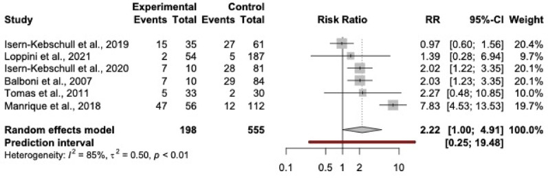
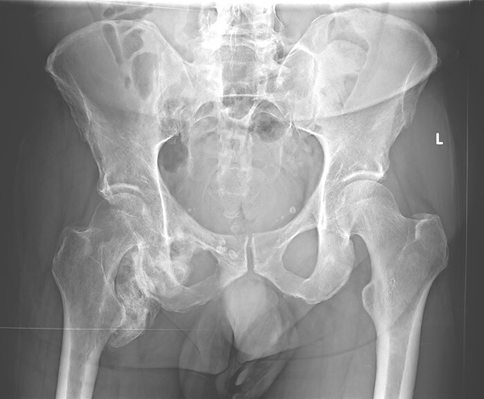
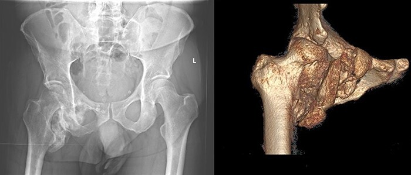
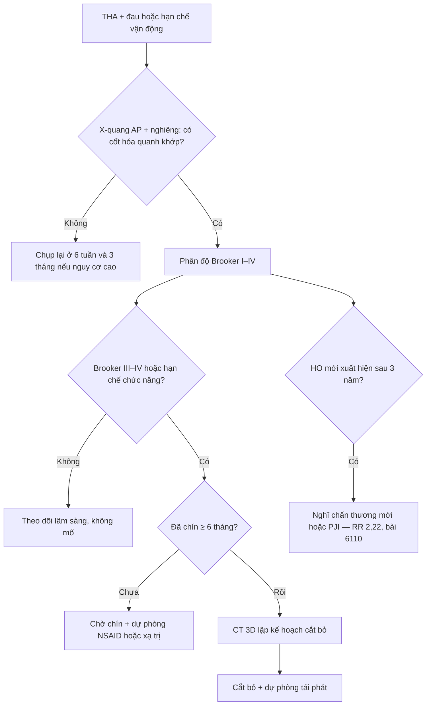
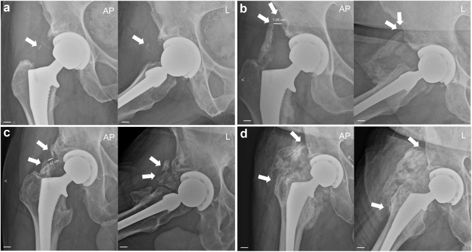
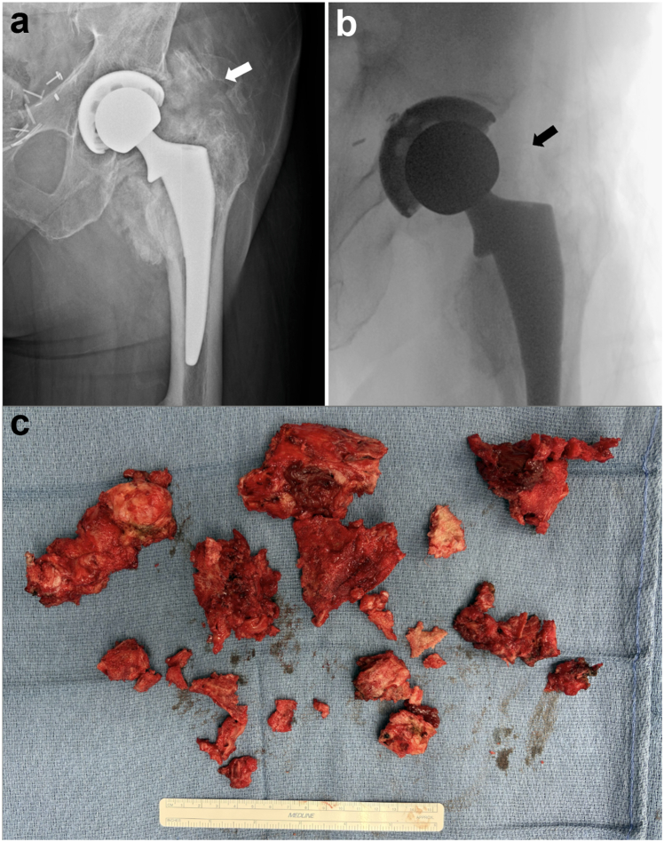

# 6141 — Vôi hóa mô mềm quanh khớp háng nhân tạo: phân độ Brooker, dự phòng & khi nào cắt bỏ / Heterotopic ossification after total hip arthroplasty

**Tags:** `pattern:voi-hoa-quanh-khop` `pattern:tao-xuong-lac-cho` `pattern:han-che-van-dong` `pattern:day-co-quanh-khop` `vung:khop-hang` `vung:co-xuong` `vung:mo-mem` `score:Brooker` `protocol:X-quang-khop-hang` `protocol:CT-khop-hang` `protocol:NSAID-du-phong` `protocol:xa-tri` `incidentaloma:khong`
**Mức chắc chắn (certainty):** tổng hợp y văn (literature synthesis) — ghép tổng quan HO sau THA (Kayani B, Wignadasan W, Fontalis A, Haddad FS. Bone Joint Res 2025;14, PMC12013453), tổng quan theo đường vào trước (Buchanan C, Culler MW, Poursalehian M, Anderson L, Yun AG, Heckmann ND. Arthroplast Today 2026;40:102110, PMC13486362), đoàn hệ chuôi ngắn đường vào trước (Soltani Farsani A et al., JB JS Open Access 2025;10, PMC12622617), thời điểm "chín" của HO (Willburger RE et al., J Orthop Surg Res 2022;17, PMC8898402), mạng lưới so sánh NSAID–xạ trị (Yang F et al., Front Pharmacol 2025;16:1601349, PMC12134758), meta PJI–HO (Pulik Ł et al., BMC Musculoskelet Disord 2025;26, PMC12333120) và ca HO khổng lồ quanh háng (Ramón R et al., J Hip Preserv Surg 2024;11, PMC11272633).

> **Điểm chốt của bài:** HO là **tạo xương lạc chỗ trong mô mềm**, không phải "vôi hóa mô mềm" đơn thuần — nên **chỉ thấy trên X-quang sau khi khoáng hóa, khoảng 6 tuần**, và **chín hoàn toàn sau 3 năm**. Chỉ **Brooker III–IV** được coi là "có ý nghĩa lâm sàng" theo cách nói cũ, nhưng dữ liệu mới cho thấy **ngay Brooker I–II cũng làm WOMAC xấu hơn**. Câu hỏi thực hành không phải "có HO không" mà là **"có cần mổ không"** — và mổ chỉ khi **đã chín ≥ 6 tháng + còn hạn chế chức năng**, vì cắt sớm **tái phát cao**.

## 1. Tổng quan — vì sao mô mềm quanh khớp háng "mọc xương"

- **Bệnh học:** sau mổ, **tổn thương cơ–mô mềm + máu tụ** tạo môi trường viêm: đại thực bào/lympho giải phóng **BMP-2, TGF-β, VEGF**, kèm **thiếu oxy mô** → **tế bào tiền tạo xương (osteoprogenitor)** tại chỗ và từ tủy lưu hành **biệt hóa theo đường sụn–xương (chondro-osteogenesis)** → ổ xương lạc chỗ **có vỏ và tủy, liên tục vỏ–tủy với xương lành**.
- **TẠI SAO X-quang "âm tính" 4–6 tuần đầu:** hình ảnh chỉ xuất hiện khi có **khoáng hóa hydroxyapatit** đủ dày; giai đoạn đầu tổn thương là **sụn/mô xơ (20–60 HU)** nên **không cản quang**. Vì vậy **phim ở tuần 2 bình thường không loại trừ HO** — dấu hiệu X-quang sớm nhất khoảng **6 tuần**, rõ ở **3 tháng**.
- **TẠI SAO cần 3 năm mới "chín":** theo dõi 75 bệnh nhân (etoricoxib 90 mg/ngày dự phòng) với phim ở **3 tháng, 1, 3, 5, 10 năm**: **Brooker I–II gặp nhiều hơn III**, còn **tăng bậc tiếp tục tới 3 năm**; **sau 3 năm, HO không tiến triển thêm** ở bất kỳ ca nào (PMC8898402).
- **Số liệu nền phải nhớ:**
  - **Tỉ lệ chung rất rộng: 8–90% sau THA**, **17–100% sau gãy ổ cối**, **18–50% sau chấn thương não** — vì phụ thuộc **đường mổ, cách chụp, thời điểm đọc và định nghĩa** (PMC12013453).
  - **Đường vào trước (DAA) — "đường mổ ít HO nhất":** 348 háng DAA + chuôi ngắn không cement: **HO 18,1%** — **Brooker I 12,4%, II 3,0%, III 3,0%, IV 0%**; ngay **HO độ thấp (I–II)** cũng có **WOMAC tệ hơn** (p < 0,001) (PMC12622617).
  - **Yếu tố nguy cơ:** **nam OR 2,11** (meta 2015); **mổ hai bên**, **viêm cột sống dính khớp (AS)**, **cứng khớp háng trước mổ**; **implant có cement > không cement**; **mổ > 90 phút**, **dẫn lưu kéo dài**; tuổi cao liên quan trong nhiều loạt nhưng không nhất quán (PMC13486362).
  - **HO và nhiễm khớp nhân tạo liên quan hai chiều:** gộp **6 nghiên cứu / 753 quan sát / 186 biến cố**: **RR 2,22 (1,00–4,91), p = 0,0497** cho HO ở người có PJI; cơ chế được đề xuất là **PAMP vi khuẩn qua TLR–NF-κB** thúc đẩy tạo xương (PMC12333120). Vì vậy **HO mới xuất hiện ở ca "vô khuẩn" phải gợi ý nhiễm** (bài 6110).

*Gộp 6 nghiên cứu: **RR 2,22 (1,00–4,91)** cho HO ở nhóm PJI so với chứng, nhưng **I² = 85%** và **khoảng dự báo 0,25–19,48** — nghĩa là **hướng liên quan rõ, độ lớn còn bất định**. Nguồn: Pulik Ł, Łęgosz P, Brzóska E, Mierzejewski B, Grabowska I, Ciemerych MA, Hube R. BMC Musculoskelet Disord 2025;26 (PMC12333120, Fig. 2), CC BY-NC-ND 4.0.*
- **TẠI SAO vị trí HO phụ thuộc đường mổ:** đường **bên (lateral)** bóc tách cơ mông → HO **mặt ngoài, quanh mấu chuyển lớn**; **DAA** đi giữa cơ may–căng mạc đùi → HO **phía trước khớp**, **rất dễ bỏ sót trên phim AP** vì bị cổ chuôi/ổ cối che; đường **sau** → HO **sau, quanh ụ ngồi** (PMC13486362).

## 2. Mẫu hình + chẩn đoán phân biệt theo vị trí (gamut)

- **Theo vị trí — đọc trên AP + nghiêng/CT:**
  - **Ngoài – trên (cơ mông, mấu chuyển lớn):** hay gặp sau **đường bên**; dễ nhầm **mảnh xương mấu chuyển** hoặc **cement sót**.
  - **Trước (cơ may–căng mạc đùi, trước ổ cối):** đặc trưng **DAA**; **gần như vô hình trên AP**, phải xem **nghiêng/CT** — đây là lý do "DAA ít HO" có thể **một phần do chụp**.
  - **Trong (cơ chậu–thắt lưng, sàn ổ cối):** HO **trong khung chậu**, có thể **chèn ép mạch chậu/niệu quản**; khó thấy trên phim thẳng.
  - **Sau (ụ ngồi, cơ mông lớn):** hạn chế **duỗi–xoay ngoài**, dễ nhầm **myositis ossificans**.
- **Theo hình thái — 3 kiểu cần phân biệt:**
  - **HO trưởng thành:** bờ **rõ, có vỏ xương + bè xương**, **liên tục vỏ–tủy với xương chủ** (dấu chốt phân biệt với vôi hóa loạn dưỡng).
  - **HO non (sớm):** **bờ mờ, không có bè xương**, có thể **phù mô quanh** — giai đoạn này **không mổ**.
  - **Vôi hóa không phải xương:** **viêm gân vôi hóa**, **calcinosis tumoral**, **mảnh xương/cement** — **không có vỏ–tủy liên tục**.
- **Gamut chẩn đoán phân biệt quanh THA:**
  - **Mảnh xương mấu chuyển lớn bị bóc tách** (thường **bờ sắc, khớp với ổ khuyết** ở mấu chuyển).
  - **Cement sót** (cản quang **rất mạnh**, **không bè xương**, thường **bờ tròn nhẵn**).
  - **Myositis ossificans** (tiền sử **chấn thương cơ**, bờ **"vỏ trứng"**, có thể **teo dần**).
  - **Viêm gân vôi hóa** (vôi hóa **dạng vô định hình**, **trong gân**, không vỏ xương).
  - **U sụn–xương (osteochondroma)** (liên tục **vỏ–tủy** nhưng có **cuống** và **sụn bọc đầu**, thường có từ trước).
  - **Sarcoma tạo xương/viêm xương–tủy** (phá xương, phản ứng màng xương, mô mềm **không vôi hóa kiểu xương trưởng thành**).
  - **HO "do nhiễm"** — HO mới ở ca tưởng vô khuẩn: **RR 2,22** với PJI (PMC12333120).

*Bệnh nhân sau thời gian dài ở ICU, **6 tháng**: hình ảnh cốt hóa còn **mờ, chưa có bè xương rõ** quanh háng phải — giai đoạn **HO non, chưa nên mổ**. Nguồn: Ramón R, Holguín E, Ribas M, Al Hussin N, Ezechieli M. J Hip Preserv Surg 2024;11 (PMC11272633, Fig. 1), CC BY 4.0.*

*Cùng ca ở **10 tháng**: khối cốt hóa **dày, bờ rõ, có bè xương**, dựng hình 3D cho thấy **khối xương lạc chỗ ôm mặt trong–dưới khớp háng** — đây là lúc **đánh giá khối đã "chín"** và lập kế hoạch cắt bỏ nếu còn hạn chế vận động. Nguồn: Ramón R et al. (PMC11272633, Fig. 2), CC BY 4.0.*

## 3. Bảng so sánh phân biệt (ma trận đối chiếu)

| Thực thể (entity) | Hình ảnh điển hình | Chốt vào (rule-in) | Chốt loại (rule-out) | Gợi ý xác nhận |
|---|---|---|---|---|
| **HO trưởng thành** | Khối cản quang **bờ rõ**, **có vỏ + bè xương**, **liên tục vỏ–tủy với xương chủ**; vị trí đúng **đường mổ** | **Vỏ–tủy liên tục + bờ rõ + không phá xương** | **Bờ mờ, không bè xương, phù mô** → HO non hoặc tổn thương khác | X-quang 2 bình diện; CT khi cần mổ |
| **HO non (sớm)** | **Mờ, dạng đám**, **không bè xương**, có thể **phù mô quanh**; xuất hiện **3–6 tuần** | **Tiền sử mổ < 3 tháng + đau/hạn chế + đám cản quang mờ** | **Đã có vỏ–tủy rõ** → đã trưởng thành | Chụp lại **3 tháng**; không mổ sớm |
| **Mảnh xương mấu chuyển** | Mảnh xương **bờ sắc**, **khớp với ổ khuyết** ở mấu chuyển lớn, **có bè xương** | **Ổ khuyết tương ứng ở mấu chuyển + tiền sử mổ** | **Khối tách rời, không ổ khuyết** → HO | So phim ngay sau mổ; CT |
| **Cement sót** | Cản quang **rất mạnh, đồng nhất**, **bờ tròn nhẵn**, **không bè xương** | **Mật độ kim loại/cement + không bè xương** | Có **bè xương/vỏ** → HO | X-quang; CT (HU rất cao) |
| **Myositis ossificans** | Khối **"vỏ trứng"** trong cơ, **bờ ngoài đậm hơn trong**, có thể **teo theo thời gian** | **Tiền sử chấn thương cơ + bờ ngoài đậm** | **Liên tục vỏ–tủy với xương** → HO/osteochondroma | Theo dõi 3–6 tháng |
| **Viêm gân vôi hóa** | Vôi hóa **vô định hình trong gân**, **không vỏ xương**, đau khu trú | **Đau khi vận động + vôi hóa trong gân** | **Có vỏ–bè xương** → HO | Siêu âm; X-quang |
| **U sụn–xương** | **Cuống xương + sụn bọc đầu**, vỏ–tủy liên tục, thường **có từ trước** | **Cuống + sụn bọc + không thay đổi theo thời gian** | **Không cuống, xuất hiện sau mổ** → HO | So phim cũ; MRI |
| **HO + PJI (bài 6110)** | HO **mới/xuất hiện sau 3 năm**, kèm **đường sáng, dịch, phù mô** | **HO mới + CRP/ESR tăng + dịch khớp bất thường** | HO ổn định, không dịch, CRP bình thường | Chọc hút dịch; cấy; **RR 2,22** |

### Ba câu phải trả lời trước khi nói "HO"
- **Có vỏ–tủy liên tục không?** Có = xương lạc chỗ thật (HO/osteochondroma); không = vôi hóa/mảnh vụn.
- **Có ổ khuyết tương ứng ở xương chủ không?** Có = mảnh xương bị bóc; không = HO.
- **Xuất hiện sau mổ bao lâu?** **< 6 tuần** có thể còn **âm tính**; **> 3 năm** mà mới mọc = **chấn thương mới hoặc nhiễm**.

## 4. Protocol chụp + hệ phân độ/điểm chuẩn hóa

- **X-quang:** **AP khung chậu + AP và nghiêng khớp háng**; chụp **6 tuần, 3 tháng, 1 năm** ở người nguy cơ cao. **Nghiêng là bắt buộc** với DAA vì HO **phía trước** gần như **không thấy trên AP**.
- **CT:** **lát mỏng ≤ 1 mm + dựng 3D** khi **lập kế hoạch cắt bỏ** — xác định **quan hệ với mạch đùi, thần kinh tọa, bàng quang**, và **khối có vỏ–tủy liên tục**. **Siêu âm** phát hiện HO **sớm hơn X-quang**; **xạ hình/PET** dương tính sớm nhưng **không đặc hiệu** (viêm cũng dương tính).
- **Phân độ Brooker (AP, khớp háng):**
  - **I:** **đảo xương** rời trong mô mềm quanh khớp.
  - **II:** **gai xương** từ khung chậu hoặc xương đùi, **khoảng cách giữa hai bờ xương > 1 cm**.
  - **III:** gai xương với **khoảng cách < 1 cm** (gần chạm nhau).
  - **IV:** **dính khớp (ankylosis)** — cầu xương liên tục.
  - **Ý nghĩa:** **III–IV** là nhóm **hạn chế vận động rõ**; **II** đã có thể **giảm gấp/dạng**; nhưng **I–II vẫn làm WOMAC xấu hơn** trong đoàn hệ DAA (PMC12622617).
- **Dự phòng (chọn theo nguy cơ):**
  - **NSAID:** **indomethacin 25 mg × 3/ngày trong 3–6 tuần** là chuẩn cũ; các phác đồ **25 mg × 3/ngày × 2 tuần**, **50 mg × 2/ngày × 6 tuần** cũng hiệu quả; **7 ngày không kém 14 ngày**. Meta: NSAID **giảm HO, OR 2,8 (1,9–4,0)** so với giả dược (PMC12013453).
  - **So sánh mạng 17 RCT / 3.014 bệnh nhân:** OR so với chứng — **diclofenac 0,06**, **xạ trị 0,08**, **indomethacin 0,13**; **SUCRA: diclofenac 78,0% > etoricoxib 71,6% > xạ trị 67,3% > naproxen 66,7% > indomethacin 53,2% > celecoxib 38,8% > ibuprofen 18,6%** (PMC12134758).
  - **Xạ trị:** **700–800 cGy liều duy nhất**, **trước mổ trong 24 giờ** hoặc **sau mổ trong 72 giờ**; **400 cGy kém hơn 700 cGy** (57,8% vs 75,0% không tăng bậc, p = 0,027); **550 vs 700 cGy: 63% vs 10%**; **500 vs 1.000 cGy: không khác (p = 0,086)** (PMC13486362).
  - **Aspirin 325 mg × 2/ngày × 4–6 tuần** có thể giảm HO (dùng kèm dự phòng huyết khối); **ketorolac: 0/152 ca HO có ý nghĩa lâm sàng vs 7,3% chứng** (PMC13486362).
  - **Tranexamic acid** và **hạn chế dẫn lưu kéo dài** được xem là biện pháp bổ trợ.
- **Cắt bỏ (excision):** chỉ khi **HO đã chín** — **≥ 6 tháng** sau khi bắt đầu cốt hóa; **sau chấn thương 6–9 tháng**, **sau chấn thương não 18 tháng**; cắt **trước 6 tháng tăng tái phát**. Ở bệnh nhân **đã gãy ổ cối**, cắt HO có **tới 1/3 biến chứng** (gãy cổ xương đùi, hoại tử chỏm, tổn thương thần kinh tọa) (PMC12013453). Sau cắt: **dự phòng lại bằng NSAID ± xạ trị** (ví dụ **700 cGy ngày 1 + indomethacin 50 mg/ngày × 2 tuần**).

*Brooker I (a: đảo xương rời), II (b: gai xương cách nhau > 1 cm), III (c: khoảng cách < 1 cm), IV (d: cầu xương/dính khớp). Mũi tên chỉ các gai xương; cột **L** là phim nghiêng — cần thiết để thấy HO **phía trước** ở đường vào trước. Nguồn: Buchanan C, Culler MW, Poursalehian M, Anderson L, Yun AG, Heckmann ND. Arthroplast Today 2026;40:102110 (PMC13486362, Fig. 1), CC BY-NC-ND 4.0 — nguyên bản, không cắt/ghép.*

*Brooker IV: (a) cầu xương quanh khớp, (b) huỳnh quang trong mổ sau khi cắt bỏ, (c) khối xương lạc chỗ lấy ra. Đây là mức độ **duy nhất** mà cắt bỏ gần như chắc chắn phải làm nếu còn triệu chứng. Nguồn: Buchanan C et al. (PMC13486362, Fig. 2), CC BY-NC-ND 4.0.*

## 5. Biến thể bình thường và cạm bẫy

- **HO phía trước sau DAA** có thể **hoàn toàn không thấy trên AP** — đừng kết luận "không HO" nếu chỉ có một phim thẳng; **nghiêng hoặc CT** mới đủ.
- **"Đảo xương" nhỏ cạnh mấu chuyển** sau mổ có thể là **mảnh xương bị bóc** chứ không phải HO — tìm **ổ khuyết tương ứng** ở xương chủ.
- **HO độ thấp vẫn có triệu chứng:** đừng dùng ngưỡng "chỉ III–IV mới quan trọng" để bỏ qua bệnh nhân **WOMAC cao, hạn chế gập háng** nhưng ảnh chỉ **Brooker I–II**.
- **HO "mới" sau 3 năm** = không phải tiến triển tự nhiên: nghĩ **chấn thương mới, di căn, hoặc PJI** (HO tăng **2,22 lần** ở PJI).
- **Đừng cắt HO non:** bờ mờ, chưa có bè xương, **< 6 tháng** → **tái phát cao**; chờ **chín** (tới **3 năm** ở một số ca) rồi mới mổ.
- **NSAID ở bệnh nhân gãy ổ cối:** giảm HO nhưng **tăng nguy cơ khớp giả (nonunion)** — cân nhắc **xạ trị liều duy nhất** hoặc **thời gian NSAID ngắn**.
- **Xạ trị ở người trẻ:** **700–800 cGy** là liều **thấp** nhưng vẫn cần cân nhắc **sinh sản/tổn thương thứ phát**; **400 cGy không đủ**.
- **Dẫn lưu kéo dài và mổ > 90 phút** là yếu tố **liên quan** — không phải "nguyên nhân chắc chắn"; đừng quy kết một yếu tố đơn lẻ.

## 6. Tự lượng giá — Blind Quiz

**Ca 1 — Nam 66 tuổi, THA 2 năm, háng "cứng như khối đá", phim AP thấy cầu xương quanh khớp.**

- Câu hỏi: Phân độ Brooker? Có nên mổ ngay không? Cần chuẩn bị gì trước mổ?

<b>Bấm để hiện đáp án</b>

- **Findings:** **cầu xương liên tục** giữa khung chậu và xương đùi → **Brooker IV**.
- **Chẩn đoán:** HO độ IV, **hạn chế vận động nặng**; đây là nhóm **gần như chắc chắn phải cắt** nếu còn triệu chứng.
- **Trước mổ:** xác nhận **đã chín ≥ 6 tháng**, **CT 3D** đánh giá quan hệ với **mạch đùi/thần kinh tọa**, chuẩn bị **dự phòng tái phát** (NSAID ± 700 cGy).
- Nguồn ảnh: Buchanan C et al. (PMC13486362, Fig. 2), CC BY-NC-ND 4.0.

**Ca 2 — Bệnh nhân 6 tháng sau ICU, đau và hạn chế gập háng phải, phim mờ nhẹ quanh háng.**

- Câu hỏi: Mô tả tổn thương? Đã đủ chín để mổ chưa? Theo dõi thế nào?

<b>Bấm để hiện đáp án</b>

- **Findings:** đám cốt hóa **mờ, chưa có bè xương rõ** ở mặt trong–dưới khớp háng phải → **HO non**.
- **Chẩn đoán:** HO giai đoạn sớm — **chưa mổ**; **chờ chín** (theo dõi tới **3 năm** nếu cần) và **dự phòng NSAID** nếu còn trong cửa sổ nguy cơ.
- **Theo dõi:** phim **3–6 tháng/lần**; khi khối **có vỏ–bè xương** và **hết tiến triển** mới cân nhắc cắt.
- Nguồn ảnh: Ramón R et al. (PMC11272633, Fig. 1), CC BY 4.0.

**Ca 3 — Cùng bệnh nhân trên, 10 tháng sau: khối đã dày, bờ rõ; anh/chị quyết định gì?**

- Câu hỏi: Khối đã "chín" chưa? Dấu hiệu nào chứng minh? Nếu cắt, nguy cơ chính là gì?

<b>Bấm để hiện đáp án</b>

- **Findings:** khối **dày, bờ rõ, có bè xương**, 3D cho thấy **ôm mặt trong–dưới khớp** → **HO trưởng thành**.
- **Chẩn đoán:** đã đủ điều kiện **cắt bỏ** nếu còn **hạn chế chức năng**; ca này được mổ qua **đường trong Ludloff cải tiến**.
- **Nguy cơ:** **chảy máu, tổn thương mạch đùi/thần kinh bịt–tọa, tái phát**; cần **dự phòng sau mổ** và theo dõi chức năng.
- Nguồn ảnh: Ramón R et al. (PMC11272633, Fig. 2), CC BY 4.0.

## Bài liên quan chéo
- [6110 – Nhiễm trùng quanh khớp nhân tạo (PJI) sau THA](../6110-nhiem-trung-quanh-khop-nhan-tao-sau-tha/lesson.md) — HO mới + PJI: **RR 2,22**
- [6140 – Lỏng vô khuẩn quanh khớp háng nhân tạo](../6140-long-vo-khuan-quanh-khop-hang-nhan-tao/lesson.md) — HO che đường sáng, dễ nhầm khuyết xương
- [6107 – Thay khớp háng ở người sống sót ung thư nhi](../6107-thay-khop-hang-nguoi-song-sot-ung-thu-nhi/lesson.md)
- [645 – Vỡ khung chậu ở trẻ](../645-vo-khung-chau-o-tre/lesson.md) — HO sau gãy ổ cối **17–100%**
- [300 – Tổng quan Hệ Cơ – Xương – Khớp](../300-tong-quan-he-co-xuong-khop/lesson.md)
- [600 – Tổng quan Nhi khoa](../600-tong-quan-nhi-khoa/lesson.md)

## Ảnh
- Tên file: `6141_voi-hoa_Modality_SourceID.jpg`. Nguồn + giấy phép từng ảnh trong `images/CREDITS.md`.
- Bài **không có ảnh composite** vì 2 ảnh phân độ Brooker là **CC BY-NC-ND** (không được cắt/ghép).

> Không dùng để chẩn đoán độc lập khi chưa có người hướng dẫn.
