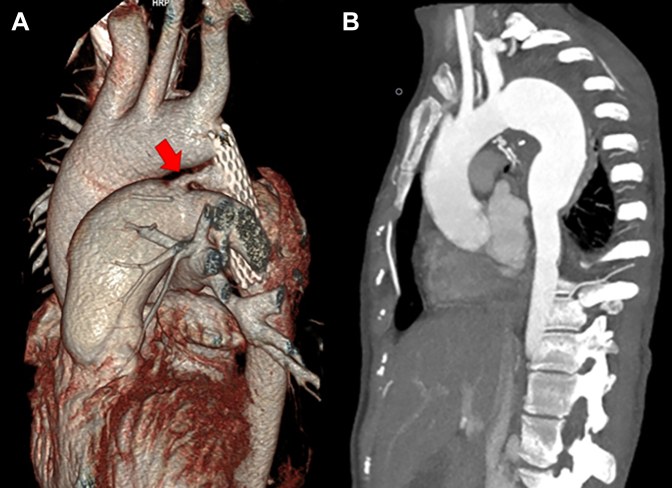
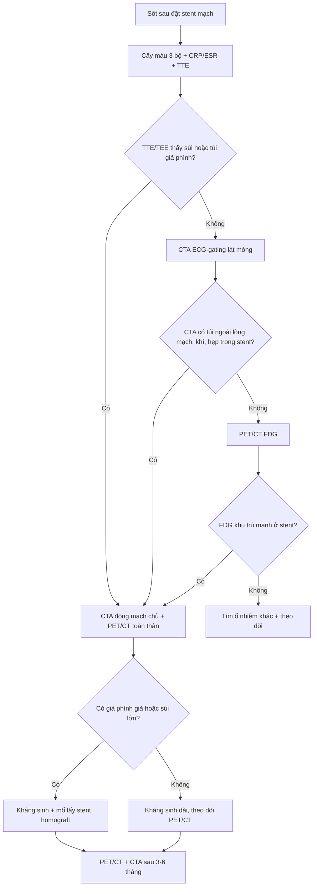
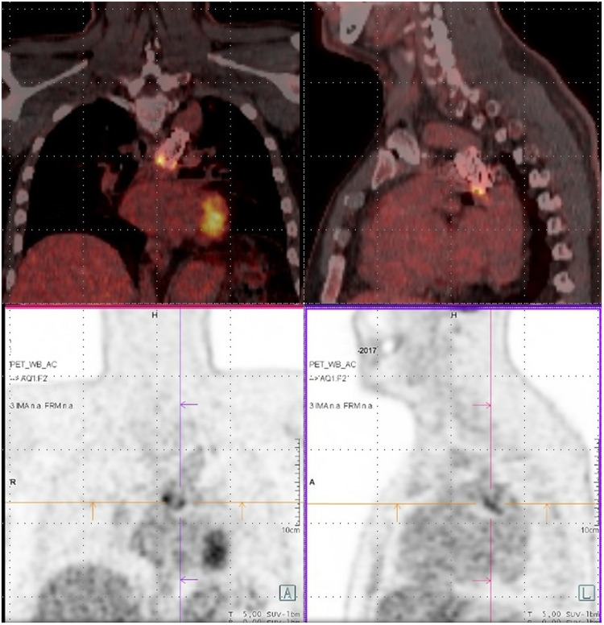
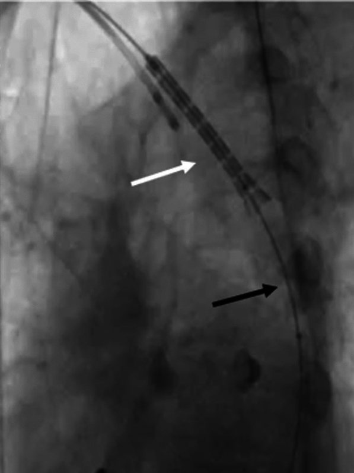
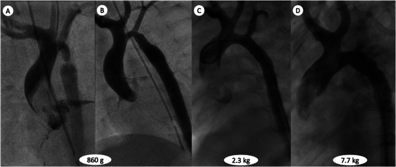

# 6142 — Nhiễm trùng, di trú và gãy stent mạch ở trẻ: sốt sau can thiệp, giả phình giả nhiễm trùng, mảnh stent trôi

**Tags:** `pattern:nhiem-trung-stent` `pattern:gia-phinh` `pattern:di-tru-stent` `pattern:gay-stent` `pattern:sot-keo-dai` `pattern:thuyen-tac-nhiem-khuan` `vung:eo-dong-mach-chu` `vung:quai-dong-mach-chu` `vung:dong-mach-chu-nguc` `vung:lach` `protocol:CTA-ECG-gating` `protocol:PET-CT-FDG` `protocol:sieu-am-tim-TEE` `protocol:chup-mach-DSA` `score:khong`
**Mức chắc chắn (certainty):** tổng hợp y văn (literature synthesis) — ghép **ca nữ 29 tuổi sốt kéo dài 2 tháng, stent hẹp eo đặt 10 năm trước, giả phình giả 46 × 32 × 49 mm + nhiễm trùng huyết do Stenotrophomonas maltophilia** (Journal of Investigative Medicine High Impact Case Reports 2026, PMC12905688), **ca nam 53 tuổi viêm stent (stentitis) 1,5 năm sau đặt stent CP, PET/CT dương tính, Streptococcus gordonii, điều trị kháng sinh đơn thuần** (European Heart Journal – Case Reports 2020, PMC7319810), **ca nam 25 tuổi viêm động mạch chủ + sùi 17 × 8 mm sau nhiễm COVID-19, CT không thấy tổn thương** (Journal of Tehran University Heart Center 2023, PMC10748656), **ca nữ 22 tuổi hội chứng Turner di trú stent lên động mạch cánh tay đầu trong lúc đặt** (The Egyptian Heart Journal 2025, PMC12014972), **bé trai 15 tháng gãy stent chủ đích để lớn theo trẻ** (Clinical Case Reports 2026, PMC12775195), **26 sơ sinh đặt stent rồi mổ thì hai** (World Journal for Pediatric and Congenital Heart Surgery 2022, PMC9243453) và **ca trẻ 12 tuổi giả phình giả nhiễm trùng sau stent phủ** (World Journal for Pediatric and Congenital Heart Surgery 2012, DOI 10.1177/2150135112439079 — không có toàn văn mở). **Lưu ý trung thực nguồn:** bằng chứng nhiễm trùng stent ở đúng lứa nhi khoa rất mỏng — 3 ca nhiễm trùng có ảnh là **người trẻ 25–29 tuổi đặt stent từ thời niên thiếu**, còn ca 12 tuổi chỉ có mô tả trong y văn; bài ghi rõ chỗ nào suy luận từ người lớn sang trẻ.

> **Câu hỏi thực hành:** bé gái **12 tuổi** đặt stent phủ điều trị hẹp eo động mạch chủ 4 năm trước, nay **sốt 3 tuần, mệt, sụt cân**, CRP **68 mg/L**, cấy máu **âm tính vì đã uống kháng sinh 2 tuần**; CTA thấy **túi cản quang 18 × 14 mm ngoài lòng mạch ngay đầu xa stent**.
> Câu hỏi: **đây là nhiễm trùng stent, giả phình giả nhiễm trùng hay chỉ là phản ứng viêm quanh stent? có phải mổ lấy stent, hay kháng sinh dài là đủ? PET/CT đặt ở đâu trong chuỗi chẩn đoán? và nếu stent di trú/gãy thì xử trí nội mạch được không, khi nào buộc phải mổ?**
> Bài chốt **năm việc**: **(1) sốt sau stent mạch = nhiễm trùng stent cho tới khi chứng minh ngược lại, kể cả cấy máu âm tính; (2) CTA là bước đầu nhưng có thể bỏ sót sùi trong lòng stent vì nhiễu kim loại — phải phối hợp TEE và PET/CT; (3) tử vong của viêm động mạch chủ nhiễm trùng là 21–44%, cao hơn khi chỉ dùng kháng sinh; (4) di trú stent gặp ở ~5% ca đặt stent hẹp eo, phần lớn di trú gần cần mổ, nhưng có thể cứu bằng bóng/thì kéo có kiểm soát; (5) trẻ đang lớn thì gãy stent là chuyện của "kích thước cố định trong mạch đang lớn" — phải có lịch chụp, không chờ triệu chứng.**

## 1. Tổng quan bệnh học – cơ chế hình ảnh: tại sao stent kim loại lại thành "ổ nhiễm"

- **Bối cảnh dịch tễ:** hẹp eo động mạch chủ (coarctation of the aorta, CoA) chiếm **5–8%** dị tật tim bẩm sinh; đặt stent qua da đã thành điều trị chuẩn cho hẹp eo nguyên phát/tái phát, và **di trú stent gặp ở khoảng 5% ca** (PMC12014972). Gãy stent trong thử nghiệm **COAST/COAST II** (stent CP) là **24,4%** ở **48–60 tháng**, kèm **can thiệp lại 21%** và **phình 6,3%** — và chỉ **16%** bệnh nhân được chụp mặt cắt nên tỉ lệ thật có thể cao hơn (PMC10340190, qua bài 6116).
- **TẠI SAO nhiễm trùng stent hiếm nhưng nặng:** kim loại không có mạch máu → **không có bạch cầu và kháng sinh tới trực tiếp**; stent chỉ được **nội mạc hóa (endothelialization)** dần trong nhiều tuần–tháng. Khi nội mạc hóa chưa hoàn chỉnh (hoặc bị rách do nong lại), dòng máu chảy quanh sợi kim loại tạo **vùng xoáy tốc độ thấp**, cho phép vi khuẩn bám và tạo **màng sinh học (biofilm)**. Màng sinh học làm kháng sinh khó thấm → cấy máu dễ âm tính sau khi đã dùng kháng sinh, và chỉ **PCR trên mảnh stent lấy ra** mới xác định được căn nguyên (ca 29 tuổi: cấy stent âm, PCR dương **Stenotrophomonas maltophilia**; PMC12905688).
- **TẠI SAO thành giả phình:** nhiễm khuẩn phá hủy **lớp áo giữa (media)** và mô quanh mạch → thành mạch mất tính chịu lực, máu thoát ra tạo **túi giả phình (pseudoaneurysm)** chỉ được bao bởi mô xơ. Đây là lý do nhiễm trùng stent **không chỉ là "viêm"**: khi đã có túi giả phình, kháng sinh đơn thuần gần như không thể lành vì ổ nhiễm nằm ngoài lòng mạch và không có tưới máu.
- **TẠI SAO nhiễu kim loại làm sai hình ảnh:** stent cản quang mạnh tạo **vệt giả (streak artifact)** trên CT — trong ca 25 tuổi, **CTA không thấy khối sùi 17 × 8 mm trong stent**, chỉ **siêu âm tim qua thực quản (TEE)** mới thấy (PMC10748656). Vì vậy "CTA âm tính" **không loại trừ** nhiễm trùng stent.
- **TẠI SAO PET/CT phân biệt được:** viêm lành thương sau can thiệp cho **ngấm FDG lan tỏa, nhẹ, đồng nhất** dọc stent; nhiễm trùng cho **ngấm mạnh, không đồng nhất, khu trú ở một đầu stent** (PMC12905688; PMC7319810). FDG có thể còn tăng trong **vài tuần đầu** sau đặt stent do viêm lành thương → **không chụp quá sớm** nếu lâm sàng cho phép (suy luận từ cơ chế viêm lành thương; bằng chứng định lượng về mốc thời gian chưa rõ — cần tra).
- **Ngưỡng định lượng phải thuộc (dùng ngay tại giường):**
  - **Sốt + viêm:** ESR **93 mm/h**, CRP **38 mg/L**, Hb **8,7 g/dL**, bạch cầu **5.500/µL** (neutrophil 69%) trong ca điển hình — **bạch cầu bình thường không loại trừ** (PMC12905688).
  - **Kích thước tổn thương:** giả phình giả **46 × 32 × 49 mm**; sùi trong động mạch phổi **22 × 8 mm**; phình giả nhiễm trùng động mạch lách **11 × 8 mm**, động mạch chậu trong trái **23 × 15 mm** (PMC12905688); sùi trong stent **17 × 8 mm**, lòng hiệu dụng **11 mm**, đường kính ngoài **22 mm** (PMC10748656).
  - **Tử vong viêm động mạch chủ nhiễm trùng: 21–44%**, cao hơn khi **chỉ dùng kháng sinh** (PMC7319810; PMC12905688).
  - **Di trú stent: ~5%** ca đặt stent hẹp eo (PMC12014972); **gãy stent: 24,4% ở 48–60 tháng** (COAST/COAST II, PMC10340190).
  - **Trẻ đang lớn:** stent cố định trong mạch lớn từ **860 g → 2,3 kg → 7,7 kg** (bé 15 tháng) buộc phải nong lại nhiều lần và **gãy chủ đích** (PMC12775195).
- **Sinh lý bệnh của "sốt mà không tìm ra ổ":** sau khi loại trừ viêm nội tâm mạc nhiễm khuẩn, viêm phổi, nhiễm trùng tiết niệu, cần coi **stent là ổ nhiễm tiềm ẩn** — đặc biệt khi có **dị tật mạch kèm theo** (ca 29 tuổi có **ống động mạch chủ (PDA) bị bỏ sót**, tạo dòng xoáy quanh stent) hoặc **nhiễm trùng huyết thoáng qua** trước đó. Nhiễm trùng huyết có thể **gieo mầm phình giả nhiễm trùng ở xa** (lách, chậu, động mạch phổi) — nên **chụp toàn thân một lần** khi đã xác định stent nhiễm.

*Nữ 29 tuổi, stent hẹp eo đặt 10 năm trước, sốt 2 tháng. **(A)** CTA 3D: stent ở eo (mũi tên mở) và **giả phình giả 46 × 32 × 49 mm** ở động mạch chủ xuống ngay đầu xa stent; mũi tên đỏ chỉ **ống động mạch chủ (PDA) bị bỏ sót** — nguồn dòng xoáy quanh stent. **(B)** CTA 1 năm sau mổ: cắt stent + túi giả phình, thắt PDA, thay đoạn động mạch chủ bằng **homograft**, không còn dấu nhiễm. Nguồn: Journal of Investigative Medicine High Impact Case Reports 2026 (PMC12905688), **CC BY-NC-ND 4.0** — nguyên bản, không cắt/ghép.*

## 2. Mẫu hình + chẩn đoán phân biệt theo vị trí và theo thời gian (gamut)

- **Nguyên tắc:** đặt stent lên **trục thời gian** trước, rồi mới đặt lên **trục giải phẫu**. Cùng một "bất thường quanh stent" nhưng **ngày thứ 3, tháng thứ 6 và năm thứ 5** là ba bệnh khác nhau.
- **Theo thời gian:**
  - **Sớm (< 30 ngày):** di trú stent, bóc tách/đứt thành mạch do bóng, huyết khối cấp, nhiễm trùng vết chọc, sốt do phản ứng vật liệu (hiếm).
  - **Trung hạn (1–12 tháng):** hẹp trong stent do tăng sinh nội mạc, huyết khối bán cấp, **viêm stent sớm** (ca 53 tuổi: **1,5 năm**), giả phình ở chỗ nong.
  - **Muộn (> 1 năm):** **nhiễm trùng stent/viêm động mạch chủ**, **gãy stent + mảnh trôi**, giả phình giả muộn, hẹp lại, và ở trẻ là **stent không lớn theo trẻ**.
- **Theo vị trí:**
  - **Trong lòng stent:** sùi/nhiễm trùng, huyết khối, hẹp trong stent, stent nong không hết.
  - **Quanh stent (quanh mạch):** **giả phình giả**, **áp-xe quanh động mạch chủ**, dò động mạch chủ–thực quản/phế quản (thể chết người, thường có khí quanh stent).
  - **Xa stent:** **thuyên tắc nhiễm khuẩn** → phình giả nhiễm trùng lách/chậu, sùi động mạch phổi, nhồi máu tạng; hoặc **mảnh stent trôi** xuống động mạch chủ bụng.
  - **Ngoài mạch:** viêm nội tâm mạc nhiễm khuẩn trên van bẩm sinh (van hai lá, van động mạch chủ), viêm màng ngoài tim.
- **Mnemonic "S-T-E-N-T" cho sốt sau stent:**
  - **S**epsis/stentitis — nhiễm trùng stent.
  - **T**hrombus — huyết khối trong stent (sốt nhẹ + thiếu máu chi).
  - **E**mbolus/endoleak — thuyên tắc nhiễm khuẩn, rò trong stent.
  - **N**arrowing — hẹp trong stent (thường không sốt, nhưng dễ nhầm khi có viêm).
  - **T**rauma/fracture — gãy stent, mảnh trôi, di trú.

## 3. Bảng so sánh phân biệt (ma trận đối chiếu)

| Thực thể | Hình ảnh điển hình | Chốt vào (rule-in) | Chốt loại (rule-out) | Gợi ý xác nhận |
|---|---|---|---|---|
| **Nhiễm trùng stent sớm (stentitis, chưa có giả phình)** | Stent áp sát thành, **FDG ngấm mạnh khu trú một đầu stent**; CTA có thể bình thường | **Sốt + chills sau stent + FDG khu trú ở stent** + cấy máu dương (kể cả sau khi đã dùng kháng sinh) | CTA **không có túi ngoài lòng mạch**, không khí quanh stent, không sùi trên TEE | Cấy máu 3 bộ trước kháng sinh; **PET/CT**; TEE |
| **Nhiễm trùng stent + giả phình giả** | **Túi cản quang ngoài lòng mạch** ở đầu xa/đầu gần stent, thành dày, có thể có khí; FDG mạnh cả túi và mô quanh | **Túi ngoài lòng mạch + sốt/CRP cao + FDG dương** | Túi **không ngấm FDG**, bờ nhẵn, không triệu chứng → nghĩ giả phình vô khuẩn | CTA + PET/CT + TEE; **PCR/mô bệnh mảnh lấy ra** |
| **Huyết khối trong stent** | Khuyết thuốc trong lòng stent, **không có túi ngoài mạch**, có thể tắc nhánh | **Thiếu máu chi/tăng huyết áp cấp + khuyết thuốc trong stent** | Không sốt, không FDG khu trú, không sùi | CTA/Doppler; DSA khi can thiệp |
| **Hẹp trong stent (in-stent restenosis)** | Eo thắt trong stent, **tăng sinh nội mạc nhẵn**, gradient tăng | **Gradient xâm nhập ≥ 20 mmHg** hoặc Vmax **> 2 m/s** tại stent | Không sốt, không túi ngoài mạch, không FDG | Siêu âm tim + CTA; đo gradient |
| **Di trú stent** | Stent **lệch khỏi vị trí hẹp**, trôi lên quai/động mạch cánh tay đầu hoặc xuống dưới | **Stent không còn bắc qua đoạn hẹp + gradient còn cao** | Stent đúng vị trí, gradient sau đặt **< 20 mmHg** | Fluoroscopy/DSA; CTA 3D |
| **Gãy stent / mảnh trôi** | **Đứt sợi stent**, mảnh rời ở động mạch chủ bụng; có thể **hoàn toàn không triệu chứng** | **CT/fluoroscopy thấy mảnh ngoài vị trí** hoặc đứt sợi | Stent liền, không di lệch, không mảnh tự do | CTA (cửa sổ rộng, MPR), fluoroscopy |
| **Sốt không do stent** | Ổ nhiễm khác: viêm nội tâm mạc, viêm phổi, nhiễm trùng tiết niệu, viêm mạch (Takayasu, Behçet) | **Ổ nhiễm rõ ngoài stent + cấy máu phù hợp** | **PET/CT âm tính hoàn toàn ở stent** + không túi ngoài mạch | Khám toàn thân, siêu âm tim, cấy máu, PET/CT |

- **Ảnh ghép đối chiếu:** bài dùng **4 ảnh rời của 4 bệnh nhân khác nhau** (nhiễm stent + giả phình; viêm stent sớm trên PET; di trú stent; stent gãy chủ đích ở trẻ đang lớn) — **không ghép** vì ghép sẽ khiến người đọc tưởng cùng một ca (lý do ghi trong `images/CREDITS.md`).

## 4. Protocol chẩn đoán – theo dõi – ngưỡng can thiệp

- **Khi có sốt sau stent (bất kỳ thời điểm nào):**
  - **Cấy máu 3 bộ từ 3 vị trí trước kháng sinh** + CRP/ESR/máu ngoại vi; **không hoãn cấy vì chờ hình ảnh**.
  - **Siêu âm tim (TTE) + TEE** nếu TTE không kết luận: TEE thấy **sùi trong stent, túi giả phình, hẹp trong stent** tốt hơn vì đầu dò sát động mạch chủ xuống (PMC10748656).
  - **CTA động mạch chủ toàn bộ (ECG-gating, lát ≤ 1 mm)** để tìm **túi giả phình, khí quanh stent, hẹp trong stent**; đọc **cả lớp ngoài stent**, không chỉ lòng stent.
  - **PET/CT FDG** khi CTA/TEE không kết luận hoặc cần đánh giá **phạm vi nhiễm toàn thân**; chụp lại sau điều trị để theo dõi đáp ứng (ca 29 tuổi: tổn thương lách **giảm kích thước và FDG sau 3 tháng**; PMC12905688).
  - **Chụp toàn thân một lần** (động mạch chủ → chậu → lách) khi đã xác định nhiễm stent, vì **thuyên tắc nhiễm khuẩn có thể tạo phình giả ở xa**.
- **Điều trị:**
  - **Kháng sinh theo cấy/PCR**, thời gian dài (thường **4–6 tuần** tĩnh mạch, sau đó uống tùy đáp ứng) — nhưng **kháng sinh đơn thuần chỉ đặt ra khi**: nhiễm sớm, **chưa có giả phình**, không có sùi lớn, cấy máu dương với vi khuẩn nhạy cảm, đáp ứng lâm sàng nhanh. Ca 53 tuổi (viêm stent **1,5 năm**, chưa có giả phình) hồi phục với kháng sinh đơn thuần (PMC7319810) — **không được lấy đó làm chuẩn cho ca có giả phình**.
  - **Mổ lấy stent + cắt túi giả phình + tái tạo mạch** là điều trị chuẩn khi có **giả phình giả, nhiễm trùng dai dẳng, sùi lớn, hoặc thất bại kháng sinh**. Vật liệu: **homograft** (ca 29 tuổi) hoặc ống nhân tạo có/không omental wrap; cần **kháng sinh trước–trong–sau mổ** và theo dõi PET/CT sau mổ.
  - **Không đặt stent mới vào ổ nhiễm** trừ khi đó là biện pháp bắc cầu để cứu mạng và đã kiểm soát nhiễm.
- **Lịch theo dõi sau can thiệp (trẻ đang lớn) — ghi vào giấy ra viện:**
  - **Siêu âm tim + huyết áp 4 chi mỗi 3–6 tháng** trong 2 năm đầu, sau đó **mỗi năm**; đo **gradient qua stent** và **đường kính stent so với động mạch chủ**.
  - **CTA/CMR mỗi 1–2 năm** ở trẻ còn lớn (stent không lớn theo trẻ); **CTA** khi có stent (CMR bị nhiễu kim loại), **CMR** khi không có stent.
  - **Chụp mạch/fluoroscopy** khi nghi gãy stent hoặc trước khi nong lại; **không nong bóng áp lực cao tùy tiện** ở stent đã gãy (nguy cơ mảnh trôi).
- **Ngưỡng can thiệp lại:** gradient xâm nhập **≥ 20 mmHg** hoặc Vmax **> 2 m/s**; tăng huyết áp tồn lưu; **di trú stent làm mất tác dụng**; **gãy stent có mảnh tự do**; **nhiễm trùng stent** (mổ).

*Nam 53 tuổi (hẹp eo + van động mạch chủ hai lá + thông liên thất), **1,5 năm** sau đặt stent CP: sốt, ớn lạnh, mồ hôi đêm. PET/CT FDG cho **ngấm khu trú ở đầu xa stent** trong động mạch chủ xuống (mặt cắt trục và mặt phẳng đứng); CTA không có giả phình. Cấy máu **Streptococcus gordonii**; kháng sinh đơn thuần làm hết sốt, bình thường hóa chỉ số viêm. Đây là **đầu bên kia của phổ bệnh**: nhiễm sớm, chưa phá thành → có thể cứu bằng kháng sinh. Nguồn: European Heart Journal – Case Reports 2020 (PMC7319810), **CC BY-NC 4.0** — nguyên bản.*

## 5. Biến thể bình thường và cạm bẫy

- **FDG dương tính giả sớm sau can thiệp:** viêm lành thương quanh stent ngấm FDG **lan tỏa, nhẹ** trong vài tuần đầu. Đừng chụp PET/CT trong **4 tuần đầu** nếu không cấp cứu; nếu buộc phải chụp, so với **ngấm đồng nhất dọc stent** và tìm **ổ khu trú không đồng nhất** mới gợi ý nhiễm.
- **CTA âm tính giả do nhiễu kim loại:** sùi **17 × 8 mm** trong stent **không thấy trên CTA** (PMC10748656). Luôn bổ sung **TEE** khi lâm sàng nghi nhiễm mà CTA âm.
- **Cấy máu âm tính không loại trừ:** bệnh nhân đã uống kháng sinh nhiều đợt (ca 29 tuổi: **2 tháng** kháng sinh ngoại trú trước nhập viện) → cấy âm; chẩn đoán dựa vào **PCR/mô bệnh mảnh stent lấy ra**.
- **Bạch cầu bình thường:** ca 29 tuổi có **WBC 5.500/µL** nhưng ESR **93 mm/h** và CRP **38 mg/L** — đừng loại trừ nhiễm chỉ vì công thức máu bình thường.
- **Dị tật bỏ sót:** **PDA** không được phát hiện trước can thiệp tạo dòng xoáy quanh stent, làm nhiễm trùng dai dẳng; phải **đánh giá lại toàn bộ giải phẫu** trước khi đặt stent (PMC12905688).
- **Di trú stent bị đọc thành "hẹp lại":** nếu stent trôi lên quai, đoạn hẹp vẫn còn nhưng gradient có thể "cải thiện giả" do stent nằm ở chỗ rộng hơn; luôn **đối chiếu vị trí stent trên fluoroscopy/CTA 3D**, không chỉ đọc gradient.
- **Mảnh stent trôi im lặng:** stent sinh học gãy ở **6 tháng**, mảnh trôi xuống động mạch chủ bụng, trẻ **hoàn toàn không triệu chứng**, chỉ phát hiện khi siêu âm thấy gradient **55 mmHg** (PMC13575008, bài 6119). Vì vậy **không dừng chụp mặt cắt chỉ vì trẻ khỏe**.
- **"Đã mổ lấy stent nhiễm là xong":** vẫn phải **PET/CT + CTA sau 3–6 tháng** vì ổ nhiễm có thể còn ở mô quanh mạch hoặc phình giả ở xa (lách, chậu) chưa thoái triển.
- **Satisfaction of search:** thấy giả phình ở đầu xa stent rồi dừng → bỏ sót **sùi trong động mạch phổi**, **nhồi máu lách**, **phình giả động mạch chậu** (đủ cả ba trong ca 29 tuổi).

## 6. Tự lượng giá — Blind Quiz

**Ca 1 — Nữ 29 tuổi, sốt 2 tháng, stent hẹp eo đặt 10 năm trước.**

- Gợi ý: mệt, chán ăn, sốt từng cơn; **ESR 93 mm/h, CRP 38 mg/L, Hb 8,7 g/dL**; đã dùng nhiều đợt kháng sinh uống.
- Câu hỏi: (1) Tổn thương ngoài lòng mạch ở đâu, kích thước? (2) Vì sao cấy máu âm? (3) Có phải mổ ngay hay thử kháng sinh?

<b>Bấm để hiện đáp án</b>

- **(A)** Stent ở eo + **giả phình giả 46 × 32 × 49 mm** ở động mạch chủ xuống ngay đầu xa stent; mũi tên đỏ = **PDA bị bỏ sót**. Siêu âm còn thấy **sùi 22 × 8 mm** ở động mạch phổi trái và **phình giả lách 11 × 8 mm, chậu trong 23 × 15 mm** — thuyên tắc nhiễm khuẩn đa ổ.
- Cấy máu âm vì đã dùng kháng sinh 2 tháng trước đó; **PCR mảnh stent sau mổ dương Stenotrophomonas maltophilia**.
- Điều trị: **kháng sinh 4 tuần** (imipenem + rifampin + vancomycin) → **mổ cắt stent + túi giả phình, thắt PDA, homograft**; 1 năm sau không tái nhiễm (B).
- Bài học: **sốt + stent + giả phình = mổ**, kháng sinh chỉ là bước đệm.
- Nguồn: Journal of Investigative Medicine High Impact Case Reports 2026 (PMC12905688), CC BY-NC-ND 4.0.

**Ca 2 — Nam 53 tuổi, sốt/ớn lạnh 1,5 năm sau đặt stent CP, CTA không có giả phình.**

- Gợi ý: không dấu viêm nội tâm mạc trên siêu âm; CTA chỉ có stent, không túi ngoài mạch.
- Câu hỏi: (1) FDG ngấm ở đâu, có phải nhiễm trùng stent? (2) Cấy máu có thể ra gì? (3) Kháng sinh đơn thuần có đủ?

<b>Bấm để hiện đáp án</b>

- FDG **ngấm khu trú ở đầu xa stent** trong động mạch chủ xuống → **viêm stent (stentitis)**, chưa có giả phình.
- Cấy máu ra **Streptococcus gordonii** (liên cầu miệng) — nguồn từ niêm mạc miệng; cần tìm ổ răng/miệng.
- Vì **chưa phá thành mạch, chưa có giả phình**, kháng sinh đơn thuần (theo kháng sinh đồ) làm hết sốt và bình thường hóa chỉ số viêm; vẫn phải theo dõi hình ảnh vì nguy cơ giả phình muộn.
- Bài học: **PET/CT là công cụ chốt khi CTA âm**, và **mức độ tổn thương thành mạch quyết định có mổ hay không**.
- Nguồn: European Heart Journal – Case Reports 2020 (PMC7319810), CC BY-NC 4.0.

**Ca 3 — Nữ 22 tuổi Turner, hẹp eo nặng gradient 90 mmHg; trong lúc đặt stent, stent trượt khỏi bóng và trôi lên quai.**

- Gợi ý: đoạn hẹp **3 mm**, trước hẹp **18 mm**, sau hẹp **22 mm**; đã nong sơ bộ bằng bóng **8 mm**; tạo nhịp hạ áp **180 lần/phút**.
- Câu hỏi: (1) Vì sao stent trượt? (2) Cứu nội mạch theo trình tự nào? (3) Khi nào phải mổ?

<b>Bấm để hiện đáp án</b>

- Stent trượt do **đoạn hẹp quá chặt (3 mm)** + bóng chưa áp sát/kiểm soát; stent trôi lên **quai rồi vào động mạch cánh tay đầu**.
- Trình tự cứu: **giữ stent bằng pigtail từ động mạch quay phải** → đưa **bóng nhỏ 8 × 20 mm** qua stent, bơm và **kéo cả hệ xuống** → nếu kẹt ở đoạn hẹp nhất, **nong đoạn hẹp bằng bóng lớn hơn 12 × 40 mm** → kéo stent về đúng vị trí → nong stent bằng bóng **16 mm**. Gradient sau thủ thuật **< 5 mmHg**, ra viện sau **2 ngày**, CT 6 tháng stent mở tốt.
- Mổ khi: **không kéo được stent**, stent **vỡ/bung sợi**, hoặc **tắc mạch não** do stent trôi lên quai.
- Bài học: **dự phòng** — chọn stent **80–90% đường kính trước hẹp**, nong sơ bộ **< 3 lần đường kính chỗ hẹp nhất**, kiểm soát nhịp/hạ áp, và **luôn có dây dẫn thứ hai** để cứu.
- Nguồn: The Egyptian Heart Journal 2025 (PMC12014972), CC BY 4.0.

**Ca 4 — Bé trai 15 tháng, stent mạch vành đặt lúc 1 tuần tuổi vì hẹp eo nặng; nay nong lại lần thứ ba. Nhìn chuỗi mạch qua các mốc cân nặng.**

- Gợi ý: **(A)** 860 g; **(B)** sau stent; **(C)** 2,3 kg sau stent thứ hai; **(D)** 7,7 kg sau gãy stent chủ đích.
- Câu hỏi: (1) Vì sao phải gãy stent? (2) Cơ chế nào làm stent "không lớn"? (3) Biến chứng của gãy stent chủ đích?

<b>Bấm để hiện đáp án</b>

- Stent kim loại có **kích thước cố định**, trong khi động mạch chủ của trẻ tăng đường kính theo cân nặng (**860 g → 2,3 kg → 7,7 kg**) → stent trở thành chỗ hẹp tương đối; phải nong lại nhiều lần và cuối cùng **cố ý làm gãy (intentional stent fracture, ISF)** bằng bóng áp lực rất cao.
- Trong mô hình lợn, ISF có **biến chứng đáng kể**, trừ **trôi mảnh stent** có thể phòng bằng **đặt stent trước** (pre-stenting) — đây là lý do ca này đặt stent thứ hai trước khi gãy.
- Bài học: ở trẻ nhỏ, **stent chỉ là bắc cầu**, không phải giải pháp vĩnh viễn; cần **lịch chụp và kế hoạch nong/gãy/mổ** ngay từ đầu.
- Nguồn: Clinical Case Reports 2026 (PMC12775195), CC BY 4.0.

## Bài liên quan chéo
- [6116 – Hẹp eo động mạch chủ ở trẻ](../6116-hep-eo-dong-mach-chu-o-tre/lesson.md) (chẩn đoán ban đầu, chọn nong bóng vs stent)
- [6119 – Tăng huyết áp tồn lưu & hẹp lại sau can thiệp hẹp eo ĐMC](../6119-tang-huyet-ap-ton-luu-sau-can-thiep-hep-eo-dmc/lesson.md) (gãy scaffold sinh học, gradient ≥ 20 mmHg)
- [6118 – Hội chứng động mạch chủ giữa](../6118-hoi-chung-dong-mach-chu-giua/lesson.md) (stent ở động mạch chủ bụng, nhiễm stent mạch tạng)
- [6110 – Nhiễm trùng quanh khớp nhân tạo sau THA](../6110-nhiem-trung-quanh-khop-nhan-tao-sau-tha/lesson.md) (mô hình "vật liệu nhân tạo + màng sinh học" tương tự)
- [800 – Tổng quan tim mạch](../800-cardiovascular-overview/lesson.md)

## Ảnh
- `images/6142_nhiem-trung-di-tru-stent_CT_PMC12905688-F6.jpg` — CTA stent nhiễm + giả phình giả, và kết quả sau mổ (PMC12905688, CC BY-NC-ND 4.0).
- `images/6142_nhiem-trung-di-tru-stent_PETCT_PMC7319810-F2.jpg` — PET/CT FDG ngấm đầu xa stent (PMC7319810, CC BY-NC 4.0).
- `images/6142_nhiem-trung-di-tru-stent_Fluo_PMC12014972-F3.jpg` — fluoroscopy stent di trú lên quai (PMC12014972, CC BY 4.0).
- `images/6142_nhiem-trung-di-tru-stent_Angio_PMC12775195-F1.jpg` — chuỗi quai động mạch chủ theo cân nặng ở trẻ đang lớn (PMC12775195, CC BY 4.0).
- Nguồn + giấy phép từng ảnh: `images/CREDITS.md`.

> Không dùng để chẩn đoán độc lập khi chưa có người hướng dẫn.
