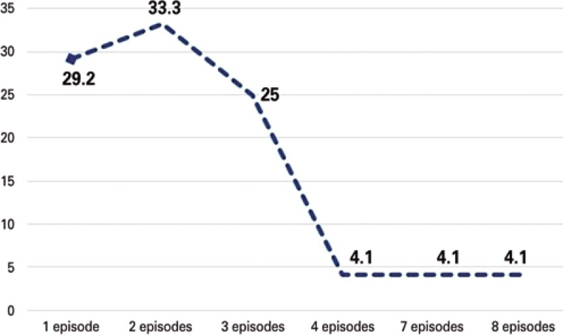
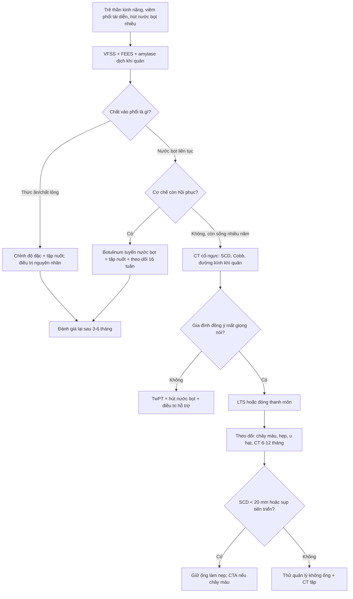
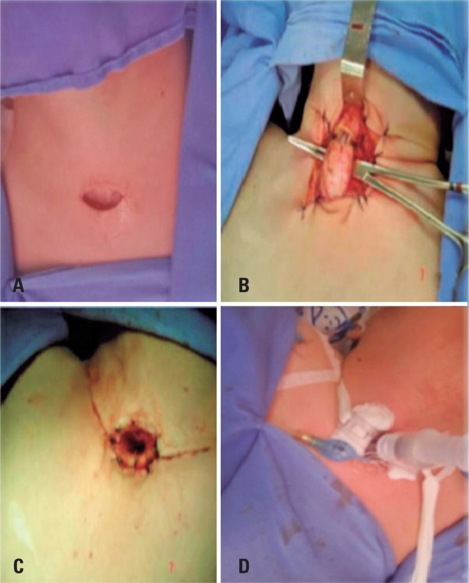
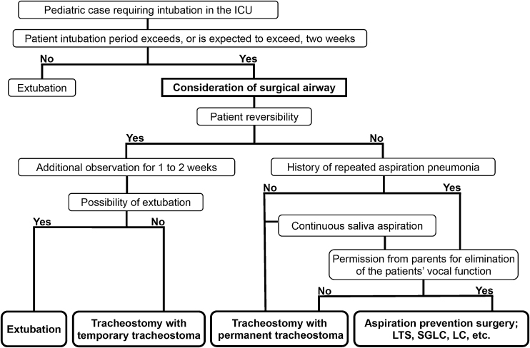
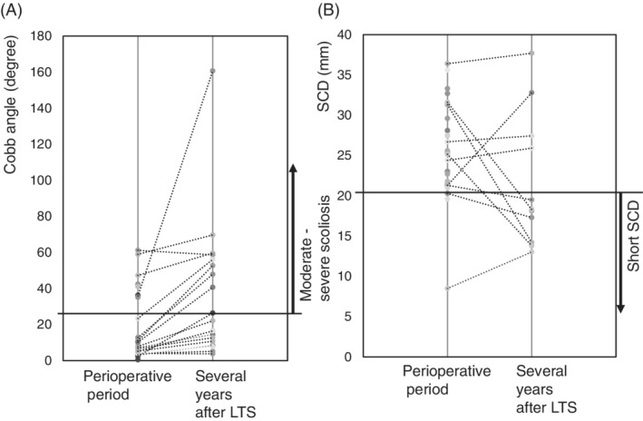

# 6143 — Cách ly thanh–khí quản và tiêm botulinum tuyến nước bọt ở trẻ hít sặc nước bọt nặng / Laryngotracheal separation and salivary botulinum toxin in severe salivary aspiration

**Tags:** `pattern:hit-sac` `pattern:roi-loan-nuot` `pattern:vien-phoi-tai-dien` `vung:duong-tho-nhi` `vung:thanh-quan` `vung:tuyen-nuoc-bot` `protocol:FEES` `protocol:VFSS` `protocol:CT-co-nguc` `score:PAS` `score:DFSS`
**Mức chắc chắn (certainty):** tổng hợp y văn (literature synthesis) — đoàn hệ **92 trẻ** cách ly thanh–khí quản trong **13 năm** (*Einstein (São Paulo)* 2019, PMCID **PMC6550435**); **28 trẻ** theo dõi **sau** cách ly (*Laryngoscope Investig Otolaryngol* 2021, PMCID **PMC8035946**); **21 trẻ** chọn đường thở ngoại khoa theo lưu đồ (*Braz J Otorhinolaryngol* 2023, PMCID **PMC10372357**); **220 trẻ** tiêm incobotulinumtoxinA tuyến nước bọt (thử nghiệm SIPEXI, dẫn trong *Toxins* 2023, PMCID **PMC10757066**); phân tích gộp **573 trẻ bại não** tiêm botulinum (*Toxins* 2021, PMCID **PMC8700360**); tổng quan hệ thống **31 nghiên cứu** tiêm botulinum ở trẻ (*Ann Otol Rhinol Laryngol* 2023, PMCID **PMC9834812**). Không gắn một bệnh án đơn lẻ cho phần số liệu.

> **Câu hỏi thực hành:** bé gái **6 tuổi**, bại não thể co cứng, đã mở khí quản **14 tháng** và đặt sonde dạ dày, nhập viện **4 lần/năm** vì viêm phổi. VFSS bữa ăn **âm tính**, nhưng mỗi ngày hút **60–80 mL nước bọt**, amylase dịch khí quản **8.400 U/L**, và mẹ nói "nước miếng chảy ra là bé sặc". Bác sĩ hỏi: **"Có phải chỉ cần tiêm botulinum tuyến nước bọt? Khi nào phải cách ly thanh–khí quản? Nếu mổ thì chọn kiểu nào, và sau mổ theo dõi gì?"**
> Bài chốt **năm quyết định**: **(1) hít sặc nước bọt là thực thể riêng** — VFSS bữa ăn có thể âm tính, chẩn đoán dựa vào amylase dịch khí quản và lượng nước bọt phải hút; **(2) botulinum chỉ làm giảm *lượng* nước bọt, không sửa *cơ chế nuốt*** — hiệu quả **8–12 tuần**, có thể tới **6 tháng**, và **không có bằng chứng trực tiếp làm giảm viêm phổi hít sặc**; **(3) cách ly thanh–khí quản (LTS)** cắt đường đi của nước bọt vào phổi: viêm phổi **100% trước mổ → 26,1% sau mổ** (p < 0,001) nhưng **mất giọng nói vĩnh viễn**; **(4) biến chứng LTS 14,1%** (rò 5,4%, chảy máu 4,3%, hẹp 3,2%, u hạt 2,2%); **(5) sau LTS, rút ống được 57% nhưng 9/16 phải đặt lại ống sau 2 năm** — vì cột sống vẹo tiến triển làm **khoảng cách xương ức–cột sống cổ (SCD) < 20 mm**, yếu tố dự báo **rò khí quản–động mạch không tên (TIF)**.

## 1. Tổng quan bệnh học – cơ chế hình ảnh: vì sao "nước bọt" khó hơn "thức ăn"

- **Nước bọt không có bữa ăn để dừng lại.** Thức ăn đi theo **từng đợt** có phản xạ nuốt bảo vệ; nước bọt chảy **liên tục 1–1,5 L/ngày** và trẻ nằm ngửa là chảy thẳng vào thanh quản theo trọng lực. Vì thế **VFSS bữa ăn âm tính không loại trừ hít sặc nước bọt** — trong 11 trẻ có ống mở khí quản, amylase dịch khí quản dao động **103–115.500 U/L** dù nhiều trẻ ăn qua sonde (PMC11301107, đã dẫn ở bài 6123).
- **Nguồn nước bọt — chọn tuyến để tiêm:** lúc đói, **tuyến dưới hàm (submandibular) tiết ~70%**, **tuyến mang tai (parotid) ~25%**, **tuyến dưới lưỡi ~5%** (PMC8700360). Vì vậy tiêm **2 tuyến dưới hàm** đã cắt phần lớn thể tích nước bọt lúc đói, còn **4 tuyến** (dưới hàm + mang tai hai bên) cắt cả phần nước bọt khi ăn.
- **Botulinum tác động ở đâu:** độc tố gắn **đầu tận cùng thần kinh cholinergic** của tuyến, được nội bào hóa rồi **ức chế phóng thích acetylcholine** tại **khớp thần kinh–tuyến**, làm giảm tiết nước bọt **theo liều** (PMC10757066). Thuốc **không đi qua hàng rào máu não**, nên **không sửa được phản xạ nuốt, trương lực cơ hầu hay phối hợp đóng thanh môn** — đây là lý do botulinum **giảm chảy nước miếng nhưng không chắc giảm viêm phổi**.
- **Vì sao botulinum có tác dụng chậm và ngắn:** sợi trục phải thoái hóa – tái tạo lại chỗ nối thần kinh–tuyến mới hồi phục; vì thế hiệu quả đạt đỉnh sau **1–2 tuần**, kéo dài **tối thiểu 8–12 tuần**, có nghiên cứu tới **6 tháng**; phân tích gộp khuyến nghị **tiêm lại sau 3 tháng** (PMC8700360). Ở trẻ, thử nghiệm SIPEXI dùng **khoảng 2 U/kg**, tổng liều **20–75 U** và **tiêm lại sau 16 tuần** (PMC10757066).
- **Nguyên lý của cách ly thanh–khí quản (LTS):** phẫu thuật **Lindeman (1976)** cắt ngang khí quản ở **vòng sụn thứ 2**, **khâu bít đầu gần** (thanh quản thành túi cụt) và **đưa đầu xa ra da** thành lỗ mở khí quản vĩnh viễn (Hình 2). Nước bọt vẫn nuốt xuống **thực quản**, còn khí đi thẳng **khí quản → lỗ mở da**, hai đường **không còn giao nhau**. Vì vậy LTS **loại bỏ hít sặc từ trên xuống** nhưng **không sửa được trào ngược dạ dày–thực quản** và **không cho ăn đường miệng an toàn** nếu cơ nuốt còn yếu.
- **Cái giá sinh lý:** LTS **cắt vĩnh viễn luồng khí qua thanh quản** → **mất giọng nói**, mất phản xạ ho hiệu quả qua đường mũi, và trẻ phải thở qua lỗ mở da suốt đời. Đây là lý do **đồng thuận của cha mẹ về việc "xóa chức năng thanh quản"** là một bước bắt buộc trong lưu đồ chọn đường thở (PMC10372357).
- **Định lượng kết quả LTS:** trong **92 trẻ** (tuổi trung vị **68,5 tháng**, 57,6% nam), **90,2%** nuôi hoàn toàn bằng sonde dạ dày và **72,4%** đặt sonde **trước** mổ; **100%** có viêm phổi trước mổ, sau mổ còn **26,1%** (24/92, p < 0,001). Biến chứng hậu phẫu **14,1%** (13/92): **rò 5,4%**, **chảy máu 4,3%**, **hẹp 3,2%**, **u hạt 2,2%**. Tử vong **25%** — do bệnh nền, không do phẫu thuật (PMC6550435).
- **Định lượng botulinum:** gộp **573 trẻ bại não**, tiêm botulinum vào tuyến nước bọt giảm **drooling quotient** với **SMD −0,716** (95% CI −1,17 đến −0,263; p = 0,002) và **thang tần suất–độ nặng chảy nước bọt (DFSS) SMD −0,888** (95% CI −1,49 đến −0,285; p = 0,004); liều Botox **10–120 U** hoặc **2–4 U/kg** (PMC8700360). Tổng quan **31 nghiên cứu** ở trẻ: **50 U onabotulinumtoxinA vào 2 tuyến dưới hàm** là liều an toàn – hiệu quả; **4 tuyến** dùng **60–100 U** tổng; tác dụng phụ hay gặp nhất là **khó nuốt**, gần như luôn hồi phục (PMC9834812).
- **Tại sao phải đo SCD và Cobb sau LTS:** lồng ngực trẻ bại não thường **vẹo cột sống nặng** và **biến dạng lồng ngực**, đẩy **động mạch không tên (innominate artery)** sát khí quản. Trên CT, **SCD < 20 mm** (khoảng cách mặt sau xương ức → mặt trước cột sống cổ) dự báo **rò khí quản–động mạch không tên**, biến chứng **chảy máu chết người** với tỉ lệ **0,1–1%** ở trẻ có mở khí quản lâu dài (PMC8035946).

*Hình 3 của bài gốc: số đợt viêm phổi giảm rõ sau cách ly thanh–khí quản; trong 92 trẻ, **100% có viêm phổi trước mổ** và còn **26,1% sau mổ** (p < 0,001). Nguồn: Einstein (São Paulo) 2019, PMCID PMC6550435, CC BY 4.0 — nguyên bản, không crop.*

## 2. Mẫu hình + chẩn đoán phân biệt theo vị trí (Gamut)

- **Mẫu hình "trẻ thần kinh nặng, viêm phổi tái diễn, hút nước bọt liên tục":** đây là giao điểm của **mất phản xạ bảo vệ thanh quản**, **ứ nước bọt trong miệng/hầu**, và **bệnh phổi mạn do hít sặc lặp lại**. Ba câu hỏi phải trả lời trước khi mổ: **(1) chất gì vào phổi** (nước bọt / thức ăn / dịch trào ngược); **(2) cơ chế còn hồi phục không** (bệnh thoái triển hay bệnh nền ổn định); **(3) gia đình chấp nhận mất giọng nói không**.
- **Gamut theo vị trí tổn thương:**
  - **Ổ miệng – hầu:** ứ nước bọt, yếu cơ môi/lưỡi, chảy ra ngoài (drooling) hoặc ứ ở xoang lê rồi tràn xuống khi nuốt khô.
  - **Thanh môn:** mất phản xạ đóng thanh môn, hít sặc **im lặng** (PAS 8), ho yếu.
  - **Dưới thanh môn – khí quản trên:** u hạt quanh ống, sụp trên lỗ mở, hẹp — **bắt chước** hít sặc vì cùng biểu hiện khò khè/tụt SpO₂ (bài 6100, 3047).
  - **Thực quản:** trào ngược dạ dày–thực quản, rò khí–thực quản — **vẫn hít sặc dù đã mở khí quản**; LTS không chữa trào ngược.
  - **Phổi:** viêm phổi **thùy dưới phải/thùy trên sau** (phụ thuộc tư thế), xẹp phổi tái diễn, giãn phế quản sau nhiều năm.
- **Gamut theo khả năng hồi phục — quyết định can thiệp:**
  - **Còn hồi phục** (bệnh cấp, sau chấn thương, đang tập nuốt): **điều trị nội khoa + botulinum + tập nuốt**, chưa mổ cắt đường thở.
  - **Không hồi phục nhưng còn sống nhiều năm** (bại não, bệnh cơ, dị tật thần kinh): **LTS hoặc đóng thanh quản** là can thiệp **giảm hít sặc triệt để**, đổi lại mất giọng.
  - **Tiên lượng ngắn, suy đa cơ quan:** chăm sóc giảm nhẹ, **không mổ**.
- **Gamut theo kiểu đường thở ngoại khoa** (lưu đồ PMC10372357): **TwTT** (mở khí quản + lỗ mở tạm thời, có thể cai ống), **TwPT** (mở khí quản + lỗ mở vĩnh viễn), **APS** (phẫu thuật phòng hít sặc: **LTS**, **đóng thanh môn dưới thanh môn (SGLC)**, **đóng thanh quản (LC)**). Trong 21 trẻ: **TwTT 5**, **TwPT 13**, **APS 3**; **3/5 TwTT cai ống được**, **2 trẻ TwPT sau đó phải chuyển APS** vì viêm phổi hít sặc tái diễn.

## 3. Bảng so sánh phân biệt (ma trận đối chiếu)

| Thực thể (entity) | Hình ảnh / thăm dò điển hình | Chốt vào (rule-in) | Chốt loại (rule-out) | Gợi ý xác nhận |
|---|---|---|---|---|
| **Hít sặc nước bọt** | VFSS bữa ăn **âm tính**; amylase dịch khí quản **cao**; hút nước bọt **> 30–50 mL/ngày** | **Amylase khí quản cao + hút nước bọt liên tục + viêm phổi tái diễn** | Amylase thấp **và** không ứ nước bọt → tìm nguyên nhân khác | Đo amylase dịch hút; FEES đánh giá ứ nước bọt |
| **Hít sặc thức ăn/chất lỏng** | VFSS: baryt **dưới dây thanh**, PAS 6–8, rõ ở chất lỏng mức 0 | **Baryt vào đường thở trong bữa ăn** | VFSS bữa ăn âm tính **không** loại trừ hít sặc nước bọt | VFSS/FEES, thử độ đặc IDDSI |
| **Trào ngược dạ dày–thực quản** | Baryt trào ngược lên thực quản; pH–trở kháng; viêm phổi **thùy trên sau/thùy dưới** | **Trào ngược thấy được + đáp ứng ức chế axit** | Không trào ngược khi nuốt chuẩn | pH–trở kháng 24 giờ, thử PPI |
| **Rò khí–thực quản (TEF)** | VFSS/CT nằm sấp: thuốc từ **thực quản → khí quản**; nội soi thấy lỗ rò | **Dòng thuốc thực quản → khí quản ở pha thực quản** | Chỉ hít sặc từ trên xuống qua thanh môn | Nội soi + CT nằm sấp sau nuốt cản quang |
| **U hạt/sụp trên lỗ mở** | Nội soi: khối mô hạt hoặc thành trước lồi vào lòng; CT: hẹp lòng | **Khối trong lòng/ sụp thấy trên nội soi, không đáp ứng kháng sinh** | Niêm mạc nhẵn, lòng mở đều | Nội soi ống mềm (bài 6100, 6144) |
| **LTS (đã mổ)** | Lỗ mở da vĩnh viễn, **không còn luồng khí qua miệng**; X-quang/CT: đầu gần khí quản bị bít | **Không khí qua mũi/miệng + lỗ mở da thở hoàn toàn** | Còn khí qua thanh môn → chưa cách ly hoàn toàn | Nội soi/CT sau mổ |
| **Đóng thanh môn dưới thanh môn (SGLC)** | Nội soi: thanh môn còn hở nhưng **dưới dây thanh bị đóng**; vẫn có thể nói bằng khí qua thanh môn | **Đóng dưới thanh môn + còn giọng nói** | Mất hoàn toàn luồng khí → LTS/LC | Nội soi, CT |
| **TwPT (mở khí quản lỗ vĩnh viễn)** | Lỗ mở da vĩnh viễn, **khí quản còn thông với thanh quản** | **Cần đường thở nhưng chưa loại trừ hít sặc** | Vẫn hít sặc nước bọt → cần APS | Nội soi, đánh giá nuốt |

- **Ảnh ghép đối chiếu:** bài này dùng **ảnh gốc riêng lẻ** (không ghép) vì một nguồn là **CC BY-NC-ND**, không được tạo tác phẩm phái sinh.

## 4. Protocol chụp/thăm dò + hệ phân độ và kỹ thuật

### 4.1 Trước can thiệp — trả lời ba câu hỏi

- **Đánh giá nuốt:** **VFSS** (chuẩn vàng cho hít sặc trong bữa ăn, đọc **PAS 1–8**) và **FEES** (ứ nước bọt, phản xạ ho, làm tại giường); làm **cả hai** khi VFSS âm tính mà vẫn nghi hít sặc nước bọt. **Không** quyết định mổ chỉ dựa vào "mẹ thấy sặc".
- **Định lượng nước bọt:** đếm **số lần hút/ngày**, **thể tích hút/ngày**, và **amylase dịch khí quản** (so sánh nội cá thể, chưa có ngưỡng tuyệt đối chuẩn hóa).
- **Đánh giá giải phẫu và nguy cơ:** **CT cổ–ngực** (không cản quang là đủ cho SCD/Cobb) đo **SCD**, **góc Cobb**, **đường kính khí quản**, tìm **hẹp/u hạt**; nội soi đường thở nếu nghi tổn thương cấu trúc.
- **Đồng thuận:** giải thích rõ **LTS mất giọng nói vĩnh viễn**, **lỗ mở da suốt đời**, **không ăn miệng được nếu nuốt còn yếu**; ghi vào hồ sơ (lưu đồ PMC10372357 yêu cầu "permission for elimination of vocal function").

### 4.2 Tiêm botulinum tuyến nước bọt — liều theo cân nặng

- **Chỉ định:** chảy nước bọt **nặng, gây hít sặc/viêm phổi tái diễn**, ở trẻ **≥ 2 tuổi và ≥ 12 kg**, sau khi đã đánh giá nuốt và loại trừ nguyên nhân cấu trúc.
- **Liều incobotulinumtoxinA (SIPEXI, PMC10757066):**

| Cân nặng | Tuyến mang tai mỗi bên | Tuyến dưới hàm mỗi bên | Tổng liều |
|---|---|---|---|
| ≥ 12 và < 15 kg | 6 U (0,24 mL) | 4 U (0,16 mL) | **20 U** |
| ≥ 15 và < 19 kg | 9 U (0,36 mL) | 6 U (0,24 mL) | **30 U** |
| ≥ 19 và < 23 kg | 12 U (0,48 mL) | 8 U (0,32 mL) | **40 U** |
| ≥ 23 và < 27 kg | 15 U (0,60 mL) | 10 U (0,40 mL) | **50 U** |
| ≥ 27 kg | 18 U (0,72 mL) | 12 U (0,48 mL) | **60 U** |
| ≥ 30 kg | 22,5 U (0,90 mL) | 15 U (0,60 mL) | **75 U** |

- **Phân bố thể tích:** **60% vào tuyến mang tai, 40% vào tuyến dưới hàm** (theo SIAXI/SIPEXI); **siêu âm hướng dẫn** được khuyến cáo vì tuyến dưới hàm thay đổi kích thước/vị trí, dù thử nghiệm **không thấy khác biệt hiệu quả** khi so có/không siêu âm.
- **Tiêm lại sau 16 tuần** (SIPEXI); trong thực hành có thể **3 tháng** nếu triệu chứng quay lại sớm. **Tác dụng phụ:** khó nuốt (4% ở liều 100 U người lớn; **4 trẻ** trong pha mở rộng SIPEXI), khô miệng, yếu cơ nhai; **không dùng** nếu đã có khó nuốt nặng chưa đánh giá.
- **Điểm cần nói với gia đình:** botulinum **giảm chảy nước miếng**, nhưng **chưa có bằng chứng trực tiếp giảm viêm phổi hít sặc** (PMC13423959) — vì vậy nó là **bắc cầu/giảm nhẹ**, không thay thế LTS khi hít sặc nặng tái diễn.

### 4.3 Cách ly thanh–khí quản — kỹ thuật và theo dõi

- **Kỹ thuật (Lindeman cải biên 1976):** rạch **2 cm trên hõm ức**, bộc lộ khí quản; **cắt ngang ở vòng sụn thứ 2**; **khâu bít đầu gần** (thanh quản); **đưa đầu xa ra da** và khâu cố định; đặt ống mở khí quản ngắn trong vài tuần đầu.
- **Sau mổ:** theo dõi **chảy máu (dấu hiệu báo trước TIF)**, **rò da–khí quản**, **hẹp lỗ mở**, **u hạt**; hút nước bọt qua miệng vẫn cần vì nước bọt vẫn tiết ra (LTS không làm hết tiết nước bọt).
- **Rút ống:** **57% (16/28)** rút được sớm sau LTS, nhưng **9 trẻ phải đặt lại ống sau 2 năm** vì **sụp/hẹp khí quản tiến triển**; **7 trẻ có biến dạng khí quản tiến triển** trên CT lần 2. Vì vậy **theo dõi CT dài hạn** là bắt buộc, không phải "mổ xong là xong" (PMC8035946).
- **Ngưỡng cảnh báo TIF:** **SCD < 20 mm** trên CT → **không nên quản lý không ống** nếu ống cần làm nẹp; **chảy máu lỗ mở bất kỳ** ở trẻ có SCD ngắn = **cấp cứu**, chụp CTA/soi mạch, không chờ.
- **Lưu đồ chọn đường thở** (PMC10372357): xét **khả năng cai ống**, **thời gian đặt ống**, **khả năng hồi phục**, **tiền sử viêm phổi hít sặc/ứ nước bọt**, và **đồng ý xóa chức năng thanh quản**; từ đó chọn **TwTT → TwPT → APS (LTS/SGLC/LC)**.

*Hình 2 của bài gốc: (A) đường rạch 2 cm trên hõm ức; (B) cắt khí quản ở vòng sụn thứ 2 và khâu bít đầu gần; (C) đưa đầu xa ra da; (D) kết quả cuối. Nguồn: Einstein (São Paulo) 2019, PMCID PMC6550435, CC BY 4.0 — nguyên bản, không crop.*

*Hình 1 của bài gốc: lưu đồ chọn đường thở ở trẻ thần kinh nặng đặt nội khí quản kéo dài — TwTT, TwPT, hoặc phẫu thuật phòng hít sặc (LTS/SGLC/LC). Nguồn: Braz J Otorhinolaryngol 2023, PMCID PMC10372357, CC BY 4.0 — nguyên bản, không crop.*

## 5. Biến thể bình thường và cạm bẫy

- **Cạm bẫy 1 — "VFSS âm tính nên không hít sặc":** VFSS chỉ đánh giá **bữa ăn**; hít sặc nước bọt xảy ra **giữa các bữa**. Phải đo **amylase dịch khí quản** và đếm **lượng nước bọt phải hút** trước khi kết luận.
- **Cạm bẫy 2 — "tiêm botulinum là đủ":** botulinum giảm **lượng** nước bọt, nhưng **không sửa phản xạ nuốt**; ở trẻ đã có **viêm phổi nặng tái diễn**, tiêm đơn thuần có thể **trì hoãn LTS** trong khi phổi tiếp tục bị tổn thương. Ngược lại, **LTS quá sớm** ở trẻ còn hồi phục là **mất giọng nói vĩnh viễn oan**.
- **Cạm bẫy 3 — bỏ sót TIF:** **SCD < 20 mm** + **chảy máu lỗ mở** = **dấu hiệu báo trước** của rò khí quản–động mạch không tên (tỉ lệ **0,1–1%**, tử vong nhanh). Không được hút mạnh/thay ống mù ở trẻ đang chảy máu; cần **CTA/soi mạch cấp cứu**.
- **Cạm bẫy 4 — "LTS chữa luôn trào ngược":** LTS tách đường khí – đường tiêu hóa, nhưng **trào ngược vẫn vào thực quản**; nếu trẻ còn **nôn/trào ngược nhiều**, vẫn có thể hít sặc **qua lỗ mở da** khi nằm ngửa hoặc khi dịch trào lên hầu. Cần **điều trị trào ngược** và tư thế.
- **Cạm bẫy 5 — u hạt/sụp giả "hít sặc":** trẻ LTS vẫn có thể **khò khè, tụt SpO₂** do **u hạt quanh lỗ mở** hoặc **sụp khí quản**, không phải do hít sặc; nội soi định kỳ phân biệt (bài 6100, 6144).
- **Biến thể bình thường:** trẻ **chảy nước bọt sinh lý tới 4 tuổi** (PMC10757066) — không tiêm botulinum cho trẻ < 4 tuổi chỉ vì chảy nước miếng; phải có **hít sặc/viêm phổi** hoặc **ảnh hưởng chất lượng sống nặng**.

## 6. Tự lượng giá — Blind Quiz

**Ca 1 — Bé trai 5 tuổi, bại não, mở khí quản 2 năm, 5 đợt viêm phổi/năm.**

- Gợi ý: VFSS bữa ăn âm tính; amylase dịch khí quản 12.000 U/L; mẹ hút nước bọt 50–70 mL/ngày.
- Câu hỏi: Đây là hít sặc gì? Hai lựa chọn can thiệp và tiêu chí chọn?

<b>Bấm để hiện đáp án</b>

- **Hít sặc nước bọt** — VFSS bữa ăn âm tính nhưng amylase khí quản cao và lượng nước bọt phải hút lớn.
- **Botulinum tuyến nước bọt** nếu còn khả năng hồi phục/đang chờ đánh giá; **LTS** nếu hít sặc nặng tái diễn, bệnh nền không hồi phục và gia đình đồng ý mất giọng nói. Trong đoàn hệ 92 trẻ, viêm phổi giảm **100% → 26,1%** sau LTS (p < 0,001).
- Nguồn ảnh: Einstein (São Paulo) 2019, PMCID PMC6550435, CC BY 4.0.

**Ca 2 — Bé gái 12 tuổi sau LTS 3 năm, khò khè tăng dần, không sốt.**

- Gợi ý: Trẻ bại não, vẹo cột sống nặng, đang thở không ống.
- Câu hỏi: Hai biến chứng muộn nào cần tìm? Ngưỡng nào buộc phải đặt lại ống?

<b>Bấm để hiện đáp án</b>

- **Sụp/hẹp khí quản tiến triển** và **rò khí quản–động mạch không tên (TIF)**; đo **Cobb** và **SCD** trên CT. **SCD < 20 mm** dự báo TIF và là lý do **giữ ống làm nẹp**; **9/16 trẻ** rút ống được đã phải đặt lại sau **2 năm**.
- Nguồn ảnh: Laryngoscope Investig Otolaryngol 2021, PMCID PMC8035946, **CC BY-NC-ND 4.0** — nguyên bản, không crop/ghép.

**Ca 3 — Bé trai 2 tuổi, hít sặc nước bọt nặng, bệnh nền không hồi phục, bố mẹ chưa đồng ý mất giọng nói.**

- Câu hỏi: Chọn TwTT, TwPT hay APS? Vì sao?

<b>Bấm để hiện đáp án</b>

- **TwPT** (mở khí quản lỗ vĩnh viễn) khi chưa đồng ý xóa chức năng thanh quản; **APS/LTS** chỉ đặt khi đã đồng thuận mất giọng nói. Trong 21 trẻ của lưu đồ: **TwPT 13**, **TwTT 5**, **APS 3**; **2 trẻ TwPT** sau đó vẫn phải chuyển **APS** vì viêm phổi tái diễn.
- Nguồn ảnh: Braz J Otorhinolaryngol 2023, PMCID PMC10372357, CC BY 4.0.

## Bài liên quan chéo
- [6123 – Rối loạn nuốt và hít sặc ở trẻ có ống mở khí quản](../6123-roi-loan-nuot-va-hit-sac-tre-mo-khi-quan/lesson.md)
- [6100 – Chăm sóc, biến chứng và cai ống mở khí quản](../6100-cham-soc-va-cai-ong-mo-khi-quan-tre/lesson.md)
- [6144 – Nội soi thanh–khí quản định kỳ ở trẻ có ống mở khí quản](../6144-noi-soi-thanh-khi-quan-dinh-ky-ong-mo-khi-quan-tre/lesson.md)
- [082 – Bài não an toàn nuốt (PAS/FOIS/IDDSI)](../082-bai-nao-an-toan-nuot/lesson.md)
- [600 – Tổng quan Hệ Nhi khoa](../600-tong-quan-nhi-khoa/lesson.md)

> Không dùng để chẩn đoán độc lập khi chưa có người hướng dẫn.
