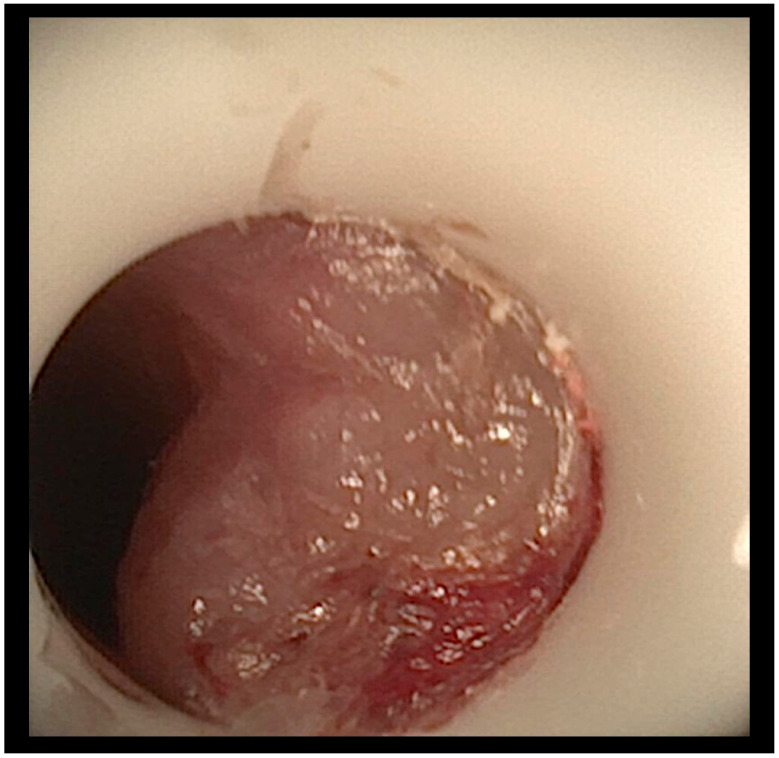
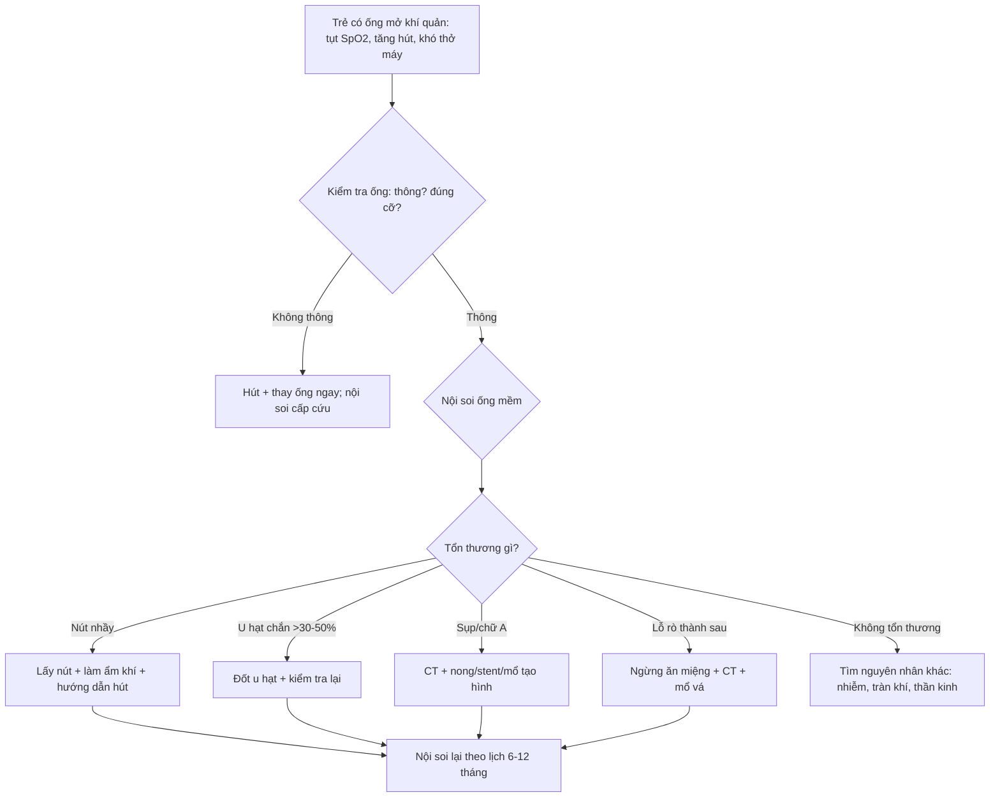
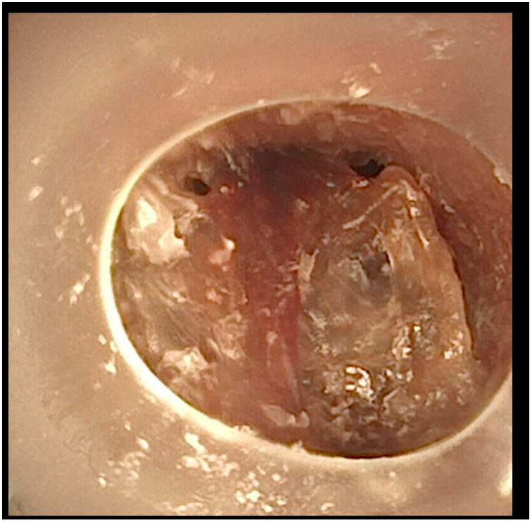
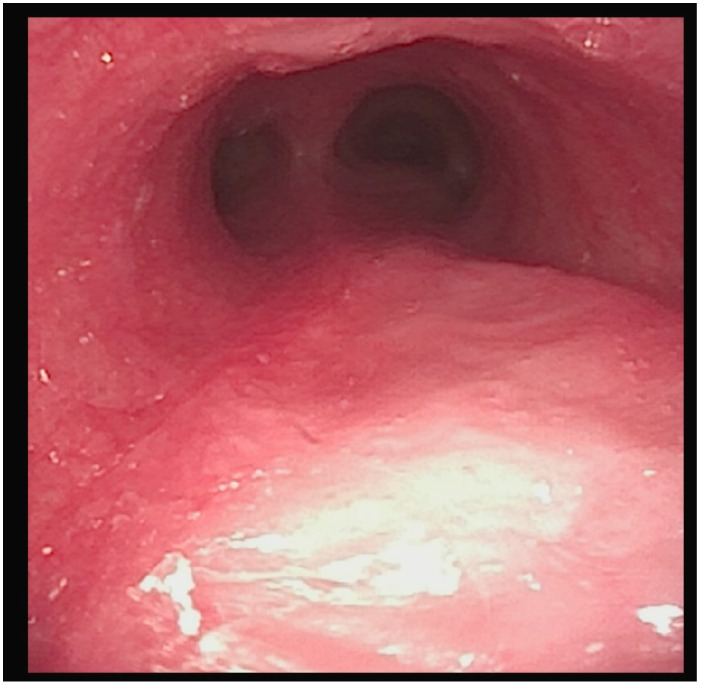
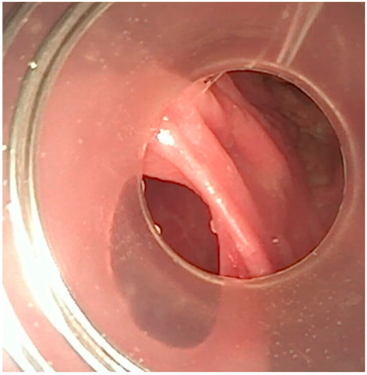

# 6144 — Nội soi thanh–khí quản định kỳ ở trẻ có ống mở khí quản / Surveillance bronchoscopy in children with tracheostomy

**Tags:** `pattern:u-hat` `pattern:hep-duong-tho` `pattern:xep-phoi` `pattern:nut-nhay` `vung:duong-tho-nhi` `vung:thanh-quan` `protocol:noi-soi-khi-quan` `protocol:CT-co-nguc` `score:Cotton-Myer`
**Mức chắc chắn (certainty):** tổng hợp y văn (literature synthesis) — **4 ca** biến chứng khí quản muộn ở trẻ thở máy dài ngày (*Children (Basel)* 2025, PMCID **PMC12191466**); **303 trẻ** trong nghiên cứu giám sát nội soi (dẫn trong cùng bài); khảo sát **138 bác sĩ tai–mũi–họng nhi** về thực hành mở khí quản (*Laryngoscope Investig Otolaryngol* 2026, PMCID **PMC13015836**); **234 trẻ** mở khí quản tại PICU, 121 trẻ theo dõi cai ống (*Front Pediatr* 2025, PMCID **PMC13485925**); **175 trẻ** về sụp trên lỗ mở và biến dạng chữ A (PMC10866584, đã dẫn ở bài 6100). **Chưa có thử nghiệm ngẫu nhiên** so sánh các khoảng nội soi — phần "bao lâu một lần" là **tổng hợp khuyến cáo**, không phải bằng chứng cấp I.

> **Câu hỏi thực hành:** bé trai **5 tuổi**, bệnh não do thiếu oxy – thiếu máu, mở khí quản **2 năm**, thở máy ban đêm. Ba tuần nay **cần hút nhiều hơn**, có lúc **tụt SpO₂ đột ngột** rồi tự hồi, **không sốt**, X-quang ngực **không đám mờ mới**. Bác sĩ hỏi: **"X-quang bình thường thì có cần nội soi không? Nội soi định kỳ bao lâu một lần? Khi nào nội soi cấp cứu?"**
> Bài chốt **năm quyết định**: **(1) X-quang bình thường không loại trừ u hạt/nút nhầy** — phần lớn bất thường **chỉ thấy bằng nội soi**; **(2) 55,1% trẻ có ống mở khí quản có ≥ 1 tổn thương khí quản**, hay gặp nhất là **u hạt quanh lỗ mở, sụp trên lỗ mở, u hạt quanh da**; **(3) ATS khuyến cáo nội soi ống mềm/ống cứng mỗi 6–12 tháng**, khảo sát 2026 cho thấy **63% đơn vị có nội soi giám sát**, chủ yếu **2 lần trong năm đầu**; **(4) nút nhầy gây ngừng tim – ngừng thở ở 7/70 trẻ (10%) trong 7–90 ngày đầu** — nội soi phát hiện và lấy nút là can thiệp cứu mạng; **(5) nội soi cấp cứu khi chảy máu, khó thông khí, không đổi được ống, nghi rò khí–thực quản** — không chờ lịch định kỳ.

## 1. Tổng quan bệnh học – cơ chế hình ảnh: vì sao "ống thở tốt" vẫn làm hư khí quản

- **Ống mở khí quản là vật lạ vừa thông khí vừa cọ xát.** Ống tì vào **thành trước khí quản** và **đầu ống cọ vào niêm mạc** ở mỗi lần cử động đầu, hút đờm, thay ống; đồng thời **ứ đọng chất tiết + màng sinh học (biofilm)** quanh ống tạo viêm mạn. Kết quả là **mô hạt (granulation tissue)** — mô viêm giàu mạch, dễ chảy máu, mọc từ **quanh lỗ mở** lan vào lòng.
- **Vì sao u hạt nguy hiểm hơn "cục thịt nhỏ":** sức cản đường thở **R ∝ 1/r⁴**; ở khí quản trẻ **đường kính 4–6 mm**, một khối u hạt làm hẹp **50% đường kính** làm **tăng sức cản ~16 lần**. Ca 1 của PMC12191466: u hạt dưới đầu ống **chắn 60% lòng khí quản**, trẻ chỉ biểu hiện **khó thở khi thở máy và có máu trong dịch hút** — không sốt, không đám mờ trên X-quang.
- **Vì sao sụp trên lỗ mở (suprastomal collapse) xuất hiện muộn:** ống làm **thiếu máu – tiêu sụn** đoạn khí quản trên lỗ mở; khi rút ống hoặc khi ống nhỏ hơn, đoạn mất giá đỡ **lồi vào lòng khi thở ra**. Trong **175 trẻ**: sụp **55%** (trung bình sau **17,7 tháng**, ước tính **73,7% ở 5 năm**), **biến dạng chữ A 18%** (ước tính **32,8% ở 5 năm**); **56% (18/32)** biến dạng chữ A xuất hiện **sau khi đã cai ống** (PMC10866584, dẫn ở bài 6100). Đây là lý do **nội soi trước và sau cai ống** đều cần.
- **Vì sao nút nhầy (mucus plug) là nguyên nhân tử vong hàng đầu:** trẻ có ống **không ho được qua thanh môn**, chất tiết khô dính thành **nút đặc** bít lòng ống; **18,2%** gia đình báo từng gặp nút nhầy và **17,6%** từng bị rơi ống (PMC12191466). Trong một nghiên cứu Canada, nút nhầy hình thành trong viện gây **ngừng tim – ngừng thở ở 7 trẻ (10%) trong 7–90 ngày** sau mở khí quản — **nội soi lấy nút là can thiệp cứu mạng**, không phải "làm cho đẹp hồ sơ".
- **Vì sao X-quang không đủ:** X-quang thấy **vị trí ống, bóng khí, đám mờ phổi**, nhưng **không thấy** u hạt mềm, **sụp thành trước**, **nút nhầy không cản quang**, **lỗ rò nhỏ**. CT **lát mỏng 1 mm** thấy **hẹp lòng, biến dạng, vôi hóa sụn**, nhưng **không thay thế** nội soi để **can thiệp** (lấy nút, đốt u hạt, đặt stent).
- **Định lượng gánh nặng tổn thương:** trong **303 trẻ** được nội soi giám sát, **55,1%** có **một hoặc nhiều tổn thương**; hay gặp nhất là **u hạt trên lỗ mở, sụp trên lỗ mở, u hạt quanh da** (mức nhẹ); **u hạt khí quản xa 4,9%** và **loét khí quản 1,3%** (mức nặng). **Thời gian trung vị từ mở khí quản đến nội soi đầu tiên là 13 tháng**, khoảng cách giữa các lần sau **7 tháng**; trẻ nội soi **trong 6 tháng đầu** ít có bất thường hơn — gợi ý **thời điểm nội soi quan trọng hơn tần suất**.
- **Định lượng hậu quả cai ống:** **234 trẻ** mở khí quản tại PICU, **121 trẻ** theo dõi đủ: **54,5%** có ≥ 1 biến chứng, **51,2%** biến chứng muộn; **87,6%** cai ống được, trung vị **126 ngày** (IQR 68–332). **Tuổi ≤ 1 năm, bệnh tắc nghẽn đường thở, phản xạ ho kém** là yếu tố **cai ống muộn** độc lập; mô hình phối hợp **AUC 0,854** (PMC13485925).

*Hình 1 của bài gốc: u hạt (granuloma) dưới đầu ống mở khí quản, chắn **60% lòng khí quản**; trẻ biểu hiện khó thở khi thở máy và có máu trong dịch hút, không sốt, X-quang không đám mờ mới. Nguồn: Children (Basel) 2025, PMCID PMC12191466, CC BY 4.0 — nguyên bản, không crop.*

## 2. Mẫu hình + chẩn đoán phân biệt theo vị trí (Gamut)

- **Mẫu hình "trẻ có ống mở khí quản xấu dần mà X-quang bình thường":** nghĩ đến **tắc ống do nút nhầy/u hạt**, **sụp trên lỗ mở**, **rò khí–thực quản**, **nhiễm trùng**, **tràn khí màng phổi**. Thứ tự xử lý: **kiểm tra ống – hút – nội soi**, không chờ CT.
- **Gamut theo tầng giải phẫu (đọc từ trên xuống):**
  - **Quanh da – lỗ mở:** u hạt quanh da, nhiễm khuẩn lỗ mở, chảy máu, hẹp da.
  - **Trên lỗ mở (suprastomal):** **u hạt "nắp"**, **sụp thành trước**, **biến dạng chữ A** — chắn ngay trên đầu ống, cản cai ống.
  - **Đầu ống – khí quản xa:** u hạt, **loét**, nút nhầy, ống quá dài chạm carina, ống sai cỡ.
  - **Thành sau khí quản:** **rò khí–thực quản**, biến dạng thành sau do bóng ống.
  - **Dưới thanh môn:** hẹp sau đặt ống kéo dài (bài 3047), dính dây thanh.
  - **Phổi – màng phổi:** viêm phổi – xẹp phổi, tràn khí, xẹp do tắc.
- **Gamut theo triệu chứng khởi phát:**
  - **Tụt SpO₂ từng cơn, hút ra ít đờm:** nút nhầy hoặc u hạt chắn đầu ống.
  - **Chảy máu qua lỗ mở:** u hạt, loét, **TIF** (rò khí quản–động mạch không tên) — cấp cứu.
  - **Sặc khi ăn/uống, viêm phổi tái diễn:** **rò khí–thực quản** hoặc hít sặc (bài 6123).
  - **Khó thay ống, không đưa được ống:** hẹp lỗ mở, u hạt, ống sai cỡ.
  - **Sốt + tăng tiết + đám mờ mới:** nhiễm trùng liên quan ống (bài 6124), không phải u hạt.
- **Ba câu hỏi phải trả lời mỗi lần nội soi:** **(1) có tổn thương chắn lòng không** (u hạt, sụp, nút nhầy) và **mức hẹp bao nhiêu %**; **(2) tổn thương ở tầng nào** (trên lỗ mở / đầu ống / khí quản xa / thành sau); **(3) can thiệp gì ngay** (lấy nút, đốt u hạt, đổi ống, đặt stent, chuyển mổ).

## 3. Bảng so sánh phân biệt (ma trận đối chiếu)

| Thực thể (entity) | Hình ảnh / nội soi điển hình | Chốt vào (rule-in) | Chốt loại (rule-out) | Gợi ý xác nhận |
|---|---|---|---|---|
| **U hạt quanh/dưới đầu ống** | Nội soi: khối mô hồng – đỏ, dễ chảy máu, **chắn một phần lòng**; CT: mô mềm trong lòng | **Khối thấy trên nội soi + chảy máu khi chạm + hẹp lòng đo được** | Niêm mạc nhẵn, không khối, lòng mở đều | Nội soi ống mềm; đốt/lấy mẫu |
| **Sụp trên lỗ mở (suprastomal collapse)** | Nội soi: **thành trước lồi vào lòng khi thở ra**, mềm; CT: hẹp động thì thở ra | **Sụp thấy khi thở ra, hồi phục khi hít vào** | Hẹp cố định do xơ/sụn → hẹp thật | Nội soi + CT động/thì thở ra |
| **Biến dạng chữ A (A-frame)** | CT/nội soi: **hai bên thành bên đổ vào**, lòng hình chữ A; thường sau cai ống | **Hình chữ A trên CT + tiền sử ống lâu** | Hẹp chu vi đều → xơ đồng tâm | CT lát mỏng, nội soi |
| **Nút nhầy (mucus plug)** | Nội soi: khối **trắng – xám, dai**, bít lòng ống/khí quản; X-quang có thể bình thường | **Lấy được nút + SpO₂ cải thiện ngay** | Không có khối, chỉ ứ dịch lỏng | Nội soi cấp cứu, hút |
| **Rò khí–thực quản (TEF)** | Nội soi: **lỗ rò thành sau**, thấy niêm mạc thực quản; VFSS/CT nằm sấp: thuốc vào khí quản | **Lỗ rò thấy trực tiếp + thuốc thực quản → khí quản** | Chỉ hít sặc từ trên xuống qua thanh môn | Nội soi + VFSS/CT nằm sấp |
| **Nhiễm trùng liên quan ống** | X-quang/CT: đám mờ mới, có thể áp-xe; nội soi: **mủ, niêm mạc viêm**, không khối | **Sốt + đám mờ mới + cấy dương** | Không sốt, không đám mờ, chỉ khối cơ học → u hạt | Cấy dịch, X-quang/CT (bài 6124) |
| **Hẹp dưới thanh môn** | Nội soi: vòng xơ dưới dây thanh; CT: hẹp cố định | **Hẹp cố định, không đổi theo thì thở** | Hẹp động, hồi phục → malacia/sụp | Nội soi + CT (bài 3047) |
| **TIF (rò khí quản–động mạch không tên)** | Chảy máu **"báo trước"** qua lỗ mở; CTA: động mạch không tên sát khí quản, giả phình | **Chảy máu + SCD < 20 mm + CTA thấy mạch sát khí quản** | Chảy máu chỉ từ u hạt, cầm khi đốt | CTA/soi mạch cấp cứu |

## 4. Protocol nội soi + hệ phân độ và lịch theo dõi

### 4.1 Chuẩn bị và kỹ thuật

- **Nội soi ống mềm** (linh hoạt) tại giường/buồng mổ: đánh giá **lỗ mở, đoạn trên lỗ mở, đầu ống, khí quản xa, carina, phế quản gốc**; **hút sạch** trước khi đánh giá; **không bơm quá nhiều nước** ở trẻ nhỏ.
- **Nội soi ống cứng** khi cần **can thiệp** (lấy nút lớn, đốt u hạt, nong, đặt stent) hoặc **kiểm tra thành sau**.
- **An thần/giảm đau** theo cân nặng; **theo dõi SpO₂, ETCO₂, huyết áp**; **nguồn oxy và ống thay thế cùng cỡ** phải có sẵn — nội soi ở trẻ có ống mở khí quản là thủ thuật **có nguy cơ mất đường thở**.
- **CT cổ–ngực lát mỏng 1 mm** khi cần đánh giá **hẹp cố định, biến dạng chữ A, SCD, khối ngoài lòng**; **không** dùng CT thay nội soi để lấy nút.

### 4.2 Lịch nội soi — tổng hợp khuyến cáo (chưa có RCT)

| Thời điểm | Khuyến cáo thực hành | Cơ sở |
|---|---|---|
| **4–6 tuần sau mở khí quản** (hoặc trước xuất viện) | Nội soi **đầu tiên** để có mốc nền: vị trí ống, u hạt sớm, sụp, rò | ATS khuyến cáo nội soi định kỳ; thực hành hay bỏ qua giai đoạn này |
| **Mỗi 6–12 tháng** | Nội soi **giám sát** ở trẻ còn ống, đặc biệt **< 2 tuổi** | ATS **6–12 tháng**; hướng dẫn Đức **hàng năm**; khảo sát 2026: **63%** đơn vị có nội soi giám sát, **34%** làm **2 lần trong năm đầu** |
| **Trước cai ống** | Nội soi **bắt buộc** để loại **u hạt, sụp, hẹp, rò** | Sụp **55%**, chữ A **18%**, nhiều tổn thương xuất hiện **sau cai** |
| **Sau cai ống 3–6 tháng** | Nội soi/CT kiểm tra **sụp và chữ A** | **56%** chữ A xuất hiện **sau cai ống** |
| **Cấp cứu — bất kỳ lúc nào** | Chảy máu, khó thông khí, **không đổi được ống**, nghi rò khí–thực quản, tụt SpO₂ tái diễn | Nút nhầy gây ngừng tim **10%** trong **7–90 ngày**; TIF **0,1–1%** |

- **Không có bằng chứng** rằng nội soi **thường quy mỗi 3 tháng** tốt hơn **6–12 tháng**; khảo sát cho thấy **thực hành rất khác nhau**, nên **phác đồ của đơn vị + đánh giá từng trẻ** quan trọng hơn con số cứng.
- **Ai cần nội soi dày hơn:** trẻ **< 2 tuổi**, **bại não/vẹo cột sống nặng**, **tiền sử u hạt/nút nhầy**, **thay ống khó**, **cai ống thất bại**, **thở máy dài ngày**.

### 4.3 Phân độ hẹp và xử trí

- **Hẹp dưới thanh môn:** **Cotton–Myer I < 50%**, **II 51–70%**, **III 71–99%**, **IV không có lòng** — dùng cho tổn thương **dưới thanh môn**, không áp cho u hạt quanh ống.
- **U hạt:** đốt bằng **laser/điện/argin plasma** nếu chắn > 30–50% lòng hoặc gây triệu chứng; **lấy mẫu** nếu nghi ác tính (hiếm ở trẻ).
- **Nút nhầy:** lấy bằng **ống mềm + kẹp/bơm rửa**, sau đó **làm ẩm khí**, **thay ống đúng cỡ**, **hướng dẫn gia đình hút đúng độ sâu**.
- **Sụp/chữ A:** **nong, stent, hoặc mổ tạo hình khí quản** khi cản cai ống; **không đốt** vì tổn thương là **sụn mất giá đỡ**, không phải mô thừa.
- **TEF:** **ngừng ăn đường miệng**, nuôi qua sonde, **nội soi + CT**, phẫu thuật vá khi ổn định; **không đặt stent thực quản** trước khi đánh giá kỹ.

*Hình 4 của bài gốc: nút nhầy (mucus plug) bít khí quản — nguyên nhân tử vong hàng đầu ở trẻ có ống mở khí quản; nút nhầy gây ngừng tim – ngừng thở ở **7/70 trẻ (10%) trong 7–90 ngày** sau mổ. Nguồn: Children (Basel) 2025, PMCID PMC12191466, CC BY 4.0 — nguyên bản, không crop.*

## 5. Biến thể bình thường và cạm bẫy

- **Cạm bẫy 1 — "X-quang bình thường nên không cần nội soi":** u hạt, sụp thành trước và nút nhầy **không cản quang**; X-quang chỉ loại trừ **đám mờ phổi lớn/tràn khí**. Trẻ **tụt SpO₂ tái diễn** phải nội soi dù phim bình thường.
- **Cạm bẫy 2 — gọi u hạt là "nhiễm trùng":** u hạt **không đáp ứng kháng sinh**; cho kháng sinh kéo dài chỉ **trì hoãn can thiệp** và tạo **kháng thuốc**. Ngược lại, **sốt + đám mờ mới** là nhiễm trùng thật (bài 6124), không phải u hạt.
- **Cạm bẫy 3 — nội soi quá nông:** chỉ nhìn **đầu ống** sẽ bỏ sót **u hạt khí quản xa (4,9%)**, **loét (1,3%)**, **rò thành sau**. Phải đi **qua đầu ống tới carina**, nhìn **thành sau** khi rút ống ra một phần.
- **Cạm bẫy 4 — bỏ qua "chảy máu nhỏ":** chảy máu lỗ mở ở trẻ **SCD < 20 mm** có thể là **tiền triệu TIF**; **không hút mạnh, không thay ống mù**, cần **CTA/soi mạch**.
- **Cạm bẫy 5 — nội soi xong không thay đổi gì:** nội soi giám sát chỉ có giá trị nếu **ghi lại tổn thương, mức hẹp, vị trí** và **đối chiếu lần trước**; nếu không, không phân biệt được **tiến triển** với **bất thường cũ**.
- **Biến thể bình thường:** **u hạt nhỏ quanh da/lỗ mở không chắn lòng** có thể chỉ theo dõi; **mô hạt nhẹ sau mổ 4–6 tuần** là phản ứng lành thường gặp, không phải chỉ định đốt ngay.

## 6. Tự lượng giá — Blind Quiz

**Ca 1 — Bé trai 5 tuổi, thở máy qua ống mở khí quản, tụt SpO₂ từng cơn, dịch hút có máu.**

- Gợi ý: không sốt, X-quang không đám mờ mới, hút ít đờm.
- Câu hỏi: Tổn thương gì? Vì sao X-quang bình thường? Xử trí?

<b>Bấm để hiện đáp án</b>

- **U hạt dưới đầu ống chắn 60% lòng khí quản** — mô mềm **không cản quang**, nên X-quang bình thường; máu trong dịch hút do u hạt dễ chảy máu.
- **Nội soi + đốt u hạt**, kiểm tra lại lòng khí quản; sau đó **theo dõi định kỳ** vì u hạt tái phát.
- Nguồn ảnh: Children (Basel) 2025, PMCID PMC12191466, CC BY 4.0.

**Ca 2 — Bé gái 8 tuổi, đột ngột không thông khí được, bóng không lên.**

- Gợi ý: Trước đó vài giờ vẫn ổn, hút ra ít đờm đặc.
- Câu hỏi: Nguyên nhân? Xử trí đầu tay? Phòng ngừa?

<b>Bấm để hiện đáp án</b>

- **Nút nhầy (mucus plug)** bít khí quản/ống — nguyên nhân tử vong hàng đầu; **nút nhầy gây ngừng tim ở 7/70 trẻ (10%) trong 7–90 ngày**.
- **Hút + thay ống + nội soi lấy nút** ngay; sau đó **làm ẩm khí**, **hướng dẫn hút đúng độ sâu**, **theo dõi sát**.
- Nguồn ảnh: Children (Basel) 2025, PMCID PMC12191466, CC BY 4.0.

**Ca 3 — Bé trai 3 tuổi, sau 3 tháng điều trị u hạt, kiểm tra lại.**

- Câu hỏi: Đánh giá kết quả thế nào? Khi nào hẹn nội soi tiếp?

<b>Bấm để hiện đáp án</b>

- **Niêm mạc hồi phục, lòng khí quản thông** sau 3 tháng chăm sóc ống đúng — minh họa rằng **can thiệp + chăm sóc ống** có thể đảo ngược tổn thương.
- Hẹn **nội soi lại 6–12 tháng** hoặc sớm hơn nếu triệu chứng quay lại; **trước cai ống** phải nội soi lại.
- Nguồn ảnh: Children (Basel) 2025, PMCID PMC12191466, CC BY 4.0.

**Ca 4 — Bé gái 6 tuổi, viêm phổi tái diễn, sặc khi ăn, nội soi thấy lỗ thành sau.**

- Câu hỏi: Chẩn đoán? Vì sao không chỉ tăng kháng sinh?

<b>Bấm để hiện đáp án</b>

- **Rò khí–thực quản (TEF)** — lỗ rò thành sau khí quản; thức ăn/dịch dạ dày đi thẳng vào đường thở nên **kháng sinh không chữa được**.
- **Ngừng ăn đường miệng**, nuôi qua sonde, **CT/VFSS xác nhận**, **mổ vá** khi ổn định.
- Nguồn ảnh: Children (Basel) 2025, PMCID PMC12191466, CC BY 4.0.

## Bài liên quan chéo
- [6100 – Chăm sóc, biến chứng và cai ống mở khí quản](../6100-cham-soc-va-cai-ong-mo-khi-quan-tre/lesson.md)
- [6124 – Nhiễm trùng liên quan ống mở khí quản](../6124-nhiem-trung-lien-quan-ong-mo-khi-quan-o-tre/lesson.md)
- [6123 – Rối loạn nuốt và hít sặc ở trẻ có ống mở khí quản](../6123-roi-loan-nuot-va-hit-sac-tre-mo-khi-quan/lesson.md)
- [6143 – Cách ly thanh–khí quản và botulinum tuyến nước bọt](../6143-cach-ly-thanh-khi-quan-botulinum-nuoc-bot-tre/lesson.md)
- [3047 – Hẹp khí quản sau đặt nội khí quản ở trẻ](../3047-hep-khi-quan-sau-dat-noi-khi-quan-o-tre/lesson.md)
- [600 – Tổng quan Hệ Nhi khoa](../600-tong-quan-nhi-khoa/lesson.md)

> Không dùng để chẩn đoán độc lập khi chưa có người hướng dẫn.
