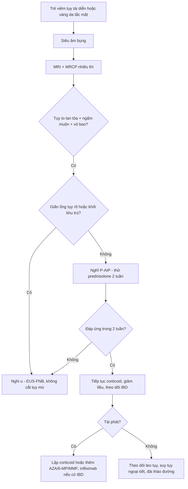
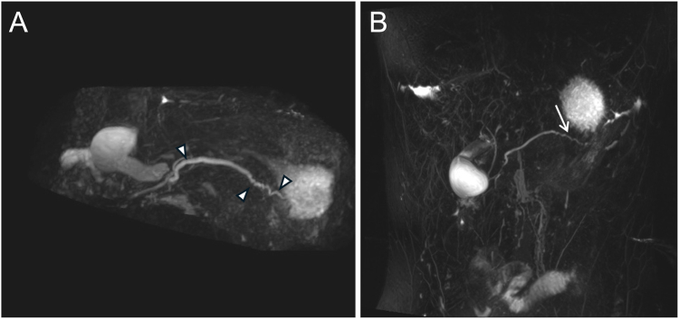
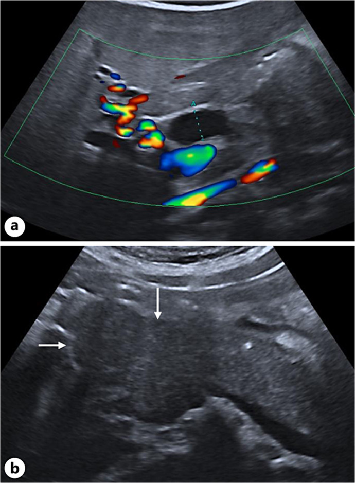
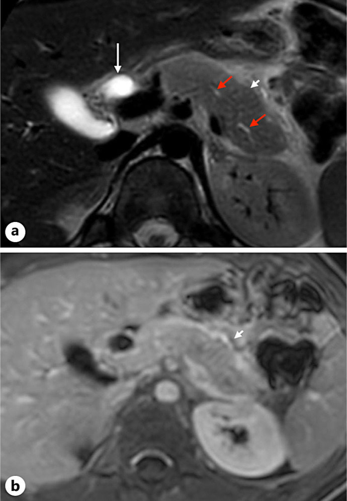
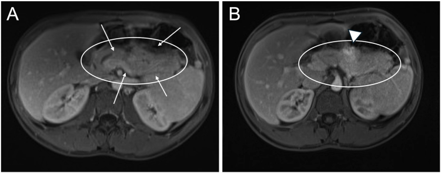

# 6145 — Viêm tụy tự miễn ở trẻ / Pediatric autoimmune pancreatitis (P-AIP)

**Tags:** `pattern:tuy-to-lan-toa` `pattern:hep-ong-tuy` `pattern:ngam-thuoc-muon` `pattern:vo-bao-tuy` `pattern:teo-tuy` `vung:tuy` `vung:o-bung` `vung:ong-mat` `protocol:MRI-bung-co-tuong-phan` `protocol:MRCP` `protocol:sieu-am-bung` `protocol:EUS-FNB` `score:ICDC`

**Mức chắc chắn (certainty):** tổng hợp y văn (literature synthesis) — **1 đoàn hệ 37 trẻ lớn nhất hiện có** (*United European Gastroenterol J* 2025, PMC12188370, CC BY-NC-ND), **2 ca nguyên văn có ảnh** (*Case Rep Gastroenterol* 2025, PMC12040306, CC BY-NC; *Gastro Hep Adv* 2026, PMC12681695, CC BY) và **bảng tổng hợp 102 ca 2017–2024** trong cùng đoàn hệ Thụy Điển. Nhóm **không có bệnh nhân của mình**; chỗ bài gốc **tự mâu thuẫn** (số level 1/2 giữa bảng và văn bản) được ghi rõ là **mâu thuẫn nguồn**, không chọn bừa.

> **Câu chốt:** P-AIP là **bệnh hiếm nhưng không được bỏ sót vì hậu quả của nó là MỔ OAN**. Ba số phải thuộc: **(1)** P-AIP là **nguyên nhân hàng đầu của viêm tụy mạn ở trẻ, chiếm ~4%**; **(2)** **IgG4 chỉ tăng ở 15,2% (5/37)** và **amylase/lipase bình thường ở 46–57%** lúc chẩn đoán — nên **không thể dựa vào xét nghiệm để loại trừ**; **(3)** **glucocorticoid là điều trị đầu tay**, **24,3% tự khỏi**, **83,8% lui bệnh hoàn toàn** và **tái phát 17–25%** — nghĩa là **thử corticoid có kiểm soát** tốt hơn **cắt tụy để chẩn đoán**. Trên ảnh, chốt là **tụy to lan tỏa mất phân thùy + ngấm thuốc muộn dạng đốm + vỏ bao quanh**, ống tụy **hẹp dài nhưng KHÔNG giãn nhiều phía trên**.

## 1. Tổng quan bệnh học – cơ chế hình ảnh

### 1.1 Bệnh học: hai thể, hai cơ chế — và vì sao trẻ KHÁC người lớn

- **AIP type 1** = **viêm tụy xơ hóa tăng lympho–tương bào (lymphoplasmacytic sclerosing pancreatitis)**, thuộc **bệnh IgG4**; gặp ở **nam lớn tuổi** (tuổi trung bình **61,4**), vàng da tắc mật **63%** so với **8,4%** ở type 2 (PMC12681695 dẫn y văn).
- **AIP type 2** = **viêm tụy ống trung tâm tế bào trung tính (idiopathic duct-centric pancreatitis)**, **không liên quan IgG4**, liên quan **bệnh ruột viêm (IBD)** khoảng **48%**; tuổi trung bình **33,5**, khởi phát bằng **viêm tụy cấp 34–64%** so với **5%** ở type 1 (PMC12681695).
- **Ở trẻ, type 2 chiếm ưu thế:** trong 37 trẻ Thụy Điển, **type 2 = 56,8%**, **type 1 = 24,3%**, **NOS = 18,9%** (PMC12188370). Vì vậy **IgG4 thường âm** và **IBD là manh mối mạnh hơn nhiều so với IgG4**.
- Về mô bệnh: **thâm nhiễm lympho–tương bào quanh ống + xơ hóa hình sao (storiform)** ở type 1; **thâm nhiễm bạch cầu trung tính vào biểu mô ống** ở type 2. Hệ quả hình ảnh: **phù nề nhu mô + thâm nhiễm quanh ống** → tụy **to, mất phân thùy, ngấm thuốc chậm**, và **hẹp ống do viêm chứ không do xơ co kéo** — nên **hồi phục sau corticoid**.

### 1.2 Vật lý: vì sao "ngấm thuốc muộn" và "vỏ bao" lại là dấu hiệu chốt

- Tụy bình thường **ngấm thuốc sớm và mạnh ở thì động mạch** (tụy là tạng có mật độ mao mạch rất cao). Trong AIP, **phù nề + xơ hóa + thâm nhiễm tế bào** làm **khoảng kẽ tăng** → thuốc cản quang **khuếch tán chậm vào mô đệm**: thì động mạch **ngấm kém/không đều ("dotted/speckled")**, rồi **tăng dần ở thì tĩnh mạch cửa và muộn**. Đây là lý do **bắt buộc chụp nhiều thì**, không kết luận trên một thì.
- **"Vỏ bao quanh tụy" (peripancreatic pseudocapsule/rim):** dải **ngấm thuốc mỏng, đều, bao quanh tụy** ở thì muộn — tương ứng **viêm xơ quanh tụy**, không phải vỏ bao thật (không có biểu mô). Đây là dấu **rất đặc hiệu** cho AIP so với ung thư (u hiếm khi tạo vòng ngấm đều quanh cả tuyến).
- **Mất phân thùy ("featureless pancreas"):** tiểu thùy tụy bình thường là các **đơn vị 1–2 mm** ngăn cách bởi mỡ; phù nề làm **mất ranh giới tiểu thùy** → tụy thành **khối đồng nhất hình xúc xích**. Trên **T1 không cản quang**, tụy bình thường **sáng hơn gan** (do protein nội tiết và mỡ); trong AIP tụy **giảm tín hiệu T1** vì phù.
- **Hẹp ống tụy:** ICDC phân biệt **level 1** = **hẹp dài > 1/3 chiều dài ống chính hoặc nhiều chỗ hẹp, KHÔNG giãn ống phía trên đáng kể**; **level 2** = **hẹp khu trú/đoạn, không giãn nhiều, ống < 5 mm** (bảng trong PMC12188370). Điểm mấu chốt: **ung thư gây giãn ống phía trên rõ**, AIP thì **không** — vì viêm lan dọc ống chứ không tắc hoàn toàn.

### 1.3 Dịch tễ và biểu hiện lâm sàng — số của đoàn hệ lớn nhất

- **Hiếm:** y văn đến 2024 mới có **< 100 ca** P-AIP được báo cáo; gộp 4 nghiên cứu 2017–2024 được **102 ca**, tuổi trung vị **12,8 (2–18)**, **55% nữ** (PMC12188370).
- **37 trẻ Thụy Điển (2006–2022):** tuổi trung bình **13,5 ± 2,8 (7–18)**, nam **54,1%**; **viêm tụy cấp 62,2%** (tất cả **thể nhẹ** theo Atlanta), **sụt cân 45,9%**, **đau bụng 43,2%**, **vàng da 21,6%**, **mệt 16,2%**; **viêm tụy cấp tái diễn 21,7% (5/23)** (PMC12188370).
- **Đa cơ quan 81,1%**, trong đó **IBD 62,2%** (15 viêm loét đại tràng, 4 Crohn, 4 không xác định), **viêm đường mật liên quan miễn dịch 18,9%**, **thận 8,1%**, **viêm giáp 5,4%**, **viêm mạch 2,7%**.
- **Suy tụy ngoại tiết 43,2% lúc chẩn đoán → 24,3% lúc theo dõi cuối** (theo dõi **6,5 ± 4,9 năm**); **đái tháo đường 2,7% (1/37, chỉ sau cắt toàn tụy)**; **nang giả 5,4%**, **vôi hóa tụy 0%** — khác hẳn viêm tụy mạn người lớn.

### 1.4 Vì sao chẩn đoán khó: ba "âm tính giả" hay gặp

1. **IgG4 bình thường:** chỉ **15,2% (5/37)** tăng; chỉ **2 ca > 4 lần giới hạn trên**. Ở trẻ, **IgG4 không đủ để loại trừ** (PMC12188370).
2. **Men tụy bình thường:** **46–57%** trẻ P-AIP có amylase/lipase **bình thường** lúc chẩn đoán (INSPPIRE, dẫn trong PMC12188370).
3. **Không vôi hóa:** **0/37** có vôi hóa tụy — nếu chờ vôi hóa để chẩn đoán "viêm tụy mạn" thì sẽ **bỏ sót toàn bộ**.

## 2. Mẫu hình + chẩn đoán phân biệt theo vị trí (gamut)

### 2.1 Gamut theo hình thái tụy trên MRI/MRCP

- **To lan tỏa "xúc xích" + mất phân thùy + vỏ bao:** **AIP type 1/2**, **phù tụy do viêm cấp nặng**, **lymphoma tụy** (hiếm ở trẻ), **phù do tắc tĩnh mạch lách**.
- **To khu trú/dạng khối ở đầu tụy:** **AIP thể khối (mass-forming)**, **u đặc–nhầy nhú (SPN)**, **u nguyên bào tụy**, **lymphoma**, **nang ống mật chủ** chèn ép.
- **Ống tụy hẹp dài/nhiều chỗ, không giãn nhiều:** **AIP** (level 1 ICDC), **viêm tụy mạn di truyền** (thường có sỏi/giãn), **IPMN** (giãn nang).
- **Teo tụy sau điều trị:** **AIP đã đáp ứng corticoid** (dấu hiệu **tốt**, không phải tiến triển).

### 2.2 Gamut theo bối cảnh lâm sàng

- **Trẻ + IBD (đặc biệt viêm loét đại tràng) + viêm tụy tái diễn:** **AIP type 2** là hàng đầu.
- **Trẻ + vàng da tắc mật + tăng IgG4 + tổn thương cơ quan khác (thận, tuyến giáp, đường mật):** **AIP type 1/IgG4-RD**.
- **Trẻ + đau bụng cấp + không IBD + hồi phục nhanh không cần điều trị:** **viêm tụy cấp đơn thuần** hoặc **AIP tự khỏi** (24,3%).
- **Trẻ + khối đầu tụy + không đáp ứng corticoid:** nghĩ **u** — đây là nhóm **bị mổ oan** (17% trong loạt Scheers cũ; 2,7% trong đoàn hệ Thụy Điển).

## 3. Bảng so sánh phân biệt (ma trận đối chiếu)

| Thực thể (entity) | Hình ảnh điển hình | Chốt vào (rule-in) | Chốt loại (rule-out) | Gợi ý xác nhận |
|---|---|---|---|---|
| **P-AIP type 2 (IBD-associated)** | Tụy **to lan tỏa, mất phân thùy**, ngấm thuốc **muộn dạng đốm**, **vỏ bao quanh**; ống hẹp dài **không giãn**; **không vôi hóa** | **IBD + viêm tụy tái diễn + hình ảnh trên + đáp ứng corticoid ≤ 2 tuần** | **Khối khu trú ngấm mạnh + giãn ống rõ** → nghĩ u | MRI/MRCP + nội soi tiêu hóa; IgG4 **không cần** dương |
| **P-AIP type 1 (IgG4-RD)** | Như trên ± **tổn thương thận/tuyến giáp/đường mật**; có thể **dày thành ống mật** | **IgG4 > 2× ULN (người lớn) hoặc > 4× ULN (gợi ý mạnh) + đa cơ quan + hình ảnh điển hình** | **IgG4 bình thường KHÔNG loại trừ** (chỉ 15,2% trẻ tăng) | IgG4 huyết thanh, sinh thiết nếu cần, PET/CT tìm ổ ngoài tụy |
| **Viêm tụy cấp/viêm tụy tái diễn đơn thuần** | Tụy to nhẹ, **phù quanh tụy**, không vỏ bao đều; hết sau vài ngày | **Khởi phát cấp + hồi phục nhanh + không tái diễn + không IBD** | **To lan tỏa kéo dài + vỏ bao + hẹp ống dài** → AIP | Theo dõi MRI 4–6 tuần; đừng vội corticoid |
| **U tụy (SPN, nguyên bào tụy, lymphoma)** | **Khối khu trú**, có thể **đặc–nang, xuất huyết, vôi hóa**; **giãn ống phía trên** | **Khối + giãn ống + không đáp ứng corticoid + có thành phần đặc/nang** | **To lan tỏa đối xứng + vỏ bao + đáp ứng corticoid** → AIP | MRI + EUS-FNB; **tránh cắt tụy chẩn đoán** (bài 6120) |
| **Nang ống mật chủ (choledochal cyst)** | **Giãn ống mật chủ** hình nang, có thể kèm sỏi; tụy bình thường | **Giãn khu trú ống mật + MRCP thấy nang** | **Hẹp ống tụy dài + tụy to lan tỏa** → AIP | MRCP; bài 6137 |
| **Viêm tụy do thuốc** | Tụy to, phù; **không vỏ bao**, không hẹp ống dài | **Thuốc khởi phát trong 2–4 tuần, ngừng thuốc thì hết** | **Tái diễn nhiều đợt + IBD + vỏ bao** → AIP | Bảng thuốc, thử ngừng thuốc; bài 6136 |
| **Viêm tụy mạn di truyền (PRSS1/SPINK1/CTRC)** | **Sỏi tụy, giãn ống, teo nhu mô**, vôi hóa theo thời gian | **Sỏi/giãn ống + đột biến gen + không đáp ứng corticoid** | **Không sỏi, không giãn, có vỏ bao** → AIP | Gen tụy; trong 37 trẻ có **6 ca mang biến thể** (CTRC ×4, PRSS1 ×1, SPINK1 ×1) |

### 3.1 Ba dấu hiệu "chốt" trên MRI — đọc theo thứ tự

1. **Hình dạng:** to **lan tỏa** (không phải một khối) + **mất phân thùy**.
2. **Động học ngấm thuốc:** **kém/đốm ở thì động mạch → tăng dần thì muộn**, kèm **vỏ bao mỏng đều**.
3. **Ống tụy:** **hẹp dài/nhiều chỗ nhưng ống phía trên không giãn nhiều** (level 1 ICDC) — ngược với u.

## 4. Protocol chụp + hệ phân độ/theo dõi

### 4.1 Protocol

- **Siêu âm bụng là bước đầu:** đo **đường kính ống mật chủ** (ca 14 tuổi: **9 mm**), tìm **đầu tụy giảm âm to**; siêu âm **không loại trừ** AIP.
- **MRI bụng có cản quang từ (gadolinium) là chuẩn:** T1 không cản quang, T2, **DWI**, và **các thì động mạch–tĩnh mạch cửa–muộn** (bắt buộc nhiều thì để thấy ngấm muộn); **MRCP** đánh giá ống tụy–mật. Trong đoàn hệ Thụy Điển, **MRI 100%**, CT **37,8%**, siêu âm **100%**, **EUS 29,7%**, **ERCP 16,2%** (PMC12188370).
- **EUS-FNB** khi **không chắc AIP vs u**; **ERCP chỉ để điều trị** (đặt stent khi vàng da tắc mật), **không dùng ERCP để chẩn đoán** nếu đã nghĩ AIP.
- **Thử corticoid có kiểm soát** (prednisolone) khi hình ảnh điển hình và đã loại u: đáp ứng lâm sàng–hình ảnh **trong ≤ 2 tuần** là tiêu chuẩn chẩn đoán (bảng ICDC trong PMC12040306).

### 4.2 Phân độ và theo dõi

- **Đáp ứng:** lui bệnh hoàn toàn **83,8%**; **tự khỏi 24,3%**; **tái phát 17–25%** (INSPPIRE/systematic review, dẫn trong PMC12188370); đoàn hệ Thụy Điển **không có tái phát tại tụy** nhưng đa số được điều trị IBD bằng **AZA/biologic**, nên **không được coi là tỉ lệ tái phát thật**.
- **Theo dõi dài hạn:** **suy tụy ngoại tiết** (FE-1), **đái tháo đường** (hiếm ở trẻ), **teo tụy** trên MRI (dấu hiệu đáp ứng, không phải xấu đi), và **kiểm soát IBD** — điều trị IBD có thể cải thiện cả hai bệnh.

## 5. Biến thể bình thường và cạm bẫy

- **"Tụy to" thoáng qua sau viêm tụy cấp** — không phải AIP; **chụp lại sau 4–6 tuần** trước khi gắn nhãn tự miễn.
- **IgG4 âm không loại trừ:** chỉ **15,2%** trẻ tăng; đừng chờ IgG4 để điều trị.
- **Men tụy bình thường không loại trừ:** **46–57%** bình thường lúc chẩn đoán.
- **Không vôi hóa không loại trừ viêm tụy mạn:** **0/37** có vôi hóa — tiêu chuẩn người lớn **không áp dụng nguyên**.
- **AIP thể khối dễ bị cắt tụy:** trong loạt cũ **17%** bệnh nhi P-AIP đã bị mổ; ngay cả đoàn hệ hiện đại vẫn có **2,7%** cắt toàn tụy vì nghi u. **Không cắt tụy để chẩn đoán** khi hình ảnh còn phù hợp AIP.
- **Corticoid che lymphoma:** nếu **đáp ứng một phần rồi tái phát nhanh**, phải **sinh thiết lại** thay vì tăng liều mù.
- **Vỏ bao quanh tụy có thể gặp ở viêm tụy cấp nặng** — chỉ có giá trị khi **kèm to lan tỏa + hẹp ống dài + bối cảnh IBD**.
- **Teo tụy sau corticoid bị đọc nhầm là "tiến triển"** — thực ra là **dấu hiệu lành**.

## 6. Tự lượng giá — Blind Quiz

**Ca 1 — Nam 18 tuổi, viêm loét đại tràng 6 tháng, đau thượng vị 3 ngày, sụt 4,5 kg, lipase 5.573 U/L.**

- Hỏi: (1) Mô tả ống tụy trước điều trị; (2) chẩn đoán phân biệt chính; (3) dấu hiệu nào trên ảnh sau điều trị xác nhận chẩn đoán?

<b>Bấm để hiện đáp án</b>

- **Dấu hiệu:** (A) **nhiều chỗ hẹp dọc ống tụy** (đầu mũi tên) + **ống chính giãn với cắt cụt đột ngột ở đầu tụy**; (B) sau **prednisolone 10 mg/ngày**, **ống tụy trở lại bình thường ở đuôi** (mũi tên).
- **Chẩn đoán:** **AIP type 1 ở trẻ có IBD** — IgG4 **2.430 mg/dL** rồi **153,2 mg/dL** (tham chiếu 4–86), tụy **hình xúc xích**.
- **Chốt:** **hẹp ống hồi phục sau corticoid** — ung thư không làm ống tụy "mở lại" như vậy.
- **Nguồn ảnh:** Rose JH và cs., *Gastro Hep Adv* 2026;5(2):100834, PMC12681695 Fig. 1 — **CC BY 4.0**, ảnh nguyên bản.

**Ca 2 — Nữ 14 tuổi, đau bụng – nôn – vàng da; siêu âm thấy ống mật chủ 9 mm và đầu tụy giảm âm.**

- Hỏi: Hai dấu hiệu siêu âm gợi ý gì? Bước tiếp theo?

<b>Bấm để hiện đáp án</b>

- **Dấu hiệu:** (a) **giãn ống mật chủ 9 mm** (giữa caliper) có tín hiệu Doppler; (b) **đầu tụy giảm âm, to** (mũi tên) — giả u.
- **Chẩn đoán:** nghi **AIP**; bước tiếp theo là **MRI + MRCP nhiều thì**, không chọc sinh thiết ngay.
- **Nguồn ảnh:** Hendlisz B và cs., *Case Rep Gastroenterol* 2025;19(1):303–312, PMC12040306 Fig. 1 — **CC BY-NC 4.0**, ảnh nguyên bản.

**Ca 3 — Cùng bệnh nhi, MRI tụy trước điều trị.**

- Hỏi: Ba dấu hiệu nào trên MRI chốt AIP? Vì sao phải chụp thì muộn?

<b>Bấm để hiện đáp án</b>

- **Dấu hiệu:** (a) T2: **giãn ống mật chủ** (mũi tên), **tụy to lan tỏa không do u** (đầu mũi tên), **ống tụy không đều** (mũi tên đỏ); (b) T1 sau tiêm: **ngấm thuốc viền quanh tụy** (đầu mũi tên) — "vỏ bao giả".
- **Vì sao thì muộn:** thuốc khuếch tán chậm vào mô đệm viêm; thì động mạch chỉ thấy ngấm **kém/đốm**, dễ đọc nhầm là "khối giảm ngấm".
- **Nguồn ảnh:** Hendlisz B và cs., *Case Rep Gastroenterol* 2025, PMC12040306 Fig. 2 — **CC BY-NC 4.0**.

**Ca 4 — Bệnh nhi P-AIP sau một đợt điều trị corticoid: MRI cho thấy tụy nhỏ lại, mất dải quanh tụy.**

- Hỏi: Teo tụy là dấu hiệu tốt hay xấu? Cần theo dõi gì?

<b>Bấm để hiện đáp án</b>

- **Dấu hiệu:** (A) trước: **tụy to lan tỏa "xúc xích"** (mũi tên) trong vòng khoanh; (B) sau: **teo tuyến**, **mất dải giảm tín hiệu quanh tụy**, còn **một khối viêm khu trú** (đầu mũi tên).
- **Ý nghĩa:** **teo tụy sau corticoid là dấu hiệu ĐÁP ỨNG**, không phải tiến triển; nhưng phải theo dõi **suy tụy ngoại tiết** (FE-1) và **đái tháo đường**.
- **Nguồn ảnh:** Rose JH và cs., *Gastro Hep Adv* 2026, PMC12681695 Fig. 2 — **CC BY 4.0**.

## Bài liên quan chéo

- [6120 – U tụy ở trẻ: SPN, u nguyên bào tụy, IPMN nhánh](../6120-u-tuy-o-tre/lesson.md) — hàng phân biệt bắt buộc, lý do "mổ oan".
- [6135 – Viêm tụy cấp ở trẻ](../6135-viem-tuy-cap-o-tre/lesson.md) — nền tảng Atlanta và nguyên nhân.
- [6136 – Viêm tụy do thuốc ở trẻ](../6136-viem-tuy-do-thuoc-o-tre/lesson.md) — chẩn đoán loại trừ.
- [6137 – Nang ống mật chủ ở trẻ](../6137-nang-ong-mat-chu-o-tre/lesson.md) — giãn ống mật, DDx của vàng da tắc mật.
- [135 – Viêm tụy cấp (Atlanta)](../135-viem-tuy-Atlanta/lesson.md)
- [136 – U nang tụy](../136-u-nang-tuy/lesson.md)
- [600 – Tổng quan Nhi khoa](../600-tong-quan-nhi-khoa/lesson.md)

> Không dùng để chẩn đoán độc lập khi chưa có người hướng dẫn.
