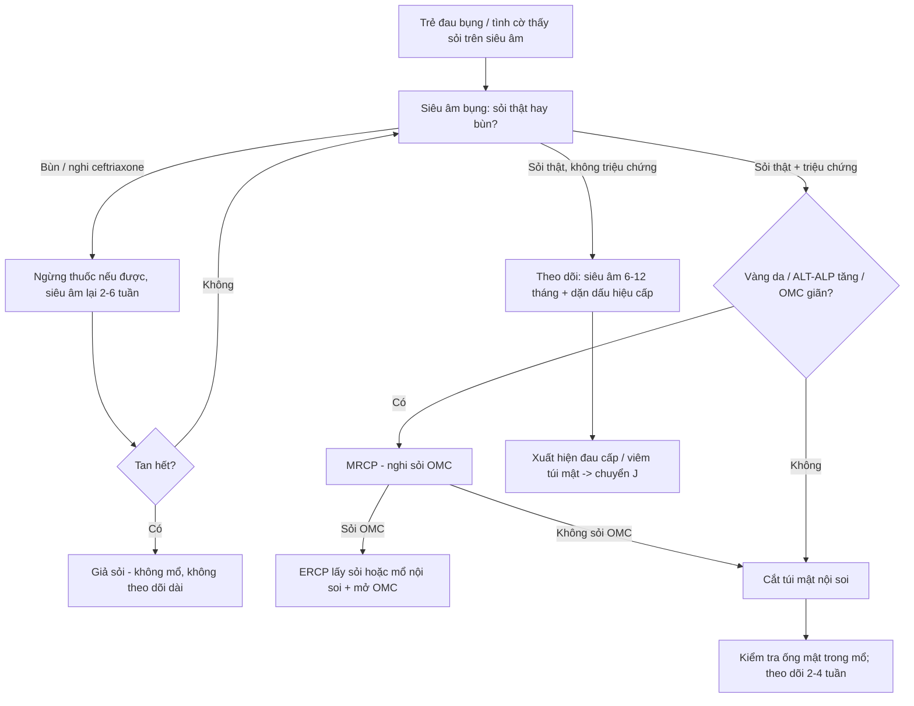
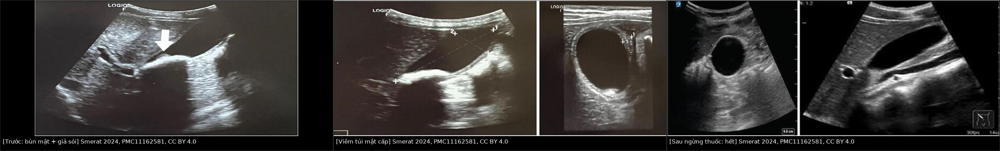
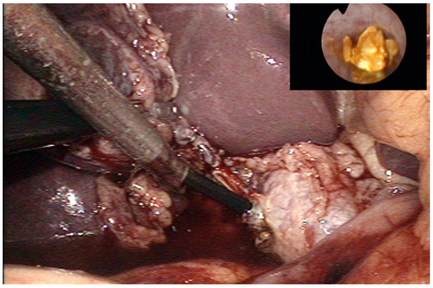
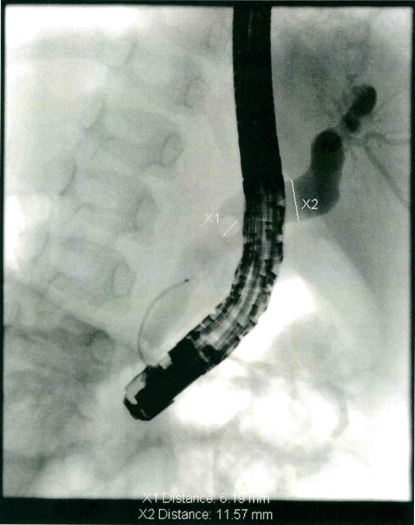

# 6146 — Sỏi túi mật và sỏi ống mật chủ ở trẻ / Pediatric cholelithiasis & choledocholithiasis

**Tags:** `pattern:soi-tui-mat` `pattern:soi-bun` `pattern:gia-soi-thuoc` `pattern:day-thanh-tui-mat` `pattern:gian-ong-mat-chu` `pattern:khuyet-long-ong-mat` `vung:tui-mat` `vung:ong-mat` `vung:o-bung` `protocol:sieu-am-bung` `protocol:MRCP` `protocol:ERCP` `protocol:noi-soi-tui-mat`

**Mức chắc chắn (certainty):** tổng hợp y văn (literature synthesis) — **1 đoàn hệ 380 trẻ** (*Cureus* 2026, PMC13548732, CC BY), **1 đoàn hệ 185 trẻ** (*Transl Pediatr* 2025, PMC12597193, **CC BY-NC-ND** — chỉ dùng số liệu, **không tạo phái sinh ảnh**), **1 tổng quan cơ chế** (*J Clin Med* 2022, PMC9657413, CC BY), **1 ca nguyên văn có ảnh** (*Oxf Med Case Reports* 2024, PMC11162581, CC BY 4.0), **1 đoàn hệ ERCP nhi 70 ca** (*Medicine* 2026, PMC13166795, CC BY) và **1 đoàn hệ 147 ca cắt túi mật nội soi** (*PLoS One* 2018, PMC5953441, CC BY). Nhóm **không có bệnh nhân của mình**; chỗ hai đoàn hệ **mâu thuẫn nhau về BMI** (380 trẻ Ấn Độ: béo phì là yếu tố nguy cơ tăng dần; 185 trẻ Thiên Tân: **77,6% BMI bình thường**) được ghi rõ là **khác biệt quần thể**, không chọn bừa.

> **Câu chốt:** Sỏi mật ở trẻ **không phải bệnh của người lớn thu nhỏ**. Ba số phải thuộc: **(1)** tỉ lệ hiện mắc **0,1–2,0%** và **đang tăng**, trong đó **47,9% không tìm được nguyên nhân** và **~20% hoàn toàn không triệu chứng**; **(2)** **sỏi bùn/giả sỏi do ceftriaxone gặp 4,1–27,3%** người dùng thuốc và **tự tan sau khi ngừng thuốc** — **cắt túi mật ở nhóm này là mổ oan**; **(3)** **siêu âm là đầu tay nhưng BỎ SÓT sỏi ống mật chủ** (380 trẻ: **0 ca** phát hiện sỏi OMC trên siêu âm) → nghi sỏi OMC phải **MRCP/EUS**, và **ERCP nhi đạt thành công 91,4%**, biến chứng **8,6% chảy máu / 1,4% viêm tụy**.

## 1. Tổng quan bệnh học – cơ chế hình ảnh

### 1.1 Dịch tễ và sự dịch chuyển nguyên nhân

- **Hiện mắc 0,1–2,0%** ở trẻ (dẫn trong PMC12597193); bệnh **đang tăng** cùng béo phì nhi.
- **380 trẻ < 15 tuổi, 2013–2025 (Bắc Ấn Độ):** tuổi trung bình **12,34 ± 1,54**; **11–14 tuổi 55,8%**, **5–10 tuổi 34,2%**, **< 5 tuổi chỉ 10,0%**; **nam 65,3%** (nam:nữ ≈ 1,9:1) — **ngược với người lớn** (nữ nhiều hơn).
- **Yếu tố nguy cơ:** tiền sử gia đình **18,4%**, **đã dùng kháng sinh trước đó 14,7%**, **không rõ nguyên nhân 47,9%**; sỏi **hỗn hợp 64,7%**.
- **Xu hướng 13 năm trong cùng bệnh viện:** sỏi **vô căn 20,0% → 57,5%**, sỏi **liên quan béo phì 2,0% → 13,0%**, sỏi **do tan máu 14,0% → 2,0%** — tức **bệnh tan máu không còn là nguyên nhân hàng đầu**.
- **185 trẻ Thiên Tân (2017–2024):** sỏi **túi mật 57,8%**, **sỏi đường mật 25,4%**, **cả hai 16,8%**; tuổi khởi phát trung vị **7,5 (3,7–11,0)**; **chỉ 22,4% thừa cân/béo phì**, **~60% BMI bình thường**; bệnh tan máu **21,1%** (trong đó **32/39 là tăng hồng cầu di truyền**).
- **Viêm túi mật ở trẻ hiếm:** **< 1% đến 4%** tuỳ nghiên cứu (PMC11162581) — khác người lớn (95% viêm túi mật có sỏi).

### 1.2 Vật lý: vì sao sỏi "có bóng lưng", bùn thì không — và vì sao bùn tan

- **Bóng lưng sau (posterior acoustic shadowing):** sỏi là **bề mặt phản xạ âm rất mạnh** (chênh lệch **trở kháng âm** giữa mật lỏng và tinh thể cholesterol/canxi). Tia siêu âm **bị phản xạ toàn phần ở mặt trước** → **không còn năng lượng đi tiếp** → phía sau sỏi là **dải tối (bóng lưng)**. Bóng lưng chỉ rõ khi **sỏi ≥ 3–5 mm** và **nằm trong mật** (không bị thành túi mật che).
- **Sỏi cholesterol gần như thuần** có **trở kháng gần với mật** → **có thể KHÔNG bóng lưng**, chỉ là **điểm tăng âm**; đây là lý do **không được loại sỏi chỉ vì thiếu bóng lưng** (khác người lớn hay dạy).
- **Sỏi bùn (biliary sludge)** = **tinh thể cholesterol monohydrat + muối canxi bilirubinat + glycoprotein** lơ lửng, **hạt < bước sóng** → tán xạ yếu, tạo **mức echo thấp–trung bình, KHÔNG bóng lưng, di chuyển chậm theo tư thế** ("sludge ball"). Vì là **cặn lơ lửng chứ không phải khối rắn**, bùn **có thể tan lại** khi hết yếu tố thúc đẩy.
- **Giả sỏi do ceftriaxone:** ceftriaxone **bài tiết qua mật dưới dạng anion**, gặp **canxi** trong mật → **kết tủa muối canxi–ceftriaxone** không tan. Trên siêu âm **bắt chước sỏi thật** (tăng âm, có khi có bóng lưng) nhưng **tan hoàn toàn sau khi ngừng thuốc** — vì kết tủa **hoà tan lại** khi nồng độ thuốc trong mật giảm.
- **Sỏi sắc tố (pigment stone):** do **tan máu mạn** → **bilirubin không liên hợp** tăng trong mật → **kết tủa canxi bilirubinat**; thường **nhiều viên nhỏ, đen, cản quang kém**.
- **Thành túi mật dày:** viêm → **phù gian bào + thấm dịch** → **dày thành > 3 mm** và **quầng giảm âm dưới thanh mạc**; khi viêm lan ra **mỡ quanh túi mật** → **dịch quanh túi mật** (dấu hiệu **viêm cấp**, không phải sỏi đơn thuần).

### 1.3 Vì sao "không triệu chứng" là nhóm lớn — và vì sao điều đó đổi cách xử trí

- **380 trẻ: 20,5% (78) phát hiện tình cờ**, không triệu chứng; triệu chứng hay gặp nhất là **đau thượng vị mơ hồ 60,0%**, **khó tiêu 45,3%**, **đau hạ sườn phải cấp 44,2%** — **triệu chứng rất "mờ"**, dễ bị coi là đau bụng chức năng.
- **Bùn/sỏi dạng cát:** **~50% tự hết**, **10–15% có triệu chứng trong 3 năm** (dẫn trong PMC12597193) → **theo dõi là hợp lý**, không mổ ngay.
- Hệ quả: **chỉ định mổ dựa trên TRIỆU CHỨNG + tổn thương cấu trúc**, không dựa trên "thấy sỏi là mổ".

## 2. Mẫu hình + chẩn đoán phân biệt theo vị trí (gamut)

### 2.1 Gamut theo hình thái trong túi mật (siêu âm)

- **Điểm tăng âm + bóng lưng + di động theo tư thế:** **sỏi thật** (hỗn hợp/cholesterol/sắc tố).
- **Mức echo thấp, không bóng lưng, lắng theo tư thế:** **sỏi bùn/sludge**, **giả sỏi ceftriaxone**, **máu/mủ đặc trong lòng túi mật**.
- **Nốt tăng âm cố định, không bóng lưng, không di động:** **polyp cholesterol**, **u tuyến (adenoma)**, **u nhú**.
- **Thành dày > 3 mm + dịch quanh túi mật + Murphy dương:** **viêm túi mật cấp** (có hoặc không sỏi).
- **Túi mật "hai buồng" / vách:** **túi mật đôi (double gallbladder)** — ca trong PMC12597193 (Hình 3).

### 2.2 Gamut theo đường mật (giãn ống + khuyết lòng)

- **Giãn ống mật chủ hình nang, không có khuyết lòng:** **nang ống mật chủ** (bài 6137).
- **Giãn ống mật chủ + khuyết lòng tròn/di động:** **sỏi ống mật chủ**.
- **Giãn ống mật trong gan + hẹp eo:** **xơ gan ứ mật/bệnh đường mật**; ở trẻ sơ sinh nghĩ **teo đường mật** (bài 625).
- **Không giãn ống nhưng có sỏi trong ống:** **sỏi OMC sớm** — siêu âm dễ bỏ, cần MRCP.

### 2.3 Gamut theo bối cảnh lâm sàng

- **Trẻ đang truyền ceftriaxone liều cao, đau hạ sườn phải sau 5–10 ngày:** **giả sỏi do thuốc**.
- **Trẻ tan máu (tăng hồng cầu di truyền, thalassemia, hồng cầu hình liềm):** **sỏi sắc tố**; ở nhóm này **cắt lách ± cắt túi mật** thường làm cùng lúc.
- **Trẻ béo phì/dậy thì sớm, đau bụng tái diễn:** **sỏi cholesterol/hỗn hợp**.
- **Trẻ sơ sinh/nhũ nhi vàng da tắc mật:** **nang ống mật chủ / teo đường mật / sỏi bùn do nuôi ăn tĩnh mạch** — **không phải sỏi người lớn**.

## 3. Bảng so sánh phân biệt (ma trận đối chiếu)

| Thực thể (entity) | Hình ảnh điển hình | Chốt vào (rule-in) | Chốt loại (rule-out) | Gợi ý xác nhận |
|---|---|---|---|---|
| **Sỏi túi mật thật (hỗn hợp/cholesterol)** | Điểm **tăng âm + bóng lưng sạch**, **di động** theo tư thế; nhiều viên **2–20 mm**; thành túi mật mỏng | **Bóng lưng + di động + nhiều viên** | **Không bóng lưng + tan sau ngừng thuốc** → không phải sỏi thật | Siêu âm lặp sau **4–6 tuần** nếu nghi bùn; X-quang chỉ thấy **10–15%** sỏi |
| **Sỏi bùn / giả sỏi ceftriaxone** | **Tăng âm mức thấp, KHÔNG bóng lưng**, lắng thành lớp; ± dày thành, dịch quanh túi mật | **Ceftriaxone trong 1–2 tuần trước + hình ảnh trên** | **Bóng lưng rõ + tồn tại > 3 tháng** → sỏi thật | **Ngừng thuốc rồi siêu âm lại 2–6 tuần**: tan hoàn toàn = giả sỏi |
| **Polyp / u tuyến túi mật** | Nốt **tăng âm cố định**, **không bóng lưng**, **không di động**, thường **< 10 mm**, đơn độc | **Cố định + không bóng lưng + không đổi tư thế** | **Di động + bóng lưng** → sỏi | Doppler (mạch nuôi), theo dõi 6–12 tháng |
| **Viêm túi mật cấp** | **Thành > 3 mm**, **quầng giảm âm**, **dịch quanh túi mật**, căng to, **Murphy siêu âm dương** | **Thành > 3 mm + dịch quanh + Murphy (+) + sốt/đau** | **Thành mỏng, không dịch quanh** → sỏi đơn thuần | Siêu âm + CRP/BC; CT nếu nghi thủng |
| **Sỏi ống mật chủ** | **Giãn OMC** + **khuyết lòng**; siêu âm **kém nhạy ở trẻ**, dễ bỏ khi ống chưa giãn | **Giãn OMC + vàng da/ALT-ALP tăng + khuyết lòng trên MRCP** | **Siêu âm bình thường KHÔNG loại trừ** (380 trẻ: 0 ca thấy sỏi OMC) | **MRCP**, **EUS**; **ERCP** khi cần lấy sỏi (thành công **91,4%**) |
| **Nang ống mật chủ (bài 6137)** | Giãn **hình nang** ống mật chủ/ống gan chung; có thể kèm sỏi | **Giãn nang khu trú + MRCP thấy nang** | **Ống đều, chỉ có khuyết lòng** → sỏi | MRCP; **không nong/ERCP đơn thuần** — cần mổ |
| **Sỏi sắc tố do tan máu** | **Nhiều viên nhỏ đen**, tăng âm, bóng lưng yếu; **lách to**, thiếu máu | **Bệnh tan máu + nhiều sỏi nhỏ + lách to** | **Sỏi đơn độc lớn, không tan máu** → sỏi cholesterol | CTM, reticulocyte, điện di Hb; **cắt lách ± cắt túi mật cùng lúc** |

### 3.1 Bốn câu hỏi đọc siêu âm theo thứ tự

1. **Có sỏi thật không?** (bóng lưng + di động) — nếu không, nghĩ **bùn/giả sỏi**.
2. **Thành túi mật dày bao nhiêu?** **> 3 mm** = viêm; đo ở mặt cắt ngang qua gan, không đo chỗ tiếp giáp gan.
3. **Có dịch quanh túi mật / Murphy siêu âm dương?** → **viêm cấp**, cần xử trí sớm.
4. **Ống mật chủ có giãn không?** — nếu **giãn** hoặc **vàng da/ALP tăng**, **bắt buộc MRCP** dù siêu âm "sạch".

## 4. Protocol chụp + phân tầng xử trí

### 4.1 Protocol

- **Siêu âm bụng là đầu tay, không cần chuẩn bị đặc biệt:** đầu dò **convex 5–8 MHz** (trẻ nhỏ dùng **linear 7–12 MHz**), **nhịn ăn 4–6 giờ** nếu hợp tác; chụp **mặt cắt dọc + ngang qua túi mật**, đổi **tư thế đứng/ngồi** để xem sỏi di động; đo **thành túi mật**, **đường kính ống mật chủ** (bình thường **≤ 4 mm** ở trẻ, tăng theo tuổi).
- **Không dùng X-quang bụng để tìm sỏi:** chỉ **10–15%** sỏi cản quang.
- **MRCP** khi **nghi sỏi OMC** hoặc **giãn ống mật**: không cần cản quang, không tia xạ; phân biệt **sỏi (khuyết lòng tròn)** với **nang ống mật chủ (giãn hình nang)**.
- **ERCP** = **điều trị**, không phải chẩn đoán: lấy sỏi OMC, đặt stent khi hẹp. Ở trẻ **70 ca** dùng **duodenoscope người lớn**: **thành công 91,4%** (người lớn 95,2%, **p = 0,278**), **chảy máu 8,6%**, **viêm tụy 1,4%**, **không tử vong**.
- **CT bụng** chỉ khi nghi biến chứng (thủng, áp-xe) hoặc bệnh cảnh cấp không rõ.

### 4.2 Phân tầng xử trí (theo triệu chứng, không theo "thấy sỏi")

- **Theo dõi (asymptomatic):** siêu âm **mỗi 6–12 tháng**; **~50% bùn tự hết**, **10–15% có triệu chứng trong 3 năm**.
- **Cắt túi mật nội soi (LC)** = chuẩn cho **sỏi có triệu chứng**: **380 trẻ**, LC thành công **96,8%**, **chuyển mổ hở 2,1%**, **không biến chứng 81,0%**, thời gian mổ **29,0 ± 6,4 phút**, nằm viện **1,9 ± 0,8 ngày**, về sinh hoạt **4,0 ± 1,2 ngày**.
- **Yếu tố nguy cơ biến chứng sau mổ (đa biến):** **thừa cân/béo phì AOR 2,63 (1,31–5,27)**, **bệnh tan máu AOR 2,18 (1,01–4,71)**, **sỏi nhiều viên AOR 2,34 (1,29–4,26)**.
- **Bảo tồn túi mật (lấy sỏi qua nội soi)**: cân nhắc khi **hình thái và chức năng túi mật bình thường** (7 ca trong PMC12597193) — nhưng **có nguy cơ tái phát**, phải theo dõi.

## 5. Biến thể bình thường và cạm bẫy

- **Bùn mật ở trẻ sơ sinh/nuôi ăn tĩnh mạch kéo dài** là **hiện tượng thường gặp và hồi phục**, không phải sỏi.
- **Ceftriaxone: "sỏi" xuất hiện sau 5–10 ngày, đau hạ sườn phải, có khi viêm túi mật thật** — tỉ lệ **4,1–27,3%** người dùng, **triệu chứng < 0,1%**. Y văn 1991–2022 chỉ **30 ca có triệu chứng**, **16 là trẻ**. **Ngừng thuốc là điều trị** — ca nguyên văn **8 tuổi** hết hoàn toàn trên siêu âm.
- **Siêu âm "không thấy sỏi OMC" KHÔNG loại trừ sỏi OMC:** trong **380 trẻ** không ca nào thấy sỏi OMC trên siêu âm dù có ca sỏi đường mật. **Vàng da + ALP/GGT tăng = chỉ định MRCP**.
- **Bỏ sót nguyên nhân phía trên:** viêm đại tràng/ung thư đại tràng gây **giãn manh tràng** có thể làm **ứ mật**, nhưng ở trẻ **hẹp đường mật do thuốc/xơ hóa** cũng gây giãn — đừng quy tất cả cho sỏi.
- **Cắt túi mật ở trẻ có bệnh tan máu:** nên **mổ cùng lúc với cắt lách** nếu có chỉ định; mổ riêng lẻ làm tăng số lần gây mê và nguy cơ cơn tan máu.
- **Không nong/đặt stent cho nang ống mật chủ** rồi coi là đã điều trị — **nang phải cắt + nối mật ruột** (bài 6137), vì nguy cơ **ung thư đường mật** về sau.
- **BMI bình thường không loại trừ:** **77,6%** trẻ trong đoàn hệ Thiên Tân có BMI bình thường — đừng chỉ tầm soát ở trẻ béo.

## 6. Tự lượng giá — Blind Quiz

**Ca 1 — Nữ 8 tuổi, viêm màng não mủ đang truyền ceftriaxone 2 g/ngày; ngày thứ 7 đau quặn hạ sườn phải 9 giờ, nôn, Murphy dương.**

- Hỏi: (1) Mô tả ba ảnh; (2) chẩn đoán và vì sao **không** cắt túi mật; (3) theo dõi thế nào?

<b>Bấm để hiện đáp án</b>

- **Dấu hiệu:** (A) trong lòng túi mật có **cấu trúc tăng âm kèm bùn** (mũi tên trắng); (B) **thành túi mật dày, phù, có dịch quanh túi mật** — viêm túi mật cấp; (C) sau ngừng thuốc: **túi mật trở lại bình thường, sỏi và bùn biến mất hoàn toàn**.
- **Chẩn đoán:** **giả sỏi + viêm túi mật do ceftriaxone (ceftriaxone pseudolithiasis)** — kết tủa canxi–ceftriaxone trong mật; tan khi nồng độ thuốc giảm.
- **Vì sao không mổ:** bệnh **tự hồi phục** sau ngừng thuốc; chỉ **30 ca có triệu chứng** trong y văn 1991–2022. Điều trị: ngừng ceftriaxone, dịch, giảm đau, kháng sinh thay thế.
- **Theo dõi:** siêu âm lại sau **2–6 tuần**; nếu **không tan** hoặc **bóng lưng rõ** → đổi hướng sang sỏi thật.
- **Nguồn ảnh:** Smerat MI và cs., *Oxf Med Case Reports* 2024;2024(6):omae062, PMC11162581 Fig. 2, 3, 4 — **CC BY 4.0**, ảnh nguyên bản (ghép letterbox bằng `tools/make_composite.py`, không crop/kéo giãn).

**Ca 2 — Bé trai 12 tuổi, đau hạ sườn phải tái diễn 5 năm, đợt này vàng da + amylase tăng; siêu âm thấy sỏi túi mật, ống mật chủ 9 mm.**

- Hỏi: Vì sao phải khám ống mật chủ? Hai cách lấy sỏi OMC ở trẻ và chọn cách nào?

<b>Bấm để hiện đáp án</b>

- **Dấu hiệu:** đầu ống soi trong **ống túi mật (transcystic)**, trong lòng ống mật là **sỏi vàng, tròn, di động**; ống mật chủ **giãn**.
- **Chẩn đoán:** **sỏi ống mật chủ + sỏi túi mật + viêm tụy do sỏi (biliary pancreatitis)**.
- **Vì sao khám OMC:** **giãn ống + vàng da + men tụy tăng**; siêu âm **bỏ sót** sỏi OMC.
- **Hai cách:** **ERCP** (thành công **91,4%**, chảy máu **8,6%**, viêm tụy **1,4%**) hoặc **mổ nội soi cắt túi mật + mở ống mật chủ lấy sỏi một thì** (tránh 2 lần thủ thuật, giữ cơ vòng Oddi).
- **Nguồn ảnh:** Pogorelić Z và cs., *Children (Basel)* 2022;9(10):1583, PMC9601212 Fig. 2 — **CC BY 4.0**, ảnh nguyên bản.

**Ca 3 — Cùng bệnh nhi, phim chụp trong ERCP.**

- Hỏi: Xác định hai dấu hiệu X1/X2. Khi nào **không** dùng ERCP mà mổ?

<b>Bấm để hiện đáp án</b>

- **Dấu hiệu:** **X1 = khuyết lòng tròn trong ống mật chủ (sỏi)**; **X2 = giãn ống mật chủ** phía trên.
- **Chẩn đoán:** sỏi ống mật chủ trên nền sỏi túi mật.
- **Khi nào mổ thay ERCP:** **nang ống mật chủ** (ERCP không chữa được, phải cắt nang + nối mật ruột, bài 6137), **thủng/viêm phúc mạc**, **trẻ quá nhỏ không đưa được duodenoscope**, hoặc **thất bại 2 lần**.
- **Sau ERCP** vẫn phải **cắt túi mật** (nguồn sỏi) — nếu không, tái phát **cao**.
- **Nguồn ảnh:** Frybova B và cs., *PLoS One* 2018;13(5):e0196475, PMC5953441 Fig. 1 — **CC BY 4.0**, ảnh nguyên bản.

## Bài liên quan chéo

- [6137 – Nang ống mật chủ ở trẻ](../6137-nang-ong-mat-chu-o-tre/lesson.md) — giãn ống mật hình nang, hàng phân biệt bắt buộc và **không được nong/stent**.
- [6135 – Viêm tụy cấp ở trẻ](../6135-viem-tuy-cap-o-tre/lesson.md) — biến chứng sỏi mật gây viêm tụy.
- [6145 – Viêm tụy tự miễn ở trẻ](../6145-viem-tuy-tu-mien-tre/lesson.md) — vàng da tắc mật ở trẻ, DDx của "tụy to + giãn ống".
- [130 – Túi mật: sỏi, viêm cấp/mạn, adenomyomatosis](../130-tui-mat/lesson.md) — nền tảng người lớn của cùng bệnh lý.
- [131 – Tắc mật](../131-tac-mat/lesson.md)
- [600 – Tổng quan Nhi khoa](../600-tong-quan-nhi-khoa/lesson.md)

## Ảnh

- Tên file: `6146_soi-tui-mat_Modality_SourceID.jpg`; nguồn + giấy phép từng ảnh ở `images/CREDITS.md`.
- **Ảnh ghép** `images/composite_pseudolithiasis.jpg` tạo bằng `tools/make_composite.py` (letterbox nền đen, **không crop/kéo giãn**), 3 ô đều **CC BY 4.0**.
- Không tải ảnh từ PMC12597193 (**CC BY-NC-ND**): chỉ dùng số liệu.

> Không dùng để chẩn đoán độc lập khi chưa có người hướng dẫn.
