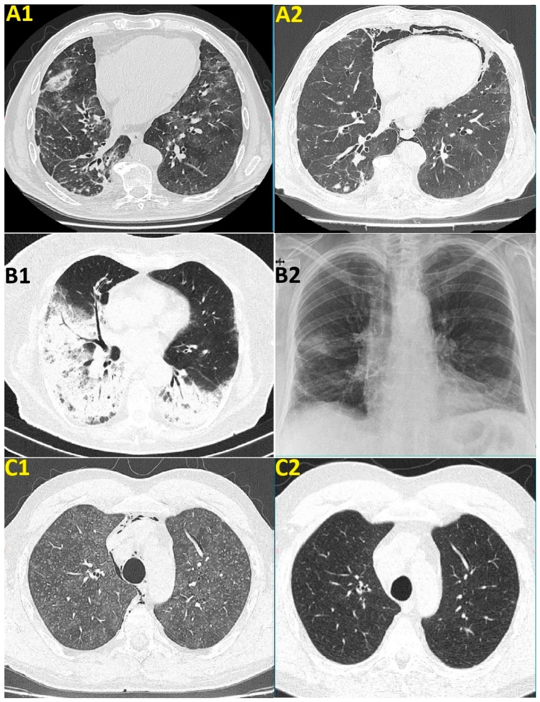
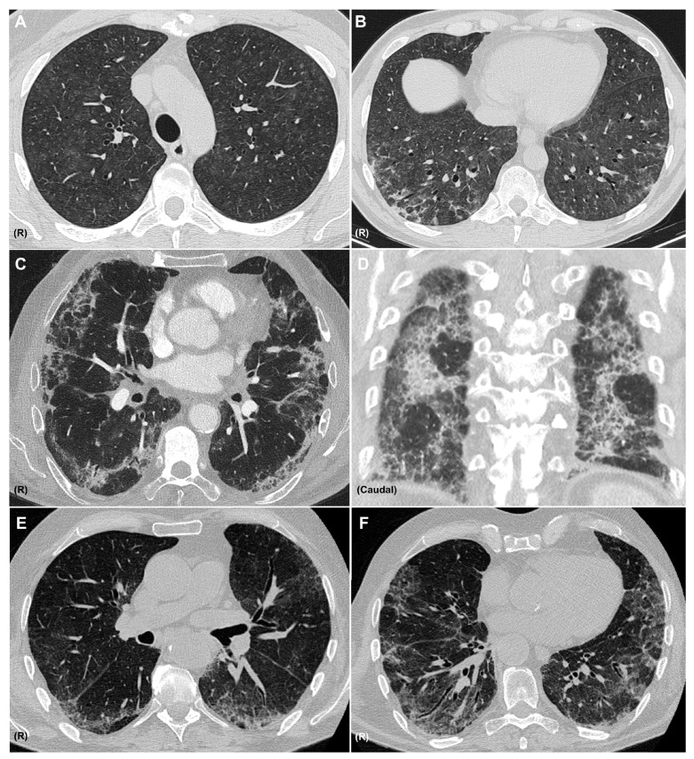
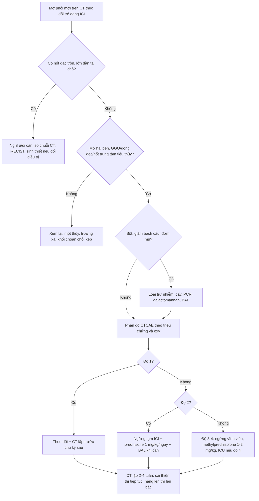
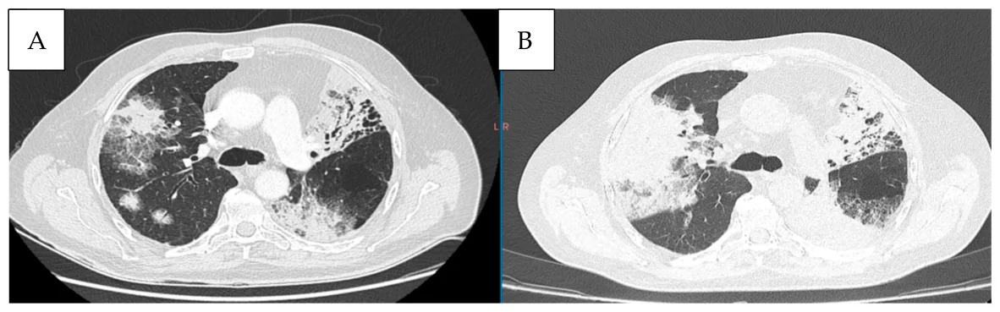

# 6147 — Viêm phổi do ức chế điểm kiểm soát miễn dịch ở trẻ / Checkpoint inhibitor pneumonitis (CIP) in children

**Tags:** `pattern:gco` `pattern:to-chuc-hoa` `pattern:mo-lan-toa` `pattern:not` `pattern:day-vach` `vung:phoi` `score:CTCAE` `protocol:CT-nguc` `protocol:surveillance` `protocol:BAL`
**Mức chắc chắn (certainty):** tổng hợp y văn (literature synthesis) — khung chẩn đoán, ngưỡng phân độ và xử trí lấy từ tổng quan CIP (Serra C et al., Medicina 2025, PMC12654511) và đoàn hệ 12 ca có hình ảnh (Toma CL et al., Diseases 2026, PMC13605366); dữ liệu **ở trẻ** chỉ gồm thử nghiệm pha I/II durvalumab + tremelimumab (Hargrave D et al., Front Oncol 2026, PMC13218898) và ca báo cáo HCC nhi (Zhong X et al., Front Oncol 2025, PMC12394043), nên phần lớn ngưỡng là **ngoại suy từ người lớn** — bài ghi rõ chỗ nào là suy luận.

> **Câu chốt của bài:** trên CT theo dõi một trẻ đang dùng ICI, **mờ phổi mới hai bên (GGO, đông đặc, nốt trung tâm tiểu thùy), không choán chỗ, xuất hiện sau 1–2 tháng** phải được gọi là **viêm phổi do ICI (checkpoint inhibitor pneumonitis, CIP)** cho tới khi loại trừ nhiễm trùng — vì CIP là **biến cố miễn dịch gây tử vong cao nhất** (tới **35%** số ca tử vong do điều trị), nhưng lại chỉ gặp ở **3–5%** thử nghiệm và **13–19%** thực hành. Ở trẻ, **không có ngưỡng riêng đã kiểm chứng**: dùng **CTCAE v5.0** như người lớn, hạ ngưỡng nội soi phế quản khi có sốt vì nhiễm trùng là hàng phân biệt số một.

## 1. Tổng quan bệnh học – cơ chế hình ảnh: vì sao ICI làm phổi mờ và vì sao CT không đặc hiệu

- **Cơ chế miễn dịch (pathophysiology):** khối u "mượn" trục **PD-1/PD-L1** để làm tê liệt tế bào T; ICI gỡ phanh đó → tế bào T hoạt hóa chống cả tự kháng nguyên phổi. Bằng chứng: **tăng lympho T hoạt hóa và Th1 trong dịch rửa phế quản (BAL)**, **giảm biệt hóa T điều hòa (Treg)**, **tăng Th17/IL-17**, **tự kháng thể (anti-CD74, RF, ANA)** và **CRP/IL-6 tăng** ở ca CIP. Microbiome phổi ở CIP cũng khác IPF/ung thư phổi và tương quan với **lauroylcarnitine** — chất làm tế bào T tiết cytokine viêm (Serra 2025).
- **TẠI SAO các mẫu hình trông như vậy (vật lý + mô bệnh):**
  - **GGO (ground-glass opacity):** phế nang chỉ bị lấp **một phần** bằng dịch viêm/tế bào → đậm độ trung gian giữa khí (**−900 HU**) và mô mềm (**+30 đến +60 HU**) nhưng **mạch máu vẫn nhìn xuyên qua** — đây là lý do GGO "mờ mà không che".
  - **Đông đặc (consolidation):** phế nang đầy hoàn toàn → **+30 đến +60 HU**, mạch máu bị che, thấy **phế quản hơi**; khi đông đặc **dưới màng phổi + đối xứng** thì nghĩ DAD/NSIP hơn là nhiễm khuẩn một thùy.
  - **Viêm phổi tổ chức hóa (organizing pneumonia, OP):** mô hạt lấp **phế nang và tiểu phế quản** nhưng **giữ nguyên khung phổi** → đông đặc vá, phân bố **quanh phế quản–mạch máu/ngoại vi**, **dấu atoll (reversed halo)** và **mờ quanh tiểu thùy (perilobular)** — những đường đa giác dày hơn vách liên tiểu thùy.
  - **HP (hypersensitivity pneumonitis):** viêm **trung tâm tiểu thùy** → **nốt GGO trung tâm tiểu thùy bờ mờ** + bẫy khí; đây là mẫu hình dễ bị đọc nhầm thành "di căn rải rác".
  - **NSIP:** GGO + **lưới** + **giãn phế quản co kéo** (traction bronchiectasis), **chừa dưới màng phổi (subpleural sparing)**, đáy phổi, đối xứng — dấu **co kéo** nghĩa là đã có xơ hóa, không còn thuần viêm.
  - **DAD:** màng hyaline + phù phế nang → **GGO lan rộng + đông đặc phụ thuộc + mất thể tích**; sau 1–3 tuần chuyển **lưới/giãn phế quản co kéo** — mẫu hình **tiên lượng xấu nhất**.
  - **Phản ứng dạng sarcoid (sarcoid-like reaction):** hạch rốn phổi/trung thất + nốt quanh bạch mạch, mô học **u hạt không hoại tử**; đây là **dấu hiệu đáp ứng điều trị**, **không phải CIP**, thường **không cần điều trị** — điểm khác biệt quyết định việc tiếp tục hay ngừng thuốc.
- **Ngưỡng định lượng cốt lõi (người lớn, dùng làm chuẩn tham chiếu cho trẻ):**
  - **Tần suất:** thử nghiệm lâm sàng **3–5%**, thực hành **13–19%**; **tới 1/3** ca là **độ 3 trở lên** (Serra 2025).
  - **Thời gian tiềm tàng:** trung bình **1–2 tháng** từ liều đầu; ca nặng thường trong **100–200 ngày**; thể **muộn (late-onset)** xuất hiện **> 3 tháng sau khi ngừng ICI**, thể **mạn** kéo dài **> 3 tháng** sau ngừng thuốc.
  - **Tỉ lệ tử vong:** CIP là irAE **có tỉ lệ tử vong cao nhất**, chiếm tới **35%** tử vong do điều trị; **58%** ca CIP có kèm irAE khác (da, đại tràng, gan, nội tiết).
  - **Mẫu hình CT hay gặp:** **OP 32%**, **HP 16%**; **DAD/OP lan rộng** gắn với ca nặng, **HP/NSIP** gắn với ca nhẹ hơn.
  - **Yếu tố nguy cơ có số:** **bất thường mô kẽ trên CT nền (ILA) OR 6,29 (95% CI 2,34–16,92)**; **phối hợp 2 ICI làm tăng gấp đôi** tần suất và ca nặng hơn; xạ trị ngực triệt căn; COPD/hen; hút thuốc **> 50 gói–năm**.
  - **Ở trẻ (dữ liệu thật, ít):** thử nghiệm pha I/II **durvalumab + tremelimumab** ở sarcoma/u đặc: **76%** có biến cố không mong muốn liên quan điều trị, **19% độ 3–4**, **1 ca viêm phổi độ 3** đáp ứng corticoid liều cao (Hargrave 2026). Ca HCC nhi **12 tuổi**: viêm gan độ 3, **dùng lại ICI → viêm phổi độ 2** phải ngừng hẳn (Zhong 2025) — minh họa rằng **trẻ dung nạp ICI tốt hơn về tần suất nhưng không "miễn nhiễm"**, và **dùng lại sau irAE gan là bối cảnh nguy cơ**.

## 2. Mẫu hình + chẩn đoán phân biệt theo mẫu hình và vị trí (Gamut)

**Mẫu hình chung:** trẻ đang/đã dùng ICI (thường ≥ 2–4 tuần), **mờ phổi mới hai bên**, không có khối choán chỗ, không xẹp thùy — câu hỏi là **"miễn dịch – nhiễm – u – xạ"**.

- **Theo mẫu hình CT (6 nhóm):** OP (ngoại vi/quanh phế quản, atoll, di chuyển) · NSIP (đáy phổi, chừa màng phổi, lưới) · HP (nốt trung tâm tiểu thùy + bẫy khí) · DAD (GGO lan tỏa + đông đặc phụ thuộc) · phản ứng sarcoid (hạch + nốt quanh bạch mạch) · **không mẫu hình đặc hiệu** (chỉ GGO khu trú — ca độ 1).
- **Theo vị trí:** **ngoại vi/dưới màng phổi** → OP, DAD; **quanh phế quản–mạch máu** → OP, sarcoid; **trung tâm tiểu thùy lan tỏa** → HP; **một thùy** → nghiêng nhiễm trùng, tắc phế quản, xạ trị; **hai đáy đối xứng** → NSIP, phù, thuốc khác.
- **Theo bối cảnh trẻ:**
  - **U hay gặp ở trẻ:** Hodgkin (nivolumab), melanoma, sarcoma (u xương mô mềm), u nguyên bào thần kinh đệm tăng đột biến (hypermutant), u nguyên bào gan, u lympho — **không có NSCLC**, nên **nền phổi lành hơn người lớn**, nhưng phổi **nhỏ hơn** và trẻ thường **nằm gây mê** khi chụp.
  - **Điều trị phối hợp:** ICI + hóa trị/xạ → mờ do **nhiễm do giảm bạch cầu**, **viêm phổi do xạ**, **bệnh phổi do thuốc khác** (bleomycin, methotrexate — xem bài 6130).
  - **Trẻ sau ghép tế bào gốc/CAR-T:** thêm PJP, CMV, nấm — **không được gọi CIP trước khi loại trừ**.
- **Gợi nhớ "OP – NSIP – HP – DAD – SARCOID":** năm mẫu hình "miễn dịch", mỗi mẫu hình vẫn phải **loại trừ nhiễm** trước khi quy cho ICI.

## 3. Bảng so sánh phân biệt (ma trận đối chiếu)

| Thực thể (entity) | Hình ảnh điển hình | Chốt vào (rule-in) | Chốt loại (rule-out) | Gợi ý xác nhận |
|---|---|---|---|---|
| **CIP – OP** | Đông đặc vá **ngoại vi/quanh phế quản**, **atoll**, **mờ quanh tiểu thùy**, có thể **di chuyển** | **Mờ hai bên + quan hệ thời gian với ICI + di chuyển/đáp ứng corticoid** | **Nốt đặc tròn lớn dần tại chỗ** → u; **một thùy + sốt cao** → nhiễm | So CT nền; BAL loại trừ nhiễm; thử corticoid có kiểm soát |
| **CIP – NSIP** | **GGO + lưới + giãn phế quản co kéo**, **chừa dưới màng phổi**, đáy phổi, đối xứng | **Đối xứng + không choán chỗ + tiến triển bán cấp** | **Mờ một bên, đẩy khe, có khối** → u/di căn | HRCT thì hít vào; PFT (hạn chế, DLCO giảm) |
| **CIP – HP** | **Nốt GGO trung tâm tiểu thùy bờ mờ** + bẫy khí + mosaic | **Nốt trung tâm tiểu thùy lan tỏa hai bên + bối cảnh ICI** | **Tree-in-bud, nốt theo thùy** → nhiễm/hít sặc | BAL (lympho, CD8), loại trừ nhiễm |
| **CIP – DAD** | **GGO lan rộng + đông đặc phụ thuộc + mất thể tích**; sau 3 tuần xơ hóa | **Khởi phát cấp, giảm oxy nhanh, hai bên, sau ICI** | **Chỉ một thùy, không suy hô hấp** → không phải DAD | CT lặp 2–5 ngày; loại trừ phù/nhiễm; cân nhắc sinh thiết nếu đổi điều trị |
| **Nhiễm trùng cơ hội (PJP, CMV, nấm)** | PJP: **GGO đối xứng + dày vách**, ít tràn dịch; CMV: **nốt nhỏ + quầng GGO**; nấm: **nốt + quầng → hang** | **Sốt + giảm bạch cầu/LDH tăng + đờm/BAL dương** | **Không sốt, mờ đối xứng đơn thuần, đáp ứng corticoid đơn thuần** → nghiêng CIP | PCR/PJP, galactomannan, cấy; **BAL trước khi tăng corticoid** |
| **Viêm phổi do xạ** | Đông đặc/GGO **thẳng bờ trường chiếu**, không vượt đường giữa | **Vị trí khớp bản đồ liều, 1–6 tháng sau xạ** | **Ngoài trường xạ, hai bên đối xứng** → không do xạ | Đối chiếu bản đồ liều; hội chẩn xạ trị |
| **Giả tiến triển (pseudoprogression)** | Tổn thương **to lên hoặc mới xuất hiện rồi nhỏ đi**, bệnh nhân vẫn khỏe | **Lâm sàng ổn + tổn thương thoái triển trên CT lặp 4–8 tuần (iRECIST)** | **To lên liên tục + LDH tăng + suy giảm lâm sàng** → tiến triển thật | CT lặp theo iRECIST; LDH (PD có LDH cao hơn, **OR 2,78/100 U/L**) |
| **Phản ứng dạng sarcoid** | **Hạch rốn phổi/trung thất + nốt quanh bạch mạch**, không GGO lan tỏa | **Hạch + nốt quanh bạch mạch ở người đáp ứng ICI, không triệu chứng** | **GGO/đông đặc lan tỏa + giảm oxy** → CIP | Sinh thiết nếu cần: **u hạt không hoại tử**, không tế bào u |
| **Bệnh phổi do thuốc khác (bleomycin, MTX)** | OP/NSIP/DAD, **mờ quanh tiểu thùy**, có thể di chuyển | **Rà danh sách thuốc + thời gian + không có ICI mới** | **Mờ mới đúng sau liều ICI, trong khi thuốc cũ đã dùng ổn định nhiều tháng** → nghiêng CIP | Pneumotox; ngừng thuốc nghi ngờ; xem bài 6130 |
| **Phù phổi/tăng thấm mao mạch** | **Dày vách + GGO + tràn dịch màng phổi/màng tim**, thay đổi nhanh | **Cân nặng tăng, tràn dịch, đáp ứng lợi tiểu** | **Không tràn dịch, mờ khu trú/đối xứng kiểu OP** → không phải phù | Siêu âm tim, BNP, cân nặng |

*Ba cặp ảnh từ đoàn hệ 12 ca: **A1** NSIP (nivolumab) → **A2** sau 1 tháng corticoid, xuất hiện **tràn khí trung thất**; **B1** OP (pembrolizumab) → **B2** X-quang sau 1 tháng cải thiện; **C1** HP (ipilimumab + nivolumab) → **C2** sau 1 tháng corticoid. Nguồn: Toma CL et al., Diseases 2026 (PMC13605366), Fig. 2, CC BY 4.0.*

*Sáu lát cắt: **A–B** HP không xơ hóa (nốt GGO trung tâm tiểu thùy lan tỏa) kèm ổ đông đặc quanh tiểu thùy kiểu OP; **C–D** NSIP + OP (GGO, lưới, chừa dưới màng phổi, đông đặc); **E–F** NSIP (GGO, chừa dưới màng phổi, lưới, giãn phế quản co kéo). Nguồn: Serra C et al., Medicina 2025 (PMC12654511), Fig. 3, CC BY 4.0.*

## 4. Protocol chụp + phân độ CTCAE + xử trí

- **CT ngực (ALARA ở trẻ):**
  - **Không cản quang** đủ để mô tả mờ nhu phổi; cản quang khi nghi **thuyên tắc phổi, nhiễm trùng hoại tử, huyết khối u, giả phình** hoặc cần đánh giá trung thất.
  - **Lát mỏng 1–1,5 mm**, tái tạo **cửa sổ phổi + trung thất**, MPR; **hít vào tối đa** nếu hợp tác, **lát thì thở ra** khi nghi bệnh tiểu phế quản; giảm kVp/mAs theo cân nặng/niên đại.
  - **Luôn so CT nền trước điều trị** trên cùng cửa sổ và cùng độ dày lát — đây là cách duy nhất phân biệt "mờ mới" với "mờ đã có từ trước".
  - Ghi rõ trong kết luận: **mẫu hình chính** (OP/NSIP/HP/DAD/sarcoid), **phân bố**, **có di chuyển không**, **có dấu xơ hóa (lưới, co kéo) không**, **có tràn dịch/tràn khí trung thất không** — vì mẫu hình và mức lan quyết định phân độ.
- **Phân độ CTCAE v5.0 — viêm phổi (pneumonitis) và xử trí tương ứng:**

| Độ | Định nghĩa | Xử trí (theo ASCO/ESMO/SITC, đồng thuận trong Serra 2025) |
|---|---|---|
| **1** | Không triệu chứng; chỉ thấy trên CT | Theo dõi triệu chứng + **CT lặp trước chu kỳ sau**: cải thiện → tiếp tục ICI; ổn định → có thể tiếp tục; **nặng lên → xử trí như độ cao hơn** |
| **2** | Có triệu chứng, hạn chế hoạt động hằng ngày | **Tạm ngừng ICI**; hội chẩn hô hấp/nhiễm; **cân nhắc nội soi phế quản**; kháng sinh theo kinh nghiệm; **prednisone 1 mg/kg/ngày**, cải thiện sau 2–3 ngày thì **giảm liều > 4 tuần** |
| **3** | Triệu chứng nặng, **cần oxy** | **Ngừng ICI vĩnh viễn**; nhập viện; **nội soi phế quản khuyến cáo**; kháng sinh; **methylprednisolone 1–2 mg/kg/ngày**, tăng/giảm theo đáp ứng; **chỉ dùng lại ICI nếu hồi phục hoàn toàn và sau đánh giá lợi/hại** |
| **4** | Đe dọa tính mạng, có thể cần đặt nội khí quản | **Ngừng ICI vĩnh viễn**; ICU; **methylprednisolone IV 2 mg/kg/ngày**; **không cải thiện sau 2 ngày → infliximab, cyclophosphamide, mycophenolate hoặc IVIG**; **giảm corticoid ≥ 2 tháng**; dự phòng PJP khi pred ≥ 20 mg/ngày ≥ 4 tuần |
| **5** | Tử vong | — |

- **Nguyên tắc dùng lại ICI (rechallenge):** bằng chứng **chất lượng thấp**; ESMO **không khuyến cáo cụ thể**; ASCO/SITC cho phép **sau độ 1 khi CT cải thiện**, **sau độ 2 khi triệu chứng và hình ảnh hồi phục hoàn toàn**; **không dùng lại từ độ 3** (SITC có thể xét ca độ 3 hồi phục hoàn toàn). **Tái phát CIP có thể xảy ra dù không dùng lại thuốc** → vẫn phải theo dõi (Serra 2025). Đoàn hệ **106 ca CIP ở ung thư phổi**: **50% (15/30)** ca tiếp tục/dùng lại ICI có **CIP tái phát hoặc tiến triển**, nhưng nhóm dùng lại có **mPFS 13,67 vs 7,90 tháng** và **mOS 33,77 vs 13,23 tháng** so với ngừng vĩnh viễn — lợi ích sinh tồn đủ lớn để **cá thể hóa**, không cấm tuyệt đối (Wu G et al., Front Oncol 2025, PMC12450690).
- **Phản biện về thời gian tiềm tàng:** tổng quan nêu **1–2 tháng**, nhưng đoàn hệ trên cho **khởi phát trung vị 5,17 tháng (95% CI 4,61–5,72)** — nghĩa là **mờ phổi mới sau 5–6 tháng vẫn phải nghĩ CIP**, đừng loại trừ chỉ vì "đã dùng thuốc lâu".
- **Giả tiến triển — đừng nhầm với CIP:** trong 123 ca nghi giả tiến triển, **56 ca là giả tiến triển thật, 67 ca tiến triển thật**; thời điểm nghi **trung vị 79 ngày**; **LDH cao hơn ở nhóm tiến triển thật** (189 vs 232,5 U/L; **OR hiệu chỉnh 2,78 mỗi 100 U/L**, 95% CI 1,19–6,52) nhưng **LDH một mình không đủ phân biệt** — phải **chụp lặp theo iRECIST** (Toulet A et al., Cancers 2026, PMC13604733).
- **Sơ đồ tiếp cận:**

## 5. Biến thể bình thường và cạm bẫy

- **Gọi CIP khi chưa loại trừ nhiễm** — sai lầm chết người: trẻ đang hóa trị có **sốt + giảm bạch cầu hạt**, hình ảnh GGO hai bên **giống hệt CIP**; tăng corticoid trước khi cấy/BAL có thể làm bùng phát nhiễm nấm/PJP. **BAL trước, corticoid sau** (trừ khi sốc/giảm oxy nặng đe dọa tính mạng).
- **Gọi CIP là "di căn mới"** → đổi phác đồ, mổ phổi oan; dấu hiệu phân biệt là **mờ lan tỏa, atoll, mờ quanh tiểu thùy, di chuyển** thay vì **nốt đặc tròn lớn dần**.
- **Bỏ sót CIP thể không triệu chứng:** tới **1/3** ca không có triệu chứng, chỉ phát hiện trên CT theo dõi — nếu chỉ đọc "không tiến triển u" mà bỏ qua mờ mới, ca độ 1 sẽ thành độ 3.
- **Giả tiến triển bị đọc là thất bại điều trị:** tổn thương **to lên rồi nhỏ đi**, bệnh nhi vẫn khỏe → **không ngừng thuốc vội**; nhưng cũng **không được dùng "giả tiến triển" để trấn an** khi bệnh nhân suy giảm lâm sàng.
- **Phản ứng sarcoid bị điều trị như CIP:** hạch + nốt quanh bạch mạch, không GGO lan tỏa → **không cần corticoid**, tiếp tục ICI; sinh thiết chỉ khi cần loại trừ u.
- **Xạ trị ngực trước đó:** CIP **vượt ngoài trường xạ**, viêm phổi do xạ **dừng ở bờ trường** — luôn chồng bản đồ liều lên CT.
- **Corticoid che bệnh:** đang dùng corticoid vì irAE khác có thể làm mờ hình ảnh nhiễm, khiến "đáp ứng corticoid" bị hiểu nhầm là bằng chứng CIP.
- **Tràn khí trung thất sau corticoid** (Hình A2): có thể xuất hiện khi tổn thương giảm — **không đồng nghĩa thất bại**, nhưng cần loại trừ **thủng/rò khí quản** nếu bệnh nhi xấu đi.
- **PET/CT không dùng để chẩn đoán CIP:** viêm do miễn dịch và u đều tăng FDG; PET chỉ hữu ích khi **nghi tiến triển/u thứ hai** và không thay thế CT lát mỏng.

## 6. Tự lượng giá — Blind Quiz

**Ca 1 — Người lớn (dữ liệu hình ảnh tham chiếu): bệnh nhân melanoma đang nivolumab + ipilimumab. Khó thở nhẹ, không sốt. CT ngực: nốt GGO trung tâm tiểu thùy lan tỏa hai bên + ổ đông đặc quanh tiểu thùy.**

- Câu hỏi: Mẫu hình nào? Hai chẩn đoán phân biệt cần loại trừ trước khi gọi CIP? Dấu hiệu nào trên ảnh nghiêng về miễn dịch hơn nhiễm?

<b>Bấm để hiện đáp án</b>

- Mẫu hình **HP (nốt GGO trung tâm tiểu thùy) + OP (đông đặc quanh tiểu thùy)** — thường gặp ở **phối hợp ICI**, và phối hợp làm **tăng gấp đôi** tần suất CIP.
- Phân biệt: **nhiễm (PJP, CMV, nấm, lao)** và **di căn/u mới**; thêm **phù** và **viêm phổi do xạ** nếu có tiền sử xạ.
- Dấu hiệu nghiêng miễn dịch: **đối xứng, lan tỏa, không có nốt đặc tròn, không có cây–chồi (tree-in-bud), không sốt** — nhưng **BAL vẫn cần** để loại trừ nhiễm vì hình ảnh không đặc hiệu.
- Nguồn ảnh: Serra C et al., Medicina 2025 (PMC12654511), Fig. 3, CC BY 4.0.

**Ca 2 — Người lớn: bệnh nhân ung thư phổi đang pembrolizumab. OP hai bên; sau khi hồi phục hoàn toàn, ICI được dùng lại song song corticoid. CT lặp sau đó.**

- Câu hỏi: Điều gì đã xảy ra? Đây là CIP tái phát hay tiến triển u? Quyết định tiếp theo?

<b>Bấm để hiện đáp án</b>

- **A:** OP trước dùng lại; **B:** tổn thương **lan rộng, đông đặc hai bên** sau khi dùng lại ICI → **CIP tái phát** (ca 7 trong đoàn hệ).
- Không phải tiến triển u: tổn thương **theo mẫu hình OP**, không phải nốt đặc lớn dần; bối cảnh **vừa dùng lại ICI** là chốt.
- Xử trí: **ngừng ICI**, tăng corticoid theo độ; **không dùng lại lần hai** nếu tái phát; đánh giá lại lợi/hại với ung thư.
- Nguồn ảnh: Toma CL et al., Diseases 2026 (PMC13605366), Fig. A7, CC BY 4.0.

**Ca 3 — Trẻ 17 tuổi, ung thư biểu mô vảy trên bệnh lý da di truyền (xeroderma pigmentosum), đang cemiplimab. Mờ phổi không triệu chứng, thay đổi qua 3 lần CT trong 4 tháng; BAL không nhiễm, không u.**

- Câu hỏi: Vì sao **không sinh thiết ngay**? Khi nào ngừng ICI ở trẻ? Khác gì so với người lớn?

<b>Bấm để hiện đáp án</b>

- Hình ảnh **mờ nốt/đông đặc ngoại vi, xuất hiện–mất–tái xuất hiện ở vị trí khác** = **di chuyển (waxing and waning)**; BAL **không nhiễm, không u** → **OP do ICI**; sinh thiết **không đổi điều trị** và có nguy cơ ở trẻ.
- Ca không triệu chứng: **theo dõi** (độ 1), không ngừng thuốc ngay; khi có triệu chứng/giảm oxy → **ngừng ICI + corticoid**.
- Ở trẻ: **không có ngưỡng riêng**; dùng CTCAE như người lớn, nhưng **dung nạp tốt hơn** (thử nghiệm durva+treme: 19% độ 3–4, 1 ca viêm phổi độ 3). Trẻ **không có NSCLC** nên nền phổi ít bệnh hơn, nhưng **phổi nhỏ** nên cùng một vùng mờ gây giảm oxy nặng hơn.
- Ca gốc (17 tuổi, cemiplimab) đã trình bày đầy đủ ở [bài 6130](../6130-viem-phoi-do-thuoc-tre-sarcoma/lesson.md), Hình 7 — dùng làm đối chiếu, không lặp ảnh.
- Nguồn: Schapiro AH et al., Pediatr Radiol 2026 (PMC12881037); Hargrave D et al., Front Oncol 2026 (PMC13218898).

## Bài liên quan chéo
- [6130 – Viêm phổi do thuốc trên CT theo dõi ở trẻ sarcoma](../6130-viem-phoi-do-thuoc-tre-sarcoma/lesson.md) — 6 mẫu hình, ca ICI 17 tuổi, chẩn đoán loại trừ
- [6148 – Hội chứng sau đốt & nhiễm trùng ổ đốt sau đốt nhiệt phổi](../6148-hoi-chung-sau-dot-va-nhiem-trung-o-dot/lesson.md) — mờ phổi mới sau can thiệp phổi
- [6702 – Theo dõi sau mổ nốt phổi ở trẻ: nốt mới là tái phát hay sẹo?](../6702-theo-doi-sau-mo-not-phoi-o-tre/lesson.md)
- [016 – Nốt phổi ở bệnh nhân có tiền sử ung thư](../016-not-phoi-tien-su-ung-thu/lesson.md)
- [1430 – Độc tính thần kinh sau CAR-T (ICANS)](../1430-icans-doc-tinh-than-kinh-sau-car-t/lesson.md) — nguyên lý irAE và thang độ

## Ảnh
- `6147_mau-hinh-ICI_CT_PMC13605366.jpg`, `6147_tai-phat-sau-tai-dieu-tri_CT_PMC13605366.jpg`, `6147_mau-hinh-ICI_CT_PMC12654511.jpg` — nguồn + giấy phép từng ảnh: `images/CREDITS.md`.
- Cả ba ảnh minh họa **người lớn** (dữ liệu hình ảnh công bố); bài ghi rõ để không gán bệnh nhi cho ảnh người lớn.

> Không dùng để chẩn đoán độc lập khi chưa có người hướng dẫn.
