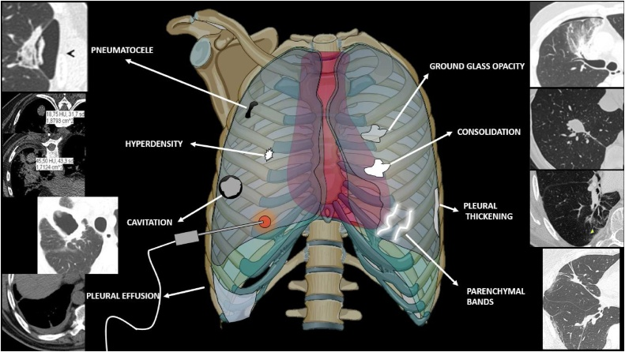
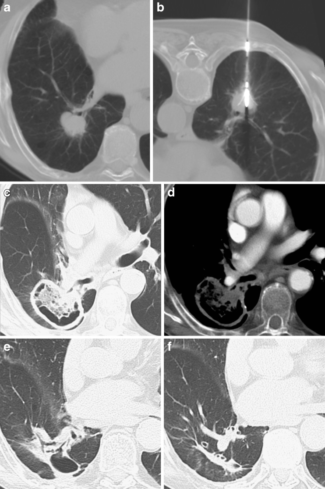
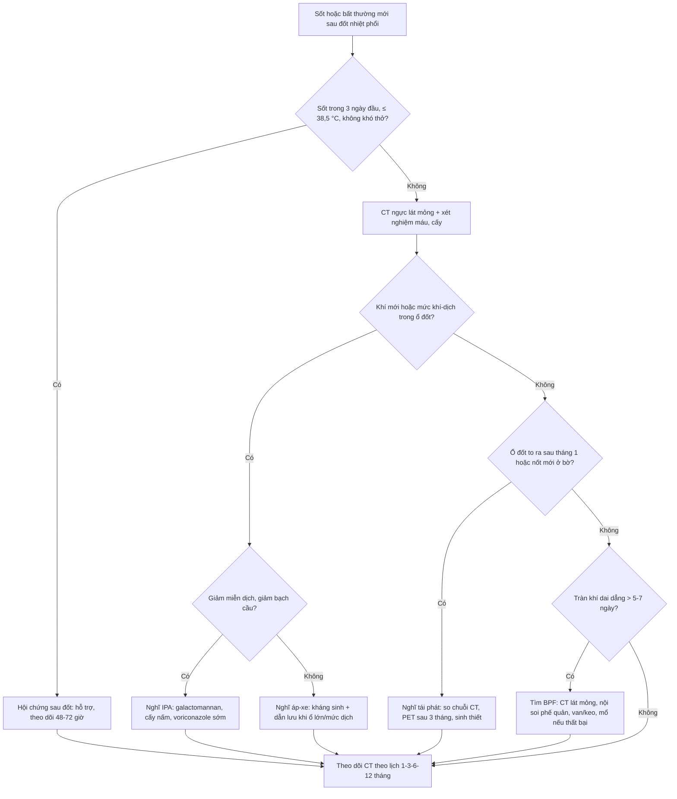
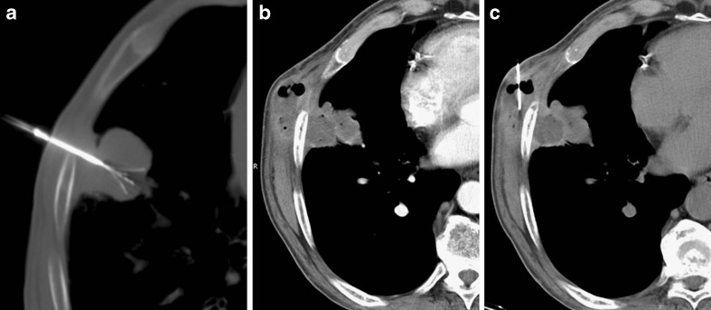

# 6148 — Hội chứng sau đốt & nhiễm trùng ổ đốt sau đốt nhiệt phổi / Post-ablation syndrome and ablation-zone infection

**Tags:** `pattern:hang` `pattern:dong-dac` `pattern:gco` `pattern:tran-dich` `pattern:xo-hoa` `vung:phoi` `score:CIRSE` `protocol:CT-nguc` `protocol:surveillance` `incidentaloma:not-phoi`
**Mức chắc chắn (certainty):** tổng hợp y văn (literature synthesis) — số liệu biến chứng và ngưỡng xử trí lấy từ tổng quan 2026 về biến chứng đốt nhiệt phổi (How GY, Pua U, Cancers 2026, PMC13702536); hình ảnh diễn tiến ổ đốt lấy từ nghiên cứu theo dõi sau RFA phổi (Araujo-Filho JAB et al., Eur J Radiol Open 2020, PMC7666375) và loạt ca RFA phổi (Bargellini I et al., Insights Imaging 2011, PMC3259330); số liệu **hội chứng sau đốt** định lượng lấy từ nghiên cứu tiến cứu **cryoablation thận** (Zhong J et al., Cardiovasc Intervent Radiol 2018, PMC5758690) vì **không có nghiên cứu tiến cứu tương ứng ở phổi/trẻ** — bài ghi rõ đây là ngoại suy.

> **Câu chốt của bài:** sau đốt nhiệt phổi, **sốt nhẹ + mệt + buồn nôn trong vài ngày đầu, kèm ổ đốt đông đặc có quầng GGO rồi hang hóa và teo dần** là **diễn tiến mong đợi**, không phải thất bại hay nhiễm trùng. Ngược lại, **sốt ≥ 38,5 °C kéo dài/lặp lại, khí mới trong ổ đốt, mức khí–dịch, thành dày lên, ổ đốt TO RA sau tháng thứ 1** phải đọc là **nhiễm ổ đốt** — vì **áp-xe chỉ ~0,5–3%** nhưng **aspergillosis xâm lấn 1,44% với tử vong 26,1%**, và **rò phế quản–màng phổi 0,3% có thể tử vong**.

## 1. Tổng quan bệnh học – cơ chế hình ảnh: vì sao ổ đốt "trông xấu" mà vẫn lành

- **Bệnh học:** đốt nhiệt (RFA/MWA/cryoablation) gây **hoại tử đông vón (coagulative necrosis)** trung tâm, quanh đó là **vùng chuyển tiếp xuất huyết–viêm** và **vành tăng sinh mạch phản ứng**. Mô hoại tử được **đại thực bào dọn dẹp**, mô xơ thay thế → ổ đốt **co nhỏ dần thành dải xơ**. Vì phổi có **khí và đường thở**, mô hoại tử có thể **được khạc ra** qua phế quản → tạo **hang vô khuẩn**.
- **TẠI SAO CT hiện các mẫu hình này (vật lý + mô bệnh):**
  - **Đông đặc trung tâm:** mô hoại tử + phù + xuất huyết lấp phế nang → **+30 đến +60 HU**, mạch máu bị che; vùng này **không ngấm thuốc** vì đã mất tưới máu.
  - **Quầng GGO quanh ổ đốt:** phù/xuất huyết vi mạch ở vùng chuyển tiếp → đậm độ trung gian (**−900 → +30 HU**), **mạch máu còn thấy xuyên qua**; đây là **"viền an toàn" (margin)** cần đạt, không phải tổn thương mới.
  - **Hang (cavitation):** mô hoại tử thoát qua phế quản → khoang khí; hang **vô khuẩn** có thành **mỏng, đều, không ngấm thuốc**, **không mức khí–dịch**, và **nhỏ dần** theo thời gian.
  - **Bóng khí (pneumatocele)/nang khí:** van một chiều ở tiểu phế quản sau viêm → khí bị giữ, thành mỏng; thường **tự khỏi**.
  - **Sốt sau đốt:** giải phóng nội bào (DNA, cytokine IL-6) từ khối hoại tử lớn + viêm màng phổi phản ứng → **"hội chứng sau đốt"**, không phải nhiễm khuẩn.
  - **Áp-xe:** khoang hoại tử **bị bội nhiễm** → **khí + mức khí–dịch**, thành **dày, ngấm thuốc không đều**, đông đặc quanh tăng lên, ổ **to ra** sau tháng đầu; **khí mới xuất hiện muộn** là dấu hiệu cảnh báo.
- **Ngưỡng định lượng cốt lõi:**
  - **Biến chứng chung sau đốt phổi:** tràn khí màng phổi **37–44%** (tới **20%** cần chọc hút/đặt dẫn lưu); xuất huyết nhu mô **17,7%**, ho ra máu **16,1%**, tử vong do chảy máu **0,4%** (248 ca RFA); tràn dịch màng phổi phản ứng **19%** sau RFA và **2,9%** sau MWA cần dẫn lưu (How 2026).
  - **Hội chứng sau đốt (tiến cứu, cryoablation thận 64 ca):** **38/64 = 59%** có triệu chứng; **52%** chỉ có triệu chứng giống cúm; **39%** hết hoàn toàn trong **10 ngày**; **38%** không triệu chứng; **đau đỉnh điểm ngày 3**; **72%** giảm đau 90–100% trong 10 ngày (Zhong 2018). **Phổi chưa có nghiên cứu tiến cứu tương đương** — dùng làm mốc thời gian tham chiếu.
  - **Nhiễm trùng ổ đốt:** sau RFA **~3%** sốt sau đốt và **~3%** áp-xe; sau MWA **viêm phổi 2,9%**, **áp-xe 0,5%**; **aspergillosis xâm lấn (IPA) 1,44%** sau MWA với **tử vong 26,1%**; **hang hóa sớm và to ra 6,3%** sau RFA, là yếu tố thuận lợi cho bội nhiễm (How 2026).
  - **Yếu tố nguy cơ hang hóa (có số):** tổn thương **cách màng phổi ≥ 20 mm**, **tiếp xúc mạch ≥ 3 mm**, **phế quản ≥ 2 mm nằm trong vùng đốt**, **điện cực đa nan ≥ 3 cm**; **sốt ≥ 38,5 °C**, **bạch cầu tăng ngày 1** và **đang dùng corticoid** là yếu tố độc lập của hang hóa (How 2026).
  - **Rò phế quản–màng phổi (BPF):** **0,3% (2/682 ca MWA)**, **cả 2 tử vong**; rò khí kéo dài **> 5–7 ngày** phải tìm BPF (How 2026).
- **Ở trẻ:** chỉ định đốt phổi chủ yếu là **di căn phổi osteosarcoma/Ewing** và một số u đặc không mổ được; trẻ **nằm gây mê**, phổi **nhỏ hơn** nên cùng một thể tích đốt chiếm **tỉ lệ nhu mô lớn hơn**, và trẻ thường **giảm bạch cầu sau hóa trị** — nguy cơ nhiễm ổ đốt **về lý thuyết cao hơn**, nhưng **chưa có số liệu riêng** (xem bài 6129 cho kỹ thuật đốt ở trẻ).

## 2. Mẫu hình + chẩn đoán phân biệt theo thời điểm (Gamut)

**Mẫu hình chung:** trẻ có ổ đốt phổi, **sốt/đau ngực/ho** trong **tuần đầu** hoặc **bất thường mới trên CT theo dõi** — câu hỏi là **"diễn tiến mong đợi – nhiễm – rò khí – tái phát"**.

- **Theo thời điểm:**
  - **24 giờ–1 tuần:** đông đặc trung tâm + **quầng GGO** (mong đợi); **tràn khí màng phổi**; **xuất huyết/ho ra máu**; **sốt nhẹ** (hội chứng sau đốt).
  - **1–3 tháng:** ổ đốt **hang hóa**, có thể **to hơn** trong 1 tháng đầu; **bóng khí**; **tràn dịch phản ứng**; đây là cửa sổ dễ **gọi nhầm áp-xe**.
  - **3–12 tháng:** ổ đốt **teo dần thành dải xơ**; **hang còn lại** nhưng phải **nhỏ dần**; **nốt mới ở bờ** = tái phát; **khí mới/mức dịch** = nhiễm.
- **Theo hình thái:**
  - **Hang vô khuẩn:** thành mỏng đều, **không ngấm thuốc**, không mức dịch, nhỏ dần.
  - **Áp-xe:** khí + **mức khí–dịch**, thành dày, ngấm thuốc, đông đặc quanh, to ra.
  - **IPA:** hang/nốt có **dấu liềm khí (air crescent)** hoặc **khí mới** ở bệnh nhân **giảm miễn dịch**, có thể kèm **dày màng phổi**, **nhồi máu phổi**.
  - **Rò phế quản–màng phổi:** **tràn khí dai dẳng dù đã dẫn lưu**, khí trong ổ đốt thông với khoang màng phổi, **khí thở ra qua ống dẫn lưu**.
  - **Tái phát tại bờ:** **nốt đặc, tròn, ngấm thuốc**, lớn dần **sát bờ ổ đốt**, không khí/mức dịch.
- **Gợi nhớ "ĐỢI – KHÍ – DỊCH – BỜ":** **Đ**ông đặc + quầng GGO (mong đợi) · **Ợ** (hội chứng sau đốt: sốt nhẹ vài ngày) · **KH**í mới/mức khí–dịch (áp-xe/IPA) · **D**ịch màng phổi (phản ứng/empyema) · **BỜ** ổ đốt (nốt mới = tái phát).

## 3. Bảng so sánh phân biệt (ma trận đối chiếu)

| Thực thể (entity) | Hình ảnh điển hình | Chốt vào (rule-in) | Chốt loại (rule-out) | Gợi ý xác nhận |
|---|---|---|---|---|
| **Ổ đốt mong đợi** | Đông đặc trung tâm **không ngấm thuốc** + **quầng GGO** ≥ 5 mm; hang thành mỏng; **teo dần** | **Đúng vị trí đốt, không khí mới, không mức dịch, nhỏ dần qua các lần chụp** | **Khí mới/mức dịch + thành dày + to ra sau tháng 1** → nhiễm | So CT 24 giờ và các mốc 1–3–6–12 tháng |
| **Áp-xe ổ đốt** | **Khí + mức khí–dịch**, thành dày ngấm thuốc, đông đặc quanh tăng | **Sốt ≥ 38,5 °C kéo dài/lặp + khí mới + mức dịch** | **Hang khô, thành mỏng, không sốt, nhỏ dần** → không áp-xe | Cấy máu/dịch ổ đốt; **không chọc qua màng phổi nếu không cần**; kháng sinh + dẫn lưu khi có chỉ định |
| **Aspergillosis xâm lấn (IPA)** | **Khí mới/liềm khí** trong ổ đốt, nốt + quầng, dày màng phổi; có thể nhồi máu | **Giảm miễn dịch/giảm bạch cầu + khí mới + sốt kháng kháng sinh** | **Hang khô ở người khỏe, không suy giảm miễn dịch** → ít nghĩ IPA | Galactomannan, **(1→3)-β-D-glucan**, cấy nấm, CT lặp 3–7 ngày; **voriconazole** là điều trị đầu tay |
| **Viêm phổi quanh ổ đốt** | Đông đặc **ngoài ổ đốt**, có phế quản hơi, có thể một thùy | **Đông đặc ngoài ranh giới ổ đốt + sốt + ran phổi** | **Đông đặc đúng ổ đốt, không lan** → diễn tiến mong đợi | Cấy đờm/BAL; kháng sinh theo kinh nghiệm |
| **Rò phế quản–màng phổi (BPF)/rò khí kéo dài** | **Tràn khí dai dẳng > 5–7 ngày** dù đã dẫn lưu; khí trong ổ đốt thông màng phổi | **Khí thở ra qua ống dẫn lưu + ổ đốt sát màng phổi** | **Tràn khí nhỏ, tự hết trong 1–3 ngày** → không BPF | CT lát mỏng; nội soi phế quản; van nội phế quản/keo sinh học; **mổ nếu thất bại** |
| **Tái phát tại bờ ổ đốt** | **Nốt đặc, tròn, ngấm thuốc**, lớn dần sát bờ; **không khí, không dịch** | **Nốt mới sát bờ, lớn lên trên ≥ 2 CT cùng kỹ thuật** | **Dải xơ mỏng, không ngấm thuốc, ổn định/teo** → sẹo | So chuỗi CT; PET sau **≥ 3 tháng**; sinh thiết nếu đổi điều trị |
| **Xuất huyết ổ đốt** | **Đậm độ cao** trong ổ đốt, có thể mức dịch–máu; ho ra máu | **Ho ra máu + đậm độ cao mới, giảm dần** | **Đậm độ thấp, ổn định** → hoại tử | Hb, CT lặp; nút mạch nếu giả phình/chảy máu ồ ạt |
| **Tràn dịch/empyema** | Dịch màng phổi **có vách, dày màng phổi**, bóng khí trong dịch | **Dịch + sốt + dày màng phổi + khí trong khoang màng phổi** | **Dịch ít, tự hết, không sốt** → phản ứng | Siêu âm/CT; cấy dịch; dẫn lưu + kháng sinh |
| **Bóng khí (pneumatocele)** | Khoang khí **thành rất mỏng**, không dịch, không ngấm thuốc | **Sau đốt/viêm, không sốt, tự xẹp** | **Thành dày + dịch + to ra** → áp-xe | CT lặp; không can thiệp nếu không triệu chứng |
| **Di căn theo đường kim (seeding)** | Nốt dọc **đường kim/thành ngực**, có thể **kèm bóng khí** | **Nốt đúng đường kim, đặc, lớn dần** | **Khối có khí + sốt + viêm mô mềm** → áp-xe (không phải seeding) | Sinh thiết **khi còn phân vân** — ca báo cáo cho thấy áp-xe giả seeding |

*Sơ đồ minh họa kèm ảnh CT: **bóng khí (pneumatocele), đậm độ cao trong nốt, hang hóa, tràn dịch màng phổi, GGO, đông đặc, dày màng phổi, dải nhu mô** — những hình thái cần nhận diện để không gọi nhầm là biến chứng. Nguồn: Araujo-Filho JAB et al., Eur J Radiol Open 2020 (PMC7666375), Fig. 1, CC BY-NC-ND 4.0 (nguyên bản, không chỉnh sửa).*

*NSCLC thùy dưới phải sát phế quản phân thùy: **a** nốt trước đốt; **b** đặt kim; **c–d** sau 1 tháng — **hang lớn chiếm toàn bộ nốt, không ngấm thuốc**; **e–f** sau 6 và 12 tháng — hang **nhỏ dần thành dải xơ** = đáp ứng hoàn toàn. Nguồn: Bargellini I et al., Insights Imaging 2011 (PMC3259330), Fig. 6, CC BY 4.0.*

## 4. Protocol chụp + phân loại biến cố + xử trí

- **CT ngực sau đốt (trẻ, ALARA):**
  - **Mốc chụp:** **24 giờ** (nền, xác nhận vùng đốt + biến chứng sớm) → **1 tháng** → **3 tháng** → **6 tháng** → **12 tháng**, sau đó theo lịch ung thư.
  - **Kỹ thuật:** lát mỏng **1–1,5 mm**, cửa sổ phổi + trung thất, MPR; **không cản quang** là đủ cho diễn tiến ổ đốt; **có cản quang** khi nghi **áp-xe/empyema, tái phát, giả phình, huyết khối**.
  - **Đo và ghi:** **đường kính ổ đốt 3 trục**, **độ dày thành hang**, **có/không khí, mức khí–dịch**, **quầng GGO quanh ổ đốt**, **khoảng cách tới màng phổi**, **nốt ở bờ**, **tràn khí/tràn dịch**.
  - **Mốc diễn tiến bình thường:** ổ đốt có thể **to hơn trong tháng đầu** (phù/xuất huyết), sau đó **phải nhỏ dần ≥ 20–30%** mỗi lần chụp; **hang khô** có thể tồn tại **nhiều tháng** nhưng **không được to lên**.
- **Phân loại biến cố (CIRSE sửa đổi, dùng trong tổng quan How 2026):**

| Độ | Ý nghĩa | Ví dụ sau đốt phổi |
|---|---|---|
| **1** | Không cần điều trị, không hậu quả | Tràn khí nhỏ, đau thoáng qua |
| **2** | Điều trị nhẹ, nằm viện ≤ 48 giờ | Tràn khí cần chọc hút, tràn dịch nhỏ |
| **3** | Điều trị tích cực, nằm viện > 48 giờ | Dẫn lưu màng phổi, kháng sinh IV, truyền máu |
| **4** | Hậu quả lâu dài/thêm can thiệp lớn | Rò khí kéo dài cần van/keo, áp-xe cần dẫn lưu kéo dài |
| **5** | Tử vong | BPF ồ ạt, nhiễm khuẩn huyết |
| **6** | Tử vong trong 24 giờ (bất kể nguyên nhân) | — |

- **Xử trí theo bệnh cảnh:**
  - **Hội chứng sau đốt:** **điều trị hỗ trợ** (hạ sốt, bù dịch, giảm đau); **không kháng sinh thường quy**; hẹn **CT nếu sốt kéo dài > 5–7 ngày** hoặc sốt ≥ 38,5 °C.
  - **Áp-xe:** kháng sinh theo cấy + **dẫn lưu qua da/qua nội soi phế quản** khi ổ lớn, có mức dịch, hoặc thất bại kháng sinh; **không chọc kim mù qua màng phổi**.
  - **IPA:** **voriconazole** đầu tay, phối hợp kiểm soát ức chế miễn dịch; **không chờ cấy** nếu hình ảnh + bối cảnh điển hình.
  - **BPF/rò khí kéo dài:** dẫn lưu + điều trị nhiễm; **van nội phế quản/keo sinh học**; **mổ** khi thất bại.
- **Sơ đồ tiếp cận sốt sau đốt:**

## 5. Biến thể bình thường và cạm bẫy

- **Khí trong ổ đốt NGAY sau đốt là bình thường** (do bay hơi mô + co kéo), nhưng **khí MỚI xuất hiện ở lần chụp sau** — đặc biệt kèm mức dịch/thành dày — là **nhiễm cho tới khi chứng minh ngược**.
- **Ổ đốt to ra trong tháng đầu** (phù/xuất huyết) là bình thường; **to ra sau tháng thứ 1** hoặc **không nhỏ đi sau 3 tháng** phải tìm **áp-xe/tái phát**.
- **Áp-xe giả di căn theo đường kim:** ca báo cáo có **khối dưới da cạnh ổ đốt sau 9 tháng, bờ ngấm thuốc + bóng khí**, bị nghi **seeding** nhưng sinh thiết cho **áp-xe lan thành ngực** — **đừng sinh thiết mù rồi bỏ qua điều trị nhiễm**, và **đừng mổ "cắt di căn"** khi có khí + viêm mô mềm (Bargellini 2011, Fig. 5).
- **Hang khô tồn tại lâu** không phải thất bại: hang có thể còn **6–12 tháng** nhưng phải **nhỏ dần**; chỉ can thiệp khi **to ra, mức dịch, sốt**.
- **PET/CT trong 3 tháng đầu dương tính giả** do viêm/hoại tử; **không dùng PET sớm để kết luận tái phát** — chờ **≥ 3 tháng** và so với CT.
- **Tràn khí dai dẳng sau đốt không được "rút ống rồi theo dõi"**: rò khí **> 5–7 ngày** phải tìm **BPF**; bỏ sót dẫn tới **viêm màng phổi/empyema** và **tử vong** (0,3% ca MWA, cả 2 tử vong).
- **Corticoid che nhiễm:** trẻ đang corticoid vì bệnh nền có thể **không sốt, bạch cầu không tăng** dù đã áp-xe — **hạ ngưỡng chụp CT**.
- **Đừng nhầm dải xơ với tái phát:** dải xơ **mỏng, không ngấm thuốc, ổn định/teo**; tái phát là **nốt đặc, tròn, lớn dần**.

## 6. Tự lượng giá — Blind Quiz

**Ca 1 — Người lớn (dữ liệu hình ảnh tham chiếu): NSCLC thùy dưới phải sát phế quản phân thùy, đốt RFA. CT 1 tháng: hang lớn chiếm toàn bộ nốt, không ngấm thuốc; bệnh nhân không sốt.**

- Câu hỏi: Hang này là **thất bại, áp-xe hay đáp ứng hoàn toàn**? Dấu hiệu nào quyết định? Theo dõi tiếp thế nào?

<b>Bấm để hiện đáp án</b>

- **Đáp ứng hoàn toàn**: hang thành mỏng, **không ngấm thuốc**, **không mức khí–dịch**, bệnh nhân không sốt — mô hoại tử đã được khạc ra qua phế quản.
- Theo dõi: CT 6 và 12 tháng — ca gốc cho thấy hang **nhỏ dần thành dải xơ** (e–f).
- Cạm bẫy: gọi hang là "áp-xe" rồi kháng sinh/dẫn lưu oan, hoặc gọi là "tái phát" rồi sinh thiết.
- Nguồn ảnh: Bargellini I et al., Insights Imaging 2011 (PMC3259330), Fig. 6, CC BY 4.0.

**Ca 2 — Người lớn: u dưới màng phổi phải đốt RFA. 9 tháng sau, khối dưới da cạnh ổ đốt, bờ ngấm thuốc, có bóng khí. Không sốt rõ.**

- Câu hỏi: Hai chẩn đoán hàng đầu? Vì sao **không được mổ ngay**? Bước tiếp theo?

<b>Bấm để hiện đáp án</b>

- Hai chẩn đoán: **di căn theo đường kim (seeding)** và **áp-xe lan thành ngực**. Ca gốc: sinh thiết → **áp-xe**, không phải seeding.
- Không mổ ngay vì khối **có khí + viêm mô mềm** nghiêng nhiễm; mổ "cắt di căn" sẽ **làm lan nhiễm** và bỏ sót điều trị kháng sinh/dẫn lưu.
- Bước tiếp: **sinh thiết/chọc hút có hình ảnh**, cấy; kháng sinh + dẫn lưu nếu áp-xe.
- Nguồn ảnh: Bargellini I et al., Insights Imaging 2011 (PMC3259330), Fig. 5, CC BY 4.0.

**Ca 3 — Trẻ 9 tuổi (ca giả định, tổng hợp từ ngưỡng của bài), di căn phổi osteosarcoma, đốt MWA 1 nốt 12 mm. Ngày 3: sốt 38,2 °C, mệt, đau ngực nhẹ. CT 24 giờ: đông đặc trung tâm + quầng GGO 6 mm, không khí, không tràn dịch.**

- Câu hỏi: Đây là hội chứng sau đốt hay nhiễm? Có cần kháng sinh không? Khi nào chụp lại và chụp gì?

<b>Bấm để hiện đáp án</b>

- **Hội chứng sau đốt**: sốt ≤ 38,5 °C trong **3 ngày đầu**, không khó thở, ổ đốt **đông đặc + quầng GGO** (viền an toàn), **không khí, không mức dịch, không tràn dịch**.
- **Không kháng sinh thường quy**; điều trị hỗ trợ (hạ sốt, giảm đau, bù dịch).
- Chụp lại **CT lát mỏng nếu sốt > 5–7 ngày, sốt ≥ 38,5 °C, ho ra máu, khó thở**; theo lịch thường quy **1–3–6–12 tháng**.
- Cạm bẫy: trẻ sau hóa trị **giảm bạch cầu** — sốt có thể là **nhiễm khuẩn huyết**, phải cấy máu và hạ ngưỡng can thiệp; ngược lại, đừng đổi sang kháng sinh kéo dài chỉ vì "ổ đốt trông xấu".
- Nguồn ảnh: Araujo-Filho JAB et al., Eur J Radiol Open 2020 (PMC7666375), Fig. 1, CC BY-NC-ND 4.0.

## Bài liên quan chéo
- [6129 – Đốt nhiệt qua da nốt phổi ở trẻ khi không mổ được](../6129-dot-nhiet-phoi-o-tre-khi-khong-mo-duoc/lesson.md) — kỹ thuật, biên an toàn, biến chứng
- [6147 – Viêm phổi do ICI ở trẻ](../6147-viem-phoi-do-ici-o-tre/lesson.md) — mờ phổi mới ở trẻ đang điều trị ung thư
- [025 – Hang & nấm phổi: dấu liềm khí](../025-ton-thuong-phoi-tao-hang/lesson.md) — hang vô khuẩn vs aspergilloma
- [040 – Tràn dịch màng phổi](../040-tran-dich-mang-phoi/lesson.md) — tràn dịch phản ứng vs empyema
- [6702 – Theo dõi sau mổ nốt phổi ở trẻ: nốt mới là tái phát hay sẹo?](../6702-theo-doi-sau-mo-not-phoi-o-tre/lesson.md)

## Ảnh
- `6148_hinh-thai-sau-dot_CT_PMC7666375.jpg`, `6148_hang-lanh-tinh_CT_PMC3259330.jpg`, `6148_ap-xe-gia-di-can_CT_PMC3259330.jpg` — nguồn + giấy phép từng ảnh: `images/CREDITS.md`.
- Hai ảnh CT là **ca người lớn** (dữ liệu công bố); hình sơ đồ là minh họa tổng hợp từ nghiên cứu RFA phổi.

> Không dùng để chẩn đoán độc lập khi chưa có người hướng dẫn.
