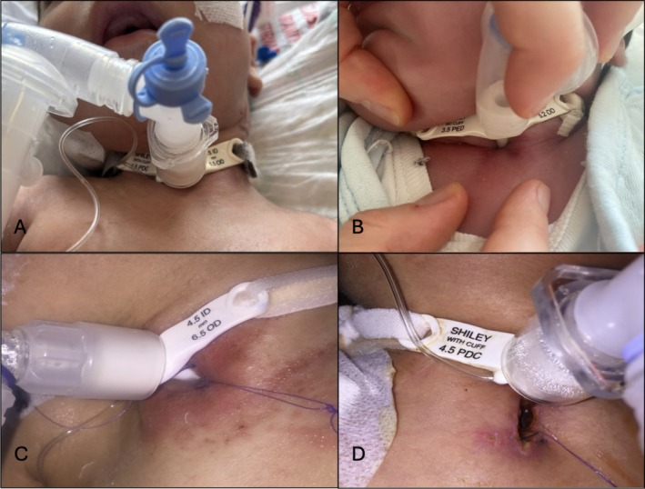
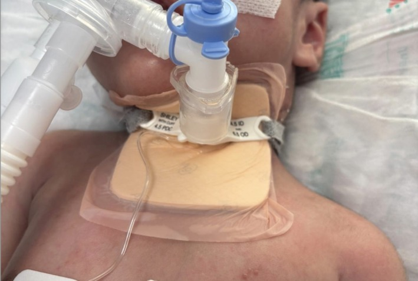
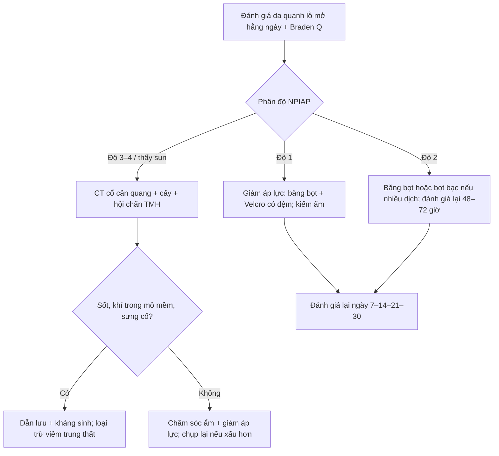

# 6149 — Loét do áp lực quanh lỗ mở khí quản ở trẻ / Peristomal pressure injury in children with tracheostomy

**Tags:** `pattern:loet-ap-luc` `pattern:viem-mo-mem` `vung:khi-quan` `vung:co` `score:NPIAP` `score:Braden-Q` `protocol:cham-soc-lo-mo-khi-quan` `protocol:CT-co`
**Mức chắc chắn (certainty):** tổng hợp y văn (literature synthesis) — số liệu lấy từ **tổng quan hệ thống + meta-analysis 2026** về dự phòng loét quanh lỗ mở khí quản ở trẻ (Wang Y et al., *Front Pediatr* 2026, PMC13269278), **thử nghiệm ngẫu nhiên có đối chứng 2026** so sánh băng bọt thường với băng bọt tẩm bạc (Bostancı ŞA et al., *Laryngoscope Investig Otolaryngol* 2026, PMC13176623), **hướng dẫn ATS 2025** về chăm sóc trẻ có ống mở khí quản (PMC12618984), và các loạt ca về **hẹp/sụp trên lỗ mở** (PMC7647974) và **rò khí quản–da** (PMC11887410). Không có thử nghiệm nào đủ lớn để chốt "băng nào tốt nhất" — bài ghi rõ chỗ nào là **suy luận**.

> **Câu chốt của bài:** ở trẻ có ống mở khí quản, **đỏ da quanh lỗ mở là một tổn thương do áp lực của thiết bị (MDRPI)**, không phải "kích ứng do dịch" đơn thuần. Tần suất **12,9%** khi có chăm sóc chuẩn và tới **22,4–29%** khi không dự phòng; **31%** trong số đó là **độ 3–4**. Điều trị khác hẳn nhau theo **phân độ NPIAP**: độ 1–2 chỉ cần **giảm áp lực + kiểm soát ẩm**, còn **độ 3–4 (lộ sụn khí quản)** là **nhiễm mô sâu/viêm sụn** — phải **CT cổ cản quang**, cấy và kháng sinh, không chỉ tăng băng.

## 1. Tổng quan bệnh học – cơ chế hình ảnh: vì sao lỗ mở khí quản là "điểm áp lực" của trẻ

- **Bệnh học:** đây là **tổn thương áp lực liên quan thiết bị y tế (medical device-related pressure injury, MDRPI)** — tổn thương da/mô dưới da do **áp lực kéo dài của flange ống mở khí quản, dây cố định (ties) và lực cắt (shear)** cộng với **ẩm từ dịch khí quản**. NPIAP/EPUAP xếp chung một hệ phân độ với loét do tư thế.
- **TẠI SAO trẻ dễ hơn người lớn (giải phẫu + vật lý):**
  - **Cổ ngắn và đầy** → flange tì vào nếp da cổ, diện tiếp xúc nhỏ, **áp lực = lực/diện tích** tăng.
  - **Lớp sừng mỏng, mô dưới da lỏng lẻo** → cùng một lực, **tổn thương sâu hơn** ở trẻ nhỏ.
  - **Dịch khí quản rỉ quanh lỗ mở** → da **ướt (maceration)**, ma sát tăng, và **men/vi khuẩn** làm mất hàng rào.
  - **Dây cố định phải đủ chặt để không tuột ống** → lực kéo thường trực ở **sau tai và vùng chẩm**, nơi không ai nhìn.
  - **Bất động** (an thần, thở máy, bệnh thần kinh) → không tự đổi tư thế; **áp lực vượt áp lực đóng mao mạch (~32 mmHg)** trong vài giờ là đủ gây thiếu máu cục bộ.
- **Vì sao phân độ NPIAP phản ánh đúng độ sâu giải phẫu:** độ 1 = **ban đỏ không mất khi ấn (non-blanchable)** — mao mạch bị chèn nhưng chưa mất da; độ 2 = **mất da một phần, còn trợt nông**; độ 3 = **mất toàn bộ lớp da, thấy mỡ dưới da**; độ 4 = **mất toàn bộ mô, lộ cân/cơ/sụn/xương**. Ở vùng quanh lỗ mở khí quản, **"xương" chính là vòng sụn khí quản** — nên một ổ loét "trông nông" mà **thấy sụn trắng** đã là **độ 4**, với nguy cơ **viêm sụn, rò khí quản–da, hẹp khí quản**.
- **Chỉ số nguy cơ định lượng (Braden Q, 7 mục, mỗi mục 1–4, tổng 7–28):** **≤ 9 = nguy cơ rất cao; 10–12 = cao; 13–15 = trung bình; ≥ 16 = không nguy cơ** (theo thử nghiệm 2026, PMC13176623). Đánh giá **ngày 1–7–14–21** sau mở khí quản.
- **Số liệu cốt lõi cần nhớ:**

| Bối cảnh | Con số | Nguồn |
|---|---|---|
| Tổn thương da quanh lỗ mở khi **có chăm sóc chuẩn** | **12,9%** | PMC13269278 |
| **Không dự phòng** | **22,4%**, trong đó **31% độ 3–4** | PMC13269278 |
| Loạt 65 trẻ | tổn thương tại chỗ mở **29%** | PMC13176623 |
| RCT 50 trẻ: băng bọt thường vs **bọt tẩm bạc** | **12% vs 8%**, p = 1,000 (khác biệt **không** có ý nghĩa) | PMC13176623 |
| Băng bọt trong quy trình chăm sóc | giảm biến chứng **22% → 9,9%** | PMC13176623 (dẫn McEvoy) |
| Gói chăm sóc chuẩn hóa | loét **8,1% → 0,3%** | PMC13176623 (dẫn Boesch) |
| Dây **Velcro** so với dây vải twill | **RR 0,26** (95% CrI 0,07–0,94), giảm ~74% biến cố da | PMC13269278 |
| Xác suất tốt nhất trên SUCRA | bọt tẩm bạc **97,6%** — nhưng mọi so sánh trực tiếp **không** có ý nghĩa | PMC13269278 |

## 2. Mẫu hình + chẩn đoán phân biệt theo vị trí (gamut)

- **Theo hình thái — "đỏ, trợt, lồi, sâu":**
  - **Chỉ đỏ, ấn mất** → kích ứng/ẩm, chưa phải loét; **đỏ ấn không mất** → **NPIAP độ 1**.
  - **Trợt nông, rỉ dịch** → **độ 2**; nếu bờ rõ, có **vảy vàng** → thêm **viêm da do dịch (irritant contact dermatitis)**.
  - **Mô đỏ tươi lồi, dễ chảy máu** → **mô hạt (granulation)** — phản ứng lành, **không phải nhiễm trùng**, nhưng là dấu hiệu **ma sát/ẩm kéo dài**.
  - **Ổ sâu, đáy trắng/xám, thấy sụn** → **độ 3–4**, phải loại trừ **viêm sụn/áp-xe**.
- **Theo vị trí — nơi áp lực "ẩn":**
  - **Dưới flange (giờ 6)** — nơi dịch đọng + flange tì: hay gặp nhất.
  - **Sau tai và vùng chẩm** — dây cố định: **không thấy khi trẻ nằm ngửa**, phải lật đầu kiểm.
  - **Bờ trên lỗ mở** — đầu ống/đầu hút (suction catheter) cọ xát.
  - **Ngực trước** — dây cố định bản rộng gây ban ở vùng xa.
- **Mnemonic MIST:** **M**oisture (dịch/ẩm) · **I**nterface pressure (flange/ống) · **S**hear–friction (dây, đầu hút) · **T**ies/tube (loại dây và cỡ ống).

## 3. Bảng so sánh phân biệt (ma trận đối chiếu)

| Thực thể (entity) | Hình ảnh điển hình (lâm sàng/US/CT) | Chốt vào (rule-in) | Chốt loại (rule-out) | Gợi ý xác nhận |
|---|---|---|---|---|
| **MDRPI NPIAP độ 1–2** | Đỏ **ấn không mất** (độ 1) hoặc **trợt nông** (độ 2) đúng vòng quanh flange; không sốt | **Vị trí khớp điểm tì + ấn không mất + không mủ** | Đỏ lan toả có vảy, ngứa, bờ mờ → viêm da tiếp xúc; sốt/sưng → nhiễm sâu | Nhìn + ấn 2 giây; chụp ảnh ngày 1–7–14–21–30 |
| **MDRPI độ 3–4 (lộ sụn)** | Ổ sâu, đáy trắng/xám; **thấy vòng sụn khí quản**; có thể rò khí khi ho | **Sụn lộ + ổ sâu + đau/sưng** | Chỉ trợt nông, đáy hồng → độ 2 | **CT cổ cản quang lát ≤ 1 mm**; hội chẩn TMH; cấy |
| **Viêm da tiếp xúc/kích ứng dịch** | Ban đỏ **lan rộng**, bờ không đều, vùng da tiếp xúc dịch; trẻ ngứa, quấy | **Bờ lan theo dòng dịch + không ấn khu trú** | Đỏ khu trú đúng điểm tì, ấn không mất → loét độ 1 | Lâm sàng; thử che chắn ẩm |
| **Nhiễm *Candida* quanh lỗ mở** | Đỏ tươi + **sẩn mủ vệ tinh**, vảy trắng, ẩm; hay sau kháng sinh | **Sẩn vệ tinh + vảy trắng** | Tổn thương khu trú hình vòng → áp lực | Soi/KOH; cấy nấm |
| **Mô hạt (hypergranulation)** | Mô đỏ tươi lồi **trên mức da**, dễ chảy máu khi chạm; không sốt | **Lồi quá mặt da + chảy máu khi lau** | Ổ lõm/đáy trắng → loét sâu | Lâm sàng; loại trừ áp-xe |
| **Áp-xe/viêm mô sâu quanh lỗ mở** | **Sưng, nóng, đau, sốt**; US: ổ giảm âm có viền; CT: **khí trong mô mềm**, dày cân, tụ dịch viền ngấm | **Sốt + sưng + khí trong mô mềm** | Chỉ đỏ da, không sốt, không khí → MDRPI đơn thuần | **CT cổ cản quang**; US đầu dò ≥ 10 MHz; cấy mủ |
| **Rò khí quản–da (tracheocutaneous fistula)** | Sau rút ống: **lỗ rò còn thông**, sủi bọt khí khi ho/nói, chảy dịch | **Còn thông sau 1,5 tháng**; thử xanh methylen/nước sủi bọt | Lỗ đóng dần, không sủi bọt → lành | Nội soi khí quản; CT cổ khi cần |

*Bốn mức độ trong cùng một nghiên cứu nhi: ảnh A–D cho thấy "độ sâu" quyết định xử trí, không phải diện tích. Hình từ *Laryngoscope Investig Otolaryngol* 2026 (PMC13176623), Fig. 3, CC BY-NC-ND 4.0 — giữ nguyên bản, không crop/ghép.*

### Ba dấu hiệu định lượng dùng ngay tại giường
- **Nghiệm pháp ấn (blanch test):** ấn bằng ngón tay/đầu đo trong **2 giây** rồi thả — **mất màu rồi hồng lại = chưa loét**; **giữ đỏ = độ 1**.
- **Độ ẩm băng:** thay khi băng **đạt 75% bão hoà dịch**; băng còn khô và da không xấu thì **để tới 7 ngày** (quy trình của RCT, PMC13176623).
- **Braden Q:** tổng **7–28**; **≤ 15** là có nguy cơ (trung bình/cao/rất cao), **≥ 16** là không nguy cơ.

## 4. Protocol chụp + hệ phân độ/điểm chuẩn hóa

- **Chăm sóc chuẩn (theo quy trình RCT, PMC13176623):** rửa lỗ mở bằng **nước muối sinh lý**, lau khô, đặt băng dưới flange; **dây Velcro có đệm bọt**; **cắt chỉ giữ (stay suture) ngày 7**; **đổi ống lần đầu ngày 7**; giữ **đầu–cổ trung tính** ở trẻ thở máy; **đánh giá da hằng ngày** bởi điều dưỡng + bác sĩ TMH; theo dõi **1 tháng**.
- **Phân độ:** NPIAP 2016 — **độ 1** ban đỏ không mất; **độ 2** mất da một phần; **độ 3** mất toàn bộ da (thấy mỡ); **độ 4** mất toàn bộ mô (cân/cơ/sụn/xương); thêm **không phân độ được (unstageable)** và **nghi tổn thương mô sâu**.
- **Khi nào chụp — nguyên tắc "da là lâm sàng, hình ảnh là biến chứng":**
  - **Không chụp** cho độ 1–2 đơn thuần.
  - **Siêu âm** (đầu dò linear **10–15 MHz**, độ xuyên ~3–4 cm) khi có **sưng khu trú**: phân biệt **mô hạt/tổ chức hoá** với **ổ tụ dịch/áp-xe**; Doppler giúp thấy **tăng sinh mạch** của mô hạt so với ổ hoại tử không mạch.
  - **CT cổ cản quang, lát ≤ 1 mm** khi: **sốt + sưng cổ**, **khí trong mô mềm**, **độ 3–4 lộ sụn**, nghi **viêm trung thất** hoặc **rò khí quản–thực quản**. Cần tìm: tụ dịch viền ngấm, khí ngoài lòng khí quản, **mất liên tục sụn**, dày mô mềm trước khí quản.
  - **Nội soi khí quản** khi nghi **sụp trên lỗ mở (suprastomal collapse)** — biến chứng muộn **35,1%** trong loạt 148 trẻ (PMC13040597) — hoặc trước khi cân nhắc rút ống.
  - **Đo lỗ mở:** ghi **đường kính lỗ (mm)**, **cỡ ống**, khoảng cách flange–da; hẹp lỗ mở là chỉ định nong/revise, không phải "chờ lành".
- **Khi nào can thiệp sâu (suy luận từ dữ liệu, không có RCT):**
  - **Độ 3–4/áp-xe:** dẫn lưu + kháng sinh theo cấy; **không băng kín** vì bít đường thoát dịch.
  - **Sụp trên lỗ mở:** cắt mô xơ, **ghép sụn sườn**, hoặc cắt nối khí quản một thì tùy hình thái lỗ mở (loạt 18 trẻ, PMC7647974).
  - **Rò khí quản–da:** **36,8%** trong loạt nhỏ phải đóng bằng phẫu thuật; **thời gian có ống > 12 tháng** là yếu tố dự báo (p = 0,045); **83,3%** ca tự đóng xảy ra **trong 1,5 tháng đầu** (PMC11887410) — nên **theo dõi ít nhất 1,5–3 tháng** trước khi quyết định mổ (suy luận).

*Cách đặt băng đúng: băng bọt **dưới flange**, chừa lỗ cho ống, dây Velcro có đệm. Đây là "giảm áp lực" — không phải băng kín lỗ mở. Hình từ *Laryngoscope Investig Otolaryngol* 2026 (PMC13176623), Fig. 2, CC BY-NC-ND 4.0 — nguyên bản.*

## 5. Biến thể bình thường và cạm bẫy

- **"Đỏ quanh lỗ mở" không đồng nghĩa loét:** ngay sau mổ, **bờ lỗ mở sung huyết 1–2 tuần** là lành thường; chỉ gọi loét khi **ấn không mất** hoặc có **mất da**.
- **Da sẫm màu:** ban đỏ khó thấy — dùng **án + so màu vùng đối xứng**, sờ **nhiệt độ**, hỏi **đau**; đừng chờ "thấy đỏ".
- **Băng che mất tổn thương:** phải **nâng flange/nhấc băng mỗi ngày**; ảnh chụp **ngày 1–7–14–21–30** để so (đúng thiết kế RCT).
- **Nhầm mô hạt với nhiễm trùng:** mô hạt **đỏ tươi, mềm, chảy máu khi lau** nhưng **không sốt, không sưng lan**; cắt mô hạt "cho sạch" có thể làm **hẹp lỗ mở**.
- **Băng kín lỗ mở:** đặt băng **kín trên lỗ** làm **ứ dịch, tăng nhiễm**, và có thể **che dấu sụp đường thở**; băng chỉ nằm **dưới flange**, chừa lỗ.
- **Sụn lộ trông như "mảng trắng"** — dễ bị cắt lọc như mô hoại tử; **không đụng vào sụn** khi chưa có CT/hội chẩn.
- **Chảy máu nhỏ (sentinel bleed) từ lỗ mở** ở trẻ có ống lâu ngày: phải lo **rò động mạch vô danh (innominate artery fistula)** — **CTA khẩn**, không chỉ băng cầm máu.
- **Dấu đầu hút:** vết xước thẳng/hình cung ở bờ trên lỗ mở do **đầu catheter** — dấu hiệu **ma sát**, xử trí bằng kỹ thuật hút, không phải loét áp lực điển hình.

## 6. Tự lượng giá — Blind Quiz

**Ca 1 — Trẻ 14 tháng, ngày thứ 3 sau mở khí quản, đang thở máy. Nhìn ảnh, mô tả trước khi mở đáp án.**

- Gợi ý lâm sàng: chưa sốt, da quanh lỗ mở hồng nhẹ, dịch khí quản nhiều.
- Câu hỏi: (1) Băng đang đặt ở đâu so với flange? (2) Mục đích chính là gì? (3) Ba việc phải làm mỗi ngày?

<b>Bấm để hiện đáp án</b>

- **Findings:** băng bọt nằm **dưới flange**, chừa lỗ cho ống; dây **Velcro có đệm bọt**; màng trong suốt giữ ẩm. Không có ổ loét, không mủ.
- **Chẩn đoán:** chăm sóc dự phòng MDRPI — **giảm áp lực + hút ẩm + cố định chắc nhưng không siết**.
- **Mỗi ngày:** (1) nhấc băng, **đánh giá NPIAP + Braden Q**; (2) rửa nước muối, lau khô, **thay băng khi 75% bão hoà** hoặc tối đa **7 ngày**; (3) kiểm **sau tai/chẩm** và độ chặt dây.
- **Nguồn:** Bostancı ŞA et al., *Laryngoscope Investig Otolaryngol* 2026 (PMC13176623), Fig. 2, CC BY-NC-ND 4.0.

**Ca 2 — Bốn trẻ khác nhau, cùng nhìn vòng quanh lỗ mở. Phân độ A–D.**

- Gợi ý: A là trẻ được chụp khi da còn nguyên; B–D là các mức nặng dần.
- Câu hỏi: mỗi ảnh là **độ mấy**? Ảnh nào cần **CT cổ**?

<b>Bấm để hiện đáp án</b>

- **A — độ 0/da lành:** không ban đỏ, không trợt.
- **B — độ 1:** ban đỏ **không mất khi ấn**, da còn nguyên.
- **C — độ 2:** **mất da một phần**, đáy hồng ướt, chưa thấy mỡ/sụn.
- **D — độ 4:** **ổ sâu, mất toàn bộ mô**, đáy trắng/xám — tương ứng **lộ sụn khí quản** trong vùng này.
- **Cần CT cổ cản quang:** **D** (và mọi độ 3–4, hoặc độ 2 kèm sốt/sưng/khí trong mô mềm). Ảnh D có nguy cơ **viêm sụn, áp-xe, hẹp khí quản**.
- **Lưu ý:** hình không có "độ 3" riêng — đừng suy ra chỉ có 4 mức; NPIAP có cả **độ 3, không phân độ được, nghi tổn thương mô sâu**.
- **Nguồn:** Bostancı ŞA et al., *Laryngoscope Investig Otolaryngol* 2026 (PMC13176623), Fig. 3, CC BY-NC-ND 4.0.

**Ca 3 — Trẻ 3 tuổi, 6 tháng sau mở khí quản, sốt 38,8 °C, sưng nề quanh lỗ mở, da đỏ tím, ấn đau. Siêu âm thấy ổ giảm âm 12 mm có viền tăng sinh mạch.**

- Câu hỏi: chẩn đoán nghĩ đến? Bước tiếp theo? Điều **không** được làm?

<b>Bấm để hiện đáp án</b>

- **Nghĩ:** **áp-xe/viêm mô sâu quanh lỗ mở khí quản** trên nền MDRPI (không phải "loét độ 2 bội nhiễm đơn thuần").
- **Bước tiếp:** **CT cổ cản quang lát ≤ 1 mm** tìm **khí trong mô mềm, dày cân, mất liên tục sụn, lan trung thất**; **cấy mủ + máu**; hội chẩn TMH; kháng sinh phổ rộng ban đầu.
- **Không được:** **băng kín/ép chặt** lên ổ (bít đường thoát, đẩy nhiễm vào trung thất) và **nạo/cắt sụn** khi chưa đánh giá hình ảnh.
- **Vì sao:** nhiễm vùng này có đường lan trực tiếp xuống **trung thất**; trẻ nhỏ thành ngực mỏng, khoang cổ chật — **không có "ngưỡng an toàn" theo kích thước ổ**.
- **Nguồn số liệu nền:** PMC13269278, PMC13176623.

## Bài liên quan chéo
- [6100 – Chăm sóc và cai ống mở khí quản ở trẻ](../6100-cham-soc-va-cai-ong-mo-khi-quan-tre/lesson.md) — quy trình chăm sóc, cai ống
- [6124 – Nhiễm trùng liên quan ống mở khí quản ở trẻ](../6124-nhiem-trung-lien-quan-ong-mo-khi-quan-o-tre/lesson.md) — nhiễm khuẩn đường thở
- [6101 – Xẹp phổi tái diễn một bên ở trẻ](../6101-xep-phoi-tai-dien-mot-ben-tre-bpd-tbm/lesson.md) — biến chứng đường thở
- [3049 – Hẹp thanh khí quản tái phát sau tạo hình ở trẻ](../3049-hep-thanh-khi-quan-tai-phat-sau-tao-hinh-o-tre/lesson.md) — hẹp/sụp đường thở sau mở khí quản
- [932 – An toàn bức xạ CT/DSA](../932-an-toan-buc-xa-ct-dsa/lesson.md) — tối ưu liều khi phải chụp CT lặp lại

## Ảnh
- `6149_phan-do-NPIAP_Clinical_PMC13176623-Fig3.jpg`, `6149_bang-gac-duoi-cannula_Clinical_PMC13176623-Fig2.jpg` — nguồn + giấy phép từng ảnh: `images/CREDITS.md`.
- Cả hai ảnh là **bệnh nhi** trong nghiên cứu RCT (0–18 tuổi); ảnh **CC BY-NC-ND** giữ **nguyên bản**, không crop/ghép.

> Không dùng để chẩn đoán độc lập khi chưa có người hướng dẫn.
