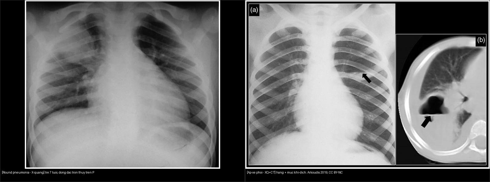
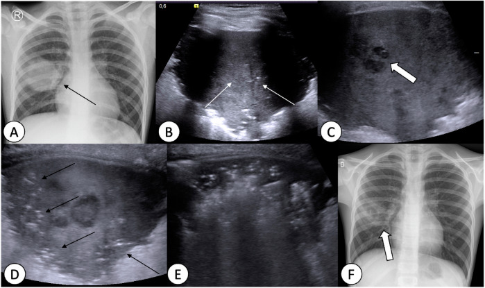
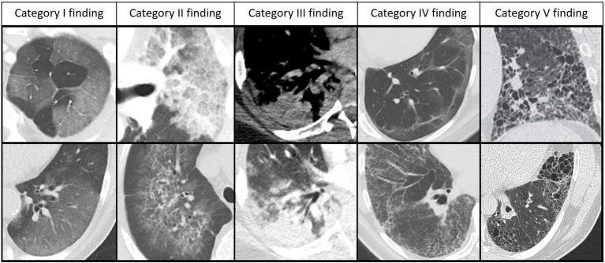
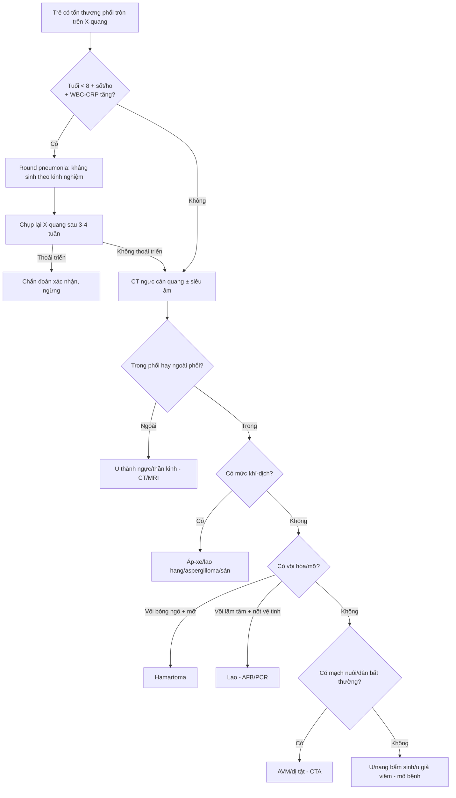
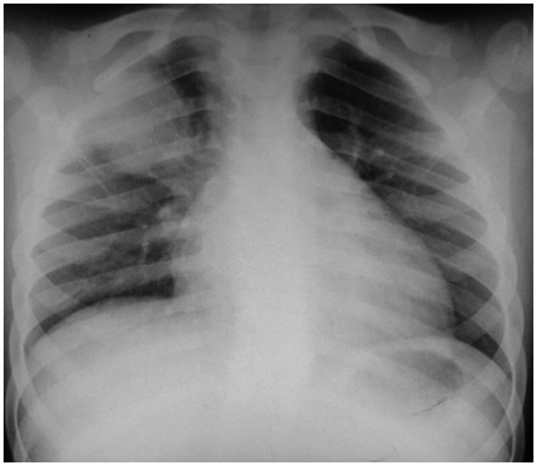
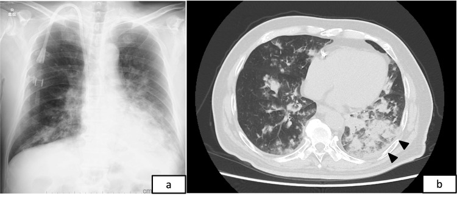

# 615 — Viêm phổi nhi: round pneumonia, virus vs vi khuẩn & hít sặc dầu hỏa / Pediatric pneumonia patterns

**Tags:** `pattern:viem-phoi-nhi` `pattern:round-pneumonia` `pattern:hit-sac-dau-hoa` `vung:phoi` `score:RACOON` `protocol:X-quang-nguc-nhi`
**Mức chắc chắn (certainty):** tổng hợp y văn (literature synthesis) — tự biên từ 4 nguồn mở (Arkoudis 2019 CC BY-NC; Lovrenski/ESR Essentials 2025 CC BY; Watanabe 2026 Cureus CC BY; Persigehl 2025 RACOON CC BY), chưa gắn ca nguyên văn đơn lẻ.

## 1. Tổng quan — TẠI SAO trẻ nhỏ lại có "viêm phổi tròn"?

- **Đông đặc tròn đơn độc ở phổi trẻ (SRPL — solitary round pulmonary lesion):** tổn thương tròn/oval đặc mô mềm trên X-quang ngực. Ở trẻ, nguyên nhân hay gặp nhất là **viêm phổi tròn (round pneumonia)** — đông đặc hình cầu do vi khuẩn, điển hình **Streptococcus pneumoniae** (Arkoudis 2019).
- **TẠI SAO lại tròn mà không lan theo thùy?** Đường thông khí bên (collateral ventilation) — **lỗ Kohn (pores of Kohn)** và **kênh Lambert (channels of Lambert)** nối giữa các tiểu thùy — **chưa phát triển đầy đủ ở trẻ < 8 tuổi**. Không có đường "rò" khí giữa các phân thùy, dịch viêm bị **"nhốt"** tại một nhóm tiểu thùy → đông đặc giữ hình **cầu/tròn**. Sau 8 tuổi đường thông khí bên hoàn thiện → viêm phổi lan theo phân thùy/thùy như người lớn; lúc này thấy khối tròn phải **nghĩ nhiều hơn tới nguyên nhân khác (u, dị tật)** (Arkoudis 2019).
- **Tuổi + vi trùng:** round pneumonia hầu như **< 8 tuổi** (bảng gốc ghi **5–8 tuổi**), phổ biến nhất do **S. pneumoniae**; lâm sàng sốt + ho, **WBC và CRP tăng**. Vị trí hay gặp: **phía sau + thùy dưới** (Arkoudis 2019). Có thể đau bụng thay vì đau ngực → dễ nhầm bụng ngoại khoa.
- **Hình thái:** đông đặc **đặc mô mềm, thường KHÔNG có mức khí–dịch** (khác áp-xe). Tiến triển điển hình: to lên vài ngày đầu → thoái triển sau 2–4 tuần; **~95% thoái triển trên phim chụp lại** (không chuyển thành viêm phổi thùy), số còn lại hóa hang/hoại tử (Lovrenski 2025 mô tả "giai đoạn tiền hoại tử" trên siêu âm phổi) (Arkoudis 2019).
- **Nguyên lý cốt lõi Hệ Nhi (ALARA + thể tích):** trước một SRPL ở trẻ — **X-quang ngực thẳng + nghiêng là đủ** và **chỉ định CT là KHÔNG khuyến cáo** ngay để "tìm nguyên nhân khác"; thay vào đó **điều trị kháng sinh rồi chụp lại X-quang sau vài tuần** (Arkoudis 2019). Siêu âm phổi (lung ultrasound — LUS) giúp phân biệt đông đặc/hoại tử không dùng tia xạ.

## 2. Mẫu hình + chẩn đoán phân biệt theo nhóm (Gamut)

- **Gamut theo cơ chế (phân nhóm Arkoudis 2019):**
  - **Nhiễm trùng:** round pneumonia (S. pneumoniae) · áp-xe phổi · lao (phức hợp Ranke: hạch rốn phổi vôi hóa + tuberculoma) · aspergilloma (BN suy giảm miễn dịch) · nang sán lá phổi (echinococcus, "water-lily sign").
  - **Bẩm sinh:** dị dạng đường thở phổi bẩm sinh (CPAM) · phổi biệt lập (sequestration — cấp máu động mạch hệ thống) · khí phế thũng thùy bẩm sinh (CLO/CLE).
  - **Tân sinh:** u mỡ hamartoma ("popcorn" vôi hóa + mỡ) · u giả viêm (inflammatory pseudotumor) · carcinoid · u nguyên bào thần kinh di căn · di căn khác.
  - **Mạch máu:** dị dạng động–tĩnh mạch phổi (AVM — cấp máu ĐM + dẫn lưu TM phình).
  - **Khác:** **giả ảnh trên nền (overlying artifact — hình tròn "quá đẹp")** · tổn thương ngoài nhu mô (u thành ngực, neurofibroma).
- **Câu hỏi phân loại nhanh:** (1) **tuổi** < hay > 8? (2) có **mức khí–dịch** (→ áp-xe) hay vôi hóa/mỡ (→ hamartoma)? (3) **một hay nhiều** ổ? (4) có **cấp máu bất thường** (→ dị dạng/mạch)?
- **Gợi nhớ 3 nhóm lớn:** **Round pneumonia (nhiễm trùng, < 8t) — U/nang bẩm sinh — U (tân sinh/mạch)**. Không có dấu hiệu nhiễm trùng đi kèm + > 8 tuổi = càng phải loại trừ u.

## 3. Bảng so sánh phân biệt (ma trận đối chiếu)

| Thực thể (entity) | Hình ảnh điển hình | Chốt vào (rule-in) | Chốt loại (rule-out) | Gợi ý xác nhận |
|---|---|---|---|---|
| Round pneumonia (S. pneumoniae) | Đông đặc **tròn/oval đặc mô mềm**, KHÔNG mức khí–dịch, sau + thùy dưới | **< 8 tuổi + sốt/ho + WBC–CRP tăng + KHÔNG viền/không vôi hóa** | Mức khí–dịch → áp-xe; > 8 tuổi/không thoái triển → u | Kháng sinh + **X-quang lại 3–4 tuần** |
| Áp-xe phổi | Tổn thương tròn có **mức khí–dịch** + thành ngấm thuốc, đông đặc/tràn dịch quanh | **Mức khí–dịch ngang + thành ngấm trên CT** | Đặc đều không khí → round pneumonia | CT cản quang; dẫn lưu nếu lớn/kéo dài |
| Viêm phổi vi khuẩn theo thùy/phân thùy | **Đông đặc thuần một thùy/phân thùy** + phế quản hơi + tràn dịch màng phổi kèm | **Đông đặc khu trú ranh rõ + tràn dịch** | Mờ hai bên rải rác → nghĩ virus/hít | X-quang + siêu âm màng phổi |
| Viêm phổi virus (RSV… ở nhũ nhi) | **Mờ mô kẽ hai bên, tăng ứ khí, dày thành phế quản, xẹp trên dưới** | **< 1 tuổi + viêm tiểu phế quản + mờ hai bên đối xứng** | Đông đặc một thùy → vi khuẩn | Công thức máu/CRP hướng, PCR vi rút |
| Viêm phổi hít dầu hỏa (hydrocarbon) | **Mờ hai bên đáy phổi**; CT có thể **mật độ mỡ (HU âm)** + **khí nang (pneumatocele)/hang** | **Tiền sử hít dầu/dầu hỏa + mờ hai đáy trong 24–72 giờ** | Đông đặc tròn một bên → nhiễm trùng thùy | X-quang/CT; điều trị hỗ trợ, CẤM gây nôn |
| Lao phổi (phức hợp Ranke) | **Hạch rốn phổi vôi hóa + nốt vôi hóa** (tuberculoma) | **Vôi hóa + nốt vệ tinh + dịch tễ lao** | Không vôi hóa/ngấm thuốc lan tỏa → u | AFB/PCR, CT ngực |
| Hamartoma | Khối tròn bờ **phân múi**, **"popcorn" vôi hóa** + mỡ trong u | **Vôi hóa hình bỏng ngô + mỡ −40 đến −120 HU** | Vôi hóa lấm tấm + hạch → lao | CT lát mỏng (đo HU) |
| Dị dạng động–tĩnh mạch phổi (AVM) | Khối tròn/ống nối với **ĐM nuôi phình + TM dẫn lưu**; giảm oxy máu | **Mạch nuôi/dẫn rõ trên CTA/MRA** | Không mạch nuôi → u/nhiễm trùng | CTA; khảo sát HHT (Osler–Weber–Rendu) |
| Giả ảnh trên nền / ngoài nhu mô | Hình **tròn hoàn hảo** hoặc hình học "không tự nhiên"; hoặc khối ngoài phổi | **Chụp lại sau bỏ vật liệu → hình biến mất** | Hình tồn tại mọi tư thế + có mạch nhu mô → thật | X-quang lại ± chụp nghiêng/CLVT |

*Trái: đông đặc tròn đặc mô mềm, không mức khí–dịch (trẻ 7 tuổi, sốt/ho, WBC–CRP tăng). Phải: tổn thương tròn có mức khí–dịch trên X-quang (a) và hang có mức dịch trên CT (b) = áp-xe. Nguồn: Arkoudis et al., Acta Radiol Open 2019, Fig. 3 & 4, CC BY-NC. Ảnh ghép letterbox.*

### Hai cạm bẫy định vị then chốt
- **Trong phổi hay ngoài phổi?** Khối "tròn" cạnh thành ngực/lồng ngực có thể là **u thành ngực hoặc u thần kinh ngoài nhu mô** (Arkoudis 2019, Fig. 15) — trên X-quang đơn thuần dễ gộp nhầm; **CT/CLVT** phân định bằng góc tiếp giáp và mạch nuôi.
- **Có mức khí–dịch hay không?** Đây là câu hỏi rẻ nhất chia đôi gamut: **có** → áp-xe/hang (áp-xe, lao hang, aspergilloma, sán); **không** → khối đặc (round pneumonia, u, dị tật).

*(A) X-quang nhập viện: đông đặc tròn thùy phải. (B) Siêu âm phổi: đông đặc dưới màng phổi tăng hồi âm nhẹ trung tâm = **giai đoạn tiền hoại tử**. (C) Sau 2 ngày: ổ giảm hồi âm nhỏ = **hoại tử**. (D) Sau 3 ngày: tái thông khí từ ngoại vi, còn hoại tử trung tâm. (E) Sau 1 tuần: tổn thương thu nhỏ, hết ổ hoại tử. (F) X-quang theo dõi: thoái triển rõ. Nguồn: Lovrenski et al., Eur Radiol (ESR Essentials) 2025, Fig. 8, CC BY 4.0.*

## 4. Protocol chụp + hệ điểm chuẩn hóa

- **X-quang ngực thẳng + nghiêng** là lựa chọn đầu tay (ALARA). Với SRPL ở trẻ < 8 tuổi điển hình về lâm sàng: **điều trị kháng sinh theo kinh nghiệm, chụp lại sau vài tuần**; **không chụp CT ngay** chỉ để loại trừ u (Arkoudis 2019).
- **Siêu âm phổi (LUS):** dùng khi X-quang mơ hồ hoặc cần theo dõi — phân biệt đông đặc (tăng hồi âm kèm **dấu phế quản hơi động**), ổ hoại tử (giảm hồi âm), và tràn dịch màng phổi; không tia xạ, lặp lại được (Lovrenski 2025).
- **CT ngực cản quang:** dành cho ca **> 8 tuổi**, **không thoái triển sau 3–4 tuần**, có **mức khí–dịch/hoại tử**, nghi dị tật–mạch máu (tìm cấp máu hệ thống) hay khối ngoài nhu mô.
- **Hệ điểm hình ảnh viêm phổi virus trên CT — RACOON Viral Pneumonia Score (RVPS), Persigehl 2025 (CC BY):** 5 nhóm tổn thương theo giai đoạn, từ lành tới di chứng:
  - **Nhóm I:** kính mờ thuần (GGO).
  - **Nhóm II:** kính mờ + dày vách mô kẽ → **"lát đá" (crazy paving)**.
  - **Nhóm III:** đông đặc, thường vây quanh bởi kính mờ.
  - **Nhóm IV:** dấu hiệu **sau viêm có thể hồi phục** — đường vách, dải nhu mô, lưới (không co kéo/biến dạng).
  - **Nhóm V:** biến đổi **giống xơ hoặc dạng nang KHÔNG hồi phục** — lưới co kéo + nang/hang/pneumatocele (giãn phế quản gặp mọi giai đoạn nên **không** tính vào điểm).
  - Ghi nhận: RVPS vốn mô tả viêm phổi virus (COVID-19), mang tính **không đặc hiệu** — dùng như khung ngôn ngữ báo cáo, không phải chẩn đoán căn nguyên.

*Từ trái sang phải: I kính mờ; II kính mờ + dày vách ("lát đá"); III đông đặc; IV dấu hiệu sau viêm có thể hồi phục; V biến đổi dạng xơ/nang co kéo không hồi phục. Nguồn: Persigehl et al., Front Med 2025, Fig. 1, CC BY 4.0.*

## 5. Biến thể bình thường và cạm bẫy

- **Giả ảnh hình tròn "quá đẹp":** vật liệu/đường trên da hay thiết bị có thể tạo hình tròn hoàn hảo gợi "nguyên nhân không tự nhiên" — **bỏ vật liệu và chụp lại** trước khi kết luận khối thật (Arkoudis 2019, Fig. 14).
- **Thỏa mãn tìm kiếm (satisfaction of search):** vừa gọi tên "round pneumonia" là dừng — phải quét toàn phim tìm **tràn dịch màng phổi, tràn khí, tổn thương hai bên, hạch rốn phổi** vì các dấu hiệu này đổi cả chẩn đoán lẫn xử trí.
- **Round pneumonia to lên trong 24–72 giờ đầu** có thể khiến lo "u đang lớn" — theo dõi ngắn rồi chụp lại; đừng vội sinh thiết một đông đặc trẻ/nhỏ có bối cảnh nhiễm trùng rõ.
- **Hít dầu hỏa — cạm bẫy xử trí chết người:** CẤM **gây nôn/rửa dạ dày** vì nôn làm dầu trào vào đường thở → tổn thương phổi nặng hơn; ưu tiên **hỗ trợ hô hấp**. Steroid **không cải thiện kết cục rõ rệt** (Watanabe 2026 dẫn Marks 1972); kháng sinh khi nghi bội nhiễm.
- **Đau bụng đừng cắt nhầm:** round pneumonia thùy dưới/đáy có thể kích thích cơ hoành gây **đau bụng** — luôn chụp phổi trước khi mổ bụng "không rõ nguyên nhân" ở trẻ.
- **Cạm bẫy mặt cắt:** cùng mật độ mô mềm, **vị trí tương quan với nhu mô–thành ngực–cơ hoành** mới quyết định tên gọi (trong phổi vs ngoài màng phổi vs trong ổ bụng); dịch **màng phổi** (góc tù, khu trú theo trọng lực) khác **đông đặc** (góc nhọn, có phế quản hơi).

## 6. Tự lượng giá — Blind Quiz

**Ca 1 — Trẻ 7 tuổi, ho + sốt + WBC và CRP tăng. Đọc X-quang ngực thẳng, mô tả trước.**

- Hỏi: tổn thương hình gì, ở đâu, có mức khí–dịch không? 3 chẩn đoán phân biệt + bước tiếp theo?

<b>Bấm để hiện đáp án (findings + chẩn đoán)</b>

- Dấu hiệu (findings): **đông đặc tròn đặc mô mềm** vùng thùy trên phải, **không có mức khí–dịch**.
- Chẩn đoán (diagnosis): **viêm phổi tròn (round pneumonia) do S. pneumoniae** — vì tuổi < 8 (đường thông khí bên chưa hoàn thiện) + sốt/ho + WBC–CRP tăng → dịch bị nhốt thành hình cầu.
- Xử trí: **kháng sinh theo kinh nghiệm + chụp lại X-quang sau 3–4 tuần**, không CT ngay để truy u.
- Nguồn ảnh: Arkoudis et al., Acta Radiol Open 2019, Fig. 3, CC BY-NC.

**Ca 2 — Trẻ có tổn thương tròn ở phổi. Bên nào phải nghĩ tới áp-xe, vì sao?**

- Hỏi: dấu hiệu nào chia đôi hai bên? Cơ chế?

<b>Bấm để hiện đáp án (findings + chẩn đoán)</b>

- Dấu hiệu (findings): **phải** = tổn thương tròn có **mức khí–dịch ngang** trên X-quang (a) và **hang có mức dịch + thành ngấm** trên CT (b); **trái** = đông đặc đặc, không mức khí–dịch.
- Chẩn đoán (diagnosis): **phải = áp-xe phổi** (hoại tử mủ tạo hang chứa khí + dịch); trái = round pneumonia (đặc, không khí).
- Chốt (clincher): **sự hiện diện của mức khí–dịch** — áp-xe có, round pneumonia không.
- Nguồn ảnh: Arkoudis et al., Acta Radiol Open 2019, Fig. 3 & 4, CC BY-NC.

**Ca 3 — Trẻ nhập viện sau ngộ độc dầu hỏa, khó thở. Cả X-quang và CT đều được chụp — mô tả và nêu cạm bẫy xử trí?**

- Hỏi: phân bố tổn thương ra sao? Diễn biến tiếp theo có thể có gì? Việc gì TUYỆT ĐỐI không làm?

<b>Bấm để hiện đáp án (findings + chẩn đoán)</b>

- Dấu hiệu (findings): **mờ thâm nhiễm hai bên, ưu thế vùng dưới/đáy phổi** (a = X-quang, b = CT). Tiến triển có thể tạo **hoại tử/dạng nang (pneumatocele)** vài ngày sau.
- Chẩn đoán (diagnosis): **viêm phổi hóa chất do hít dầu hỏa (hydrocarbon chemical pneumonitis)** — hydrocarbon hít vào gây viêm–hoại tử nhu mô, hay gặp ở trẻ do đựng dầu trong chai nước ngọt.
- Cạm bẫy (pitfall): **CẤM gây nôn/rửa dạ dày** (nguy cơ hít sặc lại, nặng hơn); điều trị **hỗ trợ + kháng sinh khi nghi bội nhiễm**, steroid không cải thiện kết cục rõ.
- Nguồn ảnh: Watanabe et al., Cureus 2026, Fig. 1, CC BY 4.0. (Ca minh họa ở **người lớn** — đối chiếu bệnh cảnh nhi: hít dầu hỏa/dầu lửa ở trẻ nhỏ.)

## Bài liên quan chéo
- [600 – Tổng quan Nhi khoa](../600-tong-quan-nhi-khoa/lesson.md)
- [610 – Suy hô hấp sơ sinh & dị dạng phổi bẩm sinh](../610-suy-ho-hap-so-sinh-va-di-dang-phoi/lesson.md) (CPAM, phổi biệt lập — SRPL nhóm bẩm sinh)
- [612 – Cấp cứu đường thở trên trẻ em](../612-cap-cuu-duong-tho-tren-tre-em/lesson.md) (dị vật đường thở; viêm phổi kèm viêm khí quản vi khuẩn)
- [030 – Đông đặc – xẹp phổi](../030-dong-dac-xep-phoi/lesson.md) · [031 – Viêm phổi theo mẫu hình](../031-viem-phoi-mau-hinh/lesson.md)
- [025 – Hang & nấm phổi](../025-ton-thuong-phoi-tao-hang/lesson.md) (áp-xe vs mủ màng phổi, aspergilloma)
- [616 – Biến chứng viêm phổi nhi: viêm mủ màng phổi (empyema) & hoại tử phổi](../616-bien-chung-viem-phoi-nhi-empyema-hoai-tu/lesson.md) (biến chứng: mủ màng phổi, hoại tử)
- [620 – Cấp cứu tiêu hóa nhi](../620-cap-cuu-tieu-hoa-so-sinh-nhu-nhi/lesson.md) (dầu hỏa/dị vật tiêu hóa — cấm gây nôn)

## Ảnh
- `615_round-pneumonia_XR_PMC6545655-CCBYNC.jpg`, `615_apxe-phoi_XR_PMC6545655-CCBYNC.jpg`, `composite_round-pneumonia-vs-apxe.jpg` — CC BY-NC, Arkoudis et al., Acta Radiol Open 2019 (PMC6545655).
- `615_round-pneumonia-progression_XR-US_PMC12226615-CCBY.jpg` — CC BY 4.0, Lovrenski et al., Eur Radiol (ESR Essentials) 2025 (PMC12226615).
- `615_hydrocarbon-pneumonitis_CT_PMC13033276-CCBY.jpg`, `615_hydrocarbon-cavitation_CT_PMC13033276-CCBY.jpg` — CC BY 4.0, Watanabe et al., Cureus 2026 (PMC13033276).
- `615_viral-pneumonia-score_CT_PMC12325055-CCBY.jpg` — CC BY 4.0, Persigehl et al., Front Med 2025 (PMC12325055).
- Chi tiết giấy phép từng ảnh trong `images/CREDITS.md`.

> Không dùng để chẩn đoán độc lập khi chưa có người hướng dẫn.
