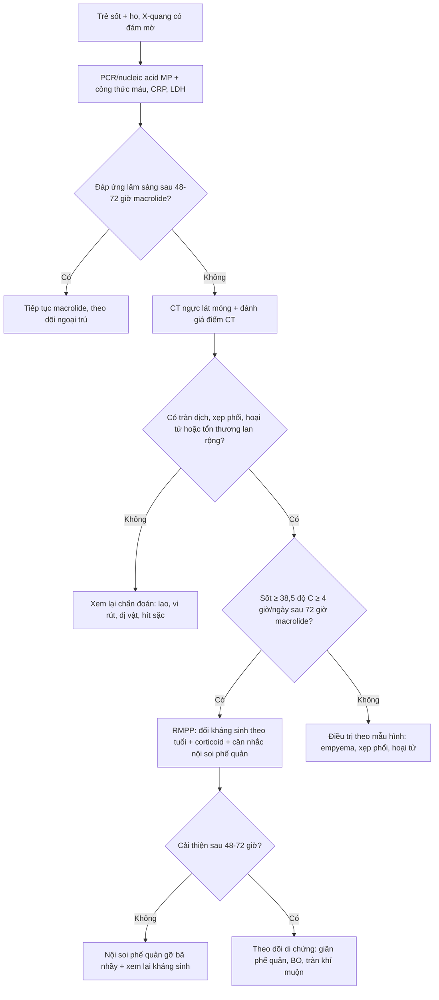
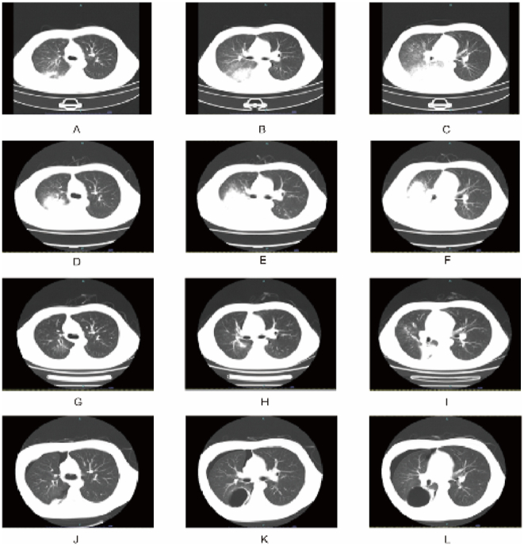
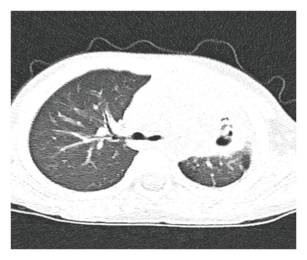
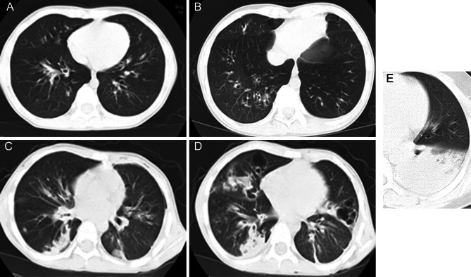

# 6150 — Viêm phổi do *Mycoplasma pneumoniae* nặng và kháng macrolide ở trẻ: mẫu hình CT, điểm CT và khi nào đổi thuốc

**Tags:** `pattern:dong-dac` `pattern:kinh-mo` `pattern:xep-phoi` `pattern:hoai-tu` `pattern:tran-dich-mang-phoi` `pattern:ba-nhay-phe-quan` `vung:phoi` `vung:phe-quan` `vung:mang-phoi` `protocol:CT-nguc-lat-mong` `protocol:X-quang-nguc` `protocol:noi-soi-phe-quan` `score:CT-score` `score:SMPP`
**Mức chắc chắn (certainty):** tổng hợp y văn (literature synthesis) — ghép **244 trẻ MPP có điểm CT + nội soi phế quản** (BMC Pulm Med 2024, PMCID **PMC11110382**), **417 trẻ GMPP/SMPP** (BMC Infect Dis 2024, PMCID **PMC11046970**), **236 trẻ kháng macrolide so với nhạy** (Front Pediatr 2026, PMCID **PMC13194381**), **236 trẻ hoại tử phổi** (Can Respir J 2026, PMCID **PMC13438169**), **4.406 trẻ trong meta-analysis bã nhầy phế quản** (J Thorac Dis 2026, PMCID **PMC13190047**) và **ca 17 tuổi diễn tiến nặng có 4 thời điểm CT** (2024, PMCID **PMC11566845**). Không có ca do nhóm tự chụp.

> **Câu hỏi thực hành:** nam **17 tuổi**, sốt **40,2 °C** và ho đờm vàng 1 tuần, đã dùng azithromycin **3 ngày** không đỡ; X-quang có đám mờ đáy phổi phải. Bác sĩ hỏi: **"Đây là viêm phổi do Mycoplasma thường hay đã kháng macrolide? Có cần CT? Khi nào dùng corticoid, khi nào nội soi phế quản lấy bã nhầy?"**
> Bài chốt **năm quyết định**: **(1) *M. pneumoniae* chiếm 10–40% viêm phổi cộng đồng ở trẻ, ~12% tiến triển nặng/kháng trị; (2) sốt ≥ 72 giờ dù đã macrolide đủ liều = "kháng trị" (RMPP), phải đánh giá lại bằng CT; (3) điểm CT 0–35 phối hợp nội soi dự báo RMPP với AUC 0,824; (4) tràn dịch màng phổi trên CT làm tăng nguy cơ bã nhầy phế quản (OR 2,46) và hoại tử phổi (OR 3,96); (5) kháng macrolide không đồng nghĩa kháng trị — phải phân biệt "đột biến 23S rRNA" với "đáp ứng viêm quá mức".**

## 1. Tổng quan bệnh học – cơ chế hình ảnh: vì sao *Mycoplasma* gây "viêm phổi điển hình trên CT nhưng không điển hình trên X-quang"

- **Sinh học của *M. pneumoniae*:** vi khuẩn **không có thành tế bào** → **mọi kháng sinh beta-lactam đều vô hiệu**; thuốc hiệu quả là **macrolide, tetracycline, fluoroquinolone**. Đây là lý do vì sao "viêm phổi không đáp ứng amoxicillin" là một manh mối kinh điển.
- **Cơ chế bám dính:** protein bám **P1** gắn vào thụ thể trên **tế bào biểu mô có lông chuyển** → **tê liệt lông chuyển**, giảm thanh thải nhầy; đồng thời tiết **hydrogen peroxide** và độc tố gây tổn thương biểu mô. Kết quả là **viêm tiểu phế quản + ứ nhầy** nhiều hơn là viêm phế nang thuần túy.
- **Cơ chế miễn dịch:** phản ứng tế bào T và cytokine (IL-8, IL-6, IFN-γ) gây **phù thành phế quản, kính mờ quanh mạch, và đông đặc từng ổ**. Đây là nền tảng của **"viêm phổi do miễn dịch"** — giải thích vì sao **corticoid** có chỗ đứng ở thể nặng.
- **Vì sao có hoại tử và bã nhầy:** viêm mạch máu nhỏ + huyết khối tại chỗ → **thiếu máu cục bộ niêm mạc**, tạo **loét, hoại tử, và các "bã nhầy" (bronchial cast)** đúc theo lòng phế quản. Bã nhầy gây **tắc phế quản** → xẹp phổi thùy, và có thể để lại **giãn phế quản** hoặc **viêm tiểu phế quản bít tắc (bronchiolitis obliterans)**.
- **TẠI SAO CT thấy nhiều hơn X-quang:** X-quang chỉ thấy đám mờ khi tổn thương đủ lớn và bị che bởi trung thất/tim; CT **lát mỏng 1 mm** phát hiện **kính mờ (ground-glass opacity, GGO)**, **dày thành phế quản**, **nốt trung tâm tiểu thùy**, **bã nhầy trong lòng phế quản**, **tràn dịch lượng nhỏ**, **hoại tử/hang** — những thứ quyết định "thường" hay "nặng".
- **TẠI SAO kính mờ và đông đặc có thể cùng tồn tại:** GGO = phế nang **chứa một phần** dịch/tế bào, còn **đông đặc** = phế nang **đầy** dịch viêm/tế bào; ở MPP, tổn thương lan theo **tiểu thùy và phế quản** nên hai mẫu hình xen kẽ, thường **đối xứng hoặc đa thùy** ở thể nặng.
- **Dịch tễ và gánh nặng:** MP gây **10–40%** viêm phổi cộng đồng ở trẻ, hay gặp **≥ 5 tuổi** (PMC13438169); khoảng **12%** tiến triển thành **SMPP hoặc RMPP**; **15–30%** không đáp ứng macrolide ban đầu.
- **Kháng macrolide:** đột biến **A2063G** ở domain V của **23S rRNA** là phổ biến nhất (sau đó A2064G, A2063C). Tại Trung Quốc, tỷ lệ **MRMP lên tới 93,02%** trong tháng 5/2024 (trích trong PMC12818305) — nhưng **kháng thuốc và nặng không đồng nghĩa**: có ca nặng **không tìm thấy đột biến** vẫn đáp ứng kém vì **phản ứng viêm quá mức** (PMC11566845).
- **Ngoài phổi:** viêm cơ tim, hội chứng Stevens–Johnson, viêm não, tổn thương gan — gặp **58,1%** ở RMPP so với **44,6%** ở GMPP (PMC11110382).

## 2. Mẫu hình + chẩn đoán phân biệt theo hình thái (Gamut)

- **Đông đặc thùy/phân thùy một bên (thường đáy phổi):** mẫu hình hay gặp nhất; đông đặc **bờ không rõ**, có thể kèm **dày thành phế quản** và **kính mờ quanh tổn thương**. Trong ca 17 tuổi: đông đặc đáy phổi phải ngày 1, **lan rộng + xuất hiện ổ mới hai đáy phổi ngày 9** (PMC11566845).
- **Kính mờ hai bên + dày thành phế quản:** gợi ý **viêm phổi không điển hình/vi rút**; phân biệt với **PJP** (người ức chế miễn dịch), **xuất huyết phế nang**, **viêm phổi quá mẫn**, **phù phổi**.
- **Nốt trung tâm tiểu thùy/branching (tree-in-bud):** tổn thương **tiểu phế quản** do MP hoặc lao, hít sặc, nhiễm nấm; đây là mẫu hình **"viêm tiểu phế quản nhiễm trùng"**, không phải đông đặc thùy.
- **Xẹp phổi kèm bã nhầy:** một thùy xẹp, **phế quản dẫn không khí bị lấp**, có thể thấy **bã nhầy đậm trên CT** và gỡ được qua nội soi. Đây là thể **"bã nhầy phế quản" (plastic bronchitis, PB)** — gặp **11–43%** trẻ MPP có nội soi; trong meta-analysis **1.123/4.406 = 25,5%** (PMC13190047).
- **Hoại tử/hang/pneumatocele:** đông đặc có **ổ giảm đậm độ trong**, **hang thành mỏng**, hoặc **kén khí**; là dấu hiệu **hoại tử phổi** — thể nặng, có thể **tràn khí màng phổi muộn** (ca 17 tuổi bị tràn khí phải ngay ngày thứ 2 tái nhập viện).
- **Tràn dịch màng phổi:** thường **lượng ít–trung bình**, một bên; gặp **40,0%** ở RMPP so với **18,7%** ở GMPP (PMC11110382). Tràn dịch **lượng nhiều/đục** → nghĩ **empyema/đồng nhiễm** (bài 616).
- **Chẩn đoán phân biệt theo vị trí và bệnh cảnh:**
  - **Lao phổi:** đông đặc thùy trên + **hạch rốn phổi hoại tử**, hang, **nốt vệ tinh**; trẻ có tiếp xúc nguồn lây — **không được bỏ qua** vì điều trị khác hoàn toàn (so sánh CT lao vs MPP: PMC13365861).
  - **Viêm phổi vi khuẩn điển hình:** đông đặc **đồng nhất**, phân thùy rõ, **tràn dịch sớm**, đáp ứng beta-lactam; tác nhân hay gặp: phế cầu, *S. aureus* (hoại tử/hang, empyema), *Klebsiella* (đông đặc + phình rãnh liên thùy).
  - **Vi rút (adenovirus, RSV, cúm):** kính mờ hai bên, dày thành phế quản, **xẹp phổi nhỏ rải rác**; adenovirus có thể **hoại tử phổi** giống MP.
  - **Dị vật đường thở:** xẹp phổi **một bên dai dẳng**, **bẫy khí**, không sốt cao kéo dài; CT thấy **dị vật cản quang** hoặc **phế quản bị tắc**.
  - **Viêm phổi do hít sặc:** tổn thương **thùy dưới bên phải/thùy trên sau**, có bệnh lý thần kinh–nuốt.
  - **Viêm phổi tăng bạch cầu ái toan/organizing pneumonia:** kính mờ **di chuyển**, đáp ứng corticoid, không đáp ứng kháng sinh.

## 3. Bảng so sánh phân biệt (ma trận đối chiếu)

| Thực thể (entity) | Hình ảnh điển hình (CT) | Chốt vào (rule-in) | Chốt loại (rule-out) | Gợi ý xác nhận |
|---|---|---|---|---|
| MPP thường (GMPP) | Đông đặc từng ổ một bên, dày thành phế quản, ít tràn dịch | **Đông đặc + PCR/nucleic acid MP dương + sốt giảm sau macrolide** | Tổn thương lan nhanh hai bên + tràn dịch nhiều → không phải thể thường | PCR MP, X-quang/CT, theo dõi 48–72 giờ |
| RMPP (kháng trị) | Đông đặc **lan rộng**, tổn thương mới, **tràn dịch 40%**, xẹp phổi | **Sốt ≥ 38,5 °C, ≥ 4 giờ/ngày sau ≥ 72 giờ macrolide TM + hình ảnh xấu đi** | Sốt giảm rõ trong 72 giờ → không phải RMPP | CT ngực, LDH/CRP/D-dimer, nội soi phế quản |
| MRMP (kháng macrolide) | Không có mẫu hình riêng; **đông đặc thùy 68,3%**, **hai bên 66,2%**, **tràn dịch 32,4%** | **Đột biến A2063G/A2064G trên 23S rRNA** hoặc không đáp ứng macrolide + yếu tố dịch tễ | Không có đột biến và đáp ứng tốt → không phải MRMP | PCR đột biến 23S rRNA từ dịch hô hấp |
| Bã nhầy phế quản (PB) | **Xẹp phổi + bã nhầy trong phế quản**, CT thấy phế quản tắc; có thể **tràn khí** | **Nội soi thấy bã nhầy đúc hình phế quản** + xẹp phổi không cải thiện | Xẹp phổi do đờm lỏng, hết sau vỗ rung → không phải PB | Nội soi phế quản (chẩn đoán xác định) |
| Hoại tử phổi do MP | Đông đặc + **ổ giảm đậm độ/hang/kén khí**, tràn dịch | **Hang trong vùng đông đặc + tràn dịch + CRP/WBC cao** | Đông đặc đồng nhất không hang → chưa hoại tử | CT cản quang, theo dõi sát |
| Viêm phổi do phế cầu | Đông đặc **phân thùy đồng nhất**, có thể tràn dịch | **Cấy máu/đờm phế cầu + đáp ứng beta-lactam** | Đông đặc bờ mờ + dày phế quản lan tỏa → nghi MP/vi rút | Cấy máu, test nhanh, PCR đa tác nhân |
| Lao phổi | Đông đặc thùy trên + **hạch hoại tử**, hang, nốt vệ tinh | **Xét nghiệm lao dương (Xpert MTB/RIF) + hạch hoại tử** | Không hạch, đông đặc đáy phổi → nghi MP | Xpert MTB/RIF, CT ngực |
| Vi rút (adenovirus) | Kính mờ hai bên, dày phế quản, xẹp nhỏ; có thể hoại tử | **PCR vi rút dương + bệnh cảnh dịch** | Không có bằng chứng vi rút, đáp ứng macrolide → nghi MP | PCR hô hấp đa tác nhân |
| Dị vật đường thở | Xẹp phổi **một bên dai dẳng**, bẫy khí, có thể thấy dị vật | **Tiền sử sặc + dị vật trên CT/nội soi** | Xẹp phổi hai bên/lan tỏa → không phải dị vật | Nội soi phế quản |

## 4. Protocol chụp + hệ phân loại/điểm chuẩn hóa

### 4.1 Chỉ định hình ảnh

- **X-quang ngực thẳng** là bước đầu; **không cần X-quang lặp lại** nếu trẻ hồi phục nhanh và không có biến chứng.
- **CT ngực** khi: (1) **nghi nặng/kháng trị** (sốt kéo dài, SpO₂ thấp, suy hô hấp); (2) **X-quang không giải thích được** mức độ nặng; (3) nghi **tràn dịch/empyema, xẹp phổi, hoại tử, hang**; (4) **trước nội soi phế quản** để lập kế hoạch.
- **Kỹ thuật:** CT **lát mỏng 1 mm**, **thì hít vào** (hợp tác được), **liều thấp theo cân nặng** (xem ngưỡng DRL ở bài 937 và an toàn bức xạ bài 9420); trẻ nhỏ cần **giảm kVp, tự động điều chỉnh dòng**, hạn chế chụp lặp.
- **Không dùng cản quang thường quy**; chỉ tiêm khi cần đánh giá **hoại tử/empyema/mạch máu**.

### 4.2 Điểm CT (CT score) — thang 0–35

- Chia **5 thùy**, mỗi thùy cho **0–5 điểm** theo **phần trăm thể tích bị tổn thương**: 0 = không; 1 = < 5%; 2 = 5–25%; 3 = 26–49%; 4 = 50–75%; 5 = > 75%.
- **Cộng thêm:** **+1** nếu có **dấu lát đá (paving stone)** trong thùy; **+2** nếu có **đông đặc** (có/không kèm lát đá) trong thùy → tổng tối đa **35**.
- Hiệu lực dự báo RMPP trong 244 trẻ: **CT score đơn thuần AUC 0,786** (Se 0,81; Sp 0,64; cut-off 0,44); **phối hợp điểm nội soi phế quản + CT: AUC 0,824** (Se 0,89; Sp 0,64) (PMC11110382). Điểm CT **cao hơn** ở nhóm **MRMP** (9,22 so với 7,88) trong một đoàn hệ khác (PMC13194381).

### 4.3 Ngưỡng lâm sàng – xét nghiệm

- **SMPP (viêm phổi nặng):** có **≥ 1** tiêu chuẩn — tổn thương **≥ 2/3 một phổi**, **đa thùy**, **tràn dịch**, **tràn khí**, **xẹp phổi**, **hoại tử/áp-xe**; **SpO₂ < 92%**; biến chứng ngoài phổi; **sốt cao > 5 ngày**; bú kém/không ăn được (PMC11046970).
- **RMPP (kháng trị):** **sốt ≥ 38,5 °C kéo dài ≥ 4 giờ/ngày sau ≥ 72 giờ macrolide tĩnh mạch đủ liều**, kèm hình ảnh xấu đi hoặc biến chứng ngoài phổi (PMC13438169).
- **Xét nghiệm hỗ trợ:** **LDH** (OR 4,06 cho bã nhầy), **D-dimer** (OR 2,63), **CRP** (OR 2,15 cho hoại tử), **WBC** (OR 2,48 cho hoại tử); **LDH và ferritin tương quan với liều corticoid** (ρ 0,672 và 0,654) (PMC13190047, PMC13438169, PMC11225272).
- **Điểm nguy cơ hoại tử phổi:** **tràn dịch (OR 3,96)**, **WBC cao (OR 2,48)**, **sốt kéo dài (OR 1,62)**, **CRP cao (OR 2,15)**; mô hình có **AUC 0,848** (tập dẫn) và **0,889** (tập kiểm định) (PMC13438169).

### 4.4 Điều trị theo bậc

- **Bậc 1 — macrolide:** azithromycin là lựa chọn đầu tay; **hiệu quả rõ trong 48–72 giờ** ở thể thường. **Không dùng macrolide đơn thuần kéo dài** khi đã ghi nhận thất bại.
- **Bậc 2 — khi nghi/khẳng định kháng macrolide hoặc không dung nạp:** **tetracycline** (doxycycline/minocycline) ở trẻ **≥ 8 tuổi**; **tigecycline** trong ca nặng (ca 17 tuổi dùng **50 mg TM mỗi 12 giờ**); **fluoroquinolone** chỉ khi cân nhắc lợi ích–nguy cơ (PMC11566845).
- **Bậc 3 — corticoid:** dùng khi **RMPP nặng, phản ứng viêm quá mức**; liều chia theo **≤ 2 / 2–10 / ≥ 10 mg/kg/ngày methylprednisolone**, không có bằng chứng RCT rằng liều cao luôn tốt hơn; theo dõi **LDH/ferritin** để chỉnh liều (PMC11225272).
- **Bậc 4 — nội soi phế quản:** chỉ định khi **xẹp phổi do bã nhầy không cải thiện sau 48–72 giờ** hoặc **suy hô hấp nặng**; gỡ bã nhầy có thể cải thiện thông khí ngay. **Bã nhầy phế quản** gặp **11–43%** trẻ MPP có nội soi.
- **Theo dõi sau xuất viện:** dặn **tràn khí màng phổi muộn** (ca 17 tuổi bị **ngày 2 tái nhập viện**), **ho ra máu**, **khó thở tăng**; hẹn tái khám và X-quang nếu có triệu chứng.

### 4.5 Thuật toán một lượt

## 5. Biến thể bình thường và cạm bẫy

- **"Sốt kéo dài" không đồng nghĩa "kháng thuốc":** có thể do **phản ứng viêm quá mức**, **bã nhầy gây tắc**, hoặc **empyema** — phải **chụp CT và xem lại ổ nhiễm** trước khi đổi kháng sinh mù.
- **Kháng macrolide ≠ kháng trị:** ca 17 tuổi **không tìm thấy đột biến 23S rRNA** nhưng vẫn không đáp ứng macrolide và cải thiện khi **đổi kháng sinh + corticoid + gỡ bã nhầy** (PMC11566845). Ngược lại, có đột biến vẫn có thể đáp ứng nếu phản ứng viêm được kiểm soát.
- **Xẹp phổi do bã nhầy bị đọc là "viêm phổi nặng thêm":** nếu thùy xẹp **không cải thiện sau 48–72 giờ** và **phế quản dẫn bị tắc**, cần **nội soi** chứ không chỉ tăng kháng sinh.
- **Tràn dịch màng phổi nhỏ là bình thường ở MPP:** chỉ **tràn dịch nhiều, vách hóa, đục** mới gợi ý **empyema/đồng nhiễm**; đừng đặt dẫn lưu chỉ vì "có dịch".
- **Hình ảnh hồi phục chậm hơn lâm sàng:** trong ca 17 tuổi, CT **ngày 17** đã cải thiện rõ dù bệnh nhân còn mệt; **không chụp lại quá sớm** chỉ vì "còn đám mờ".
- **Tràn khí màng phổi muộn:** có thể xuất hiện **sau xuất viện** (ngày thứ 2 tái nhập ở ca trên) do **kén khí/vỡ ổ hoại tử**; phải dặn bệnh nhân và gia đình.
- **Corticoid không thay thế kháng sinh:** dùng corticoid khi **chưa loại trừ lao** có thể làm nặng bệnh; luôn **Xpert MTB/RIF** ở vùng lưu hành và khi có hạch/hang.
- **Điểm CT phụ thuộc kỹ thuật:** trẻ **hít vào kém**, **nhiễu chuyển động**, **lát cắt dày** làm điểm cao/thấp giả; phải chuẩn hóa **cùng thì, cùng độ dày** khi so sánh hai lần chụp.
- **Tổn thương "di chuyển" hoặc tái phát cùng vị trí:** nghĩ **dị vật**, **hít sặc**, hoặc **organizing pneumonia** — không phải MPP tái phát.

## 6. Tự lượng giá — Blind Quiz

**Ca 1 — Nam 17 tuổi, sốt 40,2 °C, ho đờm vàng, azithromycin 3 ngày không đỡ.**

- Gợi ý lâm sàng: SpO₂ giảm, chỉ số oxy hóa **86,3**; nội soi thấy **bã nhầy** bít phế quản.
- Câu hỏi: Mô tả diễn tiến A–C → D–F → G–I → J–L. Vì sao bệnh nhân vẫn sốt dù đã macrolide? Bước tiếp theo?

<b>Bấm để hiện đáp án (findings + chẩn đoán)</b>

- Dấu hiệu: **A–C** đông đặc đáy phổi phải; **D–F** đông đặc lan rộng + ổ mới hai đáy phổi; **G–I** cải thiện rõ; **J–L** **tràn khí màng phổi phải + kén khí trong phổi** ngày 2 tái nhập viện.
- Chẩn đoán: **RMPP/MUMPP** (không đáp ứng macrolide) có **bã nhầy phế quản** và biến chứng **tràn khí muộn**.
- Vì sao: sốt ≥ 72 giờ dù macrolide + hình ảnh xấu đi = RMPP; xử trí gồm **đổi kháng sinh (tigecycline 50 mg mỗi 12 giờ)**, **methylprednisolone 40 mg/ngày từ ngày 6**, **nội soi gỡ bã nhầy**; theo dõi tràn khí muộn sau xuất viện.
- Nguồn ảnh: 2024, PMCID PMC11566845, CC BY 4.0.

**Ca 2 — Trẻ 6 tuổi, sốt 8 ngày, đông đặc thùy trái, không đáp ứng macrolide.**

- Gợi ý lâm sàng: CRP 120 mg/L, WBC 18 × 10⁹/L, tràn dịch màng phổi lượng vừa.
- Câu hỏi: Dấu hiệu nào trên CT chỉ hoại tử? Yếu tố nào dự báo hoại tử, và cần theo dõi gì?

<b>Bấm để hiện đáp án (findings + chẩn đoán)</b>

- Dấu hiệu: **đông đặc + ổ giảm đậm độ trong + hang thành mỏng**, kèm tràn dịch.
- Chẩn đoán: **viêm phổi hoại tử do MP**.
- Vì sao: **tràn dịch (OR 3,96)**, **WBC cao (OR 2,48)**, **sốt kéo dài (OR 1,62)**, **CRP cao (OR 2,15)** là yếu tố dự báo; mô hình AUC **0,848/0,889**; cần theo dõi **tràn khí, rò phế quản–màng phổi, empyema** và cân nhắc **ngoại khoa** nếu có biến chứng.
- Nguồn ảnh: Can Respir J 2026, PMCID PMC13438169, CC BY 4.0.

**Ca 3 — Trẻ 5 tuổi, ho 5 ngày, X-quang mờ hai đáy phổi; CT lát mỏng được chấm điểm.**

- Gợi ý lâm sàng: sốt 39 °C ngày thứ 6, SpO₂ 93%, LDH 480 U/L, D-dimer 2,1 mg/L.
- Câu hỏi: Cách cho điểm từng thùy? Tổng điểm và phối hợp nội soi giúp dự báo gì?

<b>Bấm để hiện đáp án (findings + chẩn đoán)</b>

- Dấu hiệu: mỗi thùy **0–5 điểm** theo % thể tích (0; < 5%; 5–25%; 26–49%; 50–75%; > 75%), **+1** nếu lát đá, **+2** nếu đông đặc; tổng **0–35**.
- Chẩn đoán: **RMPP** nếu sốt ≥ 38,5 °C ≥ 4 giờ/ngày sau 72 giờ macrolide; điểm CT cao + nội soi có bã nhầy → nguy cơ cao.
- Vì sao: **CT score đơn thuần AUC 0,786**, **phối hợp điểm nội soi + CT AUC 0,824** (Se 0,89; Sp 0,64); **LDH 480 U/L** và **D-dimer 2,1 mg/L** làm tăng xác suất bã nhầy (OR 4,06 và 2,63).
- Nguồn ảnh: BMC Pulm Med 2024, PMCID PMC11110382, CC BY 4.0.

## Bài liên quan chéo
- [600 – Tổng quan Nhi khoa](../600-tong-quan-nhi-khoa/lesson.md)
- [613 – Viêm tiểu phế quản nhi](../613-viem-tieu-phe-quan-nhi/lesson.md)
- [615 – Viêm phổi nhi: round pneumonia](../615-viem-phoi-nhi-round-pneumonia/lesson.md)
- [616 – Biến chứng viêm phổi nhi: empyema & hoại tử](../616-bien-chung-viem-phoi-nhi-empyema-hoai-tu/lesson.md)
- [619 – Di chứng hô hấp sau hoại tử phổi/cắt thùy](../619-di-chung-ho-hap-sau-hoai-tu-phoi-cat-thuy/lesson.md)
- [6126 – Bã nhầy phế quản (plastic bronchitis) ở trẻ](../6126-plastic-bronchitis-ba-nhay-phe-quan-tre/lesson.md)
- [614 – Bệnh tiểu phế quản tắc nghẽn & Swyer–James](../614-benh-tieu-phe-quan-tac-nghen-BO-Swyer-James/lesson.md)

> Không dùng để chẩn đoán độc lập khi chưa có người hướng dẫn.
