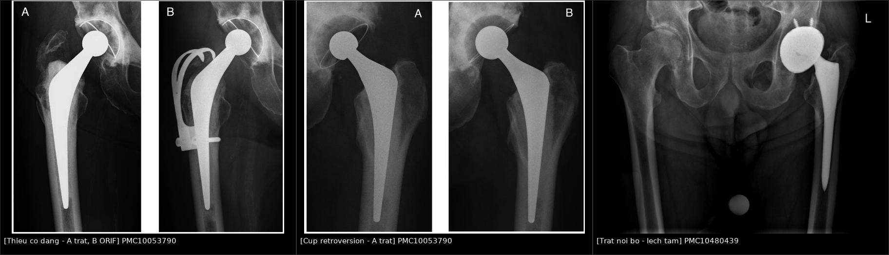
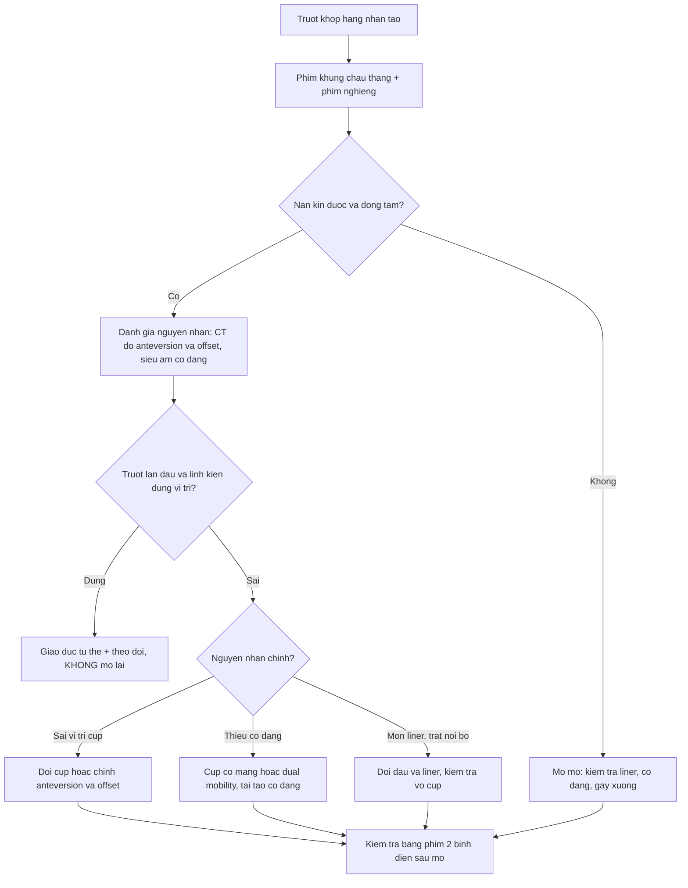
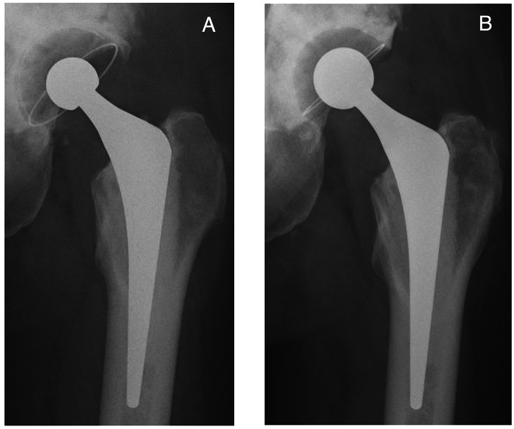
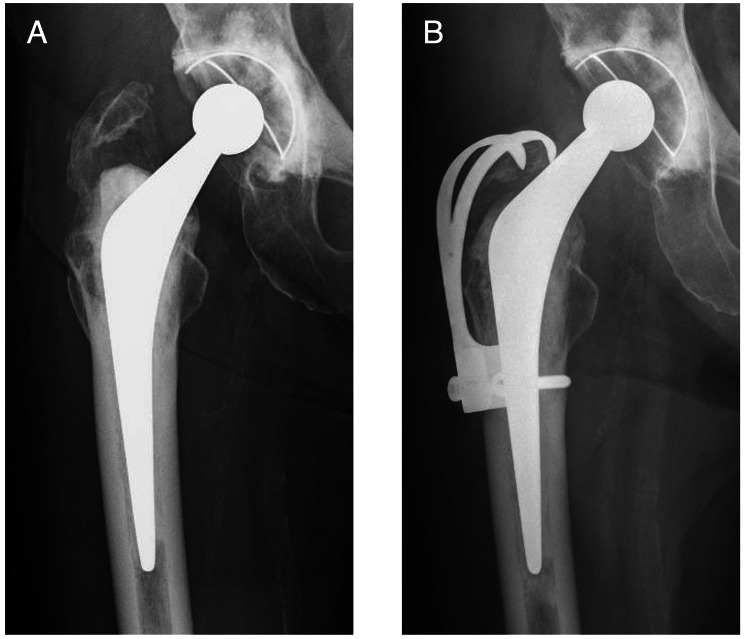
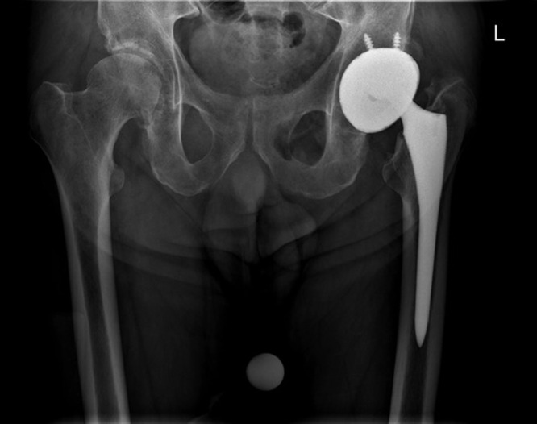

# 6151 — Trật khớp háng nhân tạo tái diễn: phân loại Dorr, đo anteversion trên CT và chọn mổ lại theo NGUYÊN NHÂN / Recurrent dislocation after total hip arthroplasty

**Tags:** `pattern:di-lech-implant` `pattern:mat-dong-tam` `pattern:long-liner-lech-tam` `pattern:thieu-co-dang` `vung:khop-hang` `vung:co-xuong` `score:Dorr` `score:Lewinnek` `protocol:X-quang-khop-hang` `protocol:CT-anteversion`
**Mức chắc chắn (certainty):** tổng hợp y văn (literature synthesis) — ghép **đoàn hệ 71 khớp mổ lại vì trật tái diễn có phân loại Dorr + 5 hình X-quang** (BMC Musculoskelet Disord 2023, PMC10053790, CC BY 4.0), **ca trật nội bộ dual-mobility có X-quang + CT** (Radiol Case Rep 2023, PMC10480439, CC BY 4.0), **sổ bộ chỉnh hình quốc gia Thụy Điển 78.098 ca** (Acta Orthop 2012, PMC3488169), **sổ bộ Hà Lan 166.231 ca** (Acta Orthop 2017, PMC5499330), **đoàn hệ 1.066 khớp một phẫu thuật viên** (J Clin Med 2026, PMC13514248), **4.904 ca trật trong 90 ngày** (Arthroplast Today 2026, PMC13717001) và **119 ca thay cup đơn thuần: dual mobility so với cup thường** (BMC Musculoskelet Disord 2025, PMC11954348). Số nào nguồn không nêu ghi "chưa rõ".

> **Câu chốt:** trật khớp là **nguyên nhân mổ lại sớm hàng đầu** sau thay khớp háng, nhưng **cùng một hình "đầu ra khỏi ổ" lại có 3 nguyên nhân ngược nhau**: **sai vị trí linh kiện** (cup retroversion — sửa cup), **thiếu cơ dạng/mất cân bằng mô mềm** (cup có màng hoặc dual mobility), và **mòn liner gây trật nội bộ** (thay đầu/liner). Trong 71 khớp mổ lại vì trật tái diễn, **Dorr type II (mất cân bằng mô mềm) chiếm 58/71 = 82%**, type III (sai vị trí linh kiện) chỉ **11/71 = 15%** — nghĩa là **đa số ca không sửa được bằng cách "đặt lại cup cho đẹp"** (PMC10053790). Ngược lại, **60,5% ca trật sớm chỉ cần nắn kín** và chỉ **60% ca phải mổ lại được chuyển sang cup có màng** (PMC13717001) — nên **đừng mổ lại ngay ở lần trật đầu**.

## 1. Tổng quan bệnh học – cơ chế hình ảnh

### 1.1 Vì sao khớp trật — 3 cơ chế cùng lúc (TẠI SAO)

- **Mất "chiều cao nhảy" (jump distance):** đầu chỉ nằm trong ổ khi **lực nén của mô mềm quanh khớp > lực đẩy đầu ra khỏi vành cup**. Chiều cao nhảy tỉ lệ với **bán kính đầu × sin của góc bao phủ cup**; vì thế **đầu nhỏ (22 mm) và cup nông/đặt đứng** đều làm giảm chiều cao nhảy → trật. Đây là lý do vật lý của con số: **đầu 22 mm có RR 2,0 (1,2–3,3)** so với 28 mm (PMC3488169).
- **Sai định hướng cup:** cup nghiêng quá nhiều (**inclination > 50°**) hoặc **retroversion** làm vành cup không còn "che" đầu khi gấp háng; **anteversion chuẩn (vùng Lewinnek) là 15° ± 10° và inclination 40° ± 10°**. Trong 1.066 khớp, **sai vị trí cup chiếm 31,82%** nguyên nhân trật, còn **sai offset xương đùi chiếm 40,91%** (PMC13514248) — offset sai làm cơ dạng **chùng**, tức là quay lại cơ chế mô mềm.
- **Thiếu cơ dạng (abductor deficiency):** cơ mông nhỡ – mông nhỏ giữ đầu trong ổ khi đứng và đi. **Gãy mấu chuyển lớn không liền, rách gân mông nhỡ sau mổ, đường vào sau bóc tách nhiều** đều làm mất lực này; trên phim **mấu chuyển lớn di lệch lên trên** là dấu hiệu gợi ý. Đây là **Dorr type II — 82%** ca trật tái diễn (PMC10053790).
- **Mất cân bằng động (spinopelvic):** cột sống thắt lưng cứng (**hàn liên đốt, thoái hóa nặng**) làm chậu **không ngửa ra sau được khi ngồi** → đầu bị đẩy ra sau; **hàn cột sống thắt lưng là yếu tố nguy cơ trật độc lập**, bất kể mổ trước hay sau thay khớp (PMC11212535).
- **Mòn liner và trật nội bộ:** liner polyethylene mòn **lệch tâm** → đầu "khoét" vào một phía, **mất độ dày** → đầu **chui qua liner** và **nằm trực tiếp trong vỏ kim loại** = **trật nội bộ (intraprosthetic dislocation)**, thường **nhiều năm sau mổ** và **có thể không thấy "đầu ra ngoài ổ" trên phim**.
- **Vì sao trật hay tái diễn:** mỗi lần trật làm **rách thêm bao khớp và gân mông nhỡ** → mất thêm lực giữ; đồng thời **trật tái diễn sau mổ lại vì trật là 18–39%** (dẫn trong PMC10053790) — vòng xoáy "mất mô mềm → trật → mất thêm mô mềm".

### 1.2 Vì sao nhìn thấy — vật lý từng phương thức

- **X-quang khung chậu thẳng + nghiêng/xuyên bàn (cross-table lateral):** kim loại cản tia hoàn toàn, nên hình học đơn giản: **tâm đầu và tâm cup phải trùng nhau**. Trật = **khoảng cách tâm–tâm > 0**, hướng theo trục: **ra sau–trên** (hay gặp nhất với đường vào sau) hay **ra trước–dưới**. Phim nghiêng là **bắt buộc**, vì trên phim thẳng một đầu "nằm trong vành cup" vẫn có thể đã trật ra sau.
- **Đo trên phim thẳng — nguyên lý chiếu:** cup là **vành ellipse**; **độ mở của ellipse** cho **inclination**, còn **tỉ lệ trục ngắn/trục dài** phản ánh **anteversion** nhưng **bị sai lệch bởi nghiêng chậu và xoay**. Vì thế khi nghi ngờ sai vị trí: **chuyển sang CT**.
- **CT có dựng ảnh:** đo **anteversion thật** trên mặt phẳng ngang chỉnh theo **trục chậu** (tilt-corrected), đo **inclination**, **offset**, **chênh chiều dài chân**, và **vị trí ốc vít/lỗ cup**; CT còn phát hiện **vỡ mấu chuyển, gãy quanh chuôi, khuyết xương sau cup**.
- **Vì sao "trật nội bộ" khó:** trên phim chỉ thấy **đầu lệch tâm trong vỏ cup** (không ra ngoài vành), đôi khi có **dấu "bong bóng" (bubble sign)** — một **vòng sáng bán nguyệt ở phía trên–ngoài** do **liner bị đẩy ra khỏi vỏ**; CT xác nhận **đầu ceramic/metal tiếp xúc trực tiếp vỏ kim loại, không còn lớp polyethylene** và **đầu polyethylene nằm lạc trong cơ mông** (PMC10480439).
- **MRI (MARS) — chỉ khi nghi phản ứng mô mềm:** **pseudotumor/ALTR** quanh khớp kim loại–kim loại hoặc **đầu modular**; đây là nguyên nhân trật **muộn** do **mô mềm bị phá hủy**, không do sai vị trí.

### 1.3 Ngưỡng định lượng nằm lòng

| Đại lượng | Ngưỡng / con số | Ý nghĩa | Nguồn |
|---|---|---|---|
| Trật sau thay khớp nguyên phát (sổ bộ Bắc Âu) | **0,5%** | Nền tảng để so sánh | PMC10053790 |
| Mổ lại vì trật (sổ bộ Thụy Điển) | **0,5%** trong 78.098 ca | Trật là lý do mổ lại sớm hàng đầu | PMC3488169 |
| Trật trong 90 ngày (4.904 ca) | **0,77%** | Đa số là trật sớm | PMC13717001 |
| Nắn kín đủ (không cần mổ) | **60,5%** ca trật sớm | Chỉ định mổ lại phải chặt | PMC13717001 |
| Phải mổ lại → chuyển cup có màng | **60%** ca mổ lại | Cup có màng là "cứu cánh" | PMC13717001 |
| Trật sau mổ lại (tổng quan 4.656 ca) | **9,0%** | Mổ lại làm tăng nguy cơ | PMC10053790 |
| Trật tái diễn sau mổ lại VÌ trật | **18–39%** | Vòng xoáy mô mềm | PMC10053790 |
| Vùng an toàn Lewinnek | **inclination 40° ± 10° · anteversion 15° ± 10°** | Ngưỡng kinh điển khi đo CT | Lewinnek 1978 |
| Nguyên nhân trật (1.066 khớp) | **sai offset 40,91% · sai cup 31,82%** | Hai nguyên nhân hàng đầu | PMC13514248 |
| Đầu 22 mm so với 28 mm | **RR 2,0 (1,2–3,3)** | Đầu nhỏ = nguy cơ cao | PMC3488169 |
| Đường vào sau so với trực tiếp bên | **RR 1,3 (1,1–1,7)** | Chênh lệch vừa | PMC3488169 |
| Đường vào ít xâm lấn | **RR 4,2 (2,3–7,7)** | Nguy cơ cao nhất | PMC3488169 |
| Gãy cổ xương đùi là chẩn đoán gốc | **RR 3,9 (3,1–5,0)** | Nhóm nguy cơ cao nhất | PMC3488169 |
| Đầu 32 mm so với 22–28 mm | **HR 1,6** cho nhóm nhỏ | Đầu ≥ 32 mm bảo vệ | PMC5499330 |
| Đầu 36 mm, đường vào sau | **HR 0,6** | Lợi ích rõ nhất ở đường vào sau | PMC5499330 |
| Dual mobility trong 287 ca | **1 ca mổ lại vì trật (0,35%)** | Gần như xóa trật | PMC3488169 |
| Dual mobility khi thay cup đơn thuần | **0/49 so với 6/70 (p = 0,042)** | Chọn cup khi mổ lại | PMC11954348 |
| Phân bố nguyên nhân Dorr (71 khớp) | **type I 2 · type II 58 · type III 11** | Mô mềm chiếm 82% | PMC10053790 |
| Hướng trật (71 khớp) | **trước 32 · sau 16 · không rõ 23** | Trật trước chiếm ưu thế trong nhóm mổ lại | PMC10053790 |
| Mổ lại lần nữa vì trật / hỏng implant | **7,0% / 1,4%** | Kết quả mổ lại | PMC10053790 |
| Sống còn implant 10 năm sau mổ lại vì trật | **81,1% (65,5–96,8)** | Tiên lượng để tư vấn | PMC10053790 |

## 2. Mẫu hình + chẩn đoán phân biệt theo vị trí (gamut)

- **Mẫu hình 1 — đầu ra khỏi vành cup, hướng sau–trên:** đường vào sau, gấp háng quá mức, cup **retroversion/thiếu anteversion**; gamut: **sai cup**, **mất cân bằng mô mềm**, **impingement cổ–cup**.
- **Mẫu hình 2 — đầu ra trước–dưới:** đường vào trước/bên, **cup quá anteverted**, hoặc **động tác duỗi–xoay ngoài**; thường gặp ở **bệnh nhân có hàn cột sống thắt lưng** (chậu không ngửa được).
- **Mẫu hình 3 — đầu vẫn "trong" vành nhưng lệch tâm:** **trật nội bộ** do mòn liner / liner bong khỏi vỏ; kèm **dấu bubble sign**.
- **Mẫu hình 4 — trật kèm di lệch mấu chuyển lớn / gãy quanh chuôi:** **chấn thương mới** trên nền khớp đã trật tái diễn; phải loại trừ **gãy xương quanh implant** trước khi nắn.
- **Mẫu hình 5 — trật "tự phát" muộn, kèm khối mô mềm:** **pseudotumor/ALTR**, **nhiễm khớp nhân tạo**, **u hạt**; gamut: **phản ứng với mảnh vụn kim loại**, **nhiễm**, **u quanh khớp**.
- **Gamut theo nguyên nhân (dùng để chọn mổ lại, theo Dorr):**
  - **Type I — tư thế (positional):** linh kiện đúng, mô mềm tốt, trật do động tác; **dạy lại tư thế**, không mổ.
  - **Type II — mất cân bằng mô mềm:** **cup có màng (constrained)**, **dual mobility**, hoặc **tái tạo cơ dạng**; chiếm đa số ca mổ lại.
  - **Type III — sai vị trí linh kiện:** **đổi cup/đổi cổ–chuôi** để chỉnh anteversion và offset.

## 3. Bảng so sánh phân biệt (ma trận đối chiếu)

| Thực thể (entity) | Hình ảnh điển hình | Chốt vào (rule-in) | Chốt loại (rule-out) | Gợi ý xác nhận |
|---|---|---|---|---|
| **Trật khớp thật** | Tâm đầu **lệch hoàn toàn** khỏi tâm cup trên cả 2 phim; hướng trước hay sau | **Mất đồng tâm trên 2 bình diện** | Đầu vẫn nằm trong vành cup trên phim nghiêng | Nắn kín dưới giảm đau; kiểm tra sau nắn bằng phim 2 bình diện |
| **Trật nội bộ (intraprosthetic)** | Đầu **lệch tâm trong vỏ cup**, **vòng sáng bán nguyệt** phía trên–ngoài; CT: đầu tiếp xúc vỏ kim loại, **đầu polyethylene lạc trong cơ mông** | **CT thấy mất lớp liner giữa đầu và vỏ** | Có lớp polyethylene đều giữa đầu và vỏ | CT không cản quang; không nắn kín đơn thuần — sẽ hỏng thêm |
| **Mòn liner lệch tâm (chưa trật nội bộ)** | Khoảng **kim loại–kim loại hẹp một phía**, đầu **lệch lên trên** | **Đo độ dày liner còn lại trên phim/CT** | Liner còn dày đều | Theo dõi, mổ lại khi mòn tiến triển |
| **Sai vị trí cup** | Inclination **> 50°** hoặc **retroversion**; đo trên CT | **Anteversion ngoài 15° ± 10° hay inclination ngoài 40° ± 10°** | Vị trí trong vùng an toàn **và** không có mất mô mềm | CT chỉnh trục chậu — không đo trên phim thẳng |
| **Thiếu cơ dạng** | Mấu chuyển lớn di lệch lên, mô mềm mỏng, khớp "lỏng" khi kéo | **Trật khi kéo + đẩy bên** trong màn huỳnh quang | Cơ dạng còn giữ, không di lệch mấu chuyển | Siêu âm gân mông nhỡ; MRI khi cần |
| **Gãy xương quanh implant kèm di lệch** | Đường gãy quanh chuôi/mấu chuyển, chuôi lún/xoay | **Đường gãy + di lệch linh kiện** | Không có đường gãy, linh kiện cố định | Phân độ Vancouver trước khi mổ |
| **Pseudotumor/ALTR** | Khối mô mềm quanh khớp, **giảm tín hiệu T2**, có vách; khuyết xương | **MRI thấy khối + tiền sử kim loại–kim loại/đầu modular** | Không có khối, mô mềm bình thường | MRI MARS; theo dõi kích thước |
| **Nhiễm khớp nhân tạo** | Khí quanh khớp, lỏng tiến triển, nang hoạt dịch cơ chậu | **Khí + lỏng nhanh + CRP tăng** | Không khí, CRP bình thường | Chọc khớp + cấy **trước** khi mổ lại |

## 4. Protocol chụp + hệ phân độ/điểm chuẩn hóa

### 4.1 Bộ phim tối thiểu khi vào viện vì trật

1. **X-quang khung chậu thẳng** (đo offset, chênh chiều dài chân, vị trí cup) + **phim nghiêng/xuyên bàn của háng bên trật** — **không bao giờ chỉ chụp một bình diện**.
2. **Phim sau nắn:** xác nhận **đồng tâm**, và **tìm gãy mấu chuyển/chuôi** do động tác nắn.
3. **CT khung chậu – háng khi:** trật tái diễn (**≥ 2 lần**), nghi **sai vị trí cup**, nghi **trật nội bộ**, nghi **gãy quanh implant**, hoặc trước khi **lên kế hoạch mổ lại**.
4. **MRI MARS** khi nghi **pseudotumor/ALTR**; **siêu âm gân mông nhỡ** khi nghi thiếu cơ dạng.

### 4.2 Đo trên CT — quy trình 3 bước

- **Bước 1:** dựng lại **mặt phẳng ngang chỉnh theo trục chậu** (qua **hai gai chậu trước trên** và **hai ụ ngồi**) — không dùng mặt phẳng ngang của máy.
- **Bước 2:** đo **anteversion cup** trên mặt phẳng đó và **inclination** so với **đường liên ụ ngồi**.
- **Bước 3:** đo **offset xương đùi**, **chênh chiều dài chân**, **độ dày liner** và **vị trí ốc vít**. Ghi **cả hai bên** để so sánh.
- **Ngưỡng ra quyết định:** **anteversion ngoài 5°–25°** hoặc **inclination ngoài 30°–50°** kèm trật tái diễn → **mổ lại chỉnh cup**. Nếu vị trí **trong vùng an toàn** mà vẫn trật → tìm **nguyên nhân mô mềm** (Dorr type II) trước khi đổi cup.

### 4.3 Thuật toán xử trí (theo nguyên nhân, không theo số lần trật)

### 4.4 Tiên lượng để tư vấn

- Sau **mổ lại vì trật tái diễn**: **trật lại 7,0%**, **hỏng implant 1,4%**, **sống còn implant 10 năm 81,1%**; **Dorr type I (positional)** là yếu tố nguy cơ **mổ lại lần nữa** (PMC10053790) — nên **xác định đúng nguyên nhân trước mổ** quan trọng hơn chọn implant "xịn".
- Sau **thay cup đơn thuần**: **dual mobility 0/49** so với **cup thường 6/70** (PMC11954348) — nếu mổ lại chỉ để đổi cup ở bệnh nhân nguy cơ cao, **chọn cup dual mobility**.
- **Không hứa "hết trật" sau một lần mổ:** ngay cả với cup có màng/dual mobility, **trật vẫn có thể xảy ra**; cần nói rõ nguy cơ **18–39%** trật lại của nhóm mổ lại vì trật.

## 5. Biến thể bình thường và cạm bẫy

- **Biến thể "cup trông nghiêng" do xoay chậu:** chụp phim thẳng khi **chậu xoay 10°–15°** làm **anteversion biểu kiến lệch 5°–10°**; luôn so **khoảng cách gai chậu – xương cùng** hai bên trước khi kết luận "cup sai".
- **Cạm bẫy 1 — chỉ chụp một bình diện:** đầu trật ra sau có thể **chồng lên vành cup** trên phim thẳng và bị đọc là "đã vào ổ".
- **Cạm bẫy 2 — "trật nội bộ" bị gọi là "mòn liner nhẹ":** dấu **bubble sign** và **đầu lệch tâm** là **cấp cứu cơ học**; **nắn kín trong trật nội bộ làm đầu ceramic cọ trực tiếp vỏ kim loại** → mảnh vụn, hỏng thêm. CT trước, rồi mới can thiệp.
- **Cạm bẫy 3 — bỏ sót gãy mấu chuyển lớn:** gãy **không liền** gây thiếu cơ dạng, là **nguyên nhân chứ không phải hậu quả** của trật; chỉ đổi cup mà không xử lý mấu chuyển/co dạng = trật lại.
- **Cạm bẫy 4 — "đầu to là tốt":** đầu **36 mm** giảm trật **chỉ rõ ở đường vào sau (HR 0,6)** nhưng với **đường vào trước** lại **tăng mổ lại vì nguyên nhân khác (HR 1,5)** (PMC5499330) — không có "một cỡ đầu tốt cho mọi đường vào".
- **Cạm bẫy 5 — quên cột sống:** bệnh nhân **hàn cột sống thắt lưng** có nguy cơ trật cao hơn; hỏi tiền sử và **đánh giá tư thế ngồi–đứng** trước khi chọn vị trí cup; **hàn cột sống là yếu tố nguy cơ độc lập** (PMC11212535).
- **Cạm bẫy 6 — mổ lại quá sớm sau lần trật đầu:** **60,5%** ca trật sớm chỉ cần **nắn kín**; mổ lại ngay làm tăng nguy cơ chung (**9,0%** trật sau mổ lại) mà không giải quyết nguyên nhân.

## 6. Tự lượng giá — Blind Quiz ngay trên trang tĩnh

**Ca 1 — Nữ 49 tuổi, trật tái diễn 2 năm sau thay khớp**

- Gợi ý lâm sàng: đã trật **nhiều lần** trong 2 năm, mỗi lần nắn kín; không chấn thương mới.
- Câu hỏi: Hai dấu hiệu nào trên phim A chỉ **sai vị trí cup**? Vì sao phải **đổi cup** thay vì chỉ đổi đầu?

<b>Bấm để hiện đáp án (findings + chẩn đoán)</b>

- Dấu hiệu (findings): A — đầu **ra khỏi vành cup** phía trên–ngoài, cup **retroverted** (đường viền ellipse mở ngược so với bình thường); B — cup được chỉnh lại và đầu **tăng từ 22,225 mm lên 26 mm**.
- Chẩn đoán (diagnosis): **Dorr type III — sai vị trí cup (retroversion)**; nguyên nhân là **hình học linh kiện**, nên **chỉnh cup** mới giải quyết được, đổi đầu đơn thuần không đủ.
- Nguồn ảnh: BMC Musculoskelet Disord 2023 (PMC10053790), Fig. 3 — CC BY 4.0.

**Ca 2 — Nữ 70 tuổi, trật 3 tháng sau thay khớp, có gãy mấu chuyển**

- Gợi ý lâm sàng: gãy mấu chuyển lớn sau mổ, đi khập khiễng, trật tái diễn nhiều lần dù cup "trông đẹp".
- Câu hỏi: Vì sao **không đổi cup** ở ca này? Cơ chế nào giữ đầu trong ổ bị mất?

<b>Bấm để hiện đáp án (findings + chẩn đoán)</b>

- Dấu hiệu (findings): A — đầu **lệch ra ngoài–trên** khỏi cup, **mấu chuyển lớn di lệch lên trên**, dụng cụ kết xương cũ; B — **tấm móc mấu chuyển** kết xương lại, đầu trở về đồng tâm.
- Chẩn đoán (diagnosis): **Dorr type II — thiếu cơ dạng do gãy mấu chuyển lớn**; xử lý là **kết xương mấu chuyển (ORIF)**, không phải đổi cup.
- Nguồn ảnh: BMC Musculoskelet Disord 2023 (PMC10053790), Fig. 2 — CC BY 4.0.

**Ca 3 — Bệnh nhân dual mobility, đau háng nhiều năm, phim "không trật khớp"**

- Gợi ý lâm sàng: đau tăng dần, mất biên độ vận động, không có cú ngã; phim thẳng được báo "khớp còn trong ổ".
- Câu hỏi: Vì sao **"không trật khớp" trên báo cáo vẫn là trật**? Cần thêm hình ảnh gì và **không được làm** gì?

<b>Bấm để hiện đáp án (findings + chẩn đoán)</b>

- Dấu hiệu (findings): đầu **lệch tâm lên trên–trong** so với vỏ cup, **không ra ngoài vành**; trên phim nghiêng/CT thấy **đầu ceramic tiếp xúc trực tiếp vỏ kim loại**, **đầu polyethylene nằm lạc trong cơ mông sau**.
- Chẩn đoán (diagnosis): **trật nội bộ (intraprosthetic dislocation)** do mòn/bong liner — **không nắn kín**; cần **CT** rồi **mổ thay đầu–liner** (Radiol Case Rep 2023, PMC10480439).
- Nguồn ảnh: Radiol Case Rep 2023 (PMC10480439), Fig. 2 — CC BY 4.0.

## Bài liên quan chéo
- [6140 – Lỏng vô khuẩn quanh khớp háng nhân tạo](../6140-long-vo-khuan-quanh-khop-hang-nhan-tao/lesson.md)
- [6141 – Vôi hóa mô mềm quanh khớp háng nhân tạo](../6141-voi-hoa-quanh-khop-hang-nhan-tao/lesson.md)
- [6155 – Gãy xương đùi quanh chuôi](../6155-gay-xuong-quanh-chuoi-dui-sau-tha/lesson.md)
- [6110 – Nhiễm trùng quanh khớp nhân tạo sau THA](../6110-nhiem-trung-quanh-khop-nhan-tao-sau-tha/lesson.md)
- [301 – Protocol khung xương và khớp](../301-protocol-msk/lesson.md)

## Ảnh
- 3 ảnh X-quang gốc + 1 ảnh ghép, tất cả **CC BY 4.0** — chi tiết Fig/PMCID trong `images/CREDITS.md`.
- Không tải ảnh từ PMC3488169, PMC5499330, PMC11954348, PMC13717001 (CC BY-NC/CC BY-NC-ND: chỉ dùng số liệu).

> Không dùng để chẩn đoán độc lập khi chưa có người hướng dẫn.
