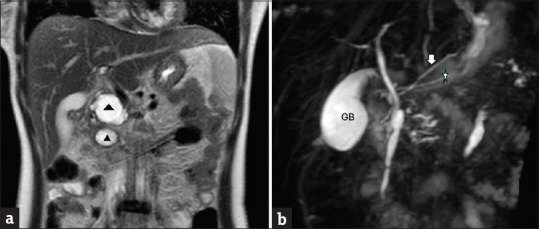
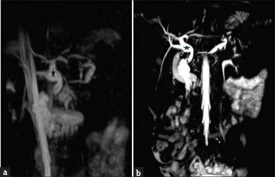
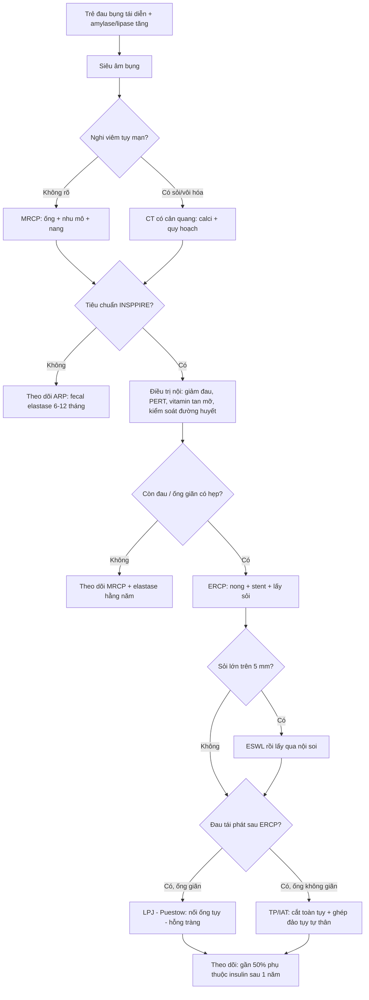
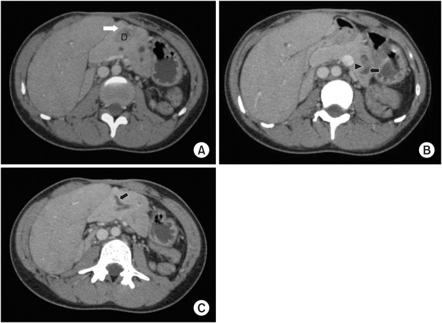
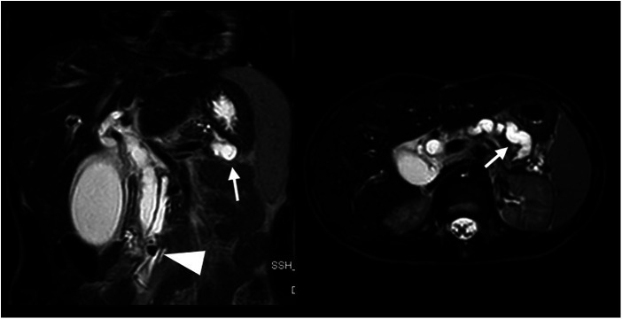

# 6152 — Viêm tụy mạn ở trẻ: vôi hóa – giãn ống – teo nhu mô / Chronic pancreatitis in children

**Tags:** `pattern:voi-hoa-tuy` `pattern:soi-ong-tuy` `pattern:gian-ong-tuy` `pattern:teo-tuy` `pattern:nang-gia-tuy` `pattern:hep-ong-tuy` `vung:tuy` `vung:o-bung` `score:Cambridge` `score:INSPPIRE-2018` `protocol:MRI-MRCP` `protocol:CT-bung-co-can-quang` `protocol:sieu-am-bung` `protocol:ERCP`

**Mức chắc chắn (certainty):** tổng hợp y văn (literature synthesis) — ghép **meta-analysis tiến triển viêm tụy ở trẻ** 68 nghiên cứu (*Clin Exp Pediatr* 2026, PMC12877302, **CC BY-NC**), **đoàn hệ 48 trẻ viêm tụy mạn** có bảng hình ảnh theo từng modality (*J Indian Assoc Pediatr Surg* 2025, PMC12643358, **CC BY-NC-SA 4.0** — nguồn 2 ảnh MRCP), **tổng quan điều trị nội soi–phẫu thuật** ở trẻ (*Children* 2024, PMC10813922, **CC BY**), **đoàn hệ 51 trẻ/131 lần ERCP** (*BMC Pediatr* 2026, PMC13393790, **CC BY 4.0**), **đoàn hệ CT 160 ca** dùng phân độ Cambridge (*JGH Open* 2026, PMC13243886, **CC BY 4.0**) và **ca nguyên văn gia đình PRSS1** (*Front Pediatr* 2024, PMC11228964, **CC BY 4.0** — nguồn 1 ảnh MRCP). Nhóm **không có bệnh nhân của mình**; chỗ các nguồn **khác quần thể** (trẻ chuyển tuyến nặng vs người lớn nghiện rượu) được ghi rõ ngay dưới số liệu.

> **Câu chốt:** viêm tụy mạn ở trẻ **không phải bệnh của người nghiện rượu thu nhỏ** — nó là bệnh **di truyền/tắc nghẽn**, và **chờ vôi hóa để chẩn đoán là bỏ sót**. Ba số phải thuộc: **(1)** mới mắc khoảng **2/100.000 trẻ/năm**, nhưng **18%** trẻ viêm tụy cấp tái phát và **35%** trong số tái phát **tiến triển thành mạn**; **(2)** **PRSS1 tăng nguy cơ mạn OR 4,56 (3,06–6,80)**, **pancreas divisum OR 2,64 (1,51–4,63)**, **bất thường giải phẫu → tái phát OR 3,15 (1,51–6,56)**; **(3)** trong đoàn hệ trẻ **chỉ 44% (22/48) có vôi hóa** trên bất kỳ modality nào — và ở **viêm tụy tự miễn** thì **0%**; vì vậy **chẩn đoán dựa trên ống tụy + nhu mô + suy chức năng**, không dựa riêng vào sỏi/vôi.

## 1. Tổng quan bệnh học – cơ chế hình ảnh

### 1.1 Dịch tễ và vì sao trẻ khác người lớn

- **Mới mắc:** viêm tụy cấp ở trẻ **3–13/100.000/năm**; **viêm tụy mạn (chronic pancreatitis, CP) khoảng 2/100.000/năm** (PMC12877302). Ở người lớn, nguyên nhân hàng đầu là **rượu và thuốc lá**; ở trẻ hai yếu tố này **hiếm khi gặp**, thay vào đó là **đột biến gen** và **bất thường giải phẫu** (PMC12877302, PMC10693666).
- **Đường đi tự nhiên (số gộp):** sau **cơn viêm tụy cấp đầu tiên**, **18% (95% CI 16–22%, 39 nghiên cứu)** tái phát thành **viêm tụy cấp tái diễn (acute recurrent pancreatitis, ARP)** và **10% (6–16%, 5 nghiên cứu)** thành **mạn**; trong nhóm ARP, **35% (24–49%, 7 nghiên cứu)** tiến triển thành **mạn** (PMC12877302).
- **Mức nặng cơn đầu dự báo tái phát:** cơn **nặng → ARP 39%**, **trung bình 24%**, **nhẹ 21%**; theo nguyên nhân, **tăng triglyceride 33%**, **vô căn 28%**, **sỏi mật 19%**, **chấn thương 16%**, **do thuốc 14%**, **do virus 3%** (PMC12877302).
- **Nguyên nhân ở trẻ:** **vô căn 30–60%** (Trung Quốc 65–73% trong một số đoàn hệ), **bất thường giải phẫu tới 30%** (pancreas divisum, nang ống mật chủ, tụy vòng, hẹp ống sau chấn thương), **tự miễn ~10%**, **chấn thương: tới 36% trẻ vỡ ống tụy tiến triển mạn** (PMC10813922, PMC10693666, PMC12643358).
- **Gánh nặng:** chi phí trung bình **38.755 USD/người/năm** cho một trẻ ARP/CP (registry INSPPIRE, dẫn qua PMC10693666); trẻ nghỉ học, đau mạn, nguy cơ **phụ thuộc opioid** và **suy tụy ngoại tiết/đái tháo đường type 3c** (PMC10813922).

### 1.2 Sinh lý bệnh: từ trypsinogen đến xơ hóa và sỏi

- **Trục chính là trypsin:** **PRSS1** mã hóa **trypsinogen** (tiền men); **SPINK1** mã hóa chất ức chế trypsin thứ nhất (ức chế ~**20%** trypsin hoạt hóa sớm); **CTRC** (chymotrypsin C) là hàng phòng thủ thứ hai; **CFTR** quyết định độ kiềm và độ loãng dịch tụy. Đột biến làm **hoạt hóa trypsin sớm trong tuyến** → tự tiêu mô → **viêm tái diễn** (PMC12643358, PMC10693666).
- **Xơ hóa:** tổn thương lặp lại hoạt hóa **tế bào sao tụy (pancreatic stellate cells)** → lắng **collagen** quanh ống và tiểu thùy → **hẹp ống không đều + tắc + sỏi** → ứ dịch → **giãn ống phía trên** → **teo nhu mô** và **thay mỡ**. Vì vậy trên ảnh, **giãn ống và teo là hai mặt của cùng một quá trình tắc nghẽn–xơ hóa**, không phải hai bệnh (PMC10813922).
- **Suy chức năng đến trước hay sau hình ảnh:** **suy tụy ngoại tiết (exocrine pancreatic insufficiency, EPI)** có thể xuất hiện **sau một cơn cấp** và **không tương quan chặt** với mức giãn ống; trong đoàn hệ CT người lớn 160 ca, **không có liên hệ có ý nghĩa giữa triệu chứng và độ Cambridge** (PMC13243886) — nghĩa là **ảnh đẹp không đồng nghĩa bệnh nhẹ, ảnh nghèo nàn không đồng nghĩa bệnh lành**.

### 1.3 Vì sao hình ảnh trông đúng như vậy (vật lý + mô bệnh)

- **Vôi hóa tụy sáng trên CT:** tinh thể **calci hydroxyapatite** trong lòng ống/nhu mô có **hệ số suy giảm tia X cao** — **cao hơn hẳn mô mềm (~40–60 HU)**, nhìn thấy **ngay cả trên lát không cản quang** → **trắng đậm**; ngưỡng HU chính xác **chưa được chuẩn hóa trong y văn** ("chưa rõ — cần tra"), nhưng đây là dấu hiệu **đặc hiệu nhưng muộn** (PMC13243886).
- **Sỏi ống tụy là "lỗ đen" trên MRCP:** MRCP dùng chuỗi **T2 nặng (heavily T2-weighted)** — chỉ **dịch tĩnh** (mật, dịch tụy) còn tín hiệu; **sỏi không có proton tự do** → **mất tín hiệu (signal void)**, hiện thành **khuyết đen trong ống trắng**, kèm **giãn ống phía trên** (ảnh ca 3). Vì vậy **MRCP nhìn thấy sỏi không cản quang**, còn **CT nhìn thấy cặn calci** — hai modality bổ sung nhau, không thay thế nhau (PMC11228964).
- **Teo nhu mô + thay mỡ:** mô tụy mất dần, **mỡ thay vào** → trên **T1 không ức chế mỡ** nhu mô **sáng bất thường** (mỡ sáng T1), nhưng trên **T1 fat-sat** thì **mất tín hiệu** và nhu mô **mỏng, giảm tín hiệu** so với tụy bình thường. Vì vậy **luôn đọc cặp T1 in-phase/fat-sat** trước khi gọi "teo" (PMC12643358).
- **Nang giả tụy:** dịch **giàu enzyme, không có biểu mô** → **T2 rất sáng, T1 tối, không ngấm thuốc**, vách mỏng; khác **u nhú thể đặc giả nhú (solid pseudopapillary neoplasm, SPN)** ở trẻ gái — SPN có **phần đặc ngấm thuốc + xuất huyết** (bài 6120).
- **Vì sao ưu tiên MRI ở trẻ (ALARA):** mỗi CT bụng trẻ sơ sinh/trẻ nhỏ cho liều hiệu dụng cao hơn người lớn cùng vùng do **kích thước nhỏ + cơ quan nhạy xạ gần nhau**; viêm tụy mạn cần **chụp lặp lại nhiều năm**, nên **MRI/MRCP là first-line**, CT chỉ khi cần **đánh giá calci, sỏi cản quang, hoặc quy hoạch mổ** (PMC12643358, PMC10813922).

### 1.4 Ngưỡng định lượng bắt buộc nhớ

| Đại lượng | Ngưỡng | Ý nghĩa thực hành | Nguồn |
|---|---|---|---|
| Fecal elastase-1 | **< 200 µg/g** (không có ngưỡng đồng thuận tuyệt đối) | Gợi ý **suy tụy ngoại tiết**; **< 100 µg/g** = nặng | PMC11893156 |
| MPD trên MRCP | **chưa có bảng chuẩn theo tuổi dùng rộng rãi**; trong các ca bệnh báo cáo, ống **5 mm** (anh trai), **8 mm** (dịch mật), **9 → 6 mm do hẹp** đều là **bất thường** | **Giãn + không đều + hẹp** = CP; **so với chính bệnh nhân ở lần chụp trước** hơn là áp ngưỡng người lớn | PMC11228964 |
| Sỏi ống tụy | **7 mm** trong ca có **giãn ống phía trên nặng** | Sỏi **> 5 mm** thường cần **ESWL/tán** trước khi lấy qua nội soi | PMC11228964 |
| Nang giả tụy | trung vị **23 mm**, **91,6% ≥ 10 mm** (đoàn hệ người lớn) | **≥ 10 mm + triệu chứng/kéo dài** mới can thiệp | PMC13243886 |
| Cambridge | **0–4** (dựa trên **số nhánh phụ bất thường + ống chính**; **teo KHÔNG tính vào grade**) | **≥ 3 nhánh phụ bất thường** đã là **grade ≥ 2**; **92,5%** đoàn hệ người lớn ở **grade 4** | PMC13243886 |
| PEP sau ERCP nhi | **17,6% (23/131 lần)** — **100% nhẹ** | Cảnh báo cha mẹ trước thủ thuật; **stent ≤ 5 Fr** làm tăng nguy cơ | PMC13393790 |

## 2. Mẫu hình + chẩn đoán phân biệt theo vị trí (gamut)

### 2.1 Gamut theo mẫu hình chính

- **Vôi hóa/sỏi trong ống:** CP (di truyền, vô căn, sau chấn thương), **sỏi ống tụy đơn thuần**, **tụy vòng có ứ đọng**; hiếm: **u thần kinh nội tiết** (không vôi hóa kiểu sỏi).
- **Giãn ống tụy đơn độc/không đều:** **CP** (hẹp–giãn xen kẽ "chuỗi hạt"), **pancreas divisum** (giãn **ống lưng**), **nang ống mật chủ type 1b** (giãn cả đường mật + ống tụy), **hẹp sau chấn thương** ở cổ tụy, **tắc do sỏi**.
- **Teo nhu mô lan tỏa ("tụy biến mất"):** **CP giai đoạn muộn**, **thay mỡ đơn thuần** (béo phì, dùng corticoid), **Shwachman–Diamond** (suy tủy + EPI ở trẻ nhỏ), **xơ nang (CF)**.
- **Nang/hang:** **nang giả tụy** (sau cơn cấp, không biểu mô), **hoại tử có vách (walled-off necrosis, WON)**, **SPN**, **nang ống mật chủ**, **nang bẩm sinh**.

### 2.2 Gamut theo vị trí

- **Đầu tụy/uncinate:** **tụy vòng** (vòng mô tụy quanh tá tràng D2), **nang ống mật chủ**, **hẹp ống sau viêm**; đây là nơi **hay bỏ sót nguyên nhân tắc**.
- **Thân–đuôi:** **CP di truyền/PRSS1** (tổn thương lan tỏa nhưng **teo thân–đuôi rõ**), **pancreas divisum** (hệ ống lưng chi phối thân–đuôi), **nang giả** (đoàn hệ: **đuôi 47%**, **đầu 21%**, **thân+đuôi 21%**).
- **Lan tỏa:** **CP vô căn**, **tự miễn (P-AIP)**, **xơ nang**.

### 2.3 Mnemonic **TIGAR-O** (dùng để không bỏ sót nguyên nhân)

**T**oxic–metabolic (thuốc, tăng calci, tăng triglyceride, suy thận) · **I**diopathic (30–60%) · **G**enetic (**PRSS1, SPINK1, CFTR, CTRC, CASR**) · **A**utoimmune (~10%) · **R**ecurrent/severe acute pancreatitis · **O**bstructive (divisum, nang ống mật chủ, tụy vòng, hẹp sau chấn thương).

## 3. Bảng so sánh phân biệt (ma trận đối chiếu)

| Thực thể (entity) | Hình ảnh điển hình | Chốt vào (rule-in) | Chốt loại (rule-out) | Gợi ý xác nhận |
|---|---|---|---|---|
| **Viêm tụy mạn (CP)** | **Vôi hóa nhu mô/ống**, **sỏi**, **giãn ống không đều**, **teo + thay mỡ**, nang giả | **≥ 2 trong: sỏi/vôi hóa, giãn–hẹp ống không đều, teo nhu mô** ở trẻ có **đau tụy tái diễn** | **Ống và nhu mô hoàn toàn bình thường + không suy chức năng** → chưa đủ CP | MRCP + **fecal elastase**; theo dõi 6–12 tháng |
| **Pancreas divisum** | **Ống lưng giãn** đổ qua **nhú phụ (minor papilla)**, ống bụng nhỏ | **Hai hệ ống không hòa nhau + ống lưng giãn** | **Ống lưng bình thường, không giãn** → **biến thể, không phải nguyên nhân** | MRCP; **có mặt ở ~5% dân số** nên chỉ quy nguyên nhân khi **giãn ống lưng + tái phát** |
| **Tụy tự miễn (P-AIP)** | **Tụy to lan tỏa mất phân thùy**, **ngấm muộn dạng đốm**, **vỏ bao**, **ống hẹp dài KHÔNG giãn**, **vôi hóa 0%** | **To lan tỏa + vỏ bao + IgG4 (chỉ 15,2%) + đáp ứng corticoid** | **Giãn ống rõ + sỏi/vôi hóa + teo** → CP thật | Corticoid thử có kiểm soát (bài 6145) |
| **Nang ống mật chủ** | **Giãn ống mật chủ + ống tụy**, nang vùng đầu tụy, có thể **sỏi trong nang** | **Giãn đường mật ngoài gan + ống tụy cùng lúc**, nang thấy rõ | **Chỉ giãn ống tụy, đường mật bình thường** → không phải | MRCP + amylase dịch nang; **cắt nang + nối mật ruột** |
| **Tụy vòng (annular pancreas)** | **Vòng mô tụy quanh D2** + **giãn ống tụy + sỏi trong chỗ giãn**, hẹp tá tràng | **Vòng mô tụy liên tục quanh tá tràng trên CT/MRCP** | **Không thấy vòng mô quanh D2** | CT/MRCP; **Puestow cải tiến** nếu ống giãn |
| **Thay mỡ đơn thuần** | Tụy **mỏng, sáng T1, mất tín hiệu trên fat-sat**, **không giãn ống, không sỏi** | **T1 sáng + fat-sat tối + ống bình thường** | **Có giãn ống/sỏi** → CP | MRI in/out-phase; **không cần điều trị đặc hiệu** |
| **SPN (u giả nhú đặc)** | Khối **đặc–nang hỗn hợp**, **xuất huyết**, ngấm thuốc phần đặc, trẻ gái | **Phần đặc ngấm thuốc + vôi hóa viền + trẻ gái** | **Nang thuần dịch, thành mỏng, không ngấm** → nang giả | MRI + sinh thiết/mổ (bài 6120) |

*Hình 1 — MRCP trẻ viêm tụy mạn. **(a)** Hai nang giả rõ (tam giác đen) cạnh đầu/uncinate, **teo thân–đuôi**. **(b)** **Pancreas divisum không hoàn toàn**: ống lưng giãn (sao trắng) chạy lên đổ nhú phụ; ống bụng nhỏ (mũi tên trắng) nối bên. Nguồn: *J Indian Assoc Pediatr Surg* 2025 (PMC12643358), **CC BY-NC-SA 4.0**, ảnh nguyên bản.*

*Hình 2 — **(a)** Teo rõ thân tụy, **ống tụy giãn + cặn calci**; **(b)** MIP cho thấy **nang ống mật chủ type 1b** (sao) cạnh ống tụy giãn. Đây là ví dụ **nguyên nhân tắc nghẽn phối hợp** — điều trị phải gồm **cắt nang + nối mật ruột**, không chỉ điều trị tụy. Nguồn: PMC12643358, **CC BY-NC-SA 4.0**, ảnh nguyên bản.*

### 3.1 Trình tự đọc MRCP ở trẻ nghi CP (5 bước)

1. **Đếm nhánh phụ bất thường** (≥ 3 = Cambridge ≥ 2) và đo **đường kính ống chính** ở đầu/thân/đuôi.
2. **Tìm sỏi** (khuyết tín hiệu trong ống) và **vôi hóa** (chỉ thấy trên CT) — **không bỏ bước CT nếu MRCP âm mà vẫn nghi**.
3. **Đo độ dày nhu mô** thân/đuôi trên **T1 fat-sat** và so với tuổi; tìm **thay mỡ**.
4. **Truy nguyên nhân tắc:** hệ ống (divisum), **đường mật** (nang ống mật chủ), **tá tràng** (tụy vòng).
5. **Tìm biến chứng:** **nang giả/WON**, **huyết khối tĩnh mạch cửa–lách** (bài 163), **giả phình động mạch** (bài 6122).

## 4. Protocol chụp + phân độ + xử trí

### 4.1 Protocol (ALARA trước, chi tiết sau)

- **Siêu âm bụng là bước đầu** ở mọi trẻ đau bụng tái diễn: rẻ, không xạ, thấy **giãn ống, sỏi lớn, nang giả**; trong đoàn hệ 48 trẻ, siêu âm phát hiện **giãn ống ở 23/48** và **vôi hóa ở 21/48** — **nhạy hơn CT** ở nhóm này vì **không cần cản quang** (PMC12643358).
- **MRI/MRCP (không cản quang + secretin nếu có)** là **chuẩn chẩn đoán và theo dõi** ở trẻ: đánh giá **hệ ống, nhu mô, nang**, **không nhiễm xạ**. Lát **≤ 3 mm**, **T1 fat-sat + T2 + MRCP MIP**.
- **CT bụng có cản quang thì tĩnh mạch cửa** khi: cần **vôi hóa/sỏi cản quang**, **quy hoạch mổ**, hoặc **MRCP không giải thích được**; **giới hạn số lần** vì trẻ sẽ chụp nhiều năm.
- **ERCP chỉ để điều trị** (không còn là chuẩn chẩn đoán): **nong + stent ống tụy**, **cắt cơ nhú**, **lấy sỏi**; cannulation thành công **~90%** ở trung tâm lớn (PMC10813922). **Biến chứng: PEP 17,6%**, toàn bộ **nhẹ**; **bất thường nối mật–tụy (PBM) aOR 4,86** và **stent ≤ 5 Fr aOR 3,08** là yếu tố nguy cơ; **khoảng thay stent 3 tháng vs dài hơn không khác** về triệu chứng (22,7% vs 27,6%) hay cơn cấp (9,1% vs 10,3%) (PMC13393790).
- **EUS**: vai trò tăng dần để **phát hiện sỏi nhỏ, nang nhỏ, đánh giá nhú** trước ERCP (PMC10813922).

### 4.2 Tiêu chuẩn chẩn đoán và phân độ

- **Tiêu chuẩn INSPPIRE (2018)** — chẩn đoán CP khi có **≥ 1 trong 3**: **(1)** đau bụng kiểu tụy **+** hình ảnh đặc trưng (bất thường ống/nhu mô); **(2)** **bằng chứng suy tụy ngoại tiết** (fecal elastase **< 200 µg/g**) **và/hoặc đái tháo đường**; **(3)** **chỉ hình ảnh đặc trưng** (bệnh nhân không đau). Điểm quan trọng: **không cần vôi hóa, không cần đau** (PMC12643358).
- **Cambridge 0–4 (bản CT/MRCP):** dựa trên **số nhánh phụ bất thường** và **thay đổi ống chính**; **≥ 3 nhánh phụ = grade ≥ 2**; **grade 4** = thay đổi ống chính **+** nang lớn/ứ tắc/giãn nặng. **Teo nhu mô KHÔNG được tính vào grade** — vì vậy **teo nặng vẫn có thể "Cambridge thấp"** (PMC13243886).
- **Đừng nhầm thang của người lớn với trẻ:** đoàn hệ 160 ca người lớn (rượu 62,5%) có **vôi hóa 85%**, **giãn ống 73,1%**, **92,5% grade 4** — tỉ lệ này **cao hơn hẳn** đoàn hệ trẻ (**vôi hóa 44%**), nên **áp nguyên ngưỡng người lớn sẽ bỏ sót trẻ** (PMC13243886, PMC12643358).

- **Điều trị nội:** **PERT** (enzyme tụy) khi elastase **< 200 µg/g**, **vitamin tan mỡ** (A/D/E/K), **giảm đau theo bậc**, **không dùng opioid dài hạn ở trẻ nếu tránh được** (PMC10813922).
- **Nội soi:** **ERCP** là **first-line can thiệp** khi **ống giãn có hẹp/sỏi**; **ESWL** cho **sỏi lớn > 5 mm** (PMC11228964, PMC13393790).
- **Phẫu thuật:** **LPJ (Puestow cải tiến)** là mổ **phổ biến nhất** ở trẻ (khoảng **200 ca** báo cáo từ 2000); **giảm đau ngắn hạn tốt** nhưng **không ngăn được EPI/đái tháo đường dài hạn** (PMC10813922).
- **TP/IAT (cắt toàn tụy + ghép đảo tụy tự thân):** chỉ định khi **đau không kiểm soát dù đã dẫn lưu**. Chuỗi 15 trẻ: **10 hết đau hoàn toàn, 4 giảm đau**, nhưng **~50% phụ thuộc insulin sau 1 năm**, **14/15 vẫn cần enzyme**; chuỗi khác **29% đạt độc lập insulin** (PMC10813922).

## 5. Biến thể bình thường và cạm bẫy

- **Pancreas divisum có ở ~5% dân số** — **đa số không bệnh**. Chỉ quy nguyên nhân khi **ống lưng giãn + tái phát nhiều lần**; **không gắn nhãn "viêm tụy mạn" chỉ vì thấy divisum** (PMC10813922).
- **Đường kính ống tụy thay đổi theo tuổi và theo độ giãn của nhu mô** — **chưa có bảng chuẩn theo tuổi được dùng rộng rãi** ("chưa rõ — cần tra"); vì vậy **đo và so sánh với chính bệnh nhân ở lần chụp trước** thay vì áp ngưỡng người lớn.
- **Thay mỡ giả teo:** tụy **sáng T1, mỏng** ở trẻ béo phì/dùng corticoid là **biến thể**, không phải CP; **T1 fat-sat** phân biệt (mỡ mất tín hiệu, nhu mô thật thì không).
- **"Không vôi hóa" không loại trừ CP:** đoàn hệ trẻ chỉ **44%** có vôi hóa, và **P-AIP 0%** (bài 6145). Ngược lại, **vôi hóa đơn độc** ở trẻ có thể là **di truyền** dù chưa đau.
- **Nang giả xuất hiện sớm:** **37%** ngay cơn đầu, **26%** sau 2 tuần, **21%** sau 3 tháng, **16%** sau 2 năm — nên **nang "mới" sau cơn cấp không phải u**, và **nang tồn tại > 6 tuần** mới cân nhắc can thiệp (PMC12643358).
- **Bẫy mặt cắt:** nang giả **đầu tụy** dễ bị đọc thành **nang ống mật chủ** — phân biệt bằng **có thông với ống tụy/đường mật hay không** và **vị trí so với D2**; **WON** có **mảnh hoại tử đặc bên trong** (không phải dịch thuần).
- **Bẫy "hài lòng tìm kiếm":** thấy sỏi là dừng, **bỏ sót nang ống mật chủ/tụy vòng** phía sau — luôn **truy nguyên nhân tắc** (mục 3.1 bước 4).

## 6. Tự lượng giá — Blind Quiz ngay trên trang tĩnh

**Ca 1 — Trẻ 12 tuổi, đau bụng tái diễn 2 năm, sụt cân. Nhìn MRCP trước, mô tả trước khi mở đáp án.**

- Gợi ý lâm sàng: đau thượng vị lan sau lưng, không sốt, amylase tăng từng đợt.
- Câu hỏi: có mấy tổn thương? Ống tụy có gì bất thường? 3 chẩn đoán phân biệt và dấu hiệu nào chốt?

<b>Bấm để hiện đáp án (findings + chẩn đoán)</b>

- **Findings:** **(a)** hai **nang giả** cạnh đầu/uncinate (tam giác đen) + **teo thân–đuôi**; **(b)** **pancreas divisum**: ống lưng giãn đổ **nhú phụ**, ống bụng nhỏ nối bên.
- **Chẩn đoán:** **viêm tụy mạn trên nền pancreas divisum** — vì ứ đọng dịch qua nhú phụ nhỏ gây tăng áp lực ống lưng, tái diễn → xơ hóa, teo và nang giả.
- **Phân biệt:** nang ống mật chủ (sẽ giãn đường mật), P-AIP (tụy to + vỏ bao, **không giãn ống**), SPN (phần đặc ngấm thuốc).
- Nguồn ảnh: *J Indian Assoc Pediatr Surg* 2025 (PMC12643358), **CC BY-NC-SA 4.0**.

**Ca 2 — Trẻ 9 tuổi, nôn kéo dài, chậm tăng cân. CT bụng có cản quang:**

- Câu hỏi: mô tả **(A)**, **(B)**, **(C)**; nguyên nhân nào giải thích cả ba? Khi nào cần mổ?

<b>Bấm để hiện đáp án</b>

- **Findings:** **(A)** **tụy vòng** bao quanh tá tràng D2 (mũi tên trắng); **(B)** **giãn ống tụy chính** kèm **sỏi trong chỗ giãn** (mũi tên + đầu mũi tên); **(C)** **giãn ống Santorini**.
- **Chẩn đoán:** **viêm tụy mạn do tụy vòng** gây hẹp tá tràng–ống tụy → ứ đọng, sỏi, giãn ống.
- **Xử trí:** dẫn lưu ống qua **LPJ/Puestow cải tiến** khi ống giãn + đau tái phát; sỏi lớn có thể **ESWL** trước.
- Nguồn ảnh: *Pediatr Gastroenterol Hepatol Nutr* 2020 (PMC7231747), **CC BY-NC 4.0**.

**Ca 3 — Trẻ 14 tuổi (và anh trai, mẹ cùng mang đột biến PRSS1), đau bụng + nôn + phân lỏng. MRCP:**

- Câu hỏi: tổn thương nào gây giãn ống? Vì sao **MRCP thấy sỏi còn CT không cản quang có thể bỏ sót**? Điều trị bước đầu?

<b>Bấm để hiện đáp án</b>

- **Findings:** **sỏi ống tụy 7 mm** (đầu mũi tên) gây **giãn nặng ống tụy và đường mật phía trên** (mũi tên); ống tụy **nhân đôi, giãn không đều**, có **hẹp 9 → 6 mm** ở đoạn đầu.
- **Vì sao:** MRCP dùng **T2 nặng** — sỏi **không có proton tự do** nên **mất tín hiệu**, nổi bật trên nền dịch trắng; CT chỉ thấy sỏi **nếu đủ cản quang calci**.
- **Điều trị:** **ERCP nong + stent + lấy sỏi**, **ESWL nếu sỏi > 5 mm**; sau đó **PERT + theo dõi elastase**; tư vấn **di truyền** cho gia đình (PRSS1 **OR 4,56** cho CP).
- Nguồn ảnh: *Front Pediatr* 2024 (PMC11228964), **CC BY 4.0**.

## Bài liên quan chéo
- [600 – Tổng quan hệ Nhi khoa](../600-tong-quan-nhi-khoa/lesson.md)
- [6145 – Viêm tụy tự miễn ở trẻ (P-AIP)](../6145-viem-tuy-tu-mien-tre/lesson.md) (thể **không vôi hóa, không giãn ống**)
- [6136 – Viêm tụy cấp do thuốc ở trẻ](../6136-viem-tuy-do-thuoc-o-tre/lesson.md)
- [628 – Viêm tụy cấp do tăng triglyceride máu](../628-viem-tuy-tang-triglyceride-o-tre/lesson.md)
- [6137 – Nang ống mật chủ ở trẻ](../6137-nang-ong-mat-chu-o-tre/lesson.md)
- [1730 – Hội chứng ống tụy đứt](../1730-hoi-chung-ong-tuy-dut/lesson.md) (chấn thương → hẹp ống → CP)
- [135 – Viêm tụy cấp (Atlanta)](../135-viem-tuy-Atlanta/lesson.md)
- [163 – Pylephlebitis & huyết khối tĩnh mạch mạc treo](../163-pylephlebitis-huyet-khoi-tm-mac-treo/lesson.md) (biến chứng huyết khối cửa–lách)

> Không dùng để chẩn đoán độc lập khi chưa có người hướng dẫn.
