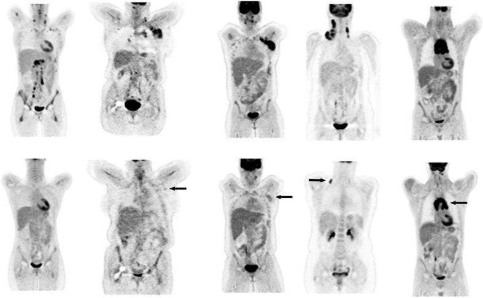
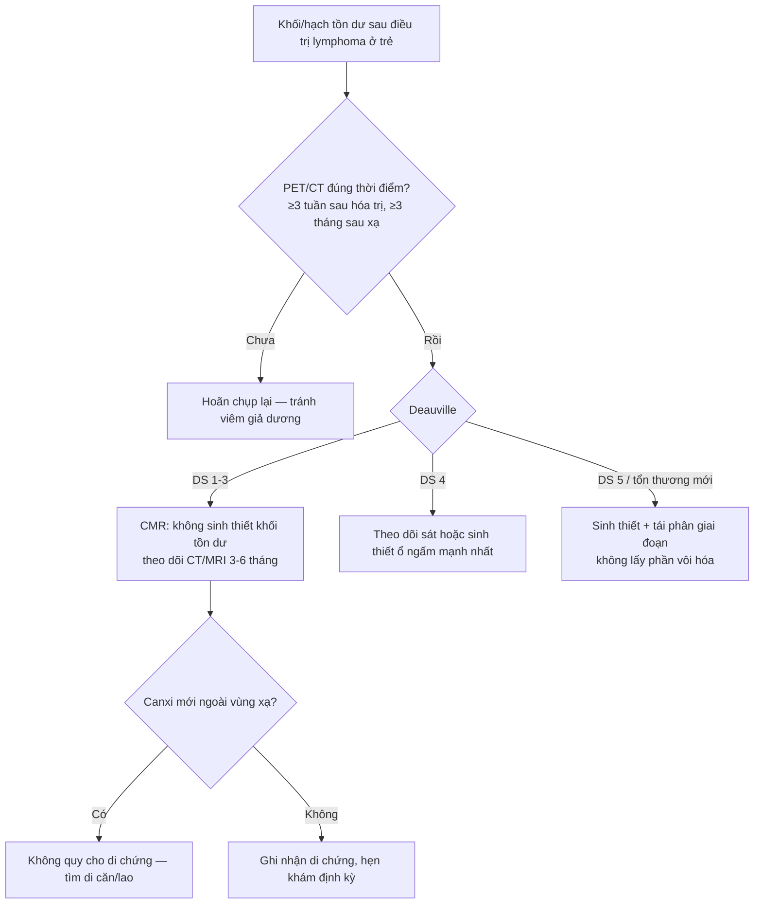
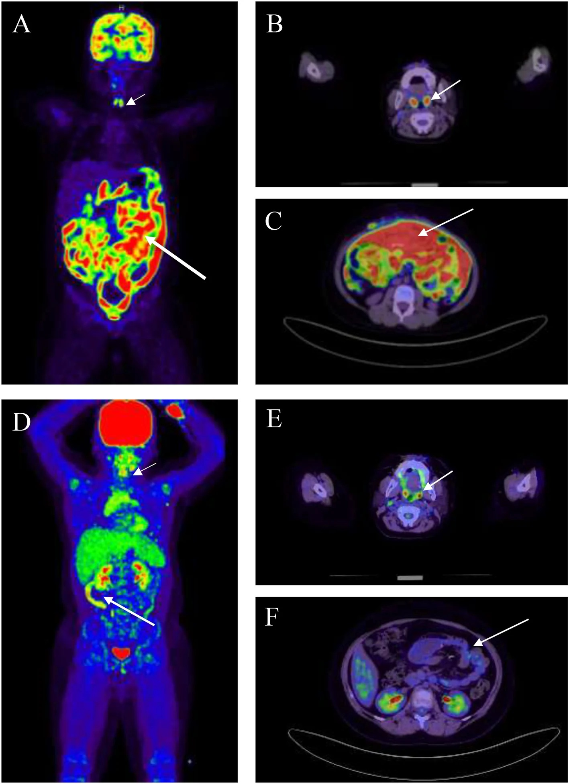

# 6153 — Vôi hóa hạch tồn dư sau điều trị lymphoma ở trẻ / Calcified residual lymph nodes after childhood lymphoma therapy

**Tags:** `pattern:hach` `pattern:voi-hoa` `pattern:ton-thuong-sau-dieu-tri` `vung:trung-that` `vung:co` `score:Deauville` `protocol:PET-CT` `protocol:CT-lieu-thap-tre-em` `incidentaloma:hach-ton-du`

**Mức chắc chắn (certainty):** tổng hợp y văn (literature synthesis) — ghép **1 tổng quan PET/đáp ứng điều trị** (Barrington & Kluge, *Eur J Nucl Med Mol Imaging* 2017, PMC5541086, CC BY 4.0), **1 ca nguyên văn nhi có ảnh** (Burkitt hồi tràng + tuyến ức phì đại hồi phục, *Front Immunol* 2026, PMC13716779, CC BY 4.0), **1 guideline HL 2026** (EHA, PMC13288861) và **1 chuỗi ca lịch sử về vôi hóa hạch sau xạ** (Strijk 1985, PMID 4050523). Nhóm **không có bệnh nhân của mình**; chỗ nguồn không đủ (tỉ lệ vôi hóa hạch ở trẻ sau hóa trị đơn thuần) ghi **"chưa rõ"**, không suy ra.

> **Câu chốt:** sau điều trị lymphoma, **khối tồn dư là chuyện thường — vôi hóa càng chứng tỏ mô đã chết — nhưng KHÔNG có nghĩa là khỏi**. Ba số phải thuộc: **(1)** PET âm tính có **giá trị tiên đoán âm 90–100%** ở Hodgkin, trong khi **giá trị tiên đoán dương chỉ 50–100%** vì viêm sau điều trị cũng bắt FDG (PMC5541086); **(2)** vôi hóa hạch sau xạ trị Hodgkin xuất hiện **trung bình 3 năm** sau điều trị, dạng **chấm nhỏ ở trung thất trên**, đôi khi **hình vỏ trứng**, và gắn với **tiên lượng tốt** (Strijk 1985); **(3)** quyết định **không dựa vào kích thước hay vôi hóa**, mà dựa vào **thang Deauville 5 điểm**: **DS 1–3 = đáp ứng chuyển hóa hoàn toàn**, **DS 4–5 = còn bệnh** (EHA 2026).

## 1. Tổng quan bệnh học – cơ chế hình ảnh

### 1.1 Vì sao hạch "không về bình thường" dù bệnh đã chết

- Điều trị hiệu quả giết tế bào u → khối u **hoại tử** → thay bằng **mô xơ (fibrosis)** và **mô mỡ**, kèm **vôi hóa loạn dưỡng (dystrophic calcification)** giống cách u hạt lao lành để lại canxi. Mô xơ **không co ngay**: khối tồn dư có thể **giữ nguyên kích thước nhiều tháng đến nhiều năm** rồi teo dần.
- Vì vậy **kích thước trên CT không phải thước đo sinh học**: một khối 3 cm toàn xơ và một khối 3 cm còn u sống **giống nhau trên CT không cản quang**. Cái phân biệt là **hoạt động chuyển hóa** (FDG) và **mật độ mô** (canxi/mỡ).
- Hệ quả thực hành: **ngừng dựa vào "hạch còn to" để nói tái phát**; và ngược lại **đừng coi hạch vôi hóa là "đã an toàn"** khi nó nằm ngoài vùng đã điều trị hoặc mới xuất hiện.

### 1.2 Vật lý: vì sao canxi "không thể nhầm" trên CT, và vì sao PET "nhìn thấy" phần còn sống

- **CT:** canxi hấp thụ tia X mạnh → **~100–1.000 HU** (điển hình **> 200 HU**, ngang xương); mô mềm **20–60 HU**; mỡ **−40 đến −120 HU**; thuốc cản quang tĩnh mạch ở thì muộn **80–150 HU** nhưng **rửa trôi theo thời gian**. Vì vậy **CT không cản quang** là cách rẻ nhất để khẳng định "đây là canxi, không phải thuốc cản quang tồn dư".
- Canxi **không có mạch máu, không có tế bào sống** → **không bắt FDG**. Đó là lý do một hạch vôi hóa hoàn toàn thường **PET âm** — nhưng "âm" ở đây **không chứng minh** phần mô mềm quanh nó cũng chết.
- **FDG** vào tế bào qua **GLUT1/GLUT3** và bị **hexokinase** giữ lại dưới dạng FDG-6-phosphate; tế bào u lymphoma có **tốc độ đường phân cao** nên bắt mạnh. Nhưng **đại thực bào và mô hạt viêm sau xạ/hóa trị cũng bắt FDG** → đây là nguồn **dương tính giả** chính, giải thích vì sao **giá trị tiên đoán dương thấp hơn nhiều** giá trị tiên đoán âm.
- **Hiệu ứng thể tích một phần (partial volume):** tổn thương nhỏ làm SUV bị **đo thấp giả**. Trong thử nghiệm phantom, một tổn thương cầu có đường kính **1,5 lần FWHM** của máy chỉ cho hoạt độ đo được **~60%** hoạt độ thật (PMC5541086). Nghĩa là **ổ bệnh còn lại vài mm có thể "âm" giả** — đây là lý do kỹ thuật của quy tắc "không sinh thiết mù, phải nhắm ổ ngấm thuốc".

### 1.3 Hai mốc thời gian quyết định cách đọc phim

- **Vôi hóa sau xạ:** Strijk 1985 gộp **61 ca** trong y văn + **8 ca** của tác giả ở Hodgkin sau xạ trị; hình ảnh điển hình là **vôi hóa dạng chấm (punctate) ở trung thất trên**, đôi khi **vôi hóa hình vỏ trứng (egg-shell)**; **thời gian trung bình xuất hiện: 3 năm** sau điều trị; tác giả ghi nhận vôi hóa **gắn với tiên lượng tốt và sống lâu**. Đây là dữ liệu **người lớn, thời kỳ xạ liều cao** — không được suy ra tỉ lệ cho trẻ sau hóa trị đơn thuần (**chưa rõ**).
- **Thời điểm chụp PET sau điều trị:** phải **hoãn ít nhất 3 tuần, tốt nhất 6–8 tuần** sau hóa trị; **2 tuần** sau yếu tố kích thích dòng bạch cầu hạt (G-CSF); **3 tháng** sau xạ trị — nếu không, **viêm và tủy tăng sinh sẽ giả dương** (PMC5541086).
- **Tuyến ức phì đại hồi phục (rebound thymic hyperplasia, RTH):** gặp ở **51,9–67,7%** người sống sót Hodgkin nhi, thường xuất hiện **2–3 tháng** sau kết thúc hóa trị, và **bắt chước tái phát trung thất** cả trên CT lẫn PET (ca Burkitt nhi, PMC13716779).

## 2. Mẫu hình + chẩn đoán phân biệt theo vị trí (gamut)

- **Trung thất — khối tồn dư ở trẻ:** xơ/vôi hóa sau điều trị; **tuyến ức phì đại hồi phục**; lymphoma còn sống; **u tế bào mầm/teratoma** (có mỡ + canxi + răng); lao/histoplasmosis (hạch vôi hóa); sarcoidosis; thymoma (hiếm ở trẻ).
- **Cổ — hạch vôi hóa:** hạch sau xạ trị; lao hạch (hay gặp ở Việt Nam, thường kèm canxi "đá tảng"); di căn **ung thư giáp thể nhú** (vôi hóa dạng "gỗ"/psammoma); u **di căn xương–xương (osteosarcoma)**; nang nhánh mang (vôi hóa thành).
- **Mạc treo/ổ bụng:** hạch sau điều trị lymphoma; **u carcinoid mạc treo** (khối canxi hóa + tua xơ tỏa tia + kéo co mạc treo); di căn **ung thư biểu mô tuyến nhầy**; GIST sau imatinib (thoái triển thành nang, có thể canxi hóa); lao mạc treo.
- **Mnemonic hạch vôi hóa — "STTLA":** **S**ilicosis (vỏ trứng), **T**B/histoplasmosis, **T**reated lymphoma/RT, **L**ymphoma đang hoạt động (hiếm, sau xạ), **A**myloid/ **A**denocarcinoma nhầy – **cộng thêm di căn giáp/osteosarcoma ở trẻ**. Vỏ trứng một mình **không** loại trừ được gì: nó chỉ nói "canxi ở vỏ hạch".

## 3. Bảng so sánh phân biệt (ma trận đối chiếu)

| Thực thể (entity) | Hình ảnh điển hình | Chốt vào (rule-in) | Chốt loại (rule-out) | Gợi ý xác nhận |
|---|---|---|---|---|
| **Xơ/vôi hóa sau điều trị** | Khối tồn dư **teo dần**, canxi **dạng chấm hoặc vỏ trứng** trong vùng đã xạ; PET **âm** | **Canxi trong đúng vùng đã điều trị + PET DS 1–3 + không nốt mới** | Canxi ở **hạch mới** hoặc ngoài trường xạ → không phải di chứng | So phim cũ, PET/CT muộn 6–8 tuần; theo dõi 3–6 tháng |
| **Tái phát thật** | Hạch **to lại**, có thể **không canxi**, ngấm FDG **> gan**; vị trí mới | **DS 4–5 + hạch mới/to lên theo thời gian** | Canxi hóa đậm đặc toàn bộ + PET âm không loại trừ hoàn toàn nếu hạch nằm ngoài trường xạ | Sinh thiết **ổ ngấm mạnh nhất** (không lấy phần vôi hóa) |
| **Tuyến ức phì đại hồi phục** | Khối **tam giác/hình cánh** ở trước mạch lớn, **2–3 tháng** sau hóa trị; có thể DS 4 | **Hình dạng tuyến ức + đối xứng + đúng cửa sổ thời gian** | Xâm lấn màng phổi, hạch rời, nốt trong phổi → không phải RTH | MRI (mô tuyến ức), theo dõi 3 tháng; sinh thiết chỉ khi không thể phân biệt |
| **U tế bào mầm/teratoma** | Khối trung thất trước có **mỡ (âm HU) + canxi + răng/xương**, có thể vôi hóa thành vỏ | **Ba thành phần mỡ–canxi–dịch trong một khối** | Khối đặc đồng nhất không mỡ, không canxi → nghĩ lymphoma/xơ | AFP/β-hCG, CT/MRI, sinh thiết |
| **Lao/histoplasmosis hạch** | Hạch vôi hóa **đá tảng/vỏ trứng**, thường hai bên rốn phổi; có thể kèm đông đặc | **Canxi + hạch rốn phổi + dịch tễ + IGRA (+)** | Canxi đơn độc trong trường xạ cũ → nghĩ di chứng điều trị | IGRA, nhuộm AFB/PCR nếu còn hạch mềm |
| **Di căn vôi hóa (giáp nhú, osteosarcoma, tuyến nhầy)** | Canxi **dạng psammoma/"gỗ"**, hoặc **canxi dạng xương** ở nốt phổi/hạch | **Tiền sử ung thư + nốt canxi MỚI + tăng kích thước** | Canxi cũ, ổn định nhiều năm, đúng vùng xạ | So phim cũ; PET; sinh thiết nếu tăng |
| **Carcinoid mạc treo** | Khối canxi hóa trung tâm + **tua xơ tỏa tia**, kéo co mạc treo, có thể xoắn ruột | **Canxi trung tâm + tua tỏa tia + co kéo** | Canxi rải rác nhiều hạch không tua → nghĩ di chứng/lao | Chromogranin A, 5-HIAA, CT bụng có cản quang |

*Năm cột từ trái sang phải là **Deauville 1 → 5** (mũi tên: ổ còn ngấm). Cùng một bệnh nhân, "khối còn lại" chỉ được gọi là bệnh khi **cường độ ngấm so với gan** vượt ngưỡng — không phải khi còn thấy bóng. Nguồn: Barrington & Kluge, *Eur J Nucl Med Mol Imaging* 2017, PMC5541086, CC BY 4.0. Ảnh nguyên bản.*

## 4. Protocol chụp + hệ phân độ chuẩn hóa

### 4.1 PET/CT ở trẻ — các bước không được rút gọn

1. **Nhịn ăn 4–6 giờ**, đường huyết **< 11 mmol/L** (nếu cao hơn, FDG cạnh tranh với glucose → giảm nhạy); phòng **ấm** để giảm mô mỡ nâu.
2. **FDG 3–5 MBq/kg** (tối thiểu ~37 MBq), **nằm yên 60 phút**, đi tiểu trước chụp.
3. **CT liều thấp theo cân nặng** chỉ để **hiệu chỉnh suy giảm (attenuation correction)** và định vị — không thay CT chẩn đoán; ở trẻ cần **ALARA**: giảm kVp/mAs theo cân nặng, giới hạn trường chiếu.
4. **Đo chuẩn:** đặt ROI/VOI **gan phải 30 mL (khối 2:2:1)**, **trung thất tại quai động mạch chủ** — **tránh thành mạch và tránh vùng canxi** vì canxi làm sai hệ số suy giảm (PMC5541086).
5. **Thời điểm:** ≥ 3 tuần (tốt nhất 6–8 tuần) sau hóa trị; 2 tuần sau G-CSF; 3 tháng sau xạ.

### 4.2 Thang Deauville 5 điểm (5-PS) — ngưỡng hành động

| Điểm | Định nghĩa | Ý nghĩa |
|---|---|---|
| 1 | Không ngấm trên nền | Đáp ứng chuyển hóa hoàn toàn (CMR) |
| 2 | Ngấm **≤ trung thất** | CMR |
| 3 | Ngấm **> trung thất nhưng ≤ gan** | CMR |
| 4 | Ngấm **trung bình > gan** | Còn bệnh (cân nhắc sinh thiết/theo dõi sát) |
| 5 | Ngấm **mạnh > gan** và/hoặc **tổn thương mới** | Còn bệnh |

- **DS ≤ 3 = CMR** theo EHA 2026; **DS ≥ 4** là PET dương trong đánh giá giữa liệu trình.
- **Lugano 2014 (Cheson):** đáp ứng hoàn toàn về CT đòi hỏi **hạch đích ≤ 1,5 cm đường kính ngang (LDi)**; nhưng khi có PET, **khối tồn dư kích thước bất kỳ mà PET âm vẫn được xếp CR** — đây chính là lý do **vôi hóa/khối to không còn là tiêu chuẩn thất bại**.
- **Vì sao vẫn phải cân nhắc xạ trị ở trẻ:** ở bệnh nhân PET âm sau hóa trị, bỏ xạ làm **giảm kiểm soát bệnh** trong các thử nghiệm ngẫu nhiên: **HD16 5 năm PFS 86,1% (hóa trị đơn thuần) so với 93,4% (hóa trị + xạ)**, RAPID **90,8% vs 94,6%**, H10F **87,1% vs 99%** (PMC13288861). Nghĩa là "PET âm" **không đồng nghĩa bỏ được xạ** — quyết định theo phác đồ và nguy cơ tích lũy.

## 5. Biến thể bình thường và cạm bẫy

- **Tuyến ức trẻ em "bình thường"** có thể dày, hình cánh; sau hóa trị lại **phì đại hồi phục** — đừng gọi tái phát trung thất trong 2–3 tháng đầu. Ca Burkitt nhi (PMC13716779) cho thấy RTH có thể **bắt chước tái phát** và buộc sinh thiết khi hình ảnh không phân định được.
- **Canxi làm hỏng ảnh PET:** hạch vôi hóa gây **sai lệch hiệu chỉnh suy giảm** trên PET/CT, tạo **ổ tăng hoặc giảm hoạt độ giả** (Mehta 2010, *J Radiol Case Rep*, 3 ca). Cách tránh: **luôn xem ảnh không hiệu chỉnh (non-AC)** và **đặt ROI tránh canxi**.
- **Partial volume:** ổ bệnh **< 2 lần FWHM** (với máy thường ~4–6 mm) bị **đo thấp SUV** — một "DS 2" ở hạch 5 mm có thể là **âm giả** (PMC5541086).
- **Sinh thiết đúng chỗ:** lấy **phần mô mềm ngấm FDG nhất**, không lấy **nhân vôi hóa** (kim vào canxi chỉ ra "mô xơ/không đủ mẫu" → kết luận sai là "không có u").
- **Vôi hóa KHÔNG phải giấy chứng nhận khỏi bệnh:** canxi trong hạch **mới xuất hiện** hoặc **ngoài trường xạ** phải coi như **di căn cho đến khi chứng minh ngược** (giáp nhú, osteosarcoma, tuyến nhầy).
- **Cạm bẫy "hài lòng với tìm kiếm":** đã thấy khối tồn dư lớn thì dễ bỏ qua **nốt nhỏ ở phổi/gan** — phải đọc **toàn thân MIP** trước khi kết luận.

## 6. Tự lượng giá — Blind Quiz

**Ca 1 — Năm bệnh nhân lymphoma, PET toàn thân cùng một thang. Nhìn hàng dưới rồi mô tả trước khi mở đáp án.**

- Gợi ý: không có lâm sàng kèm theo — đây là bài tập **hiệu chuẩn mắt**.
- Hỏi: cột thứ tư khác cột thứ năm ở đâu? Vì sao mốc so sánh là **gan** chứ không phải trung thất?

<b>Bấm để hiện đáp án (findings + chẩn đoán)</b>

- **Cột 1–3:** từ không ngấm → ngấm ≤ trung thất → ngấm > trung thất nhưng ≤ gan = **DS 1, 2, 3** (đều là CMR).
- **Cột 4:** ngấm **trung bình trên gan** (mũi tên) = **DS 4** — vùng xám, phải tương quan lâm sàng/sinh thiết.
- **Cột 5:** ngấm **mạnh hơn gan rõ rệt**, có ổ mới (mũi tên) = **DS 5**.
- **Tại sao lấy gan làm mốc:** gan là **cơ quan có hoạt độ FDG ổn định, ít thay đổi theo điều trị**; trung thất chỉ dùng cho ngưỡng thấp (DS 2–3). Dùng gan làm mốc giúp **giảm khác biệt giữa người đọc và giữa máy** (PMC5541086).
- Nguồn ảnh: Barrington & Kluge, *Eur J Nucl Med Mol Imaging* 2017, PMC5541086, CC BY 4.0.

**Ca 2 — Bé trai 11 tuổi, Burkitt lymphoma hồi tràng, sau 8 chu kỳ hóa trị. So sánh PET trước (A–C) và sau điều trị (D–F).**

- Hỏi: hạch cổ còn thấy trên ảnh sau điều trị (E) — có phải tái phát? Deauville mấy điểm? Có cần sinh thiết?

<b>Bấm để hiện đáp án (findings + chẩn đoán)</b>

- **Trước điều trị:** (A) hạch cổ hai bên ngấm mạnh (mũi tên ngắn), (C) ổ ngấm lan tỏa trong mạc treo/ruột non (mũi tên dài).
- **Sau điều trị:** (D) MIP gần như sạch; (E) còn **ngấm nhẹ, đối xứng, SUVmax 2,1** ở vùng hạch cổ cũ — **ngang hoạt độ nền sinh lý**; (F) **không còn ổ tăng chuyển hóa** trong ổ bụng.
- **Kết luận:** **Deauville 1 — đáp ứng chuyển hóa hoàn toàn**. Hạch còn "bóng" trên CT **không phải tái phát**; **không sinh thiết**, tiếp tục theo dõi.
- **Phản biện (theo PROMPT_SYNTHESIZER mục 3):** đây là **Burkitt**, không phải Hodgkin — nhưng nguyên lý "khối tồn dư + PET âm = CR" áp dụng cho cả NHL tiến triển (Lugano 2014). Ca này còn cho thấy **tuyến ức phì đại hồi phục** xuất hiện sau đó và **bắt chước tái phát trung thất**, buộc sinh thiết trong bối cảnh mơ hồ — đúng cạm bẫy của bài.
- Nguồn ảnh: Lin M và cs., *Front Immunol* 2026;17:1910294, PMC13716779 Fig. 2, CC BY 4.0. Ảnh nguyên bản.

## Bài liên quan chéo
- [046 – Tái phân giai đoạn trung thất sau hóa–miễn dịch & bệnh hạch tồn dư](../046-tai-phan-giai-doan-trung-that-sau-hoa-mien-dich/lesson.md)
- [012 – Hạch trung thất IASLC & mốc giải phẫu](../012-hach-trung-that/lesson.md)
- [1828 – Vôi hóa não sau xạ trị ở trẻ](../1828-voi-hoa-nao-sau-xa-tri-tre/lesson.md)
- [600 – Tổng quan Hệ Nhi khoa](../600-tong-quan-nhi-khoa/lesson.md)

> Không dùng để chẩn đoán độc lập khi chưa có người hướng dẫn.
