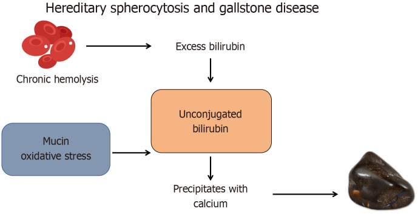
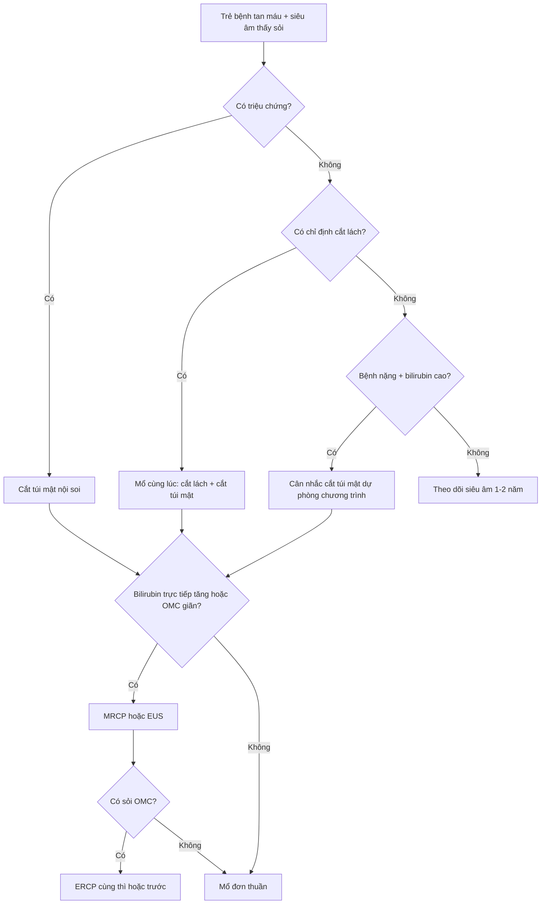
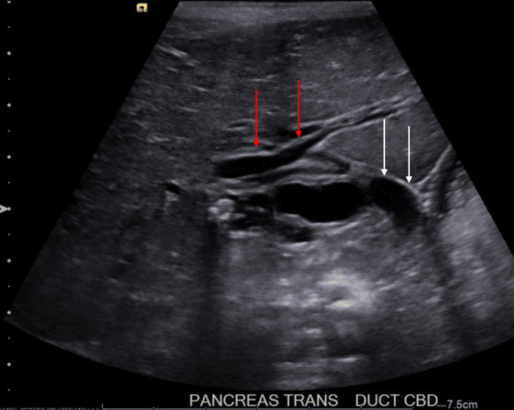
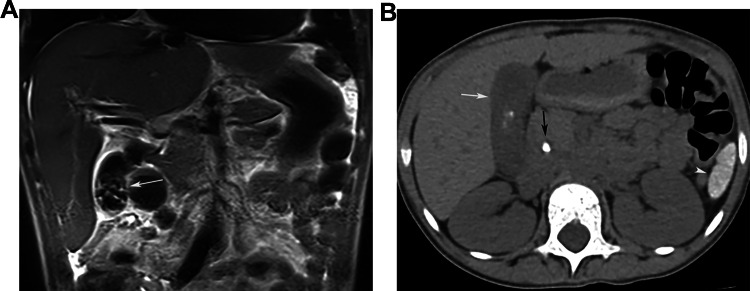

# 6154 — Sỏi mật ở trẻ có bệnh tan máu: cắt túi mật dự phòng cùng lúc cắt lách hay chờ? / Gallstones in children with hemolytic disease: prophylactic cholecystectomy at splenectomy or watchful waiting?

**Tags:** `pattern:soi-sac-to` `pattern:soi-tui-mat` `pattern:soi-ong-mat-chu` `pattern:bun-mat` `vung:tui-mat` `vung:ong-mat` `vung:o-bung` `score:ASGE-2019` `score:Baylor-2016` `protocol:sieu-am-bung` `protocol:MRCP` `protocol:ERCP` `protocol:cat-tui-mat-noi-soi` `incidentaloma:soi-tui-mat`

**Mức chắc chắn (certainty):** tổng hợp y văn (literature synthesis) — ghép **1 đoàn hệ 87 ca cắt lách** (*BMC Surg* 2025, PMC12335159, **CC BY**), **1 đoàn hệ 13 trẻ HS** (*BMC Pediatr* 2026, PMC13693155, **CC BY-NC-ND** — chỉ dùng số liệu), **1 tổng quan cơ chế HS–sỏi** (*World J Gastrointest Surg* 2025, PMC12308567, **CC BY-NC**), **1 phân tích cơ sở dữ liệu 1.124 lần ERCP nhi** (*Front Pediatr* 2025, PMC12011750, **CC BY**), **1 nghiên cứu danh pháp ống mật chủ** (*J Indian Assoc Pediatr Surg* 2026, PMC13061501, **CC BY-NC-SA**), **3 nghiên cứu dịch tễ hồng cầu hình liềm** (PMC13037497 CC BY-NC; PMC9020627 CC BY-NC-SA; PMC12907275 CC BY-NC-ND — chỉ số liệu), **1 đoàn hệ 380 trẻ sỏi mật** (*Cureus* 2026, PMC13548732, **CC BY**), **1 so sánh một thì–hai thì ERCP + cắt túi mật** (*Front Pediatr* 2026, PMC13099894, **CC BY**), **1 đoàn hệ giữ túi mật (GPC) 32 trẻ** (*Front Pediatr* 2024, PMC11614630, **CC BY**) và **2 ca nguyên văn có ảnh** (PMC12130344 CC BY; PMC13388681 CC BY). Nhóm **không có bệnh nhân của mình**; chỗ các nguồn **khác quần thể** (người lớn HS 37–43% vs trẻ 65,6% lúc cắt lách) được ghi rõ ngay dưới số liệu.

> **Câu chốt:** ở trẻ tan máu, sỏi mật **không phải "sỏi cholesterol của người lớn thu nhỏ"** mà là **sỏi sắc tố sinh liên tục**, và câu hỏi không phải "có sỏi chưa" mà là **"cắt túi mật lúc nào"**. Bốn số phải thuộc: **(1)** lúc cắt lách, sỏi có mặt ở **65,6% trẻ hồng cầu hình liềm thể cầu** (hereditary spherocytosis, HS), **50% thalassemia**, **0% ITP** (PMC12335159), còn ở **hồng cầu hình liềm (SCD)** là **13,6–35,9%** tùy quần thể (PMC9020627, PMC12907275); **(2)** sỏi sắc tố **nhỏ và nhiều** nên **hay xuống ống mật chủ**: trong **47 trẻ tan máu được ERCP**, **72,3% có sỏi OMC** (PMC12011750) — và **80% trẻ KHÔNG có sỏi OMC vẫn được xếp "nguy cơ cao" theo ASGE** → **thang điểm người lớn thổi phồng nguy cơ ở nhóm tan máu**; **(3)** trẻ HS **thể nặng** có **biến chứng đường mật 57,1%** (4/7) so với **16,7%** (1/6) thể trung bình (PMC13693155); **(4)** cắt túi mật **cùng lúc** cắt lách **không làm tăng biến chứng** (0 biến chứng nặng/13 ca; 87 ca cắt lách không có nhiễm khuẩn huyết sau mổ khi tiêm chủng đầy đủ) nhưng **tiết kiệm một lần gây mê** — một thì ERCP + cắt túi mật: **320 vs 361 phút gây mê**, nằm viện **5,3 vs 6,8 ngày** (PMC13099894).

## 1. Tổng quan bệnh học – cơ chế hình ảnh

### 1.1 Vì sao tan máu sinh ra sỏi — con đường hóa học, không phải "ăn nhiều mỡ"

- **Tan máu ngoài mạch (extravascular hemolysis)** giải phóng hemoglobin → **heme** → **bilirubin không liên hợp (unconjugated bilirubin)** tăng trong máu và trong mật. Ở túi mật, bilirubin không liên hợp bị **thủy phân và kết tủa với calci thành calcium bilirubinate** — đây là **sỏi sắc tố đen/nâu**, khác hẳn sỏi cholesterol (PMC12308567).
- **Mucin là "bàn thắp hương" của sỏi:** tế bào biểu mô túi mật tiết mucin, và **mucin plug** giàu sắc tố nằm trong cổ túi mật trở thành **nhân kết tinh**. Stress oxy hóa làm bilirubin **polymerize và vôi hóa** thêm — nên sỏi sắc tố **đen, cứng, nhiều cạnh** (PMC12308567).
- **Vì sao sỏi hình thành liên tục:** bilirubin trong mật vẫn cao **chừng nào còn tan máu** — nghĩa là **cắt lách làm giảm nhưng KHÔNG xóa** nguy cơ (còn tan máu tồn dư + đồng di truyền Gilbert). Đây là lý do **sỏi có thể hình thành cả sau cắt lách**, và **theo dõi sau mổ là bắt buộc** (PMC12308567).
- **Gilbert là "bạn đồng lõa" hay gặp:** đồng di truyền **UGT1A1** (hội chứng Gilbert) làm giảm liên hợp bilirubin → **bilirubin tăng thêm** và **sỏi xuất hiện sớm hơn**; trong đoàn hệ 2.778 người hồng cầu hình liềm, **bilirubin gián tiếp liên quan với cả sỏi, viêm túi mật và cắt túi mật**, và **UGT1A1** là locus được xác nhận (PMC12907275).

*Sơ đồ: tan máu mạn → bilirubin không liên hợp → **kết tủa với calci** thành calcium bilirubinate; **mucin + stress oxy hóa** là đồng yếu tố; kết quả là **sỏi sắc tố đen**. Nguồn: Cong S và cs., World J Gastrointest Surg 2025, PMC12308567, CC BY-NC 4.0. Ảnh nguyên bản, không chỉnh sửa.*

### 1.2 Dịch tễ: con số thay đổi theo bệnh nền, không dùng một con số chung

Hai bệnh tan máu hay gặp ở trẻ Việt Nam: **hồng cầu hình cầu di truyền (hereditary spherocytosis, HS)** và **bệnh hồng cầu hình liềm (sickle cell disease, SCD)**; thalassemia là nhóm thứ ba.

| Bệnh nền | Tỉ lệ sỏi mật | Quần thể / thời điểm đo | Nguồn |
|---|---|---|---|
| **Hồng cầu hình cầu di truyền (HS)** — cắt lách | **65,6%** | 87 ca cắt lách vì bệnh máu, tuổi mổ trung bình **9,6** (3–17) | PMC12335159 |
| **Thalassemia** — cắt lách | **50,0%** | cùng đoàn hệ trên (10/20 ca thalassemia) | PMC12335159 |
| **ITP** — cắt lách | **0%** | cùng đoàn hệ (không tan máu) | PMC12335159 |
| HS thể trung bình/nặng, trước cắt lách | **69,2%** (9/13) | đoàn hệ nhi 2026, tuổi **11,9 ± 4,3** | PMC13693155 |
| HS người lớn | **37–43%** | tổng quan y văn | PMC12308567 |
| Bệnh hồng cầu hình liềm (SCD), trẻ 2–19 tuổi | **31%** (65/208) | Uganda, siêu âm sàng lọc | PMC13037497 |
| SCD, trẻ 1–19 tuổi | **13,6%** (20/147) | Lagos; **100% không triệu chứng**; **21,4%** ở tuổi vị thành niên so với **6,5%** ở trẻ nhỏ | PMC9020627 |
| SCD người lớn + trẻ (đa trung tâm) | **35,9% sỏi** · **25,1% viêm túi mật** · **10,6% được cắt túi mật** | 2.778 người, REDS-III Brazil | PMC12907275 |

- **Đọc bảng này đúng cách:** **65,6%** là tỉ lệ **ở trẻ đã được chỉ định cắt lách** (quần thể chọn lọc, bệnh nặng), **không** phải tỉ lệ chung của mọi trẻ HS. Ngược lại **13,6%** ở Lagos là **sàng lọc cộng đồng bằng siêu âm** — thấp hơn vì gồm cả trẻ rất nhỏ và **sỏi chưa hình thành**. Hai con số **không mâu thuẫn**, chúng đo hai thời điểm khác nhau của cùng quá trình.
- **Tuổi là yếu tố mạnh nhất:** sỏi tăng dần theo tuổi ở mọi bệnh tan máu (Lagos: **6,5%** ở trẻ nhỏ vs **21,4%** ở vị thành niên) — nghĩa là **trẻ càng lớn càng ít "chờ được"**.

### 1.3 Vì sao sỏi sắc tố ở trẻ tan máu nguy hiểm hơn sỏi cholesterol

- **Sỏi nhỏ, nhiều, cứng:** sỏi sắc tố thường **nhiều viên < 5 mm**, dễ **di chuyển vào ống túi mật và ống mật chủ**; sỏi cholesterol hay gặp **một viên lớn** nằm yên trong túi mật. Hệ quả: **viêm đường mật, viêm tụy cấp, tắc mật** là biến chứng **thường gặp hơn** ở nhóm tan máu (PMC12308567).
- **Con số biến chứng theo mức nặng bệnh:** trong 13 trẻ HS, **biến chứng đường mật lớn (viêm tụy do mật hoặc vàng da tắc mật)** xảy ra ở **4/7 (57,1%)** trẻ HS **thể nặng** và **1/6 (16,7%)** thể trung bình; **cùng tỉ lệ đó cần ERCP** (PMC13693155). Đây là lập luận chính cho **cắt túi mật dự phòng ở thể nặng**.
- **Nguy cơ sau mổ cũng cao hơn:** trong 380 trẻ cắt túi mật, **bệnh tan máu là yếu tố độc lập của biến chứng sau mổ (AOR > 2, p < 0,05)** cùng với béo phì, nhiều sỏi, dính trong mổ, mucocele/empyema và mổ > 30 phút (PMC13548732) — nghĩa là **mổ muộn, khi đã có viêm/dính, khó hơn mổ chương trình**.

### 1.4 Vì sao hình ảnh trông đúng như vậy (vật lý + mô bệnh)

- **Siêu âm — sỏi "sáng + bóng lưng" vì phản xạ mạnh:** mặt phân cách sỏi–mật chênh **trở kháng âm (acoustic impedance)** rất lớn → gần như **toàn bộ sóng bị phản xạ** → **echo dày**; phần sau sỏi **không còn sóng** → **bóng lưng sạch (clean shadowing)**. **Sỏi < 3 mm và bùn mật không đủ chênh trở kháng** → **không có bóng lưng**, dễ bị bỏ qua hoặc gọi nhầm là bùn (PMC12308567).
- **Vì sao siêu âm bỏ sót sỏi ống mật chủ:** ống mật chủ nằm **sau tá tràng và đầu tụy**, thường bị **khí ruột che**; và **sỏi sắc tố nhỏ không bóng lưng** → trên thực hành **siêu âm bỏ sót gần như toàn bộ sỏi OMC ở trẻ** (bài 6146: **0/380 trẻ** phát hiện sỏi OMC bằng siêu âm dù đoàn hệ có ca sỏi OMC). Vì vậy **vàng da tắc mật/ALP tăng = chỉ định MRCP**, không phải "siêu âm âm tính là yên tâm".
- **Vì sao CT dễ âm tính giả:** sỏi sắc tố **nghèo calci**, tỉ trọng gần mật/dịch (**20–50 HU**) → **không nổi trên CT không cản quang**; sỏi cholesterol cũng **giảm tỉ trọng**. CT **chỉ nhạy với sỏi đã vôi hóa** — trong ảnh ca 2 dưới đây, **chỉ một viên nhỏ cản quang** thấy được trên CT trong khi túi mật **đầy sỏi** trên T2 (PMC13388681).
- **Vì sao MRCP nhìn thấy sỏi:** MRCP dùng chuỗi **T2 nặng** — **mật là dịch tĩnh nên rất sáng**, còn **sỏi không có proton tự do → mất tín hiệu**, hiện thành **khuyết đen (signal void)** trong lòng ống sáng; đồng thời đo được **đường kính ống** để phân biệt **giãn do sỏi** với **giãn do nang ống mật chủ** (bài 6137). Đây là lý do **MRCP là bước đệm bắt buộc trước ERCP** ở trẻ tan máu.
- **Vì sao ERCP không được dùng làm "chẩn đoán" ở nhóm này:** thang **ASGE 2019** và **Baylor 2016** được xây trên quần thể **không tan máu**; ở trẻ tan máu, **80% trẻ không có sỏi OMC vẫn đạt tiêu chuẩn "nguy cơ cao" của ASGE** và **90% đạt Baylor** → **ERCP "thăm dò" là ERCP thừa**, mà ERCP ở trẻ có **biến chứng** (bài 6146: chảy máu **8,6%**, viêm tụy **1,4%**). Kết luận: **phải có MRCP/EUS trước** (PMC12011750).

### 1.5 Ngưỡng định lượng bắt buộc nhớ

| Đại lượng | Ngưỡng | Ý nghĩa thực hành | Nguồn |
|---|---|---|---|
| Đường kính ống mật chủ bình thường | **1,01 ± 0,36 mm** (< 1 tuổi) · **2,36 ± 0,94 mm** (1–10 tuổi) · **2,77 ± 0,87 mm** (> 10 tuổi) | **Không áp ngưỡng người lớn (≤ 6–8 mm)**; OMC **9 mm ở trẻ 19 tháng** là **giãn rõ** | PMC13061501, PMC12130344 |
| Sỏi OMC ở trẻ tan máu | **72,3%** trẻ tan máu được ERCP có sỏi OMC | Xác suất **cao** nhưng **không đủ để bỏ MRCP** | PMC12011750 |
| Thang ASGE 2019 "nguy cơ cao" | **80%** trẻ tan máu **không có sỏi** vẫn đạt | **Dương tính giả hệ thống** → không dùng đơn độc | PMC12011750 |
| Siêu âm phát hiện sỏi túi mật | **Se 93,75% · Sp 100%** (thiết bị cầm tay, người có kinh nghiệm) | Tốt trong túi mật; **không suy ra được cho OMC** | PMC12308567 |
| Cắt túi mật nội soi ở trẻ | thành công **96,8%**, chuyển mở **2,1%**, **81%** không biến chứng | Phẫu thuật an toàn khi **mổ chương trình** | PMC13548732 |
| Một thì ERCP + cắt túi mật vs hai thì | gây mê **320 vs 361 phút**; nằm viện **5,3 vs 6,8 ngày**; sạch sỏi **89,6% vs 87,2%** | **Một thì tiết kiệm** một lần gây mê, không tăng biến chứng | PMC13099894 |
| Cắt lách ở trẻ | Hb **× 1,24** (HS) · bilirubin giảm có ý nghĩa | Cắt lách **giảm** nhưng **không xóa** nguy cơ sỏi | PMC12335159 |

## 2. Mẫu hình + chẩn đoán phân biệt theo vị trí (gamut)

### 2.1 Gamut theo vị trí sỏi

- **Trong lòng túi mật (phổ biến nhất):** sỏi sắc tố nhiều viên nhỏ (tan máu) · sỏi cholesterol/bùn · **giả sỏi ceftriaxone** (bài 6146) · polyp cholesterol (không di động, không bóng lưng).
- **Cổ túi mật/ống túi mật:** sỏi kẹt → **viêm túi mật cấp**, **mucocele**, **empyema**; siêu âm: túi mật căng, thành dày **> 3 mm**, dịch quanh túi mật, **dấu hiệu Murphy siêu âm**.
- **Ống mật chủ:** sỏi sắc tố di chuyển xuống → **tắc mật**, **viêm đường mật**, **viêm tụy cấp**; MRCP/EUS là chốt; **ống giãn > ngưỡng theo tuổi**.
- **Trong ống tụy:** sỏi nhỏ đi qua bóng Vater → **viêm tụy cấp do sỏi** (bài 6135) — bệnh cảnh hay gặp ở trẻ tan máu vì **sỏi nhỏ**.

### 2.2 Gamut theo bối cảnh lâm sàng (quyết định xử trí, không chỉ hình ảnh)

- **Tan máu + đau hạ sườn phải từng cơn:** sỏi có triệu chứng → **cắt túi mật nội soi**.
- **Tan máu + vàng da tăng đột ngột + phân bạc màu + ALP/GGT tăng:** **sỏi OMC/viêm đường mật** → **MRCP ± ERCP** — nhưng phải loại **cơn tan máu cấp** và **Gilbert** (bilirubin gián tiếp, không có ALP/GGT tăng).
- **Tan máu + viêm tụy cấp:** sỏi OMC là nguyên nhân **phải loại trừ bằng MRCP/EUS**, không chờ tự hết.
- **Tan máu + sỏi tình cờ, không triệu chứng, đang chờ cắt lách:** đây là **câu hỏi trung tâm của bài** — mổ **cùng lúc** hay **chờ** (mục 4).
- **Tan máu + bùn mật đơn thuần:** có thể **theo dõi** — bùn có thể tan, đặc biệt nếu do thuốc (bài 6146).
- **Tan máu + "sỏi" nhưng thực ra là **polyp/u tuyến** hoặc **túi mật sứ**: khác đường mổ (nguy cơ ung thư) — cần cắt túi mật chọn chương trình.

### 2.3 Mnemonic — **PIGMENT**

**P**igment (sắc tố, không cholesterol) · **I**ndirect bilirubin cao (tan máu ± Gilbert) · **G**allbladder sludge sớm · **M**ultiple small stones (nhiều viên nhỏ → OMC) · **E**RCP chỉ khi đã có MRCP/EUS · **N**o wait for symptoms ở thể nặng · **T**iming: cùng lúc với cắt lách.

## 3. Bảng so sánh phân biệt (ma trận đối chiếu)

| Thực thể (entity) | Hình ảnh điển hình (US/CT/MRI) | Chốt vào (rule-in) | Chốt loại (rule-out) | Gợi ý xác nhận |
|---|---|---|---|---|
| **Sỏi sắc tố có triệu chứng (tan máu)** | Nhiều echo dày **< 5 mm**, bóng lưng kém; thành túi mật **> 3 mm** khi viêm | **Đau HSP tái diễn + sỏi + bệnh tan máu** | Sỏi **không bóng lưng, không di động, mất khi ngừng thuốc** → giả sỏi/bùn | Siêu âm lặp; cắt túi mật chương trình |
| **Sỏi ống mật chủ** | **Khuyết đen trong OMC sáng trên MRCP**; OMC **> 2,36 mm** (1–10 tuổi) hoặc **> 2,77 mm** (> 10 tuổi) | **Vàng da tắc mật + OMC giãn + khuyết lòng** | Siêu âm âm tính **KHÔNG** loại trừ (bỏ sót gần 100%) | **MRCP/EUS trước ERCP** |
| **Viêm đường mật** | OMC giãn + sỏi + thành ống dày; có thể **khí trong đường mật** | **Tam chứng Charcot** (sốt–đau–vàng da) ± sốc | Chỉ bilirubin gián tiếp tăng, không ALP/GGT → **tan máu cấp**, không phải viêm đường mật | Kháng sinh + dẫn lưu/ERCP |
| **Bùn mật (sludge)** | Echo dày **không bóng lưng**, lắng đáy, **di động chậm** | **Lắng đáy, không bóng lưng, thay đổi theo tư thế** | Có bóng lưng rõ + cố định → sỏi thật | Siêu âm lặp sau 4–6 tuần |
| **Giả sỏi ceftriaxone** | Nhiều hạt nhỏ, **không bóng lưng**, trong túi mật **không viêm** | **Tiền sử ceftriaxone + không triệu chứng** | Có bóng lưng + thành dày → sỏi thật/viêm | Ngừng thuốc, siêu âm lại (bài 6146) |
| **Polyp cholesterol** | Echo dày **dính thành, không di động**, **không bóng lưng** | **Không di động khi đổi tư thế** | Di động + bóng lưng → sỏi | Theo dõi kích thước |
| **Thể tan máu cấp (crisis)** | Túi mật có thể **bình thường**; lách to; bùn | **Hb tụt + bilirubin gián tiếp tăng + reticulocyte tăng** | ALP/GGT tăng + OMC giãn → tắc mật thật | Huyết học + MRCP nếu nghi |
| **Viêm tụy cấp do sỏi** | Tụy phù, dịch quanh tụy; **sỏi OMC** trên MRCP | **Amylase/lipase × 3 + sỏi OMC** | Không sỏi OMC → nguyên nhân khác (bài 6135) | MRCP/EUS, ERCP lấy sỏi |

- **Đọc ma trận theo thứ tự:** (1) **có bóng lưng và di động không?** → phân biệt sỏi thật với bùn/polyp; (2) **thành túi mật dày > 3 mm + dịch quanh?** → viêm cấp; (3) **OMC giãn quá ngưỡng tuổi?** → sỏi OMC, đi MRCP; (4) **bilirubin trực tiếp hay gián tiếp?** → tắc mật hay tan máu.

## 4. Protocol chụp + phân tầng xử trí

### 4.1 Siêu âm — đầu tay, và phải lặp lại

- **Khi nào:** (a) **lúc chẩn đoán bệnh tan máu**; (b) **mỗi 1–2 năm** ở trẻ HS/thalassemia/SCD thể nặng (chưa có đồng thuận về khoảng cách — ghi rõ **mức chứng cứ thấp**; nghiên cứu Uganda khuyến nghị **sàng lọc thường quy** vì **31%** trẻ SCD đã có sỏi — PMC13037497); (c) **trước cắt lách** (bắt buộc, để quyết định mổ cùng lúc); (d) **mỗi cơn đau HSP**.
- **Cách đo:** túi mật **lúc đói ≥ 4 giờ**, đo **thành túi mật** (bình thường **≤ 3 mm**), **đường kính OMC** theo tuổi, ghi **số sỏi + kích thước lớn nhất**, tìm **dịch quanh túi mật**.
- **Giới hạn:** không loại trừ sỏi OMC; **bùn/sỏi nhỏ không bóng lưng**; khí ruột che ống.

### 4.2 MRCP (và EUS) — bước đệm bắt buộc khi nghi sỏi OMC

- **Chỉ định:** **vàng da tắc mật** (bilirubin **trực tiếp** tăng, ALP/GGT tăng), **OMC giãn quá ngưỡng tuổi**, **viêm tụy cấp không rõ nguyên nhân**, **trước ERCP ở mọi trẻ tan máu** (vì ASGE/Baylor **thổi phồng nguy cơ**: 80%/90% dương tính giả — PMC12011750).
- **Vì sao không bỏ qua MRCP:** ERCP ở trẻ có **chảy máu 8,6%** và **viêm tụy 1,4%** (bài 6146), trong khi MRCP **không bức xạ, không xâm lấn**.
- **EUS** là lựa chọn khi MRCP không kết luận hoặc trẻ quá nhỏ khó nín thở.

### 4.3 Cây quyết định

### 4.4 Quyết định mấu chốt: mổ **cùng lúc** hay **hai thì**

- **Cắt túi mật cùng lúc cắt lách được thực hiện ở 63,2% (55/87) ca**, trong đó **10 ca dự phòng khi chưa có sỏi**; **không có ca nhiễm khuẩn huyết sau cắt lách** khi tiêm chủng và dự phòng kháng sinh đầy đủ; **Hb tăng × 1,24**, bilirubin giảm có ý nghĩa (PMC12335159).
- **Ai nên mổ dự phòng dù CHƯA có sỏi?** Nhóm được chọn trong đoàn hệ trên có **bilirubin toàn phần trước mổ 4,17 mg/dL** so với **1,92 mg/dL** ở nhóm không cắt túi mật (p = 0,016) → **tăng bilirubin mức độ lớn là dấu hiệu "đang sản xuất sỏi liên tục"** (PMC12335159).
- **Thể nặng là nhóm hưởng lợi rõ nhất:** biến chứng đường mật **57,1% (thể nặng)** vs **16,7% (trung bình)** (PMC13693155) → **thể nặng + có sỏi = mổ cùng lúc**; thể nhẹ + không sỏi = **theo dõi**.
- **Nếu có sỏi OMC cùng lúc:** làm **một thì ERCP + cắt túi mật** dưới **cùng một lần gây mê** — gây mê **320 vs 361 phút**, nằm viện **5,3 vs 6,8 ngày**, sạch sỏi **89,6% vs 87,2%** (PMC13099894); ở trẻ, mỗi lần gây mê là một rủi ro riêng nên **một thì được ưu tiên khi điều kiện cho phép**.
- **Có nên "giữ túi mật, chỉ lấy sỏi" (GPC)?** Trong 32 trẻ HS, GPC có **tái phát sỏi 6,2% (2/32)** trong theo dõi, nhưng **viêm phúc mạc mật 9,3% (3/32)** và **1 rò mật** (PMC11614630). Kết luận thận trọng: **GPC chưa thể thay cắt túi mật** ở bệnh tan máu — vì **nguồn sỏi (tan máu) không mất đi** và **rò mật/viêm phúc mạc mật là biến chứng cần can thiệp thêm**, không phải biến chứng nhẹ.

### 4.5 Theo dõi sau mổ

- **Sau cắt túi mật, sỏi OMC vẫn có thể hình thành** (tan máu tồn dư) → **vàng da/đau tái diễn sau mổ = MRCP**, không mặc định "đã cắt túi mật nên hết sỏi".
- **Sau cắt lách:** tiêm chủng **phế cầu/meningococcus/Haemophilus** trước mổ ≥ 2 tuần, dự phòng penicillin; theo dõi **tiểu cầu tăng** (không phải viêm) và **bilirubin** để phát hiện tan máu tồn dư.
- **Sau GPC:** siêu âm **3–6 tháng/lần trong 2 năm đầu** (tái phát 6,2% trong đoàn hệ 32 trẻ).

## 5. Biến thể bình thường và cạm bẫy

- **Bùn mật ở trẻ sơ sinh/tan máu nhẹ là bình thường và có thể tan:** đừng cắt túi mật chỉ vì "thấy bùn" — **siêu âm lặp 4–6 tuần**.
- **CT âm tính không loại trừ sỏi:** sỏi sắc tố **nghèo calci**; trong ca 2, túi mật **đầy sỏi** trên T2 nhưng CT chỉ thấy **một viên cản quang nhỏ** (PMC13388681).
- **Đừng dùng bilirubin toàn phần để chẩn đoán tắc mật ở trẻ tan máu:** bilirubin **gián tiếp** luôn cao; phải xem **bilirubin trực tiếp + ALP/GGT** — nếu không, mọi cơn tan máu sẽ bị gọi là "tắc mật" và trẻ bị MRCP/ERCP oan.
- **Đừng áp ngưỡng OMC của người lớn:** OMC **9 mm** ở trẻ **19 tháng** là **giãn gấp ~3 lần** bình thường theo tuổi (**1,01–2,36 mm**), không phải "giãn nhẹ" (PMC13061501, PMC12130344).
- **Sỏi tìm thấy sau cắt lách:** **không quy cho "sót sỏi"** — quá trình tạo sỏi tiếp tục nếu còn tan máu; cần **MRCP** và xử trí theo vị trí.
- **Sai lầm "siêu âm âm tính = không cần mổ"** ở trẻ đau tái diễn: sỏi nhỏ có thể **đã xuống OMC** hoặc **đã thoát**; hỏi kỹ **cơn đau + vàng da thoáng qua**, và **MRCP** nếu ALP/GGT tăng.
- **Sai lầm "chờ hết tan máu rồi tính"**: cắt lách giảm tan máu nhưng **không xóa** nguy cơ — trì hoãn cắt túi mật chỉ làm tăng nguy cơ **viêm tụy/viêm đường mật** và làm cuộc mổ khó hơn (dính, empyema).

## 6. Tự lượng giác — Blind Quiz

**Ca 1 — Trẻ 19 tháng, vàng da tăng dần, phân nhạt màu. Siêu âm bụng ngang: mô tả trước khi mở đáp án.**

- Gợi ý lâm sàng (clinical context): trẻ nhỏ, vàng da + phân bạc màu; không sốt.
- Câu hỏi: Dấu hiệu chính là gì? Đường kính ống mật chủ đo được bao nhiêu và **có bất thường không** (so với chuẩn tuổi)? Ba chẩn đoán phân biệt? Bước tiếp theo?

<b>Bấm để hiện đáp án (findings + chẩn đoán)</b>

- Dấu hiệu (findings): **đường mật trong gan giãn** (mũi tên đỏ), **ống mật chủ giãn tới 9 mm** (mũi tên trắng), **sỏi trong túi mật không dày thành**, và **một tổn thương bầu dục 1,5 × 0,6 cm ở đoạn xa OMC** — sỏi OMC.
- Chẩn đoán (diagnosis): **sỏi ống mật chủ** — với OMC **9 mm** ở trẻ **19 tháng** (bình thường **1,01 ± 0,36 mm** dưới 1 tuổi, **2,36 ± 0,94 mm** ở 1–10 tuổi), đây là **giãn gấp ~3 lần**; sỏi **không bóng lưng rõ** vì **sỏi sắc tố nhỏ**, đúng lý do siêu âm hay bỏ sót.
- Bước tiếp: **MRCP** (hoặc EUS) để xác nhận + **ERCP lấy sỏi**, rồi **cắt túi mật** — ở trẻ tan máu nên **cùng một lần gây mê** nếu điều kiện cho phép.
- Nguồn ảnh: Gonzalez Isoba LC và cs., *Cureus* 2025, PMC12130344, CC BY 4.0. Ảnh nguyên bản.

**Ca 2 — Bệnh nhân 36 tuổi, bệnh hồng cầu hình liềm, vàng da + tiêu chảy + nôn rồi rối loạn tri giác. Hai chuỗi ảnh: (A) MRI T2 coronal, (B) CT ngang không cản quang.**

- Gợi ý lâm sàng: bệnh tan máu mạn; đợt cấp với vàng da và rối loạn tri giác (nghi viêm đường mật/nhiễm khuẩn).
- Câu hỏi: Túi mật chứa gì trên T2? Vì sao **CT chỉ thấy một chấm cản quang**? Chẩn đoán và 2 điều phải làm ngay?

<b>Bấm để hiện đáp án (findings + chẩn đoán)</b>

- Dấu hiệu: **(A)** T2 coronal — túi mật **đầy sỏi**, mỗi viên là **khuyết tín hiệu đen** trong dịch mật sáng (mũi tên); **(B)** CT ngang — **một viên nhỏ cản quang** (mũi tên đen) và **sỏi không cản quang** khác (mũi tên trắng); **gan lách to** do tan máu mạn.
- Chẩn đoán: **sỏi sắc tố đa viên** — T2 phát hiện **tất cả** viên vì sỏi **không có proton** (signal void), còn CT chỉ thấy viên **đã vôi hóa** vì sỏi sắc tố **nghèo calci**. **CT âm tính không loại trừ sỏi.**
- Phải làm ngay: **(1)** cấy máu + kháng sinh cho **viêm đường mật/nhiễm khuẩn** (bối cảnh rối loạn tri giác); **(2)** **MRCP/EUS** tìm **sỏi OMC** trước khi tính ERCP — không dựa vào thang ASGE (dương tính giả **80%** ở nhóm tan máu).
- Nguồn ảnh: Lemos Alves L và cs., *Abdom Radiol (NY)* 2026, PMC13388681, CC BY 4.0. Ảnh nguyên bản.

## Bài liên quan chéo

- [6146 – Sỏi túi mật & sỏi ống mật chủ ở trẻ: bùn/giả sỏi ceftriaxone, siêu âm bỏ sót sỏi OMC, MRCP trước ERCP](../6146-soi-tui-mat-o-tre/lesson.md)
- [6137 – Nang ống mật chủ ở trẻ: phân loại Todani, MRCP trước mổ, nguy cơ ung thư](../6137-nang-ong-mat-chu-o-tre/lesson.md)
- [6135 – Viêm tụy cấp ở trẻ: tiêu chuẩn INSPPIRE, phân độ NASPGHAN](../6135-viem-tuy-cap-o-tre/lesson.md)
- [6152 – Viêm tụy mạn ở trẻ: vôi hóa – sỏi – giãn ống – teo nhu mô](../6152-viem-tuy-man-o-tre/lesson.md)
- [6168 – Suy tụy ngoại tiết ở trẻ: khi nào elastase-1 thấp là THẬT](../6168-suy-tuy-ngoai-tiet-tre-elastase-1/lesson.md)

## Ảnh

- Tên file theo quy ước `6154_<slug>_<Modality>_<SourceID>.jpg`; nguồn + giấy phép **từng ảnh** trong `images/CREDITS.md`.
- **Không tạo ảnh ghép** cho bài này: 1 ảnh gốc là **CC BY-NC** (sơ đồ cơ chế) — giữ nguyên bản, không phái sinh.
- Ảnh **CC BY-NC-ND** (PMC13693155) và **CC BY-NC-SA** (PMC13061501) **không tải, không tạo phái sinh** — chỉ dùng số liệu.

> Không dùng để chẩn đoán độc lập khi chưa có người hướng dẫn.
