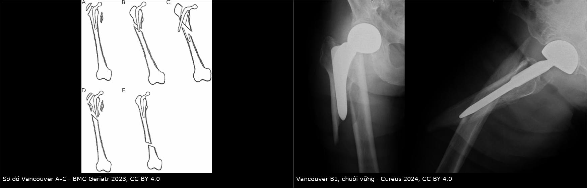
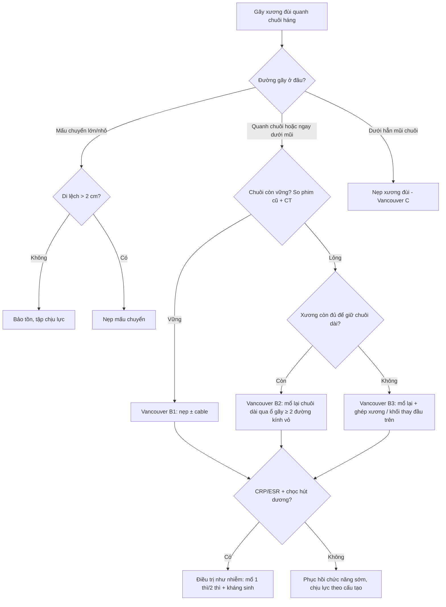
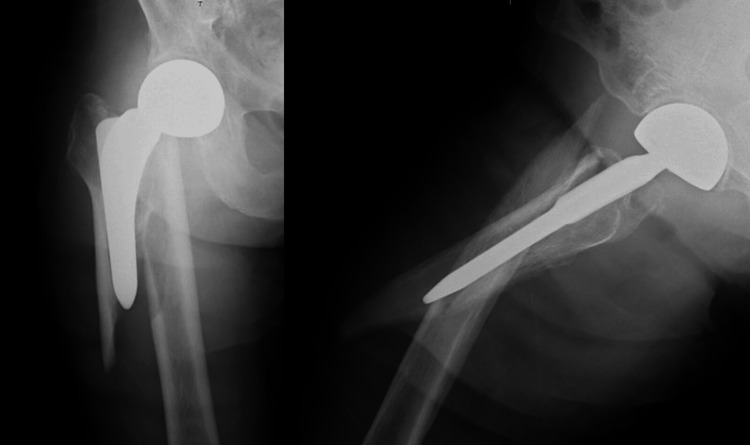

# 6155 — Gãy xương đùi quanh chuôi khớp háng nhân tạo: phân độ Vancouver & quyết định giữ chuôi hay mổ lại / Periprosthetic femoral fracture after THA

**Tags:** `pattern:gay-xuong-quanh-implant` `pattern:long-chuoi` `pattern:di-lech-manh-xuong` `vung:khop-hang` `vung:co-xuong` `score:Vancouver` `score:UCS` `score:Baba` `protocol:X-quang-khop-hang` `protocol:CT-khop-hang` `incidentaloma:khong`
**Mức chắc chắn (certainty):** tổng hợp y văn (literature synthesis) — số liệu lấy từ 2 bài tổng quan mở (PMC10929400, PMC11293929) + ca minh họa có ảnh CC BY; không có ca nguyên văn của nhóm.

## 1. Tổng quan bệnh học – cơ chế hình ảnh

- **Định nghĩa:** gãy xương đùi **sát chuôi khớp háng nhân tạo** (periprosthetic femoral fracture, PPFF), xảy ra trong mổ hoặc nhiều năm sau mổ. Đây là **biến chứng thứ 3** sau thay khớp háng (sau lỏng vô khuẩn và nhiễm trùng) và chiếm **~18% các ca mổ lại khớp háng** (National Inpatient Sample), với mức tăng **75% trong 2002–2014** — tăng nhanh hơn mọi nguyên nhân mổ lại khác.
- **Tần suất (số đã công bố, khác nhau theo registry — phải ghi rõ nguồn khi trích):**
  - Thay khớp háng **lần đầu, chuôi có xi măng**: **0,8% ở 5 năm / 3,5% ở 10 năm** (Cook, 6.458 ca).
  - Scotland (52.136 ca lần đầu, 8.726 ca mổ lại): **0,9% và 4,2% ở 5 năm**; **1,7% và 6,2% ở 10 năm** (lần đầu / mổ lại).
  - Mayo Clinic (5.417 ca mổ lại): xác suất tích lũy **1,9% (1 năm) → 3,8% (5 năm) → 6,4% (10 năm) → 11,4% (20 năm)**.
  - Gãy **trong mổ**: **1,7%** ở thay khớp lần đầu, **12%** ở mổ lại.
- **TẠI SAO gãy hay ở đúng mũi chuôi (stem tip)?** Ba yếu tố cộng lại:
  1. **Lệch mô-đun đàn hồi (modulus mismatch):** titan ~**110 GPa** so với xương vỏ ~**15–20 GPa** → chuôi "cứng" nhận lực, còn xương ngay dưới mũi chuôi phải chịu **tập trung ứng suất** khi va đập/gập.
  2. **Khiếm khuyết cơ học do phẫu thuật:** lỗ khoan vỏ xương, xi măng tràn ra ngoài vỏ, khía vỏ khi lấy chuôi cũ = **điểm khởi phát ứng suất (stress riser)**.
  3. **Mất xương do phản ứng hạt (particle disease):** đại thực bào tiêu xương quanh xi măng/chuôi → vỏ mỏng, mô xương yếu; lúc đó **ngã thấp năng lượng** cũng đủ gây gãy.
- **TẠI SAO phim X-quang thường "sạch" mà vẫn gãy?** Đường gãy không di lệch nằm ở **vỏ trước hoặc vỏ sau** xương đùi — trên cả phim thẳng (AP) và phim nghiêng (lateral), mặt phẳng vỏ đó **gần như song song với chùm tia**, nên khe gãy chỉ là một vệt mờ 0,5–1 mm bị chuôi kim loại và xi măng che. Chỉ **mặt phẳng cắt ngang (axial)** mới thấy vỏ xương bị đứt theo chu vi → CT là công cụ "nhìn vuông góc" với đường gãy.
- **TẠI SAO CT đọc được độ vững của chuôi:** lỏng chuôi biểu hiện bằng **đường sáng quanh chuôi/xi măng rộng ra**, **xi măng nứt**, **chuôi lún (subsidence)** — cả ba đều là **thay đổi theo thời gian**, nên giá trị nằm ở **so sánh với phim ngay sau mổ** đo trên cùng mặt phẳng, không phải một con số tuyệt đối trên một phim.

## 2. Mẫu hình + chẩn đoán phân biệt theo vị trí (Gamut)

- **Theo tương quan đường gãy – chuôi (Vancouver):**
  - **A** — vùng mấu chuyển: **AG** (mấu chuyển lớn) / **AL** (mấu chuyển nhỏ).
  - **B** — quanh chuôi hoặc ngay dưới mũi chuôi: **B1** chuôi **vững**; **B2** chuôi **lỏng, xương còn tốt**; **B3** chuôi **lỏng, xương mất nhiều**.
  - **C** — **dưới hẳn** mũi chuôi, xương đùi lành giữa ổ gãy và chuôi.
- **Theo hệ mở rộng UCS 2014** (dùng khi tổn thương vượt khỏi khớp háng): thêm **D** (thân xương đùi giữa 2 implant háng–gối), **E** (gãy cả xương đùi và ổ cối), **F** (chỉ ổ cối).
- **Các thể "bắt chước phân độ A" — thực chất là B2 (bẫy kinh điển):** gãy mấu chuyển nhỏ **kèm một đoạn vỏ xương đùi phía trong** (pseudo-ALT) hoặc gãy mấu chuyển lớn **kèm đoạn vỏ phía ngoài** (pseudo-AGT) → **chuôi đã mất điểm tựa** và phải xử trí như B2 (mổ lại chuôi), không phải chỉ nẹp mấu chuyển.
- **Gamut theo cơ chế khi "gãy quanh implant" mà phim không rõ:**
  - **Lỏng vô khuẩn** (đường sáng tiến triển, không gãy) — xem bài 6140.
  - **Nhiễm trùng quanh implant (PJI)** — gãy có thể là biến chứng của nhiễm; tỷ lệ nhiễm sau PPFF **7,3%**, nên **mọi ca mổ lại đều phải có CRP/ESR ± chọc hút** trước khi gọi là "gãy đơn thuần" — xem bài 6110.
  - **Gãy bệnh lý qua ổ tiêu xương/di căn** — bờ gãy không đều, có khối mô mềm, tiền sử ung thư.
  - **Vỡ mấu chuyển đơn thuần do ngã** ở người già chưa thay khớp (không phải PPFF) — chỉ cần phân biệt khi chưa biết tiền sử.

## 3. Bảng so sánh phân biệt (ma trận đối chiếu)

| Thực thể (entity) | Hình ảnh điển hình | Chốt vào (rule-in) | Chốt loại (rule-out) | Gợi ý xác nhận |
|---|---|---|---|---|
| **Vancouver A (AG/AL)** | Gãy mấu chuyển lớn/nhỏ, **đường gãy không lan vào vùng quanh chuôi**, chuôi không lún | **Mấu chuyển di lệch > 2 cm = chỉ định mổ**; < 2 cm thường điều trị bảo tồn | Đường gãy **lan xuống vỏ trong/ngoài** → thực chất pseudo-ALT/AGT = **B2** | So phim cũ + CT xác nhận vỏ xương còn liên tục |
| **Vancouver B1** | Gãy quanh chuôi/mũi chuôi, **chuôi không lún, không đổi tư thế**, xi măng còn liền, xương còn tốt | **Chuôi vững trên phim so với phim ngay sau mổ** + không có đường sáng mới | **Lún ≥ 2 mm, xi măng nứt, chuôi xoay** → B2/B3 | CT + **nghiệm pháp độ vững trong mổ** (mở khớp kiểm tra) |
| **Vancouver B2** | Gãy quanh chuôi + **chuôi lỏng**, xương đùi **còn đủ** để giữ chuôi dài | **Lún/xoay chuôi + đường sáng tiến triển + xương còn tốt** → mổ lại chuôi dài | Xương mất nhiều (vỏ < mức cần thiết để chuôi dài bám) → B3 | CT 3 mặt phẳng; phân độ Baba/UCS; cấy dịch khi mổ |
| **Vancouver B3** | Như B2 nhưng **mất xương chu vi nhiều**, vỏ mỏng, có khi chỉ còn vỏ sau | **Mất xương lên tới dưới mấu chuyển nhỏ + chuôi lỏng** → chuôi dài + ghép xương/khối thay đầu trên | Xương còn tốt, chỉ cần nẹp → B1 | CT đánh giá vỏ; Paprosky; chuẩn bị allograft/khối thay |
| **Vancouver C** | Gãy **dưới mũi chuôi**, xương đùi giữa ổ gãy và chuôi **nguyên vẹn** | **Khoảng xương lành ≥ 1 đường kính thân xương** giữa chuôi và ổ gãy | Đường gãy chạm mũi chuôi → B | Phim đủ dài **tới khớp gối** |
| **PJI (bắt chước)** | Đau + đường sáng quanh chuôi ± gãy; có thể **phim gần bình thường** | **CRP/ESR tăng + chọc hút dương** (theo MSIS/ICM) | CRP/ESR bình thường + dịch vô khuẩn **không loại trừ** PJI mạn | Chọc hút trước khi mổ; cấy 5–6 mẫu mô |

*Trái: sơ đồ Vancouver A / B1 / B2 / B3 / C. Phải: chuôi háng nhân tạo + gãy quanh chuôi **B1** (chuôi vững) trên phim thẳng và nghiêng. Ảnh ghép letterbox, không crop/kéo giãn. Nguồn: BMC Geriatr 2023 (PMC10557259), CC BY 4.0 và Cureus 2024 (PMC11055707), CC BY 4.0.*

### Đọc phân độ cho đúng: 3 con số phải nhớ

- **Độ tin cậy của Vancouver so với "sự thật trong mổ":** đồng thuận **81%, κ = 0,68**; nhưng khi chỉ dựa vào **phim trước mổ**, bác sĩ **đánh giá THẤP độ lỏng chuôi** (gọi B1 trong khi mổ thấy lỏng) — đây là lý do bài này tồn tại.
- **Với chuôi không xi măng**, phân biệt **B1 với B2/B3** chỉ đạt **κ = 0,45** (đồng thuận trung bình).
- **Khi bổ sung CT + thông tin implant**, hệ **Baba** đạt **κ = 0,94** giữa người đọc và **95% khớp với phát hiện trong mổ** — cao hơn hẳn Vancouver trên phim.

## 4. Protocol chụp + hệ phân độ/điểm

- **X-quang (bắt buộc, là bước 1):** khung chậu thẳng + háng thẳng/nghiêng **+ toàn bộ xương đùi tới khớp gối** ở bên đau (bỏ sót gãy **C** và gãy **quanh gối cùng bên** nếu chỉ chụp háng). Luôn **so với phim ngay sau mổ** để đo lún/xoay chuôi.
- **CT (khi phim không kết luận, khi dự kiến mổ lại, hoặc đau sau ngã mà phim sạch):** lát **0,5–1,25 mm**, tái tạo **đa bình diện (MPR)**, có **giảm nhiễu kim loại (MAR)**; đọc 4 điểm: **(1) vỏ xương đứt theo chu vi; (2) xi măng nứt; (3) chuôi lún/xoay so với phim cũ; (4) ổ cối cùng bên (gãy ổ cối ẩn đã được báo cáo kèm PPFF)**.
- **Không có ngưỡng mm được thẩm định cho "xương tốt vs xương kém" (B2 vs B3)** — quyết định dựa trên chiều dày vỏ, mức tiêu xương, chiều dài đoạn xương lành còn bám chuôi; ghi rõ "chưa có ngưỡng thống nhất" thay vì bịa số.
- **Nguyên tắc xử trí (theo phân độ):** A → bảo tồn nếu di lệch nhỏ, mổ nếu **> 2 cm**; **B1 → nẹp + vít/cable** (hoặc mổ lại chuôi dài); **B2 → mổ lại chuôi bám thân xương** (chuôi dài ≥ **2 đường kính vỏ xương** vượt qua ổ gãy); **B3 → mổ lại + xử lý mất xương** (ghép xương đầm, mảnh ghép vỏ, khối thay đầu trên); **C → nẹp**.
- **Số liệu chọn lựa:** trong y văn tổng hợp, **86,8% B2 (298/343)** và **95,8% B3 (160/167)** được mổ lại chuôi — tức với B2/B3, "chỉ nẹp" là ngoại lệ. Với **chuôi xi măng trơn (polished taper-slip)**, một số nghiên cứu cho thấy **nẹp có tỷ lệ mổ lại thấp hơn, chờ mổ ngắn hơn, ít truyền máu hơn** so với mổ lại chuôi → **không có một công thức duy nhất cho mọi chuôi B**.
- **Kết cục để tư vấn (số tổng hợp):** tử vong **30 ngày 3,3% · 90 ngày 4,8% · 1 năm 13,4%** (4.841 bệnh nhân/35 nghiên cứu); nhóm nguy cơ cao (nam, ≥ 75 tuổi, ASA ≥ 3) **9% / 21% / 60%** ở 90 ngày / 1 năm / 5 năm. Biến chứng sau mổ lại **~17,8%**, mổ lại lần nữa **10,5–14,4%**, **trật khớp 5–16%** và trật khớp sau mổ lại làm **tăng 5 lần tử vong trong năm đầu**.

## 5. Biến thể bình thường và cạm bẫy

- **Đường sáng quanh chuôi ≤ 1 mm, không tiến triển, ở chuôi không xi măng** là hình ảnh chấp nhận được — **không** gọi là lỏng nếu không có lún/xoay và không có triệu chứng.
- **Cạm bẫy 1 — "B1 trên phim, B2 trong mổ":** phim trước mổ **đánh giá thấp** độ lỏng (κ 0,45 với chuôi không xi măng); dấu tinh tế là **chuôi lún vào vòng định tâm (centralizer)**, **thay đổi so với phim cũ**. Khi nghi ngờ, chuẩn bị sẵn phương án mổ lại chuôi.
- **Cạm bẫy 2 — gãy mấu chuyển nhỏ "đơn thuần":** nếu kèm **một đoạn vỏ xương đùi phía trong** (pseudo-ALT) thì chuôi đã mất tựa → nẹp mấu chuyển sẽ thất bại; cần CT/MRI để thấy đoạn vỏ.
- **Cạm bẫy 3 — bỏ sót gãy thứ hai:** gãy quanh chuôi hay đi kèm **gãy ổ cối ẩn cùng bên** hoặc gãy xương đùi bên đối diện; đọc CT phải xem **toàn khung chậu**, không chỉ vùng đau.
- **Cạm bẫy 4 — thoả mãn tìm kiếm (satisfaction of search):** thấy đường gãy rõ ở thân xương là dừng, bỏ qua **đầu trên chuôi bị xoay/lún** — chính là thứ quyết định B1 hay B2.
- **Cạm bẫy 5 — gọi "gãy do ngã" mà bỏ qua nhiễm:** tỷ lệ nhiễm sau PPFF **7,3%**; mổ lại trên nền nhiễm mà không biết sẽ mất chuôi.

## 6. Tự lượng giá — Blind Quiz

**Ca 1 — Cụ bà lớn tuổi, đau đùi sau ngã tại nhà, đã thay khớp háng nhiều năm trước.**

- Câu hỏi: (1) Mô tả đường gãy và vị trí so với chuôi. (2) Phân độ Vancouver? (3) Dấu hiệu nào trên phim giúp nói chuôi **còn vững**, và bước tiếp theo cần làm?

<b>Bấm để hiện đáp án (findings + chẩn đoán)</b>

- **Dấu hiệu:** đường gãy chéo ở thân xương đùi **ngay dưới mấu chuyển, quanh chuôi**; chuôi **không lún, không đổi tư thế**, không thấy xi măng nứt; không có gãy ổ cối.
- **Chẩn đoán:** **Vancouver B1** (chuôi vững, xương còn tốt) → hướng **nẹp + vít/cable**, giữ chuôi.
- **Bước tiếp theo:** **so phim ngay sau mổ** để loại lún/xoay; nếu phim mờ hoặc đau không tương xứng → **CT có MAR**; và **CRP/ESR ± chọc hút** trước khi mổ.
- **Phản biện:** ca này được báo là B1 theo chú thích gốc, nhưng vì **Vancouver trên phim đánh giá thấp độ lỏng**, xác nhận cuối cùng vẫn là **nghiệm pháp độ vững trong mổ**.
- **Nguồn ảnh:** Cureus 2024 (PMC11055707), CC BY 4.0.

**Ca 2 — Cùng bệnh cảnh, nhưng phim chỉ có "đường sáng quanh chuôi" và bệnh nhân đau nhiều hơn sau 6 tháng.**

- Câu hỏi: (1) Nếu **không** có đường gãy rõ mà chuôi **lún 4 mm so với phim cũ**, xếp vào phân độ nào? (2) Vì sao không thể gọi "B1" chỉ vì phim không thấy gãy? (3) Khi nào cần CT?

<b>Bấm để hiện đáp án (findings + chẩn đoán)</b>

- **Trả lời:** lún chuôi + đường sáng tiến triển = **chuôi lỏng** → nếu xương còn tốt là **B2**, nếu mất xương nhiều là **B3**; **không phải B1** dù không thấy đường gãy rõ.
- **Vì sao:** Vancouver phân loại theo **3 trục: vị trí – độ vững chuôi – chất lượng xương**; "không thấy gãy" chỉ là trục vị trí, **không nói gì về độ vững**.
- **CT khi:** phim không kết luận, chuẩn bị mổ lại (đo chiều dài đoạn xương lành, phát hiện gãy ẩn vỏ trước/sau), hoặc nghi gãy ổ cối cùng bên.
- **Nguồn ảnh:** sơ đồ BMC Geriatr 2023 (PMC10557259), CC BY 4.0; ảnh phải Cureus 2024 (PMC11055707), CC BY 4.0 (ghép letterbox).

## Bài liên quan chéo
- [6140 – Lỏng vô khuẩn quanh khớp háng nhân tạo](../6140-long-vo-khuan-quanh-khop-hang-nhan-tao/lesson.md)
- [6110 – Nhiễm trùng quanh khớp nhân tạo sau thay khớp háng](../6110-nhiem-trung-quanh-khop-nhan-tao-sau-tha/lesson.md)
- [6141 – Vôi hóa lạc chỗ quanh khớp háng nhân tạo](../6141-voi-hoa-quanh-khop-hang-nhan-tao/lesson.md)
- [6107 – Thay khớp háng ở người sống sót ung thư nhi](../6107-thay-khop-hang-nguoi-song-sot-ung-thu-nhi/lesson.md)
- [300 – Tổng quan hệ Cơ – Xương – Khớp](../300-tong-quan-he-co-xuong-khop/lesson.md)

> Không dùng để chẩn đoán độc lập khi chưa có người hướng dẫn.
