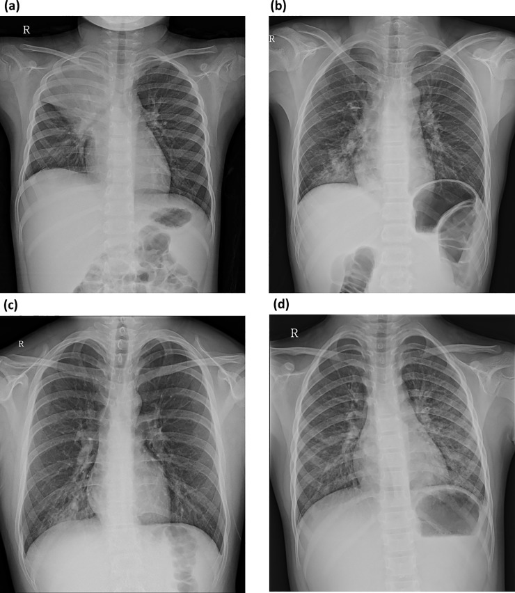
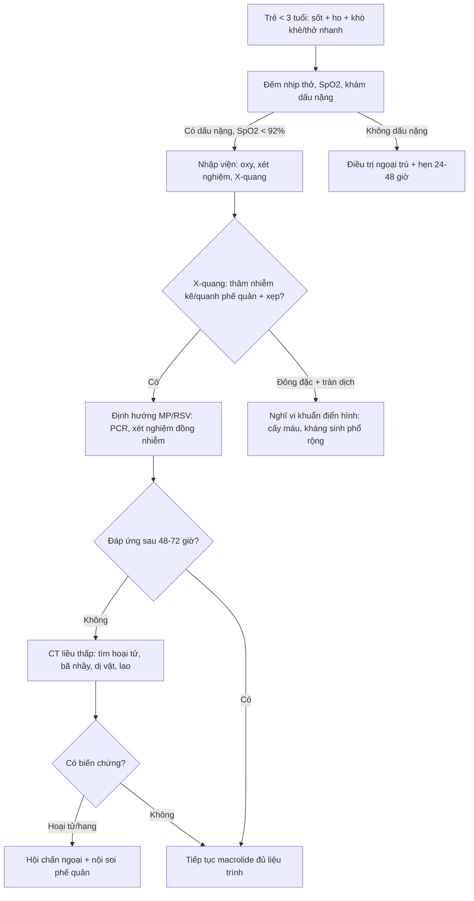
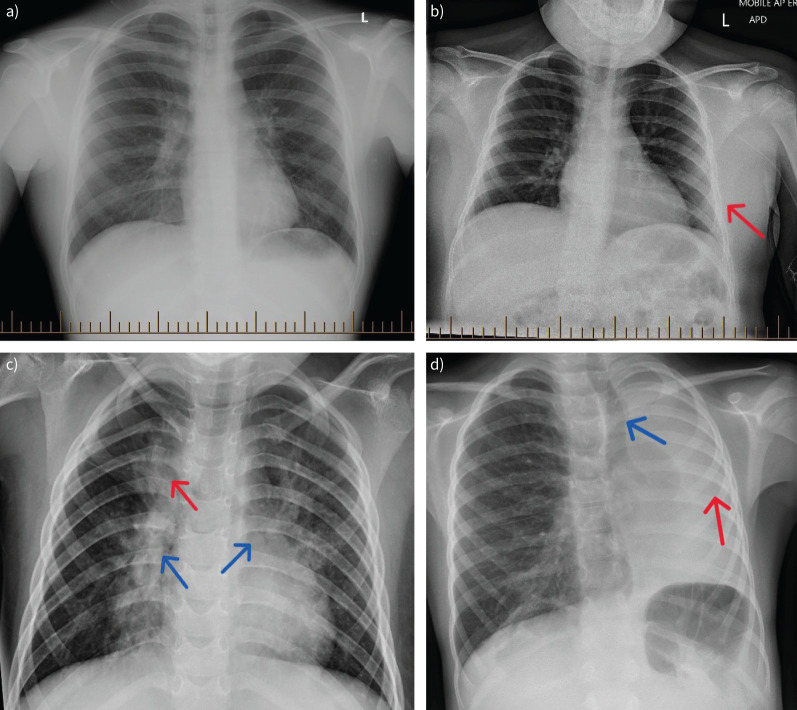

# 6156 — Viêm phổi do *Mycoplasma pneumoniae* ở trẻ dưới 3 tuổi: vì sao mẫu hình khác trẻ lớn / *M. pneumoniae* pneumonia in infants and toddlers

**Tags:** `pattern:viem-tieu-phe-quan` `pattern:thamn-nhiem-ke` `pattern:xep-phoi` `pattern:dong-dac` `vung:phoi` `vung:phe-quan` `protocol:X-quang-nguc` `protocol:CT-nguc-lieu-thap` `protocol:sieu-am-phoi` `score:WHO`

**Mức chắc chắn (certainty):** tổng hợp y văn (literature synthesis) — số liệu từ **674 trẻ viêm tiểu phế quản** (Suzhou, PMC4297954), **79 nhũ nhi viêm tiểu phế quản do MP** (Foshan, PMC7845151), **746 trẻ xét nghiệm MP** (Đan Mạch, PMC5919654), **504 trẻ mầm non nhập viện vì MPP** (2026, PMC13342035), **569 nhũ nhi MPP có khảo sát ho khò khè** (2026, PMC13685289), **402 trẻ MPP có định type kháng macrolide** (2026, PMC13670555), **155 trẻ hoại tử phổi do MP** (2025, PMC11794862) và **66 trẻ < 2 tuổi có CMV trong BALF** (2026, PMC13700219). Không có thử nghiệm ngẫu nhiên ở riêng nhóm < 3 tuổi; các ngưỡng điều trị là đồng thuận, chỗ suy luận được ghi rõ.

> **Câu chốt:** ở trẻ **< 3 tuổi**, *M. pneumoniae* **không hiếm** như sách cũ dạy, nhưng **biểu hiện không giống trẻ lớn**: **(1)** MP gây **17,2%** các ca viêm tiểu phế quản nhập viện (674 trẻ, PCR), tuổi trung vị **10 tháng**, và **66,4%** có **thâm nhiễm kẽ** trên X-quang (PMC4297954); **(2)** tỷ lệ xét nghiệm MP dương chỉ **4% ở trẻ < 2 tuổi** so với **30% ở 2–6 tuổi** và **65% ở ≥ 7 tuổi** — nghĩa là **xét nghiệm dương ở nhũ nhi có giá trị cao hơn**, còn **âm tính không loại trừ** (PMC5919654); **(3)** dưới 3 tuổi, **đồng nhiễm vi rút** làm bệnh **nặng hơn rõ**: ở trẻ **< 2 tuổi**, đồng nhiễm khiến tỷ lệ bệnh nặng **29,7% vs 9,5%** (PMC13342035).

## 1. Tổng quan bệnh học – cơ chế hình ảnh (TẠI SAO mẫu hình khác trẻ lớn)

### 1.1 Vì sao *M. pneumoniae* gây bệnh ở đường thở nhỏ

- *M. pneumoniae* **không có thành tế bào** → mọi **beta-lactam vô hiệu**; thuốc tác dụng là **macrolide, tetracycline, fluoroquinolone**.
- Vi khuẩn bám vào **tế bào biểu mô có lông chuyển** bằng protein **P1**, gây **tê liệt lông chuyển**, tiết **hydrogen peroxide** và độc tố → **tổn thương biểu mô, phù, ứ nhầy**. Vì vậy bệnh **bắt đầu ở phế quản – tiểu phế quản** rồi mới lan ra phế nang.
- **TẠI SAO trẻ nhỏ lại "viêm tiểu phế quản" mà trẻ lớn lại "đông đặc":** sức cản đường thở theo **định luật Poiseuille, R ∝ 1/r⁴** — đường kính tiểu phế quản ở nhũ nhi nhỏ hơn nhiều lần, nên **cùng một lượng nhầy/phù niêm mạc** gây **tắc gần hoàn toàn** ở trẻ nhỏ trong khi trẻ lớn chỉ bị hẹp. Kèm theo: **ít phế nang dự trữ**, **thông khí bàng hệ (pores of Kohn) chưa phát triển**, **lồng ngực mềm** → tổn thương biểu hiện thành **ứ khí + xẹp phổi từng thùy**, chứ không thành **đông đặc thùy lớn**.
- **TẠI SAO X-quang nhũ nhi khó đọc:** phim **AP nằm ngửa**, pha thở ra, **tuyến ức** che trung thất trên, và **mờ do giảm thể tích** dễ bị gọi là "đông đặc". Đây là lý do **một đám mờ ở nhũ nhi không đồng nghĩa viêm phổi thùy**.

### 1.2 Vật lý hình ảnh: mỗi mẫu hình tương ứng một mức tổn thương

- **Dày thành phế quản/quanh phế quản (peribronchial cuffing):** phù niêm mạc + dịch quanh phế quản → **đường mờ song song (tram-track)** hoặc **vòng (ring)** trên X-quang; trên CT là **dày thành phế quản ≥ 1 mm** và **nốt trung tâm tiểu thùy**.
- **Thâm nhiễm kẽ (interstitial infiltration):** phù/tế bào ở **vách tiểu thùy và quanh mạch** → **lưới mờ, nốt mờ nhỏ**; đây là mẫu hình **chiếm 66,4%** ở nhũ nhi (PMC4297954) và **21%** ở trẻ lớn hơn (PMC6713385).
- **Xẹp phổi (atelectasis):** tắc phế quản do nhầy + giảm thông khí → **mờ hình nêm, co kéo rãnh liên thùy, dịch chuyển trung thất cùng bên**; dấu **"phế quản hơi trong vùng mờ"** giúp phân biệt với đông đặc.
- **Đông đặc (consolidation):** phế nang **đầy dịch/tế bào** → **mờ đồng nhất + phế quản hơi**; ở trẻ lớn chiếm **37%** (PMC6713385), ở nhũ nhi ít hơn và thường **khu trú một thùy**.
- **Tràn dịch màng phổi:** gặp **63%** ở nhóm có đông đặc so với **16%** ở nhóm không đông đặc (PMC6713385) — tràn dịch là dấu **đi kèm đông đặc**, không phải dấu của viêm tiểu phế quản.
- **TẠI SAO CT thấy nhiều hơn:** CT **lát mỏng 1 mm, liều thấp** phát hiện **nốt trung tâm tiểu thùy, tree-in-bud, bã nhầy, hoại tử/hang, giãn phế quản sớm** — những tổn thương dưới ngưỡng X-quang. Không dùng CT thường quy; chỉ khi **nghi biến chứng hoặc chẩn đoán chưa rõ**.

### 1.3 Dịch tễ và ngưỡng định lượng

- **Tỷ lệ MP trong viêm tiểu phế quản nhập viện:** **17,2%** (117/674; PCR) ở Tô Châu 2010–2012, ổn định qua 3 năm (16,6 – 17,8 – 17,2%), đỉnh **tháng 7–9**, tuổi trung vị **10 tháng** (PMC4297954).
- **Xác nhận thứ hai:** **79 nhũ nhi** ở Phật Sơn, tỷ lệ phát hiện MP theo năm **19,2% – 21,3% – 24,0%**, đỉnh **tháng 6–7**, chủ yếu **6–12 tháng** (PMC7845151).
- **Theo tuổi (Đan Mạch, 746 trẻ):** dương tính **4% ở < 2 tuổi**, **30% ở 2–6 tuổi**, **65% ở ≥ 7 tuổi**; **đồng nhiễm vi rút 27%** (PMC5919654).
- **Ở trẻ mầm non nhập viện (504 ca):** đồng nhiễm vi rút **38,3%**, cao nhất **47,1% ở 2–4 tuổi**; ở **< 2 tuổi**, đồng nhiễm làm tăng **bệnh nặng 29,7% vs 9,5%** (P = 0,046) (PMC13342035).
- **CMV ở trẻ < 2 tuổi:** **28/66** trẻ MPP có CMV DNA trong BALF; nhóm này **sốt ≥ 3 ngày nhiều hơn, nặng hơn lúc nhập viện, nằm viện lâu hơn**, nhưng **ít khò khè hơn** (PMC13700219).
- **Kháng macrolide:** đột biến **A2063G** chiếm **90,0%** (362/402) ở trẻ nhập viện; **đông đặc phổi 25,6%** và **ít gặp hơn ở nhóm A2063G** (23,2% vs 47,5%; **OR 0,370**) (PMC13670555).
- **Hoại tử phổi (155 ca):** **80% (124/155) khu trú một thùy**; **giảm đậm độ 51,6%**, **hang/kén trong vùng hoại tử 48,4%**; nội soi: **viêm phế quản 135**, **loét hoại tử 47**, **bít tắc 4** (PMC11794862).

## 2. Mẫu hình + chẩn đoán phân biệt theo vị trí và tuổi (Gamut)

- **Nhũ nhi < 12 tháng – mẫu hình "viêm tiểu phế quản":** ứ khí hai bên, **dày thành phế quản lan tỏa**, **thâm nhiễm kẽ**, **xẹp phổi từng thùy** (hay gặp **thùy trên phải** và **thùy giữa**). Đây là thể **hay bị gọi nhầm là RSV**.
- **Trẻ 1–3 tuổi – mẫu hình "viêm phổi không điển hình":** **mờ quanh rốn phổi một bên**, **mờ lưới–nốt**, có thể **đông đặc phân thùy**; sốt cao hơn, ho khan nhiều.
- **Theo vị trí:**
  - **Trung tâm/quanh rốn phổi:** MP, RSV, vi rút; **hạch rốn phổi hoại tử** → nghĩ lao.
  - **Một thùy (thường dưới):** đông đặc do phế cầu, *S. aureus* (hoại tử/hang), *Klebsiella*; MP thể nặng cũng có.
  - **Hai bên lan tỏa:** vi rút, MP, **PJP** (nếu suy giảm miễn dịch), hít sặc.
  - **Mờ tròn (round pneumonia):** trẻ nhỏ, hay **phế cầu**; trên X-quang là **đám mờ tròn** nhưng thực chất là **đông đặc lan theo tiểu thùy**, không phải u.
- **Gợi nhớ theo tuổi — "MP hay RSV?":** **< 6 tháng** nghiêng RSV; **6–24 tháng** cả hai; **> 2 tuổi** nghiêng MP. Nhưng **không tuổi nào loại trừ MP** — vì 17,2% viêm tiểu phế quản nhập viện là MP.

## 3. Bảng so sánh phân biệt (ma trận đối chiếu)

| Thực thể (entity) | Hình ảnh điển hình (XR/CT) | Chốt vào (rule-in) | Chốt loại (rule-out) | Gợi ý xác nhận |
|---|---|---|---|---|
| **MP ở trẻ < 3 tuổi** | **Thâm nhiễm kẽ/quanh phế quản**, ứ khí, **xẹp thùy**; đông đặc ít và khu trú; thường một bên | **Tuổi 6–24 tháng + sốt cao + thâm nhiễm kẽ + đáp ứng kém beta-lactam** | Mờ đồng nhất toàn thùy + tràn dịch nhiều → nghĩ vi khuẩn điển hình | PCR MP (dương ở nhũ nhi có giá trị cao); X-quang; CT nếu nặng |
| **RSV viêm tiểu phế quản** | Ứ khí hai bên, **dày thành phế quản lan tỏa**, xẹp thùy; **ít thâm nhiễm kẽ khu trú** | **Mùa đông–xuân, trẻ < 12 tháng, khò khè, chảy mũi** | Thâm nhiễm kẽ **khu trú một bên** + sốt cao → nghiêng MP | PCR RSV; so tuổi và mùa |
| **Ho gà (pertussis)** | X-quang **thường bình thường** hoặc chỉ ứ khí; không đông đặc | **Cơn ho rũ rượi, tiếng rít vào, nôn sau ho**, bạch cầu lympho tăng | Có đông đặc/thâm nhiễm rõ → ít nghĩ ho gà đơn thuần | PCR *B. pertussis* |
| ***Chlamydia trachomatis*** | **Thâm nhiễm kẽ hai bên**, ứ khí; **không sốt** | **2–20 tuần tuổi, ho "staccato", không sốt, viêm kết mạc**, tăng bạch cầu ái toan | Sốt cao + đông đặc → không phải | PCR mắt/mũi họng |
| **Adenovirus** | **Đông đặc + hoại tử**, có thể **di chứng viêm tiểu phế quản bít tắc** | Sốt cao kéo dài, **đông đặc thùy**, suy hô hấp nặng | Thâm nhiễm kẽ nhẹ, không hoại tử → ít nghĩ | PCR; CT theo dõi di chứng |
| **Dị vật đường thở** | **Ứ khí một bên**, xẹp phổi **một bên**, có thể **mờ toàn một phổi** | **Khởi phát đột ngột, ho sặc, khò khè một bên** | Tổn thương **hai bên đối xứng** → không phải dị vật | X-quang 2 tư thế + nội soi nếu nghi |
| **Lao phổi** | **Hạch rốn phổi hoại tử**, đông đặc thùy trên, hang, nốt vệ tinh | Tiếp xúc nguồn lây, phản ứng IGRA dương, **không đáp ứng kháng sinh thường** | Thâm nhiễm kẽ hai bên đối xứng → ít nghĩ | IGRA/mantoux, PCR lao, CT |
| **Viêm phổi tròn (phế cầu)** | **Đám mờ tròn** ở trẻ nhỏ, bờ không rõ | Sốt cao, bạch cầu tăng, đáp ứng beta-lactam | Mờ tròn + không sốt + kéo dài → nghĩ u/lao | X-quang theo dõi; siêu âm phổi |

*(a) Đông đặc thùy/phân thùy có phế quản hơi; (b) mờ từng ổ bờ không rõ; (c) mờ lưới–nốt khu trú; (d) mờ quanh rốn phổi. Ở trẻ lớn, đông đặc là kiểu hay gặp nhất (37%); ở nhũ nhi, kiểu (c)–(d) chiếm ưu thế. Nguồn: Cho YJ et al., PLoS One 2019 (PMC6713385), CC BY 4.0.*

## 4. Protocol chụp + phân tầng điều trị

### 4.1 Chỉ định hình ảnh

- **X-quang ngực thẳng** là bước đầu khi nghi viêm phổi **có triệu chứng toàn thân, giảm oxy, hoặc cần phân biệt biến chứng**; **không chụp thường quy** cho viêm tiểu phế quản điển hình không biến chứng.
- **Trẻ < 5 tuổi:** phim **AP nằm ngửa**, **liều thấp**, **che tuyến sinh dục** theo quy ước địa phương; chấp nhận **hít vào kém** nhưng phải ghi rõ để tránh gọi xẹp oan.
- **Siêu âm phổi (lung ultrasound)** thay thế khi cần theo dõi: **đông đặc có phế quản hơi**, **B-line**, **tràn dịch**; không bức xạ, làm tại giường — hữu ích ở nhũ nhi.
- **CT ngực liều thấp** chỉ khi: **(1)** nghi **hoại tử/hang/áp-xe**; **(2)** nghi **bã nhầy phế quản (plastic bronchitis)**; **(3)** **không đáp ứng điều trị** và cần loại **dị vật, lao, dị tật bẩm sinh**; **(4)** trước can thiệp nội soi.

### 4.2 Ngưỡng lâm sàng — khi nào nhập viện, khi nào nặng

| Tiêu chí | Ngưỡng (WHO / thực hành) |
|---|---|
| Nhịp thở nhanh | **< 2 tháng: ≥ 60/phút**; **2–11 tháng: ≥ 50**; **1–5 tuổi: ≥ 40** |
| Giảm oxy | **SpO₂ < 90–92%** (khí trời) → nhập viện, thở oxy |
| Dấu hiệu nặng | Rút lõm ngực, rên rỉ, tím tái, **ngưng thở**, bú kém, mất nước |
| Trẻ < 3 tháng | **Ngưỡng nhập viện thấp hơn** — sốt ≥ 38 °C ở nhũ nhi < 3 tháng là **red flag** |
| Đồng nhiễm | **< 2 tuổi + đồng nhiễm vi rút: bệnh nặng 29,7% vs 9,5%** (PMC13342035) |

### 4.3 Điều trị và theo dõi

- **Macrolide** là lựa chọn đầu tay khi nghi MP: **azithromycin 10 mg/kg ngày 1, sau đó 5 mg/kg/ngày × 4 ngày** (hoặc 10 mg/kg/ngày × 3 ngày) — liều chuẩn theo cân nặng; ở trẻ **< 6 tháng** phải **loại ho gà trước** vì ho gà cũng đáp ứng macrolide nhưng cần **cách ly và điều trị dự phòng người tiếp xúc**.
- **Khi nghi kháng macrolide:** sốt **≥ 72 giờ** dù đã macrolide đủ liều; **A2063G** chiếm **90%** ở nhóm nhập viện (PMC13670555). Lưu ý **kháng gen không đồng nghĩa bệnh nặng**: nhóm A2063G **ít đông đặc hơn** (23,2% vs 47,5%).
- **Đồng nhiễm:** ở trẻ < 2 tuổi có **CMV trong BALF**, bệnh nặng và nằm viện lâu hơn — cần **cân nhắc nội soi/BALF** khi diễn tiến kéo dài (PMC13700219).
- **Theo dõi:** đáp ứng sốt trong **48–72 giờ**; nếu không, **chụp lại/CT** để tìm **tràn dịch, hoại tử, bã nhầy, dị vật**.
- **Phòng bệnh:** không có vắc-xin; **rửa tay, cách ly hô hấp**; trẻ đi học có thể mang vi khuẩn **nhiều tuần**.

## 5. Biến thể bình thường và cạm bẫy

- **Tuyến ức (thymus):** ở trẻ < 2 tuổi, **dấu cánh buồm (sail sign)** và **mờ trung thất trên** có thể giả **đông đặc thùy trên**; bờ **nhẵn, đối xứng**, không có phế quản hơi → không phải viêm phổi.
- **Hít vào kém:** phim **AP nằm ngửa thì thở ra** làm **tim to giả, mờ đáy phổi, xẹp giả**; luôn đọc **số cung sườn** trước khi kết luận.
- **"Round pneumonia" giả u:** đám mờ tròn ở trẻ nhỏ **thường là đông đặc**, không phải u; theo dõi X-quang sau **2–4 tuần**, không sinh thiết vội.
- **Cạm bẫy dị vật:** **ứ khí/xẹp một bên** sau cơn sặc **bị gọi là "viêm phổi do MP"**; nếu tổn thương **một bên, dai dẳng, không đáp ứng kháng sinh** → **nội soi phế quản**.
- **Cạm bẫy kháng sinh:** MP **không có thành tế bào** → **amoxicillin/ceftriaxone không hiệu quả**; "viêm phổi không đáp ứng beta-lactam" là manh mối kinh điển. Ở trẻ < 6 tháng, **ho gà** cũng là nguyên nhân ho kéo dài và **cũng đáp ứng macrolide**, nên phải **loại ho gà + cách ly** chứ không chỉ đổi kháng sinh.
- **Cạm bẫy xét nghiệm:** ở nhũ nhi, **MP dương tính có thể là nhiễm trùng phối hợp** chứ không phải nguyên nhân duy nhất — **27%** có đồng nhiễm vi rút (PMC5919654), và **CMV** làm bệnh nặng hơn (PMC13700219).
- **Cạm bẫy hình ảnh:** **không có "mẫu hình vàng"** cho MP ở trẻ nhỏ; **thâm nhiễm kẽ hai bên** cũng gặp ở RSV, **đông đặc** cũng gặp ở phế cầu. Chẩn đoán là **kết hợp dịch tễ + tuổi + hình ảnh + xét nghiệm**.

## 6. Tự lượng giá — Blind Quiz

**Ca 1 — Bé trai 14 tháng, sốt 39 °C 4 ngày, ho nhiều, khò khè. X-quang dưới đây có 4 kiểu mờ khác nhau; kiểu nào gợi ý đông đặc thùy và vì sao?**

- Câu hỏi: mô tả (a)–(d); kiểu nào **có phế quản hơi**? Kiểu nào phù hợp **nhũ nhi** hơn?

<b>Bấm để hiện đáp án</b>

- (a) **Đông đặc thùy/phân thùy**: mờ **đồng nhất**, có **phế quản hơi** — phế nang đầy dịch/tế bào.
- (b) **Mờ từng ổ (patchy)**: bờ không rõ, không đồng nhất.
- (c) **Mờ lưới–nốt khu trú**: tổn thương **kẽ/quanh phế quản**.
- (d) **Mờ quanh rốn phổi**: dày thành phế quản + thâm nhiễm quanh mạch.
- Ở **nhũ nhi**, kiểu (c)–(d) **chiếm ưu thế** vì đường thở nhỏ dễ tắc và tổn thương chủ yếu ở tiểu phế quản; **đông đặc (a)** hay gặp ở trẻ lớn hơn (37%).
- Nguồn: Cho YJ et al., PLoS One 2019 (PMC6713385), CC BY 4.0.

**Ca 2 — Bốn trẻ khác nhau, đều được chẩn đoán viêm phổi do *M. pneumoniae*. Nhìn các mũi tên và cho biết dấu hiệu nào là "mờ nhẹ dễ bỏ sót":**

- Câu hỏi: (a) có gì bất thường? (b) mũi tên đỏ chỉ gì? (c) mũi tên xanh chỉ gì? (d) vì sao khó thấy?

<b>Bấm để hiện đáp án</b>

- (a) **Không có đông đặc rõ** — trẻ 14 tuổi ho 4 tuần, PCR/serology MP dương; đây là ca **X-quang gần như bình thường**.
- (b) **Mờ nhẹ vùng giữa trái** (mũi tên đỏ) — dày thành phế quản/thâm nhiễm quanh phế quản, dễ bị bỏ qua.
- (c) **Dày thành phế quản và mờ quanh rốn phổi hai bên** (mũi tên xanh/đỏ).
- (d) **Đông đặc thùy dưới trái** với **phế quản hơi** — nhưng bị **bóng tim và vòm hoành** che một phần.
- Bài học: **MP có thể có X-quang bình thường hoặc chỉ thay đổi rất nhẹ**; không được dùng "X-quang sạch" để loại trừ.
- Nguồn: Sharplin L, Goyal V. Breathe 2025 (PMC12519950), CC BY-NC 4.0.

**Ca 3 — Bé gái 8 tháng, sốt 38,5 °C, ho, khò khè, SpO₂ 96%, bú giảm nhẹ. PCR MP dương, RSV âm. X-quang chỉ có dày thành phế quản và ứ khí. Xử trí thế nào?**

- Câu hỏi: có cần nhập viện không? Có cần CT không? Kháng sinh gì, và theo dõi dấu hiệu nào?

<b>Bấm để hiện đáp án</b>

- **Không có dấu hiệu nặng** (SpO₂ 96%, không rút lõm, còn bú) → **có thể điều trị ngoại trú** với hẹn **24–48 giờ**, dặn dấu hiệu quay lại (thở nhanh, rút lõm, bỏ bú, tím).
- **Không cần CT**: hình ảnh phù hợp **viêm tiểu phế quản do MP**; CT chỉ khi nghi biến chứng/không đáp ứng.
- **Azithromycin** theo cân nặng (10 mg/kg ngày 1, 5 mg/kg ngày 2–5); **không dùng beta-lactam** vì MP không có thành tế bào.
- Theo dõi: **nhịp thở, SpO₂, lượng bú, nước tiểu**; nếu sốt **≥ 72 giờ** hoặc nặng lên → đánh giá lại, cân nhắc **đồng nhiễm/kháng macrolide**.
- Lưu ý: ở trẻ < 2 tuổi, **đồng nhiễm** làm bệnh nặng hơn (29,7% vs 9,5%) — hỏi kỹ tiếp xúc, cân nhắc PCR vi rút.

## Bài liên quan chéo
- [6150 – Viêm phổi do *M. pneumoniae* nặng và kháng macrolide ở trẻ](../6150-mycoplasma-pneumoniae-nang-khang-macrolide-o-tre/lesson.md) (điểm CT, bã nhầy, đổi thuốc)
- [613 – Viêm tiểu phế quản nhi](../613-viem-tieu-phe-quan-nhi/lesson.md)
- [614 – Bệnh tiểu phế quản tắc nghẽn (BO/Swyer–James)](../614-benh-tieu-phe-quan-tac-nghen-BO-Swyer-James/lesson.md)
- [615 – Viêm phổi nhi: round pneumonia](../615-viem-phoi-nhi-round-pneumonia/lesson.md)
- [616 – Biến chứng viêm phổi nhi: empyema, hoại tử](../616-bien-chung-viem-phoi-nhi-empyema-hoai-tu/lesson.md)
- [612 – Cấp cứu đường thở trên ở trẻ em](../612-cap-cuu-duong-tho-tren-tre-em/lesson.md)
- [6128 – Rubella bẩm sinh](../6128-rubella-bam-sinh/lesson.md) (nhiễm trùng bào thai, điếc tiếp nhận)

## Ảnh
- `6156_viem-phoi-mycoplasma_XR_PMC6713385.jpg` — 4 kiểu mờ X-quang của viêm phổi MP (đông đặc, từng ổ, lưới–nốt, quanh rốn phổi).
- `6156_viem-phoi-mycoplasma_XR_PMC12519950.jpg` — 4 phim trẻ MP: từ **bình thường** đến **mờ nhẹ** và **đông đặc có phế quản hơi**.
- Chi tiết nguồn + giấy phép: [`images/CREDITS.md`](images/CREDITS.md).

> Không dùng để chẩn đoán độc lập khi chưa có người hướng dẫn.
