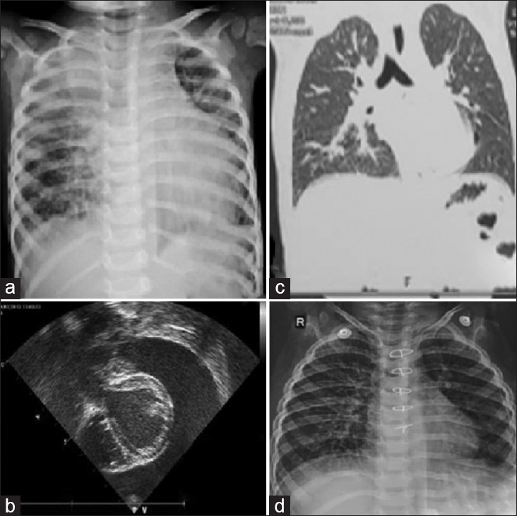
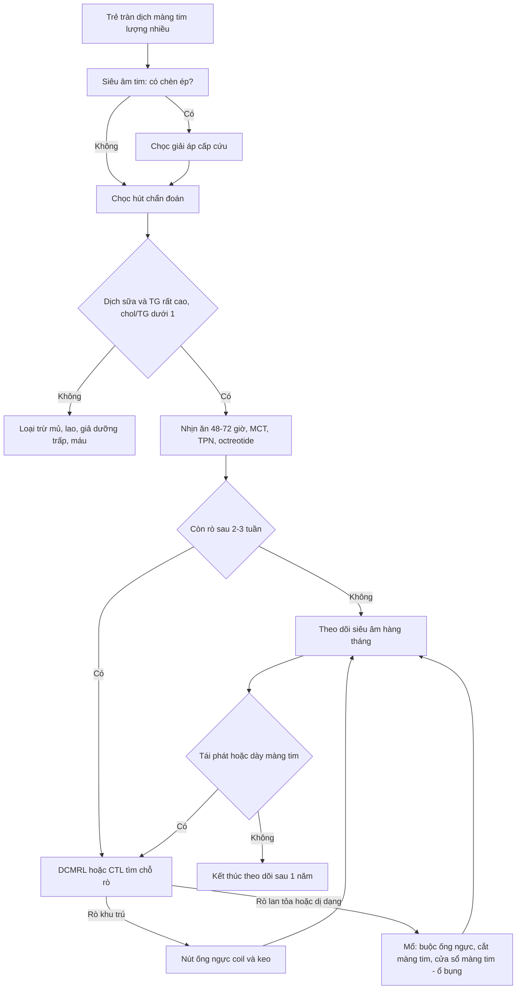
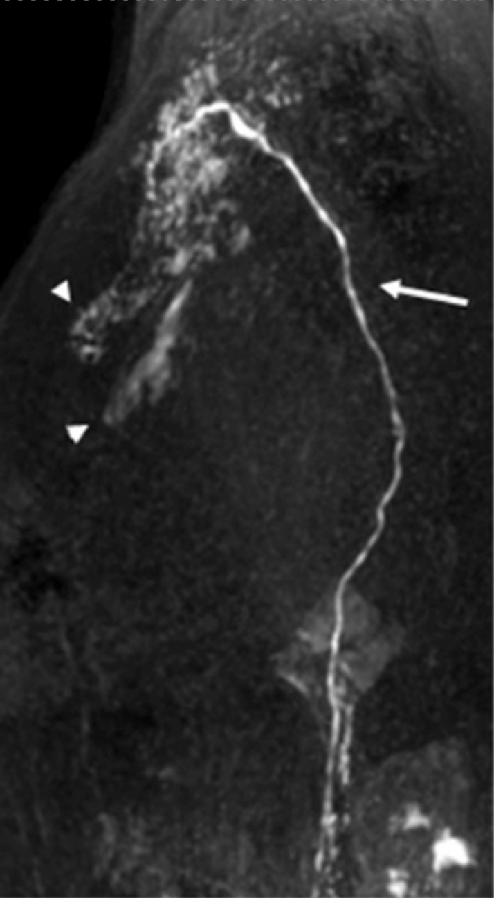
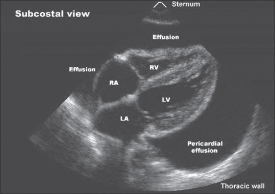

# 6157 — Tràn dưỡng trấp màng tim ở trẻ: chèn ép tim, DCMRL & khi nào nút ống ngực / Paediatric chylopericardium

**Tags:** `pattern:tran-dich-mang-tim` `pattern:duong-trap` `pattern:chen-ep-tim` `pattern:ro-bach-mach` `vung:mang-tim` `vung:ong-nguc` `vung:trung-that` `protocol:sieu-am-tim` `protocol:CT` `protocol:MRI` `protocol:DCMRL` `score:TG-dich`

**Mức chắc chắn (certainty):** tổng hợp y văn (literature synthesis) — biên từ toàn văn/abstract: **2 ca nhi** có kết cục trái ngược (PMC10243652), ca nhi được mở cửa sổ màng tim qua nội soi lồng ngực (PMC11192247), phân tích gộp **98 bệnh nhân** chylopericardium (PMC10423526), giá trị **HU trên CT** so với 38 ca tràn dịch khác loại (PMC9912497), **56 bệnh nhân** phân độ MRL không cản quang (PMC11320522), **55 bệnh nhân** CT lymphangiography + xạ hình (PMC11350940), ca DCMRL + nút ống ngực (PMC11233947). Không có ca do nhóm tự chụp.

> **Câu hỏi thực hành:** bé trai **2,5 tuổi (9,8 kg)**, khó thở tăng dần 2 tuần, tim nhịp nhanh, tiếng tim mờ, X-quang tim to; siêu âm **tràn dịch màng tim lượng nhiều, dấu hiệu chèn ép tim sớm**; chọc hút ra **300 mL dịch trắng đục như sữa**. Bác sĩ hỏi: **"Dịch sữa này là gì? Có phải mổ ngay không? Nếu mổ thì mổ gì?"**
> Bài chốt **năm quyết định**: **(1) "dịch sữa" chỉ là dưỡng trấp khi triglyceride rất cao và cholesterol/triglyceride < 1 — đừng nhầm dịch mủ hoặc dịch giả dưỡng trấp; (2) đậm độ CT thấp (chylopericardium ~11 HU, thấp hơn hydropericardium 15,4 và hemopericardium 22,3 HU) là gợi ý **trước khi chọc**; (3) chèn ép tim gặp **38%** ca chylopericardium — chọc giải áp là bước đầu, không phải điều trị triệt để; (4) **58–71%** ca idiopathic cuối cùng phải mổ, và mổ **chỉ có cửa sổ màng tim** thường thất bại — ca 1 đã thất bại 2 lần và tử vong; (5) **không kéo dài điều trị nội khoa quá 2–3 tuần** — trẻ mất dịch, protein và lympho mỗi ngày.**

## 1. Tổng quan bệnh học – cơ chế hình ảnh: vì sao dưỡng trấp vào màng tim và vì sao nó "nhẹ" trên CT

### 1.1 Dưỡng trấp là gì và đi đâu

- **Dưỡng trấp (chyle)** là dịch bạch mạch từ ruột: **nhũ tương lipid (chylomicron)** trong dịch giàu protein và **lympho T**, do ống ngực dẫn từ **bể dưỡng trấp (cisterna chyli)** lên góc tĩnh mạch cảnh–dưới đòn trái. Người lớn sản xuất **2–4 L/ngày**; trẻ nhỏ ít hơn theo cân nặng nhưng **tỉ lệ dịch/khối lượng cơ thể cao hơn** — nên mất dưỡng trấp ở trẻ nhanh dẫn tới **giảm albumin, giảm lympho, suy dinh dưỡng**.
- **Bốn cơ chế dẫn tới tràn dưỡng trấp màng tim (PMC9912497):**
  1. **Van bạch mạch hỏng** ở các nhánh nối ống ngực ↔ mạch bạch mạch màng tim;
  2. **Tăng áp lực ống ngực** (giãn bạch mạch, tắc nghẽn, hẹp);
  3. **Thông nối bất thường** giữa mạch bạch mạch và màng tim (chylous reflux);
  4. **Dị dạng bẩm sinh** (lymphangiomatosis, lymphangioma trung thất).
- **Nguyên nhân:** **vô căn (idiopathic) ~60%** ở người lớn; thể **thứ phát** gặp sau **mổ tim–lồng ngực, chấn thương, huyết khối tĩnh mạch cảnh, xạ trị, u trung thất/lymphoma, lao, viêm tụy hoại tử** (PMC10423526). Ở trẻ, **phần lớn là sau mổ tim** hoặc **dị dạng bạch mạch bẩm sinh**; thể **nguyên phát (primary) rất hiếm — chỉ ~104 ca trong 65 năm** (PMC9912497).

### 1.2 TẠI SAO dịch "trắng như sữa" và TẠI SAO đậm độ CT lại thấp

- **Màu trắng đục:** các **chylomicron** (hạt lipid ~0,1–1 µm) **tán xạ ánh sáng** (hiệu ứng Tyndall) — giống sữa pha loãng; để lắng qua đêm sẽ tạo **lớp kem (cream layer)** phía trên.
- **TẠI SAO HU thấp:** lipid là **hydrocarbon** (ít electron hơn nước) → mô mỡ thuần có đậm độ **−50 đến −100 HU**. Dưỡng trấp là **nhũ tương lipid pha loãng trong nước** nên đậm độ **nằm giữa mỡ và nước**: ca người lớn đo được **11,0 HU**; ca sơ sinh 7 tháng báo **+6 đến −6 HU**; dịch dưỡng trấp ổ bụng **7–10 HU** (PMC9912497). So sánh cùng cơ sở: **hydropericardium 15,39 HU**, **hemopericardium 22,32 HU** — nghĩa là **càng nhiều lipid, HU càng thấp**; máu làm HU tăng.
- **TẠI SAO dịch giàu lympho và protein:** ống ngực mang **lympho T** và protein huyết tương; ca trẻ có **protein 6–6,6 g/dL**, **lympho 86–90%**, tế bào **2.300–3.500/mm³** (PMC10243652) — đây là lý do dịch dưỡng trấp **không phải transudate đơn thuần** và việc mất dịch gây **suy giảm miễn dịch thứ phát**.

### 1.3 TẠI SAO trẻ có thể chèn ép tim với lượng dịch "không lớn"

- **Áp lực màng tim = áp lực dịch − áp lực trong buồng tim.** Trẻ có **màng tim mỏng, ít mô mỡ, thể tích dự trữ nhỏ**, và nếu dịch tích tụ **nhanh** (rò hoạt động) thì áp lực tăng vọt **trước khi** lượng dịch lớn. Vì thế **chèn ép tim gặp 38%** ca chylopericardium, dù nhiều ca chỉ có tràn dịch "trung bình" (PMC10423526).
- **TẠI SAO chèn ép là cấp cứu:** tim không giãn được trong thì tâm trương → **giảm đổ đầy thất phải → giảm cung lượng → sốc**. Trên siêu âm: **sụp nhĩ phải thì tâm thu**, **sụp thất phải thì tâm trương**, **tĩnh mạch chủ dưới giãn > 20 mm và biến thiên < 50%**, **vận tốc dòng chảy qua van hai lá giảm > 25–30% khi hít vào**, **qua van ba lá tăng > 40–60%** (PMC12985857).
- **TẠI SAO dưỡng trấp gây xơ màng tim về sau:** lipid và protein trong khoang màng tim kích thích viêm mạn → **dày–xơ màng tim, chèn ép mạn (constrictive pericarditis)**; đó là lý do phải **theo dõi dài hạn** chứ không chỉ lo lúc cấp.

### 1.4 Con số nằm lòng

- **Dịch màng tim dưỡng trấp — đặc điểm chung (98 bệnh nhân, 95 bài):** tuổi trung bình **37 ± 15**, nam **55%**, **vô căn 60%**, **chèn ép tim 38%**, phân tích dịch được làm **94%**, **lymphangiography tìm ra chỗ rò 59%**, điều trị nội khoa **63%**, **32% phải mổ**, **tái phát 16%** trong trung vị **180 ngày**, **10%** trong số tái phát phải nhập viện lại (PMC10423526).
- **Thể vô căn (102 bệnh nhân):** **62** điều trị nội khoa, **36 (58%)** trong số đó phải mổ; **71,2%** tổng số được mổ; thủ thuật phổ biến: **mở cửa sổ màng tim 48,1%**, **buộc ống ngực 44,2%** (PMC9912497).
- **Tiêu chuẩn dịch (PMC10243652, PMC9912497):** **triglyceride 110–2.000 mg/dL** (nhiều tác giả lấy **> 500 mg/dL** khi dịch đục như sữa); **cholesterol/triglyceride < 1**; **Sudan III dương tính**; **lympho chiếm ưu thế**; cấy và tế bào học âm tính.
- **Đậm độ CT:** chylopericardium **11,0 HU**; hydropericardium **15,39 HU**; hemopericardium **22,32 HU**; dưỡng trấp ổ bụng **7–10 HU** (PMC9912497).
- **Hai ca nhi (PMC10243652):**
  - Bé trai **2,5 tuổi**: chọc **300 mL**, triglyceride **2.748 mg/dL**, cholesterol **36 mg/dL**, lympho **86%**; thất bại nội khoa → **buộc ống ngực + cửa sổ màng tim** (ngày 14), tái rò → **cắt màng tim + cửa sổ màng tim–ổ bụng** (ngày 35), **tử vong ngày 58** do nhiễm khuẩn.
  - Bé gái **13 tháng**: chọc **210 mL**, triglyceride **2.303 mg/dL**, cholesterol **11 mg/dL**, lympho **90%**; thất bại nội khoa sau ~2 tuần → **cắt màng tim + cửa sổ màng tim–ổ bụng** (không buộc ống ngực), khỏi, **12 tháng sau tăng trưởng bình thường**.

## 2. Mẫu hình + chẩn đoán phân biệt theo cơ chế và hình ảnh (Gamut)

- **Theo cơ chế:**
  - **Nguyên phát/vô căn (idiopathic):** trẻ khỏe trước đó, tràn dịch **đơn độc**, không có u/dị dạng thấy được trên CT — chẩn đoán **loại trừ**.
  - **Thứ phát sau mổ tim:** xuất hiện **vài ngày–vài tuần** sau phẫu thuật, thường kèm **tràn dưỡng trấp màng phổi**; ổ rò ở **chỗ nối ống ngực – tĩnh mạch cảnh trái** hoặc nhánh bạch mạch màng tim.
  - **Do dị dạng bạch mạch:** lymphangioma trung thất, lymphangiomatosis đa ổ (đa ổ → tiên lượng nặng, cần điều trị toàn thân).
  - **Do tắc nghẽn dòng bạch mạch:** huyết khối tĩnh mạch cảnh/ống ngực, u trung thất chèn, xạ trị.
- **Theo hình ảnh:**
  - **Tràn dịch đơn độc** (màng tim là nơi duy nhất) — hay gặp thể vô căn;
  - **Tràn dịch + tràn dưỡng trấp màng phổi** — gợi ý tổn thương ống ngực đoạn ngực;
  - **Tràn dịch + khối/dị dạng trung thất** (nang bạch mạch, lymphangioma) — thấy trên CT/MRI.
- **Chẩn đoán phân biệt của "dịch màng tim đục như sữa":**
  - **Dưỡng trấp:** triglyceride rất cao, cholesterol/triglyceride **< 1**, Sudan III (+), lớp kem khi để lắng.
  - **Dịch giả dưỡng trấp (pseudochylous):** do **lao, viêm khớp dạng thấp, xơ hóa màng tim** — **cholesterol cao, triglyceride thấp**, có **tinh thể cholesterol**, không có lớp kem.
  - **Dịch mủ (purulent):** đục, **neutrophil ưu thế**, cấy (+), glucose thấp, LDH rất cao.
  - **Dịch dưỡng trấp pha loãng do nuôi ăn:** triglyceride có thể **thấp giả** nếu trẻ nhịn ăn kéo dài — phải cho ăn béo trước khi chọc lại nếu nghi ngờ.

## 3. Bảng so sánh phân biệt (ma trận đối chiếu)

| Thực thể (entity) | Hình ảnh điển hình | Chốt vào (rule-in) | Chốt loại (rule-out) | Gợi ý xác nhận |
|---|---|---|---|---|
| **Tràn dưỡng trấp màng tim (nguyên phát)** | Tràn dịch màng tim đơn độc; CT **11 HU** (thấp hơn dịch khác); không khối trung thất | **Dịch sữa + TG rất cao + chol/TG < 1 + lympho ưu thế** | TG thấp + cholesterol cao + tinh thể cholesterol → giả dưỡng trấp | Chọc hút + phân tích dịch; CT; DCMRL tìm rò |
| **Tràn dưỡng trấp sau mổ tim** | Tràn dịch xuất hiện **vài ngày–vài tuần** sau mổ, thường kèm tràn dịch màng phổi | **Tiền sử mổ tim + dịch sữa + ổ rò vùng góc tĩnh mạch cảnh trái** | Không tiền sử mổ, không rò → thể vô căn | DCMRL/CTL; theo dõi lưu lượng dẫn lưu |
| **Dịch giả dưỡng trấp** | Tràn dịch mạn, có thể dày màng tim | **Cholesterol cao, triglyceride thấp, tinh thể cholesterol** | TG rất cao + lớp kem → dưỡng trấp thật | Xét nghiệm dịch; tìm lao/viêm khớp |
| **Tràn mủ màng tim** | Dịch đục, dày màng tim, có thể khí | **Neutrophil ưu thế + cấy (+) + glucose thấp** | Lympho ưu thế, cấy âm → không mủ | Cấy máu/dịch; PCR lao |
| **Máu màng tim (hemopericardium)** | **HU 40–60** hoặc cao hơn; có thể mức dịch–máu | **HU cao + hematocrit dịch ≈ máu** | HU thấp < 15 → không phải máu tươi | CT; siêu âm; chọc |
| **Tràn thanh dịch (hydropericardium)** | **HU 0–20** (trung bình 15,4); dịch trong | **Dịch trong, protein thấp, TG thấp** | Dịch sữa + TG cao → không phải thanh dịch | Chọc hút; siêu âm |
| **Lymphangioma/dị dạng bạch mạch trung thất** | Khối **T2 rất sáng, không ngấm thuốc**, nhiều nang; có thể đa ổ | **Nang nhiều vách + T2 sáng + không ngấm** | Tràn dịch tự do, không nang → không phải dị dạng | MRI; DCMRL; sinh thiết nếu cần |

*Cùng một bệnh nhi: (a) X-quang **bóng tim to** (hình "bình nước"); (b) siêu âm thấy **khoảng dịch lớn quanh tim**, tim "lắc" trong dịch; (c) HRCT xác nhận **tràn dịch màng tim** và loại trừ khối trung thất; (d) sau mổ + cửa sổ màng tim–ổ bụng, phim theo dõi **bóng tim trở về bình thường**. Nguồn: Ann Pediatr Cardiol 2023, Fig. 1, PMC10243652, CC BY-NC-SA 4.0 (nguyên bản).*

## 4. Protocol chẩn đoán–điều trị + phân độ

### 4.1 Thứ tự chẩn đoán

1. **Siêu âm tim tại giường (bắt buộc đầu tiên):** lượng dịch, vị trí, dấu hiệu chèn ép — **sụp nhĩ phải** (nhạy, đặc biệt khi sụp **> 1/3 chu chuyển**), **sụp thất phải thì tâm trương** (đặc hiệu), **tĩnh mạch chủ dưới > 20 mm, biến thiên < 50%**, **E hai lá giảm > 25–30%** khi hít vào, **E ba lá tăng > 40–60%**, **đảo dòng tâm trương tĩnh mạch gan** (PPV 82%, NPV 88%) (PMC12985857).
2. **Chọc hút màng tim (pericardiocentesis) — vừa giải áp vừa chẩn đoán:** gửi **triglyceride, cholesterol, protein, LDH, glucose, tế bào + loại tế bào, Sudan III, cấy, AFB/PCR lao, tế bào học**. Đây là **tiêu chuẩn vàng** (94% ca trong phân tích gộp được phân tích dịch).
3. **CT ngực không cản quang + cản quang:** đo **HU dịch** (gợi ý dưỡng trấp nếu **< 15 HU**, đặc biệt **< 11**), tìm **khối/dị dạng trung thất**, hạch, giãn ống ngực, và biến chứng (dày màng tim, xẹp phổi).
4. **MRI ngực:** khối bạch mạch **T2 rất sáng**, không ngấm thuốc; đánh giá mô mềm trung thất.
5. **Hình ảnh bạch mạch chuyên biệt (khi cân nhắc can thiệp):**
   - **DCMRL (dynamic contrast-enhanced MR lymphangiography):** chọc **hạch bẹn hai bên**, tiêm contrast, chụp **30 giây/phìa trong 30 phút**; chỗ rò thường thấy ở **phút 20** (PMC11233947);
   - **CT lymphangiography (CTL):** ống ngực **giãn > 3 mm** là bất thường; phối hợp **99mTc-DX lymphoscintigraphy** phân **3 type** (12/14/22 bệnh nhân) (PMC11350940);
   - **MRL không cản quang:** phân **4 type** theo mức bất thường bạch mạch cổ–ngực; **type I–II (39,2%)** mổ tốt hơn **type III–IV**, **giãn thân phế quản–trung thất** là yếu tố độc lập (OR **11,10**) (PMC11320522).

### 4.2 Điều trị theo bậc thang

- **Bậc 1 — nội khoa (2–3 tuần, không lâu hơn):**
  - **Nhịn ăn 48–72 giờ**, sau đó **diet MCT (medium-chain triglyceride)** — MCT hấp thu thẳng vào tĩnh mạch cửa, **không đi qua bạch mạch**;
  - **TPN** + bù albumin; theo dõi điện giải, cân nặng, lympho;
  - **Octreotide** khởi đầu **1–3 µg/kg/giờ**, tăng **0,5 µg/kg/giờ mỗi 24 giờ** tới **5 µg/kg/giờ** nếu còn rò 80–100 mL/ngày (PMC10243652); sau ổn định chuyển **tiêm dưới da**, giảm dần trong **3 tháng**.
- **Bậc 2 — can thiệp bạch mạch qua da:** khi DCMRL/CTL thấy **chỗ rò khu trú** → **nút ống ngực bằng coil + keo (glue)**; thành công ở ca người lớn sau ghép tim, không tái phát sau 3 tháng (PMC11233947). Ít xâm lấn hơn mổ, nhưng **không thay thế** được khi rò lan tỏa/dị dạng.
- **Bậc 3 — mổ:** các lựa chọn **buộc ống ngực**, **cắt màng tim**, **cửa sổ màng tim–màng phổi**, **cửa sổ màng tim–ổ bụng (pericardioperitoneal window)**, **shunt màng tim–phúc mạc**, **mở cửa sổ qua nội soi lồng ngực** (PMC10243652, PMC11192247).
  - **Bài học từ 2 ca:** **buộc ống ngực + cửa sổ màng tim–màng phổi đơn thuần có thể thất bại** (ca 1 tái rò); **cửa sổ màng tim–ổ bụng** là đường thoát bền vững hơn vì chênh áp ổ bụng–màng tim thấp và dịch được hấp thu qua phúc mạc.
- **Theo dõi sau điều trị:** siêu âm tim **hàng tháng** trong 3–6 tháng đầu, sau đó mỗi 3–6 tháng tới 1 năm; **X-quang ngực**; theo dõi **tái phát 16%** và **chèn ép mạn** (dày màng tim, vôi hóa); cân nặng–chiều cao và **công thức máu/lympho**.

*DCMRL (MIP sagittal, ca người lớn sau ghép tim): **ống ngực** (mũi tên) và **dưỡng trấp trào ngược/rò vào khoảng quanh mạch và màng tim** (đầu mũi tên). Đây là bản đồ để chọn **nút ống ngực bằng coil + keo**. Nguồn: JACC Case Rep 2024, Fig. 3, PMC11233947, CC BY 4.0 (nguyên bản).*

## 5. Biến thể bình thường và cạm bẫy

- **"Dịch sữa" không đồng nghĩa dưỡng trấp:** dịch mủ do tụ cầu, dịch giả dưỡng trấp do lao/viêm khớp, và dịch của **tràn dịch do nuôi ăn nhân tạo** đều có thể đục. Chốt bằng **TG + chol/TG + Sudan III + loại tế bào**, không bằng mắt.
- **TG thấp giả khi trẻ đã nhịn ăn:** dưỡng trấp hình thành sau bữa ăn béo; nếu đã NPO nhiều ngày, **TG có thể không cao**. Nếu nghi ngờ, cho **bữa ăn giàu mỡ** rồi chọc lại (khi an toàn).
- **HU thấp không đặc hiệu:** dịch thanh dịch cũng **0–20 HU**; **chỉ số HU giúp gợi ý, không thay thế phân tích dịch**. Ngược lại, **HU cao** loại trừ dưỡng trấp.
- **Bỏ sót chỗ rò trên hình ảnh bạch mạch:** lymphangiography chỉ tìm được **59%** (PMC10423526); DCMRL âm không loại trừ — có thể do **rò ngắt quãng**, **chèn ép làm tắc tạm**, hoặc **thể vô căn**.
- **Buộc ống ngực đơn thuần thất bại:** đã ghi nhận ca tái rò sau buộc + cửa sổ màng tim–màng phổi; cần **cửa sổ màng tim–ổ bụng** hoặc **cắt màng tim** khi rò lan tỏa/dị dạng.
- **Chọc hút nhiều lần làm mất dịch–protein–lympho:** ở trẻ, mỗi 100 mL dịch mất ~6 g protein; phải **bù albumin, TPN** và **không hút áp lực âm mạnh** (làm tăng lưu lượng rò).
- **Bỏ qua chèn ép mạn:** dưỡng trấp gây **viêm–xơ màng tim**; trẻ có thể "hết tràn dịch" nhưng vẫn **khó thở khi gắng sức** do màng tim dày — cần MRI/CT đánh giá màng tim và theo dõi dài hạn.
- **Tưởng là "tràn dịch sau mổ tim thông thường":** tràn dịch sau mổ thường **tự hết**; nếu dịch **đục, tái phát nhanh, lưu lượng dẫn lưu > 100 mL/ngày kéo dài**, phải **xét nghiệm triglyceride** chứ không chỉ siêu âm.

## 6. Tự lượng giá — Blind Quiz

**Ca 1 — Bé trai 2,5 tuổi, khó thở 2 tuần, tim to trên X-quang.**

- Gợi ý: không sốt, không tiền sử mổ, chọc ra dịch trắng đục.
- Câu hỏi: (1) Ba nguyên nhân của dịch màng tim đục ở trẻ? (2) Xét nghiệm nào chốt dưỡng trấp? (3) Vì sao siêu âm là bước đầu tiên?

<b>Bấm để hiện đáp án (findings + chẩn đoán)</b>

- **Findings:** bóng tim to, khoảng dịch lớn quanh tim, phổi ít ứ huyết; CT xác nhận dịch màng tim, không khối trung thất.
- **Ba nguyên nhân:** **dưỡng trấp** (TG rất cao, chol/TG < 1), **mủ** (neutrophil ưu thế, cấy +), **giả dưỡng trấp** (cholesterol cao, TG thấp, tinh thể cholesterol).
- **Chốt:** **triglyceride dịch rất cao** (ca này **2.748 mg/dL**) + **cholesterol/triglyceride < 1** + **Sudan III (+)** + **lympho 86–90%**.
- **Vì sao siêu âm trước:** tại giường, phát hiện **chèn ép tim** để chọc giải áp ngay; CT/MRI chỉ bổ sung sau.
- **Nguồn ảnh:** Ann Pediatr Cardiol 2023, Fig. 1, PMC10243652, CC BY-NC-SA 4.0.

**Ca 2 — Bé gái 13 tháng, tràn dịch màng tim lượng nhiều, chèn ép sớm; dịch sữa.**

- Gợi ý: không tiền sử chấn thương, không mổ; sau 2 tuần nội khoa vẫn rò 100–120 mL/ngày.
- Câu hỏi: (1) Kế hoạch điều trị bậc thang? (2) Khi nào dừng nội khoa? (3) Vì sao chọn cửa sổ màng tim–ổ bụng thay vì chỉ buộc ống ngực?

<b>Bấm để hiện đáp án (findings + chẩn đoán)</b>

- **Bậc thang:** chọc giải áp → **NPO 48–72 giờ + MCT + TPN + octreotide 1–3 µg/kg/giờ**; nếu còn rò sau **2–3 tuần** → **DCMRL/CTL** rồi **nút ống ngực** hoặc **mổ**.
- **Ngưỡng dừng nội khoa:** không cải thiện lưu lượng rò sau **2–3 tuần**, hoặc trẻ **sụt cân, giảm albumin, giảm lympho** — ca này **100–120 mL/ngày** kéo dài 10 ngày là đủ chỉ định.
- **Vì sao cửa sổ màng tim–ổ bụng:** dịch được dẫn xuống ổ bụng và hấp thu qua phúc mạc, tránh tái tích trong màng tim; **buộc ống ngực đơn thuần** không xử lý được rò lan tỏa (ca 1 đã thất bại và tử vong).
- **Nguồn ảnh:** J Indian Assoc Pediatr Surg 2024, Fig. 1, PMC11192247, CC BY-NC-SA 4.0.

**Ca 3 — Trẻ 4 tuổi sau mổ tim 10 ngày, tràn dịch màng tim tái phát nhanh, dịch đục; CT dịch 12 HU.**

- Gợi ý: dẫn lưu ra 150 mL/ngày, không sốt, cấy dịch âm.
- Câu hỏi: (1) Nghĩ đến cơ chế nào? (2) CT 12 HU có ý nghĩa gì? (3) Bước tiếp theo nếu DCMRL thấy rò khu trú?

<b>Bấm để hiện đáp án (findings + chẩn đoán)</b>

- **Cơ chế:** **tràn dưỡng trấp thứ phát sau mổ tim** — tổn thương nhánh bạch mạch/ống ngực trong trường mổ, dưỡng trấp rò vào màng tim.
- **12 HU:** thấp hơn dịch thanh dịch (15,4) và máu (22,3), phù hợp **dịch giàu lipid** — gợi ý dưỡng trấp nhưng **phải xác nhận bằng triglyceride dịch**.
- **Nếu rò khu trú:** **nút ống ngực qua da bằng coil + keo** dưới hướng dẫn DCMRL/lymphangiography; theo dõi siêu âm, nếu thất bại → **cửa sổ màng tim–ổ bụng**.
- **Nguồn ảnh:** JACC Case Rep 2024, Fig. 3, PMC11233947, CC BY 4.0.

## Bài liên quan chéo
- [1855 – Khi DCMRL không có đích: LVA & chuyển hướng dòng ống ngực](../1855-lva-chuyen-huong-dong-ong-nguc/lesson.md)
- [1823 – Trametinib & dị dạng bạch mạch (RAS/MAPK)](../1823-trametinib-di-dang-bach-huyet-ras-mapk/lesson.md)
- [6143 – Cách ly thanh–khí quản & hít sặc ở trẻ](../6143-cach-ly-thanh-khi-quan-botulinum-nuoc-bot-tre/lesson.md)
- [043 – Chăm sóc hô hấp quanh mổ ở trẻ](../043-cham-soc-ho-hap-quanh-mo-tis-eos/lesson.md)
- [600 – Tổng quan Nhi khoa](../600-tong-quan-nhi-khoa/lesson.md)

## Ảnh
- Tên file theo quy ước `6157_slug_Modality_SourceID.jpg`; nguồn + giấy phép từng ảnh trong `images/CREDITS.md`.
- Cả 3 ảnh là **nguyên bản**, không crop/không ghép (2 ảnh CC BY-NC-SA cho phép phái sinh nhưng giữ nguyên để không mất nhãn của tác giả; 1 ảnh CC BY).

> Không dùng để chẩn đoán độc lập khi chưa có người hướng dẫn.
