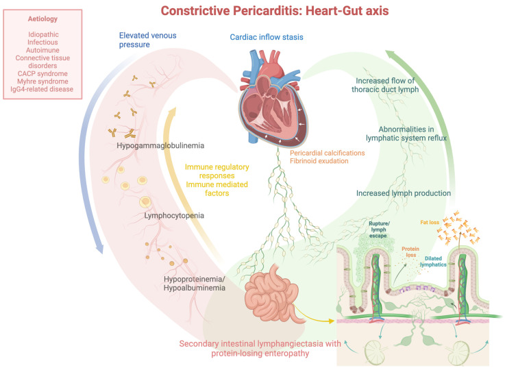
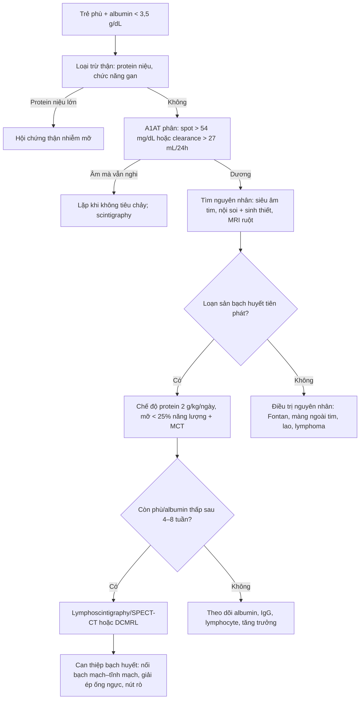
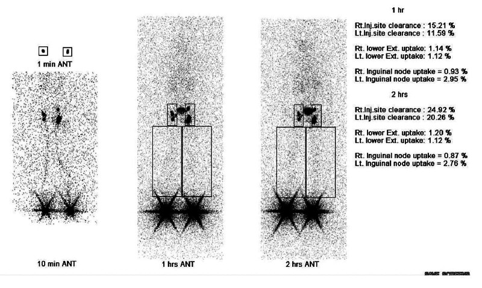
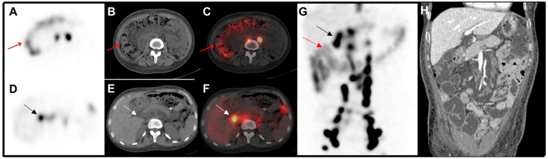

# 6158 — Protein-losing enteropathy do bạch huyết ở trẻ / Lymphatic protein-losing enteropathy in children

**Tags:** `pattern:phu` `pattern:giam-albumin` `pattern:ro-bach-huyet` `pattern:day-thanh-ruot` `vung:ruot-non` `vung:o-bung` `vung:ong-nguc` `score:A1AT-clearance` `protocol:xac-lap-bach-huyet` `protocol:lymphoscintigraphy` `protocol:SPECT-CT` `protocol:DCMRL` `incidentaloma:khong`

**Mức chắc chắn (certainty):** tổng hợp y văn (literature synthesis) — 1 ca nguyên văn nhi khoa có đủ lymphoscintigraphy + kết quả phẫu thuật bạch huyết (*Arch Plast Surg* 2026, **PMC13461259**, CC BY 4.0), 2 bài tổng quan cơ chế – điều trị (**PMC13331498**, *Ann Pediatr Cardiol* 2026, CC BY-NC-SA 4.0; **PMC11396116**, *J Clin Med* 2024, CC BY 4.0), 1 ca hình ảnh lymphoscintigraphy + SPECT/CT (*Diagnostics* 2025, **PMC11898979**, CC BY 4.0) và 1 nghiên cứu về xét nghiệm alpha-1 antitrypsin trong phân (*World J Nucl Med* 2025, **PMC12774530**, CC BY 4.0). Nhóm **không có bệnh nhân của mình**; phần **liều thuốc** không có nguồn đủ chắc được ghi là **chưa đủ nguồn**, không bịa.

> **Câu chốt:** PLE do bạch huyết ở trẻ **không phải "bệnh ruột" đơn thuần** — đó là **hệ bạch huyết bị tắc ở đâu đó giữa ruột và tĩnh mạch dưới đòn**. Dịch bạch huyết giàu albumin, IgG và lymphocyte rò vào lòng ruột → bộ ba **giảm albumin + giảm IgG + giảm lymphocyte**, phù, tiêu chảy, suy dinh dưỡng. Ba số phải thuộc: **(1)** xác định mất protein qua ruột bằng **alpha-1 antitrypsin (A1AT) trong phân: spot > 54 mg/dL, clearance > 27 mL/24 giờ khi không tiêu chảy và > 56 mL/24 giờ khi có tiêu chảy**; **(2)** ngưỡng chẩn đoán phù do mất protein là **albumin < 3,5 g/dL và protein toàn phần < 6 g/dL** (PMC13331498); **(3)** ở bệnh nhân Fontan, PLE gặp **~12%**, sống 5 năm từ cơn đầu **88%**, và **ghép tim có tử vong chu phẫu tới 40% ở một số đoàn hệ** (PMC13331498). Điều trị **phải nhắm nguyên nhân tắc bạch huyết**, không chỉ truyền albumin.

## 1. Tổng quan bệnh học – cơ chế hình ảnh

### 1.1 Vì sao mất protein lại đi kèm mất IgG và lymphocyte

- **Giải phẫu – sinh lý:** nhung mao ruột non có **mạch bạch huyết trung tâm (lacteal)** hút **chylomicron** và dịch kẽ. Dịch bạch huyết chứa **albumin, globulin (đặc biệt IgG), lymphocyte và mỡ**. Khi **áp lực bạch huyết trong thành ruột tăng** — do tắc đường dẫn lưu trung tâm, hẹp ống ngực, tăng áp lực tĩnh mạch trung tâm, hoặc loạn sản mạch bạch huyết — các **mạch bạch huyết giãn (lymphangiectasia)** vỡ vào lòng ruột. Kết quả là mất protein **không chọn lọc**: albumin, IgG, IgA, lymphocyte, và cả mỡ.
- **Vì sao lại là "bộ ba" giảm albumin – giảm IgG – giảm lymphocyte:** ba thành phần này **cùng nằm trong dịch bạch huyết**, nên mất qua ruột sẽ giảm cả ba. Đây là điểm **phân biệt với bệnh thận mất protein (nephrotic)**: mất albumin nhưng **IgG và lymphocyte thường bình thường**, và nước tiểu có protein lượng lớn. Giảm lymphocyte còn gây **suy giảm miễn dịch tế bào**, dẫn tới nhiễm trùng tái phát — và nhiễm trùng lại làm PLE nặng thêm (vòng xoắn).
- **Vì sao dùng MCT (medium-chain triglyceride):** acid béo chuỗi dài (> 12 carbon) được **ester hóa thành chylomicron** rồi vào **lacteal** — tức là **làm tăng dòng bạch huyết và tăng rò**. MCT (C8–C10) **hấp thu trực tiếp vào tĩnh mạch cửa**, **không qua lacteal**, nên giảm thể tích và áp lực dịch bạch huyết trong ruột. Đây là cơ sở của chế độ **protein ~2 g/kg/ngày, mỡ < 25% năng lượng, bổ sung MCT** (PMC13331498).
- **Vì sao hình ảnh hạt nhân nhìn thấy chỗ rò:** **99mTc-antimony sulphide colloid (99mTc-ASC)** tiêm dưới da được **mạch bạch huyết ban đầu hấp thu** và đi theo đường bạch huyết. Bình thường, tracer đi lên **hạch bẹn – chậu – thắt lưng – ống ngực – góc tĩnh mạch**, không vào lòng ruột. Khi có **tắc dẫn lưu trung tâm**, tracer **trào ngược** và **rò vào lòng ruột**, hiện thành **ổ phóng xạ trong quai ruột** trên hình planar và định vị được bằng **SPECT/CT**. Đây là lý do lymphoscintigraphy vừa **chứng minh rò**, vừa **chỉ ra cơ chế tắc** (PMC11898979).

*Sơ đồ: tăng áp lực tĩnh mạch + ứ trệ dòng vào tim → tăng dòng và áp lực ống ngực → giãn/ vỡ mạch bạch huyết ruột → mất protein, mỡ, lymphocyte vào lòng ruột. Nguồn: J Clin Med 2024, PMC11396116, CC BY 4.0 (nguyên bản).*

### 1.2 Ngưỡng định lượng nằm lòng

| Đại lượng | Ngưỡng / số liệu | Ý nghĩa thực hành | Nguồn |
|---|---|---|---|
| **A1AT spot trong phân** | **> 54 mg/dL** | Sàng lọc nhanh khi nghi PLE | PMC13331498 |
| **A1AT clearance** | **> 27 mL/24 giờ** (không tiêu chảy); **> 56 mL/24 giờ** (có tiêu chảy) | Tiêu chuẩn xác định mất protein qua ruột; **tiêu chảy làm tăng ngưỡng** | PMC13331498 |
| **Albumin máu** | **< 3,5 g/dL** | Ngưỡng phù do giảm albumin | PMC13331498 |
| **Protein toàn phần** | **< 6 g/dL** | Phối hợp với albumin | PMC13331498 |
| **PLE sau Fontan** | **~12%** bệnh nhân; sống 5 năm từ cơn đầu **88%** | Tư vấn tiên lượng | PMC13331498 |
| **Ghép tim ở PLE Fontan** | Tử vong chu phẫu **tới 40%** ở một số đoàn hệ; PLE thường **hết trong ~1 tháng** sau ghép | Chọn thời điểm ghép | PMC13331498 |
| **Ca nhi THSD1** | Albumin **1,5–2,0 g/dL** trước mổ; A1AT **138,7–195,6 mg/dL** (bình thường **< 27**); sau mổ albumin **1,5 → 3,2 g/dL** | Bằng chứng phẫu thuật bạch huyết có thể đảo ngược PLE | PMC13461259 |

## 2. Mẫu hình + chẩn đoán phân biệt theo cơ chế (gamut)

- **Nhóm 1 — bạch huyết tiên phát (primary intestinal lymphangiectasia, Waldmann disease):** loạn sản mạch bạch huyết ruột, khởi phát ở trẻ nhỏ; có thể đơn độc hoặc trong **hội chứng Hennekam (CCBE1)**, **đột biến THSD1**, **hội chứng RAS/MAPK (Noonan, CFC)**; kèm **phù bạch huyết chi**, tràn dịch màng phổi/màng tim.
- **Nhóm 2 — bạch huyết thứ phát do tắc trung tâm:** **sau Fontan**, **viêm màng ngoài tim co thắt**, suy tim phải, hẹp ống ngực, huyết khối tĩnh mạch trung tâm, xơ hóa sau xạ/phẫu thuật. Đây là nhóm **chữa được bằng cách giải quyết nguyên nhân** (mở cửa sổ Fontan, cắt màng ngoài tim, nong hẹp).
- **Nhóm 3 — bạch huyết do bệnh ruột:** **lao ruột**, **lymphoma**, **bệnh Crohn**, **viêm ruột do CMV**, **bệnh mô bào**, sau ghép tạng.
- **Nhóm 4 — PLE không do bạch huyết:** **bệnh celiac**, **viêm dạ dày ruột tăng bạch cầu ái toan**, loét/ăn mòn niêm mạc, nhiễm ký sinh trùng, **hội chứng ruột ngắn** (bài [1762](../1762-hoi-chung-ruot-ngan-nguoi-lon/lesson.md)).
- **Nhóm 5 — giảm albumin KHÔNG do ruột (bắt chước):** **hội chứng thận nhiễm mỡ** (mất qua nước tiểu), **xơ gan/suy gan** (giảm tổng hợp), **suy dinh dưỡng**, **giảm albumin máu bẩm sinh (congenital analbuminemia)** — albumin rất thấp nhưng **A1AT trong phân bình thường**, không có mất protein qua ruột.
- **Mnemonic "LYMPH":** **L**acteal dilation, **Y**ellow-white villi on endoscopy, **M**idgut leak on scintigraphy, **P**rotein + IgG + lymphocytes low, **H**ypoalbuminemia with edema.

## 3. Bảng so sánh phân biệt (ma trận đối chiếu)

| Thực thể (entity) | Hình ảnh / xét nghiệm điển hình | Chốt vào (rule-in) | Chốt loại (rule-out) | Gợi ý xác nhận |
|---|---|---|---|---|
| **Bạch huyết tiên phát (Waldmann, Hennekam, THSD1)** | Phù chi + phù mặt; **lymphoscintigraphy: dermal backflow + rò vào ruột**; nội soi: **nhung mao trắng như tuyết**; sinh thiết: **giãn mạch bạch huyết nhung mao** | **A1AT phân tăng + nội soi/sinh thiết có lymphangiectasia + phù bạch huyết ngoại vi** | Không có rò trên scintigraphy **không loại trừ** (rò ngắt quãng) | Nội soi + sinh thiết; gen CCBE1/THSD1/RAS-MAPK; DCMRL |
| **PLE sau Fontan / viêm màng ngoài tim co thắt** | Tiền sử Fontan hoặc chèn ép tim; **tăng áp lực tĩnh mạch trung tâm**; lymphoscintigraphy thấy **tắc dòng ra + trào ngược**; siêu âm tim/MRI xác nhận | **Bệnh tim phải + A1AT phân tăng + phù** | A1AT bình thường + không có bệnh tim → tìm nguyên nhân khác | Siêu âm tim, thông tim, MRI; điều trị nguyên nhân |
| **Bệnh celiac** | Teo nhung mao, tăng lymphocyte nội biểu mô; **anti-tTG IgA dương** | **Anti-tTG dương + teo nhung mao đáp ứng chế độ không gluten** | A1AT phân tăng đơn độc + anti-tTG âm → không phải celiac | Anti-tTG, nội soi + sinh thiết |
| **Viêm dạ dày ruột tăng bạch cầu ái toan** | Dày thành ruột, **tăng bạch cầu ái toan máu/dịch ruột**, đáp ứng corticoid | **Eosinophil cao + sinh thiết có xâm nhập eosinophil** | Eosinophil bình thường + lymphangiectasia → PLE bạch huyết | Sinh thiết, đáp ứng corticoid |
| **Hội chứng thận nhiễm mỡ** | **Protein niệu > 3,5 g/ngày**, albumin thấp, phù; **A1AT phân bình thường** | **Protein niệu lớn + A1AT phân bình thường** | A1AT phân tăng → mất qua ruột, không phải thận | Điện di protein niệu, sinh thiết thận |
| **Giảm albumin máu bẩm sinh** | Albumin rất thấp từ nhỏ, **phù nhẹ/không tương xứng với mức albumin**, **A1AT phân bình thường**, không mất qua thận | **A1AT phân bình thường + không protein niệu** | Có mất protein qua ruột → không phải bẩm sinh đơn thuần | Điện di protein, gen ALB |

## 4. Protocol chẩn đoán – điều trị

### 4.1 Trình tự (không bỏ bước xác định mất protein)

- **Bước 1 — chứng minh mất protein qua ruột:** A1AT là protein do gan tổng hợp, **không bị phân hủy trong ruột**, nên xuất hiện trong phân khi có rò protein. **Phải lấy mẫu 24 giờ** nếu làm clearance; **spot** dùng sàng lọc nhưng **ảnh hưởng bởi độ pha loãng phân**. Nếu trẻ đang tiêu chảy, **ngưỡng tăng lên 56 mL/24 giờ** (PMC13331498).
- **Bước 2 — loại trừ mất protein ngoài ruột:** protein niệu, chức năng gan (albumin, INR), tình trạng dinh dưỡng. Đừng bỏ qua **giảm albumin bẩm sinh** ở trẻ nhỏ.
- **Bước 3 — tìm nguyên nhân:** **siêu âm tim** (Fontan, chèn ép, suy tim phải), **nội soi tiêu hóa + sinh thiết** (nhung mao trắng, giãn lacteal, lymphoma, lao), **MRI ruột** (dày thành, phù mạc treo), **lymphoscintigraphy planar + SPECT/CT**, **DCMRL** khi cần bản đồ giải phẫu trước can thiệp.
- **Bước 4 — điều trị:** điều trị nguyên nhân + **dinh dưỡng** (protein ~2 g/kg/ngày, mỡ < 25% năng lượng, MCT, vitamin tan trong mỡ, canxi). Thuốc hỗ trợ: **lợi tiểu, truyền albumin/IVIG, corticoid, heparin trọng lượng phân tử thấp, midodrine, sirolimus** — bằng chứng chủ yếu **ca lẻ/ý kiến chuyên gia**, không có thử nghiệm ngẫu nhiên (PMC13331498; PMC11396116).
- **Bước 5 — can thiệp bạch huyết khi kháng trị:** **nối bạch mạch–tĩnh mạch (lymphaticovenous anastomosis, LVA)**, **nối hạch–tĩnh mạch (LNVA)**, **giải ép ống ngực**, **nút mạch bạch huyết**. Ca nhi THSD1: sau LVA + LNVA, albumin **1,5 → 3,2 g/dL**, chu vi chi giảm, A1AT **bình thường hóa**; nhưng **tái phát sau 3 năm** sau nhiễm hô hấp trên — bằng chứng rằng can thiệp **không phải chữa khỏi vĩnh viễn** ở trẻ đang lớn (PMC13461259).

### 4.2 Hình ảnh chốt: lymphoscintigraphy và SPECT/CT

*Ba mốc 10 phút – 1 giờ – 2 giờ sau tiêm dưới da: **dermal backflow** (trào ngược vào da) hai bên, rõ hơn ở chân phải — dấu hiệu **loạn sản/tắc dẫn lưu bạch huyết**, không phải phù do tim–thận. Nguồn: Arch Plast Surg 2026, PMC13461259, CC BY (nguyên bản).*

*SPECT/CT định vị **phóng xạ trong đại tràng lên và ngang** (mũi tên đỏ) — bằng chứng tracer thoát vào lòng ruột; kèm **hạch quanh tụy** và **dày thành quai ruột** trên CT cản quang (H). Nguồn: Diagnostics 2025, PMC11898979, CC BY 4.0 (nguyên bản).*

## 5. Biến thể bình thường và cạm bẫy

- **A1AT âm không loại trừ PLE:** rò có thể **ngắt quãng**, và **tiêu chảy pha loãng** làm giảm nồng độ; phải lặp xét nghiệm **khi không tiêu chảy** hoặc chuyển sang **scintigraphy**. Ngược lại, **tiêu chảy kéo dài** làm tăng ngưỡng clearance (PMC13331498).
- **Phù do tim/thận bị gọi nhầm là PLE:** ở trẻ Fontan, phù có thể do **suy tim phải** đơn thuần; chỉ gọi PLE khi **có bằng chứng mất protein qua ruột**. Đo A1AT trước khi kết luận.
- **Bỏ sót phù bạch huyết ngoại vi:** phù chi **không đối xứng**, dày da, **dermal backflow** trên scintigraphy là manh mối của **bệnh bạch huyết hệ thống** (Hennekam, THSD1), không chỉ là hậu quả của giảm albumin.
- **Sinh thiết ruột bình thường không loại trừ:** tổn thương **khu trú** ở hỗng tràng, có thể bỏ sót nếu sinh thiết tá tràng; nội soi viên nang (**video capsule**) tăng tỉ lệ phát hiện (PMC11396116).
- **MCT không phải "thuốc chữa":** cải thiện albumin nhưng **không giải quyết tắc trung tâm**; trẻ vẫn có thể tiến triển xơ gan, suy dinh dưỡng, nhiễm trùng. Đánh giá lại nếu albumin không tăng sau **4–8 tuần**.
- **Sau can thiệp bạch huyết vẫn tái phát:** ca nhi THSD1 tái phát sau **3 năm**, sau một đợt nhiễm hô hấp trên — cần theo dõi **albumin, A1AT, chu vi chi** dài hạn (PMC13461259).

## 6. Tự lượng giá — Blind Quiz

**Ca 1 — Bé trai 7 tuổi, phù hai chân kéo dài, albumin 1,5 g/dL:**

- Gợi ý: phù chân không đối xứng, không protein niệu, men gan bình thường.
- Hỏi: (1) mô tả bất thường trên ba mốc thời gian; (2) nghĩ bệnh gì; (3) xét nghiệm nào xác định mất protein qua ruột?

<b>Bấm để hiện đáp án (findings + chẩn đoán)</b>

- **Findings:** ở **10 phút** đã thấy **dermal backflow** sớm hai bên; **1 giờ và 2 giờ** dermal backflow rõ hơn ở **chân phải**, kèm ứ trệ/ trào ngược — không có dòng bạch huyết thẳng lên ống ngực như bình thường.
- **Chẩn đoán:** **loạn sản bạch huyết hệ thống có PLE** — ca thật của bé trai **7 tuổi mang đột biến THSD1**, phù bạch huyết chi + PLE; albumin trước mổ **1,5–2,0 g/dL**, A1AT phân **138,7–195,6 mg/dL** (bình thường **< 27**).
- **Xác định mất protein qua ruột:** **A1AT clearance 24 giờ > 27 mL/24h** (không tiêu chảy) hoặc **> 56 mL/24h** (có tiêu chảy), hoặc **spot > 54 mg/dL**.
- **Điều trị của ca:** LVA + LNVA, albumin **1,5 → 3,2 g/dL**, A1AT bình thường hóa; **tái phát sau 3 năm**.
- **Nguồn ảnh:** *Arch Plast Surg* 2026, **PMC13461259**, Fig. 5 — **CC BY** (nguyên bản).

**Ca 2 — Nữ 30 tuổi, phù từ chân lên mặt, tiêu chảy nhẹ 8 tháng, albumin thấp:**

- Hỏi: (1) phóng xạ bất thường nằm ở đâu? (2) cơ chế nào giải thích cả phù chi và mất protein qua ruột? (3) vì sao không phải bệnh thận?

<b>Bấm để hiện đáp án</b>

- **Findings:** **phóng xạ lan tỏa trong đại tràng lên và ngang** (mũi tên đỏ) — tracer đã **đi vào lòng ruột**; thêm **hạch quanh tụy** và **dày thành hỗng tràng/tá tràng** trên CT cản quang. Hình planar trước đó còn thấy **dermal backflow** hai chân.
- **Cơ chế:** **tắc dòng ra bạch huyết trung tâm** (góc tĩnh mạch/ống ngực) → **trào ngược** dịch bạch huyết qua ruột (PLE) **và** qua da/chi dưới (phù bạch huyết). Đây là "một tắc – hai biểu hiện".
- **Vì sao không phải thận:** không protein niệu, chức năng thận bình thường; **A1AT trong phân tăng** mới là bằng chứng mất protein qua **ruột**.
- **Lưu ý:** ca này là **người lớn** — dùng để dạy **hình ảnh và cơ chế**, không đại diện cho nhóm nhi khoa.
- **Nguồn ảnh:** *Diagnostics* 2025, **PMC11898979**, Fig. 2 — **CC BY 4.0**.

**Ca 3 — Tình huống tổng hợp (không phải ca nguyên văn): trẻ sau phẫu thuật Fontan 6 năm, phù, albumin 2,6 g/dL, tiêu chảy:**

- Hỏi: (1) nhìn sơ đồ mục 1.1, kể **chuỗi cơ chế** từ tim đến ruột; (2) tại sao **MCT** giúp mà **không chữa khỏi**; (3) biện pháp nào giải quyết **nguyên nhân**?

<b>Bấm để hiện đáp án</b>

- **Chuỗi cơ chế:** tuần hoàn Fontan → **tăng áp lực tĩnh mạch trung tâm** + giảm cung lượng → ứ trệ bạch huyết → **tăng sản xuất và áp lực dịch ống ngực** → **giãn/vỡ mạch bạch huyết nhung mao** → mất albumin, IgG, lymphocyte, mỡ vào lòng ruột → **phù, giảm albumin, suy dinh dưỡng, giảm miễn dịch** (PMC13331498; sơ đồ PMC11396116).
- **MCT giúp nhưng không chữa:** MCT hấp thu vào **tĩnh mạch cửa**, **bỏ qua lacteal**, nên **giảm thể tích dịch bạch huyết** và giảm rò — nhưng **áp lực tĩnh mạch trung tâm vẫn cao**, nên bệnh vẫn tiến triển.
- **Giải quyết nguyên nhân:** tối ưu huyết động Fontan (nong/stent hẹp, **mở cửa sổ Fontan**), **cắt màng ngoài tim** nếu viêm màng ngoài tim co thắt, và **ghép tim** khi suy tuần hoàn — PLE thường **hết trong ~1 tháng** sau ghép, nhưng **tử vong chu phẫu tới 40%** ở một số đoàn hệ (PMC13331498).
- **Câu chốt:** đừng điều trị "giảm albumin" như một bệnh độc lập — **tìm và giải quyết tắc bạch huyết**.

## Bài liên quan chéo
- [1822 – DCMRL bạch huyết](../1822-dcmrl-bach-huyet/lesson.md) — bản đồ bạch huyết trước can thiệp
- [1823 – Trametinib trong dị dạng bạch huyết RAS/MAPK](../1823-trametinib-di-dang-bach-huyet-ras-mapk/lesson.md)
- [1808 – Sirolimus trong dị dạng bạch huyết: theo dõi ngừng thuốc](../1808-sirolymus-di-dang-bach-huyet-theo-doi-ngung-thuoc/lesson.md)
- [6157 – Tràn dưỡng chấp màng tim ở trẻ](../6157-tran-duong-trap-mang-tim-tre/lesson.md)
- [1839 – Chylothorax sau cắt/ghép gan](../1839-chylothorax-sau-cat-gan/lesson.md)
- [600 – Tổng quan Nhi khoa](../600-tong-quan-nhi-khoa/lesson.md)

> Không dùng để chẩn đoán độc lập khi chưa có người hướng dẫn.
