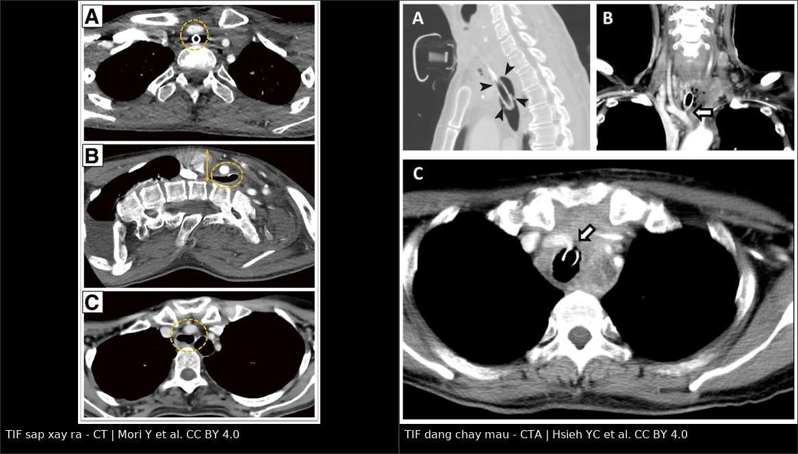
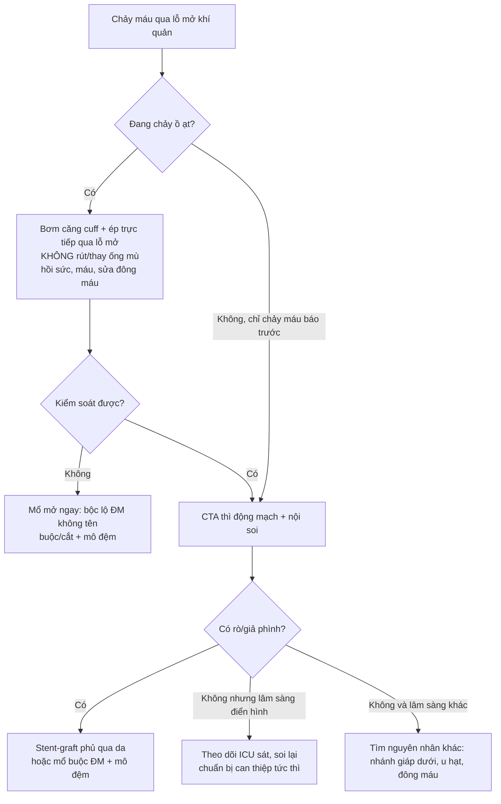
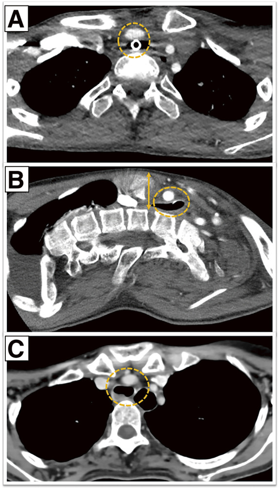
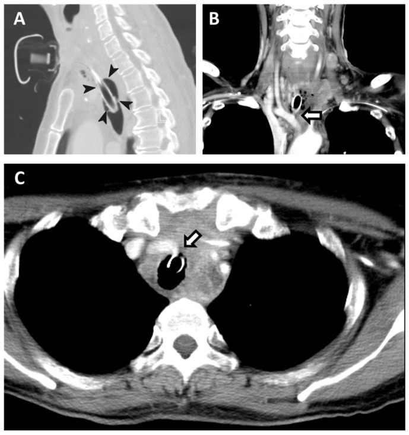
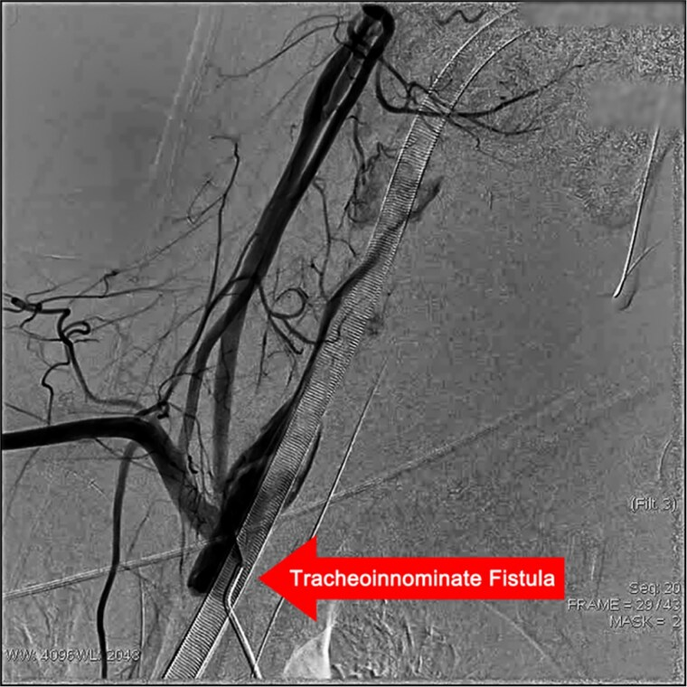

# 6159 — Rò khí quản – động mạch không tên (tracheo-innominate fistula): chảy máu "báo trước", đo khoảng trước xương ức và chèn ép bằng cuff

**Tags:** `pattern:chay-mau-duong-tho` `pattern:ro-dong-mach` `pattern:gia-phinh` `pattern:hep-khoang-trung-that` `vung:khi-quan` `vung:trung-that` `vung:mach-co` `protocol:CTA` `protocol:noi-soi-phe-quan` `protocol:DSA`
**Mức chắc chắn (certainty):** tổng hợp y văn (literature synthesis) — **1 loạt 3 ca "TIF sắp xảy ra" có CT** (PMC13186634), **1 ca nguyên văn CTA lúc chảy máu có cuff bơm căng** (PMC10814070), **1 ca nguyên văn có DSA + stent-graft** (PMC13091394), cùng 2 bài tổng quan về chảy máu sau mở khí quản (PMC13449771; PMC13740721). Chỗ suy luận được ghi **[suy luận]**.

> **Câu chốt:** TIF là biến chứng **hiếm (< 1%) nhưng tử vong > 50% dù đã can thiệp và 100% nếu không can thiệp** (PMC13449771). Cơ hội duy nhất để cứu bệnh nhân là **nhận ra "chảy máu báo trước" (sentinel bleed)** — nhưng nó **chỉ có ở 30% ca**; 70% còn lại đến viện bằng chảy máu ồ ạt (PMC13449771). Hai việc **không được làm**: **rút/thay ống mù** (mất nút chèn ép) và **đẩy bệnh nhân đi CT khi đang chảy máu không kiểm soát**. Hai con số định vị nguy cơ: **khoảng trước xương ức < 20 mm** trên CT sagittal (PMC13186634) và **vòng sụn khí quản 6–9** — nơi động mạch không tên bình thường bắt ngang qua (PMC13449771).

## 1. Tổng quan bệnh học – cơ chế hình ảnh

- **Giải phẫu quyết định mọi thứ:** động mạch không tên (brachiocephalic trunk) tách từ quai động mạch chủ, đi **lên–sang phải trước khí quản**, bắt ngang khí quản ở khoảng **vòng sụn 6–9**; giữa hai cấu trúc chỉ là **mô liên kết lỏng + mạc trước khí quản dày vài mm**. Khi động mạch **"đi cao" (high-riding)** — chạy dọc, lên cao trong eo ngực — hoặc khi có **quai bò (bovine arch)** (gặp **~35%** dân số) thì khoảng cách này ngắn hơn hẳn (PMC13449771).
- **TẠI SAO rò hình thành:** cuff bơm quá căng (**over-inflation**) → áp lực lên niêm mạc khí quản vượt áp lực tưới máu mao mạch → **thiếu máu niêm mạc → viêm sụn → hoại tử thành trước khí quản → ăn mòn thành sau động mạch** → rò. Vì tổn thương là **hoại tử áp lực từ từ**, rò xuất hiện **sau nhiều tuần đến vài tháng** (ca dưới đây: **2,5 tháng**), không phải ngay sau mở khí quản (PMC13449771).
- **Yếu tố nguy cơ (đã liệt kê trong y văn):** đặt ống/khí quản quản **> 3 tuần**, **mở khí quản quá thấp** (ống sát động mạch), béo/cổ ngắn, **dị dạng cột sống**, **xạ trị vùng cổ–trung thất**, **suy dinh dưỡng**, **suy giảm miễn dịch**, **nhiễm trùng lỗ mở/trung thất**, **tụt huyết áp kéo dài**, **corticoid**, và **bovine arch/động mạch đi cao** (PMC13449771; PMC13740721).
- **TẠI SAO CTA thấy được:** khi có rò, thuốc cản quang **thoát từ lòng động mạch vào lòng khí quản** ở thì **động mạch (arterial phase)** → thấy **dòng thuốc / ổ đọng thuốc trong khí quản**, **giả phình** hoặc **mất mặt phẳng mỡ giữa ống và động mạch**. Nếu cuff còn bơm căng, chính **bóng cuff đè lên chỗ rò** — trên CTA thấy **thành khí quản phồng ra, cản thuốc** đúng vị trí rò (PMC10814070).
- **TẠI SAO CT có thể âm tính giả:** chảy máu **ngắt quãng**, đang được **cuff chèn ép**, chụp **không thì động mạch**, hoặc **giả ảnh streak** từ ống kim loại. Vì vậy **CTA âm tính không loại trừ TIF** khi bệnh cảnh điển hình.
- **Số liệu định lượng cốt lõi:**
  - **Tần suất:** **< 0,1%–1%** tổng số ca mở khí quản; **chảy máu chung sau mở khí quản 0,6–5,0%** (phần lớn là rỉ máu nhẹ) (PMC13449771; PMC13740721).
  - **Tử vong:** **> 50%** dù can thiệp; **100%** nếu không can thiệp (PMC13449771; PMC13186634).
  - **Chảy máu báo trước:** chỉ **30%** ca; 70% không có dấu hiệu nào trước cơn ồ ạt (PMC13449771).
  - **Bối cảnh thuận lợi:** **90%** bệnh nhân mở khí quản **không biến chứng trong 90 ngày** và **88%** cai ống thành công — nghĩa là TIF là biến cố **hiếm nhưng không thể bỏ qua** (PMC13449771).
  - **Bovine arch:** **~35%**; TIF ở nhóm này **hay bị báo cáo thiếu** vì động mạch nằm sát khí quản hơn (PMC13449771).

## 2. Mẫu hình + chẩn đoán phân biệt theo vị trí (gamut)

**Mẫu hình chốt:** bệnh nhân **đang có ống mở khí quản**, **chảy máu đỏ tươi qua lỗ mở**, có thể **chỉ một lần rồi tự cầm** ("sentinel bleed"), sau đó **vài giờ đến vài ngày** chảy máu ồ ạt; soi thấy **mô hạt đập theo mạch** ở **thành trước khí quản**.

- **Theo thời điểm so với lúc mở khí quản:**
  - **Sớm (giờ–ngày đầu):** tổn thương **nhánh động mạch giáp dưới** (inferior thyroid artery), rỉ máu lỗ mở, rối loạn đông máu — thường **không ồ ạt** và **không có mô hạt đập**.
  - **Muộn (tuần–tháng):** TIF, **u hạt/loét do đầu ống**, **hẹp khí quản** — TIF là nguyên nhân **chết người** của nhóm này.
- **Theo hình ảnh:**
  - **CT/CTA:** ống **sát/đè** thành trước khí quản; **mất mặt phẳng mỡ** giữa khí quản và động mạch; **giả phình** động mạch không tên; **thuốc thoát vào khí quản**; **khoảng trước xương ức < 20 mm**.
  - **Nội soi phế quản:** **mô hạt đập**, **cục máu đông**, **lỗ rò nhỏ** ở thành trước — vừa chẩn đoán vừa có thể **chèn ép tạm**.
  - **DSA:** xác định **vị trí và kích thước lỗ rò** (ca dưới đây: **3 mm**) và **đặt stent-graft** ngay (PMC13091394).
- **Gamut "ống mở khí quản + máu":** TIF – nhánh giáp dưới – u hạt chảy máu – loét do đầu ống – rối loạn đông máu/DIC – u khí quản – rò khí quản–thực quản (thường **thức ăn/dịch**, không phải máu đỏ tươi).

## 3. Bảng so sánh phân biệt (ma trận đối chiếu)

| Thực thể (entity) | Hình ảnh điển hình (CT/CTA/nội soi) | Chốt vào (rule-in) | Chốt loại (rule-out) | Gợi ý xác nhận |
|---|---|---|---|---|
| **Rò khí quản – động mạch không tên (TIF)** | Ống sát thành trước khí quản; **mất mặt phẳng mỡ**; **giả phình**; **thuốc thoát vào khí quản**; soi: **mô hạt đập** | **Chảy máu đỏ tươi qua lỗ mở, tự cầm rồi tái phát + mô hạt đập ở thành trước** | Không có mô hạt đập, không có máu đỏ tươi, CT có mặt phẳng mỡ rõ → nghĩ nguyên nhân khác | CTA thì động mạch + nội soi; DSA khi cần can thiệp |
| **Tổn thương nhánh động mạch giáp dưới** | Máu ở **quanh lỗ mở**, không có khối trong khí quản; CTA không thấy thuốc vào lòng khí quản | **Chảy máu ngay–vài ngày sau mổ, khu trú ở bờ lỗ mở** | **Mô hạt đập + chảy máu tái phát muộn** → nghĩ TIF | Nội soi + CTA; thường xử trí tại chỗ |
| **U hạt / loét do đầu ống** | Nốt mô hạt **không đập**, đầu ống tì vào thành sau/trước; không có giả phình | **Chảy máu nhỏ, dai dẳng, không ồ ạt; thấy điểm tì của đầu ống** | **Động mạch đập ngay dưới tổn thương** → coi như TIF cho tới khi loại trừ | Nội soi; theo dõi sát |
| **Rò khí quản – thực quản** | Khí trong thực quản, dịch/thức ăn trong khí quản; **không có máu đỏ tươi** | **Nuốt sặc, dịch tiêu hóa trong khí quản** | **Máu đỏ tươi + mô hạt đập** → nghĩ mạch máu | Nội soi + cản quang nuốt |
| **Giả phình động mạch không tên chưa rò** | Khối cản thuốc **cạnh** khí quản, **không có thuốc trong lòng khí quản** | **Khối đập cạnh khí quản trên CTA, chưa có máu qua lỗ mở** | **Đã có máu đỏ tươi qua lỗ mở** → đã rò | CTA + DSA; can thiệp dự phòng khi có triệu chứng |

*Trái: CT trước mổ — ống mở khí quản tiếp giáp trực tiếp động mạch không tên (vòng đứt nét), dựng sagittal cho khoảng trước xương ức 18 mm. Phải: CTA khi đang chảy máu — cuff bơm căng đè lên chỗ rò (mũi tên đầu). Nguồn: Mori Y et al., CC BY 4.0 (PMC13186634); Hsieh YC et al., CC BY 4.0 (PMC10814070). Ảnh ghép letterbox.*

### Ba dấu hiệu định vị trên CT sagittal (thay cho "nhìn thấy là biết")
- **Khoảng trước xương ức (retrosternal distance):** đo từ **mặt sau xương ức** tới **mặt trước thân đốt sống cổ/ngực** trên lát giữa. **< 20 mm** = trung thất trước trên chật, ống dễ tì vào động mạch (ca báo cáo: **18 mm**) (PMC13186634).
- **Khoảng cách ống–động mạch:** đo từ **bờ ngoài ống** tới **bờ động mạch** trên lát ngang tại mức bắt ngang; **mất lớp mỡ** giữa hai cấu trúc là dấu hiệu đáng lo nhất.
- **Mức bắt ngang:** ghi theo **vòng sụn khí quản** (bình thường **6–9**); càng **lên cao** càng nguy hiểm (PMC13449771).

## 4. Protocol chụp + phân tầng nguy cơ

- **CTA cổ–ngực trên:** lát **≤ 1 mm**, **thì động mạch** (bolus tracking ở quai ĐMC), **dựng sagittal + coronal + MPR**; **không cần** chụp lại nhiều lần — một lần đủ để trả lời ba câu: ống có chạm động mạch không, có giả phình không, có thuốc trong khí quản không.
- **Nội soi phế quản ống mềm** (nếu bệnh nhân ổn định): tìm **mô hạt đập**, **cục máu đông**, **lỗ rò**; có thể **bơm cuff chèn tạm** hoặc đặt **ống chèn có bóng**.
- **DSA:** chỉ định **đồng thời chẩn đoán + điều trị** (stent-graft phủ) khi chảy máu kiểm soát được bằng cuff; ca nguyên văn: **rò 3 mm**, đặt stent-graft, **rút ống ngày 5**, stent thông **1 tháng** (bệnh nhân còn di chứng thần kinh nặng do thiếu máu não) (PMC13091394).
- **Không có hệ phân độ RADS cho TIF.** Phân tầng thực hành theo **3 mức**:

- **Dự phòng (quan trọng hơn cấp cứu):** giữ **áp lực cuff 20–30 cmH₂O** (không vượt 30, kiểm bằng manometer mỗi ca trực); **đặt ống không quá thấp**; đầu ống cách carina **≥ 2 cm**; với nguy cơ cao (động mạch đi cao, bovine arch, khoảng trước xương ức < 20 mm, xạ trị, suy dinh dưỡng) → **cân nhắc mô đệm (muscle flap) giữa khí quản và động mạch** khi mở khí quản (PMC13449771).

## 5. Biến thể bình thường và cạm bẫy

- **Biến thể bình thường:** động mạch không tên **bắt ngang cao** ở người trẻ/cổ dài; **quai bò type 1** (thân chung ĐM cảnh trái + ĐM không tên) gặp **~35%**, không phải bệnh — nhưng **làm thay đổi khoảng cách ống–động mạch** (PMC13449771). **Bóng cuff bình thường** khi bơm đúng có thể **chạm nhẹ** thành khí quản — chỉ gọi "tiếp giáp nguy hiểm" khi **mất lớp mỡ** và **đè lệch** thành.
- **Cạm bẫy 1 — coi "chảy máu báo trước" là rỉ máu lỗ mở:** đây là **cửa sổ duy nhất** để cứu; mọi chảy máu **đỏ tươi, một lần, tự cầm** ở bệnh nhân có ống mở khí quản phải **soi + CTA trong vài giờ** (PMC13740721; PMC13449771).
- **Cạm bẫy 2 — rút/thay ống mù để "xem cho rõ":** mất **nút chèn ép của cuff** và có thể **mất đường thở** trong vài giây; nếu buộc phải thay, phải **có ống khác đã chuẩn bị + nội soi + phẫu thuật mạch đứng chờ** (PMC10814070).
- **Cạm bẫy 3 — chụp CT không cản quang hoặc thì tĩnh mạch:** không thấy thuốc thoát; luôn **CTA thì động mạch**, và nếu bệnh nhân **không ổn định thì không đi CT** — ưu tiên **phòng mổ/phòng can thiệp**.
- **Cạm bẫy 4 — giả ảnh streak từ ống:** ống có dây kim loại tạo **vệt sáng–tối** dọc trục, có thể **che lỗ rò** hoặc **giả tạo khối**; đọc trên **MPR sagittal** và đối chiếu **nội soi**.
- **Cạm bẫy 5 — chỉ đo trên lát ngang:** khoảng cách ống–động mạch thay đổi theo **hô hấp và tư thế đầu**; đo trên **sagittal giữa** và ghi **mức vòng sụn** để so sánh giữa các lần chụp.
- **Cạm bẫy 6 — bỏ qua bovine arch/động mạch đi cao:** báo cáo ghi nhận **nhóm này bị báo cáo thiếu**; nếu thấy động mạch **đi lên dọc** trước khí quản, hạ ngưỡng cảnh giác và **theo dõi nội soi định kỳ** ở bệnh nhân mở khí quản lâu dài (PMC13449771).

## 6. Tự lượng giá — Blind Quiz ngay trên trang tĩnh

**Ca 1 — "Ống mở khí quản sát động mạch"**

- Gợi ý lâm sàng: bệnh nhân mở khí quản lâu ngày, chuẩn bị mổ vì nguy cơ chảy máu; chưa có cơn chảy máu nào.
- Câu hỏi: (1) Bất thường giải phẫu chính là gì? (2) Đo gì trên mặt cắt B và ngưỡng bao nhiêu? (3) Ba việc cần làm trước khi xảy ra chảy máu?

<b>Bấm để hiện đáp án (findings + chẩn đoán)</b>

- Dấu hiệu: **(A,C)** ống mở khí quản **tiếp giáp trực tiếp** động mạch không tên (vòng đứt nét), mất lớp mỡ giữa hai cấu trúc; **(B)** dựng sagittal cho **khoảng trước xương ức 18 mm** — dưới ngưỡng **20 mm**.
- Chẩn đoán: **TIF sắp xảy ra (impending TIF)** — động mạch nằm sát khí quản vì trung thất trước trên chật; chưa rò nên **chưa có máu**.
- Việc cần làm: **kiểm soát áp lực cuff (20–30 cmH₂O)**, **theo dõi nội soi** mô hạt đập, và **cân nhắc mô đệm/mổ dự phòng** ở ca nguy cơ rất cao.
- Nguồn ảnh: Mori Y et al., Ann Vasc Dis 2026, **CC BY 4.0** (PMC13186634).

**Ca 2 — "Cuff bơm căng đang cầm máu"**

- Gợi ý lâm sàng: nữ **58 tuổi**, chảy máu ồ ạt qua lỗ mở khí quản, đã bơm căng cuff để cầm máu tạm.
- Câu hỏi: (1) Thuốc cản quang đi đâu? (2) Vì sao bóng cuff phồng to lại là **dấu hiệu chẩn đoán**, không phải lỗi kỹ thuật? (3) Bước tiếp theo?

<b>Bấm để hiện đáp án (findings + chẩn đoán)</b>

- Dấu hiệu: **(A)** sagittal — bóng cuff **phồng to**, đè lệch **thành trước khí quản** (mũi tên đầu); **(B,C)** ngang — **thuốc thoát từ động mạch không tên** vào khí quản đúng chỗ cuff đè.
- Chẩn đoán: **TIF** — cuff vừa là **nguồn gốc cơ chế** (bơm quá căng gây hoại tử áp lực), vừa là **biện pháp cầm máu tạm**; vị trí bóng phồng chỉ đúng chỗ rò.
- Bước tiếp theo: **giữ cuff, không rút ống**, hội chẩn mạch máu → **DSA + stent-graft** hoặc mổ buộc động mạch + mô đệm.
- Nguồn ảnh: Hsieh YC et al., Diagnostics (Basel) 2024, **CC BY 4.0** (PMC10814070).

**Ca 3 — "Xác định lỗ rò và bịt bằng stent"**

- Gợi ý lâm sàng: nam trẻ, chảy máu ồ ạt qua lỗ mở khí quản, hồi sức thành công, được chụp mạch.
- Câu hỏi: (1) Dấu hiệu trên phim? (2) Kích thước tổn thương? (3) Hai lựa chọn điều trị triệt để và khác biệt chính?

<b>Bấm để hiện đáp án (findings + chẩn đoán)</b>

- Dấu hiệu: thuốc cản quang **thoát từ động mạch không tên** qua một **đường rò vào khí quản** (dấu sao) — đường rò **3 mm**.
- Chẩn đoán: **TIF** đã xác định bằng DSA; đặt **stent-graft** cầm máu, bệnh nhân **rút ống ngày 5**, stent thông ở **1 tháng** (còn di chứng thần kinh do thiếu máu não).
- Hai lựa chọn: **stent-graft phủ qua da** (nhanh, ít xâm lấn, cầu nối ở bệnh nhân không ổn định/cổ đã mổ) vs **mổ buộc/cắt động mạch + mô đệm** (triệt để, kiểm soát ổ nhiễm, nhưng nặng); nhiều ca cần **cả hai theo thì**.
- Nguồn ảnh: Peng X et al., J Surg Case Rep 2026, **CC BY-NC** (PMC13091394).

## Bài liên quan chéo
- [6100 — Chăm sóc và cai ống mở khí quản ở trẻ](../6100-cham-soc-va-cai-ong-mo-khi-quan-tre/lesson.md)
- [6143 — Cách ly thành khí quản, botulinum và nước bọt ở trẻ](../6143-cach-ly-thanh-khi-quan-botulinum-nuoc-bot-tre/lesson.md)
- [6144 — Nội soi thanh khí quản định kỳ ở trẻ có ống mở khí quản](../6144-noi-soi-thanh-khi-quan-dinh-ky-ong-mo-khi-quan-tre/lesson.md)
- [061 — Tràn khí trung thất](../061-tran-khi-trung-that/lesson.md)
- [1778 — Chấn thương phổi do sóng nổ ở trẻ](../1778-chan-thuong-phoi-song-no-tre/lesson.md)

> Không dùng để chẩn đoán độc lập khi chưa có người hướng dẫn.
