# 616 — Biến chứng viêm phổi nhi: viêm mủ màng phổi (empyema) & hoại tử phổi / Pediatric pneumonia complications: empyema & necrotizing pneumonia

**Tags:** `pattern:hoai-tu-phoi` `pattern:viem-mu-mang-phoi` `pattern:split-pleura` `vung:phoi` `vung:mang-phoi` `score:Light-criteria` `protocol:CT-nguc-can-quang` `protocol:sieu-am-phoi`
**Mức chắc chắn (certainty):** tổng hợp y văn (literature synthesis) — tự biên từ 6 nguồn mở (Ness-Cochinwala & Totapally 2025 CC BY; Foley & Parrish 2023 CC BY; Esposito 2026 CC BY; Schmiliver 2026 CC BY-NC; Hafez Eftekhari 2026 CC BY-NC; Abu-Hijleh 2026 CC BY) + 1 ca nguyên văn gắn ảnh (Gujar 2025 CC BY).

## 1. Tổng quan — TẠI SAO viêm phổi nhi "đi xa" thành mủ màng phổi & hoại tử nhu mô?

- **Phổ bệnh (spectrum):** một viêm phổi cộng đồng ở trẻ có thể tiến triển theo một dải liên tục — **tràn dịch cạnh viêm phổi (parapneumonic effusion — PPE)** → **viêm mủ màng phổi (empyema)** → **hoại tử phổi (necrotizing pneumonia — NP)** → **áp-xe phổi (lung abscess)** → **hoại tử thùy lan rộng (pulmonary gangrene)**. Tên gọi khác nhau theo **vị trí tổn thương** (khoang màng phổi hay nhu mô phổi) và **mức độ hoại tử**, chứ không phải các bệnh tách rời.
- **Định nghĩa mủ:** empyema = **mủ trong khoang màng phổi** (dịch đặc trắng–vàng, quánh, do protein đông, mảnh tế bào và fibrin) **hoặc** dịch màng phổi có **Gram stain/cấy dương tính** (Foley 2023). NP = **hóa lỏng (liquefaction) và tạo hang (cavitation)** nhu mô phổi; pulmonary gangrene = **≥ 50% một thùy** đã hoại tử chết (Ness-Cochinwala 2025).
- **TẠI SAO hình ảnh trông như vậy (cơ chế):**
  - **Nhu mô hoại tử/hóa lỏng trên CT = vùng giảm mật độ (hypoattenuation)**, không ngấm thuốc, **mất mạch máu** (loss of vascularity) vì vi huyết khối + độc tố vi khuẩn phá hủy mao mạch phổi → vùng hoại tử chứa dịch/hoại tử (mật độ nước ~0–20 HU) nằm trong đông đặc (30–60 HU) nên **nổi bật thành các ổ sáng hơn trong vùng đặc** (chênh mật độ). **Pneumatocele** (nang khí) hình thành do **van một chiều** — khí vào được, không ra → các túi khí thành mỏng, mô phổi xung quanh còn sức căng.
  - **Split pleura sign (dấu tách màng phổi):** quá trình viêm màng phổi gây **tăng sinh mao mạch và nguyên bào sợi (fibroblast)** cả màng phổi **tạng và thành** → hai lá màng phổi **dày, ngấm thuốc rõ**, bị **đẩy tách nhau** bởi dịch mủ ở giữa. Vì dấu hiệu dựa vào **ngấm thuốc**, nó **chỉ hiện trên thì cản quang màng phổi** (Foley 2023).
  - **Siêu âm phổi (lung ultrasound — LUS):** dịch **đơn thuần = trống âm (anechoic), đồng nhất**; dịch **phức tạp = tăng hồi âm (echogenic) + vách fibrin + khu trú (septations/loculations)** — fibrin là thứ hồi âm mạnh.
- **Ngưỡng định lượng (bắt buộc):**
  - **NP chiếm tới ~40% các viêm phổi có biến chứng** ở trẻ; một loạt ở Ai Cập: **54%** trẻ nhập viện vì CAP được chẩn đoán NP và **64%** ca NP **có kèm empyema** (Ness-Cochinwala 2025).
  - **Cấy máu chỉ dương tính < 10%**; nuôi cấy thường quy chỉ cho chẩn đoán vi sinh ở **30–50%** ca; ở ca empyema cấy âm, **PCR 16S rRNA dương thêm 31%** (Ness-Cochinwala 2025).
  - **Giai đoạn theo ATS (American Thoracic Society):** **xuất tiết (exudative) 24–72 giờ đầu** (dịch vô khuẩn, tự do, glucose bình thường, pH bình thường/giảm nhẹ) → **mủ–fibin (fibrinopurulent): glucose < 60 mg/dL, pH < 7,20, LDH > 3× giới hạn trên bình thường, có vách/khu trú** → **tổ chức hóa (organizing): tăng sinh nguyên bào sợi, tạo "vỏ màng phổi" (pleural peel) bó phổi** (Esposito 2026).
  - **Ngưỡng chỉ định dẫn lưu màng phổi (dịch phải dẫn lưu khi ≥ 1 tiêu chuẩn):** **pH < 7,20 · glucose < 40 mg/dL · LDH > 1000 IU/L · Gram stain/cấy dương tính** (Foley 2023).
  - **Tiêu chuẩn Light (dịch tiết – exudate):** tỷ lệ protein dịch/huyết tương **> 0,5** (Se 86%/Sp 84%), tỷ lệ LDH dịch/huyết tương **> 0,6** (Se 90%/Sp 82%), LDH dịch **> ⅔ giới hạn trên LDH huyết thanh** (Se 82%/Sp 89%); **chỉ cần 1/3 tiêu chuẩn** (Se 98%/Sp 83%) (Foley 2023).
  - **Split pleura + độ dày dịch toàn bộ > 30 mm:** **Se 79,4% / Sp 80,9%** phân biệt empyema–PPE có biến chứng với PPE không biến chứng (Foley 2023).
  - **Dự báo cần mổ (multivariate):** đau ngực kiểu màng phổi + **bạch cầu > 13.500/uL** + **khu trú (loculations)** + **split pleura sign** trên CT cản quang (Foley 2023).
  - **Cân nhắc cắt thùy (lobectomy):** NP với **hoại tử phổi lớn/các hang chiếm > 50% thùy** bị ảnh hưởng → diễn tiến kéo dài và nhiều biến chứng sau mổ hơn; cắt thùy có thể rút ngắn hồi phục ở nhóm này (Ness-Cochinwala 2025).

## 2. Mẫu hình + chẩn đoán phân biệt theo vị trí (Gamut)

- **Mẫu hình A — "ổ sáng/hang nằm trong vùng đông đặc" ở trẻ:** gamut theo **cơ chế**:
  - **Nhiễm trùng – hoại tử:** hoại tử phổi (cavitary necrosis — *S. pneumoniae*, *S. aureus/PVL-MRSA*, *S. pyogenes*, *Mycoplasma*), áp-xe phổi (đơn độc, thành rõ), nang khí (pneumatocele — hậu nhiễm tụ cầu/PVL, thường tự lành), hang lao.
  - **Ký sinh trùng:** **nang sán lá phổi (hydatid cyst)** — dấu "hoa súng" (water-lily sign) / màng nổi, hay gặp ở vùng dịch tễ.
  - **Bẩm sinh bội nhiễm:** CPAM (dị dạng đường thở phổi bẩm sinh) bội nhiễm.
  - **Khác:** nhồi máu phổi/hang sau chấn thương.
- **Mẫu hình B — "tràn dịch màng phổi cạnh viêm phổi" (đơn độc hay kết hợp A):**
  - **Nhiễm trùng:** PPE đơn thuần → PPE có biến chứng → **empyema** → **áp-xe phổi giả tràn dịch** (bẫy kinh điển).
  - **Không nhiễm trùng:** tràn dịch do viêm tụy, bệnh mô liên kết, ung thư/di căn màng phổi, phù (transudate).
- **Câu hỏi phân loại nhanh (4 câu rẻ nhất):** (1) **dịch tự do (free-flowing) hay khu trú (loculated)?** (2) **có split pleura sign không?** (3) **thành hang dày bao nhiêu, bờ đều hay lệch tâm?** (4) **khí trong hang kiểu gì — thông khí hoàn toàn (hoại tử) / mức khí–dịch (sán) / bọt khí (áp-xe)?**
- **Gợi nhớ:** **"PPE → MỦ → HOẠI TỬ"** là một dải bệnh của **cùng một ổ viêm**, cộng với 3 kẻ bắt chước màng phổi: **áp-xe, sán, lao**.

## 3. Bảng so sánh phân biệt (ma trận đối chiếu)

| Thực thể (entity) | Hình ảnh điển hình | Chốt vào (rule-in) | Chốt loại (rule-out) | Gợi ý xác nhận |
|---|---|---|---|---|
| **Hoại tử phổi (necrotizing pneumonia)** | Đông đặc chứa **vùng giảm mật độ không ngấm thuốc + mất mạch máu**, có hang/pneumatocele; trên X-quang đông đặc có **ổ sáng bên trong** | **Vùng giảm mật độ trong đông đặc + mất mạch máu + nang khí**, sốt/CRP cao, không cải thiện | Split pleura đơn độc không có tổn thương nhu mô → nghĩ empyema | CT cản quang; theo dõi X-quang; **> 50% thùy → cân nhắc cắt thùy** |
| **Áp-xe phổi (lung abscess)** | **Hang đơn độc, thành rõ, bờ đều/tròn**, thường có **mức khí–dịch**; góc **nhọn** với thành ngực | **Hang thành đều + bọt khí/mức dịch + không split pleura** | Split pleura + dịch thấu kính → empyema | CT; dẫn lưu/kéo dài kháng sinh |
| **Viêm mủ màng phổi (empyema / complicated PPE)** | Dịch **thấu kính (lenticular)**, góc **tù** với thành ngực, ép phổi; **split pleura sign** (2 lá màng phổi dày ngấm thuốc) | **Split pleura + dịch khu trú + (pH < 7,20 · glucose < 40 · LDH > 1000 · cấy +)** | Dịch trống âm tự do, không vách, không ngấm màng phổi → PPE đơn thuần | CT cản quang **thì màng phổi**; LUS; xét nghiệm dịch |
| **Tràn dịch đơn thuần (simple PPE)** | Dịch **tự do, đồng nhất, trống âm** trên LUS, di động theo tư thế; không vách | **Dịch trống âm + không khu trú + màng phổi không dày** | Vách/hồi âm/split pleura → đi theo empyema | LUS lặp lại; theo dõi dưới kháng sinh |
| **Nang sán phổi (hydatid cyst)** | **Nang thành dày nhất (~5,6 mm)**, **mức khí–dịch**, **dấu hoa súng/màng nổi** | **Màng nổi + mức khí–dịch + dịch tễ vùng nang sán** | Thành mỏng + bọt khí 1 ổ → áp-xe | CT ± MRI; huyết thanh chẩn đoán |
| **Nang khí (pneumatocele)** | Túi khí **thành rất mỏng**, nhiều ổ, trong/ven vùng đông đặc đang hồi phục | **Thành mỏng như tờ giấy + nhiều ổ + sau viêm tụ cầu/PVL** | Thành dày bờ không đều → nghĩ hoại tử/áp-xe | Theo dõi X-quang — thường tự thoái triển |

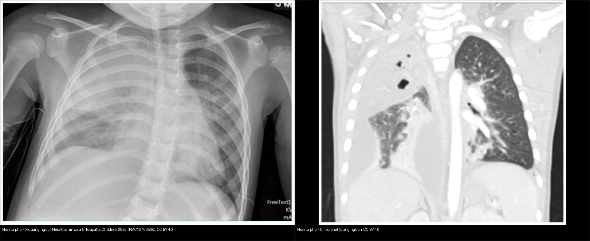
*Trái: X-quang ngực — đông đặc thùy trên phải. Phải: CT coronal cửa sổ phổi cùng ca — đông đặc có **ổ giảm mật độ + hang + pneumatocele** và **tràn dịch màng phổi phức tạp**. Nguồn: Ness-Cochinwala & Totapally, Children (Basel) 2025 (PMC12468505), CC BY 4.0. Ảnh ghép letterbox.*

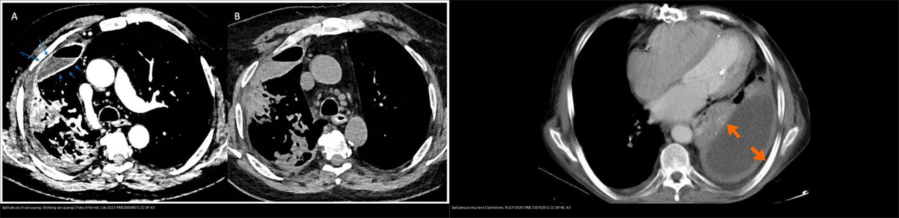
*Trái: CT cản quang (A) + không cản quang (B) — dấu split pleura chỉ hiện rõ trên thì cản quang (Foley & Parrish, Life 2023, PMC9959801, CC BY 4.0). Phải: CT ở trẻ — màng phổi tạng/thành dày ngấm thuốc (mũi tên), tách nhau bởi dịch mủ (Schmiliver, World J Clin Pediatr 2026, PMC13010351, CC BY-NC 4.0). Ảnh ghép letterbox.*

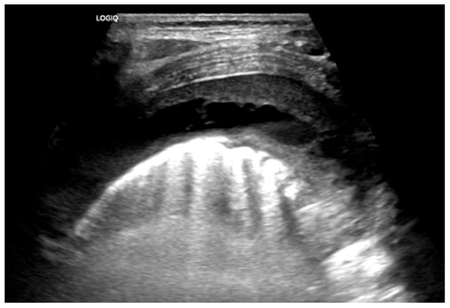
*Siêu âm phổi (LUS): tràn dịch cạnh viêm phổi **phức tạp** — dịch **tăng hồi âm, có vách fibrin và khu trú** (khác dịch đơn thuần trống âm, tự do). Nguồn: Ness-Cochinwala & Totapally, Children (Basel) 2025 (PMC12468505), Fig. 6, CC BY 4.0.*

### Ba dấu hiệu "lè lưỡi" chia đôi gamut
- **Split pleura sign:** màng phổi tạng **và** thành dày ngấm thuốc, tách bởi dịch → **empyema/PPE có biến chứng** (gặp **98,7%** trên CT cản quang thì màng phổi ở BN nhiễm trùng màng phổi; **68%** trong báo cáo ban đầu) — (Foley 2023).
- **Hình học áp-xe vs empyema:** áp-xe **hình cầu, góc nhọn** với thành ngực, không split pleura; empyema **hình thấu kính, góc tù**, split pleura (cùng mật độ dịch — **hình học mới quyết định tên**).
- **Kiểu khí trong hang (Hafez Eftekhari 2026, n=53, CC BY-NC):** **hoại tử phổi = hang thông khí hoàn toàn**; **sán = mức khí–dịch**; **áp-xe = bọt khí (air-bubble)**.

## 4. Protocol chụp + hệ phân độ/điểm chuẩn hóa

- **Thứ tự hình ảnh (ALARA):** **X-quang ngực thẳng (+ nghiêng)** đầu tay → **siêu âm phổi (LUS)** để đo lượng dịch, đánh giá khu trú/vách (không tia xạ, lặp lại được) → **CT ngực cản quang** khi nghi **hoại tử phổi**, khu trú phức tạp, không cải thiện sau dẫn lưu hoặc cần loại trừ nguyên nhân khác (Ness-Cochinwala 2025).
- **CT ngực — điểm mấu chốt:** chụp **cản quang** (dấu split pleura phụ thuộc ngấm thuốc) và đọc **cửa sổ phổi** để thấy ổ giảm mật độ/hang/pneumatocele; ghi rõ **số lượng, kích thước, thành bao nhiêu mm, có mức khí–dịch, có chia > 50% thùy không**.
- **Phân tích dịch màng phổi (khi chọc hút được):** áp dụng **tiêu chuẩn Light** (bảng trên) để xác định dịch tiết; **dẫn lưu khi pH < 7,20 · glucose < 40 mg/dL · LDH > 1000 IU/L · Gram/cấy dương tính** (Foley 2023).
- **Ba giai đoạn ATS + giá trị của thuốc tiêu sợi huyết (fibrinolysis):** hiệu quả **cao nhất ở giai đoạn mủ–fibrin (7–14 ngày)**; giai đoạn tổ chức hóa (**> 14–21 ngày**) đáp ứng kém, thường cần **VATS/decortication** (Esposito 2026).
  - **Urokinase** là thuốc có bằng chứng RCT nhi khoa chất lượng cao nhất; **alteplase** tốt trong nghiên cứu quan sát/so sánh với VATS; **kết cục fibrinolysis ≈ primary VATS** ở trẻ chọn lọc, nhưng fibrinolysis rẻ hơn và tránh mổ ở phần lớn bệnh nhân (Esposito 2026).
  - **Người lớn (MIST2):** **alteplase + DNase** cải thiện làm sạch màng phổi, giảm chuyển mổ, rút ngắn nằm viện — **đơn trị không bằng phối hợp**; mức lợi này **chưa chứng minh tương tự ở trẻ** (Esposito 2026).
  - **Tiêu chuẩn hóa:** dùng phác đồ urokinase/alteplase **chuẩn hóa tại chỗ** (liều, thời gian lưu) (Esposito 2026).

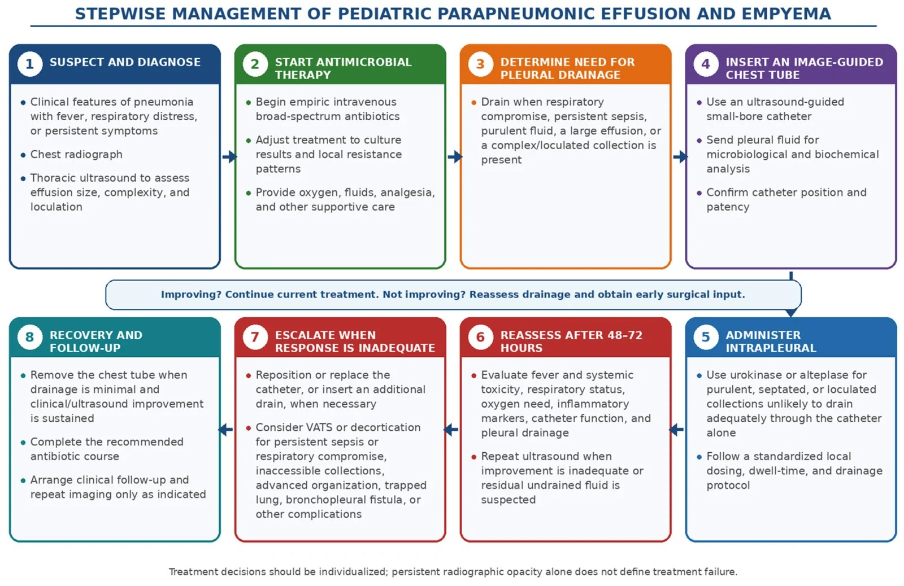
*Sơ đồ 8 bước: nghi ngờ/chẩn đoán → kháng sinh tĩnh mạch phổ rộng → quyết định cần dẫn lưu → đặt catheter dưới hướng dẫn siêu âm → thuốc tiêu sợi huyết trong màng phổi → đánh giá lại sau 48–72 giờ → nâng bậc (đổi thêm dẫn lưu/VATS) khi đáp ứng kém → hồi phục & theo dõi. Nguồn: Esposito et al., Pharmaceuticals (Basel) 2026 (PMC13516778), CC BY 4.0.*

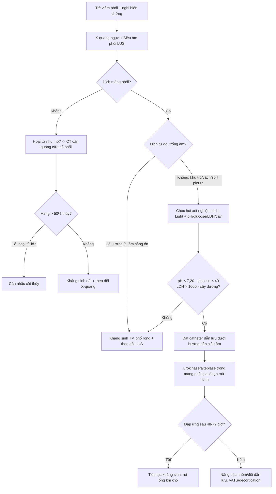

## 5. Biến thể bình thường và cạm bẫy

- **Cạm bẫy #1 — Split pleura cần thì cản quang:** trên CT **không cản quang** hai lá màng phổi có thể không phân biệt được (xem hình panel B ở mục 3). Đừng loại trừ empyema chỉ vì "không thấy split pleura" khi ảnh không có thuốc cản quang.
- **Cạm bẫy #2 — Áp-xe phổi giả tràn dịch:** áp-xe có thể dính thành ngực và trông như một ổ dịch khu trú. Chốt bằng **hình học**: áp-xe **góc nhọn** với thành ngực + không split pleura; empyema **góc tù** + split pleura.
- **Cạm bẫy #3 — Nang khí (pneumatocele) thường lành:** nhiều túi khí thành mỏng sau viêm phổi tụ cầu/PVL **tự thoái triển** — không hóa trị/không mổ chỉ vì có nang khí. Ngược lại, **hoại tử thật** có **vùng không ngấm thuốc + mất mạch máu** và vách dày hơn.
- **Cạm bẫy #4 — Cấy âm không loại trừ nhiễm trùng:** nuôi cấy thường quy chỉ dương ở **30–50%** ca (do đã dùng kháng sinh); empyema cấy âm có thể **dương thêm 31% bằng PCR 16S rRNA**. Đừng bỏ điều trị vì cấy âm.
- **Cạm bẫy #5 — Cạm bẫy mặt cắt (cross-sectional):** cùng mật độ dịch, **vị trí tương quan với cơ hoành/crus mới quyết định là dịch màng phổi hay cổ trướng** — dùng **dấu crus lệch, dấu bare area, meniscus vs ôm gan/lách**. Trong ngực, nhớ phân biệt **màng phổi vs trung thất vs nhu mô đáy phổi**.
- **Thỏa mãn tìm kiếm (satisfaction of search):** đã gọi tên hoại tử phổi thì phải **quét hết màng phổi hai bên** tìm tràn dịch/mủ/tràn khí và các biến chứng (rò phế quản–màng phổi, huyết khối) — chúng đổi cả xử trí lẫn tiên lượng.

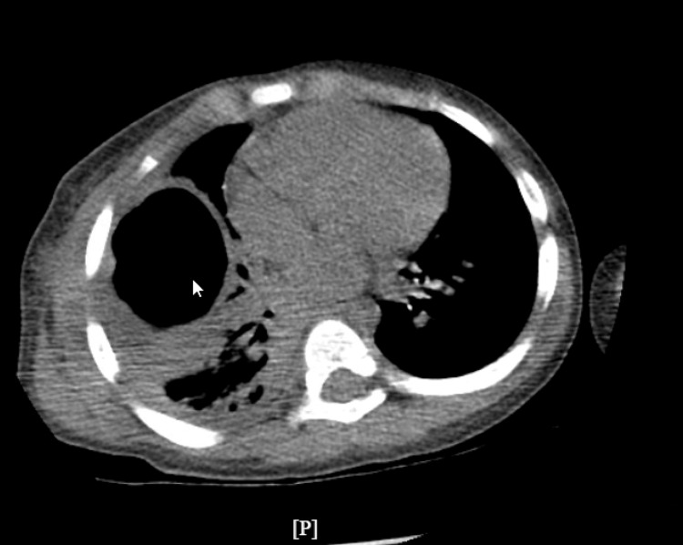
*Ca nguyên văn trẻ nhỏ: **hang thành dày lớn thùy trên phải + nhiều hang nhỏ vệ tinh** (CT ngang) — cấy mủ âm nhưng dịch dịch tiết (exudate); xác nhận hoại tử phổi bằng hình ảnh. Nguồn: Gujar AA, Patel A, Pierre L, Cureus 2025 (PMC11975787), Fig. 2, CC BY 4.0.*

## 6. Tự lượng giá — Blind Quiz

**Ca 1 — Trẻ 7 tuổi sốt cao, ho, đau ngực. Đọc X-quang ngực (a) và CT coronal (b), mô tả trước khi mở đáp án.**

- Hỏi: dấu hiệu chính trong vùng đông đặc? Có mức khí–dịch không? Màng phổi dày bao nhiêu, có split pleura? 3 chẩn đoán phân biệt?

<b>Bấm để hiện đáp án (findings + chẩn đoán)</b>

- Dấu hiệu (findings): đông đặc thùy trên phải với **ổ giảm mật độ + hang + pneumatocele**, kèm **tràn dịch màng phổi phức tạp** vùng đáy cùng bên.
- Chẩn đoán (diagnosis): **hoại tử phổi (necrotizing pneumonia)** — chủ yếu *S. pneumoniae*/*S. aureus*; vùng giảm mật độ không ngấm + mất mạch máu là do hoại tử/hóa lỏng nhu mô.
- Xử trí: **kháng sinh tĩnh mạch kéo dài + dẫn lưu màng phổi ± thuốc tiêu sợi huyết**; theo dõi X-quang; **cắt thùy** chỉ cân nhắc khi hang chiếm **> 50% thùy**.
- Cửa sổ cản quang cùng ca:

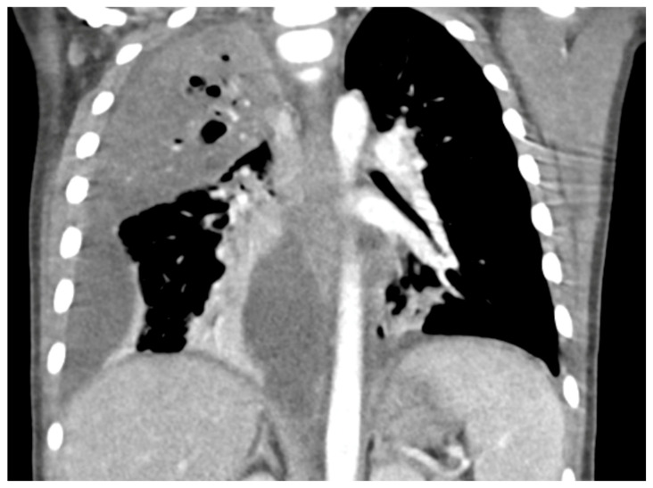

- Nguồn ảnh: Ness-Cochinwala & Totapally, Children (Basel) 2025 (PMC12468505), Fig. 3, 4 & 5, CC BY 4.0.

**Ca 2 — Trẻ có tràn dịch màng phổi cạnh viêm phổi. Nhìn CT: hai lá màng phổi ra sao, chẩn đoán là gì, xét nghiệm nào quyết định dẫn lưu?**

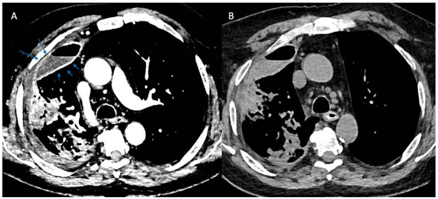

- Hỏi: mô tả màng phổi tạng và màng phổi thành? Dịch ở đâu? Chẩn đoán? Ngưỡng xét nghiệm buộc dẫn lưu?

<b>Bấm để hiện đáp án (findings + chẩn đoán)</b>

- Dấu hiệu (findings): **panel A (cản quang): hai lá màng phổi – tạng và thành – dày, ngấm thuốc rõ, bị đẩy tách nhau bởi dịch = split pleura sign**; **panel B (không cản quang): khó phân định hai lá** — minh họa vì sao dấu hiệu cần thì cản quang.
- Chẩn đoán (diagnosis): **viêm mủ màng phổi/PPE có biến chứng (empyema/complicated PPE)**. Split pleura gặp **98,7%** trên CT cản quang thì màng phổi ở BN nhiễm trùng màng phổi; **split pleura + độ dày dịch > 30 mm → Se 79,4%/Sp 80,9%**.
- Xử trí: chọc hút xét nghiệm; **dẫn lưu khi pH < 7,20 · glucose < 40 mg/dL · LDH > 1000 IU/L · Gram/cấy dương tính**; giai đoạn mủ–fibrin dùng **urokinase/alteplase**.
- Nguồn ảnh: Foley & Parrish, Life (Basel) 2023 (PMC9959801), Fig. 2, CC BY 4.0.

**Ca 3 — Ba trẻ có hang ở phổi. Xem dải CT: mép hang (trên) và kiểu khí (dưới) gợi ý gì?**

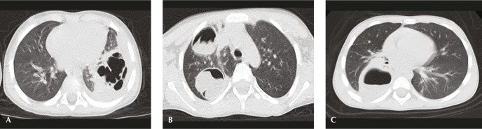

- Hỏi: mép hang A/B/C khác nhau thế nào? Xem tiếp kiểu khí — hoại tử, sán hay áp-xe có "bọt khí"?

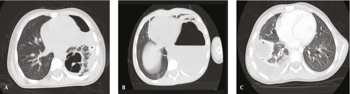

<b>Bấm để hiện đáp án (findings + chẩn đoán)</b>

- Dấu hiệu (findings): mép hang **A = bờ không đều (irregular) → hoại tử phổi (necrotizing pneumonia)**; **B = bờ đều → nang sán (hydatid cyst)**; **C = bờ đều, rõ → áp-xe phổi (lung abscess)**. Kiểu khí: **A = hang thông khí hoàn toàn (hoại tử)**; **B = mức khí–dịch (sán)**; **C = bọt khí (áp-xe)**.
- Định lượng: thành hang trung bình — **sán 5,637 mm > hoại tử 4,45 mm > áp-xe 3,621 mm**; **cut-off 3,9 mm Se 90%/Sp 60,9%**, **4,15 mm Se 80%/Sp 74%** — nhưng **AUC hoại tử/áp-xe < 70%** (kém), chỉ **sán AUC 83%** → không chốt một mình độ dày.
- **Phản biện (fidelity):** nhóm hoại tử phổi trong nghiên cứu chỉ **n = 4** → các ngưỡng này cần thận trọng, không khái quát mạnh.
- Nguồn ảnh: Hafez Eftekhari et al., Thorac Res Pract 2026 (PMC13396998), Fig. 2 & 3, CC BY-NC 4.0 (giữ nguyên bản, không ghép).

**Ca 4 (ca nguyên văn) — Trẻ nhỏ sốt, suy hô hấp, có hang + tràn dịch. Đọc X-quang và CT dưới đây — findings và hướng xử trí?**

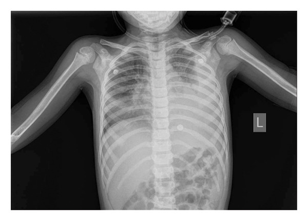

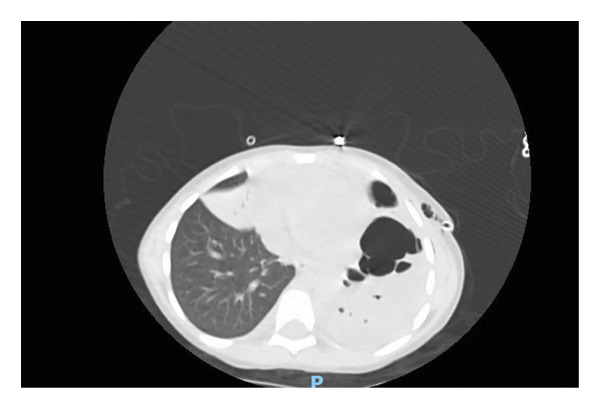

- Hỏi: tổn thương nhu mô bên trái gồm những gì? Kèm bất thường màng phổi nào? Tại sao cấy có thể âm?

<b>Bấm để hiện đáp án (findings + chẩn đoán)</b>

- Dấu hiệu (findings): **đông đặc thùy dưới trái có vùng giảm mật độ + ổ khí nhỏ bên trong (necrotizing pneumonia)** + **tràn dịch màng phổi lượng lớn bên trái**.
- Chẩn đoán (diagnosis): **hoại tử phổi có biến chứng tràn dịch** — ca ở Palestine (Abu-Hijleh 2026).
- Cạm bẫy (pitfall): nuôi cấy thường quy chỉ dương **30–50%** ca; cấy âm **không** loại trừ nhiễm trùng — dùng **PCR/kháng nguyên** để tăng độ nhạy.
- Nguồn ảnh: Abu-Hijleh et al., Case Rep Pediatr 2026 (PMC13202305), Fig. 2, CC BY 4.0.

## Bài liên quan chéo
- [600 – Tổng quan Nhi khoa](../600-tong-quan-nhi-khoa/lesson.md)
- [615 – Viêm phổi nhi: round pneumonia, virus vs vi khuẩn & hít sặc dầu hỏa](../615-viem-phoi-nhi-round-pneumonia/lesson.md) (áp-xe, biến chứng)
- [613 – Viêm tiểu phế quản ở nhũ nhi (RSV)](../613-viem-tieu-phe-quan-nhi/lesson.md) (tràn dịch/tràn khí như biến chứng)
- [040 – Tràn dịch màng phổi](../040-tran-dich-mang-phoi/lesson.md) (empyema ở người lớn — split pleura, Light)
- [025 – Hang & nấm phổi](../025-ton-thuong-phoi-tao-hang/lesson.md) (áp-xe vs mủ màng phổi — hình học)
- [041 – Tràn khí màng phổi](../041-tran-khi-mang-phoi/lesson.md)

## Ảnh
- `616_hoai-tu-phoi_XR_PMC12468505-CCBY.jpg`, `616_hoai-tu-phoi_CT_PMC12468505-CCBY.jpg`, `616_hoai-tu-phoi_CT-canquang_PMC12468505-CCBY.jpg`, `616_dich-mang-phoi-phuc-tap_US_PMC12468505-CCBY.jpg`, `composite_hoai-tu-phoi_XR-vs-CT.jpg` — CC BY 4.0, Ness-Cochinwala & Totapally, Children (Basel) 2025 (PMC12468505).
- `616_split-pleura_CT_PMC9959801-CCBY.jpg`, `composite_split-pleura_CT.jpg` (ghép với ảnh dưới) — CC BY 4.0, Foley & Parrish, Life (Basel) 2023 (PMC9959801).
- `616_split-pleura_CT_PMC13010351-CCBYNC.jpg` — CC BY-NC 4.0, Schmiliver & Perera Molligoda Arachchige, World J Clin Pediatr 2026 (PMC13010351).
- `616_hoai-tu-vs-apxe_CT_PMC13396998-CCBYNC.jpg`, `616_khi-trong-hang_CT_PMC13396998-CCBYNC.jpg` — CC BY-NC 4.0, Hafez Eftekhari et al., Thorac Res Pract 2026 (PMC13396998). **Giữ nguyên bản.**
- `616_hoai-tu-phoi-tre_CT_PMC13202305-CCBY.jpg`, `616_hoai-tu-phoi-tre_XR_PMC13202305-CCBY.jpg` — CC BY 4.0, Abu-Hijleh et al., Case Rep Pediatr 2026 (PMC13202305).
- `616_hang-hoai-tu_CT_PMC11975787-CCBY.jpg` — CC BY 4.0, Gujar AA, Patel A, Pierre L, Cureus 2025 (PMC11975787).
- `616_gd-vom-mang-phoi_schema_PMC13516778-CCBY.jpg`, `616_thuat-toan-xu-tri_schema_PMC13516778-CCBY.jpg` — CC BY 4.0, Esposito et al., Pharmaceuticals (Basel) 2026 (PMC13516778).
- Chi tiết giấy phép từng ảnh trong `images/CREDITS.md`.

> Không dùng để chẩn đoán độc lập khi chưa có người hướng dẫn.
