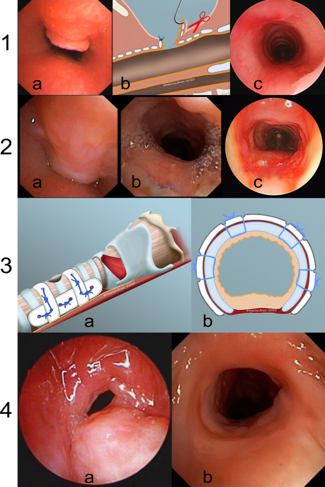
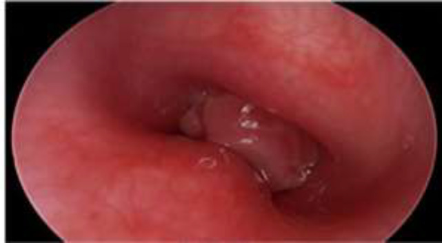
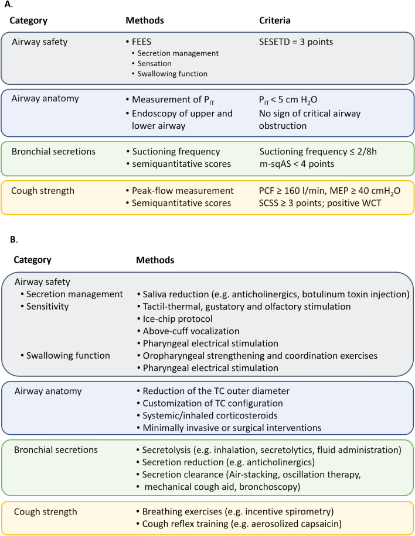
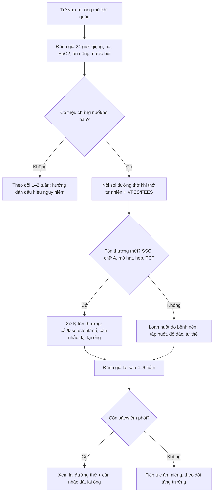

# 6160 — Rối loạn nuốt và hít sặc SAU cai ống mở khí quản ở trẻ / Post-decannulation dysphagia and aspiration in children

**Tags:** `pattern:hit-sac` `pattern:u-dong-sau-nuot` `pattern:hep-duong-tho` `vung:thanh-quan` `vung:khi-quan` `vung:hau` `protocol:VFSS` `protocol:FEES` `score:PAS` `score:FOIS`

**Mức chắc chắn (certainty):** tổng hợp y văn (literature synthesis) — số liệu từ **525 trẻ có ống mở khí quản** (PMC13086536), **175 trẻ** theo dõi sụp trên lỗ mở/biến dạng chữ A (PMC10866584), **255 trẻ** sụp trên lỗ mở (PMC12369399), **148 trẻ** biến chứng ống mở (PMC13040597), **120 trẻ** theo protocol cai ống (PMC11421412), **154 người lớn** đánh giá nội soi trước cai ống (PMC7269700) và khung **A²BC** (PMC11921981). Không có thử nghiệm ngẫu nhiên ở trẻ về thời điểm VFSS sau cai ống; phần cơ chế và thời điểm được ghi rõ là **suy luận**.

> **Câu chốt:** sau khi rút ống, **luồng khí qua thanh môn được phục hồi** nên nhiều trẻ nuốt tốt lên, nhưng một nhóm **xấu đi** vì **(1) sụp trên lỗ mở (suprastomal collapse) 55–57%**, **(2) biến dạng chữ A 18% — 56% trong số đó xuất hiện SAU cai ống**, **(3) mô hạt/hẹp mới**, **(4) rò khí–da làm yếu ho**, và **(5) loạn nuốt do bệnh nền vẫn còn**. Vì vậy **không được mặc định "rút ống là ăn được"**: trẻ có triệu chứng ho/sặc/khàn/giảm oxy sau rút ống cần **VFSS hoặc FEES lại**, không chỉ nghe phổi.

## 1. Tổng quan bệnh học – cơ chế hình ảnh (TẠI SAO nuốt có thể xấu hơn sau khi rút ống)

### 1.1 Ống mở khí quản làm thay đổi cơ học nuốt như thế nào

- **Bình thường:** khi nuốt, thanh quản **nâng lên–ra trước**, nắp thanh môn đóng, **dây thanh đóng**, và **áp lực dưới thanh môn tăng** tạo "nêm khí" bảo vệ đường thở; sau đó cơ thắt thực quản trên mở.
- **Khi có ống:** dòng khí **đi tắt qua ống ra ngoài**, làm **giảm áp lực dưới thanh môn**, giảm luồng khí qua thanh môn, giảm cảm giác thanh quản; ống còn **hạn chế thanh quản nâng lên**, thay đổi **đóng dây thanh** và **áp lực thực quản**. Đây là lý do trẻ có ống dễ **hít sặc, ứ đọng, ho yếu** (PMC13086536).
- **Sau khi rút ống:** luồng khí và áp lực dưới thanh môn **được phục hồi** → nhiều trẻ **cải thiện** phản xạ nuốt và ho. Nhưng ống từng **nong khí quản**; khi mất "nẹp", **sụp trên lỗ mở** hoặc **chữ A** có thể lộ ra, làm **hẹp đường thở**, tăng công thở, rối loạn phối hợp **thở–nuốt**, và gây **hít sặc mới**.
- **Ở trẻ nhỏ:** khí quản **nhỏ, sụn mềm**, mô hạt phát triển nhanh; chỉ **vài mm** hẹp cũng đủ tăng công thở. Vì vậy **triệu chứng sau rút ống** phải được đánh giá bằng **nội soi đường thở** và **đánh giá nuốt**, không chỉ X-quang ngực.

### 1.2 Vật lý hình ảnh: mỗi mẫu hình tương ứng một mức tổn thương

- **Sụp trên lỗ mở (suprastomal collapse, SSC):** phần khí quản **trên lỗ mở** mất chống đỡ, **sa vào lòng** khi thở ra; trên nội soi là **màng mềm sa vào lòng**, trên CT là **hẹp khẩu kính trên lỗ mở**. SSC **55% (96/175)** trong một đoàn hệ, xuất hiện trung bình **17,7 tháng** sau mở ống; **tất cả** được phát hiện **trước** cai ống (PMC10866584). Đoàn hệ 255 trẻ: **57,3% (146/255)**, trung bình **10,7 ± 12,6 tháng**; trẻ **< 6 tháng** khi mở ống có **OR 2,07**; hẹp dưới thanh môn **OR 2,96**, mềm sụn khí quản **OR 1,72**, phù thanh môn **OR 2,4** (PMC12369399).
- **Biến dạng chữ A (A-frame deformity):** thành trước khí quản **dẹt thành hình chữ A** khi thở ra; **18% (32/175)**, xuất hiện trung bình **35,8 tháng** sau mở ống; **56% (18/32)** xuất hiện **sau cai ống**, trung bình **11,3 tháng** sau cai; **nguy cơ 5 năm 32,8%**, **3 năm sau cai 36,1%** (PMC10866584). Đây là tổn thương **có thể mới xuất hiện sau khi ống đã rút** — lý do trẻ "đã cai ống thành công" vẫn có thể khó thở/khàn/aspiration về sau.
- **Mô hạt (granulation tissue):** phản ứng viêm quanh lỗ mở/đầu ống; gặp **16,2% (24/148)** trong loạt 5 năm (PMC13040597); mô hạt **> 50% lòng** gây hẹp rõ và cản trở cai ống.
- **Rò khí–da (tracheocutaneous fistula, TCF):** sau cai ống, lỗ rò còn lại gây **rò khí**, giảm **hiệu quả ho**, dễ ứ đọng và nhiễm trùng; **15,4% (16/104)** trẻ cai ống thành công phải mổ vá rò (PMC13040597).
- **Hẹp dưới thanh môn/hẹp khí quản:** hẹp cố định, không thay đổi theo nhịp thở; khác SSC **động** (sa khi thở ra). Phân biệt bằng **nội soi khi trẻ thở tự nhiên**, không thở máy.

### 1.3 Dịch tễ và ngưỡng định lượng

- **Rối loạn nuốt trước/sau mở ống:** **37% (194/525)** có triệu chứng trước, **54% (282/525)** sau mở ống (p < 0,001); **100%** trẻ đã có triệu chứng trước đó **vẫn còn** triệu chứng sau (PMC13086536).
- **VFSS sau mở ống (225 trẻ):** pha miệng **88%**, khởi phát nuốt **53%**, pha hầu **67%**, pha thực quản **2%**; **hít sặc chất lỏng loãng 28% so với đặc 17%**, **penetration 28% vs 16%** (p = 0,002) (PMC13086536).
- **25 trẻ có VFSS trước và sau mở ống:** khởi phát nuốt bất thường **40% → 80%** (p = 0,004); **penetration chất đặc 12% → 40%** (p = 0,008); **PAS giảm ở 14 trẻ**, **FOIS tăng ở 21 trẻ** — nghĩa là **đa số cải thiện**, nhưng **một nhóm vẫn nặng lên** (PMC13086536).
- **Không cai được ống vì nuốt:** trong **154 người lớn**, **41%** trường hợp không đủ điều kiện cai ống vì **hít sặc/loạn nuốt**, **26%** vì giảm oxy, **18%** vì ho yếu; nội soi **thay đổi quyết định ở 22%** (13/59) từ "không cai được" sang "cai được" (PMC7269700).
- **Tỷ lệ cai ống thành công:** **70,3% (104/148)** trong loạt 5 năm (PMC13040597); **23% (120/526)** trong protocol chuyên biệt ở trẻ (PMC11421412) — khác biệt do chọn bệnh và tiêu chuẩn.

## 2. Mẫu hình + chẩn đoán phân biệt theo thời điểm và vị trí (Gamut)

- **0–72 giờ sau rút ống — "thì cấp":** rít thì hít vào, co kéo, giảm SpO₂, ho khi ăn, sặc; nguyên nhân thường gặp **phù thanh môn**, **SSC**, **mô hạt**, **ứ đọng nước bọt**. Đây là giai đoạn **dễ nhầm với "khàn do đặt ống"**.
- **1–4 tuần — "thì dai dẳng":** ho khi uống, giọng ướt, ăn chậm, sụt cân, viêm phổi tái diễn; nguyên nhân **loạn nuốt do bệnh nền**, **TCF**, **mô hạt**, **trào ngược**.
- **1–6 tháng — "thì muộn":** khó thở khi gắng sức, rít, khàn; nguyên nhân **chữ A**, **hẹp dưới thanh môn**, **mềm sụn khí quản**, **hẹp khí quản**.
- **Theo vị trí:**
  - **Pha miệng/hầu:** chậm nhai, rơi vãi, ứ đọng xoang lê → **hít sặc sau nuốt**; gặp trong bại não, sau xạ, bệnh thần kinh–cơ.
  - **Thanh môn:** đóng dây thanh không kín, **hít sặc trước/sau nuốt**; do liệt dây thanh, mô hạt, SSC.
  - **Dưới thanh môn:** hẹp **cố định** → khó thở thì hít vào, không liên quan nuốt; do **hẹp sau đặt ống**, **chữ A**.
  - **Thực quản:** trào ngược, rối loạn nhu động, hẹp thực quản → **hít sặc muộn**, ho về đêm.

## 3. Bảng so sánh phân biệt (ma trận đối chiếu)

| Thực thể (entity) | Hình ảnh/nội soi điển hình | Chốt vào (rule-in) | Chốt loại (rule-out) | Gợi ý xác nhận |
|---|---|---|---|---|
| **Hít sặc mới do SSC** | Nội soi: **màng mềm trên lỗ mở sa vào lòng khi thở ra**; CT: hẹp khẩu kính trên lỗ mở | **Trẻ vừa rút ống + ho/sặc + rít + nội soi thấy sa trên lỗ mở** | Sa **cố định** không thay đổi theo nhịp thở → nghĩ hẹp/xơ, không phải SSC động | Nội soi thở tự nhiên; CT động |
| **Hít sặc tồn tại do bệnh nền** | VFSS: chậm khởi phát nuốt, ứ đọng, PAS cao; **không có tổn thương đường thở mới** | **Đã có loạn nuốt trước mở ống + vẫn sặc sau rút + nội soi đường thở ổn** | Nội soi thấy hẹp/mô hạt mới → phải xử lý tổn thương trước | VFSS/FEES; so với baseline |
| **Phù thanh môn sau rút ống** | Nội soi: **phù nề, đỏ, hẹp lòng; hồi phục sau 48–72 giờ** | **Khàn/rít ngay sau rút, cải thiện trong 3 ngày, không sốt** | Phù kéo dài > 1 tuần hoặc có mủ → nghĩ nhiễm/mô hạt | Nội soi lại sau 72 giờ |
| **Mô hạt > 50% lòng** | Nội soi: **khối đỏ mềm quanh lỗ mở/đầu ống**, chảy máu khi chạm | **Khó cai ống + nội soi thấy mô hạt lấp > 50% lòng** | Mô hạt < 50% và không triệu chứng → theo dõi | Nội soi; cắt/laser nếu cản trở |
| **Biến dạng chữ A** | Nội soi/CT: **thành trước dẹt hình chữ A**, hẹp khi thở ra | **Rít tiến triển nhiều tháng sau cai + hình chữ A** | Hẹp **đều chu vi** → nghĩ hẹp sau đặt ống | Nội soi động; CT 0,5–1 mm |
| **Hẹp dưới thanh môn** | CT: **hẹp cố định**, sẹo xơ; nội soi: vòng xơ | **Khó thở thì hít vào + hẹp cố định + tiền sử đặt ống lâu** | Hẹp **thay đổi theo nhịp thở** → SSC/malacia | Nội soi + CT; phân độ Myer–Cotton |
| **Rò khí–da (TCF)** | Lỗ rò còn thổi khí khi bịt mũi; nội soi thấy đường rò | **Sau rút ống, lỗ rò > 2–3 mm, ho yếu, ứ đọng** | Lỗ rò nhỏ **< 2 mm** và khô → có thể tự đóng | Nội soi; theo dõi 3–6 tháng |
| **Trào ngược/EoE** | Không đặc hiệu; có thể thấy **ứ đọng thực quản**, hẹp, vòng xơ | **Ho/khàn về đêm, ợ nóng, đáp ứng PPI; nội soi thực quản** | Không đáp ứng PPI + không viêm thực quản → ít nghĩ | pH–impedance; nội soi + sinh thiết |
| **Hít sặc im lặng** | VFSS: **thuốc xuống dưới dây thanh không ho**; PAS 8 | **PAS 8 + không có phản xạ ho** | Có ho mạnh, PAS ≤ 5 → nguy cơ thấp hơn | VFSS với chất loãng + đặc |

*Bốn tình huống sụp trên lỗ mở (SSC): (1) cắt tại chỗ — (a) sa vừa khi thở động, (b) kẹp/cắt, (c) sau 6 tháng; (2) cắt nối khí quản một thì — (a) SSC nặng quanh lỗ, (b) ngày 5, (c) 1 năm; (3) sơ đồ làm cứng lỗ mở bằng nẹp PD; (4) làm cứng lỗ mở — (a) trước, (b) sau. Hình cho thấy **SSC là tổn thương động**: mức hẹp thay đổi theo nhịp thở, nên phải đánh giá **khi trẻ thở tự nhiên**. Nguồn: Onder SS et al., *Eur Arch Otorhinolaryngol* 2020 (PMC7647974), CC BY 4.0.*

*Mô hạt quanh/trên lỗ mở **chiếm > 50% lòng khí quản** — nguyên nhân cơ học gây khó cai ống, ho và ứ đọng; cần cắt/laser hoặc xử lý trước khi thử cai. Nguồn: Chauhan N et al., *Iran J Otorhinolaryngol* 2020 (PMC7302532), CC BY 3.0.*

## 4. Protocol chụp/đánh giá + hệ phân độ

### 4.1 Trước khi cai ống — khung A²BC

| Thành phần | Công cụ | Ngưỡng |
|---|---|---|
| **A — Airway safety** (an toàn đường thở) | **FEES** (nuốt, cảm giác, quản lý nước bọt) | **SESETD = 3 điểm**; không ứ đọng nặng, có phản xạ ho |
| **A — Airway anatomy** (giải phẫu) | Nội soi trên/dưới; **PIT** | **PIT < 5 cmH₂O**; không có hẹp tới hạn |
| **B — Bronchial secretions** | Tần suất hút, thang bán định lượng | **≤ 2 lần/8 giờ**; **m-sqAS < 4** |
| **C — Cough strength** | **PCF**, **MEP**, **SCSS** | **PCF ≥ 160 L/phút**, **MEP ≥ 40 cmH₂O**, **SCSS ≥ 3** |

*(PMC11921981 — khung A²BC; PIT = áp lực trong lồng ngực, PCF = lưu lượng đỉnh khi ho, MEP = áp lực thở ra tối đa, SCSS = thang điểm ho bán định lượng.)*

*Bảng ngưỡng A²BC: an toàn đường thở (SESETD 3 điểm), giải phẫu (PIT < 5 cmH₂O), tiết khí quản (≤ 2 lần/8 giờ; m-sqAS < 4), sức ho (PCF ≥ 160 L/phút; MEP ≥ 40 cmH₂O; SCSS ≥ 3). Đây là **ngưỡng người lớn/khung chung**, chưa được hiệu chỉnh riêng cho trẻ — cần dùng cùng bối cảnh lâm sàng. Nguồn: Dziewas R et al., *Neurol Res Pract* 2025 (PMC11921981), CC BY 4.0.*

### 4.2 Sau khi rút ống — đánh giá nuốt

- **Đánh giá lâm sàng trong 24 giờ:** giọng (ướt/khàn), ho khi uống, thay đổi SpO₂, nhịp thở, khả năng quản lý nước bọt, ăn/uống lượng bao nhiêu.
- **Chỉ định VFSS/FEES:** **bất kỳ** dấu hiệu sau: ho/sặc khi ăn, giọng ướt, giảm SpO₂, viêm phổi tái diễn, sụt cân, sợ ăn, hoặc **trẻ có loạn nuốt trước đó**. Ở trẻ **đã có VFSS bất thường trước cai**, nên **đánh giá lại** sau rút ống.
- **Thời điểm:** **VFSS/FEES trong 1–2 tuần đầu** sau rút ống nếu có triệu chứng; **lặp lại sau 4–6 tuần** nếu còn bất thường hoặc sau điều trị (thắt lưng, tập nuốt). Nếu không triệu chứng và bú/ăn tốt, **không cần chụp thường quy**.
- **Chọn VFSS hay FEES:**
  - **VFSS** (videofluoroscopic swallow study): thấy **toàn bộ pha nuốt**, **PAS**, **ứ đọng**, **hít sặc im lặng**, đánh giá **thay đổi tư thế/độ đặc**; có bức xạ.
  - **FEES** (fiberoptic endoscopic evaluation of swallowing): thấy **giải phẫu, nước bọt, cảm giác, mức ứ đọng**, làm tại giường, không bức xạ; **không thấy pha miệng và thời gian pha hầu đầy đủ**.
  - **Kết hợp** khi cần: FEES để đánh giá đường thở + VFSS để đánh giá cơ chế và thử độ đặc.

### 4.3 Khi nào đặt lại ống thay vì chỉ tập nuốt

- **Đặt lại ống khẩn:** suy hô hấp, **SpO₂ < 92%** dai dẳng, không quản lý được nước bọt, **hít sặc tái diễn gây viêm phổi**, **PCF < 160 L/phút** hoặc ho không hiệu quả, **sụp trên lỗ mở nặng** gây tắc.
- **Cân nhắc ống thay thế:** **T-tube/Montgomery** hoặc stent khi hẹp khí quản; **phẫu thuật SSC/chữ A** nếu tái hẹp; **vá rò khí–da** khi rò lớn.
- **Chỉ tập nuốt khi:** đường thở **ổn định**, không hẹp tới hạn, **PAS ≤ 5** với ít nhất một độ đặc, trẻ **tỉnh, hợp tác**, và có **kế hoạch theo dõi**.
- **Đích điều trị:** không chỉ "ăn được" mà **không viêm phổi, tăng cân, không mất nước**.

## 5. Biến thể bình thường và cạm bẫy

- **Rít sau rút ống do phù:** thường **giảm trong 48–72 giờ**; nếu **kéo dài > 1 tuần** hoặc có **mủ/sốt**, phải nội soi lại — không mặc định "phù tự hết".
- **SSC là động:** nội soi **khi trẻ thở tự nhiên**, không đánh giá dưới gây mê/thở máy vì có thể **che mất** mức sa.
- **Chữ A xuất hiện muộn:** **56%** chữ A xuất hiện **sau cai ống**, trung bình **11,3 tháng**; trẻ "đã cai ống thành công" vẫn cần theo dõi **rít/khó thở/khàn** trong **1–2 năm**.
- **Hít sặc im lặng:** **không ho không loại trừ**; PAS 8 thường gặp ở trẻ có bệnh thần kinh. Phải test **chất lỏng loãng** vì đây là độ đặc gây sặc nhiều nhất (28% vs 17%).
- **VFSS chỉ test một độ đặc:** nếu chỉ cho chất đặc, có thể **bỏ sót sặc chất loãng**; test **cả loãng và đặc**, và thử **tư thế/độ đặc**.
- **FEES không thay thế VFSS hoàn toàn:** FEES **không đánh giá pha miệng** và **thời gian pha hầu**; ngược lại VFSS **không thấy nước bọt ứ đọng** rõ như FEES. Kết hợp khi cần.
- **Trào ngược bị "đổ vấy":** ho về đêm/khàn có thể do **trào ngược**, nhưng cũng có thể do **ứ đọng sau nuốt** hoặc **SSC**; không dùng PPI thử mù để thay cho nội soi/đánh giá nuốt.
- **Rò khí–da làm yếu ho:** lỗ rò lớn làm **rò khí**, giảm **PCF**, dễ ứ đọng; cần **vá rò** nếu không tự đóng.
- **Satisfaction of search:** thấy mô hạt/SSC là dừng, bỏ sót **hẹp dưới thanh môn** hoặc **liệt dây thanh** — luôn đánh giá **toàn bộ đường thở** trên và dưới lỗ mở.

## 6. Tự lượng giá — Blind Quiz

**Ca 1 — Bé trai 2 tuổi, mở ống khí quản vì hẹp dưới thanh môn; sau rút ống 3 ngày xuất hiện rít thì hít vào, ho khi uống, SpO₂ 93%. Nội soi dưới đây cho thấy gì và xử trí tiếp?**

- Câu hỏi: Mô tả tổn thương ở panel 1a/2a. Vì sao **không nên kết luận "phù do rút ống"**? Bước tiếp theo?

<b>Bấm để hiện đáp án</b>

- Panel 1a/2a: **màng mềm trên lỗ mở sa vào lòng khí quản khi thở ra** = **sụp trên lỗ mở (SSC)**; mức hẹp **thay đổi theo nhịp thở**.
- Không phải chỉ phù: tổn thương **có cấu trúc**, có thể cần **cắt/laser** hoặc **mổ tạo hình**; nếu chỉ chờ sẽ **tái hít sặc/viêm phổi**.
- Bước tiếp: **nội soi khi thở tự nhiên** đánh giá toàn bộ đường thở + **VFSS/FEES**; cân nhắc **đặt lại ống** nếu hẹp nặng/SpO₂ thấp; xử lý SSC theo vị trí.
- Nguồn: Onder SS et al. (PMC7647974), CC BY 4.0.

**Ca 2 — Bé gái 5 tuổi, mở ống khí quản 8 tháng, 3 lần thử cai thất bại vì khó thở và ho. Nội soi thấy khối đỏ mềm chiếm phần lớn lòng khí quản. Chẩn đoán và vì sao phải xử lý trước khi cai?**

- Câu hỏi: Khối này là gì? Nó gây khó cai ống bằng cơ chế nào? Khi nào cắt/laser?

<b>Bấm để hiện đáp án</b>

- **Mô hạt (granulation tissue)** quanh/trên lỗ mở, **> 50% lòng khí quản**.
- Cơ chế: **hẹp cơ học + viêm + chảy máu khi chạm** → tăng công thở, ho, ứ đọng, khó cai ống; mô hạt còn **kích thích ho và cản trở nuốt**.
- Xử lý: **cắt/laser** hoặc **silver nitrate** khi nhỏ; kiểm soát **trào ngược/nhiễm**; đánh giá lại sau **2–4 tuần** rồi mới thử cai.
- Nguồn: Chauhan N et al. (PMC7302532), CC BY 3.0.

**Ca 3 — Bé trai 4 tuổi, sau rút ống 10 ngày: ho khi uống, không sốt, SpO₂ 96%, PCF 140 L/phút, hút đờm 3 lần/8 giờ, nội soi không thấy hẹp. Theo A²BC, nên làm gì?**

- Câu hỏi: Thành phần nào **không đạt**? Có nên cho ăn tiếp không? Chọn VFSS hay FEES?

<b>Bấm để hiện đáp án</b>

- **PCF 140 < 160 L/phút** → **ho yếu**, chưa đạt ngưỡng an toàn; **hút 3 lần/8 giờ > 2** → tiết khí quản nhiều.
- Không nên cho ăn đầy đủ ngay: **đánh giá nuốt bằng VFSS/FEES**, tập ho, tăng cường làm sạch đường thở; cân nhắc **đặt lại ống** nếu sặc/viêm phổi.
- Chọn **VFSS** nếu cần xem toàn bộ pha nuốt và thử độ đặc; **FEES** nếu cần đánh giá nước bọt/giải phẫu tại giường — có thể **kết hợp**.
- Nguồn: Dziewas R et al. (PMC11921981), CC BY 4.0.

## Bài liên quan chéo
- [6123 – Rối loạn nuốt và hít sặc ở trẻ có ống mở khí quản](../6123-roi-loan-nuot-va-hit-sac-tre-mo-khi-quan/lesson.md)
- [6100 – Chăm sóc, biến chứng & cai ống mở khí quản ở trẻ](../6100-cham-soc-va-cai-ong-mo-khi-quan-tre/lesson.md)
- [6144 – Nội soi thanh–khí quản định kỳ ở trẻ có ống mở khí quản](../6144-noi-soi-thanh-khi-quan-dinh-ky-ong-mo-khi-quan-tre/lesson.md)
- [6143 – Cách ly thanh–khí quản & botulinum tuyến nước bọt ở trẻ hít sặc nước bọt](../6143-cach-ly-thanh-khi-quan-botulinum-nuoc-bot-tre/lesson.md)

> Không dùng để chẩn đoán độc lập khi chưa có người hướng dẫn.
