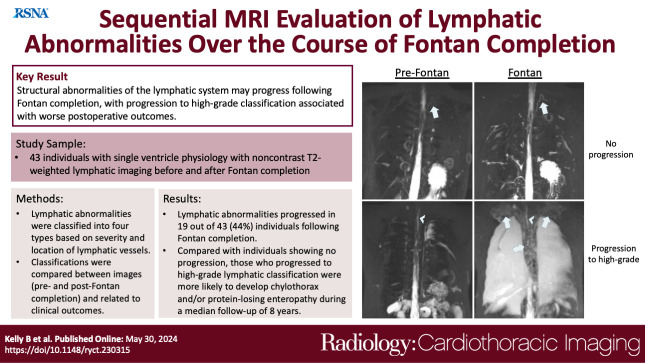
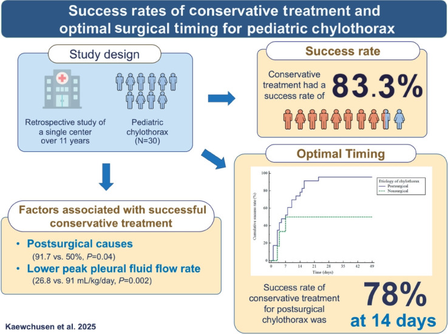
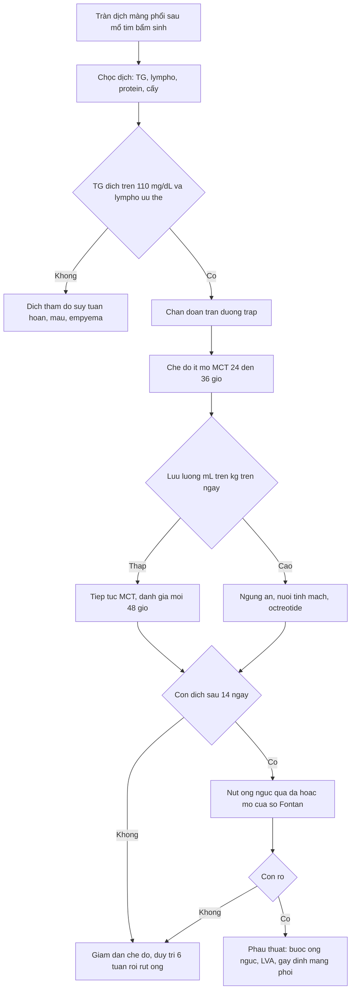
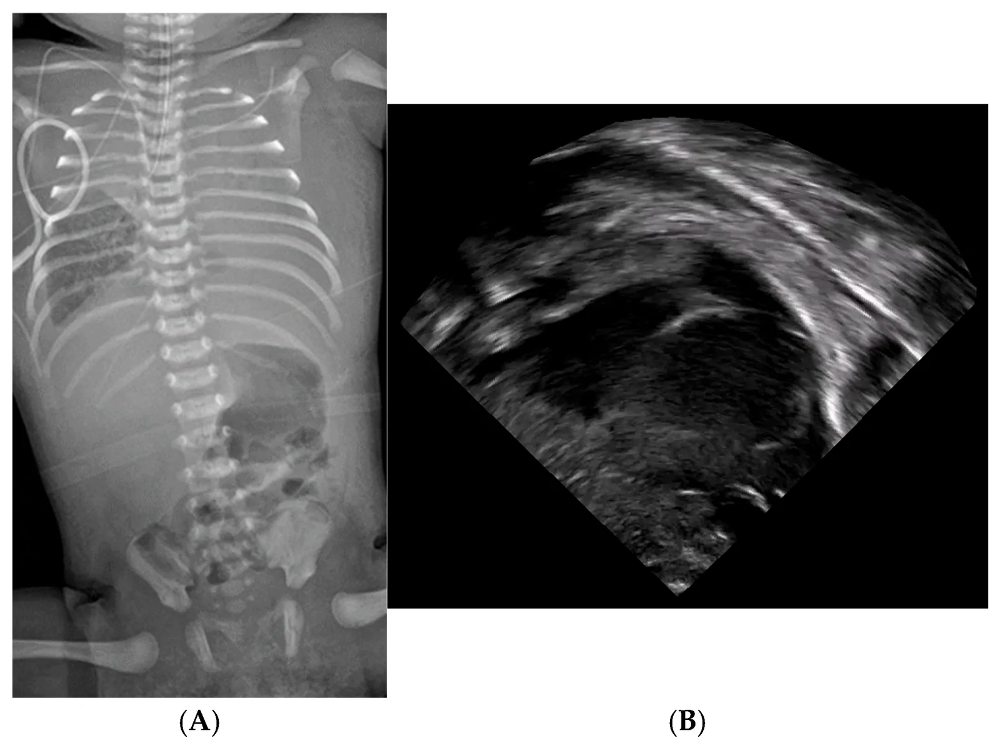
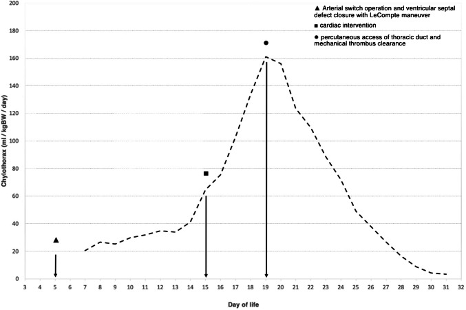
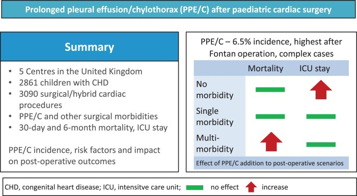

# 6161 — Tràn dưỡng trấp màng phổi sau mổ tim bẩm sinh (Fontan/Glenn): vì sao áp lực tĩnh mạch hệ thống quyết định / Postoperative chylothorax after congenital heart surgery

**Tags:** `pattern:chylothorax` `pattern:tran-dich-mang-phoi` `pattern:ro-bach-mach` `vung:mong-phoi` `vung:trung-that` `vung:ong-nguc` `protocol:X-quang-nguc` `protocol:sieu-am-phoi` `protocol:MRI-T2-bach-huyet` `score:TG-dich` `score:luu-luong-mL-kg`

**Mức chắc chắn (certainty):** tổng hợp y văn (literature synthesis) — biên từ **9.892 ca mổ tim bẩm sinh** theo dõi 2001–2024 (*JTCVS Open* 2026, **PMC13711289**), đoàn hệ **5 trung tâm Anh, 2.861 trẻ / 3.090 thủ thuật** (**PMC11522863**), **176 nhũ nhi** Trung Quốc (**PMC10929254**), **1.053 ca** Thổ Nhĩ Kỳ (**PMC10472469**), nghiên cứu **30 ca nhi** về thời điểm mổ (**PMC12590056**), protocol **Severance** (**PMC7155178**), tổng quan *Nutrients* 2022 (**PMC9104302**), **43 bệnh nhân** MRI bạch huyết trước–sau Fontan (*Radiology: Cardiothoracic Imaging* 2024, **PMC11211943**), ca sơ sinh **3 kg** nút ống ngực qua da (**PMC12708693**) và ca người lớn có tắc tĩnh mạch chủ trên gây chylothorax (**PMC8311179**). Nhóm **không có bệnh nhân của mình**.

> **Câu chốt:** sau mổ tim bẩm sinh, tràn dưỡng trấp **không phải một biến chứng "rò ống ngực" đơn thuần** mà là **bệnh của gradient áp lực bạch huyết–tĩnh mạch**: ống ngực đổ vào ngã ba tĩnh mạch cảnh trong–dưới đòn, nên **áp lực tĩnh mạch trung tâm (CVP) là "áp lực đối kháng" của dòng dưỡng trấp**. Ở tuần hoàn Fontan, **CVP cao là điều kiện sống còn** — và cũng chính là nguyên nhân gây rò. Vì vậy **hạ CVP bằng mở cửa sổ (fenestration) hoặc giải ép ống ngực là điều trị gốc**, không chỉ là "cho ăn ít mỡ".

## 1. Tổng quan bệnh học – cơ chế hình ảnh (TẠI SAO)

### 1.1 Sinh lý bệnh: dòng bạch huyết là dòng chảy theo gradient

- Bạch huyết từ **ống ngực (thoracic duct)** đổ vào **ngã ba tĩnh mạch cảnh trong trái – tĩnh mạch dưới đòn trái**, tức là đổ **trực tiếp vào hệ tĩnh mạch hệ thống**. Lưu lượng theo **Q = ΔP / R**, với **ΔP = áp lực mô kẽ − áp lực tĩnh mạch trung tâm**.
- **Hệ quả 1 — CVP tăng thì Q giảm rồi ứ:** khi CVP tăng, ΔP giảm → bạch huyết ứ ở mô kẽ, **giãn mạch bạch huyết (lymphangiectasia)**, thành mạch mỏng đi và **rò dịch dưỡng trấp vào khoang màng phổi**. Đây là cơ chế **không do dao kéo** — giải thích vì sao tràn dưỡng trấp xuất hiện **muộn, kéo dài, hai bên** ở bệnh nhân Fontan chứ không chỉ ngay sau mổ.
- **Hệ quả 2 — sau Fontan, CVP cao là bắt buộc:** không còn thất phải làm bơm, **máu lên phổi chỉ nhờ chênh áp tĩnh mạch hệ thống – nhĩ trái**. Vì thế **giảm CVP = giảm lưu lượng phổi**, còn **giữ CVP cao = tăng rò bạch huyết**. Đây là **mâu thuẫn điều trị cốt lõi** của bài này.
- **Hệ quả 3 — tổn thương trực tiếp:** bóc tách quanh **tĩnh mạch chủ trên, tĩnh mạch azygos, rốn phổi** trong thì Glenn/Fontan cắt ngang các nhánh bạch huyết trung thất; đây là cơ chế **sớm, một bên** điển hình sau các phẫu thuật mở ngực khác.
- **TẠI SAO lại là màng phổi mà không phải màng tim:** bạch huyết của **màng phổi thành** đổ về ống ngực và các thân bạch huyết trung thất; khi ứ, dịch thoát vào **khoang màng phổi** — nơi có áp lực âm trong thì thở vào, tạo "van hút" làm dịch tích nhanh. Tràn dưỡng trấp **màng tim** là thể riêng, ít gặp hơn (bài 6157).
- **TẠI SAO tràn dịch kéo dài lại nguy hiểm:** mất **dịch, protein, immunoglobulin, lympho bào** → **suy dinh dưỡng, giảm miễn dịch, giảm thể tích**, kéo dài thở máy và nằm hồi sức. Trong đoàn hệ 5 trung tâm Anh, tràn dịch/ dưỡng trấp kéo dài **cộng thêm vào các biến chứng khác** làm **tăng tử vong 30 ngày và 6 tháng** và **tăng thời gian hồi sức** (**PMC11522863**).

### 1.2 Vật lý hình ảnh: vì sao dịch "dưỡng trấp" có thể trong như dịch thấm

- Dịch dưỡng trấp đục là do **tán xạ ánh sáng của chylomicron** (hạt ≈ 0,1–1 µm, đường kính lớn hơn bước sóng ánh sáng khả kiến). **Không có chylomicron = không đục**, dù dịch vẫn là bạch huyết.
- Vì vậy **bệnh nhân đang đói/nuôi tĩnh mạch hoàn toàn** có thể có dịch **vàng trong** — màu sữa **không phải tiêu chuẩn chẩn đoán** (độ nhạy thấp). Ngược lại, dịch đục cũng gặp trong **empyema** (tế bào mủ) và **pseudochylothorax** (tinh thể cholesterol, không có chylomicron).
- **Tiêu chuẩn dịch trên lâm sàng** (theo tổng quan *Nutrients* 2022): **bạch cầu > 1.000 tế bào/µL với > 70–80% lympho bào**, và ở bệnh nhân **đang ăn đường tiêu hóa**, **triglyceride dịch > 110 mg/dL**; **TG dịch > TG huyết thanh** là dấu phụ rất đặc hiệu. Ở trẻ sơ sinh, dịch thường **không đục** vì bữa ăn còn ít mỡ.
- **Trên X-quang và siêu âm**, tràn dưỡng trấp **không có dấu hiệu riêng**: chỉ là **tràn dịch tự do** (mờ đáy phổi, xóa góc sườn hoành, dấu liềm; siêu âm: khoảng trống không hồi âm, phổi xẹp đẩy lên). Chẩn đoán **luôn cần chọc hút + xét nghiệm dịch**; hình ảnh chỉ trả lời "có bao nhiêu dịch, có chèn ép, có ổ khu trú".
- **MRI T2 không cản quang** (lymphatic MRI) mới là phương thức **thấy chính bạch huyết**: dịch bạch huyết **tăng tín hiệu mạnh trên T2** nên các **ống bạch huyết giãn, mạng bạch huyết sau phúc mạc và trung thất** hiện thành các cấu trúc **sáng như nước**, cho phép **phân độ 1–4** theo mức lan và vị trí (**PMC11211943**).

### 1.3 Dịch tễ và ngưỡng định lượng (số phải nhớ)

- **Tần suất chung sau mổ tim bẩm sinh:** **3,2% (312/9.892)** ca mổ trong 24 năm; **Fontan là phẫu thuật nguy cơ cao nhất** (**HR 16,198** so với mổ đơn giản), chiếm **20,5%** tổng số ca tràn dưỡng trấp; tuổi mổ càng nhỏ nguy cơ càng cao (**HR 0,745 mỗi năm tuổi tăng thêm**) (**PMC13711289**).
- **Đoàn hệ 5 trung tâm Anh:** **6,5%** trong **2.861 trẻ / 3.090 thủ thuật**, cao nhất sau **Fontan** và các ca phức tạp; khi có **nhiều biến chứng đồng thời** thì tràn dịch kéo dài làm **tăng tử vong 30 ngày và 6 tháng** (**PMC11522863**).
- **Nhũ nhi:** **2,02%** (dao động 1,55–3,17%/năm); **sinh non OR 5,783**, **thở máy trước mổ OR 1,053**, **albumin sau mổ thấp OR 0,095** (**PMC10929254**). Ở **1.053 ca** Thổ Nhĩ Kỳ: **7,4%**, liên quan **tuổi nhỏ, nhiễm trùng, lọc màng bụng** (**PMC10472469**).
- **Fontan và bạch huyết:** trong **43 bệnh nhân** chụp MRI T2 trước và sau Fontan, **19/43 (44%) tiến triển** sang mức nặng hơn (phân bố type 1–4 trước Fontan **23/11/6/3** → sau Fontan **10/18/10/5**, p = 0,04); nhóm tiến triển có **dẫn lưu màng phổi 17 ngày (IQR 10–23) vs 9 ngày (6–14)** và **nằm viện 26 ngày (18–30) vs 13 ngày (9–25)** (**PMC11211943**).
- **Ngưỡng lưu lượng (định nghĩa không thống nhất — ghi rõ mâu thuẫn nguồn):** có tác giả coi **> 10 mL/kg/ngày** là thể tích cao, nhóm khác dùng **> 20 mL/kg/ngày**; một số dùng **> 5 mL/kg/ngày** cho trẻ nhỏ. **Chỉ định can thiệp** được đề xuất khi **> 100 mL/kg/ngày kéo dài 5 ngày**, hoặc **100 mL/ngày liên tục > 2 tuần**, hoặc **không giảm sau 1–2 tuần** điều trị nội khoa (**PMC9104302**).
- **Kết quả điều trị nội khoa:** **83,3% (25/30)** thành công chung và **95% (19/20)** ở nhóm sau mổ tim; **lưu lượng đỉnh 26,8 mL/kg/ngày** ở nhóm thành công so với **91 mL/kg/ngày** ở nhóm thất bại (p = 0,002); đường cong sống còn cho thấy **78% thành công ở ngày thứ 14** — mốc **2 tuần** là thời điểm hợp lý để chuyển can thiệp (**PMC12590056**).
- **Protocol Severance:** sau khi áp dụng protocol, **61%** chỉ cần ăn ít mỡ, **28%** phải ngừng hoàn toàn đường tiêu hóa; **không ca nào cần buộc ống ngực hay gây dính màng phổi**; số ngày dẫn lưu **trung vị 24 → 14 ngày** (**PMC7155178**).

## 2. Mẫu hình + chẩn đoán phân biệt theo vị trí và cơ chế (Gamut)

- **Nhóm A — rò tại ngã ba bạch huyết–tĩnh mạch (trung tâm):** sau **Fontan/Glenn**, hoặc do **huyết khối ống thông tĩnh mạch trung tâm** làm tắc tĩnh mạch chủ trên/dưới đòn. Hình ảnh: tràn dịch **một hoặc hai bên**, tái phát nhanh sau khi rút ống; kèm **phù mặt, tuần hoàn bàng hệ thành ngực**, huyết khối trên siêu âm Doppler. Đây là thể **chữa được bằng giải ép tĩnh mạch** (nong/hút huyết khối, mở cửa sổ Fontan).
- **Nhóm B — tổn thương trực tiếp ống ngực/nhánh trung thất:** sau **bóc tách trung thất, mổ cầu nối chủ–phổi, sửa van, cắt tuyến ức**. Dịch xuất hiện **sớm 2–10 ngày**, thường **một bên trái** (ống ngực), lưu lượng lớn, đáp ứng tốt với dinh dưỡng + nút ống ngực.
- **Nhóm C — dưỡng trấp từ ổ bụng lên (qua cơ hoành):** bệnh nhân Fontan có **bệnh lý ruột mất protein (PLE)** và **cổ trướng dưỡng trấp**; tràn dịch màng phổi thường **phải** (đường bạch huyết gan), kèm **albumin máu thấp, phù, tiêu chảy**. Đây là dấu hiệu **thất bại tuần hoàn Fontan**, tiên lượng xấu.
- **Nhóm D — không phải dưỡng trấp (bắt buộc loại trừ):**
  - **Dịch thấm do suy tuần hoàn Fontan** (CVP cao, tim cung lượng thấp): dịch **trong, TG thấp, protein thấp**, hai bên, kèm gan to, tĩnh mạch cổ nổi.
  - **Máu (hemothorax):** sau mổ, Hct dịch ≈ máu, đông máu, tụt huyết sắc tố.
  - **Empyema:** sốt, dịch đục, **pH < 7,2, glucose thấp, LDH cao**, Gram/cấy dương.
  - **Dịch do thở máy/ứ dịch:** cải thiện khi giảm PEEP, thường hai bên.
- **Gợi nhớ khi đứng trước "tràn dịch sau Fontan" — 4 câu hỏi:** (1) **CVP bao nhiêu?** (2) **Dịch có TG > 110 mg/dL không?** (3) **Một bên hay hai bên?** (4) **Có albumin thấp/phù (PLE) không?** Trả lời 4 câu này định vị được nhóm A–D.

## 3. Bảng so sánh phân biệt (ma trận đối chiếu)

| Thực thể (entity) | Hình ảnh điển hình | Chốt vào (rule-in) | Chốt loại (rule-out) | Gợi ý xác nhận |
|---|---|---|---|---|
| Rò ống ngực sau mổ tim (nhóm B) | Tràn dịch **một bên trái**, xuất hiện **2–10 ngày** sau mổ, lưu lượng tăng khi ăn mỡ | **TG dịch > 110 mg/dL + lympho > 70–80% + lưu lượng tăng sau bữa ăn** | Dịch trong, TG thấp, không tăng theo bữa ăn → nghĩ dịch thấm | Xét nghiệm dịch, theo dõi lưu lượng theo mL/kg/ngày |
| Rò do CVP cao sau Fontan (nhóm A) | Tràn dịch **hai bên/kéo dài**, tái phát sau rút ống, kèm phù mặt, bàng hệ | **CVP cao + tràn dịch tái phát + MRI T2 thấy bạch huyết giãn độ 3–4** | CVP bình thường, ổ khu trú một bên, đáp ứng nhanh với MCT → nghĩ nhóm B | Doppler tĩnh mạch trung tâm, MRI bạch huyết T2, đo CVP |
| Suy tuần hoàn Fontan (dịch thấm) | **Hai bên**, tim to, gan to, tĩnh mạch cổ nổi, có thể cổ trướng | **Dịch trong, protein thấp, TG thấp, BNP cao, CVP cao** | TG cao + lympho ưu thế → là dưỡng trấp | Siêu âm tim, BNP, xét nghiệm dịch |
| Máu màng phổi sau mổ | Mờ đáy phổi, có thể mức ngang, thiếu máu | **Hct dịch gần Hct máu, đông thành cục** | Dịch không đông, Hct thấp → không phải máu | Hct dịch, Hb/Hct máu, siêu âm |
| Empyma sau mổ | Dịch khu trú, vách, dày màng phổi, sốt | **pH < 7,2, glucose thấp, LDH cao, cấy dương** | Dịch vô khuẩn, pH > 7,3, không vách → không empyema | Cấy + tế bào + sinh hóa dịch |
| Cổ trướng dưỡng trấp thoát lên (nhóm C) | Tràn dịch **phải**, kèm cổ trướng, phù, albumin thấp | **Cổ trướng + albumin < 3 g/dL + MRI thấy bạch huyết sau phúc mạc giãn** | Không có cổ trướng, albumin bình thường → không phải PLE | Albumin, phân tích dịch bụng, MRI bạch huyết |

*Hình đồ họa của bài Radiology: Cardiothoracic Imaging 2024 (**PMC11211943**, CC BY 4.0): 43 bệnh nhân một thất được chụp MRI T2 không cản quang trước và sau Fontan; **19/43 tiến triển** sang phân độ nặng hơn, và nhóm tiến triển có **dẫn lưu 17 vs 9 ngày**, **nằm viện 26 vs 13 ngày**. Ảnh nguyên bản, không cắt ghép.*

### Dấu hiệu cần đọc đúng trên từng phương thức

- **X-quang ngực:** đếm **số cung sườn** và **mức mờ** để ước lượng thể tích; **lệch trung thất** cho biết có chèn ép. Ở trẻ sơ sinh, phim **nằm ngửa, pha thở ra** làm mờ giả tăng — luôn so với phim trước.
- **Siêu âm phổi đầu giường:** khoảng **không hồi âm** giữa thành ngực và màng phổi; **phổi xẹp đập theo nhịp tim** trong dịch; có thể **đo thể tích ước tính** và **hướng dẫn chọc**. Đây là công cụ **không bức xạ** để theo dõi hằng ngày ở trẻ sơ sinh.
- **MRI bạch huyết T2:** đánh giá **phân độ 1–4** và **sự tiến triển sau Fontan**; giá trị lớn nhất là **tiên lượng** (nguy cơ tràn dịch kéo dài, PLE) và **chọn bệnh nhân** cho can thiệp bạch huyết.
- **DCMRL (dynamic contrast-enhanced MR lymphangiography):** xác định **điểm rò** và **đường dẫn lưu bất thường** trước khi nút ống ngực — dùng khi can thiệp đã được quyết định (xem bài 6158, 1822).

## 4. Protocol chụp + hệ phân độ + thuật toán xử trí

### 4.1 Chẩn đoán

- **Bước 1 — X-quang ngực thẳng** khi nghi tràn dịch (khó thở, giảm thông khí một bên, tăng nhu cầu oxy).
- **Bước 2 — siêu âm phổi đầu giường** để định lượng và hướng dẫn chọc; **không cần CT thường quy**.
- **Bước 3 — chọc hút chẩn đoán** (nếu an toàn): gửi **tế bào, protein, albumin, LDH, glucose, pH, TG, cấy, AFB nếu cần**.
- **Bước 4 — chỉ CT ngực có cản quang** khi nghi **ổ khu trú, empyema, huyết khối tĩnh mạch trung tâm, hoặc biến chứng phẫu thuật**.
- **Bước 5 — MRI bạch huyết T2 (± DCMRL)** khi tràn dịch **kéo dài/tái phát** và đang cân nhắc can thiệp bạch huyết.

### 4.2 Phân tầng theo lưu lượng và thời gian

- Đặt **dẫn lưu kín, áp lực thấp**, ghi **mL/kg/ngày** mỗi 24 giờ (đây là **biến số quyết định**, không phải số mL tuyệt đối).
- **Bắt đầu ngay chế độ ít mỡ:** **MCT hoặc sữa mẹ đã tách béo**, **mỡ < 10 g/ngày**, bổ sung **3 g/kg/tuần lipid** và vitamin tan mỡ; đánh giá lại sau **24–36 giờ** (**PMC9104302**).
- **Nếu lưu lượng cao:** **ngừng ăn + nuôi tĩnh mạch hoàn toàn**, cân nhắc **octreotide** (đồng thuận, liều khác nhau giữa trung tâm — ghi rõ là **kinh nghiệm**, không có thử nghiệm ngẫu nhiên ở trẻ).
- **Mốc 14 ngày:** nếu **không giảm** hoặc **> 10 mL/kg/ngày sau 1 tuần**, hoặc **> 100 mL/kg/ngày kéo dài 5 ngày** → **can thiệp**. Dữ liệu 30 ca nhi cho thấy **78% thành công ở ngày 14**, nên **chờ quá 2 tuần là chờ vô ích** ở nhóm sau mổ (**PMC12590056**).

*Hình đồ họa Clinical and Experimental Pediatrics 2025 (**PMC12590056**, CC BY-NC 4.0): điều trị nội khoa thành công **83,3% (25/30)**, **95% (19/20)** ở nhóm sau mổ tim; **lưu lượng đỉnh 26,8 vs 91 mL/kg/ngày** giữa nhóm thành công và thất bại; **78% thành công ở ngày thứ 14** — cơ sở cho mốc chuyển can thiệp.*
- **Can thiệp theo thứ tự:** (1) **nút ống ngực qua da (TDE)** bằng **coil + NBCA** — thành công kỹ thuật cao, kể cả ở trẻ Fontan (**PMC10647881**); (2) **mở cửa sổ Fontan** nếu rò do CVP cao; (3) **phẫu thuật**: buộc ống ngực, nối bạch huyết–tĩnh mạch (LVA), gây dính màng phổi.
- **Duy trì chế độ ít mỡ 6 tuần** sau khi hết dịch rồi **giảm dần**; rút ống khi lưu lượng thấp và ổn định (**PMC9104302**).

### 4.3 Theo dõi trong hồi sức

- **Cân nặng hằng ngày, albumin, điện giải, lympho bào máu, immunoglobulin** — mất dịch dưỡng trấp gây **giảm IgG** và **nhiễm trùng**; đây là lý do **không được "chỉ theo dõi lưu lượng"**.
- **Siêu âm tim** đánh giá **chức năng Fontan, hẹp đường dẫn lưu, cửa sổ**; **Doppler tĩnh mạch trung tâm** nếu nghi huyết khối (nhóm A).
- **Đo lưu lượng theo mL/kg/ngày** và **ghi vào bảng** — mọi quyết định can thiệp dựa trên **xu hướng 3–5 ngày**, không dựa một lần đo.

## 5. Biến thể bình thường và cạm bẫy

- **Cạm bẫy 1 — "dịch trong nên không phải dưỡng trấp":** bệnh nhân **đói hoặc nuôi tĩnh mạch** có dịch **vàng trong** dù TG vẫn cao. Luôn **gửi TG** dù màu dịch thế nào; nếu nghi ngờ, cho **bữa ăn có mỡ** rồi đo lại.
- **Cạm bẫy 2 — "tràn dịch sau Fontan luôn là dưỡng trấp":** sai. **Suy tuần hoàn Fontan** cho dịch **thấm** (protein thấp, TG thấp). Điều trị **khác hoàn toàn** (tối ưu cung lượng, giảm CVP), và **tăng dinh dưỡng đơn thuần sẽ thất bại**.
- **Cạm bẫy 3 — bỏ sót huyết khối tĩnh mạch trung tâm:** trẻ có **ống thông tĩnh mạch trung tâm lâu ngày** bị chylothorax **do tắc tĩnh mạch chủ trên**, không do rò ống ngực; **nút ống ngực sẽ vô ích** nếu không giải ép tĩnh mạch. Ca người lớn tương tự đã được báo (**PMC8311179**).
- **Cạm bẫy 4 — tăng "dẫn lưu mạnh" để "cho phổi nở":** hút áp lực cao làm **tăng lưu lượng rò**, mất protein và lympho nhanh hơn; dùng **dẫn lưu kín áp lực thấp**, chỉ hút khi cần thiết.
- **Cạm bẫy 5 — nhầm với viêm phế quản nhựa (plastic bronchitis):** cũng là biến chứng **bạch huyết của Fontan**, nhưng biểu hiện là **bã nhầy hình cành cây** gây xẹp phổi, **không phải tràn dịch**; điều trị cũng là **can thiệp bạch huyết**.
- **Biến thể bình thường:** **dịch màng phổi lượng nhỏ sau mổ tim (vài mm, mất trong 48–72 giờ)** là phản ứng lành tính; **không chọc** nếu trẻ ổn định, không tăng oxy, không lệch trung thất.

## 6. Tự lượng giá — Blind Quiz

**Ca 1 — Sơ sinh 3,2 kg, ngày thứ 8 sau mổ chuyển gốc động mạch + đóng thông liên thất, khó thở tăng, oxy tụt.**

- Hỏi: mô tả 2 hình (A) và (B). Dịch nằm ở đâu, có chèn ép gì? 3 chẩn đoán phân biệt? Xét nghiệm nào chốt chẩn đoán?

<b>Bấm để hiện đáp án</b>

- **(A) X-quang:** **mờ toàn bộ nửa lồng ngực trái**, đẩy trung thất sang phải, phổi trái còn lại bị ép — tràn dịch **lượng lớn**. **(B) Siêu âm:** khoảng **không hồi âm lớn** dưới màng phổi, phổi xẹp **đập theo nhịp tim** trong dịch.
- Phân biệt: **tràn dưỡng trấp sau mổ** (thể tổn thương trực tiếp), **dịch thấm do suy tuần hoàn**, **empyema**, **máu màng phổi**.
- Chốt: **chọc hút + TG dịch > 110 mg/dL, lympho > 70–80%, bạch cầu > 1.000/µL** → dưỡng trấp. Nếu dịch trong vẫn phải gửi TG (bệnh nhân đang đói).
- Nguồn ảnh: *Children* 2026 (**PMC13703455**, CC BY 4.0), ca tràn dưỡng trấp sau mổ tim ở sơ sinh.

**Ca 2 — Sơ sinh 3 kg sau mổ tim, lưu lượng dẫn lưu tăng dần và đạt đỉnh 170 mL/kg/ngày.**

- Hỏi: con số 170 mL/kg/ngày nói gì? Vì sao **không thể chờ thêm**? Cơ chế nào giải thích đỉnh này?

<b>Bấm để hiện đáp án</b>

- **170 mL/kg/ngày** vượt xa ngưỡng **100 mL/kg/ngày** — thuộc nhóm **lưu lượng rất cao**, nguy cơ **mất dịch, protein, lympho**, không thể điều trị nội khoa đơn thuần.
- Ca này có **huyết khối tại ngã ba ống ngực–tĩnh mạch** và **tắc tĩnh mạch cánh tay đầu/chủ trên**; sau khi **hút huyết khối + nong** và **tiếp cận ống ngực qua da**, lưu lượng giảm nhanh trong **10 ngày**.
- Bài học: **tăng CVP do tắc tĩnh mạch = tăng ΔP ngược chiều = tăng rò**; phải **giải ép tĩnh mạch**, không chỉ ăn ít mỡ.
- Nguồn ảnh: *Pediatric Radiology* 2025 (**PMC12708693**, CC BY 4.0).

**Ca 3 — Trẻ một thất, MRI T2 bạch huyết trước Fontan là độ 2; 6 tháng sau Fontan chụp lại.**

- Hỏi: hình bên phải khác bên trái ở đâu? Sự khác biệt này dự báo gì? Nó thay đổi kế hoạch điều trị thế nào?

<b>Bấm để hiện đáp án</b>

- Bên phải (sau Fontan): **các ống bạch huyết giãn rõ hơn, lan rộng hơn** — **tiến triển phân độ**. Trong đoàn hệ 43 bệnh nhân, **19/43 tiến triển**, và nhóm tiến triển có **dẫn lưu 17 vs 9 ngày**, **nằm viện 26 vs 13 ngày**.
- Dự báo: **nguy cơ tràn dịch kéo dài, PLE, thất bại Fontan** → cần **theo dõi sát, chuẩn bị can thiệp bạch huyết sớm**, và **cân nhắc cửa sổ Fontan**.
- Nguyên tắc: **hình ảnh bạch huyết cho biết "đường ống" — lưu lượng và CVP cho biết "áp lực"**; quyết định can thiệp cần cả hai.
- Nguồn ảnh: **PMC11211943**, CC BY 4.0.

**Ca 4 — Trẻ Fontan có tràn dịch hai bên, albumin 2,4 g/dL, phù, tiêu chảy.**

- Hỏi: đây là nhóm nào trong 4 nhóm (A–D)? Vì sao "cho ăn ít mỡ" đơn thuần sẽ thất bại? Cần đánh giá gì trước khi can thiệp?

<b>Bấm để hiện đáp án</b>

- Đây là **nhóm C — dưỡng trấp từ ổ bụng (PLE)**, dấu hiệu **thất bại tuần hoàn Fontan**, không phải rò ống ngực đơn thuần.
- Ăn ít mỡ chỉ giảm **nguồn chylomicron**, không giải quyết **CVP cao và thất thoát protein qua ruột** → phải **đánh giá huyết động Fontan** (siêu âm tim, catheter, cửa sổ), **albumin, IgG**, và cân nhắc **can thiệp bạch huyết/ghép tim**.
- Ảnh: **PMC11522863** (CC BY 4.0) — tràn dịch/dưỡng trấp kéo dài làm **tăng tử vong** khi có nhiều biến chứng đồng thời.

## Bài liên quan chéo
- [1839 – Chylothorax sau cắt gan/ghép gan](../1839-chylothorax-sau-cat-gan/lesson.md) — ngưỡng TG, bilothorax
- [6157 – Tràn dưỡng trấp màng tim ở trẻ](../6157-tran-duong-trap-mang-tim-tre/lesson.md) — thể màng tim
- [1855 – LVA chuyển hướng dòng ống ngực](../1855-lva-chuyen-huong-dong-ong-nguc/lesson.md) — phẫu thuật bạch huyết
- [6158 – PLE bạch huyết ở trẻ](../6158-ple-bach-huyet-tre/lesson.md) — bệnh ruột mất protein
- [6101 – Xẹp phổi tái diễn ở trẻ BPD](../6101-xep-phoi-tai-dien-mot-ben-tre-bpd-tbm/lesson.md) — chẩn đoán phân biệt mờ phổi
- [040 – Tràn dịch màng phổi](../040-tran-dich-mang-phoi/lesson.md) — tiếp cận tràn dịch nói chung

## Ảnh
- Nguồn và giấy phép từng ảnh: `images/CREDITS.md`. Ảnh nguyên bản, không cắt ghép (một ảnh CC BY-NC chỉ dùng nguyên bản).

> Không dùng để chẩn đoán độc lập khi chưa có người hướng dẫn.
