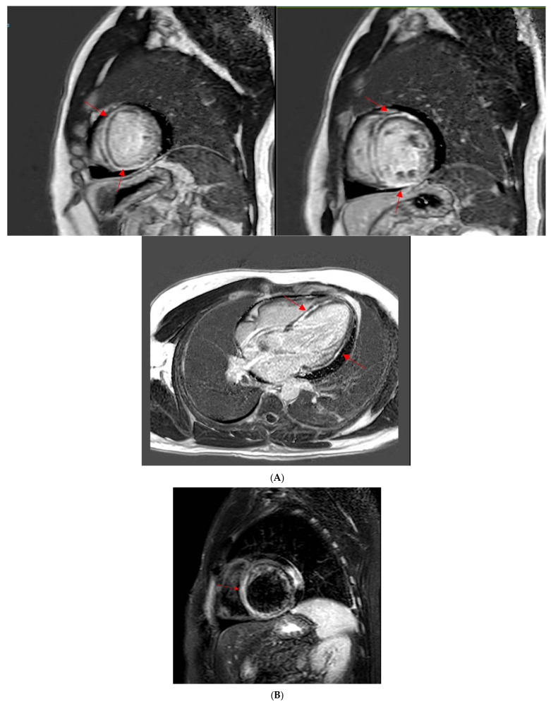
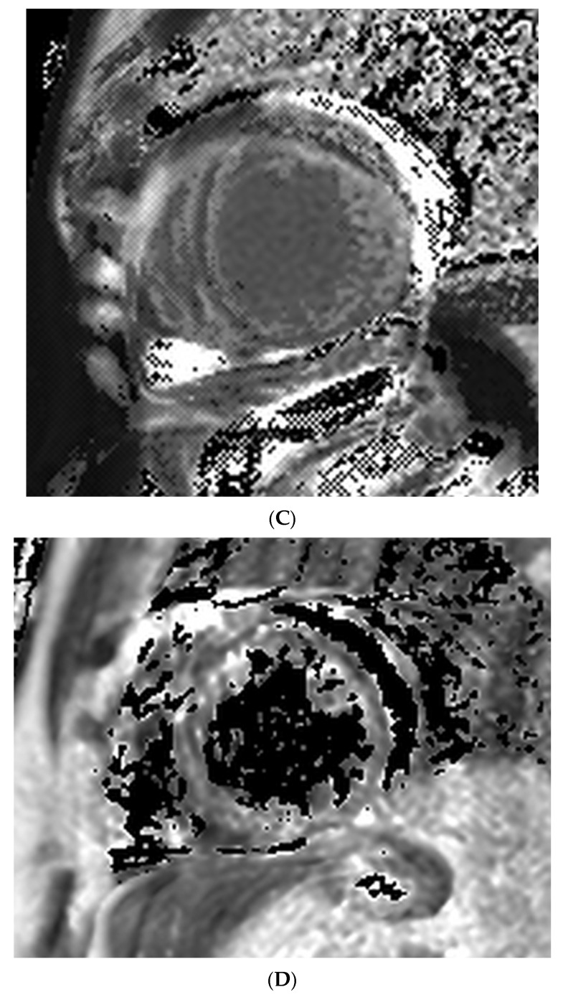
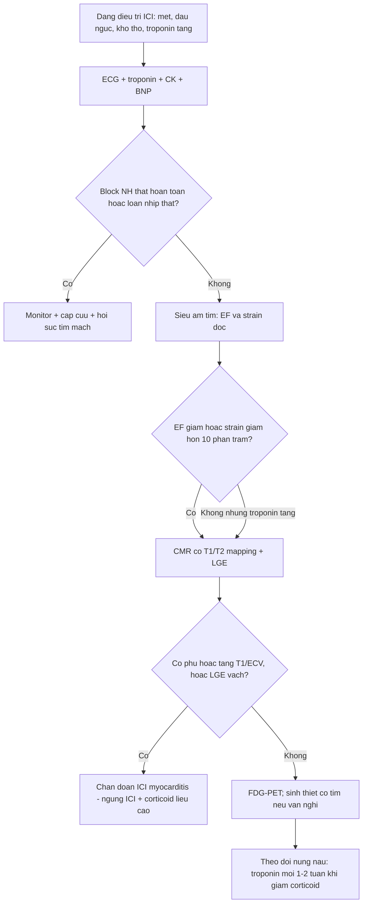
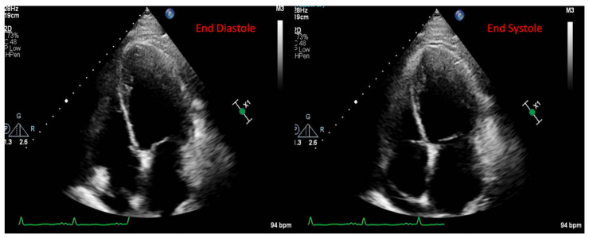

# 6162 — Viêm cơ tim do thuốc ức chế điểm kiểm soát miễn dịch (ICI myocarditis): khi men tim tăng mà MRI "bình thường" / Immune checkpoint inhibitor myocarditis

**Tags:** `pattern:LGE-cotim` `pattern:phu-co` `pattern:roi-loan-van-dong-vung` `vung:cotim` `score:Lake-Louise` `score:IC-OS` `protocol:MRI-tim` `protocol:PET-FDG`
**Mức chắc chắn (certainty):** tổng hợp y văn (literature synthesis) — biên từ tổng quan hình ảnh đa phương thức (J Clin Med 2025, PMC12028134, CC BY 4.0), tổng quan quản lý sau xuất viện của JACC CardioOncology (PMC13699033, CC BY 4.0), so sánh CMR giữa viêm cơ tim do ICI và không do ICI **54 ca** (PMC12608560, CC BY 4.0) và nghiên cứu block nhĩ thất hoàn toàn **34 ca** (PMC10510176, CC BY 4.0). Số liệu lấy từ toàn văn/bảng, không viết từ abstract gián tiếp.

## 1. Tổng quan — vì sao thuốc ung thư lại "đánh" vào cơ tim

### 1.1. Cơ chế: vòng tự khuếch đại tế bào T – đại thực bào

- ICI (anti-CTLA-4, anti-PD-1, anti-PD-L1, anti-LAG-3) **gỡ bỏ phanh ức chế miễn dịch**, làm tế bào T nhận diện **kháng nguyên dùng chung giữa khối u và cơ tim** (myosin, titin…) → viêm cơ tim do tế bào T (PMC12028134).
- Ở thể kháng trị/nung nấu (smoldering), có **vòng tự duy trì tại mô**: đại thực bào cư trú trình diện kháng nguyên → tế bào T tại chỗ hoạt hóa → cytokine → tổn thương cơ tim tiếp diễn **dù đã giảm viêm toàn thân**. Đây là lý do **troponin có thể bùng lại khi giảm corticoid** ở bệnh nhân trông "ổn định" (PMC13699033).
- **Phối hợp ICI làm tăng nguy cơ ~4,7 lần** so với đơn trị (PMC13699033) — vì gỡ nhiều phanh dung thứ cùng lúc.

### 1.2. Vì sao hình ảnh trông "nghèo nàn" hơn bệnh cảnh

- **Phù cơ tim (T2):** nước tự do ngoại bào tăng → **T2 kéo dài** → T2W/STIR sáng, **T2 mapping tăng**. Nhưng tổn thương ở ICI thường **lan tỏa, kẽ, từng đám nhỏ** chứ không thành ổ lớn như nhồi máu — nên **STIR thường chỉ dương ở 28%** ca (103 bệnh nhân), trong khi **mapping bắt được nhiều hơn** (PMC12028134).
- **LGE:** gadolinium ứ ở vùng **mất tế bào/tăng khoảng ngoại bào**. Ở ICI, hoại tử ít hơn viêm cơ tim do virus, nên **LGE chỉ có ở 48%**; trong khi viêm cơ tim **không do ICI** có LGE tới **80%** (PMC12028134). **Kết luận thực hành: LGE âm không loại trừ ICI myocarditis.**
- **T1/ECV:** khi tế bào bị tổn thương và khoảng ngoại bào tăng, **native T1 tăng** phản ánh tổn thương lan tỏa. Trong 136 ca, **95% đạt tiêu chuẩn "tổn thương cơ tim không do thiếu máu"** và **53% đạt tiêu chuẩn phù** khi thêm T1/T2 mapping (PMC12028134). **Native T1 có AUC 0,9 cho MACE** — tốt hơn T2 (PMC12028134).
- **Vì sao EF có thể bình thường:** tổn thương kẽ lan tỏa chưa đủ phá cơ học; **EF bình thường không loại trừ** — đúng như tên gọi "viêm cơ tim có EF bảo tồn".

### 1.3. Con số phải nhớ

| Chỉ số | Giá trị | Nguồn |
|---|---|---|
| Tần suất | **0,04% – ~1%** (theo phác đồ và cách giám sát) | PMC13699033 |
| Tử vong | **20% – 50%** | PMC13699033 |
| Thời điểm khởi phát | trung vị **30–34 ngày** sau bắt đầu ICI (thường sau 1–2 liều); một số loạt **34–167 ngày** | PMC13699033 / PMC12028134 |
| Block nhĩ thất hoàn toàn | **20,6%** (7/34); **HR tử vong 7,41** | PMC10510176 |
| LGE / T2-STIR dương (103 ca) | **48% / 28%** (viêm cơ tim không do ICI: LGE **80%**) | PMC12028134 |
| Tuổi ICI vs không-ICI (54 ca) | **75 (71–78) vs 39 (30–64) tuổi**; T1 **1041 ± 84 vs 1063 ± 60 ms**; T2 **59 ± 6 vs 59 ± 6 ms**; ECV **0,32 ± 0,07 vs 0,31 ± 0,04** | PMC12608560 |

## 2. Mẫu hình + chẩn đoán phân biệt theo thời điểm và kiểu hình (Gamut)

### 2.1. Gamut theo thời điểm — câu hỏi đầu tiên là "cách liều ICI bao lâu?"

- **Sớm (2–12 tuần, trung vị 30–34 ngày):** thể kinh điển, thường sau 1–2 liều, hay **nặng và fulminant** (PMC13699033).
- **Muộn/nung nấu (smoldering):** troponin tăng dai dẳng **không triệu chứng**, EF bảo tồn hoặc đã hồi phục — định nghĩa theo **IC-OS** là troponin đạt ngưỡng chẩn đoán **mà không có triệu chứng** (PMC13699033). Đây là nhóm dễ bị bỏ qua nhất trên hình ảnh.
- **Rất muộn:** hiếm; phải loại trừ **tái phát/tổn thương do xạ, do thuốc khác, do khối u** trước khi quy cho ICI.

### 2.2. Gamut theo kiểu hình lâm sàng–hình ảnh

- **Fulminant:** sốc tim, **block nhĩ thất hoàn toàn**, loạn nhịp thất, ngừng tim — hình ảnh có thể chỉ là **phù lan tỏa + EF giảm nhẹ**.
- **Hội chứng chồng lấp "triple M"** (myocarditis + myositis + myasthenia gravis): CK rất cao, yếu cơ, **nhược cơ hô hấp** — hình ảnh tim có thể kín đáo nhưng bệnh cảnh nặng (PMC12028134).
- **Bảo tồn EF + mapping bất thường:** chỉ phát hiện nhờ **T1/T2 mapping/ECV**, không có LGE (PMC12028134).
- **Chỉ dương trên PET-FDG:** viêm cơ tim hoạt động với CMR không điển hình — **FDG-PET bổ sung**, đặc biệt khi nghi ngờ mà CMR âm (PMC11340117).

### 2.3. Gamut theo vùng tổn thương trên MRI

- **Vách liên thất giữa thành** — vị trí hay gặp nhất; **LGE vách là yếu tố dự báo MACE 1 năm duy nhất trên CMR**, kể cả sau hiệu chỉnh troponin (PMC12028134).
- **Dưới thượng tâm mạc/thành tự do** — gặp nhưng ít đặc hiệu.
- **Lan tỏa không vùng** — thể "mapping-only", dễ đọc là "bình thường" nếu chỉ nhìn LGE.

## 3. Bảng so sánh phân biệt (ma trận đối chiếu)

| Thực thể (entity) | Hình ảnh điển hình | Chốt vào (rule-in) | Chốt loại (rule-out) | Gợi ý xác nhận |
|---|---|---|---|---|
| **Viêm cơ tim do ICI** | LGE **vách giữa thành** hoặc dưới thượng tâm mạc; **T1/T2 map tăng lan tỏa**; EF có thể bình thường | **ICI trong 2–12 tuần + troponin tăng + T1/T2 mapping tăng** (kể cả LGE âm) | LGE **dưới nội tâm mạc theo lãnh thổ vành** → nhồi máu | CMR mapping + ECV; FDG-PET; EMB nếu không chắc |
| **Viêm cơ tim do virus/không do ICI** | LGE **dưới thượng tâm mạc thành bên** rõ, **LGE 80%**; phù khu trú | Tiền sử nhiễm virus; LGE điển hình; tuổi trẻ hơn (**39 vs 75**) | Bệnh cảnh ICI + tuổi lớn + LGE vách → nghĩ ICI | Huyết thanh virus, CMR |
| **Takotsubo** ([1842](../1842-takotsubo-hau-phau-icu/lesson.md)) | Ballooning đỉnh/giữa thất, nền tăng co bóp; **phù khớp vùng rối loạn, LGE vắng** | **Rối loạn vận động vượt quá 1 lãnh thổ + hồi phục nhanh**; trigger stress | Phù + LGE vách lan tỏa, không hồi phục nhanh → viêm | Echo lặp lại, T2 mapping, đáp ứng corticoid |
| **Nhồi máu cơ tim cấp** | Rối loạn vận động **theo lãnh thổ**; LGE dưới nội tâm mạc/xuyên thành | Tắc/mảng thủ phạm; troponin rất cao; ST chênh lên | LGE **vách giữa thành** ngoài lãnh thổ → không phải nhồi máu | ICA/CTA vành |
| **Bệnh cơ tim do nhiễm khuẩn** | Giảm co bóp toàn bộ, buồng giãn; không LGE đặc hiệu | Sốc nhiễm khuẩn, lactate cao | Mapping **bình thường** + hồi phục theo ổ nhiễm → nhiễm khuẩn | Cấy máu, echo lặp lại |
| **Viêm cơ tim tăng bạch cầu ái toan (DRESS)** ([943](../943-viem-co-tim-do-dress/lesson.md)) | LGE **đa ổ dưới nội tâm mạc** + tràn dịch; T2 map 68 ms | Ban + tăng bạch cầu ái toan + thuốc mới | Bệnh sử ICI, không ban, không tăng bạch cầu ái toan → ICI | Công thức máu, sinh thiết |
| **Bệnh cơ tim do myositis chồng lấp** | Tim có thể bình thường; **CK rất cao**, phù cơ | Yếu cơ gốc chi + CK > 5–10× + troponin T tăng do cơ | CK bình thường, không yếu cơ → ít nghĩ myositis | CK, EMG, kháng thể myositis |

### 3.1. Trình tự đọc MRI tim khi nghi ICI myocarditis

1. **EF và vận động vùng** trên cine — có fulminant/giãn buồng không?
2. **T2W/STIR** — có phù vùng không? (Nhớ: chỉ 28% dương.)
3. **T1/T2 mapping + ECV** — dấu hiệu lan tỏa; **đây là phần quyết định** khi LGE âm.
4. **LGE** — vị trí (vách giữa thành?) và mức lan; **LGE vách = tiên lượng**.
5. **Tràn dịch màng ngoài tim** — gợi ý viêm lan rộng.

## 4. Protocol chụp + hệ phân độ/điểm chuẩn hóa

### 4.1. Trước và trong điều trị ICI

- **Trước liều đầu:** ECG + troponin + siêu âm tim làm **mốc nền** — vì mọi thay đổi so với nền mới có giá trị (PMC12028134).
- **Theo dõi trong 2–12 tuần đầu (giai đoạn nguy cơ cao nhất):** troponin và **ECG** mỗi chu kỳ ở bệnh nhân nguy cơ cao (phối hợp ICI, bệnh tim mạch nền).
- **Siêu âm tim:** đánh giá EF, **strain dọc toàn cầu** — **giảm strain dọc > 10%** sớm liên quan tới troponin tăng và phát triển viêm cơ tim (PMC12028134).

### 4.2. Khi nghi ngờ — thứ tự

- **ECG trước tiên:** block nhĩ thất hoàn toàn gặp **20,6%** và là **yếu tố tử vong mạnh (HR 7,41)** (PMC10510176) — cần monitor và cân nhắc tạo nhịp.
- **Troponin + CK + BNP:** CK tăng gợi ý chồng lấp myositis; **BNP/troponin lệch về BNP** gợi ý takotsubo hơn.
- **Siêu âm tim** → **CMR có mapping** (T1/T2/ECV/LGE) khi ổn định → **FDG-PET** khi CMR không kết luận (PMC11340117) → **sinh thiết cơ tim (EMB)** khi còn nghi ngờ và kết quả thay đổi điều trị.
- **Chụp vành/CTA vành** phải loại trừ bệnh mạch vành trước khi quy tổn thương cho ICI (PMC12028134).

### 4.3. Phân độ (ASCO/IC-OS) và ngưỡng hành động

| Độ | Đặc điểm | Hành động chính |
|---|---|---|
| **1** | Không triệu chứng, chỉ ECG/troponin bất thường | Ngừng ICI tạm, theo dõi sát, CMR sớm |
| **2** | Có triệu chứng + ECG/troponin bất thường | Ngừng ICI + corticoid, nhập viện theo dõi |
| **3** | Triệu chứng + **echo/CMR chẩn đoán hoặc gợi ý** viêm cơ tim | Corticoid liều cao, cân nhắc ức chế miễn dịch bậc 2 |
| **4** | Đe dọa tính mạng: sốc, block, loạn nhịp thất | Hồi sức, methylprednisolone xung, bậc 2 sớm (abatacept/tocilizumab), ECMO |

- Bảng phân độ theo ASCO/IC-OS (PMC13699033). **Điều trị:** ngừng ICI + **corticoid liều cao**; thể kháng trị/nung nấu dùng **bậc 2** (abatacept ức chế đồng kích thích CD80/86–CD28, tocilizumab chẹn IL-6, ức chế calcineurin, IVIG/plasmapheresis) (PMC13699033).
- **Giảm liều corticoid phải có "phanh" sinh học:** troponin bùng lại khi giảm liều = **taper-flare**, cần nâng lại liều và đánh giá lại hình ảnh (PMC13699033).

## 5. Biến thể bình thường và cạm bẫy

- **"EF bình thường = không viêm cơ tim" là sai:** thể bảo tồn EF chỉ lộ ra trên **mapping**; bỏ sót dẫn tới ngừng theo dõi và tử vong do block/loạn nhịp.
- **"LGE âm = loại trừ" là sai:** LGE chỉ 48% (so với 80% ở viêm không do ICI) (PMC12028134). Luôn đọc **T1/T2 mapping và ECV**.
- **Mapping không đặc hiệu cho ICI:** ICI và không-ICI có **T1, T2, ECV tương đương** (PMC12608560) — chẩn đoán dựa vào **bệnh sử ICI + thời điểm + loại trừ nguyên nhân**, không dựa vào một con số mapping.
- **Troponin T có thể tăng do myositis** chứ không do tim — luôn kiểm **CK** và triệu chứng cơ; ngược lại, myositis chồng lấp làm **troponin T cao hơn troponin I**.
- **Bẫy "bình thường hóa sớm":** bệnh nhân ra viện với troponin giảm rồi **bùng lại khi giảm corticoid** (smoldering/taper-flare) — coi là **cùng một đợt bệnh**, không phải "tái phát mới".
- **Lỗi đọc ảnh do phẳng mặt cắt:** LGE vách mỏng dễ bị bỏ khi mặt cắt ngắn không đúng; luôn có **mặt cắt 4 buồng + ngắn trục** và **ảnh đảo pha đúng TI**.
- **FDG-PET dương giả** do cơ tim dùng glucose sinh lý — cần **chuẩn bị chế độ ăn ít carb/ít mỡ** trước khi kết luận (nguyên tắc chung của PET tim).

## 6. Tự lượng giá — Blind Quiz

**Ca 1 — Nam 72 tuổi, ung thư phổi, 3 tuần sau liều thứ 2 pembrolizumab, mệt và khó thở nhẹ, troponin T tăng.**

- Gợi ý: EF giảm, có tràn dịch màng ngoài tim lượng ít; không đau ngực; ECG nhịp nhanh xoang.
- Câu hỏi: Ảnh cho thấy gì? Nếu EF bình thường thì có loại trừ được viêm cơ tim do ICI không? Bước hình ảnh tiếp theo?

<b>Bấm để hiện đáp án (findings + chẩn đoán)</b>

- Dấu hiệu: 4 buồng ở thì tâm trương và tâm thu — **giảm co bóp nặng (LVEF ~30%)**, giảm nhẹ chức năng thất phải, **tràn dịch màng ngoài tim ít**.
- Chẩn đoán: **viêm cơ tim do ICI** (thời điểm 3 tuần sau liều 2, phù hợp trung vị 30–34 ngày).
- Không: **EF bình thường không loại trừ** — thể bảo tồn EF chỉ lộ trên **T1/T2 mapping/ECV**; bước tiếp theo là **CMR có mapping**, sau đó **FDG-PET/EMB** nếu chưa kết luận.
- Nguồn ảnh: *J Clin Med* 2025 (PMC12028134), Fig. 3, **CC BY 4.0**.

**Ca 2 — Cùng bệnh nhân, CMR tim sau khi ổn định huyết động.**

- Gợi ý: troponin còn tăng nhẹ; EF 29%; không có mảng xơ vữa đáng kể trên CTA vành.
- Câu hỏi: Mô tả LGE (vị trí, kiểu lan)? T2W cho thêm thông tin gì? Vì sao tổn thương này **không** theo lãnh thổ vành?

<b>Bấm để hiện đáp án</b>

- Dấu hiệu: (A) **LGE giữa thành dọc vách liên thất**, lan vào các đoạn trước/dưới thất trái (mũi tên đỏ); EF hai thất giảm (LVEF 29%, RVEF 42%). (B) **T2W: tăng tín hiệu cơ tim** phù hợp phù cơ tim.
- Chẩn đoán: **viêm cơ tim do ICI** — LGE **vách giữa thành** là vị trí điển hình và là **yếu tố dự báo MACE 1 năm**.
- Vì sao không theo lãnh thổ: tổn thương nằm **giữa thành vách**, không tôn trọng ranh giới một nhánh vành; cơ chế là viêm tế bào T lan theo mô cơ tim, không do tắc mạch.
- Nguồn ảnh: *J Clin Med* 2025 (PMC12028134), Fig. 4A–B, **CC BY 4.0**.

**Ca 3 — Nữ 66 tuổi, ung thư vú, 6 tuần sau liều ICI, không triệu chứng nhưng troponin tăng dai dẳng; EF 60%.**

- Gợi ý: LGE không rõ; STIR không dương; bệnh nhân hoàn toàn không triệu chứng.
- Câu hỏi: Đây là thể gì? Vì sao LGE âm mà vẫn chẩn đoán? Ngưỡng theo dõi và nguy cơ khi giảm corticoid?

<b>Bấm để hiện đáp án</b>

- Dấu hiệu: (C) **bản đồ T1** và (D) **bản đồ T2** — vùng cơ tim có giá trị **tăng so với cơ tim lành**, tức **tổn thương/phù lan tỏa** dù không có LGE.
- Chẩn đoán: **ICI myocarditis thể nung nấu (smoldering)** — troponin đạt ngưỡng chẩn đoán **không triệu chứng**, EF bảo tồn (định nghĩa IC-OS).
- Vì sao: tổn thương **kẽ lan tỏa** làm tăng T1/ECV và T2 trước khi đủ mất tế bào để tạo LGE; **chỉ 48% ca có LGE, 28% có STIR dương**.
- Theo dõi: troponin mỗi **1–2 tuần** khi giảm corticoid; **troponin bùng lại = taper-flare**, nâng lại liều và đánh giá hình ảnh.
- Nguồn ảnh: *J Clin Med* 2025 (PMC12028134), Fig. 4C–D, **CC BY 4.0**.

## Bài liên quan chéo
- [1842 — Takotsubo ở ICU và hậu phẫu (phân biệt với ICI myocarditis)](../1842-takotsubo-hau-phau-icu/lesson.md)
- [943 — Viêm cơ tim do DRESS (eosinophilic myocarditis)](../943-viem-co-tim-do-dress/lesson.md)
- [820 — MRI tim: LGE và mapping](../820-cardiac-mri-lge-mapping/lesson.md)
- [810 — CTA vành và CAD-RADS](../810-coronary-cta-cadrads/lesson.md)
- [085 — Độc tính miễn dịch quanh mổ ung thư phổi](../085-doc-tinh-mien-dich-quanh-mo-ung-thu-phoi/lesson.md)
- [092 — Suy thượng thận & suy tuyến yên do ICI](../092-suy-thuong-than-suy-tuyen-yen-quanh-mo/lesson.md)

## Ảnh
- `6162_ICI-viem-co-tim_TTE_PMC12028134.jpg` — siêu âm 4 buồng: giảm co bóp nặng, tràn dịch màng ngoài tim ít.
- `6162_ICI-viem-co-tim_LGE-T2W_CMR_PMC12028134.jpg` — LGE giữa thành vách + T2W tăng tín hiệu.
- `6162_ICI-viem-co-tim_T1-T2-map_CMR_PMC12028134.jpg` — bản đồ T1 và T2 (thể mapping-only).
- Nguồn + giấy phép từng ảnh: `images/CREDITS.md`.

> Không dùng để chẩn đoán độc lập khi chưa có người hướng dẫn.
