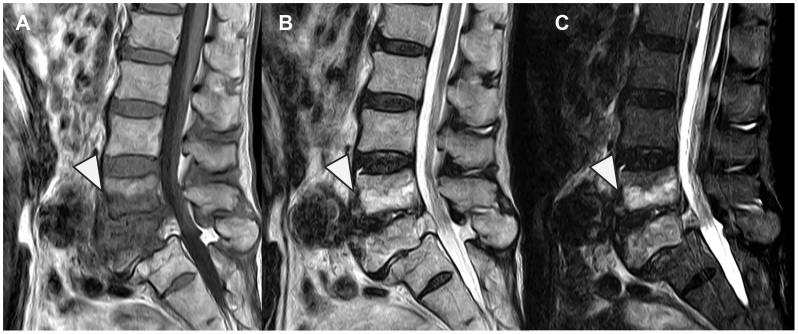
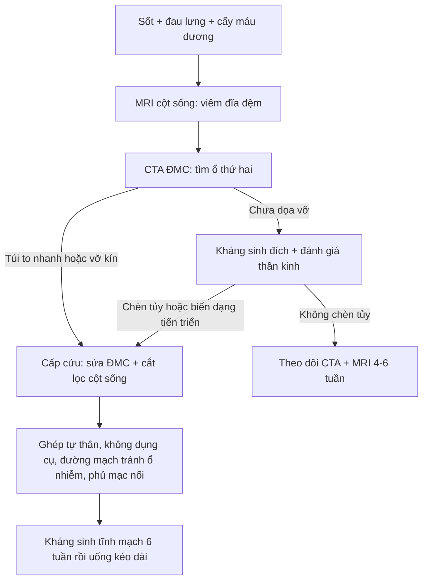
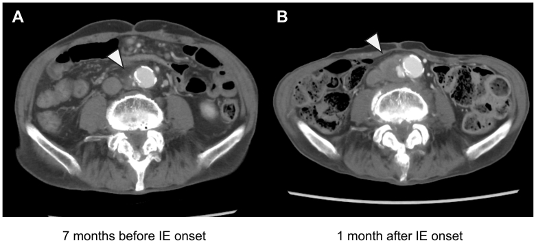

# 6163 — Viêm đĩa đệm–thân sống + phình động mạch chủ nhiễm khuẩn: hai ổ liền kề và thứ tự can thiệp / Contiguous spondylodiscitis and infected aortic aneurysm

**Tags:** `pattern:phinh-dong-mach` `pattern:viem-dia-dem` `pattern:khi-quanh-mach` `pattern:phu-tuy-xuong` `vung:dong-mach-chu-bung` `vung:cot-song` `protocol:CTA` `protocol:MRI-cot-song`
**Mức chắc chắn (certainty):** tổng hợp y văn (literature synthesis) — ghép **1 ca bệnh hai ổ liền kề có phẫu thuật một thì + 2 ảnh** (*J Vasc Surg Cases Innov Tech* 2026, PMC13382081, CC BY), **1 loạt ca 15 bệnh nhân viêm ĐMC nhiễm khuẩn được can thiệp nội mạch** (*J Clin Med* 2024, PMC11354867, CC BY) và **bài nền 1919** (phình nhiễm ĐMC nguyên bản, đã có nguồn riêng). Không có thử nghiệm ngẫu nhiên về **thứ tự mổ**.

> **Câu chốt:** khi **sốt + đau lưng** gặp **túi phình ĐMC lệch tâm đang to nhanh**, phải coi là **một bệnh — hai ổ**: **viêm đĩa đệm–thân sống và phình ĐMC nhiễm khuẩn** lây nhau qua **đường máu hoặc lan kế cận**. Sai lầm chết người **không phải** là đọc sai một trong hai, mà là **dừng lại khi đã tìm thấy một ổ**. Về điều trị: **đường kính KHÔNG phải ngưỡng quyết định** (3–4 cm đã có thể vỡ); **tốc độ to và hình thái túi** mới là ngưỡng, và **mảnh ghép/ dụng cụ đặt qua vùng nhiễm là thất bại** — nên phải **cắt lọc, ghép tự thân, đi đường mạch tránh ổ nhiễm, phủ mạc nối**.

## 1. Tổng quan bệnh học – cơ chế hình ảnh (TẠI SAO)

### 1.1 Một dòng máu, hai ổ: sinh lý bệnh

- **Nguồn gieo thường gặp:** **viêm nội tâm mạc nhiễm khuẩn** (như ca minh họa), **nhiễm khuẩn huyết do *S. aureus* / *Salmonella***, **ổ nhiễm tiết niệu–tiêu hóa kề cận**. Trong loạt 15 ca viêm ĐMC nhiễm khuẩn, **47% do *S. aureus***, phần còn lại chủ yếu ***Salmonella*** (PMC11354867).
- **Ở ĐMC:** vi khuẩn vào **vasa vasorum** của lớp áo ngoài → **viêm mủ lớp áo giữa** → **phá hủy sợi đàn hồi và collagen** → thành **mất sức chịu lực từng ổ** → **túi lệch tâm (saccular)**, bờ nhiều thùy, **to nhanh**. Vì mất thành **khu trú** chứ không phải giãn đều, **đường kính 3–4 cm đã có thể vỡ** — **ngưỡng 5,5 cm của phình xơ vữa không áp dụng** (bài 1919).
- **Ở cột sống:** đĩa đệm **người lớn không có mạch máu**; vi khuẩn theo **động mạch thân sống tới đốt sống kề đĩa**, rồi **lan qua đĩa**. Vì vậy tổn thương **lấy đĩa làm trung tâm (disc-centered)**, **phá hai bờ đốt kề** và **hẹp khe đĩa** — khác hẳn **di căn** (ở **thân sống**, **chừa đĩa**).
- **Hai ổ lây nhau thế nào:** hoặc **gieo máu cùng lúc** (như ca minh họa: viêm nội tâm mạc → cả ĐMC và L4/5), hoặc **lan kế cận** từ ổ cạnh ĐMC (túi thừa, đại tràng, ổ mủ sau phúc mạc). Trong loạt ca viêm ĐMC, **3/15 (20%)** có **viêm đĩa đệm kèm theo** (PMC11354867) — đủ thường gặp để **phải soát chủ động**.

### 1.2 TẠI SAO mỗi chuỗi xung cho một câu trả lời khác nhau

1. **MRI cột sống — vì sao là "vua" của ổ xương:** viêm làm **phù tủy xương** (nước ngoại bào tăng) → **T1 giảm, T2/STIR tăng**; **ngấm thuốc** ở đĩa và hai bờ đốt; **áp-xe ngoài màng cứng** là khối **viền ngấm thuốc**. Trên **X-quang**, phải **mất 30–50% khoáng chất** mới thấy bờ đốt mờ — **trễ 2–4 tuần**; **CT** thấy **bào mòn bờ đốt** sớm hơn nhưng **kém nhạy với phù tủy** và **không thấy áp-xe mô mềm** rõ như MRI.
2. **CTA ĐMC — vì sao phải so phim cũ:** túi nhiễm **thay đổi hình thái trong vài tuần**, nên **một phim đơn độc có thể "chưa đáng kể"**. Ca minh họa là ví dụ thuần: **7 tháng trước còn là phình dưới thận "ổn định"**, **1 tháng sau khởi phát nhiễm** đã **to thêm, bờ không đều, có dịch/mỡ quanh mạch** → **nguy cơ vỡ cận kề** (PMC13382081).
3. **TẠI SAO có khí quanh ĐMC:** vi khuẩn sinh hơi + ổ mủ hoại tử. Ở **ĐMC nguyên bản (chưa có mảnh ghép)**, **khí quanh mạch là dấu hiệu rất đặc hiệu của nhiễm** — khác **khí bẫy lành tính sau EVAR** (bài 148, bài 1919).
4. **TẠI SAO PET/CT hữu ích nhưng không thay CTA:** đại thực bào hoạt hóa quanh ổ nhiễm **tăng tiêu thụ FDG** → **ngấm khu trú**. PET giúp khi **cấy máu âm** hoặc **nghi ổ thứ hai**, nhưng **dương tính giả** sau mổ, trong mảng xơ vữa viêm, và ở u (bài 1919).

### 1.3 Ngưỡng định lượng nằm lòng

| Đại lượng | Số liệu | Nguồn |
|---|---|---|
| Phình nhiễm trong mọi phình ĐMC | **1–3%** | bài 1919 (dẫn PMC12148370) |
| Viêm đĩa đệm kèm viêm ĐMC | **3/15 (20%)** | PMC11354867 |
| Viêm ĐMC có **vỡ kín** / **vỡ tự do** lúc can thiệp | **40%** / **13%** | PMC11354867 |
| Tử vong 30 ngày sau can thiệp nội mạch | **13%** (2/15) | PMC11354867 |
| Tử vong mổ (loạt được trích) | **21%**; sống **1 năm 82%**, **5 năm 50%** | PMC11354867 (dẫn loạt khác) |
| Can thiệp lại | **20%** trong **31,6 ± 23,1 tháng** | PMC11354867 |
| Kháng sinh tĩnh mạch có đích | trung bình **51 ± 28,6 ngày** | PMC11354867 |
| Dày thành ĐMC lúc chẩn đoán | **30,3 ± 19,2 mm** | PMC11354867 |
| Thời gian từ nhiễm huyết đến viêm đĩa đệm (ca minh họa) | **≈ 1 tháng** | PMC13382081 |
| Thời gian nằm viện sau mổ một thì (ca minh họa) | **≈ 3 tháng**, tiếp tục kháng sinh uống | PMC13382081 |
| Cỡ mẫu ca minh họa | **1 ca** (77 tuổi, nam) | PMC13382081 |

## 2. Mẫu hình + chẩn đoán phân biệt theo vị trí (Gamut)

**Mẫu hình chung:** **sốt âm ỉ + đau lưng dữ dội + cấy máu dương**; hình ảnh **hai ổ**: **ĐMC dưới thận lệch tâm, bờ không đều, to nhanh, viêm mỡ quanh mạch ± khí** và **đĩa đệm L4/5 (hoặc L3/4) hẹp, hai bờ đốt bào mòn, phù tủy, ngấm thuốc ± áp-xe ngoài màng cứng**.

- **Theo vị trí ĐMC:** **dưới thận** (hay gặp, dễ mổ/EVAR) · **cạnh tạng–trên thận** (khó, cần stent phân nhánh hoặc mổ) · **ngực** (thường kèm nhiễm *Salmonella*, dễ vỡ vào trung thất).
- **Theo vị trí cột sống:** **thắt lưng** (hay gặp nhất, kề ĐMC — **đúng vùng nguy hiểm của bài này**) · **ngực** (kèm áp-xe cạnh sống lan trung thất) · **cổ** (kèm áp-xe sau hầu, chèn đường thở).
- **Gamut "viêm đĩa đệm lấy đĩa làm trung tâm":** **vi khuẩn (Staph, Salmonella, Brucella)** · **lao (Pott)** · **nấm** · **viêm đĩa đệm vô khuẩn sau mổ** · **bệnh khớp do lọc máu (amyloid β2-microglobulin)** · **bệnh Charcot cột sống** · **Modic 1** (giả nhiễm).
- **Gamut "khối/dịch quanh ĐMC":** **phình nhiễm** · **phình viêm (inflammatory AAA)** · **máu tụ sau vỡ kín** · **xơ hóa sau phúc mạc** · **lymphoma** · **sarcoma nội mạc** · **nhiễm mảnh ghép** (bài 148, 1919).

## 3. Bảng so sánh phân biệt (ma trận đối chiếu)

| Thực thể (entity) | Hình ảnh điển hình | Chốt vào (rule-in) | Chốt loại (rule-out) | Gợi ý xác nhận |
|---|---|---|---|---|
| **Hai ổ liền kề: viêm đĩa đệm + phình ĐMC nhiễm** | **Túi lệch tâm to nhanh + viêm mỡ quanh ĐMC ± khí**; **đĩa đệm hẹp, bào mòn 2 bờ đốt, phù tủy, ngấm thuốc** | **Cấy máu dương + hai ổ cùng lúc + to nhanh khi so phim cũ** | **Đĩa đệm bình thường + ĐMC vôi hóa liên tục, không viêm quanh mạch** → không phải | CTA 3 thì lát 1 mm + MRI cột sống; cấy máu **3 bộ trước kháng sinh**; PET/CT |
| **Phình ĐMC nhiễm đơn độc (1919)** | Túi lệch tâm, nhiều thùy, **mất liên tục vôi hóa**, dịch/khí quanh mạch | **Sốt + cấy dương + túi lệch tâm có viêm quanh mạch** | **Hình thoi đều + vôi hóa liên tục + không viêm** → xơ vữa | CTA; PET/CT khi cấy âm |
| **Viêm đĩa đệm vi khuẩn đơn độc** | **Disc-centered**, hẹp khe đĩa, phù tủy 2 bờ đốt, ngấm thuốc, áp-xe ngoài màng cứng | **MRI disc-centered + cấy/ sinh thiết dương** | **ĐMC bình thường, không túi, không viêm quanh mạch** | MRI + cấy đĩa; **luôn CTA ĐMC** để tìm ổ thứ hai |
| **Lao cột sống (Pott)** | **Phá thân sống** nhiều hơn đĩa, **áp-xe lạnh dưới dây chằng**, gù, nhiều tầng | **Phá thân sống + áp-xe lớn + dịch tổ chức hóa + gù** | **Đĩa hẹp sớm, bào mòn 2 bờ đối xứng, khởi phát cấp** → nghĩ vi khuẩn | PCR lao/IGRA; sinh thiết; MRI |
| **Modic 1 (giả nhiễm)** | **Phù tủy hai bờ đốt đối xứng**, **không bào mòn**, **không ngấm đĩa**, không áp-xe | **Phù hai bờ đốt, đĩa còn chiều cao, không ngấm thuốc đĩa** | **Bào mòn bờ đốt + ngấm thuốc đĩa + áp-xe** → nhiễm | MRI; theo dõi, không sinh thiết |
| **Di căn cột sống** | **Thân sống** bị phá, **chừa đĩa**, ngấm thuốc, có khối mô mềm | **Chừa đĩa + tổn thương thân sống + tiền sử ung thư** | **Disc-centered + hẹp khe đĩa** → nhiễm | MRI + PET/CT; sinh thiết |
| **Phình viêm (inflammatory AAA)** | **Dày thành đồng tâm đều**, xơ hóa quanh ĐMC, **không khí**, **không phá xương** | **Dày thành đều + xơ hóa + không sốt/cấy âm** | **Túi lệch tâm + khí + bào mòn đốt sống** → nhiễm | CTA; IgG4/CRP; PET âm tính |
| **Nhiễm mảnh ghép nội mạch (148)** | Dịch/khí **quanh mảnh ghép**, giả phình miệng nối | **Khí ≥ 7 tuần hoặc dịch ≥ 3 tháng sau EVAR, tăng dần** | **Khí/dịch sớm, nhỏ dần** → sinh lý | MAGIC; CTA; PET |

*Nam 77 tuổi, viêm nội tâm mạc nhiễm khuẩn, **1 tháng sau** đau lưng. **(A)** T1W xương dọc: **giảm tín hiệu thân sống và đĩa L4/5** (đầu mũi tên). **(B)** T2W: **tăng tín hiệu cùng vùng**, khe đĩa hẹp. **(C)** STIR: **phù tủy rõ** ở hai bờ đốt và mô cạnh sống. Nguồn: *J Vasc Surg Cases Innov Tech* 2026 (PMC13382081), Fig. 1, CC BY 4.0.*

## 4. Protocol chụp + thứ tự can thiệp

### 4.1 Trình tự chẩn đoán (không được đảo)

1. **Cấy máu 3 bộ trước kháng sinh** + CRP, PCT, **siêu âm tim** tìm viêm nội tâm mạc (nguồn gieo).
2. **MRI cột sống** (T1, T2, STIR, **T1 sau tiêm fat-sat**, ± toàn bộ cột sống nếu đau nhiều tầng): xác định **đĩa nào, mức phá xương, áp-xe ngoài màng cứng, chèn tủy**.
3. **CTA ĐMC bụng–chậu 3 thì, lát 1 mm**, **cửa sổ xương**: tìm **túi lệch tâm, dịch/khí quanh mạch, mất vôi hóa, huyết khối trong túi**, và **so với mọi phim cũ** để tính **tốc độ to**.
4. **Sinh thiết/ chọc hút đĩa qua CT** khi cấy máu âm và chẩn đoán chưa rõ. **Không chọc hút túi phình ĐMC "để chẩn đoán"** — nguy cơ vỡ và gieo nhiễm.
5. **PET/CT** khi cấy âm, nghi ổ thứ ba, hoặc theo dõi đáp ứng sau mổ.

### 4.2 Thứ tự can thiệp — vì sao "một thì" có thể đúng

- **Nguyên tắc 1 — cắt lọc triệt để:** lấy hết mô hoại tử, **curette đĩa và bờ đốt**, dẫn lưu ổ mủ.
- **Nguyên tắc 2 — không đặt dị vật qua vùng nhiễm:** **mảnh ghép mạch** và **dụng cụ cột sống** đều là **bề mặt cho biofilm**. Ca minh họa dùng **ghép tự thân xương mào chậu KHÔNG dụng cụ** để tái tạo cột sống trước, và **đi đường mạch tách khỏi ổ cột sống** (infection-avoiding graft routing) — rồi **phủ mạc nối** (PMC13382081).
- **Nguyên tắc 3 — ghép tẩm rifampicin** dùng khi buộc phải đặt vật liệu tổng hợp tại chỗ (ca minh họa), nhưng **không thay thế** cắt lọc và che phủ.
- **Nguyên tắc 4 — thời gian kháng sinh:** khung **6 tuần tĩnh mạch** là thực hành thường dùng (loạt ca trung bình **51 ± 28,6 ngày**), sau đó **uống kéo dài** — ca minh họa uống tiếp tới **≈ 3 tháng** và **không tái phát** (PMC11354867; PMC13382081).
- **Theo dõi:** **CTA + MRI lặp lại 4–6 tuần** và khi có triệu chứng mới; **không dùng đường kính đơn thuần** để quyết định dừng — **túi còn to lên dù kháng sinh = thất bại nội khoa**, phải can thiệp (bài 1919).

### 4.3 Hệ phân độ liên quan

- **Phình ĐMC nhiễm:** không có RADS riêng; dùng **hình thái + tốc độ to + dấu viêm** làm "phân độ thực hành" (bài 1919).
- **Viêm đĩa đệm:** không có score hình ảnh chuẩn hóa; **yếu tố quyết định** là **chèn tủy/áp-xe ngoài màng cứng, mất vững, biến dạng** — không phải kích thước ổ viêm.

## 5. Biến thể bình thường và cạm bẫy

- **Cạm bẫy 1 — "thỏa mãn tìm kiếm" (satisfaction of search):** thấy **viêm đĩa đệm** là dừng, hoặc thấy **túi phình** là dừng. **Quy tắc cứng: có một ổ → phải CTA ĐMC + MRI cột sống cho ổ kia**, vì **20%** ca viêm ĐMC có viêm đĩa đệm kèm (PMC11354867).
- **Cạm bẫy 2 — chờ "đủ to" mới mổ:** phình nhiễm **vỡ ở 3–4 cm**; **ngưỡng 5,5 cm không áp dụng**. Dấu hiệu hành động là **to nhanh + đau + bờ không đều**, không phải con số tuyệt đối.
- **Cạm bẫy 3 — đọc "khí quanh ĐMC" như khí bẫy:** ở **ĐMC nguyên bản**, khí quanh mạch **hầu như luôn là nhiễm**; sau EVAR mới có khí lành tính **< 7 ngày** (bài 148).
- **Cạm bẫy 4 — bỏ sót ổ nhiễm thứ ba:** răng, xoang, túi thừa, đường mật, van tim, ổ tiêm chích. Ca minh họa có **viêm nội tâm mạc** đứng trước.
- **Cạm bẫy 5 — "MRI bình thường sớm":** trong **vài ngày đầu**, phù tủy có thể chưa rõ; **nếu lâm sàng mạnh, chụp lại sau 3–5 ngày** hoặc làm **PET/CT**, đừng kết luận loại trừ.
- **Cạm bẫy 6 — Modic 1 bị điều trị như nhiễm:** **phù đối xứng hai bờ đốt, đĩa còn chiều cao, không ngấm thuốc đĩa, không áp-xe** → **không sinh thiết, không kháng sinh dài**.
- **Cạm bẫy 7 — cấy máu âm vì đã dùng kháng sinh:** **không loại trừ nhiễm**; cần **sinh thiết đĩa** hoặc **PET/CT**, và **nhớ rằng không có xét nghiệm nào một mình loại trừ**.
- **Biến thể bình thường cần biết:** **đĩa đệm thoái hóa có phù nhẹ kiểu Modic 1**; **vôi hóa ĐMC không liên tục ở người già do mảng xơ vữa** (khi **không có viêm quanh mạch và không to nhanh** thì không phải nhiễm); **khí trong ruột kề ĐMC** trên CT không cản quang — luôn đọc **cửa sổ mô mềm + so thì**.

## 6. Tự lượng giá — Blind Quiz (ảnh ngoài, đáp án trong khối chi tiết)

**Ca 1 — nam 77 tuổi, sốt và đau lưng 1 tháng sau nhiễm khuẩn huyết**

- Gợi ý lâm sàng: **đau lưng tăng dần**, CRP cao, **cấy máu dương**; chưa có yếu chi.
- Câu hỏi: Tổn thương **lấy đĩa hay lấy thân sống làm trung tâm**? Ba chẩn đoán phân biệt? Vì sao **phải chụp thêm ĐMC**?

<b>Bấm để hiện đáp án (findings + chẩn đoán)</b>

- Dấu hiệu (findings): **đĩa L4/5 hẹp**, **giảm tín hiệu T1 và tăng tín hiệu T2/STIR ở hai bờ đốt kề và đĩa**, **phù mô cạnh sống** → **viêm đĩa đệm–thân sống**.
- Chẩn đoán (diagnosis): **viêm đĩa đệm–thân sống do vi khuẩn** (disc-centered). Phân biệt: **lao** (phá thân sống, áp-xe lạnh), **di căn** (chừa đĩa), **Modic 1** (không bào mòn, không ngấm đĩa).
- Vì sao phải chụp ĐMC: cùng một đợt nhiễm khuẩn huyết có thể **gieo cả hai ổ**; **20%** ca viêm ĐMC có viêm đĩa đệm kèm (PMC11354867) — và ổ ĐMC là ổ **chết người**.
- Nguồn ảnh: *J Vasc Surg Cases Innov Tech* 2026 (PMC13382081), Fig. 1, CC BY 4.0.

**Ca 2 — cùng bệnh nhân, CTA bụng so hai thời điểm**

- Gợi ý lâm sàng: cùng bệnh nhân trên; **không đau bụng**, chỉ đau lưng.
- Câu hỏi: Hai ảnh khác nhau ở điểm nào? Vì sao **không thể chờ đến 5,5 cm**? Kế hoạch mổ nên **đặt mảnh ghép ở đâu**?

<b>Bấm để hiện đáp án (findings + chẩn đoán)</b>

- Dấu hiệu (findings): **(A)** 7 tháng trước: phình dưới thận **hình thoi, bờ tương đối đều**. **(B)** 1 tháng sau khởi phát nhiễm: **túi to ra, bờ không đều, dịch/mỡ quanh ĐMC** (đầu mũi tên) — **thay đổi hình thái trong vài tuần**.
- Chẩn đoán (diagnosis): **phình ĐMC nhiễm khuẩn có nguy cơ vỡ cận kề** — **tốc độ to + hình thái** là ngưỡng, không phải đường kính.
- Kế hoạch: **cắt lọc + ghép tự thân/tẩm rifampicin, đi đường mạch TRÁNH ổ cột sống, phủ mạc nối**; ca này mổ **một thì** cùng cắt lọc cột sống, tái tạo bằng **xương mào chậu không dụng cụ** (PMC13382081).
- Vì sao: **dụng cụ/mảnh ghép xuyên vùng nhiễm = nhiễm mảnh ghép**; đường mạch tách khỏi ổ xương giảm gieo nhiễm.
- Nguồn ảnh: *J Vasc Surg Cases Innov Tech* 2026 (PMC13382081), Fig. 2, CC BY 4.0.

## Bài liên quan chéo
- [1919 – Phình động mạch chủ bụng nhiễm khuẩn](../1919-phinh-dong-mach-chu-bung-nhiem-khuan/lesson.md) — chẩn đoán và chọn EVAR/mổ hở.
- [148 – Nhiễm mảnh ghép nối mạch ĐMC](../148-nhiem-trung-manh-ghep-noi-mach-dmc/lesson.md) — khí/dịch quanh mảnh ghép, tiêu chuẩn MAGIC.
- [171 – Bóc tách ĐMC bụng và IMH](../171-boc-tach-dong-mach-chu-bung-va-IMH/lesson.md) — phân biệt túi phình thật/giả, huyết khối trong thành.
- [3012 – Áp-xe ngoài màng cứng cột sống](../3012-apxe-ngoai-mang-cung-sau-gay-te-ngoai-mang-cung/lesson.md) — biến chứng thần kinh của ổ cột sống.

## Ảnh
- Hai ảnh từ **một ca** (*J Vasc Surg Cases Innov Tech* 2026, PMC13382081, **CC BY 4.0**): MRI cột sống (Fig. 1) và CTA bụng hai thời điểm (Fig. 2). **Không tạo ảnh ghép** vì mỗi hình là bảng nhiều panel của **cùng bệnh nhân**.
- Chi tiết nguồn + giấy phép từng file: `images/CREDITS.md`.

> Không dùng để chẩn đoán độc lập khi chưa có người hướng dẫn.
