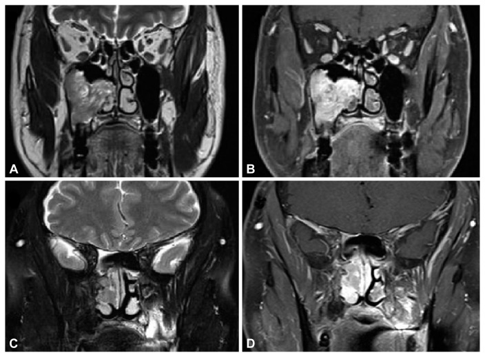
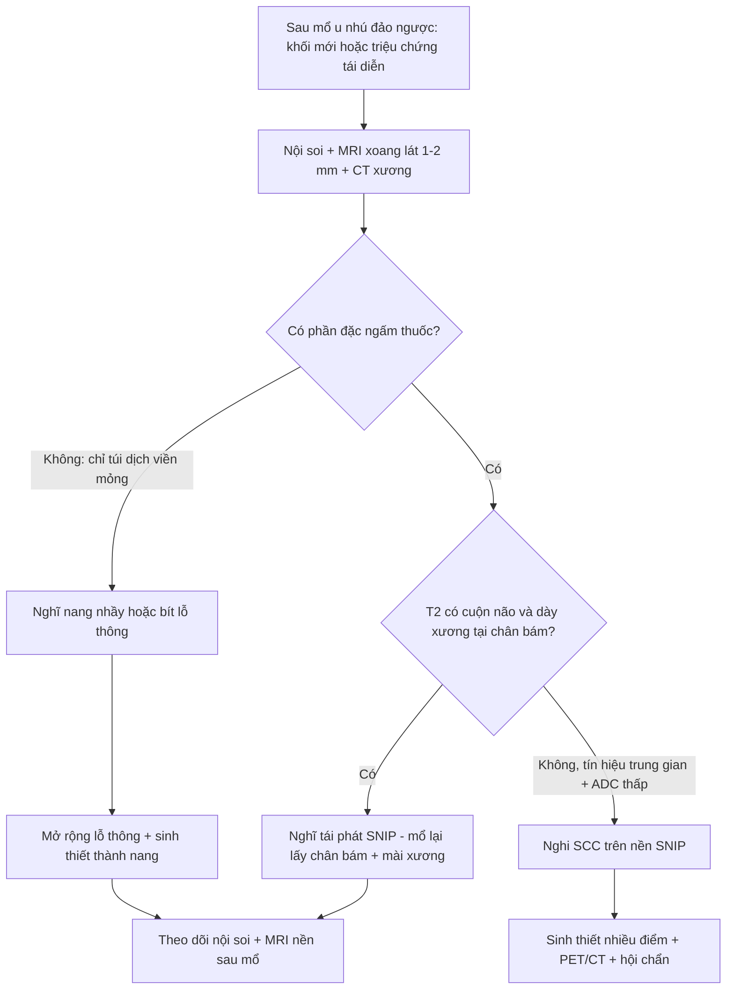
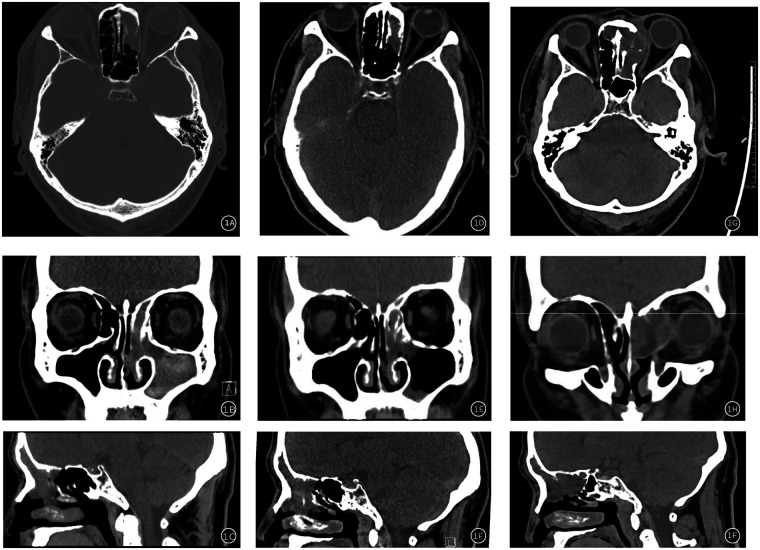
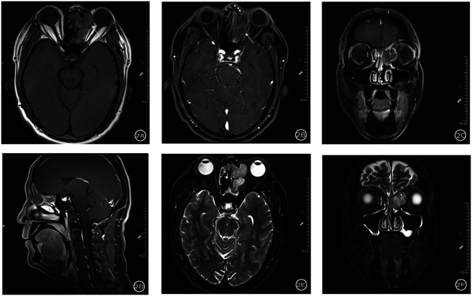
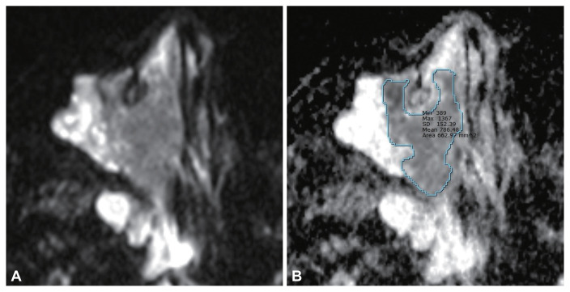

# 6164 — U nhú đảo ngược tái phát sau mổ: tái phát thật, nang nhầy hay sẹo xơ / Recurrent sinonasal inverted papilloma: recurrence, mucocele or scar

**Tags:** `pattern:tai-phat` `pattern:khoi-xoang` `pattern:nang-nhay` `pattern:cerebriform` `pattern:day-xuong` `vung:xoang` `vung:mui` `score:Krouse` `protocol:MRI-xoang` `protocol:CT-xoang` `protocol:noi-soi-xoang`
**Mức chắc chắn (certainty):** tổng hợp y văn (literature synthesis) — ghép **1 ca tái phát bị nang nhầy che, chẩn đoán trượt trên CT/MRI 4 mm và chỉ xác nhận khi mổ** (*Front Allergy* 2026, PMC13349747, CC BY), **1 loạt 30 ca so u nhú đảo ngược với ung thư biểu mô vảy trên nền u nhú (ADC, T2, mẫu hình cuộn não)** (*J Rhinol* 2026, PMC13065420, CC BY-NC), **1 loạt 16 ca đối chiếu CT – mô học** (*Diagnostics* 2025, PMC12248862, CC BY) và **bài nền 3066** của repo. **Không có thử nghiệm ngẫu nhiên** về lịch theo dõi.

> **Câu chốt:** sau mổ u nhú đảo ngược, **khối mô mềm mới không tự động là tái phát, và nang nhầy không tự động là "lành"**. Ba khả năng — **tái phát thật**, **nang nhầy/bít lỗ thông** và **sẹo xơ – mô hạt** — chồng lấp trên hình ảnh; **nang nhầy có thể nằm TRƯỚC u tái phát và che nó**, nên **chỉ đọc túi dịch rồi kết luận là bỏ sót u**. Ngược lại, **gọi mọi nốt ngấm thuốc sau mổ là tái phát** dẫn tới **mổ lại lần hai trên mô đã xơ** — khó hơn nhiều và dễ làm hẹp lỗ thông hơn nữa. Chốt hạ: **MRI lát mỏng ≤ 1–2 mm + soi nội soi + sinh thiết thành nang khi còn nghi ngờ**, không dựa vào một chuỗi xung.

## 1. Tổng quan bệnh học – cơ chế hình ảnh (TẠI SAO)

### 1.1 Vì sao u nhú đảo ngược hay tái phát

- **Dịch tễ:** u nhú đảo ngược xoang mũi (sinonasal inverted papilloma, SNIP) chiếm **0,4–7%** u xoang mũi, tỷ lệ mắc **0,2–1,5/100.000/năm**; nam nhiều hơn nữ, tuổi hay gặp **50–60** (PMC13349747, PMC12248862).
- **Bản chất:** u **lành tính về mô học nhưng xâm lấn tại chỗ**, mọc theo **niêm mạc Schneiderian**, **đảo ngược** biểu mô vào lớp đệm (không phải "đảo ngược" vị trí giải phẫu). Vì vậy **chân bám là trung tâm của bệnh**: **không lấy hết chân bám và không mài xương dưới chân bám** thì u mọc lại từ chính chỗ đó.
- **Tái phát:** y văn ghi **0–78%** tùy loạt (cao ở mổ nội soi "bóc khối" không xử lý chân bám, theo dõi ngắn); các tổng quan hiện đại nêu **2–15%** (PMC13349747, PMC12248862). Trong repo, **bài 3066** ghi **tái phát 19%**, giảm còn **4,2%** khi mổ **định hướng chân bám**.
- **Vị trí nguy cơ:** **xoang trán** và **thành trong xoang hàm** tái phát nhiều hơn; **Krouse T3** (tổn thương **xoang trán hoặc xoang bướm**) có nguy cơ cao hơn hẳn T1–T2 (PMC13349747).
- **Chuyển dạng ác tính:** **6–15%** (một số tổng quan **7–10%**), chủ yếu thành **ung thư biểu mô vảy (SCC)**; SCC **đồng thời 7,1%**, **dị thời 3,6%** (PMC12248862).

### 1.2 TẠI SAO mỗi chuỗi xung nói một câu khác nhau

1. **T2 — "mẫu hình cuộn não" (convoluted cerebriform pattern, CCP):** u mọc thành **nếp gấp của biểu mô và mô đệm** xen kẽ **vách xơ mỏng**. Trên T2, **biểu mô/đệm giàu nước sáng** xen **vách xơ tối** → các **dải sáng–tối lượn sóng** giống bề mặt não. Đây là dấu hiệu **đặc trưng** nhưng **không tuyệt đối**: cùng mẫu hình xuất hiện ở SCC trên nền u nhú, và **mất CCP chỉ gặp 53,3% ở nhóm ác tính vs 20% ở nhóm lành** — **không có ý nghĩa thống kê (p = 0,128)** (PMC13065420). **Vì vậy: có CCP không loại trừ ung thư; mất CCP không chứng minh ung thư.**
2. **T1 và T1 sau tiêm:** u **đồng hoặc giảm tín hiệu** so với niêm mạc vì **đặc, ít mỡ, ít máu**; ngấm thuốc **không đồng nhất** theo các dải cuộn. **Tín hiệu trung gian** trên T2 và trên T1 sau tiêm gặp **nhiều hơn ở nhóm SCC** (**80% vs 40%**, p = 0,025; **73,3% vs 26,7%**, p = 0,029) — tức **mất tính "sáng–tối rõ" của CCP** mới là điều đáng lo.
3. **DWI/ADC:** SCC **tăng mật độ tế bào** → **hạn chế khuếch tán** → **ADC thấp hơn**. Trung vị **ADC 0,99 × 10⁻³ mm²/s** ở SCC trên nền u nhú so với **1,20 × 10⁻³ mm²/s** ở u nhú lành (p = 0,026), **có chồng lấp** (khoảng 0,68–1,30 vs 0,88–1,73) (PMC13065420). ADC là **gợi ý**, không phải chốt.
4. **CT — vì sao vẫn cần dù đã có MRI:** CT là phương tiện tốt nhất để thấy **xương**. Hai dấu hiệu định vị **chân bám**: **dày xương khu trú (focal hyperostosis)** và **mài mòn/khuyết xương** tại nơi u bám — giúp **lập kế hoạch mài xương** và là **bản đồ cho lần mổ lại**. CT cũng phân biệt **mờ xương do u** với **mờ do viêm xoang kèm**.
5. **TẠI SAO nang nhầy che được u:** sau mổ, **lỗ thông xoang trán/xoang bướm bị hẹp hoặc dính** → niêm mạc còn lại **tiết nhầy nhưng không thoát được** → **nang nhầy căng, tăng tín hiệu T2 rất mạnh**, **ngấm thuốc chỉ ở viền**, **đè xẹp các cấu trúc lân cận**. Trên ảnh, **túi dịch chiếm hết xoang**, còn **u nhỏ ở lỗ thông bị đẩy ra rìa và "biến mất"** nếu lát cắt dày. Ca PMC13349747 dùng **MRI 4 mm** và **không thấy u**; chỉ **mổ + sinh thiết thành nang** mới phát hiện **SNIP ở lỗ thông xoang trán**.

### 1.3 Ngưỡng định lượng nằm lòng

| Đại lượng | Số liệu | Nguồn |
|---|---|---|
| SNIP trong u xoang mũi | **0,4–7%** | PMC13349747, PMC12248862 |
| Tỷ lệ mắc | **0,2–1,5/100.000/năm** | PMC13349747 |
| Tuổi hay gặp | **50–60** | PMC12248862 |
| Tái phát | **0–78%** (loạt) · **2–15%** (tổng quan) · **19%** (repo, bài 3066) | PMC13349747, PMC12248862, bài 3066 |
| Tái phát sau mổ định hướng chân bám | **4,2%** | bài 3066 |
| Chuyển dạng ác tính | **6–15%** (**7–10%**) | PMC13349747, PMC12248862 |
| SCC đồng thời / dị thời | **7,1%** / **3,6%** | PMC12248862 |
| ADC: SNIP lành vs SNIP + SCC | **1,20** vs **0,99 × 10⁻³ mm²/s**, **p = 0,026** | PMC13065420 |
| T2 tín hiệu trung gian: lành vs ác | **40%** vs **80%**, **p = 0,025** | PMC13065420 |
| T1 sau tiêm trung gian: lành vs ác | **26,7%** vs **73,3%**, **p = 0,029** | PMC13065420 |
| Mất CCP: lành vs ác | **20%** vs **53,3%**, **p = 0,128** (không ý nghĩa) | PMC13065420 |
| Thể tích u: lành vs ác | **không khác biệt** có ý nghĩa | PMC13065420 |
| Ca minh họa: thời gian từ mổ đến phát hiện tái phát | **≈ 2 năm** (2023 → 2025) | PMC13349747 |
| Ca minh họa: độ dày lát cắt MRI đã bỏ sót | **4 mm** | PMC13349747 |
| Ca minh họa: theo dõi sau mổ lại | **1 năm**, không tái phát | PMC13349747 |

*Hình 1 — Mẫu hình cuộn não (CCP): (A) T2 coronal và (B) T1 sau tiêm coronal của u nhú đảo ngược có **dải sáng–tối lượn sóng** xen kẽ; (C–D) ca khác với CCP rõ. Đây là dấu hiệu **đặc trưng nhưng không dùng một mình** để loại ung thư. Nguồn: *J Rhinol* 2026 (PMC13065420), CC BY-NC 4.0.*

## 2. Mẫu hình + chẩn đoán phân biệt theo vị trí (Gamut)

**Mẫu hình chung:** bệnh nhân **đã mổ SNIP**, đến khám vì **nghẹt mũi tái diễn, chảy mũi một bên, đau mặt/đau hốc mắt, hoặc chảy máu**; nội soi thấy **khối mô mềm** hoặc **niêm mạc phù nề quanh lỗ thông đã hẹp**. Câu hỏi hình ảnh: **khối này là u, dịch, hay sẹo — và nếu là u thì đã xâm lấn đâu?**

- **Theo vị trí (quyết định cả nguy cơ tái phát và đường mổ):**
  - **Xoang trán/lỗ thông trán** → tái phát cao, dễ bị nang nhầy che, cần **Draf IIb/III** và **mài xương** (ca PMC13349747).
  - **Thành trong xoang hàm** → tái phát cao; phải **cắt thành trong + mài xương** chứ không chỉ bóc niêm mạc.
  - **Mảnh khứu/trần sàng** → nguy cơ **lan nội sọ**, cần đánh giá **màng não/ống sàng** trên MRI.
  - **Xoang bướm** → nguy cơ **xâm lấn động mạch cảnh, thần kinh thị, hốc mắt**; đây là **Krouse T3**.
  - **Vách mũi** → thể **hai bên** hiếm, dễ bỏ sót bên đối diện.
- **Gamut "khối mô mềm trong xoang ở người đã mổ":** **tái phát SNIP** · **nang nhầy/bít lỗ thông** · **mô hạt – sẹo xơ** · **viêm xoang – polyp** · **u nhú mới ở vị trí khác** · **SCC trên nền SNIP** · **u khác (schwannoma, lymphoma, sarcoma)** · **dị vật/gạc cầm máu còn lại**.
- **Gamut "khối có vôi hóa/tiêu xương xoang":** **nấm xoang (mycetoma)** · **SCC** · **u nhú đảo ngược có hyperostosis** · **u xương sụn** · **chondrosarcoma** · **di căn**.

## 3. Bảng so sánh phân biệt (ma trận đối chiếu)

| Thực thể (entity) | Hình ảnh điển hình (CT / MRI) | Chốt vào (rule-in) | Chốt loại (rule-out) | Gợi ý xác nhận |
|---|---|---|---|---|
| **Tái phát SNIP** | Khối mô mềm **bám vào vị trí chân bám cũ**, **dày xương khu trú** dưới chân bám; T2 **CCP**, ngấm thuốc theo dải | **Khối đặc + CCP + dày xương tại chân bám + ngấm thuốc đặc** | **Túi dịch thuần, không có phần đặc ngấm thuốc** → không phải tái phát đơn thuần | Nội soi + sinh thiết; MRI ≤ 1–2 mm |
| **Nang nhầy** | **Tăng T2 rất mạnh, đồng nhất**, **viền ngấm thuốc mỏng**, **giãn xoang, mỏng/vỡ xương**, không có phần đặc | **Túi dịch căng + viền mỏng + không phần đặc** | **Có nốt đặc ngấm thuốc ở thành/lỗ thông** → phải loại tái phát ẩn | **Sinh thiết thành nang khi mổ** |
| **Sẹo xơ – mô hạt sau mổ** | **T2 giảm**, ngấm thuốc **đều**, **không cuộn não**, **không dày xương mới**, co kéo | **Mô xơ co kéo, không hiệu ứng khối, không dày xương** | **Hiệu ứng khối + CCP + dày xương** → nghi tái phát | So phim cũ; MRI định kỳ |
| **Polyp/viêm xoang** | Mờ niêm mạc **đối xứng**, **tăng T2 dạng nang**, ngấm thuốc **dải niêm mạc**, cuống khe giữa | **Mờ niêm mạc hai bên, không phá xương** | **Khối đặc một bên + phá/dày xương khu trú** | Điều trị nội khoa rồi chụp lại |
| **SCC trên nền SNIP** | **Phần đặc tín hiệu trung gian trên T2/T1 sau tiêm**, **ADC thấp**, **tiêu xương, xâm lấn hốc mắt/nội sọ**, hoại tử | **ADC < 1,0 × 10⁻³ mm²/s + tiêu xương + xâm lấn ngoài xoang** | **ADC cao + không tiêu xương + CCP điển hình** giảm khả năng, **không loại trừ** | Sinh thiết nhiều điểm; PET/CT |
| **Mảnh xương bịt (mài xương cũ)** | **Dày xương cục bộ không có mô mềm**, bờ nhẵn | **Chỉ xương, không mô mềm** | **Có mô mềm quanh xương dày** → nghi tái phát | CT xương lát mỏng; so phim mổ |
| **Gạc/dị vật còn lại** | Tổn thương có **khí/bóng hơi nhỏ**, hình thái theo vật liệu, không ngấm thuốc | **Bóng khí trong khối + tiền sử mổ gần** | **Khối đặc ngấm thuốc** | Hỏi bệnh sử; nội soi |

## 4. Protocol chụp + phân độ và lịch theo dõi

**MRI là phương tiện chính để phân định "đặc vs dịch vs sẹo"** — CT một mình không đủ khi đã có nang nhầy.

- **MRI xoang mũi:** **lát ≤ 1–2 mm** (ca PMC13349747 dùng **4 mm** và bỏ sót u), **T2 fat-sat**, **T1 trước và sau tiêm fat-sat** (3 mặt phẳng), **DWI + ADC**, cân nhắc **DCE** (SCC có kiểu **washout**) (PMC12248862).
- **CT xoang không cản quang, lát ≤ 1 mm, tái tạo xương:** dùng để **định vị chân bám**, **đánh giá dày xương/tiêu xương**, lập kế hoạch **mài xương** và chọn đường mổ (Draf, medial maxillectomy).
- **Nội soi là chuẩn theo dõi đầu tay**; hình ảnh là **bổ trợ** (PMC13349747).
- **Lịch theo dõi:** chưa có lịch thống nhất trong y văn. Thực hành hợp lý: **nội soi + hình ảnh nền sau mổ 3–6 tháng**, sau đó **nội soi định kỳ** (vì đa số tái phát phát hiện bằng nội soi); **chụp lại MRI lát mỏng ngay khi** có triệu chứng, khối mới, hoặc nội soi không giải thích được. **Ca PMC13349747 không theo dõi định kỳ và tái phát được phát hiện sau ≈ 2 năm** — đây là lý do phải có lịch, không phải bằng chứng cho một lịch cụ thể.
- **Khi mổ lại:** **lấy toàn bộ chân bám, mài và đốt xương dưới chân bám**, **mở rộng lỗ thông** (ca PMC13349747 làm **Draf IIb**) và **gửi thành nang + mô quanh lỗ thông đi xét nghiệm** nếu nghi tái phát ẩn.

**Krouse (phân độ dùng để dự báo tái phát):**

| Độ | Phạm vi | Ý nghĩa thực hành |
|---|---|---|
| **T1** | Chỉ trong hốc mũi, không phá xương | Mổ nội soi, tiên lượng tốt |
| **T2** | Sàng và/hoặc **phần trong xoang hàm** | Cần cắt thành trong xoang hàm |
| **T3** | **Xoang trán và/hoặc xoang bướm**, hoặc thành sau–bên xoang hàm | **Nguy cơ tái phát cao** — cần đường mở rộng, mài xương |
| **T4** | Lan **ngoài xoang mũi** (hốc mắt, nền sọ, nội sọ) hoặc **ác tính** | Hội chẩn đa chuyên khoa; nguy cơ SCC |

## 5. Biến thể bình thường và cạm bẫy

- **Nang nhầy "sạch" vẫn có thể che u:** đây là **cạm bẫy chính của bài** — túi dịch **không loại trừ** tái phát; phải **soi và sinh thiết thành nang** ở bệnh nhân nguy cơ cao (xoang trán, Krouse T3, mổ trước không xử lý chân bám).
- **Mô hạt sau mổ ngấm thuốc** trong **3–6 tháng đầu** — đừng gọi tái phát nếu **không có hiệu ứng khối, không cuộn não, không dày xương mới**.
- **Dày xương do viêm xoang kèm** (osteitis) có thể **bắt chước hyperostosis của chân bám**; đối chiếu với **vị trí mô mềm** và **phim trước mổ**.
- **Lát cắt dày > 2 mm** làm mất **dải cuộn não** và **bỏ sót u nhỏ ở lỗ thông** — luôn yêu cầu **lát mỏng, đa mặt phẳng**.
- **CCP không phải dấu hiệu loại trừ ung thư** (p = 0,128 khi so mất CCP); **ADC chồng lấp** giữa hai nhóm; **không được sinh thiết bỏ qua vì "ADC cao"**.
- **Sau mổ lại, giải phẫu đã thay đổi:** lỗ thông hẹp, sẹo co kéo, mảnh xương mài — **so phim cũ là bắt buộc**, không đọc "khối" trên một phim đơn độc.
- **Bỏ sót bên đối diện** ở thể hai bên: luôn đọc **cả hai hốc mũi** dù triệu chứng một bên.

## 6. Tự lượng giá — Blind Quiz

**Ca 1 — nam 56 tuổi, mổ nội soi xoang vì u nhú đảo ngược xoang trán (Krouse T3) cách đây 2 năm; nay đau hốc mắt trái tăng dần, không theo dõi định kỳ**

- Gợi ý lâm sàng: không sốt, thị lực 0,8 hai mắt, không lồi mắt; nội soi thấy khối nhẵn có dịch mủ ở khe giữa trái.
- Câu hỏi: (1) Mô tả tổn thương ở hàng dưới (2025) và so với 2020/2023? (2) Vì sao hình ảnh này **dễ bị gọi là nang nhầy lành**? (3) Bước tiếp theo cần làm gì để không bỏ sót u?

<b>Bấm để hiện đáp án (findings + chẩn đoán)</b>

- Dấu hiệu (findings): hàng trên (axial 2020, 2023, 2025) và hai hàng dưới (coronal, sagittal) — 2020/2023: **khối mô mềm một bên** lấp xoang hàm, sàng trước, trán trái; 2025: **tổn thương dạng nang giãn rộng, đậm độ thấp**, **mỏng và khuyết khu trú thành trong hốc mắt trái**, **đè cơ trực trong**.
- Chẩn đoán: **nang nhầy xoang trán–sàng trái che một u nhú đảo ngược tái phát**; u thật nằm ở **lỗ thông xoang trán** và chỉ thấy khi mổ; giải phẫu bệnh: **SNIP, loạn sản nhẹ khu trú**.
- Vì sao: lỗ thông bị hẹp sau mổ → nhầy ứ → **túi dịch căng chiếm hết xoang**, u nhỏ ở lỗ thông **bị đẩy ra rìa**; trên CT chỉ thấy **hình ảnh nang nhầy điển hình**.
- Phản biện: ca này **MRI 4 mm không thấy u** — **không phải bằng chứng "MRI vô dụng"**, mà là bằng chứng **lát dày bỏ sót tổn thương nhỏ**; tác giả khuyến nghị **MRI lát ≤ 1–2 mm** khi nghi ngờ.
- Nguồn ảnh: *Front Allergy* 2026;7:1877618 (PMC13349747), CC BY 4.0.

**Ca 2 — cùng bệnh nhân, MRI 3.0 T trước mổ lần hai**

- Câu hỏi: (1) Tín hiệu của tổn thương trên T1, T1 sau tiêm, T2 fat-sat? (2) Có **phần đặc ngấm thuốc** không? (3) Vì sao **không thể kết luận "chỉ là nang nhầy"**?

<b>Bấm để hiện đáp án (findings + chẩn đoán)</b>

- Dấu hiệu (findings): tổn thương **đồng tín hiệu trên T1**, **viền ngấm thuốc**, **tăng tín hiệu mạnh trên T2 fat-sat**, **giãn xoang trán–sàng**, **mỏng/khuyết thành trong hốc mắt**, đè **cơ trực trong**; **không thấy rõ phần đặc cuộn não** trên các lát 4 mm.
- Chẩn đoán: hình ảnh **phù hợp nang nhầy**, nhưng **không loại trừ u ẩn ở lỗ thông** — đúng như diễn tiến lâm sàng.
- Vì sao: nang nhầy **tăng T2 rất mạnh, viền mỏng**, còn u **đặc, ngấm thuốc theo dải**; nhưng khi u **nhỏ và nằm sát xương/lỗ thông**, **lát dày + hiệu ứng thể tích** làm nó **hòa vào viền**.
- Phản biện: đây là **1 ca**; không thể suy ra "mọi nang nhầy sau mổ SNIP đều có u ẩn" — nhưng đủ để **đổi thái độ**: ở bệnh nhân **Krouse T3, mổ trước không xử lý chân bám, không theo dõi**, nang nhầy mới **phải được soi + sinh thiết thành**.
- Nguồn ảnh: *Front Allergy* 2026;7:1877618 (PMC13349747), CC BY 4.0.

**Ca 3 — bệnh nhân có khối đặc một bên xoang hàm, không tiêu xương trên CT; cần phân biệt u nhú đảo ngược với SCC trên nền u nhú**

- Câu hỏi: (1) Panel A và B là chuỗi gì? (2) **ADC đo được 0,786 × 10⁻³ mm²/s** gợi ý gì? (3) Có nên kết luận ung thư chỉ dựa vào ADC?

<b>Bấm để hiện đáp án (findings + chẩn đoán)</b>

- Dấu hiệu (findings): panel A **DWI** — khối **tăng tín hiệu**; panel B **bản đồ ADC** — ROI đặt trong phần đặc cho **ADC trung bình 0,786 × 10⁻³ mm²/s** (min 0,389; max 1,307), diện tích ROI **88,57 mm²**.
- Chẩn đoán: **ADC thấp** ủng hộ **mô đặc, mật độ tế bào cao** — trong bối cảnh này **nghi SCC trên nền u nhú**.
- Vì sao: tăng mật độ tế bào làm **giảm khoảng ngoại bào** → **hạn chế khuếch tán** → ADC thấp; trung vị ADC ở nhóm SCC là **0,99** so với **1,20 × 10⁻³ mm²/s** ở u lành.
- Phản biện: **khoảng ADC chồng lấp** (0,68–1,30 vs 0,88–1,73) và **cỡ mẫu 30 ca** → **ADC không đủ để chẩn đoán**; đây là ca **minh họa cách đo**, không phải ca chứng minh. Chốt vẫn là **sinh thiết**.
- Nguồn ảnh: *J Rhinol* 2026;33:e2025.00062 (PMC13065420), CC BY-NC 4.0.

## Bài liên quan chéo
- [3066 — U nhú đảo ngược mũi xoang: chẩn đoán, phân độ Krouse và mổ định hướng chân bám](../3066-u-nhu-dao-nguoc-mui-xoang/lesson.md)
- [715 — Nấm xoang (mycetoma) & viêm xoang do nấm](../715-rhinosinusitis-fungal/lesson.md)
- [710 — Giải phẫu xoang mũi trên CT](../710-sinonasal-ct-anatomy/lesson.md)
- [3051 — Máu tụ tổ chức hóa xoang bướm](../3051-mau-tu-to-chuc-hoa-xoang-buom/lesson.md)
- [1713 — Cholesteatoma xương đá ở trẻ](../1713-cholesteatoma-xuong-da-o-tre/lesson.md)

## Ảnh
- `images/6164_ip-recur-CT_PMC13349747-f1.jpg` — CT chuỗi thời gian 2020/2023/2025 (CC BY 4.0).
- `images/6164_ip-recur_MRI_PMC13349747-f2.jpg` — MRI trước mổ lại (CC BY 4.0).
- `images/6164_ip_CCP-MRI_PMC13065420-f5.jpg` — mẫu hình cuộn não trên T2/T1 sau tiêm (CC BY-NC 4.0).
- `images/6164_ip_ADC-DWI_PMC13065420-f4.jpg` — DWI/ADC và cách đo ROI (CC BY-NC 4.0).
- Nguồn, giấy phép và phái sinh từng ảnh: `images/CREDITS.md`; link gốc: `sources.md`.

> Không dùng để chẩn đoán độc lập khi chưa có người hướng dẫn.
