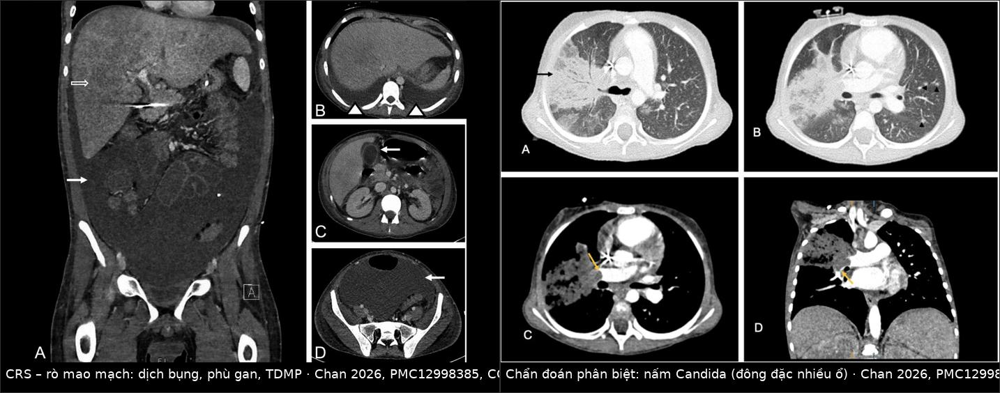
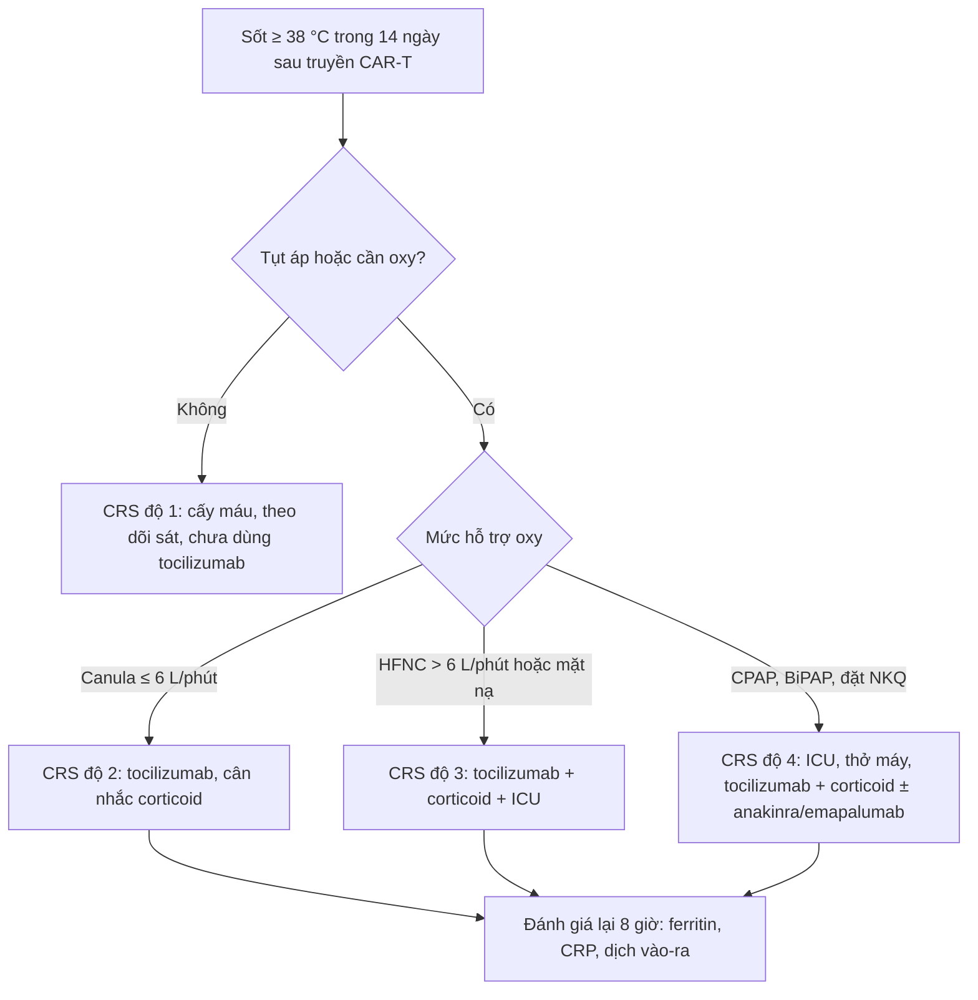
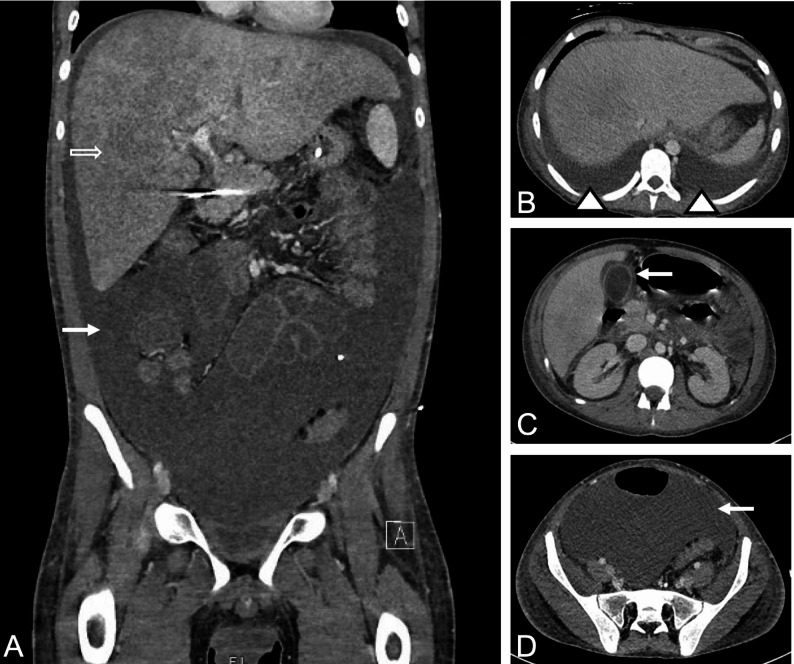
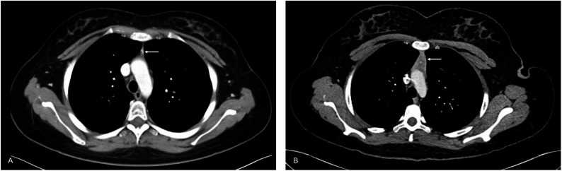
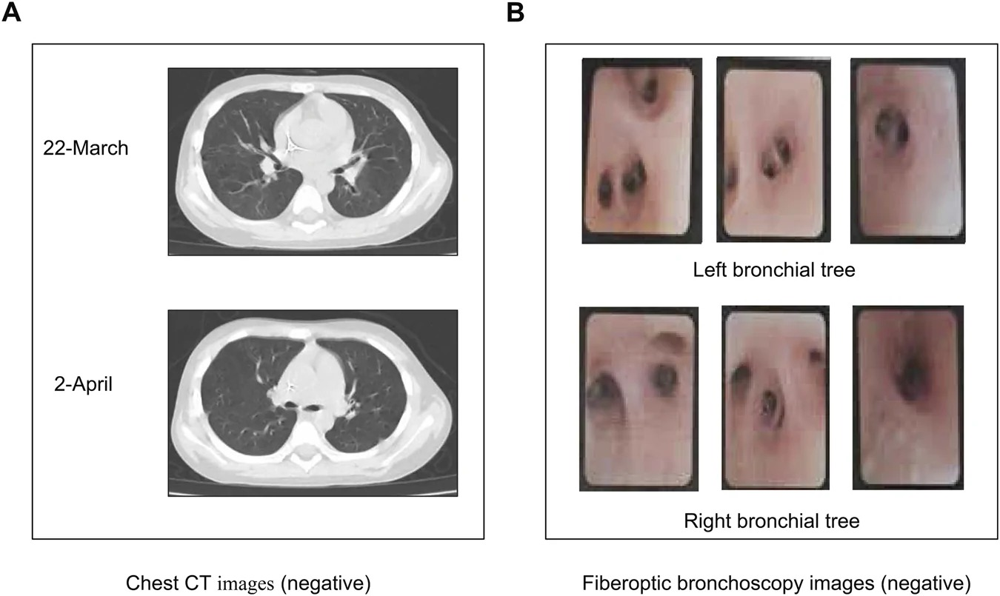

# 6165 — Phù phổi do phản ứng cytokine (CRS) sau CAR-T và blinatumomab ở trẻ / Cytokine release syndrome–associated pulmonary edema in children

**Tags:** `pattern:phu-phoi` `pattern:go-khong-dong-nhat` `pattern:tran-dich-mang-phoi` `pattern:phu-tang` `vung:phoi` `vung:mang-phoi` `vung:trung-that` `protocol:X-quang-nguc` `protocol:CT-nguc` `protocol:sieu-am-tim` `score:ASTCT`

**Mức chắc chắn (certainty):** tổng hợp y văn (literature synthesis) — số liệu lấy từ **review hình ảnh CAR-T ở trẻ và người trẻ** 2026 (Vasyliv, PMC12998385, 12 figure), **review độc tính CRS/ICANS ở khoa hồi sức nhi** 2022 (Baumeister, PMC8989409), **review an toàn CAR-T ở B-ALL nhi** 2025 (Li & Zheng, PMC12846953), **ca blinatumomab gây tổn thương phổi ở trẻ 10 tuổi** 2026 (Feng, PMC13731319), **ca CRS độ nặng ở trẻ phải thở máy + CRRT** 2026 (Alotaibi, PMC12903790) và **meta-analysis blinatumomab ở trẻ** 2022 (Marrapodi, PMC9354602). Không có thử nghiệm ngẫu nhiên riêng cho phù phổi do CRS; mọi ngưỡng điều trị là đồng thuận ASTCT/kinh nghiệm trung tâm, chỗ suy luận được ghi rõ.

> **Câu chốt:** phù phổi trong CRS **không phải** viêm phổi và **không phải** phù phổi do tim — đó là **rò mao mạch toàn thân (capillary leak)** do bão cytokine. Trên CT, bộ ba **tràn dịch màng phổi hai bên + dịch bụng + phù tạng** đi cùng **phổi ngấm thuốc bình thường cạnh dịch** (xẹp phổi chứ không phải viêm) là dấu hiệu mạnh nhất phân biệt với nhiễm khuẩn (Vasyliv 2026). Ngược lại, **CT ngực bình thường không loại trừ CRS**: ca trẻ 10 tuổi giảm oxy máu sau hóa trị có **CT và nội soi phế quản đều âm tính**, đáp ứng với methylprednisolone (Feng 2026).

## 1. Tổng quan bệnh học – cơ chế hình ảnh (TẠI SAO lại phù phổi)

### 1.1 Cơ chế: bão cytokine → tổn thương nội mô → rò mao mạch

- **Khởi phát:** tế bào CAR-T (hoặc blinatumomab, một **bispecific T-cell engager**) gắn kháng nguyên trên tế bào B → **hoạt hóa T** hàng loạt → giải phóng **IL-6, IFN-γ, TNF-α, IL-10**. IL-6 là trung tâm của chuỗi này.
- **Đích tổn thương là NỘI MÔ, không phải phế nang:** cytokine hoạt hóa nội mô → **mất lớp glycocalyx**, tăng tính thấm mao mạch → **dịch thoát vào khoang kẽ thứ ba**. Vì vậy hình ảnh là **phù kẽ + tràn dịch đa màng**, chứ không phải đông đặc phế nang do vi khuẩn.
- **TẠI SAO phổi bị trước:** phổi có **mao mạch phế nang với diện tích trao đổi lớn nhất cơ thể** và **áp lực keo thấp của tuần hoàn phổi**; chỉ cần tăng tính thấm nhẹ là dịch đã tràn vào kẽ quanh phế quản–mạch → **giảm oxy máu trước khi có mờ trên X-quang** (đây là lý do "X-quang sạch mà SpO₂ tụt").
- **TẠI SAO tim bình thường mà vẫn phù:** cung lượng tim **tăng**, sức cản mạch hệ thống **giảm**, áp lực đổ đầy mao mạch phổi (PCWP) **bình thường** — nhưng CRS có thể kèm **viêm cơ tim do cytokine** làm suy tim thật; hai cơ chế có thể cùng tồn tại.
- **Blinatumomab khác CAR-T ở đâu:** CRS thường gặp ở **chu kỳ đầu**, **giảm ở các chu kỳ sau**, và có thể cắt bằng **ngừng truyền → giảm liều → corticoid/tocilizumab** (Baumeister 2022). Blinatumomab còn gây **tổn thương phổi do thuốc (DIILD)** — cùng hình ảnh, **khác điều trị** (corticoid, không phải tocilizumab).

### 1.2 Vật lý hình ảnh: mỗi mẫu hình là một mức dịch

- **Mờ kính mờ (ground-glass, GGO):** dịch **trong kẽ** làm dày vách phế nang nhưng **khí còn trong phế nang** → đậm độ **−300 đến −600 HU**; phế quản vẫn chứa khí.
- **Đông đặc (consolidation):** phế nang **đầy dịch** → **+30 đến +60 HU**, thấy **phế quản hơi (air bronchogram)**. Trong CRS, đông đặc thường **hai bên, vùng thấp, đối xứng** — không có phân thùy.
- **Dày vách tiểu thùy (smooth septal thickening):** dịch ở vách → đường mờ **nhẵn**, khác **dày nốt (nodular)** của carcinomatosis hay **dày không đều** của xơ phổi.
- **Tràn dịch màng phổi:** dịch **0–20 HU** (nước) — **không cản quang**, khác máu **35–70 HU**; phân bố **hai bên**, không kèm dày màng phổi.
- **Dịch bụng + phù gan:** gan **to, giảm đậm độ lan tỏa** (phù nhu mô), dịch tự do quanh gan/lách — dấu hiệu **rò mao mạch hệ thống**, không phải suy gan.
- **Nhiễm khuẩn thì khác:** đông đặc **một thùy/từng ổ**, có **phế quản hơi trong khối đặc**, đôi khi **hang/nốt**, **không có dịch bụng**; nấm Candida cho **đông đặc nhiều ổ + nốt nhỏ** (ảnh trong mục 3).

### 1.3 Ngưỡng định lượng bắt buộc nhớ

| Đại lượng | Ngưỡng / con số | Nguồn |
|---|---|---|
| CRS độ 3–4 (các liệu pháp CAR-T nói chung) | **10–30%** | Vasyliv 2026, PMC12998385 |
| CRS nặng (≥ độ 3) ở trẻ dùng **CD19 CAR-T** | **22–46%** (ICANS **13–31%**) | Li & Zheng 2025, PMC12846953 |
| Thời điểm khởi phát CRS | **trong 2 tuần đầu** sau truyền | Vasyliv 2026 |
| CRS kèm HLH/MAS (CarHLH) | **ferritin > 100.000 µg/L** + **≥ 2** tiêu chí (transaminase/bilirubin ≥ độ 3, creatinine ≥ độ 3, **phù phổi ≥ độ 3**, thực bào tủy) | Baumeister 2022 |
| Ferritin đỉnh | **130.000 ng/mL** (CRS độ 4–5) vs **8.290 ng/mL** (độ 0–3) | Baumeister 2022 |
| CRP đỉnh | **22,9 mg/dL** (độ 4–5) vs **16,2 mg/dL** (độ 0–3) | Baumeister 2022 |
| Tocilizumab | **< 30 kg: 12 mg/kg**; **≥ 30 kg: 8 mg/kg**; tối đa **3–4 liều**, cách **8 giờ** | Baumeister 2022 |
| Corticoid | **methylprednisolone 1–2 mg/kg** mỗi 6–12 giờ **hoặc dexamethasone 0,5–1 mg/kg** (tối đa **10 mg**) mỗi 6 giờ | Baumeister 2022 |

## 2. Mẫu hình + chẩn đoán phân biệt theo vị trí (gamut)

**Mẫu hình chung:** trẻ **sốt + tụt áp + giảm oxy máu** trong **14 ngày** sau truyền CAR-T/blinatumomab → **mờ phổi hai bên + tràn dịch đa màng + dịch bụng**, tim không to.

| Vị trí / mẫu hình | Gamut theo bối cảnh |
|---|---|
| **Phổi hai bên, vùng thấp (GGO → đông đặc)** | **CRS rò mao mạch** · viêm phổi do vi khuẩn/nấm/PJP · phù phổi do tim (viêm cơ tim CRS) · xuất huyết phổi (giảm tiểu cầu) · TRALI/TACO sau truyền máu · DIILD do blinatumomab/hóa trị |
| **Màng phổi (dịch hai bên, không dày màng phổi)** | **CRS** · phù phổi do tim · TRALI/TACO · ít gặp: lao màng phổi (thường một bên, dày màng phổi) |
| **Ổ bụng (dịch tự do + gan to giảm đậm độ)** | **CRS rò mao mạch** · quá tải dịch do hồi sức · tắc tĩnh mạch gan · nhiễm trùng ổ bụng (có khí/dày thành ruột) |
| **Trung thất trước (khối mới)** | **Tuyến ức phục hồi sau CAR-T** (ngày +52, bờ nhẵn, ngấm đều) · tái phát u · u lympho · nhiễm trùng trung thất |
| **Mô dưới da (phù, khí)** | **Phù do rò mao mạch** · khí dưới da do thủ thuật/thở máy (xem bài 649) · viêm mô tế bào |
| **Phổi "sạch" nhưng giảm oxy máu** | **CRS sớm / DIILD** · thuyên tắc phổi · shunt · thiếu máu nặng · tổn thương phổi do thuốc |

## 3. Bảng so sánh phân biệt (ma trận đối chiếu)

| Thực thể (entity) | Hình ảnh điển hình | Chốt vào (rule-in) | Chốt loại (rule-out) | Gợi ý xác nhận |
|---|---|---|---|---|
| **CRS – rò mao mạch** | GGO/đông đặc **hai bên vùng thấp** + **tràn dịch màng phổi hai bên** + **dịch bụng** + phù tạng | **Dịch ở ≥ 2 khoang** (màng phổi + bụng) cùng lúc, **tim không to**, xuất hiện **≤ 14 ngày** sau truyền | Không có dịch ngoài phổi, có **đông đặc một thùy** hoặc **hang** → nghĩ nhiễm | Lâm sàng ASTCT + IL-6/CRP/ferritin; đáp ứng tocilizumab |
| **Viêm phổi vi khuẩn** | Đông đặc **một thùy/từng ổ**, phế quản hơi, có thể tràn dịch **một bên** | Đông đặc **khu trú**, **không dịch bụng**, procalcitonin cao | **Đông đặc đối xứng hai bên + dịch đa màng** → không điển hình vi khuẩn | Cấy máu/đờm, BAL; kháng sinh |
| **Nấm Candida (muộn)** | **Đông đặc nhiều ổ + nốt nhỏ**, có phế quản hơi; thường **> 1 tháng** sau CAR-T | **Sốt dai dẳng + cấy nấm dương**, tổn thương **nhiều ổ rời rạc** | Tổn thương **đối xứng + dịch bụng** → không phải nấm | Cấy máu, (1,3)-β-D-glucan, BAL |
| **PJP** | GGO **hai bên quanh rốn**, có thể **kén khí**; thường **sau giảm ức chế miễn dịch kéo dài** | GGO + **kén khí** + LDH cao, **không dịch bụng** | Có dịch đa màng + phù tạng → nghĩ CRS | PCR BAL, nhuộm Grocott |
| **Phù phổi do tim (viêm cơ tim CRS)** | Tim **to**, phù **quanh rốn**, tái phân bố mạch máu, dịch màng phổi | **BNP/NT-proBNP cao**, EF giảm, **tĩnh mạch cổ nổi** | EF bình thường + **dịch bụng nhiều** → nghi rò mao mạch | Siêu âm tim tại giường |
| **TRALI/TACO** | Phù phổi **trong 6 giờ** sau truyền chế phẩm máu | **Bối cảnh truyền máu**, kháng thể HLA (TRALI), đáp ứng lợi tiểu (TACO) | Không truyền máu trong 6 giờ → loại | Ngừng truyền, NT-proBNP, báo cáo huyết học |
| **DIILD do blinatumomab/hóa trị** | GGO/đông đặc hai bên, **có thể CT bình thường** | Bắt đầu **sau thuốc**, **loại trừ nhiễm** (mNGS/BAL âm), **đáp ứng corticoid** | Đáp ứng tocilizumab nhanh + tăng IL-6 → nghi CRS hơn | Ngừng thuốc, corticoid, HRCT lặp lại |
| **Xuất huyết phổi** | Mờ lan tỏa/**đông đặc** + **giảm Hb đột ngột**, tiểu cầu rất thấp | **Hb giảm + tiểu cầu < 20 G/L**, ho ra máu | Mờ đối xứng + Hb ổn định → loại | CT, nội soi phế quản nếu cần |
| **Tuyến ức phục hồi** | Khối **trung thất trước**, **bờ nhẵn, ngấm thuốc đều**, xuất hiện **sau ngày +28** | **Hình dạng tuyến ức**, không xâm lấn, không hạch | Bờ tua, xâm lấn, hạch trung thất → nghi tái phát | So sánh CT cũ, PET/CT nếu không chắc |

- **Trái:** CRS — dịch bụng lượng lớn, gan to giảm đậm độ (phù), tràn dịch màng phổi hai bên; **phổi cạnh dịch ngấm thuốc bình thường** = xẹp phổi, không phải viêm.
- **Phải:** nấm Candida lan tỏa — **đông đặc nhiều ổ rời rạc có phế quản hơi**, không có dịch bụng; xuất hiện **10 tháng** sau CAR-T.

## 4. Protocol chụp + hệ phân độ ASTCT + xử trí

### 4.1 Protocol

- **Bước 1 — X-quang ngực tại giường (AP):** rẻ, nhanh, đủ để phát hiện tràn dịch/đông đặc lớn; **không đủ** để loại trừ phù kẽ sớm.
- **Bước 2 — siêu âm phổi tại giường:** **B-line ≥ 3/ô** và **dày màng phổi > 3 mm** gợi ý phù kẽ, dùng để theo dõi **hằng ngày** không bức xạ (suy luận từ sinh lý, chưa có ngưỡng riêng cho CRS).
- **Bước 3 — CT ngực:** **không thường quy**; chỉ khi cần phân biệt **nhiễm khuẩn/nấm, xuất huyết, thuyên tắc phổi** hoặc trước can thiệp. Dùng **liều thấp (low-dose)**, không cản quang; thêm cản quang nếu nghi thuyên tắc/viêm cơ tim.
- **Bước 4 — siêu âm tim** (bắt buộc khi tụt áp/giảm oxy): loại **phù phổi do tim**, tìm **viêm cơ tim CRS** (EF giảm, dày thành).
- **Theo dõi:** cân nặng **2 lần/ngày**, **cân bằng dịch vào–ra mỗi 8 giờ**, SpO₂, lactat; **không dùng cân nặng làm chuẩn duy nhất** vì dịch còn trong khoang thứ ba.

### 4.2 Phân độ ASTCT (CRS) — ngưỡng oxy quyết định độ

| Độ | Sốt | Tụt áp | **Giảm oxy máu** |
|---|---|---|---|
| 1 | ≥ 38 °C | Không | Không |
| 2 | ≥ 38 °C | **Không cần** vận mạch | **Canula ≤ 6 L/phút** hoặc thở blow-by |
| 3 | ≥ 38 °C | Cần **1 vận mạch** ± vasopressin | **HFNC > 6 L/phút**, mặt nạ, non-rebreather, Venturi |
| 4 | ≥ 38 °C | Cần **nhiều vận mạch** | **CPAP/BiPAP/đặt nội khí quản** |

### 4.3 Xử trí có ngưỡng

- **Tocilizumab:** **12 mg/kg nếu < 30 kg**, **8 mg/kg nếu ≥ 30 kg**, lặp **mỗi 8 giờ**, tối đa **3–4 liều**; dùng khi **CRS độ ≥ 2 kéo dài** hoặc **độ ≥ 3**.
- **Corticoid:** **methylprednisolone 1–2 mg/kg** mỗi 6–12 giờ hoặc **dexamethasone 0,5–1 mg/kg** (tối đa **10 mg**) mỗi 6 giờ — thêm khi **không đáp ứng liều tocilizumab đầu**.
- **Dịch:** nguyên tắc **hạn chế** — rò mao mạch làm dịch vào khoang thứ ba, truyền nhiều **làm phù phổi nặng thêm**; ưu tiên **vận mạch** để giữ huyết áp, dùng **lợi tiểu** khi đã quá tải (suy luận sinh lý, không phải khuyến cáo có ngưỡng).
- **Kháng sinh:** **cấy máu trước** khi dùng tocilizumab; sốt đơn thuần **không loại trừ** nhiễm khuẩn huyết.
- **Điều trị bắc cầu khi thất bại:** **anakinra** (đối kháng IL-1) và **emapalumab** (đối kháng IFN-γ) đã được dùng cho CRS độ cao kháng trị ở trẻ (Alotaibi 2026; Zhang 2026, PMC12996094).

## 5. Biến thể bình thường và cạm bẫy

- **Tuyến ức phục hồi (thymic rebound):** sau CAR-T, tuyến ức **to lên ở ngày +52**, **bờ nhẵn, ngấm thuốc đều**, không xâm lấn — **lành tính**, không phải tái phát. Cạm bẫy: gọi là u trung thất rồi sinh thiết/mổ oan.
- **Xẹp phổi cạnh dịch:** phổi cạnh tràn dịch **ngấm thuốc bình thường** (không tăng đậm độ) → **xẹp phổi**, không phải viêm phổi; cho kháng sinh là điều trị sai hướng.
- **CT bình thường không loại trừ CRS/DIILD:** ca trẻ **10 tuổi** giảm oxy máu, **CT ngực 2 lần và nội soi phế quản đều âm tính**, mNGS âm, đáp ứng **methylprednisolone** → chẩn đoán **DIILD**, không phải CRS (Feng 2026). Chẩn đoán CRS là **lâm sàng**, hình ảnh chỉ để loại trừ.
- **Nhiễm muộn sau CAR-T:** **Candida** có thể xuất hiện **10 tháng** sau truyền khi đã giảm ức chế miễn dịch — không được gọi là CRS.
- **Blinatumomab ≠ CAR-T:** cùng hình ảnh nhưng CRS do blinatumomab thường **chu kỳ đầu**, xử trí **ngừng truyền/giảm liều** trước, và **DIILD do blinatumomab đáp ứng corticoid**, không phải tocilizumab.
- **Bẫy truyền dịch:** tụt áp do rò mao mạch **không đáp ứng bằng dịch** như sốc giảm thể tích; truyền nhanh nhiều lít → **phù phổi nặng thêm**.
- **Bẫy "tìm kiếm thỏa mãn":** thấy đông đặc là dừng ở "viêm phổi" mà bỏ **dịch bụng + phù gan** — hai dấu hiệu chỉ điểm rò mao mạch hệ thống.

## 6. Tự lượng giá — Blind Quiz ngay trên trang tĩnh

**Ca 1 — trẻ 16 tuổi B-ALL tái phát, ngày 12 sau CAR-T, bụng to nhanh, khó thở**

- Gợi ý lâm sàng: sốt, tụt áp nhẹ, tăng cân 3 kg trong 2 ngày, SpO₂ 91% khí trời.
- Câu hỏi: Mô tả 3 bất thường? Vì sao phổi cạnh dịch không bị gọi là viêm? Chẩn đoán và bước điều trị đầu tiên?

<b>Bấm để hiện đáp án (findings + chẩn đoán)</b>

- **Dấu hiệu:** (A) **dịch bụng lượng lớn** + **gan to, giảm đậm độ lan tỏa** (phù gan); (B) **tràn dịch màng phổi hai bên**; (C,D) dịch tự do trong khung chậu/lách.
- **Vì sao không phải viêm phổi:** phổi cạnh dịch **ngấm thuốc bình thường**, mờ chỉ do **xẹp phổi** — không có đông đặc khu trú, không có phế quản hơi trong khối đặc.
- **Chẩn đoán:** **CRS độ 2–3 với rò mao mạch toàn thân** — vì dịch xuất hiện ở **≥ 2 khoang** cùng lúc, tim không to, trong **14 ngày** sau truyền.
- **Điều trị:** **tocilizumab 8 mg/kg** (≥ 30 kg) ± **corticoid**, hạn chế dịch, theo dõi cân bằng dịch.
- Nguồn ảnh: Vasyliv et al., *Cancer Imaging* 2026, **PMC12998385**, Fig. 6 — **CC BY 4.0**.

**Ca 2 — trẻ 16 tuổi, ngày +52 sau CAR-T, chụp CT ngực kiểm tra, không triệu chứng**

- Gợi ý lâm sàng: xét nghiệm tế bào học tủy âm tính, không sốt, không sụt cân.
- Câu hỏi: Khối trung thất trước là gì? Cần sinh thiết không? Dấu hiệu nào giúp phân biệt với tái phát?

<b>Bấm để hiện đáp án (findings + chẩn đoán)</b>

- **Dấu hiệu:** (A) trước điều trị mô tuyến ức nhỏ; (B) **ngày +52 tuyến ức to lên**, **bờ nhẵn, ngấm thuốc đồng nhất**, không xâm lấn mỡ trung thất.
- **Chẩn đoán:** **tuyến ức phục hồi sau CAR-T (thymic rebound)** — lành tính.
- **Không sinh thiết** nếu điển hình; so sánh phim cũ và theo dõi. Nghi tái phát khi **bờ tua, xâm lấn, hạch trung thất, tăng FDG không đồng nhất**.
- Nguồn ảnh: Vasyliv et al., *Cancer Imaging* 2026, **PMC12998385**, Fig. 10 — **CC BY 4.0**.

**Ca 3 — trẻ 10 tuổi B-ALL, ngày 11 sau hóa trị CAT, khó thở tăng dần, SpO₂ 88%**

- Gợi ý lâm sàng: không sốt, không tụt áp; nghe phổi có ran ẩm; kháng sinh không đỡ, không có ổ nhiễm rõ.
- Câu hỏi: Hình ảnh có gì? Nếu CT bình thường thì loại trừ được gì? Chẩn đoán khả năng và điều trị?

<b>Bấm để hiện đáp án (findings + chẩn đoán)</b>

- **Dấu hiệu:** (A) **CT ngực 2 thời điểm đều không có tổn thương**; (B) **nội soi phế quản bình thường**, không có viêm/loét.
- **Loại trừ được:** viêm phổi do vi khuẩn, tổn thương đường thở lớn, u xâm lấn — nhưng **KHÔNG loại trừ** CRS/DIILD.
- **Chẩn đoán:** **tổn thương phổi do thuốc (DIILD)** sau hóa trị, đã loại nhiễm bằng **mNGS âm**; đáp ứng **methylprednisolone + HFNC**.
- **Bài học:** giảm oxy máu + CT sạch = nghĩ **rò mao mạch/tổn thương kẽ sớm**, không được trấn an bằng "CT bình thường".
- Nguồn ảnh: Feng et al., *Front Pharmacol* 2026, **PMC13731319**, Fig. 1 — **CC BY 4.0**.

## Bài liên quan chéo

- [1430 – Độc tính thần kinh sau CAR-T (ICANS)](../1430-icans-doc-tinh-than-kinh-sau-car-t/lesson.md)
- [1440 – Hội chứng Parkinson do MNT sau CAR-T BCMA](../1440-mnt-parkinsonism-sau-car-t-bcma/lesson.md)
- [033 – Phù phổi & ARDS](../033-phu-phoi-ards/lesson.md)
- [1788 – Viêm phổi do PJP không HIV](../1788-viem-phoi-pjp-khong-hiv/lesson.md)
- [1826 – Viêm phổi do thuốc ức chế mTOR](../1826-viem-phoi-do-thuoc-uc-che-mtor/lesson.md)

## Ảnh

- `6165_phu-phoi-crs_CT-bung_PMC12998385-f6.jpg` — CRS: dịch bụng, phù gan, tràn dịch màng phổi (Vasyliv 2026, PMC12998385, Fig. 6, CC BY 4.0).
- `6165_phu-phoi-crs_CT_f10-PMC12998385.jpg` — tuyến ức phục hồi ngày +52 (Vasyliv 2026, Fig. 10, CC BY 4.0).
- `6165_phu-phoi-crs_CT_f12-PMC12998385.jpg` — nấm Candida lan tỏa, đông đặc nhiều ổ (Vasyliv 2026, Fig. 12, CC BY 4.0).
- `6165_phu-phoi-crs_CT-PMC13731319-f1.jpg` — CT ngực bình thường + nội soi phế quản bình thường trong ca giảm oxy máu (Feng 2026, PMC13731319, Fig. 1, CC BY 4.0).
- `composite_crs_ro-mao-mach_vs_nhiem.jpg` — ảnh ghép đối chiếu CRS (Fig. 6) vs nấm Candida (Fig. 12), tạo bằng `tools/make_composite.py`, nguyên bản không crop/kéo giãn.

> Không dùng để chẩn đoán độc lập khi chưa có người hướng dẫn.
