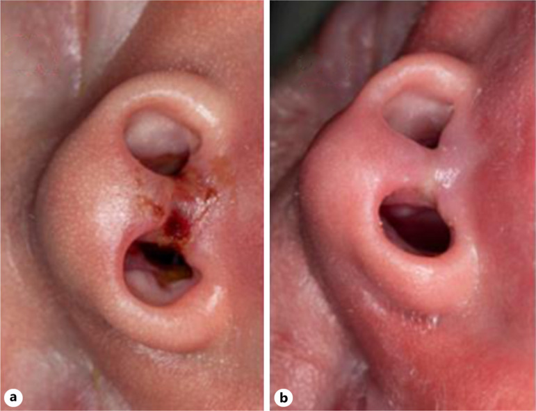
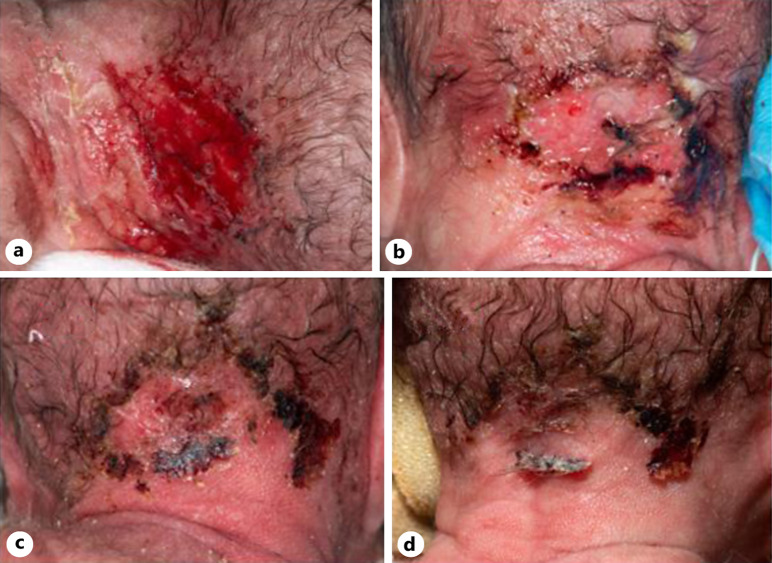
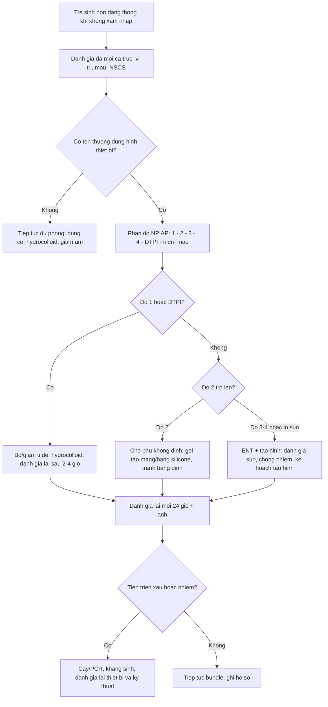
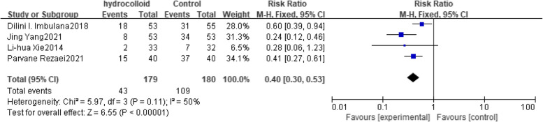

# 6167 — Loét do áp lực do thiết bị ở trẻ sơ sinh: mask CPAP, ống nội khí quản, điện cực / Medical device-related pressure injury in neonates

**Tags:** `pattern:loet-ap-luc` `vung:da` `vung:so-sinh` `score:NPIAP` `score:NSCS` `protocol:cham-soc-da` `protocol:CPAP`
**Mức chắc chắn (certainty):** tổng hợp y văn (literature synthesis) — loạt ca có ảnh lâm sàng (Case Rep Dermatol 2026: 3 ca sinh non 23+5, 28+6, 27 tuần) + 1 tổng quan hệ thống/phân tích gộp 12 RCT (BMC Pediatr 2025, n = 1.271) + 1 nghiên cứu hồi cứu người lớn dùng làm đối chứng (Health Sci Rep 2025). Không có ca nguyên văn riêng của nhóm.

## 1. Tổng quan — vì sao da trẻ sinh non "không chịu nổi" một chiếc mask; TẠI SAO tổn thương hay ở đúng chỗ tì đè

- **Da trẻ sinh non mỏng hơn hẳn:** tổng độ dày da **0,9 mm ở trẻ sinh non**, **1,2 mm ở trẻ đủ tháng**, so với **2,1 mm ở người lớn**; độ dày **tỷ lệ nghịch với tuổi thai**. Lớp sừng chỉ có **vài lớp** và **protein trung bì ít** → hàng rào kém, dễ tổn thương bởi **áp lực, lực cắt (shear), ma sát, bóc tách do băng dính (MARSI)**.
- **Áp lực = lực / diện tích (P = F/A):** đầu prong CPAP tì vào **cột trụ mũi (columella) – vách mũi – cánh mũi** trên một diện tích rất nhỏ, nên **cùng một lực siết của dây đai tạo ra áp lực tại chỗ lớn hơn nhiều** so với một mặt tiếp xúc rộng (mask). Khi áp lực tại chỗ vượt **áp lực đóng mao mạch** (kinh điển ~32 mmHg) trong vài giờ → thiếu máu cục bộ → ban đỏ không mất khi ấn → **loét**.
- **Ba lực cùng lúc:** (1) **áp lực trực tiếp** của interface; (2) **lực cắt/ma sát** khi trẻ cử động, khi thay mask; (3) **ẩm ướt** do hơi thở/humidifier + băng dính → **maceration**, làm da yếu thêm. Vì vậy tổn thương thường **đúng hình dạng thiết bị** (mask, prong, dây đai, điện cực, vòng tay).
- **Tần suất rất cao:** y văn ghi nhận **tổn thương mũi do thông khí không xâm nhập ở trẻ sinh non có thể tới 90%**; các thể gồm chảy máu mũi, loét niêm mạc, **biến dạng cánh mũi**, tổn thương vách mũi, **hẹp tiền đình mũi**, rách da.
- **Hậu quả không chỉ là "vết đỏ":** hoại tử sụn/niêm mạc → **biến dạng mũi vĩnh viễn, sẹo, hẹp lỗ mũi**, có ca phải **tạo hình**; kéo dài thời gian nằm viện, tăng chi phí và sang chấn cho gia đình.
- **Đối chứng ở người lớn (để thấy trẻ khác thế nào):** ở người lớn thở NIV, tổn thương áp lực do thiết bị gặp **15,4% (12/78)**, chủ yếu **số 1 (83,3%)** và **số 2 (16,7%)**, hay ở **sống mũi – trán – tai**; yếu tố nguy cơ độc lập là **albumin thấp** và **thời gian thở máy không xâm nhập dài**. Trẻ sinh non có **da mỏng hơn 1/3 – 1/2** người lớn nên cùng thời gian phơi nhiễm cho tổn thương sâu hơn.

*Trẻ 28+6 tuần, 1.220 g, thở CPAP mũi từ lúc sinh: a) ngày thứ 9 — trợt/đóng vảy và hoại tử nông ngay cột trụ mũi và vành lỗ mũi (đúng vị trí prong tì); b) ngày 17 — da liền sau khi thay bằng gel tạo màng. Nguồn: Fleming R, Strunk T, Case Rep Dermatol 2026 (PMC12975154) Fig. 2, CC BY-NC 4.0.*

## 2. Mẫu hình + gamut theo vị trí thiết bị (location-based)

### 2a. Theo thiết bị → vị trí tổn thương điển hình

| Thiết bị | Vị trí hay tổn thương | Hình thái |
|---|---|---|
| **CPAP mũi (prong)** | **Cột trụ mũi, vách mũi, vành lỗ mũi, cánh mũi** | Trợt/loét hình vành khuyên, đóng vảy, hoại tử đen; hẹp tiền đình mũi về sau |
| **CPAP mask / mũ CPAP** | **Sống mũi, gò má, trán (dây đai mũ), sau tai** | Ban đỏ hình mask, trợt, đôi khi **hoại tử da trán** |
| **Ống nội khí quản + dây cố định** | **Khóe miệng, môi trên, cột trụ mũi (nếu cố định bằng dây qua mũi)** | Rách da, loét ấn, MARSI do băng dính |
| **Điện cực theo dõi / vòng tay nhận diện** | **Ngực, bụng, cổ tay, mắt cá** | Ban đỏ/trợt hình tròn hoặc hình vòng |
| **Đầu dò SpO₂, nhiệt độ** | **Ngón tay/chân, nách** | Ban đỏ, phỏng nếu quá nhiệt |
| **Catheter rốn (băng cố định)** | **Quanh rốn** | Kích ứng hóa chất (chlorhexidine) + bóc tách |

### 2b. Gamut "đỏ/trợt vùng mũi–miệng ở trẻ sơ sinh" — không phải cứ đỏ là loét áp lực

- **Loét áp lực do thiết bị (MDRPI):** đúng vị trí tì đè, **hình dạng khớp thiết bị**, xuất hiện sau nhiều giờ–ngày thở CPAP.
- **MARSI (tổn thương da do băng dính):** bề mặt bóng/trợt nông, **hình dải băng**, xảy ra ngay khi gỡ băng.
- **Kích ứng/bỏng hóa chất:** chlorhexidine, cồn, dung dịch sát khuẩn — **hình chảy tràn**, bờ không đều, có khi ở bụng/quanh rốn.
- **Nhiễm trùng da:** HSV sơ sinh (chùm mụn nước), impetigo (vảy vàng mật ong), **viêm mô tế bào** (đỏ lan, ấm, sốt) — cần cấy/kháng sinh, không phải "chăm sóc loét".
- **Tụ máu vách mũi / áp-xe vách mũi** sau sinh khó (forceps): **khối căng, tím, tắc mũi** — cần dẫn lưu, khác hẳn loét nông.
- **Biến thể sắc tố:** dát xanh tím vùng cùng cụt/lưng (dermal melanocytosis), **không đau, không đổi theo thiết bị** — đừng gọi là loét.
- **U máu (hemangioma):** đỏ tươi, gồ lên, **lớn dần**, không khớp vị trí thiết bị.

### 2c. Phân độ NPIAP (áp dụng cho MDRPI, kể cả trẻ sơ sinh)

- **Độ 1:** ban đỏ **không mất khi ấn**, da còn nguyên; ở da sẫm màu có thể chỉ thấy **đổi màu/tím/nóng–lạnh bất thường**.
- **Độ 2:** mất **một phần bề dày da** (trung bì) — trợt nông, bóng hoặc khô, **không có mô hoại tử/mỡ**; có thể có bọng nước.
- **Độ 3:** mất **toàn bộ bề dày da** — thấy **mỡ dưới da**, có thể có hốc/mô hoại tử ẩm; **chưa** tới gân/cơ/xương.
- **Độ 4:** mất toàn bộ bề dày **+ lộ gân/cơ/xương/sụn** — ở mũi trẻ sơ sinh nghĩa là **mất sụn cánh mũi/vách mũi**, để lại biến dạng.
- **Tổn thương áp lực mô sâu (DTPI):** vùng **tím/mận đậm** hoặc bọng máu, da có thể còn nguyên → tổn thương **sâu hơn vẻ ngoài**.
- **Loét niêm mạc:** **không phân độ** theo NPIAP; ghi vị trí + kích thước (vách mũi, niêm mạc môi).
- **Nguyên tắc vàng:** **phân độ theo tổn thương sâu nhất**, và **MDRPI luôn mang hình dạng thiết bị** — đây là chốt phân biệt với loét do tì đè thông thường.

*Cùng loạt ca: a) ngày 13 — vùng trợt lớn ở trán dưới dây/mũ CPAP, đáy đỏ; b) ngày 15 — mô hoại tử đen, tiết dịch; c) ngày 18 và d) ngày 21 — sau khi chuyển sang gel tạo màng, tổn thương thu nhỏ và liền. Nguồn: Fleming R, Strunk T, Case Rep Dermatol 2026 (PMC12975154) Fig. 3, CC BY-NC 4.0.*

## 3. Bảng so sánh phân biệt (ma trận đối chiếu)

| Thực thể (entity) | Hình ảnh/đặc điểm điển hình | Chốt vào (rule-in) | Chốt loại (rule-out) | Gợi ý xác nhận |
|---|---|---|---|---|
| **MDRPI độ 1** | Ban đỏ **không mất khi ấn**, da nguyên, đúng hình thiết bị | **Vị trí khớp interface + không mất khi ấn** | Đỏ mất khi ấn, không khớp thiết bị → ban đỏ tạm thời | Ảnh chuẩn hóa + đánh giá lại sau 2–4 giờ sau khi bỏ thiết bị |
| **MDRPI độ 2** | Trợt nông, bóng/khô, **không mỡ/không hoại tử** | **Mất một phần bề dày + đúng vị trí tì** | Đáy sâu thấy mỡ → độ 3; có mụn nước lan → nghĩ HSV | Soi da, nếu nghi nhiễm: PCR HSV/cấy |
| **MDRPI độ 3–4** | Mất toàn bộ bề dày; độ 4 **lộ sụn/gân/xương** | **Thấy mỡ (độ 3) hoặc sụn mũi (độ 4)** | Chỉ trợt nông → độ 2 | ENT/tạo hình đánh giá sụn; chụp CT/MRI **chỉ khi** nghi viêm sụn/áp-xe |
| **MARSI** | Trợt bóng **hình dải băng**, ngay sau gỡ băng | **Bờ khớp băng dính + xuất hiện tức thì** | Hình vành khuyên đúng prong, xuất hiện sau nhiều giờ → MDRPI | Hỏi lại quy trình dán/gỡ băng |
| **Bỏng/kích ứng hóa chất** | Đỏ/trợt **lan theo dòng chảy**, bờ không đều | **Tiền sử dung dịch sát khuẩn + hình chảy tràn** | Hình khớp thiết bị → MDRPI | Xem lại loại dung dịch, pha loãng |
| **Nhiễm trùng da (HSV/impetigo/cellulitis)** | Mụn nước chùm, vảy vàng, hoặc đỏ lan + sốt | **Tổn thương lan ngoài vùng tì + sốt/CRP tăng** | Khu trú đúng interface, không lan → MDRPI | PCR HSV, cấy da, CRP |
| **Tụ máu/áp-xe vách mũi** | Khối **căng, tím**, tắc mũi, đau | **Khối căng + tắc mũi một bên** | Trợt nông + không có khối → MDRPI | ENT + siêu âm/CT nếu cần dẫn lưu |
| **Dermal melanocytosis** | Dát xanh tím, phẳng, vùng cùng cụt/lưng | **Không đau, không đổi theo thiết bị, từ lúc sinh** | Đỏ/tím đúng vị trí mask, mới xuất hiện → MDRPI | Theo dõi, không can thiệp |

## 4. Protocol phòng ngừa + phân độ + sơ đồ xử trí

### 4a. Bó phòng ngừa (bundle) — bằng chứng định lượng

- **Chọn interface theo kích cỡ:** prong **không được làm trắng (blanch) niêm mạc/vành mũi**; mask phải phủ kín nhưng **không tì vào sống mũi**; đánh giá lại mỗi lần thay.
- **Giảm lực siết dây đai:** dây đủ chặt để giữ seal, **không siết thêm**; tránh kéo mask lên cao tì vào sống mũi.
- **Hydrocolloid dự phòng:** phân tích gộp 12 RCT (n = 1.271) cho thấy dùng **hydrocolloid dự phòng giảm tổn thương mũi rõ rệt — OR 0,40 (KTC 95% 0,30–0,53, p < 0,0001)**.
- **Mask vs prong:** **mask mũi ít tổn thương hơn prong — OR 0,62 (0,45–0,87, p = 0,006)**; **luân phiên mask/prong không khác biệt — OR 0,95 (0,27–3,29, p = 0,093)**, tức "đổi qua đổi lại" **không thay thế** được việc chọn đúng cỡ + đệm bảo vệ.
- **Giảm ẩm ướt:** humidifier đúng mức, lau khô vùng da dưới mask mỗi lần thay, tránh băng dính kín hơi.
- **Đánh giá da có hệ thống:** mỗi ca trực **theo thang NSCS (Neonatal Skin Condition Score, 3–9: 3 = tốt nhất, 9 = nặng nhất)** dựa trên **khô da – ban đỏ – trợt da**; chụp ảnh chuẩn hóa khi có tổn thương (có đồng thuận của cha mẹ).
- **Luân chuyển vị trí interface** theo quy trình đơn vị (thường mỗi 3–4 giờ) — **chưa có ngưỡng thời gian thống nhất trong y văn**, nên ghi rõ quy trình của khoa thay vì trích "chuẩn".
- **Yếu tố nền cần tối ưu:** albumin/dinh dưỡng (ở người lớn **albumin thấp là yếu tố nguy cơ độc lập**), kiểm soát phù, giảm thời gian thở NIV khi có thể.

### 4b. Đo – ghi – theo dõi

- **Đo:** dài × rộng (mm), vị trí theo giải phẫu (cột trụ mũi/vách/cánh mũi), **độ NPIAP**, mô đáy (hồng/trắng/đen), dịch tiết, đau.
- **Chụp ảnh:** cùng khoảng cách, cùng ánh sáng, có thước/tăm bông làm mốc; ảnh trước–sau để so sánh (như loạt ca ở trên).
- **Hình ảnh CT/MRI:** **không thường quy**; chỉ khi nghi **viêm sụn, áp-xe vách mũi, viêm mô tế bào sâu** hoặc biến dạng mũi cần đánh giá trước tạo hình.

### 4c. Sơ đồ xử trí

### 4d. Ngưỡng chuyển tuyến

- **Độ 3–4, lộ sụn, hoại tử đen không tự bong:** hội chẩn **ENT/tạo hình** sớm (tránh cắt lọc quá tay gây mất sụn thêm).
- **Nghi nhiễm:** cấy/PCR, kháng sinh theo khoa; **không bôi corticoid** lên vùng nghi nhiễm.
- **Biến dạng mũi/hẹp tiền đình mũi:** theo dõi đến khi trẻ lớn, chụp CT đánh giá trước tạo hình khi có chỉ định.

## 5. Biến thể bình thường và cạm bẫy

- **Ban đỏ mất khi ấn** (sau khi vừa bỏ mask 30–60 phút) là **phản ứng tạm thời**, không phải độ 1 — nhưng **phải đánh giá lại**, không bỏ qua.
- **Da sẫm màu:** độ 1 có thể **không thấy đỏ** mà chỉ **tím/nóng/lạnh/đau**; đừng kết luận "da bình thường" chỉ vì không đỏ.
- **Vảy/đóng mày vàng ở cột trụ mũi** dễ bị coi là "lành" nhưng thường là **tổn thương sâu đang khô** — cần làm ẩm, không bóc vảy.
- **"Đổi mask/prong luân phiên" không đủ:** phân tích gộp cho thấy **không giảm** tổn thương (OR 0,95); tin vào luân phiên mà bỏ qua cỡ prong là bẫy thường gặp.
- **Hydrocolloid trên da đã trợt/tiết dịch nhiều:** có thể gây **maceration và nhiễm**; khi da đã mất toàn bộ bề dày, dùng **gel tạo màng/băng silicone không dính** thay vì hydrocolloid kín.
- **Băng dính "cho chắc":** chính là nguyên nhân **MARSI** và che mất tổn thương bên dưới — hạn chế tối đa.
- **Nhầm với nhiễm HSV sơ sinh:** mụn nước chùm, lan ngoài vùng tì, trẻ có thể sốt/lừ đừ → **PCR HSV**, không chờ loét tiến triển.
- **Chỉ nhìn mặt trước mũi:** tổn thương **vách mũi/niêm mạc** chỉ thấy khi **soi đèn** và **nhìn từ dưới lên**; bỏ sót dẫn tới **dính vách, hẹp tiền đình mũi** về sau.
- **Ảnh hồ sơ không chuẩn hóa:** ảnh thiếu mốc kích thước/ánh sáng khiến không so sánh được tiến triển — chụp lại cùng góc.

## 6. Tự lượng giá — Blind Quiz

**Ca 1 — trẻ 28+6 tuần, CPAP mũi từ lúc sinh, ngày thứ 9**

- Bối cảnh: sinh non 28+6 tuần, 1.220 g, thở CPAP mũi từ sinh; ngày 9 thấy vết đỏ–trợt ở mũi, trẻ quấy khi thay prong.
- Câu hỏi: (1) Tổn thương nằm ở đâu và **hình dạng khớp với thiết bị nào**? (2) Phân độ NPIAP? (3) Hai việc cần làm ngay và một việc **không** nên làm?

<b>Bấm để hiện đáp án (findings + chẩn đoán)</b>

- Dấu hiệu: trợt + vảy/hoại tử nông ở **cột trụ mũi và vành lỗ mũi**, **hình vành khuyên khớp đầu prong**; ảnh b là sau 5 ngày điều trị bằng gel tạo màng — da liền.
- Chẩn đoán: **loét áp lực do thiết bị (MDRPI) độ 2** — mất một phần bề dày, chưa thấy mỡ/sụn.
- Việc cần làm: **đổi cỡ/loại interface + đệm bảo vệ**, chăm sóc ẩm bằng gel tạo màng; **không** dán băng dính kín/bóc vảy.
- Nguồn ảnh: Fleming R, Strunk T, Case Rep Dermatol 2026 (PMC12975154) Fig. 2, CC BY-NC 4.0.

**Ca 2 — trẻ 27 tuần, tổn thương ở trán dưới mũ CPAP**

- Bối cảnh: trẻ 27 tuần, CPAP qua mũ; ngày 13 thấy vùng da trán đỏ rồi **đen lại**, tiết dịch.
- Câu hỏi: (1) Vì sao tổn thương ở **trán** mà không ở mũi? (2) Mô đen là mô gì và **có nên cắt bỏ ngay**? (3) Theo dõi bằng gì để biết đang lành?

<b>Bấm để hiện đáp án</b>

- Dấu hiệu: vùng trợt lớn **dưới dây/mũ CPAP**, đáy đỏ → mô **hoại tử đen (eschar)**; các ảnh sau cho thấy tổn thương thu nhỏ, liền dần.
- Chẩn đoán: **MDRPI độ 3 tại trán** (hoại tử da, có thể tới mỡ) do **dây/mũ CPAP** — minh họa rằng MDRPI **không chỉ ở mũi**.
- Nguyên tắc: **không cắt lọc hoại tử khô chưa phân định ranh giới** ở trẻ non tháng; chăm sóc ẩm, kiểm soát nhiễm, đánh giá lại mỗi 24 giờ; theo dõi bằng **ảnh chuẩn hóa + đo mm + NSCS**.
- Nguồn ảnh: Fleming R, Strunk T, Case Rep Dermatol 2026 (PMC12975154) Fig. 3, CC BY-NC 4.0.

**Ca 3 — chọn biện pháp dự phòng: số liệu nói gì?**

- Bối cảnh: khoa sơ sinh muốn giảm tổn thương mũi do CPAP; đề xuất "luân phiên mask–prong mỗi 4 giờ" hoặc "dán hydrocolloid dự phòng".
- Câu hỏi: (1) Biện pháp nào có bằng chứng mạnh hơn? (2) Đọc OR và KTC 95% của hydrocolloid; (3) Vì sao "luân phiên" không được coi là biện pháp chính?

<b>Bấm để hiện đáp án</b>

- Dấu hiệu: forest plot gộp các RCT về **hydrocolloid dự phòng** — hiệu ứng nghiêng về giảm tổn thương, KTC không chạm 1.
- Chẩn đoán/khuyến nghị: **hydrocolloid dự phòng: OR 0,40 (0,30–0,53), p < 0,0001**; **mask so với prong: OR 0,62 (0,45–0,87), p = 0,006**; **luân phiên mask–prong: OR 0,95 (0,27–3,29), p = 0,093 — không có ý nghĩa**.
- Kết luận: ưu tiên **chọn đúng cỡ interface + đệm hydrocolloid**; luân phiên chỉ là thói quen, không thay thế hai việc trên.
- Nguồn ảnh: Gong T et al., BMC Pediatr 2025 (PMC12107769) Fig. 7, CC BY-NC-ND 4.0 (nguyên hình, không chỉnh sửa).

> **Phản biện nguồn:** phân tích gộp chỉ gồm **12 RCT, n = 1.271**, nhiều nghiên cứu cỡ mẫu nhỏ và khác nhau về định nghĩa "tổn thương mũi"; ngưỡng "luân chuyển mỗi 3–4 giờ" là **quy trình đơn vị**, chưa có thử nghiệm xác lập.

## Bài liên quan chéo
- [6149 – Loét do áp lực quanh lỗ mở khí quản ở trẻ (MDRPI vùng cổ)](../6149-loet-ap-luc-quanh-lo-mo-khi-quan-tre/lesson.md)
- [6109 – Thông khí không xâm nhập tại nhà quanh mổ ở trẻ](../6109-niv-tai-nha-quanh-mo-o-tre/lesson.md)
- [6100 – Chăm sóc và cai ống mở khí quản ở trẻ](../6100-cham-soc-va-cai-ong-mo-khi-quan-tre/lesson.md)

## Ảnh
- `images/6167_loet-ap-luc-thiet-bi-so-sinh_Anh_PMC12975154-F2.jpg` — tổn thương cột trụ mũi do CPAP (Fleming R, Strunk T, Case Rep Dermatol 2026, CC BY-NC 4.0).
- `images/6167_loet-ap-luc-thiet-bi-so-sinh_Anh_PMC12975154-F3.jpg` — tổn thương trán do mũ CPAP (cùng bài, CC BY-NC 4.0).
- `images/6167_loet-ap-luc-thiet-bi-so-sinh_Forest_PMC12107769-F7.jpg` — forest plot hydrocolloid (Gong T et al., BMC Pediatr 2025, CC BY-NC-ND 4.0, nguyên hình).
- Chi tiết giấy phép: `images/CREDITS.md`; link gốc: `sources.md`.

> Không dùng để chẩn đoán độc lập khi chưa có người hướng dẫn.
