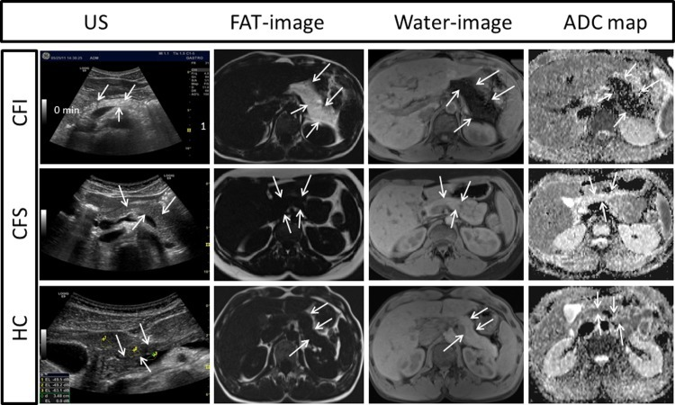
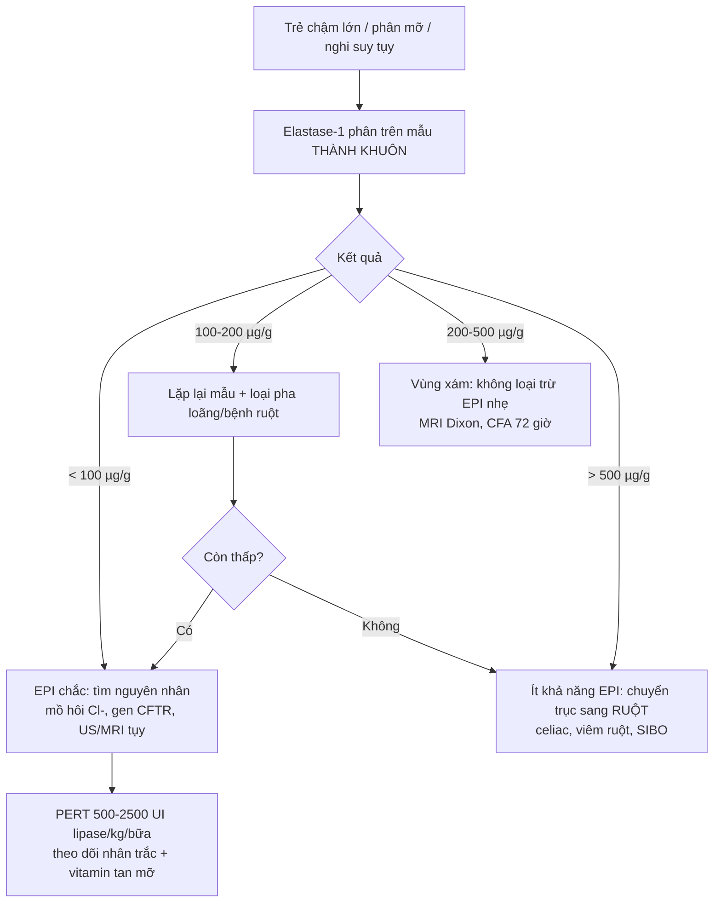

# 6168 — Suy tụy ngoại tiết ở trẻ: khi nào elastase-1 thấp là THẬT / Exocrine pancreatic insufficiency in children: when is fecal elastase-1 really low?

**Tags:** `pattern:suy-tuy` `pattern:mo-hoa-tuy` `pattern:teo-tuy` `vung:tuy` `score:elastase-1` `protocol:elastase-phan` `protocol:sieu-am-tuy` `protocol:MRI-Dixon-tuy` `incidentaloma:mo-tuy`

**Mức chắc chắn (certainty):** tổng hợp y văn (literature synthesis) — ghép **1 meta-analysis độ chính xác** (de la Iglesia và cs., *United European Gastroenterol J* 2025, PMC12529004, CC BY-NC-ND), **1 scoping review về elastase-1 trong xơ nang** (Sankararaman và cs., *Pediatr Pulmonol* 2026, PMC13142209, CC BY-NC-ND), **1 đoàn hệ nhi viêm tụy INSPPIRE-2** (Gummadi và cs., *J Pediatr* 2026, PMID 42471081), **1 nghiên cứu giá trị bình thường ở nhũ nhi** (PMC8522897, CC BY), **1 nghiên cứu siêu âm–MRI tụy ở xơ nang** (Engjom và cs., *PLoS One* 2018, PMC6062060, CC BY) và **1 nghiên cứu nhi mỡ gan–mỡ tụy** (PMC13584307, CC BY-NC-ND). Nhóm **không có bệnh nhân của mình**; chỗ chưa đủ dữ liệu ghi **"chưa rõ"**.

> **Câu chốt:** elastase-1 phân là xét nghiệm **nhạy nhưng KHÔNG đặc hiệu** — và **độ nhạy phụ thuộc hoàn toàn vào mức độ nặng**. Bốn số phải thuộc: **(1)** ngưỡng **< 200 µg/g** = suy tụy ngoại tiết (EPI), **< 100 µg/g** = nặng; gộp 13 nghiên cứu/888 bệnh nhân: **Se 0,94 · Sp 0,69** ở ngưỡng 200 (PMC12529004); **(2)** ở trẻ **viêm tụy** (n = 1.007, INSPPIRE-2), cùng ngưỡng 200 chỉ đạt **Se 65,1% · Sp 75,5%**, còn ngưỡng 100 là **Se 55,8% · Sp 82,8%** — **không được lấy độ nhạy của xơ nang áp cho viêm tụy**; **(3)** elastase-1 là **enzym NGƯỜI**, không có trong chế phẩm tụy heo/bò → **PERT KHÔNG làm sai kết quả, không cần ngừng thuốc** (khác hẳn chymotrypsin phân); **(4)** phân **lỏng/toàn nước** làm **pha loãng → thấp giả**, và **béo phì có mỡ tụy** cũng làm elastase thấp hơn mà **không phải suy tụy thật**.

## 1. Tổng quan bệnh học – cơ chế hình ảnh

### 1.1 Vì sao đo elastase-1 trong phân lại phản ánh tụy

- **Elastase-1 (CELA3A/CELA3B)** do **tế bào nang tụy** tổng hợp, bài tiết vào tá tràng, **không bị phân hủy dọc ruột**, và **không có ở chế phẩm enzym tụy heo/bò**. Hai hệ quả: (a) nồng độ trong phân tỉ lệ với **lượng enzym tụy bài tiết**; (b) **điều trị PERT không phản ứng chéo trong ELISA** → kết quả vẫn đọc được khi bệnh nhân đang uống enzym (Dominici & Franzini 2002, PMID 12059069; scoping review PMC13142209).
- **Ngưỡng và độ chính xác (người lớn + trẻ, gộp):** **< 200 µg/g = EPI**, **< 100 µg/g = EPI nặng**. Meta-analysis 13 nghiên cứu/888 bệnh nhân: ở ngưỡng **200 µg/g**, **Se 0,94 (KTC 95% 0,82–0,98)**, **Sp 0,69 (0,52–0,82)**, **LR+ 3,02**, **LR− 0,09**, **DOR 35,27**; hạ ngưỡng xuống **100 µg/g** thì **Sp tăng lên 0,82** nhưng **Se giảm còn 0,88** (PMC12529004).
- **Vì sao Se cao mà Sp thấp:** elastase chỉ giảm khi **mất > 90% chức năng nang tụy** (ngưỡng gây steatorrhea kinh điển) — nên khi đã giảm thì "chắc chắn có bệnh"; nhưng **nhiều nguyên nhân khác** (phân loãng, bệnh ruột, mỡ tụy) cũng làm giảm → **dương tính giả nhiều**. Đây là lý do **LR− 0,09 (loại trừ tốt) nhưng LR+ chỉ 3,02 (xác nhận yếu)**.
- **Vì sao EPI nhẹ bị bỏ sót:** ở xơ nang, elastase-1 ngưỡng 200 đạt **Se 89,3% chung**, nhưng **100% ở EPI trung bình–nặng** và **chỉ 25% ở EPI nhẹ**; **Sp 96,4%** (Walkowiak, dẫn trong PMC13142209). Nghĩa là: **elastase bình thường KHÔNG loại trừ EPI nhẹ**.

### 1.2 Vì sao thấp giả: ba cơ chế khác nhau, ba cách xử lý khác nhau

1. **Pha loãng:** elastase đo **theo µg/g phân**; phân lỏng nhiều nước → **cùng lượng enzym nhưng nồng độ thấp**. Đây là lý do phải lấy **phân thành khuôn**, không lấy mẫu nước.
2. **Giảm tín hiệu nội sinh ("EPI thứ phát"):** tổn thương niêm mạc (**celiac, Crohn, suy dinh dưỡng nặng, sau nhiễm trùng**) và **SIBO** làm giảm tín hiệu kích thích tụy → elastase thấp **dù tụy lành** (PMC13142209).
3. **Mỡ tụy do béo phì:** ở 163 trẻ (92 MASLD/71 không), **mỡ tụy gặp 93,5% vs 40,8%** và **elastase thấp (≤ 200 µg/g) gặp 59,8% vs 15,5%**; mỗi **1 độ mỡ tụy** làm **OR 1,97 (1,20–3,23)** cho elastase thấp; **vòng bụng ≥ bách phân vị 95: OR 3,31 (1,24–8,87)**; **AUC của độ mỡ tụy = 0,76** (PMC13584307). Cơ chế **chưa rõ** — có thể do thay thế nhu mô hoặc do đề kháng insulin; **không được đồng nhất với EPI thật**.

### 1.3 Vật lý hình ảnh: mỡ trong tụy "nói" cùng ngôn ngữ với elastase

- **CT:** mỡ **−40 đến −120 HU**, mô tụy bình thường **30–50 HU** (cản quang thì cao hơn) → tụy **mỡ hóa lan tỏa** có đậm độ **giảm rõ, gần mỡ dưới da**; **teo tụy** = mất chiều dày, bờ mấp mô.
- **MRI:** hình **Dixon** tách nước–mỡ; **fat fraction** của tụy tăng khi mô nang bị thay bằng mỡ. Ở xơ nang, **toàn bộ 10/10 trẻ EPI có lượng mỡ tụy tăng rõ** so với nhóm đủ chức năng và trẻ lành, và **mỡ tụy tương quan nghịch với ADC (r = −0,93)** — mỡ thay nhu mô làm **khuếch tán giảm** (PMC6062060).
- **Siêu âm:** tụy **tăng hồi âm** so với gan (đậm hơn), bờ rõ; nhưng **90% trẻ EPI xơ nang tăng hồi âm**, trong khi **27% trẻ xơ nang đủ chức năng** và **33% trẻ lành** cũng tăng hồi âm → **siêu âm một mình không chẩn đoán được EPI**, chỉ dùng để **phân tầng** và tìm bất thường cấu trúc (PMC6062060).
- **Hệ quả thực hành:** hình ảnh **không thay thế** xét nghiệm chức năng; nhưng **mỡ hóa + teo tụy ở trẻ có steatorrhea** là bằng chứng cấu trúc **ủng hộ EPI** và giúp loại nguyên nhân tắc nghẽn.

## 2. Mẫu hình + chẩn đoán phân biệt theo vị trí/cơ chế (gamut)

- **EPI thật (tụy mất nhu mô):** **xơ nang** (85–90% bệnh nhân; ~80% đã EPI lúc sinh, thêm 20–25% mất dần trong vài năm đầu — PMC13142209); **Shwachman–Diamond** (suy tủy + loạn sản sụn–xương); **viêm tụy mạn/tái diễn** (INSPPIRE-2: EPI **19,4%**, tích lũy **24% sau 7 năm** — PMID 42471081); **bất sản/giảm sản tụy bẩm sinh**, **Johanson–Blizzard**; **hậu phẫu cắt tụy**; **sỏi/ống tụy tắc nghẽn**.
- **Elastase thấp KHÔNG do mất nhu mô:** **phân lỏng (pha loãng)**; **bệnh ruột non** (celiac, Crohn, viêm ruột sau nhiễm, suy dinh dưỡng nặng); **SIBO**; **mỡ tụy/béo phì**; **mẫu sai cách lấy** (phân lỏng, lẫn nước tiểu).
- **Steatorrhea không do tụy:** bệnh **celiac**, **viêm ruột**, **suy ruột ngắn**, **ứ mật** (giảm muối mật), **bạch mạch ruột**, **lactose/đường ruột khác** — elastase **bình thường** giúp **quay trục chẩn đoán sang ruột**.
- **Mnemonic nguyên nhân EPI ở trẻ — "CASCADE":** **C**ystic fibrosis, **A**plasia/hypoplasia, **S**hwachman–Diamond, **C**hronic pancreatitis, **A**utoimmune/obstructive, **D**eficiency bẩm sinh enzym đơn thuần (lipase), **E**ndocrine–exocrine (pancreatitis sau tăng calci/mỡ máu).

## 3. Bảng so sánh phân biệt (ma trận đối chiếu)

| Thực thể (entity) | Hình ảnh điển hình | Chốt vào (rule-in) | Chốt loại (rule-out) | Gợi ý xác nhận |
|---|---|---|---|---|
| **Xơ nang (CF)** | Tụy **mỡ hóa lan tỏa + teo** (CT giảm đậm độ, MRI fat fraction cao, US tăng hồi âm); có thể nang/ống giãn | **Elastase < 100 µg/g + mồ hôi Cl⁻ ≥ 60 mmol/L + IRT sơ sinh cao/2 đột biến CFTR** | Elastase **> 500 µg/g** + mồ hôi bình thường → ít khả năng EPI do CF (nhưng EPI nhẹ có thể bỏ sót) | Mồ hôi Cl⁻ (làm 2 lần), gen CFTR, elastase lặp lại |
| **Shwachman–Diamond** | Tụy **mỡ hóa sớm, teo**, thường **không canxi, không giãn ống**; xương **loạn sản sụn–metaphysis**, đầu xương đùi | **Giảm 2–3 dòng tủy + elastase thấp + bất thường xương** | Tủy bình thường + xương bình thường → nghĩ CF/khác | Công thức máu, X-quang xương, gen SBDS |
| **Viêm tụy mạn/tái diễn** | **Canxi hóa nhu mô, ống giãn không đều, teo**, nang giả | **Đau tụy tái diễn + canxi/ống giãn + elastase thấp** | Canxi đơn độc không ống giãn + không đau → nghĩ di chứng/khác | MRCP, elastase lặp lại, gen PRSS1/SPINK1/CFTR |
| **EPI "thứ phát" do bệnh ruột** | Tụy **bình thường** về cấu trúc; niêm mạc ruột teo/viêm | **Elastase thấp + bệnh ruột đang hoạt động + hồi phục sau điều trị ruột** | Tụy mỡ hóa/teo rõ → nghĩ EPI thật | IgA tTG, nội soi, calprotectin, điều trị thử rồi đo lại |
| **Pha loãng do phân lỏng** | — (không có hình ảnh) | **Mẫu phân nước + elastase thấp + elastase bình thường khi hết tiêu chảy** | Phân thành khuôn mà vẫn < 100 µg/g → không phải pha loãng | Lấy lại mẫu **phân thành khuôn**, 1 lần, không cần 24 giờ |
| **Mỡ tụy do béo phì** | Tụy **tăng hồi âm (độ 0–3)**, gan nhiễm mỡ; **không teo, không canxi** | **Béo bụng + mỡ gan + elastase thấp nhẹ (100–200)** | Teo tụy + steatorrhea nặng → không quy cho mỡ đơn thuần | Giảm cân, đo lại elastase; MRI Dixon nếu cần định lượng mỡ |

*Ba hàng: **CFI** (xơ nang suy tụy), **CFS** (xơ nang đủ tụy), **HC** (trẻ lành). Hàng CFI: tụy **tăng hồi âm** trên siêu âm, **rất sáng trên ảnh FAT**, giảm tín hiệu trên ảnh nước, và **ADC thấp** — mỡ đã thay nhu mô. Nguồn: Engjom và cs., *PLoS One* 2018, PMC6062060, CC BY 4.0. Ảnh nguyên bản.*

## 4. Protocol xét nghiệm + chẩn đoán hình ảnh

### 4.1 Lấy mẫu và đọc elastase-1

- **Mẫu:** **1 lần, phân thành khuôn** (không cần thu 24 giờ); elastase **rất bền** trong phân (khác chymotrypsin) — có thể gửi xa, bảo quản lạnh.
- **KHÔNG cần ngừng PERT** (enzym người, không phản ứng chéo). Nếu phòng xét nghiệm yêu cầu ngừng, **hỏi lại quy trình** — ngừng thuốc không cải thiện giá trị chẩn đoán mà chỉ làm trẻ thiếu enzym.
- **Đọc:** **< 100 µg/g = EPI nặng**; **100–200 = EPI** (nên lặp); **200–500 = vùng xám** — không loại trừ EPI nhẹ/trung bình, và **có thể giảm liều PERT từ từ** (không ngừng đột ngột) nếu lâm sàng cho phép (PMC13142209); **> 500 = bình thường**.
- **Trẻ nhỏ:** giá trị bình thường **200–1.695 µg/g** ở 160 trẻ **1–24 tháng**; **không trẻ nào < 200**; nhóm **1–3 tháng** thấp hơn nhóm **13–24 tháng** (trung vị **790 vs 900 µg/g**, p = 0,023) nhưng **ngưỡng 200 vẫn dùng được** (PMC8522897).

### 4.2 Xác nhận và tìm nguyên nhân

- **Vàng chuẩn chức năng:** **hệ số hấp thu mỡ (CFA)** trên **cân mỡ phân 72 giờ** (hoặc test secretin/secretin–CCK khi có điều kiện) — elastase chỉ là **sàng lọc**.
- **Xơ nang:** **mồ hôi Cl⁻ ≥ 60 mmol/L** = chẩn đoán; **30–59** = trung gian (làm lại + gen); **< 30** = bình thường (ngưỡng chuẩn thực hành, không trích từ bài OA của lượt này). Sàng lọc sơ sinh bằng **IRT**.
- **Hình ảnh (thứ tự ở trẻ):** **siêu âm** (rẻ, không bức xạ: hồi âm, kích thước, ống, canxi) → **MRI/MRCP + Dixon** (mỡ–nước, ống tụy, nang) → **CT** chỉ khi cần canxi hóa/giải phẫu trước mổ (**ALARA**).
- **PERT:** khởi đầu **500–2.500 UI lipase/kg/bữa**, tổng **≤ 10.000 UI/kg/ngày**; theo dõi **cân nặng, chiều cao, vitamin A/E/D/K, steatorrhea** — đáp ứng lâm sàng mới là tiêu chuẩn điều trị, không phải con số elastase.

## 5. Biến thể bình thường và cạm bẫy

- **"Elastase thấp = suy tụy" là kết luận vội:** Sp chỉ **0,69** ở ngưỡng 200 (PMC12529004); ở trẻ viêm tụy, **Se chỉ 65,1%** (PMID 42471081) — **cả hai chiều đều sai được**.
- **Không ngừng PERT để xét nghiệm:** elastase-1 **người** không có trong viên enzym heo/bò (PMID 12059069). Ngừng thuốc chỉ làm trẻ **steatorrhea nặng hơn**, không làm kết quả "đúng hơn". (Khác với **chymotrypsin phân** — xét nghiệm này **bị ảnh hưởng** bởi PERT.)
- **Phân lỏng:** mẫu nước → **thấp giả**; phải lấy **phân thành khuôn**, và **đo lại sau khi hết tiêu chảy** trước khi dán nhãn suy tụy suốt đời.
- **Trẻ béo phì:** mỡ tụy làm elastase thấp (**59,8% ở MASLD vs 15,5%** — PMC13584307) nhưng **không kèm teo tụy** trên hình ảnh → đừng mở PERT dài hạn chỉ vì một con số.
- **Siêu âm tăng hồi âm không đồng nghĩa EPI:** **33% trẻ lành** cũng tăng hồi âm (PMC6062060) — hình ảnh phải đọc **cùng elastase và lâm sàng**.
- **CFTR modulator làm elastase tăng lại:** một số bệnh nhân xơ nang **được xếp lại từ EPI sang đủ tụy** sau điều trị modulator → **không coi EPI là vĩnh viễn**, phải **đánh giá lại** trước khi tiếp tục PERT liều cao suốt đời (PMC13142209).

## 6. Tự lượng giá — Blind Quiz

**Ca 1 — Bé 4 tuổi, chậm lớn, phân mỡ. Siêu âm bụng rồi MRI tụy (hàng giữa và dưới là 2 trẻ khác để đối chiếu).**

- Hỏi: hàng nào là tụy **mỡ hóa nặng**? Dấu hiệu nào trên MRI khẳng định đó là **mỡ** chứ không phải xơ? Siêu âm một mình có đủ không?

<b>Bấm để hiện đáp án (findings + chẩn đoán)</b>

- **Hàng trên (CFI):** siêu âm tụy **tăng hồi âm rõ** (mũi tên), **ảnh FAT rất sáng**, **ảnh nước tối**, **ADC thấp** → mỡ thay nhu mô, tương ứng **suy tụy ngoại tiết**.
- **Hàng giữa (CFS) và dưới (HC):** tụy **ít sáng trên ảnh FAT**, ADC cao hơn — mô tụy còn nhu mô.
- **Khẳng định mỡ:** chỉ **Dixon fat image/fat fraction** mới định lượng được; xơ sẽ **không sáng trên ảnh FAT** và có thể **giảm tín hiệu cả T1 lẫn T2**.
- **Siêu âm không đủ:** **90%** trẻ EPI tăng hồi âm, nhưng **27% trẻ xơ nang đủ tụy** và **33% trẻ lành** cũng tăng hồi âm (PMC6062060).
- Nguồn ảnh: Engjom T và cs., *PLoS One* 2018;13(7):e0201019, PMC6062060 Fig. 2, CC BY 4.0. Ảnh nguyên bản.

**Ca 2 — Bốn trẻ cùng "elastase thấp". Ai thật sự suy tụy?**

- A. Bé 2 tuổi xơ nang, elastase **< 50 µg/g**, mồ hôi Cl⁻ **98 mmol/L**, tụy mỡ hóa toàn bộ trên MRI.
- B. Bé 9 tuổi tiêu chảy 5 ngày, mẫu phân **toàn nước**, elastase **140 µg/g**.
- C. Bé 12 tuổi béo bụng, gan nhiễm mỡ, elastase **180 µg/g**, tụy **không teo, không canxi**.
- D. Bé 7 tuổi celiac chưa điều trị, elastase **160 µg/g**, tụy bình thường; sau 6 tháng ăn không gluten, elastase **> 500 µg/g**.

<b>Bấm để hiện đáp án</b>

- **A = EPI thật (xơ nang)**: elastase **< 100** + mồ hôi **≥ 60 mmol/L** + mỡ tụy lan tỏa. Điều trị PERT + theo dõi vitamin tan mỡ.
- **B = thấp giả do pha loãng**: mẫu **nước** làm nồng độ giảm; phải lấy **phân thành khuôn** và đo lại.
- **C = mỡ tụy do béo phì**: elastase thấp nhẹ nhưng **không teo tụy**; OR 1,97 mỗi độ mỡ tụy (PMC13584307) — **không mở PERT dài hạn** khi chưa có steatorrhea/CFA bất thường.
- **D = "EPI thứ phát" do bệnh ruột**: elastase **hồi phục sau điều trị celiac** → tụy lành; đây là lý do phải **đo lại sau điều trị** trước khi kết luận.
- **Chốt:** elastase-1 là **test sàng lọc**, không phải chẩn đoán; **ngưỡng 200 có Se 0,94/Sp 0,69** (PMC12529004) — nghĩa là **loại trừ tốt hơn xác nhận**.

## Bài liên quan chéo
- [6152 – Viêm tụy mạn ở trẻ: vôi hóa – giãn ống – teo nhu mô](../6152-viem-tuy-man-o-tre/lesson.md)
- [6146 – Sỏi túi mật và sỏi ống mật chủ ở trẻ](../6146-soi-tui-mat-o-tre/lesson.md)
- [163 – Pylephlebitis & huyết khối tĩnh mạch mạc treo](../163-pylephlebitis-huyet-khoi-tm-mac-treo/lesson.md)
- [600 – Tổng quan Hệ Nhi khoa](../600-tong-quan-nhi-khoa/lesson.md)

> Không dùng để chẩn đoán độc lập khi chưa có người hướng dẫn.
