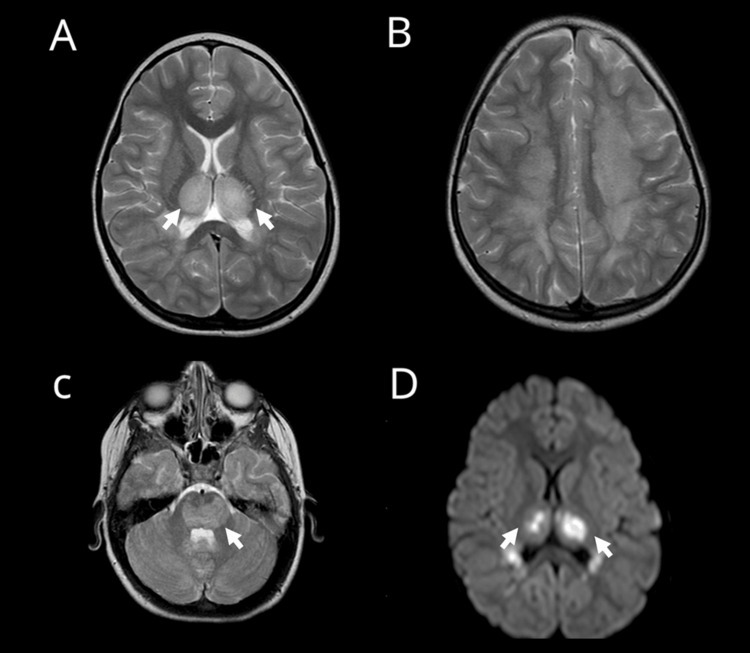
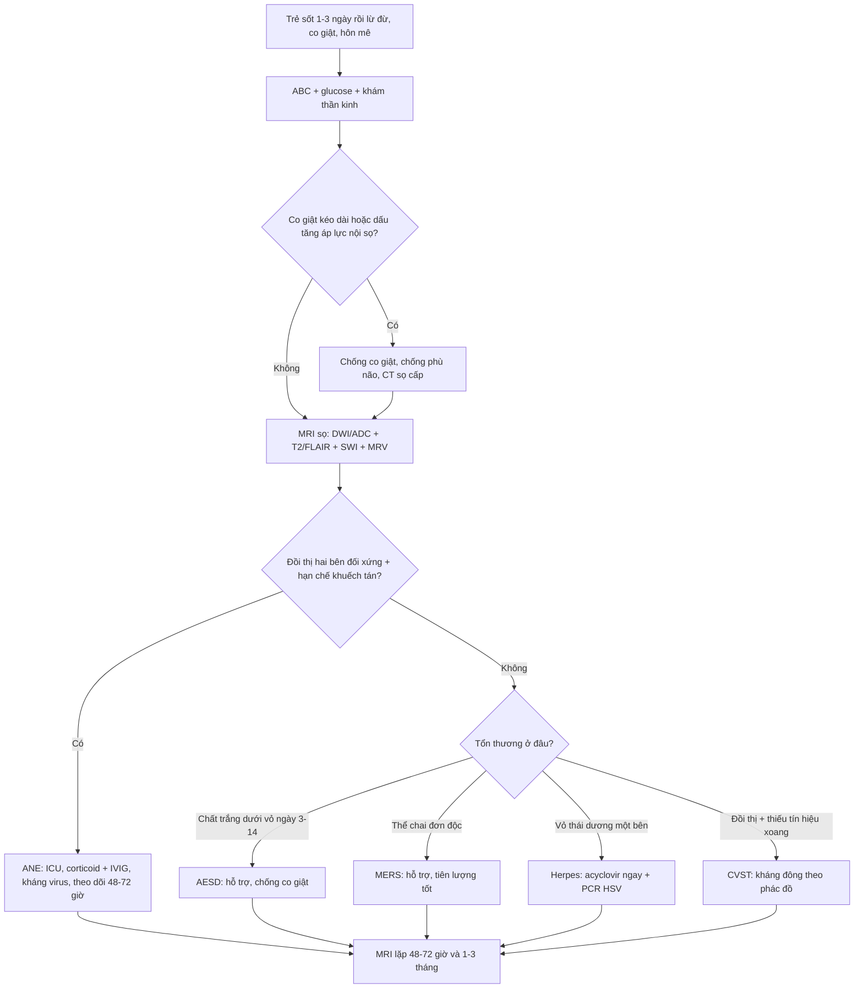
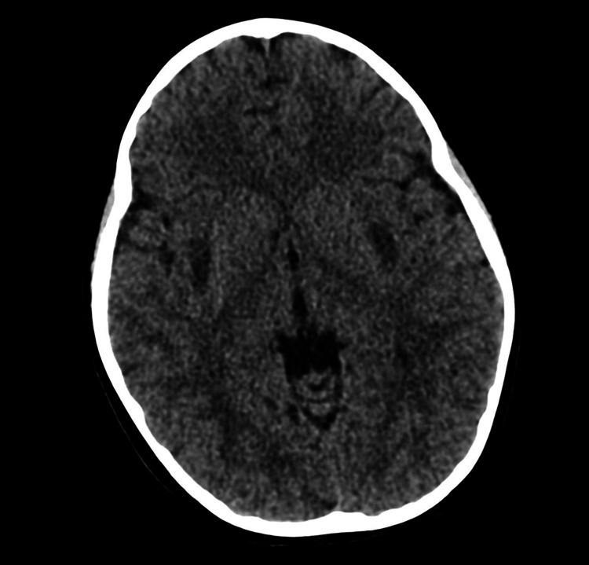

# 6169 — Bệnh não do cúm (influenza-associated encephalopathy) ở trẻ: đồi thị hai bên, "dấu ba lớp" và cửa sổ 24–72 giờ

**Tags:** `pattern:doi-thi-hai-ben` `pattern:han-che-khuếch-tán` `pattern:xuat-huyet-doi-thi` `pattern:trilaminar` `vung:nao` `vung:nao-that` `protocol:MRI-so-nao` `protocol:DWI-ADC` `protocol:SWI` `incidentaloma:khong`
**Mức chắc chắn (certainty):** tổng hợp y văn (literature synthesis) — ghép **phân tích gộp 15 nghiên cứu/138 ca ANE nhi** (*Front Neurol* 2026, PMCID **PMC13719322**, CC BY 4.0), **phân tích gộp 1.946 ca hội chứng não–bệnh sau nhiễm (ITES)** (*EClinicalMedicine* 2026, PMCID **PMC13543797**, CC BY 4.0), **báo cáo giám sát CDC 2024–25 về IAE/ANE ở trẻ Mỹ** (*MMWR*-type, 2025, PMCID **PMC12463191**, không rõ giấy phép), và **ca nguyên văn ANE do cúm B** có CT + MRI (*Cureus* 2026, PMCID **PMC13326859**, CC BY 4.0). Không có ca do nhóm tự chụp.

> **Câu chốt:** trẻ **sốt 1–3 ngày rồi lừ đừ/co giật/đi vào hôn mê**, **CT sớm thường chỉ "hơi mờ" hoặc bình thường**, trong khi **MRI thấy đồi thị hai bên đối xứng, hạn chế khuếch tán, có thể xuất huyết**. Đây là **bệnh não do cúm (influenza-associated encephalopathy, IAE)** — thể nặng nhất là **bệnh não hoại tử cấp (acute necrotizing encephalopathy, ANE)**: **94,2%** ca nhi có **tổn thương đồi thị hai bên**, **15,3%** có **xuất huyết trong tổn thương**, và **tử vong 35–41%** (PMC13719322, PMC13543797, PMC12463191). Không nhận ra trong **24–72 giờ** là mất cửa sổ điều trị.

## 1. Tổng quan bệnh học – cơ chế hình ảnh (TẠI SAO)

### 1.1. Vì sao cúm gây tổn thương ĐỒI THỊ chứ không phải "viêm não" lan tỏa

- **Cơ chế chính là "bão cytokine", không phải virus xâm nhập nhu mô:** cúm kích hoạt đại thực bào/lympho T giải phóng **IL-6, TNF-α, IL-1β**; cytokine làm **mở hàng rào máu–não** → phù mạch (vasogenic) rồi **hoại tử tế bào** (PMC13719322, PMC13703285). Vì vậy **dịch não tủy thường KHÔNG tăng tế bào** nhưng **protein tăng** — khác viêm não do virus trực tiếp.
- **TẠI SAO đồi thị:** đồi thị có **mật độ thụ thể glutamate/NMDA cao, nhu cầu chuyển hóa và mạch máu lớn nhất trong chất xám sâu** → nhạy nhất với cơn bão cytokine + độc tính glutamate; dẫn lưu tĩnh mạch sâu (xoang thẳng, tĩnh mạch nội bộ) là "vùng cuối" của dòng chảy, nên phù và xuất huyết tụ ở đây. Cùng nhóm cấu trúc dễ tổn thương: **chất trắng quanh não thất, bao trong, thể vân (putamen), thuỳ thái dương, trần thân não, tiểu não** — đúng danh sách "common" trong tiêu chuẩn chẩn đoán ANE (PMC13543797).
- **Hệ quả hình ảnh:** mô hoại tử **giàu nước nội bào** → **ADC giảm (hạn chế khuếch tán thật)**; khi tế bào vỡ và xuất huyết vi thể, tổn thương **mất tính đồng nhất** → **dấu ba lớp (trilaminar sign)** = vòng trung tâm hoại tử/xuất huyết + vòng trung gian + vòng ngoài phù, tương ứng **"concentric structures"** trong tiêu chuẩn ANE (PMC13543797).

### 1.2. TẠI SAO CT sớm hay "âm tính" — vật lý của phù não trên CT

- Phù não chỉ làm **giảm 2–5 HU** ở giai đoạn đầu; mắt người chỉ phân biệt được **≈ 5–10 HU** giữa hai vùng mô, và ở trẻ **nhu mô não còn nhiều nước, độ tương phản xám–trắng thấp** → **CT ngày 1 thường chỉ thấy đồi thị "hơi tối" hoặc hoàn toàn bình thường** (xem ảnh mục 6 — CT của ca nguyên văn chỉ có giảm tỷ trọng kín đáo ở putamen hai bên).
- Vì vậy **CT không dùng để loại trừ ANE**; CT dùng để **loại trừ chảy máu lớn, tụt kẹt, và tìm nguyên nhân khác cấp cứu**. **MRI (DWI/ADC + T2/FLAIR + SWI)** là phương thức chốt, và **phải chụp lại 48–72 giờ** nếu lần đầu bình thường mà trẻ xấu đi — thời điểm nặng nhất **trung vị ngày thứ 3** (PMC13543797).

### 1.3. Ngưỡng định lượng nằm lòng (dùng cho mục 3 và 4)

| Đại lượng | Số liệu | Nguồn |
|---|---|---|
| Tổn thương **đồi thị hai bên** ở ANE nhi | **94,2%** (129/136) | PMC13719322 |
| Thân não / thể vân / tiểu não / lan tỏa | **33,6%** / **28,5%** / **17,5%** / **14,4%** | PMC13719322 |
| **Xuất huyết trong tổn thương** | **15,3%** (21/137) | PMC13719322 |
| Tử vong ANE nhi (gộp ngẫu nhiên) | **39,1%** (KTC 95%: 29,8–49,8); 54/138 | PMC13719322 |
| Tử vong cấp ANE (1.946 ca ITES) | **35%**; tốt sau 6 tháng (mRS 0–2) chỉ **33%** | PMC13543797 |
| Tử vong IAE / ANE ở trẻ Mỹ 2024–25 | **19%** / **41%** | PMC12463191 |
| Ca IAE được xác nhận trong 192 báo cáo | **109 IAE**, trong đó **37 ANE (34%)** | PMC12463191 |
| Tuổi trung vị / trẻ trước đó khoẻ mạnh / vào ICU | **5 tuổi** / **55%** / **74%** | PMC12463191 |
| Trẻ đủ điều kiện đã tiêm cúm mùa 2024–25 | **16%** | PMC12463191 |
| Thời gian từ khởi phát thần kinh đến đỉnh nặng | **trung vị 3 ngày** | PMC13543797 |
| Dịch não tủy | **tế bào bình thường + protein tăng**; transaminase tăng, **ammonia bình thường** | PMC13543797 |
| Liệu pháp đã dùng (ANE nhi) | corticoid **75,9%**, IVIG **51,8%**; tocilizumab chọn lọc | PMC13719322 |
| Hồi phục hoàn toàn / di chứng ở ca sống | **20,2%** / **40,6%** | PMC13719322 |

- **Chưa rõ — cần tra:** không có **ngưỡng ADC (×10⁻⁶ mm²/s)** hay **ngưỡng thể tích đồi thị** được thẩm định để phân tầng ANE; mọi con số trên là **dịch tễ/kết cục**, không phải tiêu chuẩn hình ảnh định lượng.
- **Cảnh báo dịch tễ:** số **39,1%** là **gộp các ca đã báo cáo** (nguy cơ thiên lệch công bố), còn **41%** là của **một mùa cúm nặng** ở Mỹ; **không** dùng để tiên lượng từng trẻ.

## 2. Mẫu hình + chẩn đoán phân biệt theo vị trí (Gamut)

- **Đồi thị hai bên đối xứng + hạn chế khuếch tán + sốt:** ANE (cúm A/B, SARS-CoV-2), **huyết khối xoang tĩnh mạch sâu/não (CVST)**, **HIE ở trẻ đủ tháng**, **hạ đường huyết**, **ngộ độc CO**, **bệnh Leigh/thể não–tủy**, **thiếu vitamin B1 (Wernicke)**, **hủy myelin thẩm thấu (osmotic demyelination)**.
- **Đồi thị + thể vân + chất trắng quanh não thất, có xuất huyết:** ANE là hàng đầu; loại trừ **CVST** bằng MRV và **bệnh mạch máu** (bóc tách, dị dạng) bằng MRA.
- **Chất trắng dưới vỏ, hạn chế khuếch tán XUẤT HIỆN MUỘN (ngày 3–14), không ở đồi thị:** **AESD** (động kinh hai pha, "bright tree appearance", liên quan HHV-6; tử vong thấp hơn nhưng di chứng 46%) (PMC13543797).
- **Thể chai (splenium) đơn độc:** **MERS** (thường sau rotavirus), **hồi phục hoàn toàn 99%** — điều trị hỗ trợ, **không** dùng corticoid liều cao mặc định.
- **Tiểu não (nhân răng) + hải mã + thân não sau opioid:** **CHANTER** (bài **3101**) — bối cảnh thuốc, không có bão cytokine.
- **Vỏ não thái dương một bên + xuất huyết:** **viêm não herpes** — acyclovir ngay, không chờ MRI.
- **Gợi nhớ ANE** = **A**ltered consciousness > 24 giờ, **N**euroimaging đồi thị đối xứng, **E**nzyme gan tăng (ammonia bình thường).

## 3. Bảng so sánh phân biệt (ma trận đối chiếu)

| Thực thể (entity) | Hình ảnh điển hình (CT/MRI) | Chốt vào (rule-in) | Chốt loại (rule-out) | Gợi ý xác nhận |
|---|---|---|---|---|
| **ANE do cúm** | **Đồi thị hai bên đối xứng**, T2/FLAIR sáng, **DWI sáng + ADC thấp**, **dấu ba lớp**, 15,3% xuất huyết; thân não 33,6% | **Sốt + rối loạn ý thức > 24 giờ + đồi thị hai bên**; **dịch não tủy tế bào bình thường, protein tăng, transaminase tăng** | Tổn thương **một bên**, vỏ não thái dương, hoặc **chất trắng dưới vỏ đơn thuần** → nghĩ nguyên nhân khác | PCR cúm (âm tính **không** loại trừ), MRI lặp 48–72 giờ, IL-6 |
| **AESD** | **Chất trắng dưới vỏ** hạn chế khuếch tán **ngày 3–14**, "bright tree", **giữ nguyên hồi trước–sau trung tâm** | **Động kinh hai pha** (ngày 1–2 rồi ngày 3–7) + hình ảnh muộn ở chất trắng dưới vỏ | Đồi thị là tổn thương **chính** → ANE; thể chai đơn độc → MERS | MRI ngày 3–5 (đừng chụp quá sớm), HHV-6 |
| **MERS** | **Thể chai (splenium)** hạn chế khuếch tán đồng nhất, có thể lan toàn thể chai | **Bệnh cảnh nhẹ, hồi phục nhanh**, **mRS 0–2 sau 6 tháng 99%** | Tổn thương **đồi thị/thân não** hoặc ý thức sâu kéo dài → không phải MERS | MRI 3–7 ngày, rotavirus, theo dõi lâm sàng |
| **HIE ở trẻ đủ tháng** | **Đồi thị + nhân nền hai bên**, có thể lan cột sau tủy; **ADC thấp** | **Tiền sử ngạt chu sinh, pH/kiềm dư thấp, điểm Apgar, hội chứng não sơ sinh** | Khởi phát **sau 1 tuổi** hoặc có **sốt nhiễm trùng rõ** → không phải HIE | Bệnh sử chu sinh + lactate; MRI sớm 3–5 ngày |
| **Hạ đường huyết** | **Vỏ chẩm–đỉnh + nhân nền**, thường **không đối xứng hoàn toàn**, ADC thấp | **Glucose < 2,6 mmol/L (47 mg/dL)** tại thời điểm triệu chứng, hồi phục sau bù glucose | Đồi thị **đối xứng hoàn hảo + sốt cao** → ANE | Glucose mao mạch, MRI sau bù đường |
| **Ngộ độc CO** | **Globus pallidus hai bên**, có thể lan chất trắng; **xuất huyết** | **Bệnh sử phơi nhiễm (lò sưởi, khói), COHb tăng**, nhiều người trong nhà cùng triệu chứng | Phơi nhiễm âm tính + tổn thương **đồi thị** → nghĩ ANE | COHb (khí máu), bối cảnh gia đình |
| **Viêm não herpes** | **Thuỳ thái dương một bên**, vỏ não, phù, **xuất huyết**, ngấm thuốc màng não | **Sốt + co giật cục bộ + rối loạn ngôn ngữ**, **PCR HSV dịch não tủy** | Tổn thương **hai bên đồi thị** → không điển hình herpes | PCR HSV, EEG, **acyclovir ngay** |
| **CVST (xoang sâu/não)** | **Đồi thị hai bên** nhưng kèm **nhồi máu xuất huyết**, giãn não thất, **không thấy dòng chảy xoang** | **MRV/CTV thiếu tín hiệu xoang**; đau đầu + tăng áp lực nội sọ | Xoang **thông tốt** trên MRV → loại trừ | MRV thì tĩnh mạch, D-dimer |
| **CHANTER (bài 3101)** | **Nhân răng tiểu não + hải mã + thân não**, đối xứng | **Bối cảnh opioid**, không sốt | Không phơi nhiễm opioid + **đồi thị là tổn thương chính** | Bệnh sử thuốc, MRI |

*Ca nguyên văn trẻ **6 tuổi** khoẻ mạnh, cúm B, ngày 2–3: (A) T2 axial — **đồi thị hai bên tăng tín hiệu đối xứng** (mũi tên); (B) T2 trên não thất — ổ tăng tín hiệu **chất trắng quanh não thất**; (C) T2 hố sau — **trung tâm thân não (pons)** tăng tín hiệu (mũi tên); (D) DWI — **hạn chế khuếch tán mạnh ở đồi thị hai bên** (mũi tên). Ảnh nguyên bản, không crop. Nguồn: *Cureus* 2026, PMCID PMC13326859, CC BY 4.0.*

## 4. Protocol chụp + phân tầng xử trí

### 4.1. Thứ tự hình ảnh (không được đảo)

1. **CT sọ không cản quang** khi trẻ hôn mê/co giật: mục đích **loại trừ chảy máu lớn, tụt kẹt, não úng thủy cấp** — **không** dùng để chẩn đoán ANE.
2. **MRI sọ khẩn (≤ 24 giờ)** với **DWI + ADC + T2/FLAIR + T1 ± SWI + MRA/MRV**: bắt buộc đủ 4 chuỗi để trả lời 3 câu — **(a) có hạn chế khuếch tán thật? (b) có xuất huyết? (c) có huyết khối xoang/mạch?**
3. **Lặp MRI sau 48–72 giờ** nếu lần đầu bình thường mà trẻ xấu đi (đỉnh bệnh trung vị **ngày 3**); lặp **1–3 tháng** để đánh giá teo đồi thị/hang hóa và tiên lượng.
4. **Chọc dò dịch não tủy** sau khi loại trừ tăng áp lực nội sọ: gửi **tế bào, protein, glucose, PCR đa tác nhân (cúm, HSV, HHV-6, enterovirus), IL-6** nếu có.
5. **Xét nghiệm máu:** transaminase, **ammonia (bình thường giúp phân biệt với bệnh chuyển hóa)**, glucose, lactate, đông máu, ferritin/CRP.

### 4.2. Phân tầng điều trị (bằng chứng quan sát, chưa có RCT)

| Mức | Lâm sàng – hình ảnh | Xử trí |
|---|---|---|
| **IAE nhẹ (MERS/encephalopathy không tổn thương sâu)** | Tỉnh táo dao động, không co giật kéo dài, MRI không có tổn thương đồi thị | Hỗ trợ, kiểm soát sốt, theo dõi 24–48 giờ; **không** corticoid liều cao |
| **IAE có tổn thương sâu** | Đồi thị/thân não, hạn chế khuếch tán, ý thức giảm | ICU; **methylprednisolon 10–30 mg/kg/ngày × 3–5 ngày** (thực hành phổ biến, **chưa có RCT**); **IVIG 1–2 g/kg** chia 2–5 ngày; kháng virus nếu PCR cúm dương |
| **ANE nặng / có xuất huyết** | Xuất huyết đồi thị, thân não, hôn mê sâu | ICU + **hạ thân nhiệt có kiểm soát** (thực hành Nhật, bằng chứng quan sát); **tocilizumab/anakinra** trong thể tăng viêm; **không** mổ giải áp trừ khi có thoát vị |
| **Theo dõi sau** | Teo/hang hóa đồi thị, động kinh muộn, chậm phát triển | Phục hồi chức năng, EEG khi có cơn, MRI 1–3 tháng, tư vấn **di chứng 40,6%** |

- **Kháng virus:** oseltamivir/zanamivir **không chứng minh cải thiện thần kinh**, nhưng dùng khi cúm dương tính; **không chậm corticoid để chờ kết quả PCR**.
- **Không có thang điểm hình ảnh được thẩm định** cho ANE; phân tầng dựa vào **(1) mức ý thức, (2) thân não, (3) xuất huyết** — ba yếu tố này gắn với tử vong/di chứng trong các loạt quan sát.

## 5. Biến thể bình thường và cạm bẫy

- **Cạm bẫy 1 — "CT bình thường thì loại trừ":** CT ngày 1 chỉ giảm **2–5 HU**; ca nguyên văn (ảnh quiz) chỉ có giảm tỷ trọng kín đáo ở **putamen**, phải MRI mới thấy đồi thị. **CT âm tính không bao giờ được dừng chẩn đoán.**
- **Cạm bẫy 2 — ADC giả hồi phục (pseudonormalization):** ngày 3–7, ADC có thể **trở về bình thường** trong khi DWI vẫn sáng → dễ gọi là **"T2 shine-through"** và bỏ ANE. Cách tránh: đọc **DWI + ADC + T2** cùng lúc, và **SWI/T2\*** để tìm xuất huyết.
- **Cạm bẫy 3 — "đồi thị hai bên = ANE" tuyệt đối:** CVST, HIE, hạ đường huyết, Wernicke, Leigh, hủy myelin thẩm thấu đều đối xứng. **Bắt buộc MRV** trước khi kết luận, nhất là khi có **đau đầu + giãn não thất**.
- **Cạm bẫy 4 — PCR cúm âm tính:** virus có thể đã được đào thải khi trẻ vào viện (bệnh cảnh **sau nhiễm**), hoặc do **cúm B/SARS-CoV-2**; **không** loại trừ ANE.
- **Cạm bẫy 5 — dịch não tủy "bình thường":** ANE có **tế bào bình thường + protein tăng**; coi "dịch trong" là loại trừ bệnh não là sai.
- **Cạm bẫy 6 — bỏ sót thân não và xuất huyết:** đã thấy đồi thị thì vẫn phải soát **trần thân não (33,6%)** và **xuất huyết (15,3%)** — hai yếu tố đổi tiên lượng và mức điều trị (satisfaction of search).
- **Cạm bẫy 7 — "chỉ là co giật do sốt":** co giật **kéo dài > 30 phút**, tái phát trong cùng đợt sốt, hoặc **không tỉnh lại sau cơn** → không phải co giật do sốt; chụp MRI.
- **Biến thể bình thường dễ nhầm:** **nhân bèo (pulvinar) tăng tín hiệu nhẹ theo tuổi** ở trẻ nhỏ trên T2; **khoảng giảm tín hiệu đồi thị do myelination** ở trẻ < 6 tháng — luôn so **hai bên đối xứng** và so với vỏ não cùng tuổi.

*Cùng bệnh nhi: CT không cản quang lúc nhập viện — **giảm tỷ trọng nhẹ, đối xứng ở putamen hai bên**, không có máu tụ, không tụt kẹt. Đây là lý do **CT không loại trừ ANE**; tổn thương đồi thị rõ chỉ thấy trên MRI (ảnh trên). Ảnh nguyên bản, không crop. Nguồn: *Cureus* 2026, PMCID PMC13326859, CC BY 4.0.*

## 6. Tự lượng giá — Blind Quiz

**Ca 1 — Bé gái 6 tuổi, khoẻ mạnh, sốt 2 ngày rồi co giật toàn thể, sau cơn lừ đừ, không nói, không nhìn theo. CT sọ tại tuyến trước "không có gì".**

- Hỏi: (1) CT có loại trừ được bệnh não không? (2) Bạn chụp gì tiếp và đọc những chuỗi nào? (3) 3 chẩn đoán phân biệt hàng đầu?

<b>Bấm để hiện đáp án (findings + chẩn đoán)</b>

- **CT:** giảm tỷ trọng kín đáo, đối xứng ở **putamen hai bên**; **không** loại trừ được ANE.
- **Bước tiếp:** **MRI sọ khẩn với DWI + ADC + T2/FLAIR + SWI + MRV**.
- **Findings trên MRI:** **đồi thị hai bên tăng T2, hạn chế khuếch tán mạnh**; thêm **chất trắng quanh não thất** và **trần thân não (pons)**.
- **Chẩn đoán:** **ANE do cúm B** — bão cytokine, phù độc tế bào + hoại tử đồi thị.
- **Phân biệt:** **CVST** (cần MRV), **HIE** (bệnh sử chu sinh), **viêm não herpes** (vỏ thái dương một bên), **AESD** (tổn thương chất trắng dưới vỏ xuất hiện ngày 3–14).
- **Xử trí:** ICU, corticoid + IVIG, kháng virus, **MRI lặp 48–72 giờ** vì đỉnh bệnh trung vị ngày 3.
- Nguồn ảnh: *Cureus* 2026, PMCID PMC13326859, CC BY 4.0.

**Ca 2 — Bé trai 1,5 tuổi, sốt cao ngày 1 co giật kéo dài, tỉnh lại, đến ngày 4 co giật cục bộ liên tiếp và lơ mơ. MRI ngày 5:**

- Hỏi: tổn thương ở đâu, vì sao MRI ngày 1 có thể bình thường, tiên lượng khác ANE thế nào?

<b>Bấm để hiện đáp án</b>

- **Hình ảnh:** **hạn chế khuếch tán ở chất trắng dưới vỏ** (bright tree appearance) **ngày 3–14**, **giữ nguyên hồi trước–sau trung tâm**; đồi thị **không** là tổn thương chính.
- **Chẩn đoán:** **AESD** (động kinh hai pha + hạn chế khuếch tán muộn), thường sau **HHV-6**; MRI quá sớm (ngày 1–2) **có thể bình thường**.
- **Tiên lượng:** tốt sau 6 tháng **54%** (so với ANE **33%**); tử vong cấp thấp hơn ANE.
- **Xử trí:** chống co giật, hỗ trợ; **không** corticoid liều cao mặc định.
- Nguồn số liệu: *EClinicalMedicine* 2026, PMCID PMC13543797, CC BY 4.0.

**Ca 3 — Bé gái 9 tuổi, tiêu chảy do rotavirus, ngày 3 lú lẫn nhẹ, không co giật, không sốt cao. MRI: ổ hạn chế khuếch tán đồng nhất ở thể chai.**

<b>Bấm để hiện đáp án</b>

- **Chẩn đoán:** **MERS** (tổn thương thể chai hồi phục), liên quan **rotavirus**; hồi phục hoàn toàn **99%** (mRS 0–2 sau 6 tháng).
- **Vì sao không phải ANE:** không có tổn thương **đồi thị/thân não**, ý thức chỉ rối loạn nhẹ và hồi phục nhanh.
- **Xử trí:** hỗ trợ, theo dõi; **không** leo thang miễn dịch; MRI lặp nếu xấu đi.
- Nguồn: *EClinicalMedicine* 2026, PMCID PMC13543797, CC BY 4.0.

## Bài liên quan chéo
- [3062 – Viêm màng não tái diễn ở trẻ có dị tật tai trong](../3062-viem-mang-nao-tai-dien-di-tat-tai-trong/lesson.md) (nhiễm trùng thần kinh trung ương ở trẻ, đường vào từ tai)
- [3101 – Hội chứng CHANTER sau opioid](../3101-hoi-chung-chanter-opioid/lesson.md) (tổn thương hai bên sau thuốc, không sốt)
- [1738 – Ngộ độc khói lửa/CO ở trẻ](../1738-ngo-doc-co-khoi-lua-o-tre/lesson.md) (globus pallidus hai bên)
- [216 – Dị dạng mạch & huyết khối xoang tĩnh mạch](../216-di-dang-mach-CVST/lesson.md) (đồi thị hai bên do tắc tĩnh mạch sâu)
- [653 – PRES/RCVS ở trẻ](../653-pres-rcvs-tre-em/lesson.md) (phù não hai bên, bối cảnh huyết áp/thuốc)
- [212 – Xuất huyết sọ não](../212-xuat-huyet-so-nao/lesson.md) (loại trừ chảy máu lớn trên CT)

## Ảnh
- `6169_benh-nao-cum_CT_PMC13326859-F1.jpg` — CT sọ ngày 1, giảm tỷ trọng putamen hai bên; *Cureus* 2026, PMCID PMC13326859, CC BY 4.0.
- `6169_benh-nao-cum_MRI_PMC13326859-F2.jpg` — MRI T2 + DWI: đồi thị, chất trắng quanh não thất, pons; *Cureus* 2026, PMCID PMC13326859, CC BY 4.0.
- Chi tiết nguồn, giấy phép, phái sinh: `images/CREDITS.md`; link bài gốc: `sources.md`.

> Không dùng để chẩn đoán độc lập khi chưa có người hướng dẫn.
