# 617 — Hội chứng rò khí ở nhũ nhi: tràn khí màng phổi & tràn khí trung thất / Neonatal air-leak syndrome

**Tags:** `pattern:ro-khi` `pattern:tran-khi-mang-phoi` `pattern:tran-khi-trung-that` `vung:phoi` `vung:mang-phoi` `score:AP-ratio` `protocol:X-quang-nguc-nhi` `protocol:sieu-am-phoi`
**Mức chắc chắn (certainty):** ca nguyên văn (verbatim case) — neo vào **một ca trẻ đủ tháng nguyên văn** (Al Dhouyani & Al-Naimi, *Cureus* 2024, PMC11301117: tràn khí màng phổi trái ngày 1 → tràn khí trung thất ngày 6, tự khỏi không can thiệp), bổ sung bằng tổng hợp y văn mở (cơ chế Macklin, dấu cánh buồm, ngưỡng AP-ratio).

## 1. Tổng quan bệnh học – cơ chế hình ảnh

- **Hội chứng rò khí (air-leak syndrome, ALS)** là một phổ tổn thương do khí thoát khỏi lòng phế nang ra khoảng kẽ rồi lan theo các đường mạc: **khí kẽ phổi (pulmonary interstitial emphysema, PIE)**, **tràn khí màng phổi (pneumothorax, PTX)**, **tràn khí trung thất (pneumomediastinum, PM)**, **tràn khí màng ngoài tim (pneumopericardium)**, **khí dưới da (subcutaneous emphysema)** và biến thể cần nhớ — **tràn khí phúc mạc do chấn thương áp lực (barotrauma-related pneumoperitoneum)**.
- **Cơ chế (TẠI SAO rò khí):** phế nang nhũ nhi **chưa trưởng thành** (ít đàn hồi, thành mỏng) + thiếu surfactant/chủng loại bệnh nền (RDS, viêm phổi, hít phân su) gặp **áp lực xuyên phổi cao đột ngột** (resuscitation, thở máy, CPAP) → phế nang căng vỡ → khí vào **khoảng kẽ quanh mạch–quanh phế quản (Macklin effect)**. Khí đi theo **mạc quanh mạch (perivascular fascia — nguồn gốc màng ngoài tim xơ)** và **mạc trước khí quản (pretracheal fascia)** về **rốn phổi → trung thất**, hoặc vỡ màng phổi tạng → **khoang màng phổi**. Cùng một đợt vỡ phế nang có thể cho nhiều đích khác nhau → trên hình ảnh, **tên gọi do KHÔNG GIAN mà khí chiếm, không do bản chất khí**.
- **Vì sao đọc được trên hình:** khí cản tia X cực thấp (X-quang: đen; **CT: khoảng −1000 HU**, thấp hơn nhu mô phổi lành −700 đến −900 HU) → chìa khóa là **tương quan của dải khí với mạc/mốc giải phẫu**: khí nâng **tuyến ức** lên khỏi màng ngoài tim = **dấu cánh buồm rộng (Spinnaker-sail sign)** — do có một **mạc liên tục (màng Quattromani)** bọc mặt trước tuyến ức và màng ngoài tim mà khí bị giữ lại; khí tách lá màng phổi khỏi cơ hoành = **dấu khí ngoài màng phổi (extrapleural air sign)**.
- **Cơ chế tự tiêu – “rửa nitơ” (nitrogen washout):** khí khí quyển **~78% N₂**; tổng áp lực khí trong phế nang ~**760 mmHg**, tổng áp lực khí trong máu tĩnh mạch ~**706 mmHg** → gradient đẩy khí khu trú hấp thu dần vào máu. Thở **FiO₂ 90–100%** làm loãng N₂ phế nang → tăng gradient, tan khí nhanh hơn — nhưng **bằng chứng ở nhũ nhi còn yếu** và có hại tiềm tàng (mất cân xứng V/Q, xẹp hấp thu), nên chỉ dùng chọn lọc ở trẻ có triệu chứng.
- **Dịch tễ & yếu tố nguy cơ (ngưỡng định lượng):**
  - **PTX nhập NICU: 0,5–2%**; theo dõi 58.706 trẻ (Farghaly et al., *J Perinatol* 2026, PMC13121010): **310/58.706 = 0,53%**, tăng vọt theo tuổi thai — **0,39% (≥ 35 tuần) · 4,0% (29–34 tuần) · 4,6% (≤ 28 tuần)**.
  - **Trẻ đủ tháng PTX tự phát: 1–2%**, trẻ non tháng **~6%** (Al Dhouyani, PMC11301117).
  - **Thời điểm:** ở nhóm ≥ 35 tuần **76% trong 24 giờ đầu** sau sinh.
  - **Yếu tố nguy cơ độc lập:** **CPAP ở phòng sinh (aOR 2,38)** ở ≥ 35 tuần; **nhỏ so với tuổi thai (SGA, aOR 3,81)** ở 29–34 tuần; **đặt nội khí quản tại phòng sinh (aOR 4,78)** ở ≤ 28 tuần; viêm màng ối (OR 2,07), **corticoid thai sớm (OR 5,22)**; ở trẻ thở máy, nhóm rò khí chịu **PIP cao hơn: 20,6 ± 5 so với 14,3 ± 3 cmH₂O (p = 0,005)**.

## 2. Mẫu hình + chẩn đoán phân biệt theo vị trí (gamut)

- **Khoang màng phổi (pleural) — PTX:** dải đen giữa **bờ phổi tạng (lung edge)** và thành ngực, **không có mạch máu băng qua**; trẻ nằm ngửa → khí tụ đáy trước, dấu **rãnh sâu (deep sulcus sign)** — góc sườn–hoành đen sắc nhọn, sâu hơn bên đối diện. Tràn khí áp lực (tension) → **đẩy lệch trung thất/rốn phổi sang bên lành + tim xa bên tổn thương**.
- **Trung thất (mediastinal) — PM:** khí nâng **tuyến ức** (spinnaker-sail), dải khí dọc trung thất/khí quản, **dấu cơ hoành liên tục (continuous diaphragm sign)**, **dấu V Naclerio**, **dấu vòng quanh động mạch (ring around the artery)** trên phim nghiêng, khí lan lên **cổ/dưới da**. **KHÔNG có bờ phổi tạng**, phổi vẫn áp sát thành ngực.
- **Khoảng kẽ phổi (PIE):** các **bóng khí nhỏ li ti/tuyến tính** dọc quanh mạch–phế quản, thùy căng giãn, **không di chuyển**; thường là **tiền đề** của PTX/PM.
- **Màng ngoài tim (pneumopericardium):** vòng khí **ôm sát tim, không lan lên cổ**, có thể gây **chèn ép tim (tamponade)**.
- **Ngoài màng phổi (extrapleural air sign):** dải sáng **trên cơ hoành trái**, tách lá màng phổi khỏi cơ hoành — dấu của PM, không phải PTX.
- **Phúc mạc (pneumoperitoneum do barotrauma):** khí tự do dưới cơ hoành nhưng **nguồn PHỔI** (Macklin → trung thất → cơ hoành/khoang sau phúc mạc → phúc mạc), **KHÔNG do thủng tạng rỗng** — bẫy dễ dẫn tới mổ bụng oan.
- Mnemonic sàng lọc: nhũ nhi **không chấn thương** khởi phát cấp sau sinh/thở máy → luôn tự hỏi **“khí nằm ở khoang nào?”** thay vì chỉ “có tràn khí hay không”.

## 3. Bảng so sánh phân biệt (ma trận đối chiếu)

| Thực thể (entity) | Hình ảnh điển hình | Chốt vào (rule-in) | Chốt loại (rule-out) | Gợi ý xác nhận |
|---|---|---|---|---|
| Tràn khí màng phổi (PTX) | Dải đen giữa bờ phổi tạng và thành ngực, không mạch máu vượt qua; dấu rãnh sâu khi nằm ngửa | **Bờ phổi tạng (lung edge) + không mạch máu băng qua** | **Có khí nâng tuyến ức + dấu cơ hoành liên tục → PM**; khối không đổi khi đổi tư thế → không phải nếp da | Siêu âm phổi (dấu điểm phổi), X-quang thẳng/nghiêng, chụp ngửa–sấp |
| Tràn khí trung thất (PM) | **Dấu cánh buồm:** khí nâng tuyến ức khỏi màng ngoài tim; dải khí dọc trung thất, dấu cơ hoành liên tục, dấu V Naclerio, khí lên cổ | **Nâng tuyến ức + dấu cơ hoành liên tục + lan lên cổ** | **Có bờ phổi tạng tách khỏi thành ngực → PTX** | X-quang thẳng + nghiêng; CT khi PM lượng nhiều/kéo dài/không điển hình |
| Khí kẽ phổi (PIE) | Bóng khí li ti/tuyến tính dọc quanh mạch–phế quản, thùy căng giãn, **cố định** | **Bóng khí kẽ cố định dọc mạch phổi** | **Dải khí di chuyển tự do theo tư thế → PTX** | X-quang lặp lại (PIE báo trước PTX/PM) |
| Tràn khí màng ngoài tim | Vòng khí **sát tim**, có thể gây chèn ép tim | **Vòng khí ôm tim, không lan lên cổ** | **Dải khí giữa tim và cơ hoành + lên cổ → PM** | Siêu âm tim (tamponade), X-quang thẳng–nghiêng |
| Khí ngoài màng phổi (extrapleural air) | Dải sáng trên cơ hoành trái, tách màng phổi khỏi cơ hoành | **Dải khí nằm giữa cơ hoành và màng phổi** | **Có bờ phổi tạng tách khỏi thành ngực → PTX** | X-quang thẳng; CT nếu cần |
| Tràn khí phúc mạc do barotrauma | Khí tự do dưới cơ hoành ở trẻ **thở máy áp lực cao**, bụng mềm | **Khí phúc mạc + tiền sử thở máy/khí trung thất kèm theo** | **Thành ruột mỏng + khí trong thành/mạch cửa + bụng gồng → thủng tạng (hoại tử ruột)** | Theo dõi lâm sàng ± ống thông mạch máu; **tránh mổ bụng vội** |

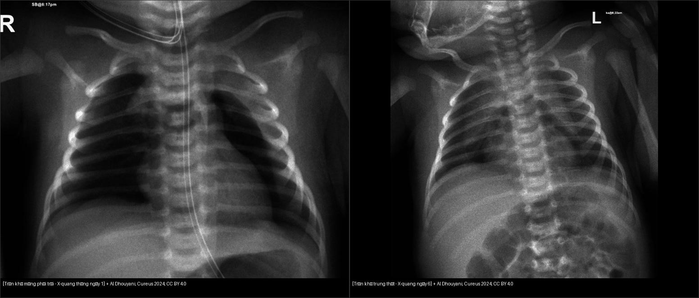
*Trái: PTX trái — bờ phổi tạng tách khỏi thành ngực, nhu mô xẹp về rốn. Phải: sau 6 ngày, khí nâng tuyến ức (tràn khí trung thất) — phổi đã nở lại, không còn bờ phổi tạng. Cùng một đợt rò khí lan theo hai con đường khác nhau. Nguồn: Al Dhouyani & Al-Naimi, *Cureus* 2024, CC BY 4.0. Ảnh ghép letterbox.*

## 4. Protocol chụp + hệ phân độ/điểm chuẩn hóa

- **Siêu âm phổi tại giường (POCUS) — đầu tay ở NICU:** dấu **A-line sắc nét, MẤT B-line, mất trượt màng phổi (lung sliding)**; **dấu “điểm phổi” (lung point)** tại ranh giới vùng rò khí/vùng phổi lành là dấu **đặc hiệu nhất** cho PTX; **M-mode dạng “mã vạch” (barcode sign)** thay vì “bờ biển” (seashore). Với **PM**, trên mặt cắt ngang trước xương ức thấy **A-line + không quan sát được mặt cắt tim bình thường** do khí che; điểm phổi cũng xuất hiện ở vùng chuyển tiếp.

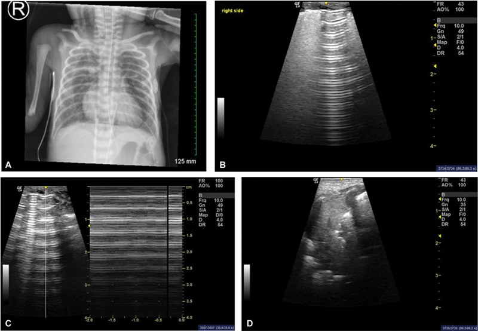
*(A) X-quang: tràn khí trung thất hai bên lan lên cổ; (B) siêu âm cạnh ức phải: A-line sắc nét, mất B-line, mất trượt màng phổi; (C) M-mode: **dấu “mã vạch” (barcode sign)**; (D) **điểm phổi (lung point)** tại ranh giới vùng rò khí/vùng lành — dấu đặc hiệu nhất. Nguồn: Sagaser AE et al., *AJP Rep* 2024 (PMC11461096), **CC BY-NC-ND 4.0 — giữ nguyên bản, không cắt/ghép**.*
- **X-quang ngực thẳng (AP, trẻ nằm ngửa) là chuẩn đầu tiên:** tìm dấu rãnh sâu, bờ phổi tạng, dấu cánh buồm, dấu cơ hoành liên tục, khí cổ/dưới da. **Phim nghiêng tay (lateral decubitus)** lật bên nghi ngờ lên trên để khí dồn thành lớp — hữu ích khi PTX khó thấy.
- **CT ngực chỉ khi:** diễn tiến không điển hình, rõ kích thước/thành phần của PM/PIE, **rò khí dai dẳng**, hoặc nghi tổn thương phổi–phế quản kèm theo (không dùng thường quy vì liều bức xạ — nguyên tắc **ALARA**).
- **Đo kích thước PTX để tiên lượng can thiệp (AP-ratio, APr):** đo **đường kính ngang rộng nhất của dải khí** chia cho **đường kính ngang rộng nhất của nửa lồng ngực trên cơ hoành** (Baillie et al., *Children* 2025, PMC12839672, n = 62):
  - **APr < 0,102 → 0% (39% số ca) cần can thiệp** (không thủ thuật).
  - **APr > 0,187 → 100% (15% số ca) cần can thiệp.**
  - Vùng giữa **APr 0,104–0,183 → ~47%** cần can thiệp (vùng xám).
  - **Ngưỡng tốt nhất APr = 0,184:** **AUC 0,902 (KTC 0,828–0,977), độ nhạy 86%, độ đặc hiệu 88%**, chỉ số Youden J = 0,74, phân loại đúng 87%.
  - **Chọc hút kim (thoracentesis) đơn thuần thường thất bại:** **13/14 (93%)** ca chọc hút phải đặt ống dẫn lưu sau đó; RCT cho thấy **55%** phải dẫn lưu trong 6 giờ; tổng quan Cochrane (142 trẻ) ~**30%** chọc hút không cần dẫn lưu tiếp.

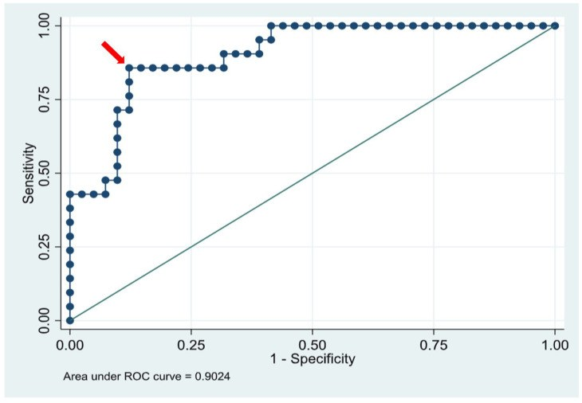
*Đường cong ROC của **AP-ratio**: **AUC 0,902 (KTC 0,828–0,977)**; ngưỡng APr = 0,184 cho **Se 86%/Sp 88%**. Nguồn: Baillie KN et al., *Children* 2025 (PMC12839672), CC BY 4.0.*
- **Flowchart xử trí rò khí ở nhũ nhi:**

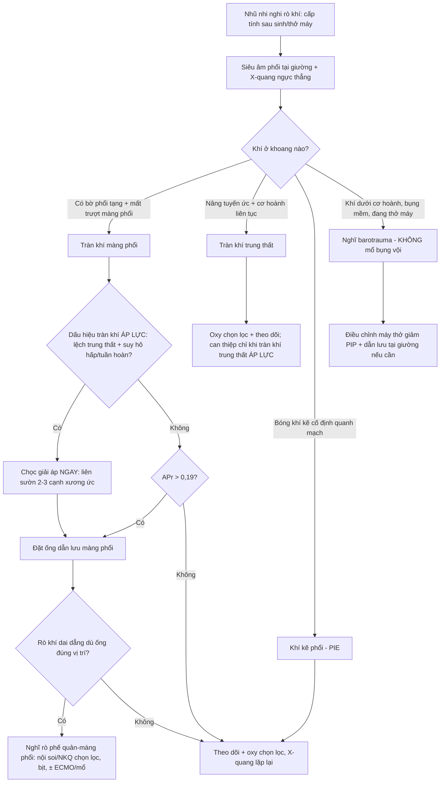

## 5. Biến thể bình thường và cạm bẫy

- **Bẫy tử vong: tràn khí phúc mạc do barotrauma.** Khí tự do dưới cơ hoành ở trẻ **thở máy áp lực cao** có thể do **Macklin effect** lan từ trung thất xuống qua cơ hoành/khoang sau phúc mạc, **không phải thủng ruột**. Nếu bụng mềm, không gồng, không có khí trong thành ruột/tĩnh mạch cửa → **tránh mổ bụng oan**; dẫn lưu tại giường + giảm áp lực đường thở. (Hiremath et al., *Cureus* 2025, PMC11955197 — sau đặt dẫn lưu phúc mạc còn **xuất hiện PTX phải mới**, minh chứng khí đang “đi lại” giữa các khoang.)
- **Nếp da/mép màng phổi giả (skin fold)** dễ nhầm PTX: kiểm tra **bờ tận cùng ngoài thành ngực + có cắt qua xương sườn**, và **đổi tư thế/không đổi theo nhịp thở**; bờ phổi thật đi song song với thành ngực.
- **Tuyến ức bình thường vs PM:** tuyến ức bình thường là mờ mềm “cánh buồm” sát trung thất, **không có dải khí sáng nâng nó lên**; PM tạo **đường sáng rõ** giữa tuyến ức và màng ngoài tim.
- **Trẻ nằm ngửa che PTX:** khí dồn ra **trước và đáy**, phim thẳng có thể “bình thường” → tìm **dấu rãnh sâu**; nếu còn nghi, chụp **nghiêng tay** hoặc siêu âm.
- **Sỏi bỏ sót (satisfaction of search):** thấy PTX rồi dừng đọc → bỏ sót PM kèm theo và **ống thông/ống sonde sai vị trí** (nhắc đi nhắc lại trong các ca).
- **PIE thoáng qua:** bóng khí kẽ có thể tự tiêu nhưng **báo trước** PTX/PM nặng hơn → theo dõi.
- **Rò khí dai dẳng dù ống dẫn lưu đúng vị trí** → nghĩ **rò phế quản–màng phổi (bronchopleural fistula, BPF)** hoặc tổn thương phế quản lớn (Janowicz & Szostawicki, *Front Pediatr* 2026, PMC13534012). Ở trẻ non tháng, BPF bẩm sinh cực hiếm nhưng biểu hiện ban đầu **giống PTX của non tháng/thở máy** → phải phân biệt với **dị dạng đường thở phổi bẩm sinh (CPAM), phổi cách ly, teo phế quản bẩm sinh, nang phế quản**.

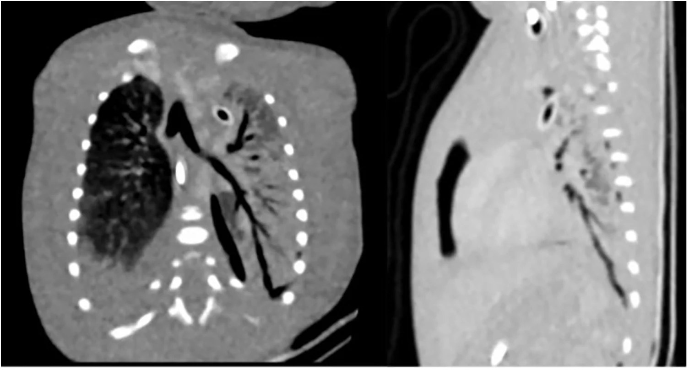
*CT ngực trước can thiệp ở trẻ non tháng rò khí dai dẳng: **đường thông phế quản–màng phổi** (mũi tên trong bài gốc) — minh chứng khi khí vẫn thoát dù ống dẫn lưu đúng vị trí. Nguồn: Janowicz T & Szostawicki M, *Front Pediatr* 2026 (PMC13534012), CC BY 4.0.*

## 6. Tự lượng giá — Blind Quiz ngay trên trang tĩnh

> Ảnh trơn ở NGOÀI, dấu hiệu + chẩn đoán giấu trong khối “bấm để hiện đáp án”. Mở trên Pages: tự đoán rồi bấm mở đáp án.

**Ca 1 — Trẻ đủ tháng 2.730 g, sinh thường, sau 10 phút khởi phát tím + rên rỉ, giảm thông khí hai bên. Phim ngày 1.**

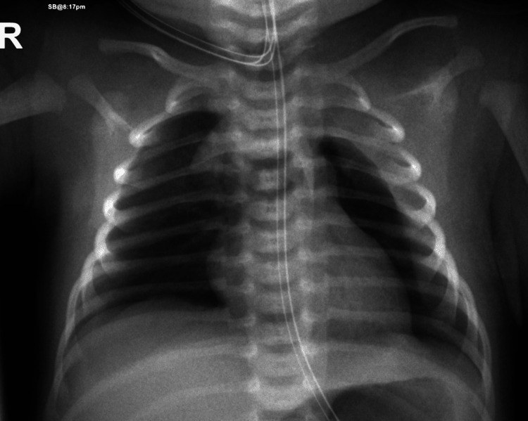

- Gợi ý lâm sàng: đủ tháng, Apgar 8/9, khởi phát cấp trong 10 phút đầu.
- Câu hỏi: Mô tả dấu hiệu chính? Vì sao không nên gọi đây là “viêm phổi sơ sinh”? Dấu hiệu nào quyết định can thiệp?

<b>Bấm để hiện đáp án (findings + chẩn đoán)</b>

- Dấu hiệu: **nửa lồng ngực trái sáng, nhu mô phổi trái xẹp về rốn (bờ phổi tạng) + tràn dịch màng phổi lượng vừa** — tràn khí màng phổi trái kèm tràn dịch.
- Chẩn đoán: **tràn khí màng phổi trái ở trẻ đủ tháng** — vỡ phế nang chưa trưởng thành do áp lực rặn sinh. Xử trí: **CPAP 5 cmH₂O/PEEP, FiO₂ 30% trong 9 giờ rồi cai xuống oxy lưu lượng thấp** — **không cần chọc hút/dẫn lưu**, tự khỏi.
- Nguồn ảnh: Al Dhouyani & Al-Naimi, *Cureus* 2024 (PMC11301117), CC BY 4.0.

**Ca 2 — Cùng trẻ trên, phim lại ngày 6 sau khi cai oxy.**

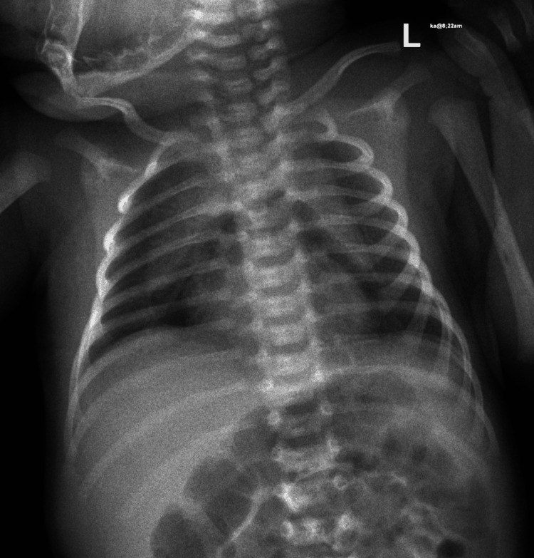

- Câu hỏi: Tổn thương mới là gì? Vì sao chuyển từ tràn khí màng phổi sang tràn khí trung thất?

<b>Bấm để hiện đáp án (findings + chẩn đoán)</b>

- Dấu hiệu: **dải khí nâng tuyến ức lên khỏi bóng tim** (khí dưới tuyến ức), dọc trung thất — **tràn khí trung thất**.
- Chẩn đoán: **tràn khí trung thất** — cùng đợt rò khí, khí lan theo **mạc quanh mạch–trước khí quản (Macklin)** từ rốn phổi vào trung thất. CT ngày 9 xác nhận tràn khí trung thất trước **dưới tuyến ức**; trẻ **ổn định, không cần can thiệp**, xuất viện ngày 9.
- Nguồn ảnh: Al Dhouyani & Al-Naimi, *Cureus* 2024 (PMC11301117), CC BY 4.0.

**Ca 3 — Dấu hiệu “cánh buồm” kinh điển.**

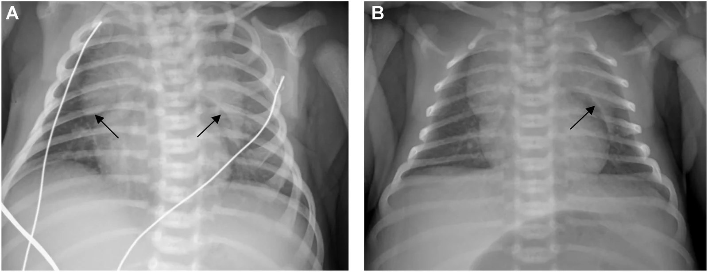

- Gợi ý: trẻ sơ sinh khó thở nhẹ sau sinh, không thở máy.
- Câu hỏi: Gọi tên dấu hiệu (2 mũi tên)? Bảng so sánh với PTX gồm dấu hiệu nào?

<b>Bấm để hiện đáp án (findings + chẩn đoán)</b>

- Dấu hiệu: khí nâng hai thùy tuyến ức (mũi tên) tạo hình **“cánh buồm rộng” (spinnaker-sail / angel wing sign)** — **tràn khí trung thất**. Panel B: phim theo dõi ngày 5, còn dư khí nhẹ.
- Chốt: **không có bờ phổi tạng** → không phải PTX; phổi vẫn áp sát thành ngực.
- Nguồn ảnh: Miguel CF et al., *Radiol Case Rep* 2026 (PMC13562374), CC BY 4.0.

**Ca 4 — CT xác nhận và phân bố khí theo mạc.**

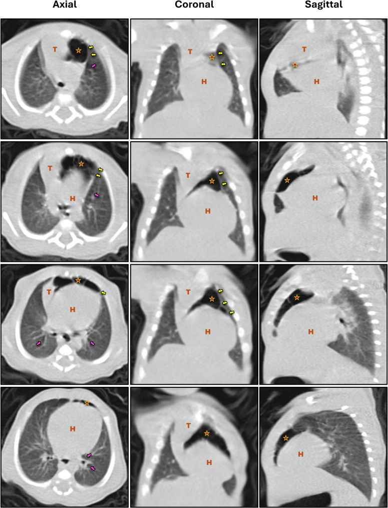

- Câu hỏi: Trên ba mặt phẳng trục/vành/dọc, khí tập trung ở đâu (T = tuyến ức, H = tim)? Mũi tên vàng và mũi tên hồng chỉ gì?

<b>Bấm để hiện đáp án (findings + chẩn đoán)</b>

- Dấu hiệu: khí bao quanh và nâng **tuyến ức (T)** khỏi **tim (H)**; **mũi tên vàng** = bờ mạc bên phủ tuyến ức và màng ngoài tim (khí bị giữ giữa hai lớp); **mũi tên hồng** = **khí quanh phế quản chính (air dissecting along the peribronchial sheaths)** — tức đường lan Macklin đang diễn ra.
- Chẩn đoán: **tràn khí trung thất tự phát ở trẻ đủ tháng** — thường lành tính, tự tiêu.
- Nguồn ảnh: Zamlout A et al., *BMC Pediatr* 2025 (PMC11995531), CC BY 4.0.

**Ca 5 — Bẫy mổ bụng oan: khí tự do dưới cơ hoành ở trẻ đang thở máy.**

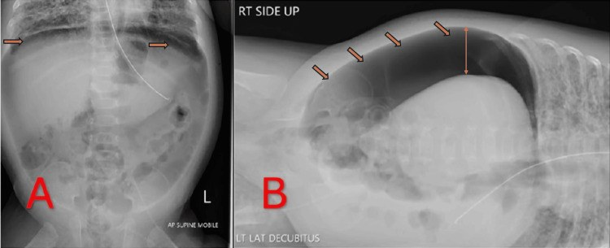

- Gợi ý: trẻ hiệu chỉnh ~36 tuần, thở máy PIP tới 30 cmH₂O, bụng mềm không gồng.
- Câu hỏi: Đây là thủng tạng rỗng hay tràn khí phúc mạc do barotrauma? Bằng chứng lâm sàng nào giúp tránh mổ?

<b>Bấm để hiện đáp án (findings + chẩn đoán)</b>

- Dấu hiệu: **liềm khí tự do dưới cơ hoành** (A: phim thẳng ngửa; B: nghiêng trái, khí dồn lớp trên cùng ổ bụng) — hình ảnh “bụng ngoại khoa”.
- Chẩn đoán: **tràn khí phúc mạc do barotrauma (Macklin effect)** — khí từ phế nang → trung thất → cơ hoành/khoang sau phúc mạc → phúc mạc, **không do thủng ruột**. Trẻ **huyết động ổn, bụng mềm, không gồng** → xử trí bằng **dẫn lưu phúc mạc tại giường + giảm áp lực đường thở**, tránh mổ bụng. Sau dẫn lưu thấy **PTX phải mới** (khí “đi lại” giữa các khoang), phải đặt ống dẫn lưu màng phổi.
- **Phản biện/cạm bẫy:** tiêu chuẩn loại trừ thủng tạng = **không khí trong thành ruột/tĩnh mạch cửa, thành ruột không mỏng, bụng không gồng**; nếu có các dấu hiệu đó thì vẫn phải mổ.
- Nguồn ảnh: Hiremath A et al., *Cureus* 2025 (PMC11955197), CC BY 4.0.

**Ca 6 — Ngưỡng đo kích thước PTX để quyết định can thiệp.**

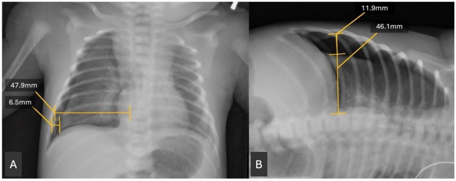

- Câu hỏi: Đo gì chia cho gì? Ngưỡng nào giúp “chốt” có/không cần dẫn lưu?

<b>Bấm để hiện đáp án (findings + chẩn đoán)</b>

- Cách đo: **đường kính ngang rộng nhất của dải khí (6,5 mm/11,9 mm) chia cho đường kính ngang rộng nhất nửa lồng ngực trên cơ hoành (47,9 mm/46,1 mm) = APr**; đo được trên phim thẳng (A) và **nghiêng tay (B)**.
- Ngưỡng: **APr < 0,102 → 0% cần can thiệp; APr > 0,187 → 100% cần can thiệp; ngưỡng tốt nhất 0,184 (AUC 0,902; Se 86%, Sp 88%)**.
- Nguồn ảnh: Baillie KN et al., *Children* 2025 (PMC12839672), CC BY 4.0.

**Ca 7 — Diễn tiến tự tiêu của tràn khí trung thất (ngày 2 → ngày 11).**

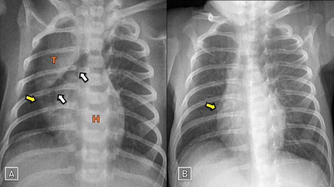

- Câu hỏi: Hai phim cách nhau 9 ngày ở cùng một trẻ tràn khí trung thất — dấu hiệu nào biến mất để khẳng định khỏi?

<b>Bấm để hiện đáp án (findings + chẩn đoán)</b>

- Dấu hiệu: (A) ngày 2 — **dấu cánh buồm** (mũi tên vàng: bờ mạc bên phủ tuyến ức và màng ngoài tim, giữ khí lại); (B) ngày 11 — **gần như hết hoàn toàn**, đường viền tuyến ức trở lại bình thường.
- Chẩn đoán: tràn khí trung thất tự phát lành tính; **theo dõi bằng X-quang lặp lại là đủ**, không cần can thiệp.
- Nguồn ảnh: Zamlout A et al., *BMC Pediatr* 2025 (PMC11995531), CC BY 4.0.

## Bài liên quan chéo
- [600 – Tổng quan Nhi khoa](../600-tong-quan-nhi-khoa/lesson.md)
- [610 – Suy hô hấp sơ sinh & dị dạng phổi](../610-suy-ho-hap-so-sinh-va-di-dang-phoi/lesson.md)
- [613 – Viêm tiểu phế quản ở nhũ nhi (RSV)](../613-viem-tieu-phe-quan-nhi/lesson.md) (biến chứng tràn khí 0,5–2%)
- [614 – Bệnh tiểu phế quản tắc nghẽn (BO) & Swyer–James](../614-benh-tieu-phe-quan-tac-nghen-BO-Swyer-James/lesson.md) (ứ khí một bên)
- [616 – Biến chứng viêm phổi nhi: empyema & hoại tử phổi](../616-bien-chung-viem-phoi-nhi-empyema-hoai-tu/lesson.md) (tràn khí màng phổi vs mủ màng phổi)

## Ảnh
- Tên file: `617_slug_Modality_SourceID.jpg`; nguồn + giấy phép từng ảnh trong `images/CREDITS.md`.
- Tất cả ảnh là **CC BY 4.0** (trừ ảnh siêu âm phổi trong CREDITS là CC BY-NC-ND, giữ nguyên bản) — cho phép tải/ghép khi ghi nguồn; không có ảnh nào phải dẫn link vì paywall.

> Không dùng để chẩn đoán độc lập khi chưa có người hướng dẫn.
