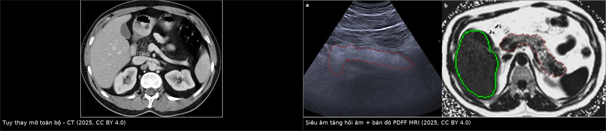
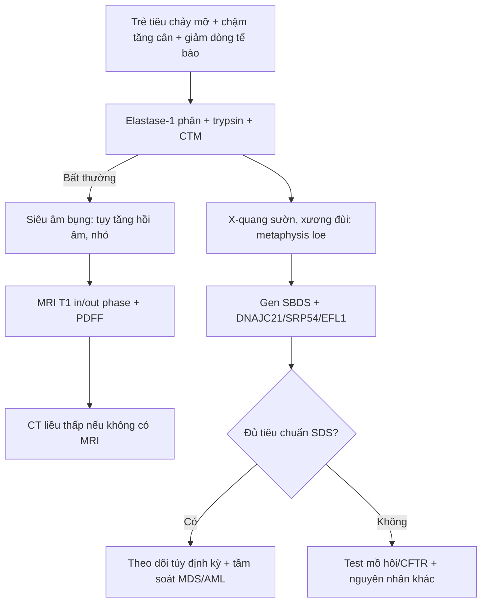
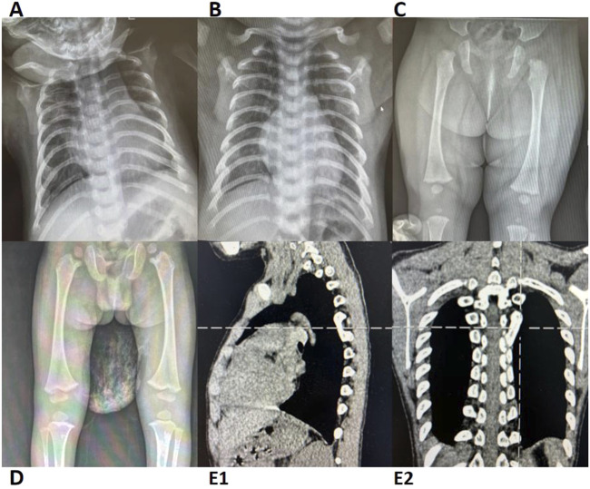
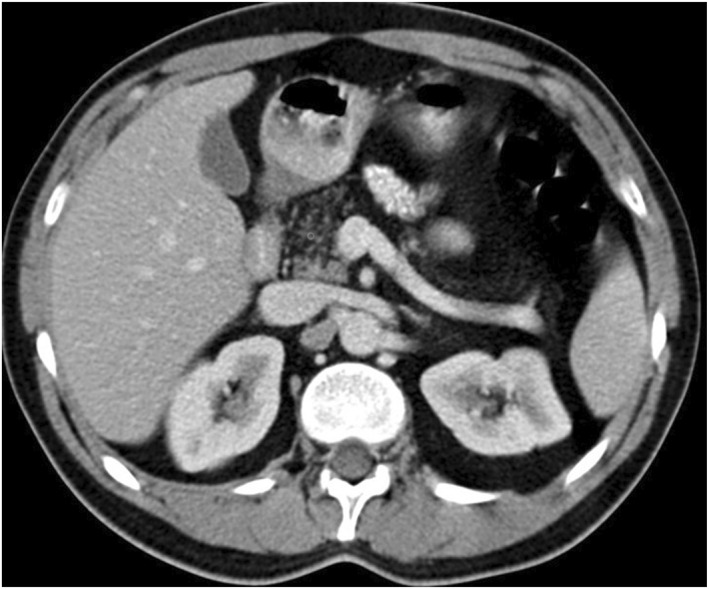
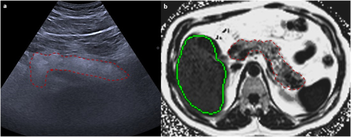

# 6170 — Hội chứng Shwachman–Diamond: tụy mỡ hóa + tủy giảm sinh + loạn sản metaphysis / Shwachman–Diamond syndrome

**Tags:** `pattern:tuy-mo-hoa` `pattern:teo-tuy` `pattern:loang-xuong-metaphysis` `pattern:giam-sinh-tuy` `vung:tuy` `vung:xuong-dai` `score:PDFF` `protocol:MRI-in-out-phase`

**Mức chắc chắn (certainty):** tổng hợp y văn (literature synthesis) — biên từ đoàn hệ **18 trẻ SDS** (*Frontiers in Genetics* 2025, **PMC12213692**, CC BY 4.0), tổng quan SDS 2026 (**PMID 42971867**), GeneReviews SDS (**PMID 20301722**), đồng thuận quốc tế về **tụy mỡ** (*J Gastroenterol Hepatol* 2025, **PMC12906299**, CC BY 4.0) và đoàn hệ cytogenetic Ý 27 năm (**PMID 42498179**). Nhóm **không có bệnh nhân của mình**.

> **Câu chốt:** SDS là **bệnh của ribosome**, không phải bệnh của tụy. Ba trụ cột — **suy tụy ngoại tiết, giảm dòng tế bào tủy, loạn sản xương metaphysis** — xuất hiện **rất sớm** (trung vị **1,5 tháng tuổi**), nhưng **hình ảnh không chẩn đoán được SDS**: hình ảnh chỉ (1) phát hiện **tụy thay mỡ**, (2) đo **mức loạn sản xương**, và (3) **loại trừ** nguyên nhân khác. Chẩn đoán nằm ở **elastase-1/trypsin + công thức máu + gen SBDS**.

## 1. Tổng quan bệnh học – cơ chế hình ảnh (TẠI SAO)

### 1.1 Sinh lý bệnh: ribosome hỏng → ba mô cùng "thiếu tế bào"

- **SBDS** (và ít gặp hơn **DNAJC21, SRP54, EFL1**) mã hóa protein cần cho **lắp ráp tiểu đơn vị 60S**; đột biến → **stress ribosome** → tế bào có tốc độ tăng sinh cao (tụy ngoại tiết, tủy xương, sụn tiếp hợp) **chết theo chương trình**.
- **Tụy:** **giảm sản/acinar hypoplasia** — mô acinar (giàu protein, đậm độ cao) **bị thay bằng mỡ**, **không có viêm, không sỏi, không giãn ống**.
- **Tủy:** giảm sinh một hoặc nhiều dòng; **giảm bạch cầu hạt trung tính gần như luôn có** (liên tục hoặc từng đợt) → dễ nhiễm trùng; nguy cơ **MDS/AML tăng** (con số tích lũy khác nhau giữa các đoàn hệ — **chưa có giá trị thống nhất, cần tra khi tư vấn**).
- **Xương:** **loạn sản sụn–xương metaphysis (metaphyseal chondrodysplasia)** — đầu xương dài **loe rộng, bờ nham nhở**, sườn **ngắn + đầu trước loe** → **lồng ngực hình thùng**.

### 1.2 Cơ chế hình ảnh: tại sao "mỡ" chứ không phải "viêm"

- **Mỡ trên CT:** **−10 đến −100 HU** (mô mỡ); tụy bình thường **30–50 HU** không cản quang. Tụy SDS **giảm đậm độ gần bằng mỡ**, **kích thước nhỏ**, **không vôi hóa**, **không giãn ống tụy** — đây là bộ ba **"mỡ thay thế đơn thuần"**.
- **Siêu âm:** tụy **tăng hồi âm** (mỡ phản xạ mạnh) và **nhỏ**; dấu hiệu này **không đặc hiệu** (béo phì, corticoid, CF đều tăng hồi âm).
- **MRI:** mỡ **T1 sáng**, **giảm tín hiệu trên chuỗi out-of-phase** (do mỡ–nước cùng voxel); **PDFF (proton density fat fraction)** định lượng được **% mỡ** — hữu ích để theo dõi, không để chẩn đoán SDS.
- **Xương:** sụn tiếp hợp **không khoáng hóa đúng** → vùng metaphysis **loang lổ, loe rộng**; phim **không cần cản quang**, giá trị nằm ở **vị trí và đối xứng**.
- **TẠI SAO quan trọng:** ở trẻ **tiêu chảy mỡ + chậm tăng cân**, thấy tụy mỡ hóa **không** đồng nghĩa CF; và **tụy bình thường trên hình ảnh không loại trừ SDS** (mỡ thay thế có thể chưa hoàn toàn ở nhũ nhi).

### 1.3 Ngưỡng định lượng cần nhớ

- **Tần suất:** **≈ 1/75.000 – 1/170.000 trẻ sinh sống** (ước tính khác nhau: 1/75.000–125.000 theo tổng quan 2026; 1/153.000–168.000 theo Minelli).
- **Đột biến SBDS:** **> 90%** ca; < 10% do **DNAJC21/SRP54/EFL1**.
- **Tuổi khởi phát:** trung vị **1,5 tháng** (đoàn hệ 18 trẻ, **PMC12213692**).
- **Tụy:** đa số bệnh nhi có **bất thường hình ảnh tụy** (đoàn hệ trên: "tần suất cao"); **trypsin giảm**, **elastase-1 phân thấp** là xét nghiệm chốt chức năng.
- **Tủy:** **giảm bạch cầu hạt** gần như phổ biến; thiếu máu/giảm tiểu cầu gặp ở một phần ca.
- **Xương:** **sườn ngắn + đầu xương loe** là dấu hiệu cổ điển; chiều cao thấp hơn bách phân vị 50 theo tuổi (đường cong SDS riêng, **PMC13244479**).

## 2. Mẫu hình + chẩn đoán phân biệt theo vị trí (gamut)

- **Tụy mỡ hóa ở trẻ (fatty replacement):** SDS · **xơ nang (CF)** · viêm tụy mạn/teo tụy · Johanson–Blizzard · Pearson · **mỡ thay thế sau xạ/steroid/béo phì** · lipomatous pseudohypertrophy.
- **Tụy nhỏ + mỡ + KHÔNG vôi hóa/không giãn ống:** SDS, CF giai đoạn sớm, teo do suy dinh dưỡng.
- **Tụy nhỏ + vôi hóa + giãn ống:** viêm tụy mạn (di truyền, CF muộn, tắc ống) — **không phải SDS**.
- **Loạn sản metaphysis ở trẻ:** SDS · loạn sản sụn metaphysis khác (Schmid, McKusick) · còi xương · loạn sản sụn–xương do hóa trị/xạ · bệnh xương do thận.
- **Giảm dòng tế bào tủy + tụy:** SDS · Fanconi anemia · anemia Diamond–Blackfan · bạch cầu hạt giảm bẩm sinh · nhiễm trùng/ thuốc.

## 3. Bảng so sánh phân biệt (ma trận đối chiếu)

| Thực thể (entity) | Hình ảnh điển hình | Chốt vào (rule-in) | Chốt loại (rule-out) | Gợi ý xác nhận |
|---|---|---|---|---|
| **Shwachman–Diamond (SDS)** | Tụy **nhỏ, giảm đậm độ gần mỡ (−10 đến −100 HU)**, **không vôi hóa, không giãn ống**; sườn ngắn + metaphysis loe; tủy giảm sinh | **Tụy mỡ + loạn sản metaphysis + giảm bạch cầu hạt + khởi phát < 6 tháng** | **Vôi hóa/giãn ống tụy → nghĩ viêm tụy mạn**, không phải SDS | **Elastase-1/trypsin + CTM + gen SBDS** |
| Xơ nang (CF) | Tụy **thay mỡ hoàn toàn**, có thể **nang nhỏ/vôi hóa muộn**, giãn ống; phổi tắc nghẽn + xoang | **Tổn thương phổi mạn + xoang + mồ hôi mặn** | **Không có bệnh phổi + không vôi hóa + sườn bình thường → nghĩ SDS** | **Test mồ hôi/CFTR** (không dùng hình ảnh) |
| Viêm tụy mạn | Tụy **teo + vôi hóa + giãn ống không đều**, ống hẹp–giãn | **Vôi hóa trong tụy** | **Không vôi hóa, ống bình thường → ít nghĩ viêm mạn** | MRCP/CT + di truyền PRSS1/SPINK1 |
| Mỡ tụy do béo phì/corticoid | Tụy **giảm đậm độ lan tỏa nhưng kích thước bình thường**, không loạn sản xương | **Béo phì/steroid + hồi phục khi giảm cân/ngừng thuốc** | **Loạn sản xương + giảm dòng tế bào → không quy cho béo phì** | Bệnh sử + theo dõi |
| Johanson–Blizzard | Tụy teo/mỡ hóa + **bất sản cánh mũi + dị tật tai + suy giáp** | **Bất sản cánh mũi + điếc + dị tật răng** | **Mặt bình thường, chỉ tụy + tủy + xương → SDS** | Khám dị tật + gen UBR1 |

*Trái: CT bụng — tụy giảm đậm độ gần bằng mỡ, kích thước nhỏ, không vôi hóa. Phải: siêu âm tụy tăng hồi âm (a) và bản đồ PDFF MRI (b) với ROI đầu/thân/đuôi tụy. Ảnh ghép letterbox, giữ nguyên tỉ lệ — nguồn và giấy phép trong `images/CREDITS.md`.*

## 4. Protocol chụp + hệ phân độ/điểm chuẩn hóa

### 4.1 Trình tự hình ảnh (ALARA: siêu âm trước)

- **Siêu âm bụng** đầu tay: tụy **tăng hồi âm, nhỏ**, không sỏi/không giãn ống; đồng thời xem gan lách.
- **MRI bụng** khi cần định lượng mỡ: **T1 in-phase/out-of-phase** (mất tín hiệu out-of-phase = mỡ) + **PDFF** để đo **% mỡ**; **MRCP** nếu nghi giãn ống.
- **CT bụng liều thấp** chỉ khi MRI không khả dụng/trẻ quá nhỏ cần khảo sát nhanh; cửa sổ mô mềm, đo **HU** tại đầu/thân/đuôi.
- **X-quang xương** (ngực, xương đùi, đầu gối) để ghi nhận **sườn ngắn, metaphysis loe**; không cần khảo sát toàn bộ xương.
- **Không có "điểm hình ảnh" chẩn đoán SDS** — không có RADS/score riêng; **PDFF** là số đo liên tục, không phải phân độ.

### 4.2 Lộ trình chẩn đoán (hình ảnh đứng ở đâu)

## 5. Biến thể bình thường và cạm bẫy

- **Nhũ nhi khỏe mạnh có thể có tụy "sáng" hơn mỡ** — tăng hồi âm nhẹ đơn thuần **không đủ** gọi bệnh lý.
- **Tụy bình thường trên hình ảnh không loại trừ SDS**, nhất là **< 6 tháng** khi mỡ thay thế chưa hoàn toàn; ngược lại **mỡ thay thế không đồng nghĩa SDS**.
- **Béo phì/steroid** gây **mỡ tụy hồi phục** — đừng gọi là "teo tụy" nếu kích thước bình thường và không có loạn sản xương.
- **Vôi hóa tụy là dấu hiệu LOẠI SDS** trên thực hành: thấy vôi hóa → nghĩ **viêm tụy mạn/CF muộn**.
- **Loạn sản metaphysis sau hóa trị/xạ** có thể giống SDS về hình ảnh xương — **bệnh sử ung thư** là chốt loại.
- **Đừng chẩn đoán SDS bằng hình ảnh:** thiếu **giảm dòng tế bào** hoặc **gen** thì chỉ nên mô tả "tụy mỡ hóa + loạn sản xương, cần đánh giá chuyên khoa".

## 6. Tự lượng giá — Blind Quiz

**Ca 1 — Trẻ 8 tháng, tiêu chảy phân mỡ, nặng 6,2 kg (bách phân vị 3). Phim và CT xương:**

- Gợi ý: bụng chướng nhẹ; bạch cầu hạt trung tính 0,6 × 10⁹/L.
- Hỏi: mô tả **hai bất thường xương** nổi bật? Chúng gợi ý nhóm bệnh nào? Cần xét nghiệm gì để chốt?

<b>Bấm để hiện đáp án (findings + chẩn đoán)</b>

- Dấu hiệu: **lồng ngực hình thùng, sườn ngắn**; **đầu trước xương sườn loe rộng**; **metaphysis xương đùi/xương chày loang lổ, loe rộng** đối xứng.
- Chẩn đoán: **loạn sản sụn–xương metaphysis** trong bối cảnh **suy tụy ngoại tiết + giảm bạch cầu hạt** → **hội chứng Shwachman–Diamond**.
- Chốt: **elastase-1 phân/trypsin thấp + gen SBDS**; hình ảnh chỉ định hướng, không chẩn đoán thay.
- Nguồn: Wei et al. 2025, *Frontiers in Genetics*, Fig. 1 (5 bệnh nhi SDS), **PMC12213692**, **CC BY 4.0**.

**Ca 2 — Trẻ 3 tuổi, chậm tăng cân, phân mỡ. CT bụng có cản quang:**

- Hỏi: đậm độ tụy khoảng bao nhiêu HU? Có vôi hóa hay giãn ống không? Ba chẩn đoán phân biệt và xét nghiệm chốt?

<b>Bấm để hiện đáp án (findings + chẩn đoán)</b>

- Dấu hiệu: tụy **giảm đậm độ gần bằng mỡ (−10 đến −100 HU)**, **nhỏ**, **không vôi hóa**, **không giãn ống**; gan lách bình thường.
- Phân biệt: **SDS**, **CF**, **mỡ tụy do béo phì/steroid**; loại **viêm tụy mạn** vì không vôi hóa/không giãn ống.
- Chốt: **elastase-1/trypsin + test mồ hôi + gen SBDS**; hình ảnh không phân biệt được SDS với CF.
- Nguồn: đồng thuận tụy mỡ 2025, Fig. 5, **PMC12906299**, **CC BY 4.0**.

**Ca 3 — Cùng bệnh nhi, siêu âm và bản đồ PDFF MRI:**

- Hỏi: vì sao siêu âm thấy tụy **sáng**? PDFF dùng để làm gì, và có thay thế được sinh thiết/gen không?

<b>Bấm để hiện đáp án (findings + chẩn đoán)</b>

- Siêu âm: mỡ trong tụy **phản xạ mạnh** → tụy **tăng hồi âm** so với gan; dấu hiệu **không đặc hiệu**.
- PDFF: đo **% mỡ** trong ROI đầu/thân/đuôi — theo dõi **mức mỡ** và so sánh trước–sau, **không chẩn đoán nguyên nhân** và **không thay thế** elastase-1/gen.
- Chẩn đoán: **tụy thay mỡ** (gợi ý SDS trong bối cảnh phù hợp), cần **gen SBDS**.
- Nguồn: đồng thuận tụy mỡ 2025, Fig. 4, **PMC12906299**, **CC BY 4.0**.

## Bài liên quan chéo
- [6168 – Suy tụy ngoại tiết ở trẻ & elastase-1](../6168-suy-tuy-ngoai-tiet-tre-elastase-1/lesson.md) (CF, ngưỡng elastase-1, MRI Dixon)
- [6152 – Viêm tụy mạn ở trẻ](../6152-viem-tuy-man-o-tre/lesson.md) (vôi hóa/giãn ống — chốt loại SDS)
- [6105 – Hoại tử xương ở trẻ điều trị ALL](../6105-hoai-tu-xuong-o-tre-dieu-tri-ALL/lesson.md) (loạn sản xương do điều trị)
- [6134 – Bệnh xương cứng di truyền (osteopetrosis)](../6134-benh-xuong-cung-di-truyen-osteopetrosis/lesson.md) (xương đặc — phân biệt với loạn sản metaphysis)

> Không dùng để chẩn đoán độc lập khi chưa có người hướng dẫn.
