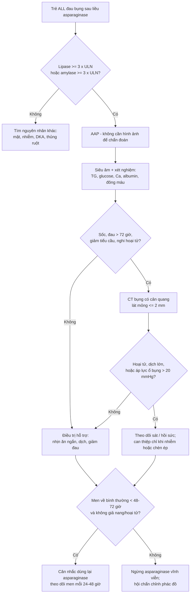
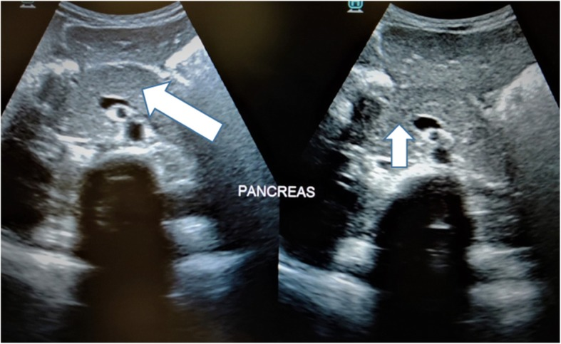
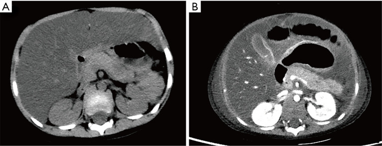
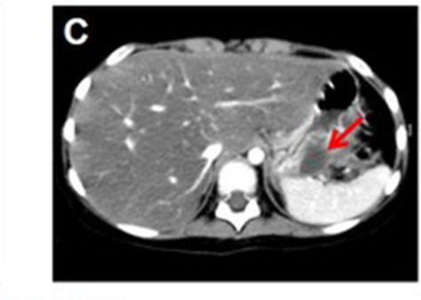
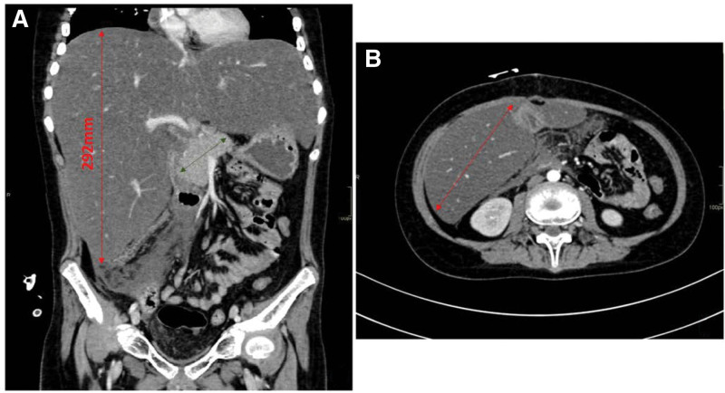

# 6171 — Viêm tụy cấp do asparaginase ở trẻ ALL: hình ảnh có thể bình thường sớm và quyết định dùng lại thuốc / Asparaginase-associated pancreatitis in paediatric ALL

**Tags:** `pattern:viem-tuy` `pattern:phu-tuy` `pattern:hoai-tu-tuy` `pattern:gia-nang-tuy` `pattern:tu-dich-quanh-tuy` `vung:tuy` `vung:o-bung` `protocol:sieu-am-bung` `protocol:CT-bung-co-can-quang` `protocol:MRI-bung` `score:Ponte-di-Legno` `score:CTSI` `score:CTCAE`

**Mức chắc chắn (certainty):** tổng hợp y văn (literature synthesis) — ghép dữ liệu từ **2.448 bệnh nhân ALL 1–45 tuổi** (NOPHO ALL2008, *J Clin Oncol* 2020, **PMC6953441**), **4.925 trẻ** hai thử nghiệm COG (AALL0232/AALL0434, *Blood Adv* 2026, **PMC13382259**), **474 trẻ** Hà Bắc (**PMC12480329**), **353 trẻ** Đài Loan (**PMID 34718353**), **322 trẻ** Ả Rập Xê Út (**PMC12398873**), **352 trẻ** Trung Quốc (**PMC13226028**), tổng quan *Haematologica* 2026 (**PMC12775779**), 3 ca nguyên văn có ảnh (**PMC12163796**, **PMC11573588**, **PMC10489477**, **PMC7236281**). Không có thử nghiệm ngẫu nhiên về **dùng lại asparaginase**; các ngưỡng dùng lại là đồng thuận, chỗ suy luận được ghi rõ.

> **Câu chốt:** viêm tụy do asparaginase (asparaginase-associated pancreatitis, **AAP**) là biến cố **quyết định sống còn của phác đồ**, không chỉ là "đau bụng do hóa trị": **(1)** gặp ở **1–7,4%** trẻ ALL, tăng theo tuổi — **7,0%** ở 1–9,9 tuổi, **10,1%** ở 10–17,9 tuổi (NOPHO); **(2)** khởi phát **trung vị 10,5 ngày** (1–26 ngày) sau liều PEG-asparaginase, sau **trung vị 3–5 liều**; **(3)** **hình ảnh có thể âm tính** đúng lúc cần chẩn đoán — CT chỉ dương **25%**, siêu âm **43%** trong một đoàn hệ 322 trẻ, và một ca CT ngày 14 chỉ "giảm tỷ trọng nhẹ đuôi tụy, thể tích không tăng" nhưng ngày 22 đã **hoại tử tụy**; **(4)** **giả nang xuất hiện 26–27%** (tới 60%), **hoại tử trong tuần đầu 27,9%**, nên câu hỏi thật là **theo dõi gì sau đợt cấp** và **có dùng lại thuốc hay không**.

> **Phân vai với bài khác:** [6135](../6135-viem-tuy-cap-o-tre/lesson.md) phủ **viêm tụy cấp ở trẻ nói chung** (INSPPIRE, NASPGHAN, ARP/CP), [6136](../6136-viem-tuy-do-thuoc-o-tre/lesson.md) phủ **bảng Badalov – thuốc nào gây tụy**. Bài này **chỉ đi sâu chuỗi quyết định của AAP**: thời điểm – hình ảnh âm tính sớm – phân độ – theo dõi di chứng – **dùng lại hay bỏ asparaginase**.

## 1. Tổng quan bệnh học – cơ chế hình ảnh (TẠI SAO hình ảnh đến muộn)

### 1.1 Asparaginase giết tế bào nang tụy bằng cách nào

- Asparaginase (L-asparaginase *E. coli*, pegaspargase, *Erwinia*) thủy phân asparagine huyết tương → **ức chế tổng hợp protein** ở mọi tế bào, nhưng **tế bào nang tụy** có tốc độ tổng hợp enzym tiêu hóa rất cao nên **nhạy nhất**: hết protein để đóng gói enzym → không bào hóa, rối loạn bài tiết, rồi **tự tiêu hóa mô tụy** (autodigestion). Đây là **độc tính của bản thân phân tử asparaginase**, không phải của tá dược — đổi sang *Erwinia* chủ yếu để xử lý **dị ứng**, không được chứng minh là hết nguy cơ viêm tụy *(suy luận từ cơ chế; chưa có thử nghiệm so sánh tỷ lệ AAP giữa các chế phẩm)*.
- **Đường thứ hai — tăng triglyceride:** asparaginase làm tăng VLDL và giảm hoạt tính lipoprotein lipase → **tăng triglyceride máu**, có khi **> 1.000 mg/dL**, tự nó gây viêm tụy. Ca nguyên văn dưới đây có **TG 8,63 mmol/L (~763 mg/dL)** đúng lúc chẩn đoán.
- **Đường thứ ba — huyết khối vi mạch:** asparaginase giảm antitrombin III và fibrinogen → **vi huyết khối** trong mao mạch tụy, làm **hoại tử không ngấm thuốc** rõ hơn là phù đơn thuần.
- **TẠI SAO hình ảnh đến muộn:** chẩn đoán viêm tụy cấp là **chẩn đoán lâm sàng – sinh hóa** (đau + lipase ≥ 3 × ULN + hình ảnh, cần **≥ 2/3** theo đồng thuận Ponte di Legno). Trong 24–72 giờ đầu, tổn thương là **phù kẽ** — chênh lệch tỷ trọng với nhu mô lành chỉ vài HU, dưới ngưỡng nhìn thấy của CT không cản quang; **hoại tử** mới tạo ra vùng giảm tỷ trọng rõ và **dịch quanh tụy** mới đẩy mỡ quanh tụy thành các dải tăng tỷ trọng. Vì vậy **CT bình thường trong 48–72 giờ đầu KHÔNG loại trừ AAP**.

### 1.2 Ngưỡng định lượng phải nhớ (Ponte di Legno 2016 / Atlanta 2012)

| Mốc | Ngưỡng / định nghĩa | Ý nghĩa thực hành |
|---|---|---|
| Chẩn đoán AAP | **≥ 2/3**: (1) đau bụng điển hình; (2) amylase/lipase **≥ 3 × ULN**; (3) hình ảnh (US/CT/MRI) phù hợp | **Không cần hình ảnh** nếu đã có đau + men ≥ 3 × ULN |
| Cửa sổ thời gian | trong **4 tuần (28 ngày)** sau liều asparaginase gần nhất; nhiều trung tâm dùng **35 ngày** | Đau bụng sau 6 tuần **không** quy cho asparaginase nếu không có bằng chứng khác |
| Hình ảnh dương | **CT 25%**, **siêu âm 43%** ở 322 trẻ (Ả Rập Xê Út) | Ưu tiên **siêu âm trước**; CT khi nghi biến chứng |
| Hoại tử sớm | **27,9%** (12/43) hoại tử **trong tuần đầu**; **39,5%** (17/43) có suy tạng hoặc hoại tử | CT có cản quang **sớm** nếu sốc/giảm tiểu cầu/tăng CRP mạnh |
| Giả nang | **26%** trung bình (tới **60%**), NOPHO **27%** (45/167) | Siêu âm/MRI theo dõi **≥ 4 tuần** sau đợt cấp |
| Men kéo dài | lipase vẫn **≥ 3 × ULN sau 72 giờ** ở **22/47** ca | Là tiêu chí **AAP nặng**, quyết định không dùng lại thuốc |

## 2. Mẫu hình + chẩn đoán phân biệt theo vị trí (gamut)

### 2.1 Mẫu hình trên từng phương thức

- **Siêu âm (đầu tay):** tụy **to, giảm âm, đều** (phù) ± **dải tăng âm quanh tụy** (thâm nhiễm mỡ) ± dịch quanh tụy. Ca *BMC Pediatr* 2020 (**PMC7236281**) là ví dụ trơn: "tụy to nhẹ, giảm âm đều, ống tụy chính bình thường, thâm nhiễm mỡ tối thiểu" ở trẻ **đái tháo đường nhiễm toan ceton** đang dùng asparaginase — tức **cùng một hình ảnh, hai nguyên nhân**.
- **CT có cản quang:** phù lan tỏa hoặc **ổ giảm tỷ trọng** (hoại tử), **dịch quanh tụy**, dày cân Gerota, **tụ máu sau phúc mạc**; đánh giá **hoại tử** và **biến chứng** tốt hơn siêu âm, nhưng **không dùng để loại trừ sớm**.
- **MRI/MRCP:** ống tụy, nang – hoại tử có vách, **không bức xạ** — hợp trẻ cần chụp lặp; MRCP để loại trừ **tắc mật/pancreas divisum** khi tái phát.

### 2.2 Gamut theo **bối cảnh** (trẻ đang điều trị ALL, đau bụng)

1. **AAP** — sau liều asparaginase **1–4 tuần**, đau thượng vị lan sau lưng, nôn; men tụy tăng; có thể kèm **tăng TG, tăng đường huyết, huyết khối**.
2. **Viêm tụy do corticoid** (giai đoạn induction) — cùng phác đồ, không có mốc liều asparaginase; thường **nhẹ**, men tăng vừa.
3. **Tăng triglyceride đơn thuần** (bài [684](../684-tang-triglyceride-asparaginase-all-nhi/lesson.md)) — tụy có thể **chưa viêm**; TG rất cao, huyết thanh đục; chẩn đoán bằng TG chứ không bằng men.
4. **Bệnh mật – sỏi/túi mật cấp** (bài [6146](../6146-soi-tui-mat-o-tre/lesson.md)) — đau hạ sườn phải, siêu âm thành túi mật dày, sỏi; amylase có thể tăng nhẹ.
5. **Nhiễm trùng** (Coxsackie, Mycoplasma, mumps, SARS-CoV-2) — sốt, đau lan tỏa, dịch kẽ; dịch tễ.
6. **Thâm nhiễm bạch cầu/tái phát u** — tụy **to không đều, khối**, không đau điển hình; đáp ứng kém với nhịn ăn; cần tế bào học nếu kéo dài.
7. **Thủng ruột/viêm ruột trung tính** (neutropenic enterocolitis) — đau + sốt + giảm bạch cầu hạt; **khí trong thành ruột**, không phải dịch quanh tụy.
8. **Nhiễm toan ceton do đái tháo đường** (do corticoid/asparaginase) — đau bụng + nôn + thở nhanh; **amylase/lipase có thể tăng nhẹ** do cô đặc máu → dễ chẩn đoán nhầm AAP.

### 2.3 Gamut theo **vị trí tổn thương trên CT**

- **Đầu tụy:** AAP, sỏi ống mật chủ, u đầu tụy (hiếm ở trẻ).
- **Thân/đuôi tụy:** AAP (ổ giảm tỷ trọng đuôi tụy là vị trí hay gặp trong ca nặng), tăng TG, viêm tụy do thuốc khác.
- **Quanh tụy – hậu cung mạc nối (lesser sac):** dịch cấp (APFC), giả nang, hoại tử có vách (WON), **áp-xe** (có khí).
- **Rãnh tá tràng – mạc treo:** dịch lan xuống **hố chậu phải** → đau giống viêm ruột thừa (cạm bẫy số 1 ở trẻ).

## 3. Bảng so sánh phân biệt (ma trận đối chiếu)

| Thực thể (entity) | Hình ảnh điển hình | Chốt vào (rule-in) | Chốt loại (rule-out) | Gợi ý xác nhận |
|---|---|---|---|---|
| **AAP** | Tụy phù lan tỏa hoặc **ổ giảm tỷ trọng**; dịch quanh tụy; có thể **bình thường** < 72 giờ | **Đau thượng vị + lipase ≥ 3 × ULN trong 4 tuần sau liều asparaginase** | Hình ảnh bình thường **không** loại trừ; đau – men bình thường sau 6 tuần → nghĩ nguyên nhân khác | Lipase, TG, glucose; US trước, CT khi nặng |
| **Viêm tụy do corticoid** | Phù nhẹ, ít dịch, không hoại tử | Đang induction corticoid, **không có mốc liều asparaginase**, men tăng vừa | Không có đau điển hình + men < 3 × ULN → không chẩn đoán | Ngừng/tạm giảm corticoid, theo dõi men 48 giờ |
| **Tăng triglyceride máu** | Tụy bình thường hoặc phù; **huyết thanh đục**, CT mỡ gan | **TG > 1.000 mg/dL** (ngưỡng gây viêm tụy) ± đau | TG < 500 mg/dL → không quy cho TG | TG, cholesterol, lipase; bài 684 |
| **Sỏi/túi mật cấp** | Sỏi, thành túi mật **≥ 3 mm**, dịch quanh túi mật, ống mật chủ giãn | **Sỏi + thành túi mật dày + Murphy siêu âm** | Không sỏi, ống mật không giãn → ít nghĩ mật | Siêu âm, MRCP nếu men gan tăng |
| **Thủng ruột/viêm ruột trung tính** | **Khí trong thành ruột**, thành ruột dày, dịch tự do; không có phù tụy | **Khí ngoài lòng ruột + giảm bạch cầu hạt + sốt** | Không khí tự do, tụy bình thường → loại | CT bụng có cản quang, X-quang đứng |
| **Giả nang tụy** (biến chứng, không phải chẩn đoán khác) | Ổ dịch **đồng nhất, thành mỏng, ≤ 15 HU**, **≥ 4 tuần** sau đợt cấp, **không có mảnh hoại tử** | **Ổ dịch đơn thuần + vách + ≥ 4 tuần + không hoại tử** | Có mảnh đặc không ngấm thuốc bên trong → **WON**, không phải giả nang | US/MRI; amylase dịch rất cao |
| **Hoại tử có vách (WON)** | Ổ dịch **không đồng nhất**, mảnh hoại tử **20–40 HU không ngấm thuốc**, vách dày | **Mảnh đặc trong ổ dịch ≥ 4 tuần** | Ổ dịch thuần nhất → giả nang | CT/MRI; chỉ can thiệp khi nhiễm/ chèn ép |

**Ba dấu hiệu định vị giúp đọc đúng trên mặt cắt ngang**

- **Dịch quanh tụy vs dịch màng phổi:** dịch trong **túi mạc nối** nằm **trước thận trái, sau dạ dày**; dịch màng phổi nằm **ngoài cơ hoành**, có **dấu crus** và không đẩy dạ dày ra trước.
- **Dịch quanh tụy vs dịch tự do (ascites):** dịch tự do chảy vào **rãnh gan–thận (Morison)** và **túi cùng Douglas**; dịch tụy **khu trú quanh tụy**, đẩy dạ dày ra trước và **không** lấp đầy rãnh gan–thận.
- **Giả nang vs nang tụy thật:** nang thật có **biểu mô**, thường **đa ổ, thành mỏng, không liên quan đợt cấp**; giả nang xuất hiện **sau đợt đau cấp**, amylase dịch rất cao.

## 4. Protocol chụp + hệ phân độ/điểm chuẩn hóa

### 4.1 Protocol thực hành (theo thứ tự, không chụp thừa)

1. **Siêu âm bụng** ngay khi nghi AAP: tụy to/giảm âm, dịch quanh tụy, **túi mật – ống mật** (loại trừ nguyên nhân mật). Không cần nhịn ăn trước ở trẻ nhỏ.
2. **X-quang bụng đứng** nếu nôn nhiều/giảm nhu động: loại trừ **thủng/thoát vị/tắc ruột**, không dùng để chẩn đoán tụy.
3. **CT bụng có cản quang** khi: sốc/giảm tưới máu, đau không giảm sau **48–72 giờ**, nghi **hoại tử/tụ máu**, hoặc cần **đo áp lực ổ bụng**. Lát mỏng **≤ 1–2 mm**, thì tĩnh mạch cửa (55–70 giây), **không** dùng CT để loại trừ AAP sớm.
4. **MRI/MRCP** khi: tái phát, nghi **tắc mật/pancreas divisum**, theo dõi **giả nang/WON** ở trẻ cần chụp lặp (không bức xạ). Chuỗi: T2 fat-sat + DWI + MRCP.
5. **Theo dõi di chứng:** siêu âm lúc ra viện, **4 tuần**, rồi **3 tháng** nếu có giả nang; đo **HbA1c/glucose** và **elastase-1 phân** sau **≥ 3 tháng** nếu đợt nặng (suy tụy nội – ngoại tiết).

### 4.2 Phân độ — ba hệ, đừng trộn

| Hệ | Cách chia | Ngưỡng then chốt | Dùng khi |
|---|---|---|---|
| **Ponte di Legno (AAP)** | AAP **nặng** nếu: suy tạng, hoại tử, giả nang, men **≥ 3 × ULN sau 72 giờ**, cần can thiệp | Men kéo dài **> 72 giờ**; di chứng hình ảnh | Quyết định **không dùng lại** asparaginase |
| **Atlanta 2012 (sửa đổi)** | Nhẹ / trung bình–nặng / nặng | Suy tạng **> 48 giờ** = nặng | Mô tả bệnh cảnh, tiên lượng |
| **CTSI (Balthazar)** | 0–10 điểm: phù 0–2, dịch 0–4, **hoại tử < 30% = 2, 30–50% = 4, > 50% = 6** | **≥ 7** = nặng | Nghiên cứu/so sánh; **chưa chuẩn hóa cho trẻ** |

- **CTCAE v5.0** dùng trong thử nghiệm ALL: viêm tụy **grade 3** = đau nặng, nôn, cần can thiệp; **grade 4** = biến chứng đe dọa tính mạng. Đoàn hệ Ả Rập Xê Út: **56% grade 2, 44% grade 3**.
- **Suy tạng** ở trẻ: dùng tiêu chí **pSOFA**, không dùng SOFA người lớn; **hạ calci máu**, **tăng glucose**, **giảm albumin** là các dấu hiệu nặng sớm.

### 4.3 Sơ đồ quyết định (Mermaid)

### 4.4 Câu hỏi điều trị then chốt: **dùng lại hay bỏ**

- **Chỉ dùng lại** khi: hết đau, **men tụy bình thường trong 48–72 giờ**, **không giả nang**, **không hoại tử**, và đã hội chẩn ung thư nhi. Theo dõi **lipase + lâm sàng mỗi 24–48 giờ** sau liều.
- **Tỷ lệ tái phát khi dùng lại rất cao:** NOPHO **15/34** (44%) bị đợt hai; Hà Bắc **7/17** (41,2%) sau khi dùng lại PEG-asparaginase; tổng quan *Haematologica* ghi nhận **"một nửa"** bệnh nhân tái phát.
- **Bỏ vĩnh viễn** khi: hoại tử, giả nang, suy tạng, men kéo dài **> 72 giờ**, hoặc đợt thứ hai. Đây là quyết định **đánh đổi**: cắt asparaginase làm giảm cường độ phác đồ và **tăng nguy cơ tái phát** trong y văn chung, nhưng trong NOPHO ALL2008 **bản thân AAP và việc cắt asparaginase không làm tăng tái phát** (không có khác biệt có ý nghĩa) — nên **không được tự ý bỏ thuốc mà không hội chẩn**.
- **Điều trị hỗ trợ:** nhịn ăn **ngắn** (không quá 24–48 giờ ở trẻ), dịch tinh thể, giảm đau (kể cả opioid), **không kháng sinh thường quy**; dinh dưỡng qua sonde/TPN nếu không ăn được — trong đoàn hệ *Haematologica*, **30 ca cần TPN, trung vị 23 ngày** (3–153 ngày), nằm viện trung vị **10 ngày**, **11 ca vào ICU**.
- **Can thiệp ổ dịch:** chỉ khi **nhiễm** hoặc **chèn ép** — dẫn lưu qua da/qua nội soi (LAMS) hoặc mổ; **không chọc** giả nang không triệu chứng vì nguy cơ nhiễm và tái phát.

## 5. Biến thể bình thường và cạm bẫy

1. **"CT bình thường nên không phải viêm tụy"** — sai. CT chỉ dương **25%**; ca nguyên văn ngày 14 chỉ có **giảm tỷ trọng nhẹ đuôi tụy, không tăng thể tích**, ngày 22 mới **hoại tử** rõ. **Chẩn đoán bằng lipase**, không bằng hình ảnh.
2. **Đau bụng bị quy cho "táo bón do opioid" hoặc "loét do corticoid"** — bỏ sót AAP. Ở trẻ ALL, **đau thượng vị + nôn sau liều asparaginase** phải đo lipase **ngay**, kể cả khi bụng mềm.
3. **Amylase bình thường trong tăng triglyceride** — huyết thanh đục có thể **ức chế phản ứng đo** amylase/lipase; nếu TG rất cao, pha loãng mẫu hoặc đo lại.
4. **Nhầm viêm tụy với **nhiễm toan ceton** (DKA) — cả hai có đau bụng, nôn, amylase tăng nhẹ; phân biệt bằng **glucose, ceton máu, pH**; ca *BMC Pediatr* 2020 có **cả hai cùng lúc**.
5. **Giả nang xuất hiện muộn** — siêu âm lúc ra viện **bình thường** không có nghĩa là hết; giả nang có thể hình thành sau **≥ 4 tuần**. Hẹn siêu âm lại.
6. **Giả nang vs WON** — ổ dịch **có mảnh đặc bên trong** là **hoại tử có vách**, không phải giả nang; đặt LAMS vào WON chưa trưởng thành làm **chảy máu/nhiễm**.
7. **Bỏ sót hội chứng khoang bụng (ACS)** — bụng chướng + **áp lực ổ bụng > 20 mmHg** + suy tạng mới; dấu **Cullen/Grey Turner** xuất hiện **muộn** (ca nguyên văn: ngày 9). Đo áp lực bàng quang ở trẻ nặng; **mổ giải áp** khi thất bại nội khoa.
8. **Dịch quanh tụy tưởng là cổ trướng** — xem lại mục 3 (dấu giải phẫu); chọc dẫn lưu "cổ trướng" ở trẻ có WON có thể **làm rò tụy ra da**.

## 6. Tự lượng giá — Blind Quiz

**Ca 1 — Bé gái 9 tuổi, B-ALL, ngày 12 sau PEG-asparaginase: đau thượng vị, nôn. Nhìn siêu âm trước.**

- Gợi ý: lipase 1.240 U/L (ULN 60), amylase 480 U/L, TG 3,1 mmol/L.
- Câu hỏi: mô tả dấu hiệu chính? Có cần CT ngay không? Hai chẩn đoán phân biệt hàng đầu?

<b>Bấm để hiện đáp án (findings + chẩn đoán)</b>

- Dấu hiệu: tụy **to nhẹ, giảm âm đều**, bờ mờ, **dải tăng âm quanh tụy** (thâm nhiễm mỡ); ống tụy chính không giãn.
- Chẩn đoán: **AAP** — đau điển hình + lipase **> 20 × ULN** + hình ảnh phù hợp = **3/3 tiêu chí Ponte di Legno**.
- Không cần CT ngay: CT chỉ dương **25%**, không đổi điều trị khi chưa có dấu hiệu nặng; CT khi đau **> 72 giờ**, sốc, hay nghi hoại tử.
- Phân biệt: viêm tụy do **corticoid** (cùng phác đồ, không có mốc liều) và **tăng TG** (TG 3,1 mmol/L chưa đủ ngưỡng > 11,3 mmol/L).
- Nguồn ảnh: *BMC Pediatrics* 2020 (**PMC7236281**), CC BY 4.0 — ca DKA + viêm tụy ở trẻ dùng asparaginase.

**Ca 2 — Bé trai 2 tuổi 11 tháng, B-ALL, ngày 14 sau PEG-asparaginase 2.500 IU/m²: sốc, bụng chướng, chấm xuất huyết hai bên hông. Xem hai thì CT.**

- Gợi ý: lipase 965 U/L, amylase 659 U/L, TG 8,63 mmol/L; ngày 14 CT "giảm tỷ trọng nhẹ đuôi tụy, thể tích không tăng".
- Câu hỏi: vì sao CT đầu gần như bình thường? Dấu hiệu nào trên CT thứ hai? Biến chứng chết người cần đo gì?

<b>Bấm để hiện đáp án (findings + chẩn đoán)</b>

- Ngày 14: **ổ giảm tỷ trọng nhẹ ở đuôi tụy, không tăng thể tích** — phù kẽ dưới ngưỡng nhìn thấy; **không loại trừ AAP**.
- Ngày 22 (có cản quang): **nhiều ổ giảm tỷ trọng không ngấm thuốc** = **hoại tử tụy**, kèm **dịch màng phổi – phúc mạc**.
- Biến chứng: **hội chứng khoang bụng** — phải đo **áp lực bàng quang**; **> 20 mmHg + suy tạng mới** = ACS, cần **mổ giải áp** khi nội khoa thất bại. Dấu **Cullen/Grey Turner** xuất hiện muộn (ngày 9).
- Nguồn ảnh: *Translational Pediatrics* 2025 (**PMC12163796**), CC BY-NC-ND 4.0 — nguyên bản, không cắt ghép.

**Ca 3 — Bé gái 6 tuổi, B-ALL, đợt AAP thứ hai; sau 6 tuần còn đau nhẹ, siêu âm thấy ổ dịch.**

- Gợi ý: ổ dịch **4,2 × 3,5 cm**, đồng nhất, thành mỏng, không mảnh đặc; amylase dịch 12.000 U/L.
- Câu hỏi: chẩn đoán? Vì sao **không** chọc hút ngay? Khi nào can thiệp?

<b>Bấm để hiện đáp án (findings + chẩn đoán)</b>

- Dấu hiệu: **ổ dịch đồng nhất, thành mỏng, không có mảnh đặc**, nằm cạnh đuôi tụy, **≥ 4 tuần** sau đợt cấp.
- Chẩn đoán: **giả nang tụy** (pseudocyst) — không phải WON vì **không có mảnh hoại tử**.
- Không chọc hút ngay: giả nang **không triệu chứng** thường tự tiêu; chọc làm **nhiễm** và **tái phát** (hút đơn thuần tái phát cao).
- Can thiệp khi: **nhiễm, chèn ép (dạ dày/ống mật), tăng kích thước nhanh, đau kéo dài** — dẫn lưu qua da hoặc **LAMS nội soi**.
- Đây cũng là ca có **SPINK1 c.194+2T>C dị hợp** — giải thích vì sao tái phát; xét nghiệm gen khi tái phát.
- Nguồn ảnh: *Frontiers in Pediatrics* 2024 (**PMC11573588**), CC BY 4.0 — **cắt từ Hình 1, khung C** (phần CT), giữ nguyên nội dung.

**Ảnh bổ trợ — CT viêm tụy phù nề không hoại tử (đầu tụy 29 mm, thân 13 mm, đuôi 20 mm, thâm nhiễm mỡ quanh đầu tụy; không có ổ hoại tử)**

- Ở ca này gan cũng **to 292 mm** và giảm tỷ trọng (độc gan do asparaginase/đợt induction) — **đừng chỉ nhìn gan** mà bỏ qua tụy; đây là cạm bẫy "satisfaction of search" điển hình.
- Nguồn: *Medicine (Baltimore)* 2023 (**PMC10489477**), CC BY 4.0.

> **Phản biện trung thực:** các con số **CT dương 25% / siêu âm 43%** đến từ một đoàn hệ hồi cứu **322 trẻ** với chỉ định chụp không đồng nhất — không phải độ nhạy chuẩn; đừng trích như "độ nhạy của CT". Tương tự, **CTSI chưa được chuẩn hóa ở trẻ**, chỉ nên dùng để mô tả.

## Bài liên quan chéo
- [6136 – Viêm tụy cấp do thuốc ở trẻ](../6136-viem-tuy-do-thuoc-o-tre/lesson.md) (bảng Badalov, thời gian tiềm tàng)
- [6135 – Viêm tụy cấp ở trẻ](../6135-viem-tuy-cap-o-tre/lesson.md) (INSPPIRE, NASPGHAN, ARP/CP)
- [684 – Tăng triglyceride do asparaginase ở trẻ ALL](../684-tang-triglyceride-asparaginase-all-nhi/lesson.md)
- [6146 – Sỏi túi mật ở trẻ](../6146-soi-tui-mat-o-tre/lesson.md) (phân biệt đau hạ sườn phải)
- [6105 – Hoại tử xương ở trẻ điều trị ALL](../6105-hoai-tu-xuong-o-tre-dieu-tri-ALL/lesson.md) (độc tính khác của cùng phác đồ)

> Không dùng để chẩn đoán độc lập khi chưa có người hướng dẫn.
