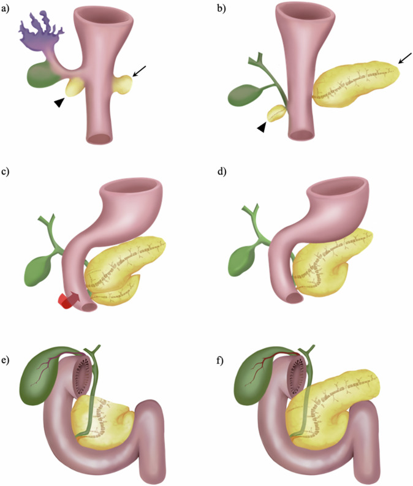
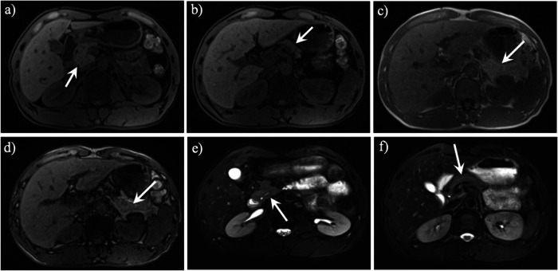
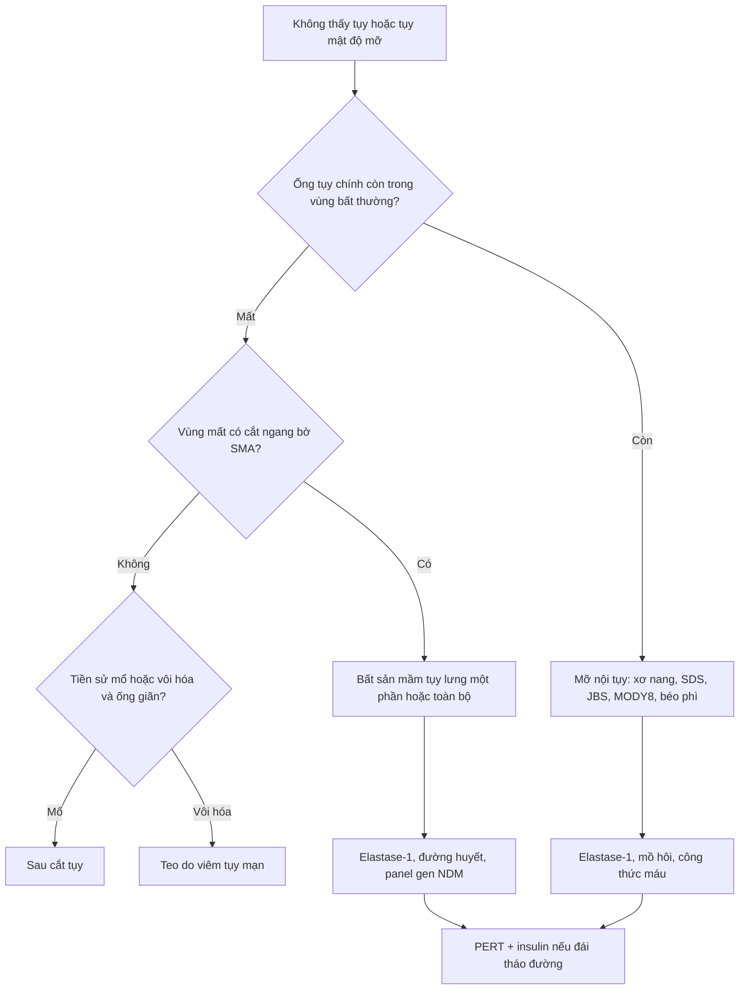
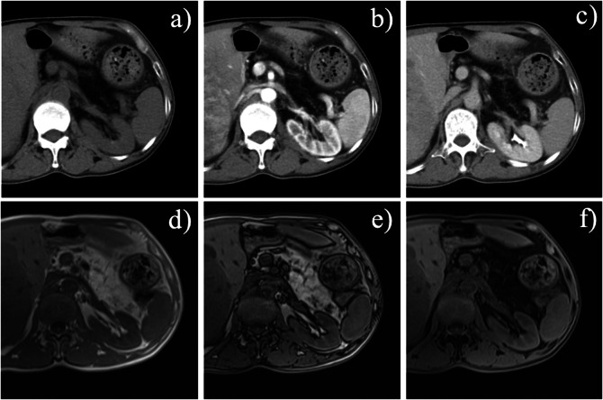
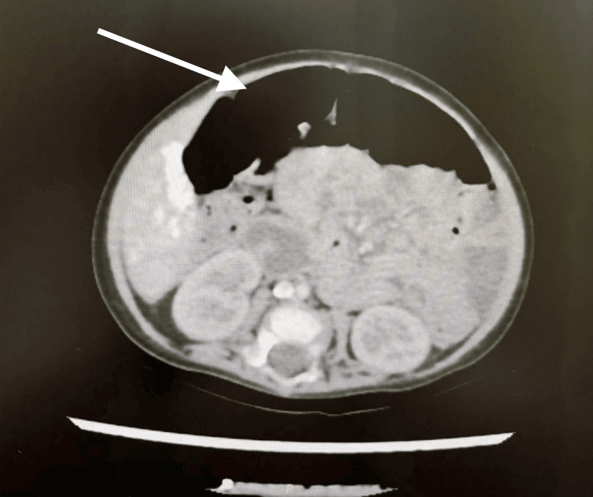

# 6172 — Bất sản/giảm sản tụy bẩm sinh và thiếu lipase đơn thuần: "tụy biến mất" ở trẻ / Congenital pancreatic agenesis–hypoplasia and isolated lipase deficiency

**Tags:** `pattern:khong-thay-tuy` `pattern:mo-thay-tuy` `pattern:teo-tuy` `pattern:suy-tuy-ngoai-tiet` `vung:tuy` `protocol:MRI-tuy` `protocol:MRCP` `protocol:SAT-tre` `score:elastase-1`

**Mức chắc chắn (certainty):** tổng hợp y văn (literature synthesis) — số liệu từ **tổng quan "vanishing pancreas" 2025** (PMC12228938, CC BY 4.0), **ca bất sản tụy toàn bộ do ZNF808** (PMC12698496, CC BY), **đoàn hệ 19 người mang biến thể PDX1** (PMC11575358, CC BY) và **6 trẻ Amish thiếu lipase tụy bẩm sinh do PNLIP** (PMC12475842, CC BY). Nhóm **không có bệnh nhân của mình**.

> **Câu chốt:** "không thấy tụy" trên hình ảnh chỉ có **ba nguyên nhân**, và chỉ một trong ba là **bẩm sinh mất mô**: **(1) bất sản mầm tụy lưng** (chỉ còn đầu–móc, cắt ngang ở bờ **SMA**); **(2) tụy bị mỡ thay/thâm nhiễm** (xơ nang, Shwachman–Diamond, Johanson–Blizzard — **mật độ mỡ nhưng ống tụy còn**); **(3) teo do viêm tụy mạn** (tụy mảnh như sợi chỉ + ống giãn/vôi). Ngoài ra, **thiếu lipase đơn thuần** (PNLIP/CEL) là hình ảnh **hoàn toàn bình thường** — chẩn đoán bằng **elastase-1 phân** và gen. Bốn số phải thuộc: bất sản tụy **toàn bộ < 50 ca** đã công bố; bất sản **mầm lưng MỘT PHẦN ~100 ca**; elastase-1 **< 200 µg/g = suy tụy ngoại tiết** (ca bất sản toàn bộ thường **< 50 µg/g**); trẻ PDX1 có **cân nặng lúc sinh trung vị z = −3,09** và **đái tháo đường khởi phát trung vị 20 ngày tuổi**.

## 1. Tổng quan bệnh học – cơ chế hình ảnh

### 1.1 Phôi thai học: vì sao thiếu chính xác phần thân–đuôi

- **Hai mầm tụy:** vào cuối **tuần thứ 4** phôi thai, **mầm tụy bụng** (ventral bud) mọc từ túi gan và **mầm tụy lưng** (dorsal bud) mọc từ mạc treo lưng (PMC12228938). Mầm bụng xoay ra sau tá tràng rồi **hòa với mầm lưng** ở tuần 6–7.
- **Định mệnh giải phẫu:** **mầm bụng → đầu dưới + móc (uncinate process)**; **mầm lưng → đầu trên, eo, thân, đuôi** và **nhú tá tràng nhỏ (minor papilla) + ống tụy phụ (duct of Santorini)**.
- **Hệ quả:** mầm lưng không phát triển → **mất thân–đuôi**; mầm bụng vẫn còn → **chỉ thấy đầu và móc**, tức **"tụy một nửa"** (partial dorsal agenesis). Mất cả hai mầm → **bất sản toàn bộ** (complete agenesis), hiếm và nặng nhất.
- **TẠI SAO trẻ bất sản toàn bộ lại nhỏ so với tuổi thai:** insulin là **yếu tố tăng trưởng thai chính**; không có tụy nội tiết → **chậm tăng trưởng trong tử cung**. Đoàn hệ PDX1: **17/17** trẻ có số liệu đều **nhỏ so với tuổi thai**, trung vị **z = −3,09** (khoảng −4,51 đến −1,65) (PMC11575358).
- **TẠI SAO thiếu lipase đơn thuần không biểu hiện ở sơ sinh:** **PNLIP** (lipase triglyceride tụy) rất thấp lúc mới sinh; **CEL** (carboxyl ester lipase) trong **sữa mẹ** và **PNLIPRP2** bù trừ. Vì vậy bệnh **khởi phát muộn ở cuối năm đầu** khi trẻ chuyển sang ăn đặc — đúng mô tả của thể PNLIP (OMIM #614338) (PMC12475842).

### 1.2 Vì sao hình ảnh thấy "tụy biến mất" — vật lý của mỡ, nước và protein

- **CT:** tụy bình thường **30–40 HU** chưa cản quang (mô đặc, nhiều protein enzym); **mỡ −40 đến −120 HU**. Khi nhu mô bị mỡ thay, vùng tụy **trùng mật độ mỡ sau phúc mạc** → mắt thường đọc là "không có tụy".
- **MRI T1 không bão hòa mỡ:** tụy bình thường **tăng tín hiệu** do **protein trong tế bào nang** (nước liên kết protein → T1 ngắn); mỡ cũng sáng trên T1 thường. Vì vậy **T1 fat-sat** mới phân biệt: **tụy thật vẫn sáng, mỡ tối** (PMC12228938).
- **MRI in-phase/out-of-phase (chemical shift):** mỡ vi thể trong nhu mô → **mất tín hiệu ở out-of-phase**; đây là dấu khách quan của **mỡ nội tụy (intra-pancreatic fat deposition, IPFD)**, không phải mất mô (PMC12228938).
- **MRCP:** mầm lưng mất → **ống tụy chính ở thân–đuôi không hiện**; ống tụy phụ cũng mất. Ngược lại, trong **IPFD ống tụy vẫn còn** — đây là chốt phân biệt quan trọng nhất (PMC12228938).
- **TẠI SAO "mất mô" chứ không phải "teo":** trong bất sản, **không có ống tụy** trong vùng vắng mô và **không có mô xơ thay thế**; trong teo do viêm mạn, ống còn nhưng **giãn, gấp khúc** và có **vôi hóa** (PMC12228938).

### 1.3 Các con số quyết định

- **Bất sản mầm lưng:** thể **một phần ~100 ca** đã báo cáo; đa số **không triệu chứng**, đái tháo đường gặp ở thể **toàn bộ** (PMC12228938).
- **Bất sản tụy toàn bộ:** **< 50 ca** xác nhận trên toàn thế giới, mô tả từ thập niên 1960 (PMC12698496).
- **Mỡ nội tụy (IPFD):** tỷ lệ **16–35%** dân số trưởng thành; là cơ chế "tụy biến mất" phổ biến nhất (PMC12228938).
- **Xơ nang (CF):** **~80%** bệnh nhân có suy tụy ngoại tiết (PMC12228938).
- **Shwachman–Diamond (SDS):** giảm bạch cầu trung tính + **mỡ thay tụy** + **loạn sản sụn–xương (metaphyseal dysplasia)**.
- **Johanson–Blizzard (JBS):** đột biến **UBR1**, **bất sản/giảm sản cánh mũi** + suy tụy ngoại tiết bẩm sinh.
- **MODY8:** đột biến **CEL** — vừa **suy ngoại tiết** vừa **đái tháo đường** (nối trực tiếp với nhóm thiếu lipase).
- **PDX1 (đoàn hệ 19 người):** đái tháo đường **vĩnh viễn 100%**, chẩn đoán trung vị **20 ngày tuổi** (1–181 ngày), insulin **0,93 U/kg/ngày** (0,2–2,5); **63,2%** có bất thường ngoài tụy, **42%** bất thường tá tràng/gan–mật; **3/19 tử vong < 1 tuổi** (PMC11575358). Lưu ý **2/3 anh chị em cùng gia đình có elastase bình thường (> 200 µg/g)** — tức bất sản **không luôn** kèm suy ngoại tiết.
- **Bất sản toàn bộ (ca ZNF808):** sinh 38 tuần, **1,3 kg** (< bách phân vị 3), **elastase phân < 50 µg/g** (bình thường > 200), đái tháo đường sơ sinh cần insulin (PMC12698496).

## 2. Mẫu hình + chẩn đoán phân biệt theo hình thái (gamut)

Mẫu hình cần nhận: **trẻ nhỏ chậm tăng trưởng + phân mỡ (steatorrhea) + đường huyết cao hoặc hạ đường huyết**, hình ảnh **không thấy tụy một phần/toàn bộ** hoặc **tụy mật độ mỡ**.

- **Chỉ còn đầu–móc, cắt ở bờ SMA** → **bất sản mầm lưng** (một phần hoặc toàn bộ); tìm **đa lách (polysplenia), situs inversus, bất thường mạch, u/túi giả tụy** đi kèm (PMC12228938).
- **Toàn bộ vùng tụy là mỡ, ống tụy còn** → **IPFD**: xơ nang, SDS, JBS, MODY8, béo phì/chuyển hóa; ở trẻ còn phải loại **teo do suy dinh dưỡng nặng**.
- **Tụy mảnh như sợi chỉ + ống giãn/vôi hóa** → **viêm tụy mạn** (khác hoàn toàn bẩm sinh; thường đau tái diễn).
- **Không thấy tụy + sẹo mổ/kẹp phẫu thuật** → **sau cắt tụy** (Whipple, cắt đuôi); đọc sai thành bẩm sinh nếu không hỏi tiền sử.
- **Tụy bình thường trên hình ảnh nhưng phân mỡ** → **thiếu enzym đơn thuần** (PNLIP, CEL) hoặc **suy tụy ngoại tiết "chức năng"**; đây là nhóm **không chẩn đoán được bằng hình ảnh**.
- **Tụy to, không đồng nhất, đường huyết cao ở trẻ** → nghĩ **viêm tụy cấp** hoặc **tụy chủ mô**, không phải bất sản.

*Hình 1 của tổng quan: mầm bụng (đầu mũi nhọn) và mầm lưng (mũi tên) hợp nhất; (e) mất hoàn toàn thân–đuôi; (f) mất một phần. Nguồn: Qin Y et al, *Insights Imaging* 2025 (PMC12228938), CC BY 4.0.*

## 3. Bảng so sánh phân biệt (ma trận đối chiếu)

| Thực thể (entity) | Hình ảnh điển hình | Chốt vào (rule-in) | Chốt loại (rule-out) | Gợi ý xác nhận |
|---|---|---|---|---|
| **Bất sản mầm tụy lưng (một phần)** | MRI/CT: **chỉ đầu + móc** dừng ở **bờ SMA**, thân–đuôi vắng; **không ống tụy** ở vùng vắng; vùng đó là mỡ | **Cấu hình "tụy bụng đơn độc" cắt ngang bờ SMA**, mất mẫu ống "xương cá" | Ống tụy còn chạy trong vùng mỡ → **IPFD**, không phải bất sản | MRI T1 fat-sat + MRCP; tìm đa lách/situs |
| **Bất sản tụy toàn bộ** | **Không thấy nhu mô tụy** ở bất kỳ lát nào; túi mật/tá tràng bình thường | **Đái tháo đường sơ sinh + elastase < 50 µg/g** + không thấy tụy | Có đầu tụy → bất sản một phần | Gen **PDX1/PTF1A/GATA6/ZNF808/CNOT1** |
| **Mỡ nội tụy / CF / SDS / JBS** | Tụy **mật độ mỡ**, **ống tụy CÒN**; in/out-phase **mất tín hiệu**; CF có giãn phế quản, SDS có loạn sản sùn | **Mỡ nội tụy + ống còn + elastase thấp** | Mất ống + cắt ở SMA → bất sản | Mồ hôi (CF), công thức máu (SDS), gen UBR1 (JBS) |
| **Teo do viêm tụy mạn** | Tụy **mảnh như sợi chỉ**, **ống giãn/gấp khúc**, **vôi hóa**, túi giả | **Vôi hóa + ống giãn + đau tái diễn** | Ống bình thường, không vôi → không phải viêm mạn | MRCP; CA19-9 nếu nghi ung thư |
| **Thiếu lipase đơn thuần (PNLIP)** | **Tụy bình thường** về kích thước, mật độ, ống | **Phân mỡ + elastase thấp + hình ảnh bình thường** | Có bất thường cấu trúc → không phải thể đơn thuần | Gen **PNLIP/CEL**, vitamin tan mỡ |
| **Sau cắt tụy** | Mất phần tụy **theo giải phẫu mổ**, có **kẹp/anastomosis** | **Tiền sử mổ** + mất mô theo vùng | Mất mô không theo vùng mổ → bẩm sinh | Hỏi tiền sử, so phim cũ |

*Hình 2: (a,b) T1 fat-sat — đầu/eo còn; (c,d) in/out-phase — vùng thân–đuôi là mỡ; (e,f) T2 — chỉ thấy ống tụy ở đầu/eo, ống đuôi mất. Nguồn: Qin Y et al (PMC12228938), CC BY 4.0.*

## 4. Protocol chụp + xét nghiệm + phân độ

### 4.1 Siêu âm (đầu tay ở trẻ)

- **Nhịn ăn 3–4 giờ**, đầu dò linear tần số cao, lát ngang thượng vị qua **động mạch chủ → SMA → tĩnh mạch lách**.
- **Bẫy sinh lý:** tụy sơ sinh **tăng âm hơn gan** và **rất mảnh** — không được gọi "mỡ thay" chỉ vì tụy sáng; và **hơi ruột** có thể che hoàn toàn thân–đuôi → **"không thấy" trên siêu âm không phải "không có"**.
- **Đo:** bề dày đầu/eo, sự hiện diện ống tụy chính (đường **echo dày 1–2 mm** trong thân tụy), và **đuôi tụy trước lách**.

### 4.2 MRI/CT (khi siêu âm không kết luận)

- **MRI 3T, nhịn ăn 4 giờ:** **T1 3D fat-sat** (nhu mô tụy sáng), **T2**, **in-phase/out-of-phase** (mỡ vi thể), **DWI**, **MRCP** (ống chính + ống phụ) (PMC12228938).
- **CT:** chưa cản quang + thì tĩnh mạch cửa, lát **≤ 2 mm**; đo **HU** vùng tụy để chứng minh mật độ mỡ; tìm **đa lách, situs inversus, bất thường mạch**, và **u/túi giả** đi kèm.
- **Ba dấu chốt của bất sản mầm lưng:** (1) cấu hình **tụy bụng đơn độc** dừng ở **bờ SMA**; (2) **không nhu mô lưng** ngoài mặt phẳng SMA; (3) **mất mẫu ống "xương cá" (herringbone)** (PMC12228938).

### 4.3 Xét nghiệm

- **Elastase-1 phân:** **< 200 µg/g = suy tụy ngoại tiết**; **< 100 µg/g = nặng**; ca bất sản toàn bộ thường **< 50 µg/g**. Elastase là enzym **người**, PERT không làm sai kết quả (chi tiết ở bài 6168).
- **Loại trừ xơ nang:** **mồ hôi (sweat chloride)** hoặc gen **CFTR** — bắt buộc trước khi kết luận "bẩm sinh không do CF".
- **Vitamin tan mỡ A/D/E/K + INR**, albumin, kẽm; **cân nặng/chiều cao** theo tuổi.
- **Đái tháo đường sơ sinh:** glucose, HbA1c, C-peptide; **panel gen NDM** (PDX1, PTF1A, GATA6, ZNF808, CNOT1, HNF1B, INS, KCNJ11, ABCC8).
- **Không có "điểm phân độ" cho bất sản tụy** — mô tả **một phần vs toàn bộ** là đủ cho quyết định điều trị; phân độ nặng dựa vào **elastase + tăng trưởng + đường huyết**.

### 4.4 Điều trị (khung)

- **PERT suốt đời** (chi tiết liều theo bài 6168): chỉnh theo **phân, cân nặng, vitamin tan mỡ**, không theo con số elastase.
- **Insulin** cho đái tháo đường sơ sinh; theo dõi **hạ đường huyết** khi trẻ nhỏ.
- **Bổ sung vitamin tan mỡ**, theo dõi **tăng trưởng và phát triển thần kinh**.
- **Tầm soát đi kèm:** siêu âm tim (GATA6), thận–tiết niệu, cột sống, và **đa lách/situs** khi có bất sản mầm lưng.

## 5. Biến thể bình thường và cạm bẫy

- **Tụy sơ sinh "sáng" là bình thường:** nhu mô tụy ở trẻ nhỏ **tăng âm hơn gan** do ít mỡ và nhiều mô đặc; gọi "mỡ thay toàn bộ" ở sơ sinh là **overcall**.
- **Hơi ruột che thân–đuôi** trên siêu âm → tưởng bất sản; cho **nhịn ăn** và đổi tư thế, hoặc chuyển MRI.
- **Bất sản mầm lưng + đa lách:** luôn **đếm lách** và tìm **situs inversus** — bỏ sót làm mất thông tin tiên lượng và phẫu thuật (PMC12228938).
- **Tụy mỡ nhưng elastase bình thường** (người lớn béo phì, MASLD): **không mở PERT dài hạn** chỉ vì hình ảnh.
- **Bất sản một phần không luôn kèm suy ngoại tiết:** trong đoàn hệ PDX1, **2/3 anh chị em** có elastase **> 200 µg/g** — hình ảnh và enzym **không đồng hành tuyệt đối** (PMC11575358).
- **Giả u/túi giả:** bất sản mầm lưng có thể kèm **túi giả tụy** hoặc **u thực thể**; khối không ngấm thuốc cạnh vùng vắng tụy dễ bị đọc là "tụy lạc chỗ" (PMC12228938).
- **CA19-9 không dùng để chẩn đoán bất sản:** ngưỡng **> 40 U/mL** chỉ có giá trị phân biệt **viêm tụy mạn vs ung thư** (độ đặc hiệu **90%**, độ nhạy **81%**) (PMC12228938).

*Hình 9: mỡ nội tụy ở bệnh nhân 50 tuổi — ống tụy vẫn hiện, khác bất sản mầm lưng. Nguồn: Qin Y et al (PMC12228938), CC BY 4.0.*

*Ca bất sản toàn bộ do ZNF808: CT lúc 7 tháng tuổi không thấy tụy; trẻ có đái tháo đường sơ sinh và elastase < 50 µg/g. Nguồn: Alshareef F et al, *Cureus* 2025 (PMC12698496), CC BY 4.0.*

## 6. Tự lượng giá — Blind Quiz

**Ca 1 — Bé trai sinh 38 tuần, 1,3 kg, hạ đường huyết ngày 3, phân mỡ khi bắt đầu ăn đặc.**

- Hỏi: hình ảnh gợi ý gì? Hai xét nghiệm chốt? Chẩn đoán phân biệt với CF?

<b>Bấm để hiện đáp án</b>

- **Bất sản tụy toàn bộ**: không thấy nhu mô tụy ở mọi lát; trẻ **nhỏ so với tuổi thai** vì thiếu insulin.
- **Elastase-1 phân < 50 µg/g** + **panel gen NDM** (PDX1/PTF1A/GATA6/ZNF808) là hai xét nghiệm chốt; thêm **siêu âm tim** (GATA6).
- CF **loại bằng mồ hôi bình thường** và hình ảnh tụy **có mô/mỡ nhưng ống còn**, không "mất toàn bộ".
- Nguồn ảnh: Alshareef F et al (PMC12698496), CC BY 4.0.

**Ca 2 — Nam 48 tuổi, đau bụng mơ hồ, MRI thấy chỉ đầu/eo tụy, thân–đuôi là mỡ.**

- Hỏi: ba dấu hiệu chốt bất sản mầm lưng? Cần tìm gì đi kèm? Vì sao không gọi là "teo tụy"?

<b>Bấm để hiện đáp án</b>

- Ba dấu: **cấu hình tụy bụng đơn độc dừng ở bờ SMA**, **không nhu mô ngoài mặt phẳng SMA**, **mất mẫu ống xương cá**; MRCP không thấy ống thân–đuôi.
- Tìm **đa lách, situs inversus, bất thường mạch, túi giả/u** — bất sản mầm lưng hay đi kèm polysplenia.
- **Không gọi teo** vì teo do viêm mạn còn **ống giãn + vôi hóa**; ở đây ống **mất hẳn** và không có vôi.
- Nguồn ảnh: Qin Y et al (PMC12228938), CC BY 4.0.

**Ca 3 — Trẻ 14 tháng, phân mỡ, chậm tăng trưởng; siêu âm và MRI tụy bình thường; elastase 60 µg/g.**

- Hỏi: hình ảnh bình thường loại trừ được gì? Chẩn đoán nào còn lại? Xét nghiệm nào chốt?

<b>Bấm để hiện đáp án</b>

- Hình ảnh **bình thường loại trừ bất sản/teo/mỡ thay**, **không loại trừ thiếu enzym**.
- Nghĩ **thiếu lipase tụy bẩm sinh (PNLIP, OMIM #614338)** hoặc **CEL/MODY8** — bệnh **khởi phát cuối năm đầu** vì PNLIP thấp lúc sinh và được CEL trong sữa mẹ bù.
- Chốt bằng **gen PNLIP/CEL** + **vitamin tan mỡ**; elastase thấp **không phân biệt** nguyên nhân, chỉ xác nhận suy ngoại tiết.
- Nguồn số liệu: Curry GE et al (PMC12475842), CC BY; ảnh minh họa mỡ nội tụy từ Qin Y et al (PMC12228938) — **không phải ảnh của ca này**.

## Bài liên quan chéo
- [6168 – Suy tụy ngoại tiết ở trẻ: elastase-1](../6168-suy-tuy-ngoai-tiet-tre-elastase-1/lesson.md)
- [6152 – Viêm tụy mạn ở trẻ](../6152-viem-tuy-man-o-tre/lesson.md)
- [600 – Tổng quan Nhi khoa](../600-tong-quan-nhi-khoa/lesson.md)
- [6154 – Sỏi mật ở trẻ bệnh tan máu](../6154-soi-mat-o-tre-benh-tan-mau/lesson.md)
- [3048 – U máu gan ở nhũ nhi](../3048-u-mau-gan-o-nhu-nhi/lesson.md) (bối cảnh chẩn đoán hình ảnh bụng ở nhũ nhi)

## Ảnh
- `images/6172_phoi-thai_Fig_PMC12228938.jpg`, `images/6172_dorsal-agenesis_MRI_PMC12228938.jpg`, `images/6172_mo-tuy_CT-MRI_PMC12228938.jpg` — CC BY 4.0.
- `images/6172_bat-san-tuy_CT_PMC12698496.jpg` — CC BY 4.0.
- Nguồn + giấy phép từng ảnh: `images/CREDITS.md`.

> Không dùng để chẩn đoán độc lập khi chưa có người hướng dẫn.
