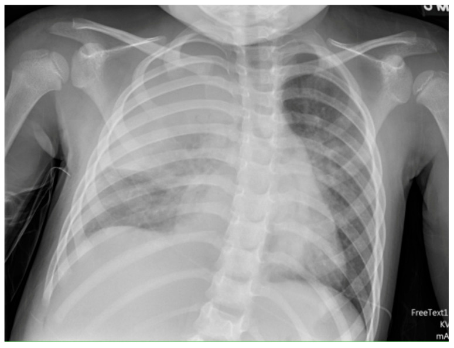
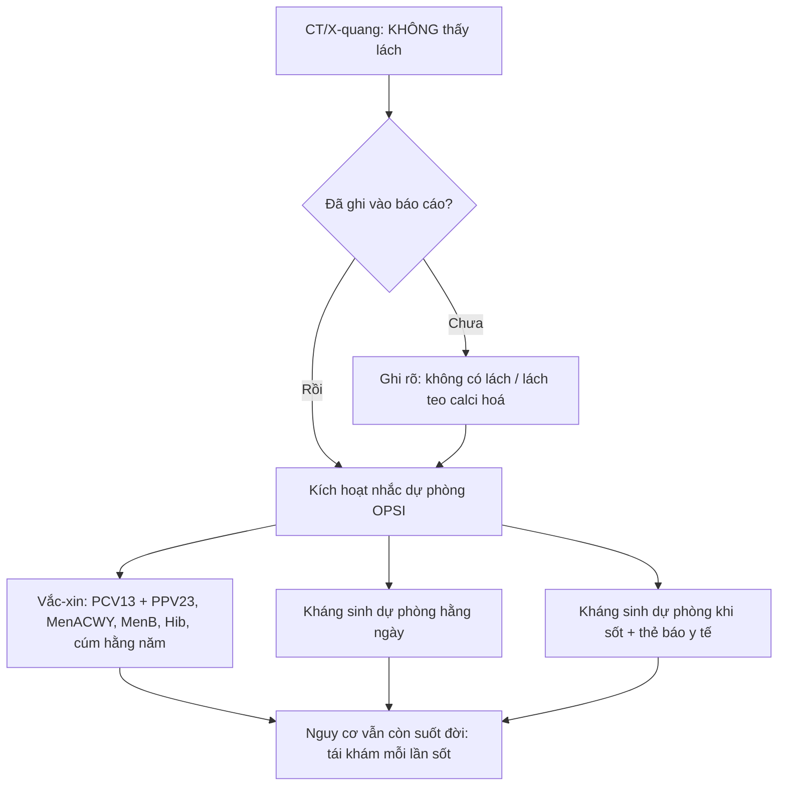
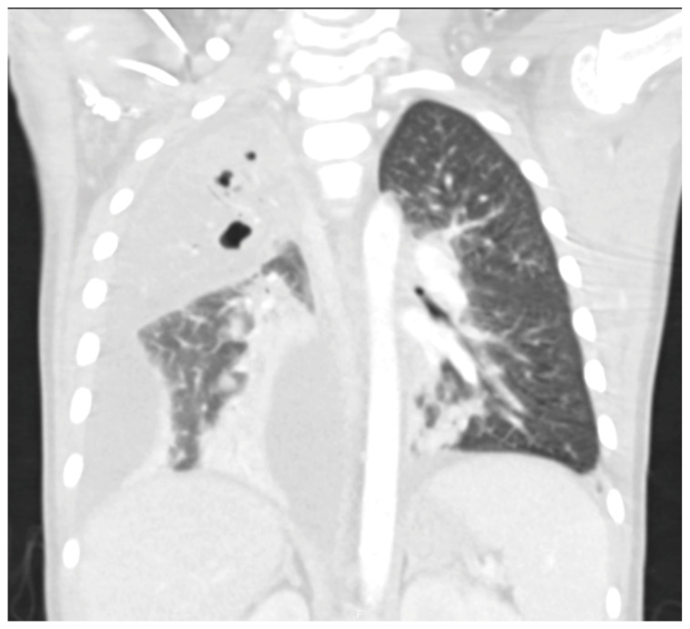
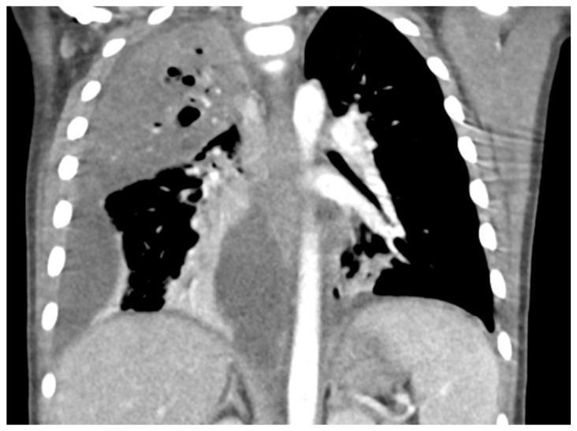
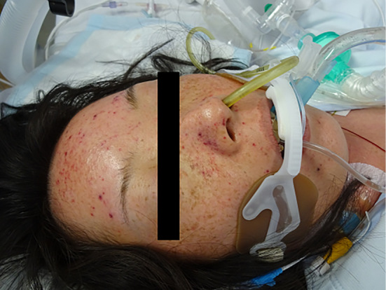
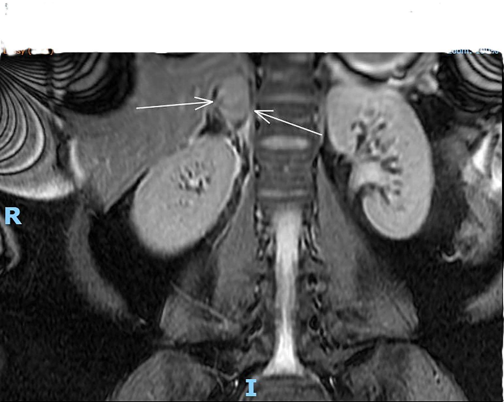

# 6173 — Nhiễm khuẩn huyết tối cấp sau cắt lách ở trẻ (OPSI): "sốt ở trẻ không lách là 24 giờ vàng" / Overwhelming post-splenectomy infection in children

**Tags:** `pattern:khong-lach` `pattern:viem-phoi-hoai-tu` `pattern:empyema` `pattern:xuat-huyet-thuong-than` `pattern:purpura-fulminans` `vung:lach` `vung:phoi` `vung:mang-phoi` `vung:thuong-than` `score:Light-criteria` `protocol:X-quang-nguc` `protocol:sieu-am-phoi` `protocol:CT-nguc-can-quang`

**Mức chắc chắn (certainty):** tổng hợp y văn (literature synthesis) — ghép 2 bài tổng quan về OPSI (*Cureus* 2020, PMC7059871, CC BY; *Infect Drug Resist* 2019, PMC6748314, CC BY-NC), 1 loạt ca OPSI (*Cureus* 2020, PMC7505613, CC BY), 1 ca purpura fulminans do phế cầu ở người cắt lách (*Intern Med* 2017, PMC5337479, CC BY-NC-ND — chỉ dùng ảnh nguyên bản), 1 tổng quan viêm phổi hoại tử nhi (*Children* 2025, PMC12468505, CC BY — 3 ảnh), 1 nghiên cứu tiêm chủng–biến chứng phổi nhi (*Life* 2026, PMC13208318, CC BY), 1 tổng quan nhiễm trùng trong bệnh hồng cầu hình liềm (*Haematologica* 2025, PMC11873697, CC BY-NC), 1 ca xuất huyết thượng thận (*J Clin Gynecol Obstet* 2025, PMC12788810, CC BY-NC — ảnh minh hoạ hình thái, **không phải ca OPSI**) và 1 thử nghiệm can thiệp tuân thủ dự phòng (*Infection* 2023, PMC10665246, CC BY). Nhóm **không có bệnh nhân của mình**.

> **Câu chốt:** OPSI không phải "nhiễm khuẩn nặng hơn bình thường" mà là **nhiễm khuẩn huyết mất kiểm soát vì thiếu bộ lọc lách** — bệnh cảnh **12–24 giờ từ sốt nhẹ tới tử vong**. Bốn số phải thuộc: **(1)** tỉ lệ mắc **0,1–0,5%** người cắt lách, **0,13/100 người-năm**, tử vong **tới 50%** (một số nguồn **50–70%**); **(2)** *Streptococcus pneumoniae* gây **50–90%** ca, tử vong do phế cầu **tới 60%**; **(3)** nguy cơ cao nhất **2–3 năm đầu** nhưng **kéo dài suốt đời** — đã có ca **26 năm** và **15 năm** sau cắt lách; **(4)** trẻ hồng cầu hình liềm **< 3 tuổi** có **10 ca phế cầu/100 người-năm**, tử vong ca bệnh **30%** — dù vậy **tiêm chủng đầy đủ làm giảm bệnh phế cầu xâm lấn tới 93,4% ở trẻ < 5 tuổi**.

## 1. Tổng quan bệnh học – cơ chế hình ảnh (TẠI SAO)

### 1.1 Lách làm gì mà thiếu lách lại chết nhanh

- **Lách = bộ lọc tuần hoàn + nhà máy kháng thể chống vỏ polysaccharide.** Mô lách trắng (**25%** thể tích lách) chứa nang lympho và vùng rìa (marginal zone); mô lách đỏ (**75%**) có dây Billroth và xoang tĩnh mạch, nơi hồng cầu phải **chui qua khe nội mô** để về tuần hoàn.
- **Ba chức năng mất đi sau cắt lách** (PMC6748314):
  1. **Lọc cơ học** vi khuẩn khỏi máu;
  2. **Opsonin hoá** nhờ kháng thể và bổ thể — không có lách thì vi khuẩn **vỏ polysaccharide** (phế cầu, não mô cầu, *H. influenzae* týp b) **kháng thực bào**;
  3. **"Pitting"** — cắt bỏ thể vùi trong hồng cầu (**thể Howell–Jolly**, hốc hồng cầu, siderocyte) mà không phá huỷ cả tế bào.
- **Hậu quả miễn dịch định lượng:** giảm **tế bào B nhớ IgM** và giảm đáp ứng với **vắc-xin polysaccharide** (không phụ thuộc tuyến ức); tỉ lệ tế bào B giảm rõ **150 ngày** sau cắt lách. Đây là lý do **vắc-xin cộng hợp (conjugate) hiệu quả hơn vắc-xin polysaccharide** ở người không lách.
- **Vì sao chết trong 24 giờ:** vi khuẩn có vỏ **nhân đôi nhanh trong máu** (phế cầu có thể từ **10³ → 10⁸ CFU/mL trong vài giờ** ở mô hình động vật), gây **bùng phát cytokine**, **DIC**, **suy thượng thận cấp** và **hoại tử chi** — đó chính là các hình thái mà bác sĩ chẩn đoán hình ảnh nhìn thấy: **viêm phổi hoại tử**, **mủ màng phổi**, **xuất huyết thượng thận hai bên**, **purpura fulminans**.

### 1.2 Vì sao hình ảnh học lại quan trọng trong một bệnh "nhiễm trùng"

- OPSI là **chẩn đoán lâm sàng–vi sinh**, nhưng **ổ nhiễm khuẩn khởi phát** thường ở phổi và **diễn tiến hoại tử nhanh hơn người có lách**: phế cầu **serotype 3** nổi bật trong viêm phổi hoại tử nhi (PMC12468505).
- Viêm phổi hoại tử (necrotizing pneumonia, NP) chiếm **3–7%** ca viêm phổi cộng đồng nhập viện ở trẻ và **tới 40%** ca viêm phổi có biến chứng; **thông khí nhân tạo 28%**, tử vong **0–5%** (cao hơn ở nhũ nhi và trẻ có bệnh nền) — tức là **biến chứng phổi tự nó đã nặng**, và ở trẻ không lách ngưỡng can thiệp còn thấp hơn.
- Trong một loạt **144 trẻ** viêm phổi cộng đồng nhập viện (Jerusalem 2001–2010), **40% có mủ màng phổi** và **20% có viêm phổi hoại tử** — hai hình thái này thường **đi cùng nhau** và cùng là "cửa vào" của OPSI.

## 2. Mẫu hình + chẩn đoán phân biệt theo vị trí (gamut)

- **Phổi – màng phổi (hay gặp nhất ở trẻ):** viêm phổi hoại tử (ổ giảm mật độ không ngấm thuốc trong vùng đông đặc + **pneumatocele**), mủ màng phổi (**split pleura**), áp-xe phổi, rò phế quản–màng phổi.
- **Tuyến thượng thận:** **xuất huyết thượng thận hai bên** (hội chứng Waterhouse–Friderichsen) — nguyên nhân tử vong trong **vài giờ** nếu không nghĩ tới; gặp trong nhiễm phế cầu, não mô cầu, *Pseudomonas*.
- **Mô mềm – chi:** **purpura fulminans** (ban xuất huyết hoại tử đối xứng do DIC + thiếu protein C), **viêm cân mạc hoại tử** (đã có ca do phế cầu **serotype 7C**, PMC13521636).
- **Ổ bụng:** **không thấy lách** trên CT; **splenosis** giả di căn (bài 192); viêm phúc mạc phế cầu (hiếm, hay ở trẻ nữ).
- **Gợi nhớ nhanh — "SỐT + KHÔNG LÁCH":** *S*treptococcus pneumoniae, *O*ther encapsulated (meningococcus, Hib, *Capnocytophaga* sau chó mèo cắn), *T*rauma/functional asplenia (hồng cầu hình liềm), *A*bsent spleen on imaging, *S*urgery gần đây (cắt lách < 30 ngày).

## 3. Bảng so sánh phân biệt (ma trận đối chiếu)

| Thực thể (entity) | Hình ảnh điển hình | Chốt vào (rule-in) | Chốt loại (rule-out) | Gợi ý xác nhận |
|---|---|---|---|---|
| **OPSI – viêm phổi hoại tử do phế cầu** | Đông đặc thuỳ + **ổ giảm mật độ không ngấm thuốc** + **pneumatocele** (bóng khí thành mỏng) ± tràn dịch | **Không có lách trên CT + sốt < 24 giờ + ổ hoại tử trong đông đặc** | Đông đặc đồng nhất, không hang, không tràn dịch → viêm phổi thuỳ đơn thuần | Cấy máu **trước** kháng sinh; CT ngực có cản quang |
| **Mủ màng phổi (empyema)** | **Split pleura**: hai lá màng phổi dày, ngấm thuốc, tách nhau bởi dịch; vách/ổ khu trú | **Hai lá màng phổi ngấm thuốc tách nhau + dịch vách** | Dịch tự do, màng phổi mỏng < 1 mm → tràn dịch đơn thuần | Siêu âm phổi (vách, khu trú); chọc dịch: **pH < 7,20, glucose < 40 mg/dL, LDH > 1.000 IU/L** |
| **Xuất huyết thượng thận hai bên (Waterhouse–Friderichsen)** | Tuyến **to, không ngấm thuốc**, tỉ trọng không đồng nhất; MRI T2 tăng tín hiệu hỗn hợp | **Sốt + tụt huyết áp kháng dịch + hai tuyến thượng thận to, không ngấm** | Tuyến bình thường/thuỷ hoá đều hai bên → không phải cấp | CT bụng có cản quang; cortisol/metyrapone cấp cứu |
| **Purpura fulminans** | Ban xuất huyết **đối xứng**, hoại tử đầu chi; không có ổ đặc hiệu trên CT | **Ban hoại tử + DIC (tiểu cầu giảm, fibrinogen giảm) + không lách** | Ban dạng sởi, mày đay, hồng ban → không phải purpura fulminans | Đông máu toàn bộ, protein C/S, cấy máu |
| **Splenosis giả di căn** | Nhiều nốt **giống nhu mô lách**, ngấm thuốc kiểu lách, trong phúc mạc/màng phổi | **Tiền sử vỡ/cắt lách + nốt đồng tín hiệu lách ở mọi thì** | Nốt có washout, xâm lấn, hạch → nghĩ di căn | ⁹⁹ᵐTc-HDRBC/SPECT-CT (bài 192) |

*X-quang ngực thẳng: đông đặc thuỳ trên phổi phải + mờ màng phổi phải lượng nhiều, đẩy nhẹ trung thất. Nguồn: Ness-Cochinwala M, Totapally BR — Children 2025, PMC12468505 Fig. 3, CC BY 4.0. Ảnh nguyên bản.*

## 4. Protocol chụp + hệ phân độ/điểm chuẩn hoá

### 4.1 Khi nghi OPSI — thứ tự không được đảo

1. **Cấy máu 2 vị trí TRƯỚC kháng sinh**, lactate, glucose, đông máu, cortisol (nếu tụt huyết áp).
2. **Kháng sinh trong 60 phút** đầu (ceftriaxone ± vancomycin theo dịch tễ); **không chờ hình ảnh**.
3. Hình ảnh **chỉ để tìm ổ cần dẫn lưu**: X-quang ngực → **siêu âm phổi tại giường** → **CT ngực có cản quang** khi nghi hoại tử/mủ màng phổi; **CT bụng** khi tụt huyết áp không giải thích được.
4. **Không chọc dò tủy sống khi chưa ổn định huyết động** (nguy cơ tụt huyết áp do DIC).

### 4.2 Ngưỡng phân độ có số

- **Light criteria** cho dịch màng phổi: dịch **pH < 7,20**, **glucose < 40 mg/dL**, **LDH > 1.000 IU/L** (hoặc > 2/3 giới hạn trên của LDH huyết thanh) → **cần dẫn lưu**; mủ đặc thì dẫn lưu ngay.
- **Viêm phổi hoại tử:** hoại tử **> 50% thể tích một thuỳ** = **phổi hoại tử (pulmonary gangrene)** → cân nhắc **cắt thuỳ**; pneumatocele thường **tự tiêu sau vài tuần**, không can thiệp chỉ vì có bóng khí.
- **Nguy cơ OPSI theo thời gian:** cao nhất **2–3 năm đầu**; trẻ **< 2 tuổi** và cắt lách vì **bệnh ác tính** có nguy cơ cao nhất.

### 4.3 Phòng bệnh — phần "hình ảnh" mà bác sĩ CĐHA phải kích hoạt

- **Thời điểm tiêm:** **14 ngày trước** cắt lách chương trình hoặc **14 ngày sau** cắt lách cấp cứu (tiêm quá sớm → đáp ứng kém).
- **Bộ vắc-xin:** **PCV13** rồi **PPV23** (nhắc lại **≥ 8 tuần** sau PCV13), **MenACWY**, **MenB**, **Hib**, **cúm hằng năm**.
- **Kháng sinh dự phòng:** hằng ngày **≥ 3 năm** sau cắt lách (hướng dẫn Úc/Spleen Australia), **suốt đời** nếu nguy cơ cao (bệnh ác tính, suy giảm miễn dịch, hồng cầu hình liềm); **luôn mang kháng sinh "dự phòng khi sốt"** và **thẻ báo y tế**.
- **Hiệu quả thực tế:** ở **69 trẻ** viêm phổi cộng đồng có biến chứng, tiêm chủng phế cầu đầy đủ là yếu tố bảo vệ độc lập với mủ màng phổi (**OR hiệu chỉnh 0,19; 95% CI 0,06–0,61**), và trẻ không tiêm nằm viện **17 vs 9,5 ngày** (p = 0,016) (PMC13208318).
- **Tuân thủ lại rất kém:** **85%** người cắt lách **không biết** mình tăng nguy cơ nhiễm trùng; can thiệp giáo dục có cấu trúc nâng điểm tuân thủ từ **3,73 → 7,70/10** (PMC10665246).

## 5. Biến thể bình thường và cạm bẫy

- **Lách teo calci hoá trong hồng cầu hình liềm ("autosplenectomy")** — trên CT là đám calci nhỏ ở hố lách, **không phải "không có lách bẩm sinh"**; chức năng lách đã mất từ rất sớm, và trẻ vẫn cần dự phòng như người cắt lách.
- **Lách phụ / splenosis** — mô lách còn lại **có chức năng một phần** nhưng **không đủ** để loại trừ OPSI; đừng trấn an gia đình chỉ vì "còn mô lách" (bài 192).
- **Thể Howell–Jolly âm tính không loại trừ giảm chức năng lách** — xét nghiệm này **độ nhạy thấp** khi còn mô lách nhỏ; quyết định dự phòng dựa trên **bệnh nền + hình ảnh**, không dựa trên một lam máu.
- **Sốt "chỉ là siêu vi"** — bẫy chết người: trẻ không lách sốt **> 38,5 °C** phải được khám, cấy máu và **kháng sinh ngay**, kể cả khi trẻ trông khoẻ.
- **Bạch cầu bình thường hoặc thấp không loại trừ OPSI** — trong nhiễm khuẩn huyết tối cấp, bạch cầu có thể **giảm** do tiêu thụ; ca nguyên văn có **22,2 × 10³/µL với 92,8% neutrophil** nhưng ca khác lại không tăng.
- **Pneumatocele xuất hiện MUỘN (ngày 3–7)** sau đông đặc — đừng chẩn đoán "hang lao/áp-xe" trên phim chụp sớm; và **đừng chọc dẫn lưu một pneumatocele** (không phải ổ mủ).
- **Dịch màng phổi "đáp ứng kháng sinh" vẫn có thể là mủ** — siêu âm thấy **vách/khu trú** thì phải chọc và xét nghiệm Light, không chờ CT.

## 6. Tự lượng giá — Blind Quiz

**Ca 1 — Trẻ 4 tuổi, sốt 39,5 °C, ho 2 ngày, đã cắt lách vì hồng cầu hình cầu 3 năm trước. X-quang ngực thẳng:**

- Gợi ý lâm sàng: trẻ không lách, không sốt rét, không tiêm nhắc; mạch nhanh, chi ấm.
- Câu hỏi: Mờ ở đâu? Có đẩy trung thất không? Ba chẩn đoán phân biệt? Việc đầu tiên phải làm trước khi đẩy trẻ đi CT?

<b>Bấm để hiện đáp án (findings + chẩn đoán)</b>

- Dấu hiệu: **đông đặc thuỳ trên phổi phải** + **mờ màng phổi phải lượng nhiều**, trung thất hơi lệch trái; không thấy khí trong mô mềm.
- Chẩn đoán: **viêm phổi + tràn dịch cận viêm phổi ở trẻ không lách** — phải coi là **OPSI cho tới khi loại trừ**. Phân biệt: viêm phổi thuỳ đơn thuần, mủ màng phổi, viêm phổi hoại tử.
- Việc đầu tiên: **cấy máu + kháng sinh trong 60 phút**, không chờ CT. Sau đó **siêu âm phổi** tại giường.
- Nguồn ảnh: Ness-Cochinwala M, Totapally BR — *Children* 2025, PMC12468505 Fig. 3, CC BY 4.0.

**Ca 2 — Cùng bệnh nhi, sau 48 giờ sốt dai dẳng, CT ngực có cản quang:**

- Câu hỏi: Trong vùng đông đặc có gì bất thường? Đó là hang, áp-xe hay hoại tử? Có chỉ định dẫn lưu màng phổi không?

<b>Bấm để hiện đáp án</b>

- Dấu hiệu: khối đông đặc lớn thuỳ trên phải với **nhiều ổ khí nhỏ (pneumatocele) và vùng giảm mật độ không ngấm thuốc**; **dịch màng phổi phải lượng lớn**.
- Chẩn đoán: **viêm phổi hoại tử (necrotizing pneumonia) + tràn dịch cận viêm phổi phức tạp**. Hoại tử khác áp-xe ở chỗ **nhiều ổ nhỏ, bờ không rõ, không có vỏ**; pneumatocele là di chứng, **không chọc**.
- Dẫn lưu: có, nếu dịch **khu trú/vách** trên siêu âm hoặc **pH < 7,20 / glucose < 40 mg/dL / LDH > 1.000 IU/L**.
- Nguồn ảnh: Ness-Cochinwala M, Totapally BR — *Children* 2025, PMC12468505 Fig. 4, CC BY 4.0.

**Ca 3 — Cùng bệnh nhi, cửa sổ trung thất:**

- Câu hỏi: Hai lá màng phổi có tách nhau không? Dấu này tên gì và nói lên điều gì về khả năng dẫn lưu?

<b>Bấm để hiện đáp án</b>

- Dấu hiệu: **màng phổi tạng và thành đều dày, ngấm thuốc, tách nhau bởi dịch** = **split pleura sign**; kèm đông đặc phổi phải và ổ khí trong nhu mô.
- Ý nghĩa: mủ màng phổi **giai đoạn fibrinopurulent** — dẫn lưu đơn thuần có thể thất bại, cần **ống dẫn lưu + fibrinolytic** hoặc **VATS**.
- Nguồn ảnh: Ness-Cochinwala M, Totapally BR — *Children* 2025, PMC12468505 Fig. 5, CC BY 4.0.

**Ca 4 — Người lớn 70 tuổi (ca nguyên văn), sốt 1 ngày rồi lơ mơ; tiền sử cắt lách 10 năm, chưa từng tiêm phế cầu:**

- Câu hỏi: Ban này gọi là gì? Cơ chế? Hai xét nghiệm đông máu nào sẽ bất thường?

<b>Bấm để hiện đáp án</b>

- Dấu hiệu: **purpura không căng da (non-palpable)** lan mặt–thân–chi, kèm **tiểu cầu giảm nặng và fibrinogen giảm** → **purpura fulminans do DIC**, trong bối cảnh **OPSI do phế cầu**.
- Cơ chế: nhiễm khuẩn huyết tối cấp → hoạt hoá đông máu + tiêu thụ protein C/S → huyết khối vi mạch ở da → hoại tử.
- Điều trị: kháng sinh ngay (ceftriaxone), hồi sức, sản phẩm máu; đây là ca **sống sót** nhưng là ngoại lệ.
- Nguồn ảnh: Sakai K, Kuriyama A — *Intern Med* 2017, PMC5337479 Picture 1, **CC BY-NC-ND 4.0** (ảnh nguyên bản, không cắt/ghép).

**Ca 5 — Bệnh nhi tụt huyết áp kháng dịch, không tìm thấy ổ nhiễm; MRI bụng lát vành T2:**

- Câu hỏi: Tạng nào to bất thường (mũi tên)? Tại sao tụt huyết áp không đáp ứng dịch? Cần làm gì ngay?

<b>Bấm để hiện đáp án</b>

- Dấu hiệu: **tuyến thượng thận phải to, tín hiệu T2 hỗn hợp không đồng nhất** (mũi tên) — hình thái **xuất huyết thượng thận**.
- Chẩn đoán: **xuất huyết thượng thận hai bên / Waterhouse–Friderichsen** trong nhiễm khuẩn huyết tối cấp; mất cortisol → **sốc kháng catecholamine**.
- Xử trí: **hydrocortisone tĩnh mạch ngay** + kháng sinh + hồi sức; không chờ kết quả cortisol.
- **Lưu ý trung thực nguồn:** ảnh này lấy từ ca **xuất huyết thượng thận tự phát trong thai kỳ** (người lớn), **không phải ca OPSI** — chỉ dùng để nhận diện **hình thái**, không dùng để chứng minh tỉ lệ.
- Nguồn ảnh: Memon M, Wilson D, Okolo I, Wang A — *J Clin Gynecol Obstet* 2025, PMC12788810 Fig. 1, CC BY-NC 4.0.

## Bài liên quan chéo
- [6154 – Sỏi mật ở trẻ có bệnh tan máu: cắt túi mật cùng lúc cắt lách](../6154-soi-mat-o-tre-benh-tan-mau/lesson.md)
- [192 – Splenosis & lách phụ sau cắt lách](../192-splenosis-va-lach-phu-sau-cat-lach/lesson.md)
- [616 – Biến chứng viêm phổi nhi: mủ màng phổi & hoại tử phổi](../616-bien-chung-viem-phoi-nhi-empyema-hoai-tu/lesson.md)
- [1860 – Chấn thương lách ở trẻ em: NOM/SAE và ngưỡng mổ](../1860-chan-thuong-lach-tre-em/lesson.md)
- [649 – Khí trung thất & khí dưới da ở trẻ](../649-khi-trung-that-hoai-tu-va-sinh-khi-o-tre/lesson.md)

> Không dùng để chẩn đoán độc lập khi chưa có người hướng dẫn.
