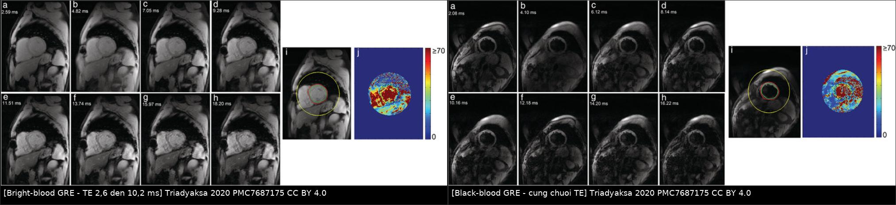
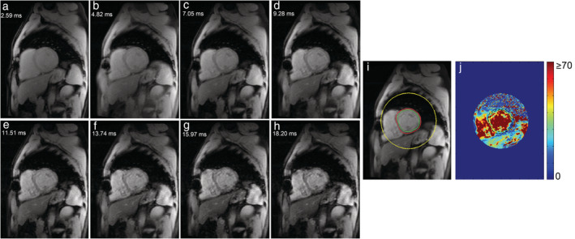
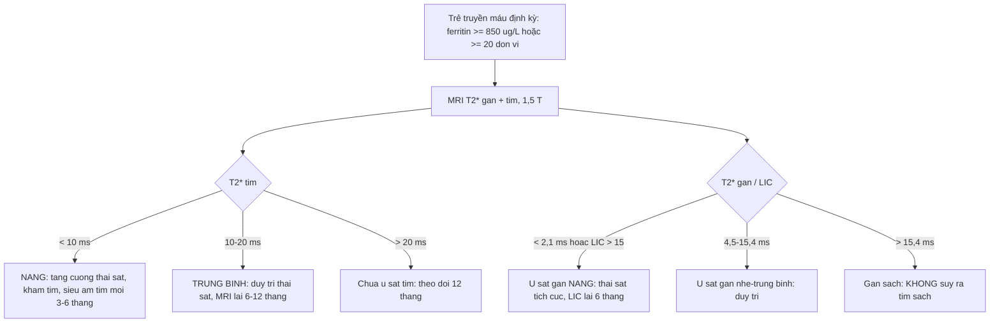
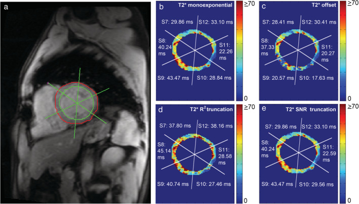
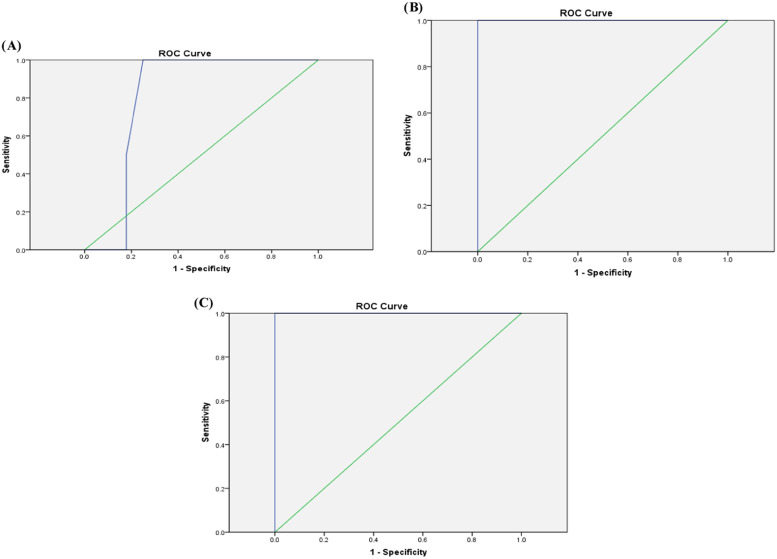

# 6174 — Quá tải sắt do truyền máu ở trẻ: MRI T2*/R2*, LIC và ngưỡng "trái tim bị rỉ sét" / Transfusional iron overload in children: T2*/R2* MRI and liver iron concentration

**Tags:** `pattern:giam-tin-hieu-T2-star` `pattern:tu-sat` `pattern:gan-giam-tin-hieu` `pattern:tim-giam-tin-hieu` `vung:gan` `vung:tim` `vung:tuy` `score:T2-star` `score:LIC` `protocol:MRI-T2-star` `protocol:MRI-tim`

**Mức chắc chắn (certainty):** tổng hợp y văn (literature synthesis) — ghép 1 tổng quan kỹ thuật T2* tim (*J Magn Reson Imaging* 2020, PMC7687175, CC BY — 3 ảnh + 1 ảnh ghép), 1 nghiên cứu bệnh–chứng **60 trẻ sống sót ALL** với T2* gan/tim (*Hematol Transfus Cell Ther* 2024, PMC11726085, CC BY), 1 đoàn hệ **119 bệnh nhân thalassemia** theo dõi T2* 5 năm (*Tomography* 2021, PMC8167609, CC BY), 1 tổng quan nhiễm trùng–tan máu ở hồng cầu hình liềm (*Haematologica* 2025, PMC11873697, CC BY-NC) và 1 tổng quan thải sắt (*Int J Mol Sci* 2026, PMC13665008, CC BY). Nhóm **không có bệnh nhân của mình**; mọi ngưỡng T2* đều ghi rõ **cường độ từ trường**, vì ngưỡng 1,5 T **không dùng được** cho 3 T.

> **Câu chốt:** quá tải sắt là **tổn thương cơ quan do tích luỹ**, không phải "ferritin cao". Ba số phải thuộc: **(1)** **T2* tim < 10 ms** (1,5 T) = ứ sắt nặng, nguy cơ suy tim và biến cố tim; **10–20 ms** = trung bình; **(2)** **T2* gan < 2,1 ms** tương ứng **LIC > 15 mg/g khô**, còn **> 15,4 ms** là **LIC < 2 mg/g** (công thức Garbowski **LIC = 0,032 × R2* − 0,14**); **(3)** **tim và gan ứ sắt ĐỘC LẬP** — trong 119 bệnh nhân thalassemia, T2* tim **không tương quan** với LIC (p = 0,39) hay ferritin (p = 0,54), nên **"gan sạch" không bảo vệ tim**.

## 1. Tổng quan bệnh học – cơ chế hình ảnh (TẠI SAO)

### 1.1 Vì sao sắt làm mất tín hiệu — vật lý T2*

- Truyền hồng cầu cầu → **hemoglobin** bị đại thực bào phân huỷ → **hemosiderin/ferritin** tích trong **lysosome** của tế bào Kupffer (gan), đại thực bào lách/tuỷ, rồi **tế bào cơ tim** (không có cơ chế thải sắt chủ động).
- Sắt ở dạng **superparamagnetic**: tạo **gradient từ trường vi mô** quanh mỗi hạt → proton mất pha nhanh → **giảm T2*** (và tăng **R2* = 1/T2***). Đây là **hiệu ứng phụ thuộc cường độ từ trường**: cùng một lượng sắt, **3 T làm giảm T2* mạnh hơn 1,5 T** — nên ngưỡng phải khác nhau.
- Tín hiệu chuỗi xung **gradient-echo đa TE** giảm theo hàm mũ: **S(TE) = S₀ · e^(−TE/T2*)**. Vẽ **ln(S)** theo TE, độ dốc = **−1/T2***. Sắt càng nhiều → đường dốc càng đứng → T2* càng ngắn.
- **Hệ quả kỹ thuật (rất hay bị bỏ qua):**
  - **TE đầu tiên phải ngắn (~1 ms)** — với T2* **< 2 ms** (gan ứ sắt nặng), TE 2,5 ms đã **mất gần hết tín hiệu** và không đo được.
  - **TE dài phải cắt bỏ (truncation)** — tín hiệu ở TE dài chỉ còn **nhiễu nền**; đưa vào hồi quy làm T2* **bị ước lượng cao** (xem mục 5 và Ca 2).
  - **Máu trong buồng tim** có T2* khác cơ tim; nếu không **khử tín hiệu máu (black-blood)** hoặc đặt ROI đúng, giá trị cơ tim **bị kéo theo máu** — ảnh ghép dưới đây cho thấy cùng mặt cắt, hai kỹ thuật.

*Trái: **bright-blood** GRE — máu trong buồng tim sáng, dễ lẫn vào ROI cơ tim. Phải: **black-blood** GRE — máu bị khử tín hiệu, cơ tim hiện rõ. Cả hai: chuỗi TE tăng dần (a→h) cho thấy **tín hiệu cơ tim tối dần**, kèm **bản đồ T2\*** (j) thang **0–≥ 70 ms**. Nguồn: Triadyaksa P, Oudkerk M, Sijens PE — J Magn Reson Imaging 2020, PMC7687175 Fig. 1–2, CC BY 4.0. Ảnh ghép letterbox, **không crop/kéo giãn**.*

### 1.2 Đường vào của sắt: gan trước, tim sau

- **Gan là "kho đệm"**: sau mỗi đơn vị máu, sắt vào **tế bào Kupffer** trước; LIC tăng sớm và **giảm nhanh** khi thải sắt.
- **Tim vào chậm, ra chậm**: sắt vào cơ tim **qua kênh calci týp L** và **transferrin receptor**, tích luỹ **nhiều năm**; khi đã vào thì **thải rất chậm** — đó là lý do T2* tim có thể **bình thường** dù LIC rất cao, và **vẫn thấp** dù LIC đã về bình thường.
- **Tuyến tụy, tuyến yên, tuyến giáp** ứ sắt sớm hơn tim ở một số bệnh nhân → **đái tháo đường, suy sinh dục, suy giáp**; trên MRI, **tụy mất tín hiệu T2*** là dấu sớm của rối loạn nội tiết.
- **Vì sao trẻ sống sót ung thư cũng bị:** trong **60 trẻ sống sót ALL 6–18 tuổi**, trung bình đã nhận **6.256 ± 2.402 mL** hồng cầu khối (**143,8 ± 45,5 mL/kg**), **43,3% có ứ sắt gan** và **3,3% có ứ sắt cơ tim**; **66,7%** có marker viêm gan C — nghĩa là nhóm này cần **theo dõi sau khi kết thúc điều trị**, không chỉ trong lúc truyền máu.

## 2. Mẫu hình + chẩn đoán phân biệt theo vị trí (gamut)

- **Gan giảm tín hiệu lan toả:** ứ sắt (hemosiderosis/hemochromatosis thứ phát) · **mỡ gan** (chỉ giảm tín hiệu trên **out-of-phase**, T2* bình thường) · xơ gan (tín hiệu không đều, có nốt) · **nốt sắt (siderotic nodule)** trong xơ gan · artefact kim loại/dị vật.
- **Cơ tim giảm tín hiệu:** ứ sắt cơ tim · **nhồi máu cũ** (vùng thành mỏng, LGE) · **lắng đọng amyloid** (tăng T1 mapping, không giảm T2*) · artefact chuyển động/susceptibility ở **đáy tim sát phổi**.
- **Tụy giảm tín hiệu:** ứ sắt (thường **toàn bộ**, đối xứng) · mỡ thay (thường **teo**, tăng tín hiệu T1) · viêm tụy mạn (vôi hoá, ống giãn).
- **Gợi nhớ nhanh:** "**T2* thấp = SẮT**" — **S**iderosis/hemosiderosis, **Ắ** (ứ sắt sau truyền), **T**halassemia, nhưng luôn kiểm **artefact** và **mỡ** trước khi kết luận.

## 3. Bảng so sánh phân biệt (ma trận đối chiếu)

| Thực thể (entity) | Hình ảnh điển hình | Chốt vào (rule-in) | Chốt loại (rule-out) | Gợi ý xác nhận |
|---|---|---|---|---|
| **Ứ sắt gan (transfusional)** | Gan **giảm tín hiệu lan toả** trên T2*/GRE, mạch máu **sáng hơn nhu mô**; lách cũng tối nếu còn lách | **T2* gan < 15,4 ms** (LIC > 2 mg/g); **< 2,1 ms** = nặng | T2* gan bình thường + gan sáng trên in-phase → **mỡ**, không phải sắt | ROI gan phải tránh mạch; báo **T2* + LIC** |
| **Ứ sắt cơ tim** | Cơ tim **tối** trên GRE đa TE, đặc biệt **vách liên thất**; chức năng có thể còn bình thường | **T2* tim < 20 ms** (1,5 T); **< 10 ms** = nặng | T2* > 20 ms + không có LGE/giảm EF → chưa có bằng chứng ứ sắt tim | ROI **vách giữa** (segment 8+9), black-blood |
| **Mỡ gan (steatosis)** | Giảm tín hiệu **out-of-phase**, hồi phục **in-phase**; T2* **bình thường** | **Mất tín hiệu out-of-phase** + T2* bình thường | Không mất tín hiệu ở out-of-phase → không phải mỡ | Dixon / PDFF; không dùng T2* để chẩn đoán mỡ |
| **Xơ gan + nốt siderotic** | Gan **không đều**, bờ nốt, nốt **tối hơn** nhu mô trên T2*/T1 | **Nốt tối trên T2* trong gan xơ** | Gan đồng nhất, không nốt → ứ sắt đơn thuần | MRI gan có cản quang + AFP |
| **Artefact (kim loại/chuyển động/susceptibility)** | Vùng tối **khu trú**, bờ địa phương hoá, **không theo giải phẫu**; thay đổi giữa các TE | **Tối khu trú + không tái lập khi đổi mặt cắt** | Tối lan toả, đối xứng theo giải phẫu → bệnh lý thật | Chạy lại chuỗi, đổi hướng mặt cắt |

*Chuỗi GRE đa TE từ **a→h** (TE 2,59 → 10,20 ms): tín hiệu cơ tim **giảm dần**; **(i)** vẽ contour nội–ngoại tâm mạc; **(j)** bản đồ T2* thang **0–≥ 70 ms** (xanh = T2* dài, đỏ = ngắn). Nguồn: Triadyaksa P, Oudkerk M, Sijens PE — J Magn Reson Imaging 2020, PMC7687175 Fig. 1, CC BY 4.0.*

## 4. Protocol chụp + hệ phân độ/điểm chuẩn hoá

### 4.1 Protocol tối thiểu (bám theo PMC7687175)

- **Từ trường:** **1,5 T** là chuẩn để dùng các ngưỡng dưới đây; nếu chụp **3 T** phải dùng **bộ ngưỡng 3 T**.
- **Gan:** lát **ngang giữa gan**, **GRE đa TE**, **TR 80 ms**, **20 TE** từ **1,1 → 16,3 ms** (bước **0,8 ms**), **góc lật 20°**, **lát 10 mm**, **FOV 40 cm**, **nín thở**.
- **Tim:** trục ngắn **giữa thất**, **ECG-gating**, **black-blood** ưu tiên, ROI **vách liên thất** (segment **8 + 9**), loại pixel T2* **> 70 ms** khỏi bản đồ.
- **Hồi quy:** hàm mũ đơn **có cắt TE dài**; báo **T2* (ms)** và **R2* (Hz)**, kèm **LIC (mg/g khô)**.
- **Theo dõi:** T2* tim + LIC **mỗi 12 tháng** khi ổn; **mỗi 6 tháng** khi T2* tim **< 10 ms** hoặc LIC **> 15 mg/g**; **cùng một máy, cùng chuỗi xung** để so sánh.

### 4.2 Phân tầng — dùng đúng cường độ từ trường

| Cơ quan | Bình thường | Trung bình | Nặng | Nguồn |
|---|---|---|---|---|
| **Tim, 1,5 T** | T2* **> 20 ms** (R2* < 50 Hz) | **10–20 ms** (50–100 Hz) | **< 10 ms** (> 100 Hz) | PMC7687175 |
| **Tim, 3 T** | T2* **> 12 ms** (R2* < 83 Hz) | **5,5–12 ms** (83–181 Hz) | **< 5,5 ms** (> 181 Hz) | PMC7687175 |
| **Gan, T2*** | **> 15,4 ms** (LIC < 2 mg/g) | **4,5–15,4 ms** (LIC 2–7) | **< 2,1 ms** (LIC > 15) | PMC11726085 |
| **Gan, LIC** | **≤ 3 mg/g khô** | **7–15 mg/g** | **≥ 15 mg/g** | PMC8167609 |

- **Công thức LIC (Garbowski):** **LIC (mg/g) = 0,032 × R2* (Hz) − 0,14** (PMC11726085). Kiểm tra chéo: T2* 15,4 ms → R2* 64,9 Hz → LIC ≈ **1,94 mg/g**; T2* 2,1 ms → R2* 476 Hz → LIC ≈ **15,1 mg/g** — hai cách phân tầng khớp nhau.
- **Ferritin không thay được MRI, nhưng có ngưỡng dùng được:** ở 60 trẻ sống sót ALL, ferritin **205 µg/L** phát hiện ứ sắt gan nhẹ (**Se 71,4% / Sp 66% / AUC 0,643**), **725–850 µg/L** phát hiện mức trung bình (**Se 100% / Sp 75% / AUC 0,804**), **850 µg/L** phát hiện mức nặng (**Se 100% / Sp 96,2% / AUC 1,00**). Lượng máu đã truyền cũng có ngưỡng: **115,1 / 169,4 / 217 mL/kg** cho nhẹ / trung bình / nặng.
- **Tương quan:** ferritin – T2* gan **R = 0,705** (p < 0,001); nhưng **T2* tim không tương quan** với ferritin, LIC hay lượng máu truyền.

## 5. Biến thể bình thường và cạm bẫy

- **"Gan sạch = tim sạch" là sai lầm chết người.** Vì tim vào sắt chậm, một trẻ **LIC 25 mg/g** vẫn có thể có **T2* tim 25 ms** — nhưng nguy cơ tim tăng dần theo **tổng lượng máu truyền**, không theo LIC hiện tại.
- **Ferritin là protein pha cấp** — tăng khi viêm/nhiễm trùng, giảm khi thiếu vitamin C; **ferritin bình thường không loại trừ ứ sắt** và ferritin cao không chứng minh ứ sắt.
- **Cùng một pixel, hai giá trị T2* khác nhau tuỳ cách hồi quy:** trong hình dưới, cùng vùng cơ tim cho **29,86 ms** (hồi quy đơn thuần), **28,41 ms** (có offset), **37,80 ms** (cắt theo R²), **29,86 ms** (cắt theo SNR). Chênh **~27%** đủ để **đổi phân tầng** nếu ngưỡng nằm giữa — nên **luôn so sánh trên cùng phương pháp**.
- **Ảnh hưởng của mỡ/xơ:** gan nhiễm mỡ làm T2* **dài giả**, xơ gan làm tín hiệu **không đều**; đọc kèm **in/out-of-phase** hoặc **PDFF**.
- **Artifact susceptibility ở đáy tim** (sát phổi/hoành) làm T2* **ngắn giả** — tránh đặt ROI ở **segment 6/7/11/12** nếu có artifact.
- **Máy khác nhau/chuỗi xung khác nhau** không so sánh trực tiếp: ngưỡng 1,5 T **không** áp cho 3 T (3 T làm T2* ngắn hơn ~1,7 lần).
- **Trẻ nhỏ không nín thở được** — dùng chuỗi thở tự do/trigger, nhưng phải ghi rõ vì giá trị **kém tái lập** hơn.

*Bốn phương pháp hồi quy cho cùng mặt cắt: **(b)** đơn thuần, **(c)** có offset, **(d)** cắt theo R², **(e)** cắt theo SNR — giá trị từng segment thay đổi **tới vài ms**. Nguồn: Triadyaksa P, Oudkerk M, Sijens PE — J Magn Reson Imaging 2020, PMC7687175 Fig. 5, CC BY 4.0.*

## 6. Tự lượng giá — Blind Quiz

**Ca 1 — Trẻ 12 tuổi thalassemia thể nặng, truyền máu 2 đơn vị/tháng từ 3 tuổi. MRI tim trục ngắn, chuỗi GRE đa TE:**

- Gợi ý: trẻ mệt, không đau ngực, EF 58%.
- Câu hỏi: Tín hiệu cơ tim thay đổi thế nào từ a→h? Đo T2* ở vùng nào? EF bình thường có loại trừ ứ sắt tim không?

<b>Bấm để hiện đáp án (findings + chẩn đoán)</b>

- Dấu hiệu: tín hiệu cơ tim **tối dần** khi TE tăng — đúng quy luật **S = S₀·e^(−TE/T2*)**; bản đồ T2* màu cho thấy vùng **vách liên thất** có giá trị đại diện toàn thất.
- Đo ở **vách giữa (segment 8 + 9)**, black-blood, loại pixel **> 70 ms**.
- **EF bình thường KHÔNG loại trừ ứ sắt tim** — rối loạn chức năng là dấu **muộn**; T2* < 10 ms là ngưỡng nguy cơ.
- Nguồn ảnh: Triadyaksa P và cs., PMC7687175 Fig. 1, CC BY 4.0.

**Ca 2 — Cùng bệnh nhi, kỹ thuật viên báo T2* vách 37,8 ms; bác sĩ khác đo lại được 29,9 ms trên cùng ảnh:**

- Câu hỏi: Tại sao lệch? Cách nào đúng? Cần ghi gì vào báo cáo để lần sau so sánh được?

<b>Bấm để hiện đáp án</b>

- Nguyên nhân: **cắt TE dài** (theo R²/SNR) loại bỏ điểm nhiễu nền; nếu không cắt, hồi quy bị **kéo lên** → T2* **dài giả** (37,80 vs 29,86 ms).
- Cách đúng: dùng **một phương pháp thống nhất, có cắt TE dài**, và ghi rõ phương pháp + phần mềm + từ trường trong báo cáo.
- Bài học: chênh **~8 ms** đủ đổi phân tầng nếu giá trị nằm quanh **10 hoặc 20 ms**.
- Nguồn ảnh: Triadyaksa P và cs., PMC7687175 Fig. 5, CC BY 4.0.

**Ca 3 — Trẻ 8 tuổi sống sót ALL, ferritin 900 µg/L, không triệu chứng. Có cần MRI không?**

- Câu hỏi: Đọc ba đường ROC: ferritin phân biệt được mức nào tốt nhất? Ferritin 900 µg/L gợi ý gì? MRI sẽ thay đổi xử trí ra sao?

<b>Bấm để hiện đáp án</b>

- **1A (nhẹ):** ngưỡng 205 µg/L, **AUC 0,643** — kém. **1B (trung bình):** 725–850 µg/L, **AUC 0,804**. **1C (nặng):** 850 µg/L, **Se 100% / Sp 96,2% / AUC 1,00** — rất tốt.
- Ferritin 900 µg/L nằm **trên ngưỡng nặng** → cần **MRI T2* gan + tim** để xác định mức và **phân biệt gan/tim**.
- MRI đổi xử trí vì quyết định **cường độ thải sắt** và **theo dõi tim**, không chỉ vì ferritin.
- Nguồn ảnh: Sherief LM và cs., *Hematol Transfus Cell Ther* 2024, PMC11726085 Fig. 1, CC BY 4.0.

## Bài liên quan chéo
- [6105 – Hoại tử xương ở trẻ điều trị ALL](../6105-hoai-tu-xuong-o-tre-dieu-tri-ALL/lesson.md)
- [6154 – Sỏi mật ở trẻ có bệnh tan máu](../6154-soi-mat-o-tre-benh-tan-mau/lesson.md)
- [6168 – Suy tụy ngoại tiết ở trẻ: elastase-1 và MRI Dixon](../6168-suy-tuy-ngoai-tiet-tre-elastase-1/lesson.md)
- [6153 – Hạch/khối tồn dư sau điều trị lymphoma ở trẻ](../6153-hach-ton-du-sau-dieu-tri-lymphoma-tre/lesson.md)

> Không dùng để chẩn đoán độc lập khi chưa có người hướng dẫn.
