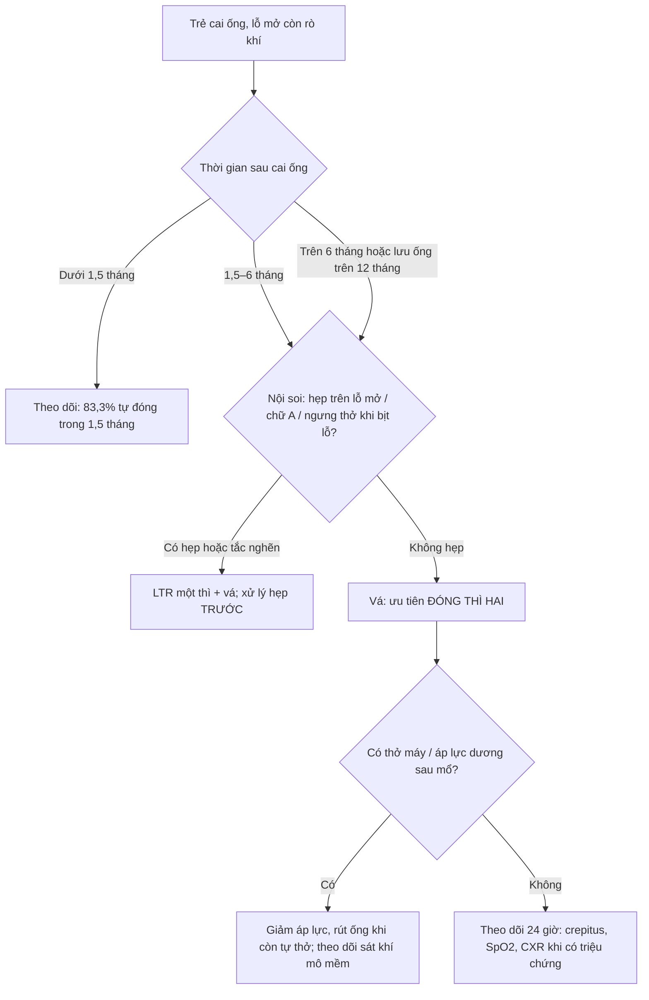
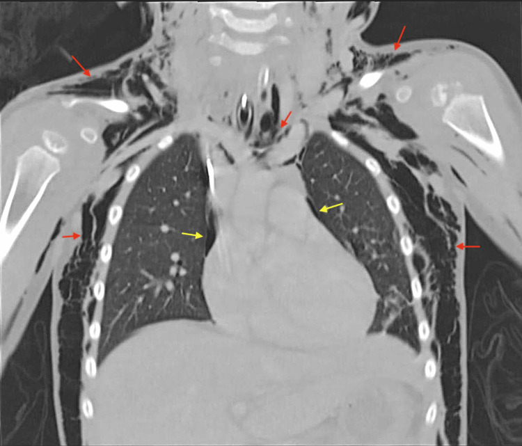
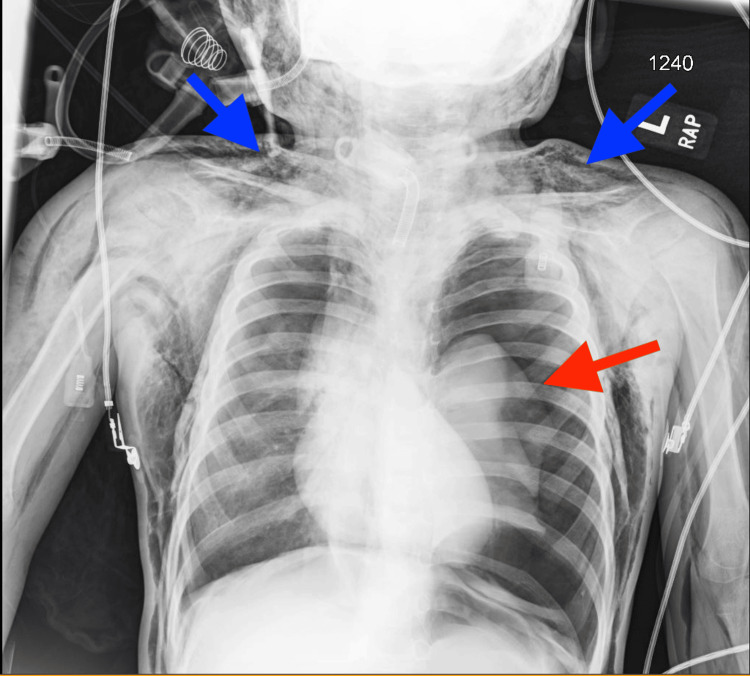
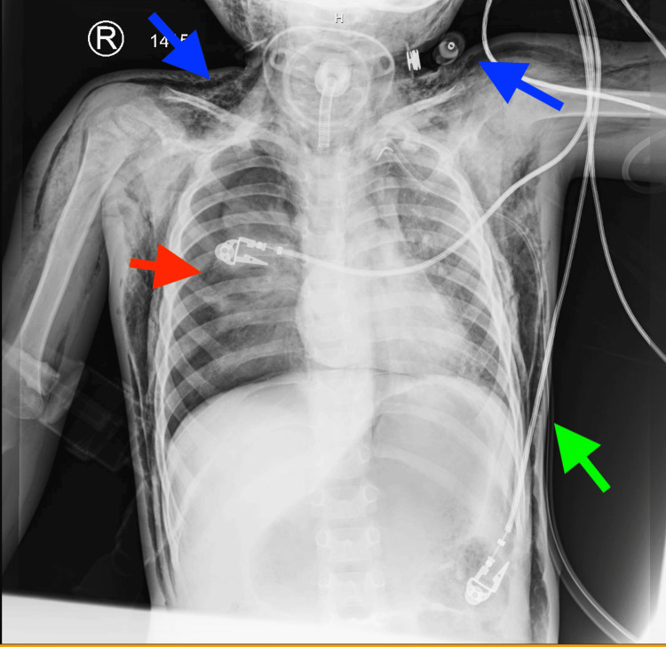
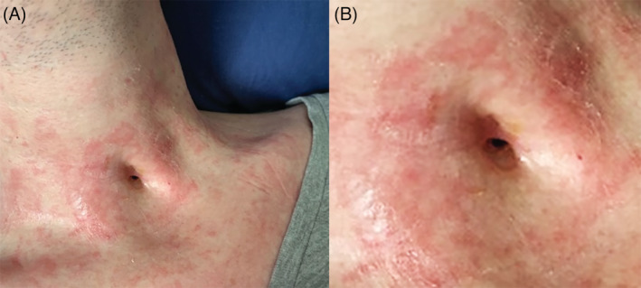

# 6175 — Rò khí–da sau cai ống mở khí quản ở trẻ (tracheocutaneous fistula): chờ tự đóng hay vá, và hội chứng rò khí sau vá

**Tags:** `pattern:ro-khi-da` `pattern:khi-duoi-da` `pattern:tran-khi-mang-phoi` `pattern:khi-trung-that` `vung:khi-quan` `vung:co` `vung:nguc` `protocol:CT-co-nguc` `protocol:noi-soi-duong-tho` `protocol:PSG-bit-lo` `score:TCF-closure`
**Mức chắc chắn (certainty):** tổng hợp y văn (literature synthesis) — ghép **tổng quan thực hành tốt nhất** về rò khí–da nhi (**PMC11903927**, CC BY-NC 4.0), **đoàn hệ 19 trẻ cai ống** với thời gian lưu ống dự báo phải mổ (**PMC11887410**, CC BY 4.0), **2 ca nguyên văn có ảnh** về hội chứng rò khí sau vá (**PMC12775883** và **PMC13191400**, CC BY 4.0) và **1 ca có ảnh lâm sàng** rò tồn tại (**PMC9585420**, CC BY-NC-ND).

> **Câu chốt:** **hơn một nửa lỗ mở tự đóng**, và **83,3% ca tự đóng xảy ra trong 1,5 tháng đầu** — nên "chưa lành sau 1 tháng" **không phải** chỉ định mổ. Ngược lại, **vá rò là phẫu thuật "nhỏ" nhưng có thể gây hội chứng rò khí nặng**: khí thoát qua chỗ vá hở → **khí dưới da cổ–ngực → tràn khí trung thất → tràn khí màng phổi hai bên tuần tự**, và **thở máy/áp lực dương là yếu tố làm nặng rõ rệt** (khí mô mềm **33,3%** khi có áp lực dương vs **16,7%** khi không, p = 0,005).

> **Phân vai với bài khác:** [6100](../6100-cham-soc-va-cai-ong-mo-khi-quan-tre/lesson.md) phủ **chăm sóc ống, biến chứng và quy trình cai ống** (rò khí–da chỉ một hàng ma trận); [649](../649-khi-trung-that-hoai-tu-va-sinh-khi-o-tre/lesson.md) phủ **khí dưới da – khí trung thất do rò khí từ phổi** và cách phân biệt với viêm trung thất hoại tử; [6123](../6123-roi-loan-nuot-va-hit-sac-tre-mo-khi-quan/lesson.md) phủ **rối loạn nuốt – hít sặc** sau mở khí quản. Bài này chỉ đi sâu **đường hàn tồn tại sau cai ống**: khi nào chờ, khi nào vá, vá kiểu gì, và **đọc hình ảnh biến chứng rò khí** sau vá.

## 1. Tổng quan bệnh học – cơ chế hình ảnh (TẠI SAO đường hàn không tự đóng, và TẠI SAO khí đi vào mô mềm)

### 1.1 Định nghĩa và dịch tễ — con số dao động rất rộng vì tiêu chuẩn "tồn tại" khác nhau

- **Rò khí–da (tracheocutaneous fistula, TCF):** đường hàn **có biểu mô lót** nối **lòng khí quản cổ** với **da cổ trước**, còn lại sau khi rút ống mở khí quản (PMC13191400).
- **Tỷ lệ:** **1–40%**, đa số nghiên cứu **20–30%** (PMC11903927); một tổng quan khác ghi **6–55%**, cao hơn khi lưu ống lâu (PMC13191400); gộp **49 nghiên cứu** biến chứng ống mở khí quản ở trẻ: rò khí–da **9,5%** (PMC8047564, dẫn qua [6100](../6100-cham-soc-va-cai-ong-mo-khi-quan-tre/lesson.md)).
- **Tự đóng:** **> 50%** lỗ mở đóng kín sau cai ống (PMC11903927). Trong đoàn hệ **19 trẻ cai ống thành công**: **63,2% (12/19) tự đóng**, **36,8% (7/19) phải mổ**; thời gian tự đóng trung bình **1,5 tháng** (7 ngày – 2,5 tháng), **83,3%** trong số đó đóng **trong 1,5 tháng** (PMC11887410).

### 1.2 Yếu tố quyết định: thời gian lưu ống, không phải tuổi

| Biến | Tự đóng (n = 12) | Phải mổ (n = 7) | p |
|---|---|---|---|
| Thời gian lưu ống, trung bình | **7,8 tháng** | **26,7 tháng** | **0,022** |
| Lưu ống **> 12 tháng** | — | — | **0,045** |
| Tuổi đặt ống / tuổi cai ống | 4,5 / — | 4,3 / — | 0,932 |
| Chỉ định (tắc đường thở vs hỗ trợ thông khí) | 9 vs 3 | 4 vs 3 | 0,617 |

*(số liệu PMC11887410, đoàn hệ 19 trẻ)*

- **TẠI SAO thời gian lưu ống quyết định:** đường hàn được **biểu mô hóa từ da vào trong** trong nhiều tháng; một khi toàn bộ đường hàn đã có **biểu mô lát**, hai bờ không còn áp sát để dính — lỗ **không thể đóng bằng co kéo tự nhiên** (PMC11887410). Đây là lý do **"chờ thêm" sau 6 tháng hiếm khi thành công** ở trẻ đã lưu ống > 1 năm.
- Ngược lại, ở trẻ mới rút ống vài tuần, đường hàn còn **mô hạt chưa biểu mô hóa** → tự đóng nhanh (83,3% trong 1,5 tháng).

### 1.3 TẠI SAO hình ảnh nhìn thấy đường hàn, và TẠI SAO khí đi vào mô mềm

- **Đường hàn chứa KHÍ:** khí quản ~ **−1.000 HU**, mô mềm cổ **+40 đến +60 HU**. Trên **CT cửa sổ mô mềm**, đường hàn hiện thành **cột khí (đen) xuyên qua mỡ trước khí quản** từ da vào thành trước khí quản; đo được **chiều dài đường hàn và đường kính lỗ** bằng mm — đây là thứ nội soi không đo được.
- **Khi chỗ vá hở:** áp lực trong lòng khí quản **cao hơn áp lực mô mềm** mỗi khi **ho, khóc, nín thở, hoặc thở máy**. Khí đi theo **đường ít trở kháng**: mô mềm cổ trước → **khoảng quanh khí quản → trung thất** (khí trung thất) → **màng phổi tạng–thành** (tràn khí màng phổi). Vì vậy **khí dưới da là dấu hiệu SỚM NHẤT**, còn tràn khí màng phổi là **hệ quả muộn hơn** và có thể **xuất hiện bên đối diện sau khi đã dẫn lưu một bên** (PMC13191400).
- **Vì sao áp lực dương làm nặng:** thở máy/CPAP tạo **gradient áp lực khí quản–mô mềm liên tục**, không chỉ theo nhịp ho; do đó khí vào mô mềm **nhanh và nhiều hơn**. Số liệu: nhóm có áp lực dương **50% biến chứng** vs **16,7%** nhóm không (p = 0,015); **khí mô mềm (dưới da/trung thất/màng phổi) 33,3% vs 16,7%** (p = 0,005) (PMC12775883 dẫn Smith và cs.).

### 1.4 Tần suất biến chứng rò khí sau vá — vì sao phải đọc phim chứ không chỉ nhìn vết mổ

- **Khí dưới da (subcutaneous emphysema, SCE):** **3,6–3,8%** (tổng quan hệ thống), **8,4%** (đoàn hệ hồi cứu), **18%** (case series), tổng hợp **3–20%** tùy kỹ thuật và quản lý chu phẫu (PMC12775883, PMC13191400).
- **Khí dưới da chỉ được báo cáo ở nhóm đóng thì đầu (primary closure)**, không gặp ở đóng thì hai trong các series nhi (PMC11903927) — đây là lập luận chính để **ưu tiên đóng thì hai** ở trẻ không có hẹp đường thở.
- **Hệ quả của rò tồn tại (nếu không vá):** mất ẩm đường thở, giảm **hiệu quả ho (peak cough flow)**, ứ đọng đờm → **nhiễm trùng tái diễn**, và **ảnh hưởng tâm lý – xã hội** (PMC11903927).

## 2. Mẫu hình + chẩn đoán phân biệt theo vị trí (gamut)

### 2.1 Lỗ mở còn tồn tại sau cai ống — gamut theo "có đường hàn biểu mô hay không"

- **Đường hàn biểu mô hóa (TCF thật):** cột khí **xuyên suốt** da → khí quản, bờ lỗ **liền, ướt/khô**, có thể **rò khí khi bịt mũi và thở mạnh** hoặc **sủi bọt khi nuốt/nói**.
- **Lỗ mở đang lành (chưa biểu mô hóa):** nông, đáy là **mô hạt đỏ**, không thấy cột khí liên tục; đa số đóng trong **1,5 tháng** (PMC11887410) → **không can thiệp**.
- **U hạt quanh lỗ mở:** mô hạt lồi, chảy máu khi chạm; thường **hẹp giả** đường thở khi thử bịt lỗ.
- **Rò khí–thực quản (tracheoesophageal fistula):** khác hoàn toàn — **sặc khi nuốt, bụng chướng hơi**, khí trong thực quản trên CT; tiền sử **dị vật pin cúc áo/ống thông** hoặc **teo thực quản** (PMC11887410 có 1 ca rò khí–thực quản do pin).
- **Rò bẩm sinh vùng cổ (giáp lưỡi, khe mang):** lỗ **lệch đường giữa hoặc bên cổ**, tiết nhầy từ nhỏ, **không liên quan khí quản** trên CT/fluoroscopy.
- **Hẹp trên lỗ mở (suprastomal collapse) hoặc biến dạng chữ A:** nguyên nhân **thất bại cai ống**, không phải nguyên nhân rò; phải loại trừ **trước khi vá** vì vá lỗ mà bỏ hẹp = **trẻ vẫn khó thở**.

### 2.2 Khí ngoài lòng sau vá — gamut theo khoang

- **Khí dưới da cổ–ngực:** sớm nhất, sờ **crepitus**; trên phim **dải sáng dọc các lớp cơ**.
- **Khí trung thất:** dải khí **dọc bờ trái khí quản/thực quản**, **dấu liên tục với khí dưới da cổ**.
- **Tràn khí màng phổi:** có thể **hai bên và tuần tự**; bên đối diện có thể xuất hiện **sau khi dẫn lưu bên thứ nhất** (PMC13191400).
- **Tràn khí phúc mạc / khí sau phúc mạc:** hiếm, khi khí theo **khoảng quanh mạch máu xuống dưới**.

## 3. Bảng so sánh phân biệt (ma trận đối chiếu)

| Thực thể (entity) | Hình ảnh điển hình | Chốt vào (rule-in) | Chốt loại (rule-out) | Gợi ý xác nhận |
|---|---|---|---|---|
| **TCF thật (đường hàn biểu mô)** | CT cửa sổ mô mềm: **cột khí liên tục** da → thành trước khí quản, đường kính đo được (mm); không có mô hạt đáy | **Cột khí xuyên suốt + tồn tại > 3–6 tháng + đã lưu ống > 12 tháng** | Đáy là mô hạt, không thấy cột khí → lỗ đang lành | Nội soi + đo lỗ; thử bịt lỗ (occlusion test) |
| **Lỗ mở đang lành** | Nông, không có cột khí liên tục; CT: không thấy đường hàn tới khí quản | **Mới cai ống < 1,5 tháng** và không rò khí | Cột khí liên tục → TCF | Theo dõi 1,5–3 tháng, không mổ |
| **Rò khí–thực quản** | Khí trong thực quản, **mức khí–dịch thực quản**, có thể thấy **đường hàn** trên CT/fluoroscopy uống cản quang | **Sặc khi nuốt + bụng chướng hơi + khí thực quản** | Không sặc, không khí thực quản → không phải | Nội soi thực quản–khí quản, uống cản quang |
| **U hạt lỗ mở** | Khối mô mềm **quanh** lỗ, không xuyên vào lòng khí quản | **Chảy máu khi chạm + lồi ra ngoài** | Khối xuyên vào lòng → nghĩ u/nhú | Nội soi, sinh thiết nếu cần |
| **Khí dưới da sau vá** | Phim thẳng: **dải sáng trong mô mềm cổ–ngực**; CT: khí **dọc các lớp cân**, không trong màng phổi | **Crepitus + dải khí mô mềm** | Khí trong khoang màng phổi → tràn khí màng phổi | CXR + CT cổ–ngực |
| **Tràn khí màng phổi** | **Đường bờ màng phổi tạng**, mất tuần hoàn phổi ngoại vi; nằm ngửa: **dấu rãnh sâu (deep sulcus)** | **Bờ màng phổi tạng nhìn thấy + lệch trung thất khi căng** | Chỉ dải sáng mô mềm → chưa có tràn khí | CXR, CT; siêu âm đầu giường nếu cấp |
| **Khí trung thất** | Dải khí **bờ trái khí quản**, **liên tục với khí cổ** | **Khí dọc khí quản + khí cổ** | Không liên tục với cổ → nghĩ khí thực quản/khác | CT ngực |

### Đọc phim theo thứ tự — đừng dừng ở dấu hiệu đầu tiên

1. **Bờ màng phổi tạng** hai bên (kể cả đáy phổi khi phim nằm).
2. **Khí mô mềm** cổ → ngực → cánh tay (đối chiếu **hai bên**, vì khí lan rất xa).
3. **Trung thất:** dải khí quanh khí quản, **khí quanh động mạch phổi**.
4. **Vị trí dẫn lưu** (nếu có): dẫn lưu còn hở? khí còn thoát?

## 4. Protocol chụp + quyết định chờ/vá (hệ phân độ thực hành)

### 4.1 Chẩn đoán hình ảnh

- **CT cổ–ngực không cản quang, lát ≤ 1–2 mm, cửa sổ mô mềm + cửa sổ phổi** — chỉ định khi: (a) nghi rò khí sau vá, (b) cần đo đường hàn/lỗ trước mổ, (c) trẻ không hợp tác để khám lâm sàng đáng tin. **Luôn đọc cả hai cửa sổ**: cửa sổ phổi bỏ sót khí mô mềm, cửa sổ mô mềm bỏ sót tràn khí nhỏ.
- **X-quang ngực thẳng** ngay khi có triệu chứng sau vá (thở nhanh, giảm SpO₂, phù mặt–cổ); nếu trẻ nằm, tìm **dấu rãnh sâu**.
- **Siêu âm phổi đầu giường** (nếu có người làm): mất **dấu trượt màng phổi (lung sliding)** + **dấu bờ phổi (lung point)** = tràn khí; nhanh hơn chờ phim ở trẻ đang xấu.
- **Nội soi đường thở (ống mềm/ống cứng)** trước mọi ca vá: đánh giá **tĩnh và động**, tìm **hẹp trên lỗ mở, biến dạng chữ A, mô hạt, liệt dây thanh**; **thử bịt lỗ (occlusion test)** dưới gây mê nhẹ để xem trẻ có chịu được khi bịt kín.
- **PSG có băng bịt lỗ** khi nghi **ngưng thở tắc nghẽn** — vì còn lỗ mở là "van xả" che mất tắc nghẽn khi ngủ; bịt lỗ làm **tắc nghẽn lộ ra** → phải xử lý **trước** khi vá (PMC11903927).

### 4.2 Quyết định: chờ – vá thì hai – vá thì đầu

- **Ngưỡng thời gian:** y văn **đề xuất chờ 6 tháng**, nhưng **hai nghiên cứu lớn vá sớm hơn 6 tháng ở hơn một nửa số ca**, sớm nhất **1 tháng** (PMC11903927). Thực hành hợp lý: **chờ 1,5–3 tháng** nếu lỗ nhỏ, trẻ không triệu chứng; **vá khi > 6 tháng** hoặc **lưu ống > 12 tháng** (p = 0,045) hoặc **rò khí gây giảm ho/nhiễm tái diễn**.
- **Không có ngưỡng mm được hội chứng nhận** cho "lỗ lớn phải mổ" — quyết định dựa **thời gian + triệu chứng + đánh giá nội soi**, không dựa một mình đường kính. (Ca minh họa dùng ống **3,5 mm** uncuffed — PMC13191400 — chỉ là mô tả, không phải ngưỡng.)

### 4.3 Chọn kiểu vá — số liệu so sánh

| Tiêu chí | Đóng thì đầu (primary) | Đóng thì hai (secondary intention) |
|---|---|---|
| Đóng kín | Không khác biệt (p = 0,48) | Không khác biệt |
| Biến chứng chung | p = 0,55 | p = 0,55 |
| Cần mổ lại | p = 0,62 | p = 0,62 |
| Nhiễm vết mổ | p = 1,00 | p = 1,00 |
| Bục vết mổ | p = 0,82 | p = 0,82 |
| **Thời gian mổ + nằm viện** | Dài hơn | **Ngắn hơn (p < 0,001)** |
| **Khí dưới da** | Có báo cáo | **Không gặp trong series nhi** |

*(tổng quan hệ thống + đoàn hệ, PMC11903927)*

## 5. Biến thể bình thường và cạm bẫy

- **"Lỗ mở chưa lành" bị gọi là rò:** trong **1,5 tháng** đầu, đa số sẽ đóng (83,3%) — mổ sớm là **can thiệp thừa** ở trẻ còn mô hạt.
- **Khí dưới da bị gọi là phù dị ứng/angioedema:** sau vá rò, phù mặt–cổ **xuất hiện nhanh trong 10 giờ** kèm **khó thở**; phù dị ứng **không có crepitus**. Ca PMC12775883: trẻ **4 tuổi**, phù toàn thân–cổ–mặt **10 giờ sau mổ**, sờ **crepitus**, CT cho thấy **khí dưới da lan + tràn khí màng phổi nhỏ** → phải **mở lại vết mổ, đặt dẫn lưu, thở máy**.
- **Bỏ sót tràn khí bên đối diện:** sau khi dẫn lưu một bên, **luôn chụp lại**; ca PMC13191400 có **tràn khí phải xuất hiện sau 1 giờ** dù đã dẫn lưu trái.
- **Chỉ đọc cửa sổ phổi trên CT:** bỏ sót **khí mô mềm** (cửa sổ phổi làm mô mềm "trắng xóa"); ngược lại, chỉ đọc cửa sổ mô mềm bỏ sót **tràn khí nhỏ**.
- **Thỏa mãn tìm kiếm (satisfaction of search):** thấy khí dưới da rồi dừng → bỏ **tràn khí màng phổi** và **khí trung thất**, là hai thứ quyết định can thiệp.
- **Vá lỗ khi chưa loại trừ hẹp trên lỗ mở:** trẻ vẫn khó thở sau "vá thành công"; luôn nội soi **trước** và **sau**.
- **Không có "TCF bình thường":** lỗ mở **có đường hàn biểu mô** không tự đóng — đừng hứa với gia đình là "chờ sẽ khỏi" khi đã lưu ống > 1 năm.

## 6. Tự lượng giá — Blind Quiz

**Ca 1 — Trẻ 4 tuổi, 10 giờ sau vá rò khí–da, phù mặt–cổ, khó thở. Nhìn CT trước khi đọc đáp án.**

- Gợi ý lâm sàng: vá rò thì đầu, hậu phẫu 10 giờ, phù lan nhanh, sờ thấy lạo xạo dưới da.
- Câu hỏi: (1) Khí nằm ở những khoang nào? (2) Có tràn khí màng phổi không, bên nào? (3) Ba việc phải làm ngay?

<b>Bấm để hiện đáp án (findings + chẩn đoán)</b>

- **Dấu hiệu:** khí (đen) lan trong **mô mềm cổ, thành ngực hai bên và cánh tay** (mũi tên đỏ); **tràn khí màng phổi nhỏ hai bên** (mũi tên vàng) — bờ màng phổi tạng tách khỏi thành ngực.
- **Chẩn đoán:** **hội chứng rò khí sau vá rò khí–da** — khí thoát qua chỗ vá khí quản chưa kín, đi theo **mô mềm cổ → trung thất → màng phổi**. Vì sao lan xa: áp lực khí quản cao hơn mô mềm khi ho/khóc/thở máy, khí theo **đường ít trở kháng** giữa các lớp cân.
- **Xử trí (theo ca gốc):** **mở vết mổ + đặt dẫn lưu**, đặt lại ống mở khí quản/ống nội khí quản để bảo vệ đường thở, **thở máy áp lực thấp**, theo dõi sát; khí dưới da hết sau vài ngày.
- **Nguồn ảnh:** *Cureus* 2026 — **PMC12775883** — CC BY 4.0 (Hình 3, nguyên bản).

**Ca 2 — Trẻ 3 tuổi sau vá rò khí–da: khó thở ngay sau rút ống, SpO₂ tụt 70%. Xem hai phim liên tiếp.**

- Câu hỏi: Bên nào có tràn khí? Dấu hiệu nào cho biết đây là khí ngoài màng phổi chứ không phải chỉ khí dưới da?

<b>Bấm để hiện đáp án</b>

- **Dấu hiệu:** **tràn khí màng phổi trái** (mũi tên đỏ) với **khí dưới da cổ–ngực lan rộng** (mũi tên xanh); phổi trái xẹp gần hoàn toàn.
- **Chốt:** **bờ màng phổi tạng** thấy được + **mất tuần hoàn phổi ngoại vi** = tràn khí; khí dưới da chỉ là dải sáng trong mô mềm, **không tạo bờ màng phổi**.
- **Nguồn ảnh:** *Cureus* 2026 — **PMC13191400** — CC BY 4.0 (Hình 1, nguyên bản).

**Ca 2 (tiếp) — 1 giờ sau đặt dẫn lưu trái, trẻ vẫn khó thở:**

- Câu hỏi: Phổi trái đã nở chưa? Có gì MỚI ở bên phải? Vì sao phải chụp lại?

<b>Bấm để hiện đáp án</b>

- **Dấu hiệu:** phổi trái **nở lại** với dẫn lưu (mũi tên xanh lá); **tràn khí màng phổi PHẢI mới xuất hiện** (mũi tên đỏ); khí dưới da vẫn còn.
- **Bài học:** rò khí từ chỗ vá là **nguồn liên tục** — dẫn lưu một bên **không chặn** khí sang bên kia; phải **chụp lại sau mỗi can thiệp** và tìm **tràn khí tuần tự hai bên**.
- **Nguồn ảnh:** *Cureus* 2026 — **PMC13191400** — CC BY 4.0 (Hình 2, nguyên bản).

**Ca 3 — Trẻ đã cai ống 3 tháng, mẹ than "vẫn còn lỗ, thỉnh thoảng sủi bọt khi tắm".**

- Câu hỏi: Đây là "lỗ mở chưa lành" hay rò thật? Cần làm gì trước khi quyết định vá?

<b>Bấm để hiện đáp án</b>

- **Dấu hiệu:** lỗ tròn, bờ **liền, biểu mô hóa**, không thấy mô hạt đỏ ở đáy — phù hợp **đường hàn biểu mô (TCF thật)**; rò khí khi tắm/bịt mũi thở mạnh.
- **Chẩn đoán:** **rò khí–da tồn tại** — với **3 tháng** sau cai ống, khả năng tự đóng thấp (83,3% ca tự đóng đã đóng trong 1,5 tháng).
- **Trước khi vá:** nội soi đánh giá **tĩnh + động** (hẹp trên lỗ mở, chữ A), thử **bịt lỗ**, cân nhắc **PSG có bịt lỗ**; đo đường hàn trên CT nếu cần; ưu tiên **đóng thì hai** nếu không hẹp.
- **Nguồn ảnh:** *Respirology Case Reports* 2022 — **PMC9585420** — CC BY-NC-ND 4.0 (Hình 1, nguyên bản, không chỉnh sửa).

## Bài liên quan chéo
- [6100 – Chăm sóc và cai ống mở khí quản ở trẻ](../6100-cham-soc-va-cai-ong-mo-khi-quan-tre/lesson.md) (quy trình cai ống, biến chứng chung)
- [649 – Tràn khí dưới da & khí trung thất ở trẻ](../649-khi-trung-that-hoai-tu-va-sinh-khi-o-tre/lesson.md) (rò khí lành tính từ phổi, phân biệt viêm trung thất hoại tử)
- [061 – Tràn khí trung thất](../061-tran-khi-trung-that/lesson.md) (đọc phim, chẩn đoán phân biệt)
- [6101 – Xẹp phổi một bên tái diễn ở trẻ BPD/TBM](../6101-xep-phoi-tai-dien-mot-ben-tre-bpd-tbm/lesson.md) (khi trẻ khó thở sau cai ống)

## Ảnh
- 6 ảnh CT/X-quang từ **PMC12775883** và **PMC13191400** (CC BY 4.0) — tải về, ghi nguồn từng file trong `images/CREDITS.md`.
- 1 ảnh lâm sàng từ **PMC9585420** (CC BY-NC-ND 4.0) — **nguyên bản**, không crop/ghép.
- Không dùng ảnh nội soi/ảnh mổ từ nguồn không rõ giấy phép.

> Không dùng để chẩn đoán độc lập khi chưa có người hướng dẫn.
