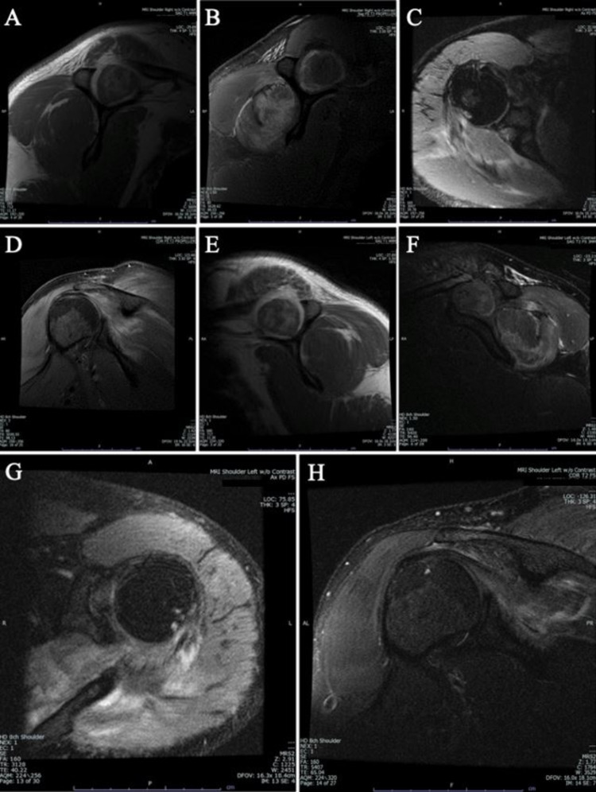
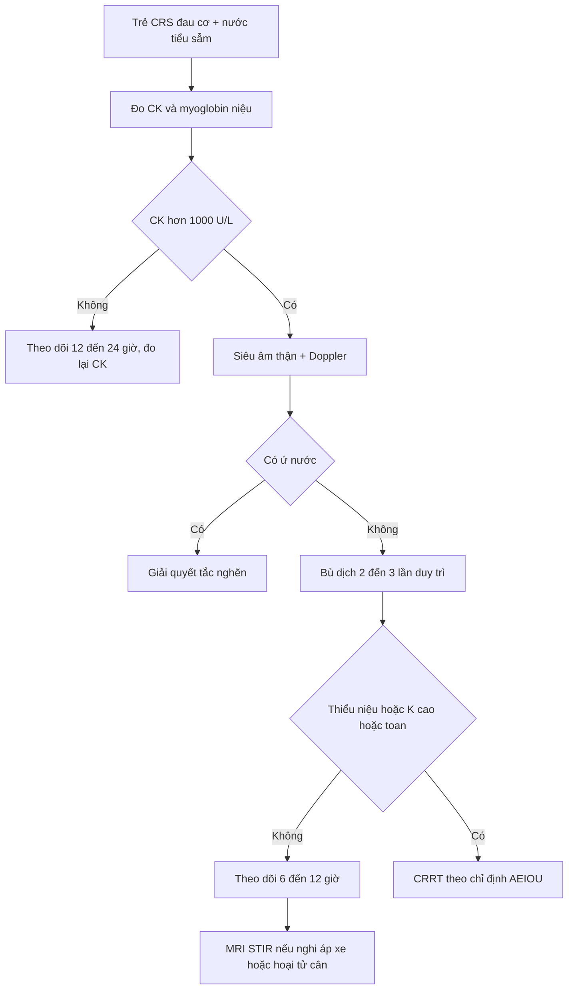
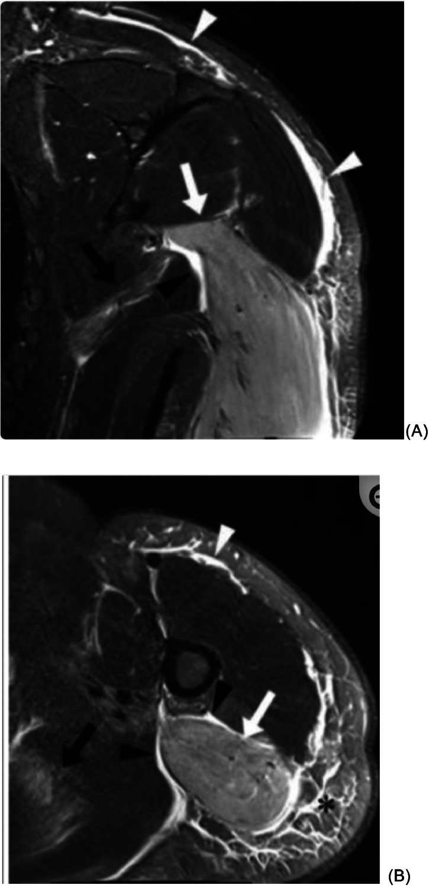
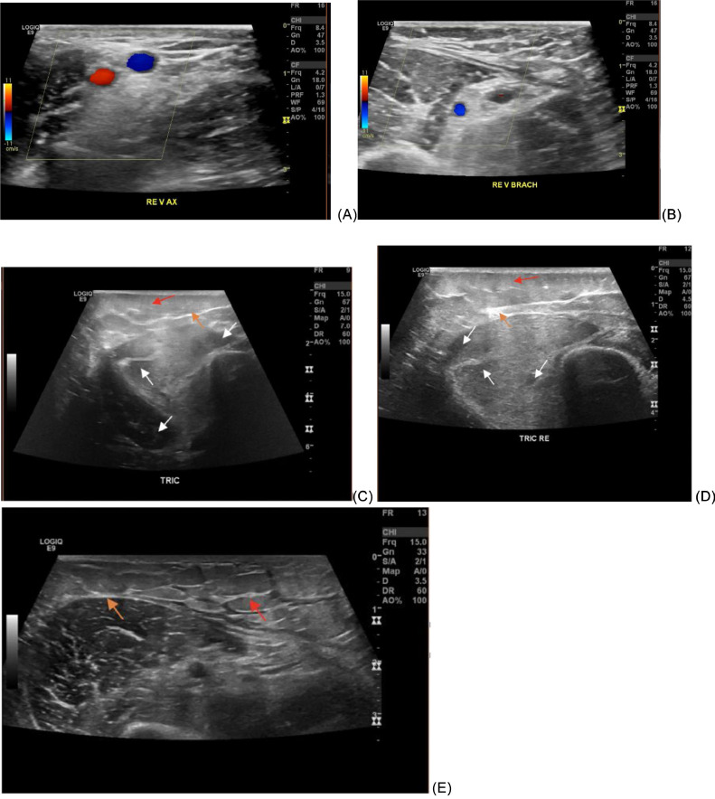

# 6176 — Tiêu cơ vận và tổn thương thận cấp trong hội chứng giải phóng cytokine ở trẻ / Rhabdomyolysis and acute kidney injury in paediatric cytokine release syndrome

**Tags:** `pattern:phu-co` `pattern:tan-co` `pattern:phu-mo-mem` `vung:co-van` `vung:than` `protocol:MRI-co` `protocol:sieu-am-co` `score:KDIGO` `score:CTCAE`

**Mức chắc chắn (certainty):** tổng hợp y văn (literature synthesis) — số liệu dịch tễ lấy từ **phân tích gộp 2025 về tiêu cơ vận ở trẻ** (BMC Pediatr, PMC12560446), **đoàn hệ 55 trẻ** (Front Pediatr 2020, PMC7500160), **đoàn hệ 112 trẻ** (Healthcare 2024, PMC11395255), **ca CRS độ 3 kèm tiêu cơ vận sau CAR-T** (World J Clin Cases 2022, PMID 36159401) và **ca CRS nặng phải CRRT** (Case Rep Oncol Med 2026, PMC12903790). Ảnh minh hoạ lấy từ 2 ca người lớn có cùng mẫu hình (Cureus 2021, Radiol Case Rep 2024) — ghi rõ trong chú thích, không gán bệnh nhi cho ảnh người lớn.

> **Câu chốt:** trong CRS, **đau cơ và nước tiểu sẫm màu bị quy cho "đau cơ do cytokine"** — nhưng đó có thể là **tiêu cơ vận (rhabdomyolysis)** với CK tăng hàng chục lần và **hoại tử ống thận do sắc tố** đi kèm. Chẩn đoán **không dựa vào hình ảnh**: **CK > 1.000 U/L** (hoặc > 5 × ULN) là ngưỡng sinh hoá; hình ảnh chỉ trả lời **cơ nào tổn thương, có áp-xe/viêm cân mạc/hoại tử không, thận còn tưới máu hay đã ứ nước**. Đỉnh CK **không** tỷ lệ với độ nặng AKI: trong đoàn hệ 55 trẻ, **rối loạn điện giải** mới là yếu tố dự báo AKI, không phải CK đỉnh.

## 1. Tổng quan bệnh học – cơ chế hình ảnh

### 1.1 TẠI SAO CRS làm vỡ cơ vân

Bốn đòn bẩy cùng lúc trên một bệnh nhi đang có bão cytokine:

1. **Thiếu ATP do giảm tưới máu:** CRS gây giãn mạch + rò mao mạch → tụt áp; cơ vân là tạng lớn nhất và là "khách hàng" cuối của dòng máu. Khi ATP giảm, **bơm Na⁺/K⁺-ATPase** ngừng → Na⁺ vào, Ca²⁺ vào theo gradient → **calpain và phospholipase** hoạt hoá → màng cơ (sarcolemma) rách.
2. **Sốt cao + rét run:** co cơ liên tục làm tăng nhu cầu ATP đúng lúc nguồn cung giảm — cùng cơ chế với tiêu cơ sau co giật/sốt cao.
3. **Bất động và chèn ép:** nằm lâu trên cáng/giường hồi sức ở trẻ mê/bứt rối loạn → chèn ép khoang cơ, thiếu máu cục bộ cục bộ.
4. **Rò mao mạch tại chỗ:** IL-6 làm tăng tính thấm mao mạch cơ → phù cơ, tăng áp lực trong bao cơ → giảm tưới máu mao mạch thêm (vòng xoáy).

Khi sarcolemma rách, **myoglobin (17,8 kDa), CK, K⁺, phosphate, acid uric, LDH** đổ vào máu. Myoglobin lọt qua cầu thận, tại **nước tiểu toan** chuyển thành dạng **ferryl-heme** gây **độc trực tiếp tế bào ống thận** và **đúc ống (cast)**; cộng thêm **giảm thể tích** do dịch dồn vào cơ (có thể vài lít) → **AKI "hai đòn" (pigment + prerenal)**.

### 1.2 TẠI SAO hình ảnh trông như vậy (vật lý + mô bệnh)

| Chuỗi xung / phương thức | Vì sao có tín hiệu đó |
|---|---|
| **T2W fat-sat / STIR** | Phù cơ = **nước tự do** (thời gian T2 dài) → **tăng tín hiệu** trong cơ, nổi bật trên nền mỡ bị bão hoà. Đây là chuỗi **nhạy nhất**, không cần cản quang |
| **T1W** | Nước thay mỡ **không làm tăng** T1 (khác máu bán cấp/mỡ) → cơ **đẳng tín hiệu đến hơi giảm**, chỉ thấy **to cơ, mất vân cơ**; T1 có ích để **loại trừ mỡ thay cơ và máu tụ** |
| **CT** | Cơ bình thường **40–60 HU**; khi phù/hoại tử nước thay nhu mô → **20–40 HU**, cơ **to, mờ bờ**, không ngấm thuốc ở vùng hoại tử. CT **không** đủ nhạy để phát hiện tiêu cơ nhẹ |
| **Siêu âm** | Phù tách các bó cơ → **dải/túi dịch không hồi âm giữa các bó**, mất cấu trúc sợi, **cân cơ dày và tăng âm**, phù mô dưới da. Doppler màu dùng để **loại trừ huyết khối tĩnh mạch** và **đánh giá tưới máu** (không đo được áp lực khoang) |
| **Thận trên siêu âm** | Thận **to, vỏ tăng âm** (phù kẽ + đúc ống), **không ứ nước**; **RI ≥ 0,70** trên Doppler gợi ý bệnh nhu mô — nhưng **không đặc hiệu** cho thể sắc tố |

Điểm mấu chốt về mô bệnh: trong tiêu cơ vận **cấu trúc bó cơ vẫn còn** (hoại tử dạng lưới, chưa hoá lỏng) — khác **áp-xe cơ** (ổ dịch có vỏ ngấm thuốc) và **viêm cân mạc hoại tử** (dịch dọc cân, khí trong mô). Vì vậy ảnh chỉ "phù cơ lan toả" **không** đủ gọi nhiễm trùng hoại tử.

### 1.3 Ngưỡng định lượng bắt buộc nhớ

| Đại lượng | Ngưỡng / con số | Nguồn |
|---|---|---|
| Định nghĩa tiêu cơ vận (trẻ) | **CK > 1.000 U/L** hoặc **> 5 × ULN**, không do nguyên nhân cơ tim/loạn dưỡng cơ | PMC12560446 (tiêu chuẩn của các nghiên cứu gộp) |
| **CK > 5.000 U/L** | AKI **~19%** so với **~8%** khi CK < 5.000 U/L | PMC7500160 (trích dẫn y văn) |
| Phân tích gộp trẻ (2025) | **AKI 21,3%** (95% CI 14,5–30,3) · **CKD 1,1%** · **tử vong 4,5%** (1,7–11,8) · **nhiễm trùng là nguyên nhân hàng đầu (~40%)** | PMC12560446 |
| Myoglobin niệu | **OR 22,98** (2,05–432,48) cho AKI; tuổi lớn hơn **OR 1,44/1 tuổi** | PMC11395255 (112 trẻ) |
| Yếu tố dự báo AKI ở 55 trẻ | **Rối loạn điện giải** (p < 0,05) — **không** có liên hệ với tuổi, giới, **CK đỉnh** | PMC7500160 |
| Động học CK | Đỉnh **24–72 giờ**, **nửa đời ~1,5 ngày (36 giờ)** → giảm ~40–50%/ngày nếu ngừng tổn thương. Ví dụ thực: **14.990 → 127 U/L** trong 10 ngày | PMC8569652 |
| KDIGO AKI (2012) | Độ 1: **1,5–1,9 ×** baseline **hoặc +0,3 mg/dL/48 giờ**; độ 2: **2,0–2,9 ×**; độ 3: **≥ 3,0 ×** hoặc **≥ 4,0 mg/dL** hoặc **RRT** | KDIGO 2012 |
| Thiểu niệu | **< 0,5 mL/kg/giờ trong 6 giờ** (độ 1); **vô niệu 12 giờ** (độ 3) | KDIGO 2012 |
| Bù dịch | **2–3 × nhu cầu duy trì**, theo dõi nước tiểu **1–2 mL/kg/giờ** | Đồng thuận điều trị (không có RCT) |
| CRRT | **Không** có bằng chứng CRRT loại myoglobin cải thiện kết cục → **không** khởi động CRRT chỉ vì CK cao | Cochrane 2014 (Zeng, CD008566) |

## 2. Mẫu hình + chẩn đoán phân biệt theo vị trí (gamut)

**Mẫu hình chung:** trẻ **sau truyền CAR-T/blinatumomab** (hoặc đang CRS nặng) **đau cơ, yếu, nước tiểu sẫm màu, CK tăng** → MRI/STIR **phù cơ lan toả một hoặc nhiều khoang, cấu trúc bó cơ còn**, cân cơ có thể dày nhưng **không có ổ dịch/khí**.

| Vị trí / mẫu hình | Gamut theo bối cảnh |
|---|---|
| **Cơ một chi, phù lan toả, cân nguyên** | **Tiêu cơ vận do CRS** · do thuốc (nelarabine, asparaginase, propofol, statin) · sau vận động/co giật · viêm cơ do virus (cúm, EBV) · thiếu máu cơ do tư thế |
| **Cơ + dịch dọc cân + khí trong mô mềm** | **Viêm cân mạc hoại tử** (cấp cứu ngoại) · viêm cơ mủ · áp-xe cơ · loét do đè ép nhiễm trùng |
| **Một khoang căng, đau vượt thăm khám, yếu/đau thụ động** | **Hội chứng khoang cấp** (bài 3125) · tiêu cơ vận có biến chứng khoang · huyết khối tĩnh mạch sâu |
| **Phù cơ + mô dưới da đối xứng, không đau cơ** | Phù toàn thân/rò mao mạch (CRS — bài 6165) · phù bạch mạch · suy tim/giảm albumin |
| **Cơ + ban da (Gottron, heliotrope), yếu gốc chi** | Viêm da cơ/viêm đa cơ · viêm cơ do ICI (bài 6162) · bệnh mô liên kết |
| **Thận to, vỏ tăng âm, KHÔNG ứ nước** | **Hoại tử ống thận do sắc tố** · AKI do cytokine/CRS · AKI do thuốc (cisplatin, ifosfamide) · **ly giải u (bài 6183)** |
| **Thận to + hạch/khối ổ bụng, ứ nước** | Thâm nhiễm u · chèn ép niệu quản · **TLS có tinh thể urat** (bài 6183) |

## 3. Bảng so sánh phân biệt (ma trận đối chiếu)

| Thực thể (entity) | Hình ảnh điển hình (US/CT/MRI) | Chốt vào (rule-in) | Chốt loại (rule-out) | Gợi ý xác nhận |
|---|---|---|---|---|
| **Tiêu cơ vận do CRS** | STIR/T2FS: phù cơ lan toả nhiều khoang, **cấu trúc bó cơ còn**; cân dày nhẹ; US: dịch giữa các bó, mất vân cơ | **CK > 1.000 U/L** + myoglobin niệu (dipstick máu dương, hồng cầu âm) + bối cảnh CRS | Không có ổ dịch vỏ ngấm thuốc, không khí trong mô → không phải áp-xe/hoại tử cân | CK 12–24 giờ/lần; xét nghiệm nước tiểu; MRI STIR nếu cần khoanh vùng |
| **Viêm cơ do virus** | Phù cơ khu trú/đối xứng, thường cơ thân mình; phục hồi sau 1–2 tuần | Triệu chứng hô hấp/tiêu hoá trước đó, PCR cúm/EBV (+), CK tăng vừa | CK **> 10.000** kéo dài, phù tiến triển nhiều khoang → nghĩ CRS/thuốc | PCR virus, diễn tiến |
| **Viêm cân mạc hoại tử** | **Dịch dọc cân > 3 mm**, dày cân, **khí trong mô mềm**, phù mô dưới da, có thể ngấm thuốc không đều | **Khí trong mô + đau không tương xứng + sốt/tụt áp** | Không khí, không dịch dọc cân, cấu trúc cơ còn → không mổ vội | Ngoại khoa + cấy; CT có giá trị tìm khí |
| **Hội chứng khoang cấp** | Cơ căng, phù; **MRI/CT không đo được áp lực khoang** | **Đau thụ động tăng + khoang căng + mạch/đo áp lực khoang > 30 mmHg** (hoặc Δ < 30 mmHg) | Đau kiểm soát, không căng, không dấu thần kinh → theo dõi | Đo áp lực khoang là chốt, không phải hình ảnh |
| **Viêm đa cơ/da cơ** | Phù cơ **đối xứng gốc chi**, teo mỡ, phù dưới da; có thể xơ hoá muộn | Yếu gốc chi tiến triển + enzym cơ tăng + **EMA/Myositis panel (+)** | CK tăng thoáng qua, có nguyên nhân cấp (CRS/thuốc) → không phải tự miễn | Sinh thiết cơ, kháng thể đặc hiệu |
| **Tiêu cơ do thuốc (nelarabine…)** | Không khác về hình ảnh; thường phù cơ lan toả, khởi phát **vài ngày sau truyền** | **Thời điểm sau truyền thuốc + CK tăng nhanh**, không có CRS | CRS đang hoạt động (sốt, ferritin, IL-6) → quy về CRS | Ngưng thuốc, theo dõi CK |
| **AKI do sắc tố** | Thận to, vỏ tăng âm, RI ≥ 0,70, **không ứ nước** | **CK rất cao + myoglobin niệu + creatinin tăng** | Có ứ nước/giãn bể thận → nguyên nhân tắc nghẽn | Siêu âm thận + Doppler; không cản quang khi đang AKI |

*Ảnh minh hoạ ở **người lớn** (sau mổ tim, CK 14.990 U/L), cùng mẫu hình với trẻ CRS. Các khung T1W (A, D) cho thấy cơ to nhưng tín hiệu không tăng; T2W/STIR (C, G) tăng tín hiệu lan toả cơ–cân–mô dưới da. Nguồn: Cureus 2021, PMC8569652, CC BY 4.0.*

## 4. Protocol chụp + hệ phân độ

- **MRI cơ (khi cần khoanh vùng hoặc loại trừ áp-xe):** 1,5 T; **axial + coronal T1W** và **T2W fat-sat/STIR**; trường nhìn phủ **toàn bộ khoang** nghi ngờ + so sánh bên đối diện. **Tránh gadolinium khi đang AKI** trừ khi cần phân biệt áp-xe; không dùng cản quang chỉ để "xem cơ".
- **Siêu âm cơ:** đầu dò thẳng **9–15 MHz**, khảo sát nhiều điểm theo khoang, đối chiếu hai bên, **Doppler màu** để loại trừ huyết khối tĩnh mạch và xem tưới máu. Siêu âm **không** thay thế đo áp lực khoang.
- **CT:** chỉ khi nghi **nhiễm trùng hoại tử/khí trong mô** hoặc máu tụ; đo đậm độ cơ (bình thường **40–60 HU**).
- **Siêu âm thận:** chiều dài theo tuổi, so **độ hồi âm vỏ thận với gan/lách**, tìm **ứ nước**, đo **RI**; bắt buộc khi có thiểu niệu để loại trừ tắc nghẽn trước khi quy AKI cho sắc tố.
- **Theo dõi sinh hoá:** CK, K⁺, phosphate, Ca²⁺, acid uric, creatinin, khí máu **mỗi 6–12 giờ** trong 48–72 giờ đầu; **đo lại CK sau 12–24 giờ** vì đỉnh đến muộn.
- **Bù dịch:** **2–3 × duy trì** bằng dịch tinh thể đẳng trương, mục tiêu nước tiểu **1–2 mL/kg/giờ**; **không** dùng bicarbonate/manitol thường quy (không có RCT chứng minh).
- **CRRT:** chỉ định theo **AEIOU/KDIGO** (toan nặng, điện giải không kiểm soát, ngộ độc, quá tải dịch, urê cao) — **không** chỉ định vì CK cao (Cochrane 2014).

## 5. Biến thể bình thường và cạm bẫy

- **CK bình thường không loại trừ:** CK tăng sau **2–12 giờ**, đỉnh **24–72 giờ** → trẻ mới khởi phát đau cơ có thể còn CK trong giới hạn.
- **Dipstick "máu 3+" mà hồng cầu âm** = myoglobin (hoặc hemoglobin) — phải soi cặn; đừng gọi là đái máu.
- **Đỉnh CK không tỷ lệ với AKI** (55 trẻ: rối loạn điện giải mới dự báo AKI). Đừng trấn an vì "CK chỉ 3.000".
- **Tăng tín hiệu T2 là phù, không phải chẩn đoán:** phù do nằm lâu, phù toàn thân, sau chấn thương đều tăng tín hiệu. Chỉ gọi tiêu cơ khi có **CK + bối cảnh**.
- **Đừng bỏ qua viêm cân mạc hoại tử:** tiêu cơ vận có thể kèm phù mô dưới da dữ dội; chỉ **khí trong mô hoặc dịch dọc cân** mới đổi đường điều trị (mổ).
- **Sai lầm tìm kiếm thoả mãn (satisfaction of search):** bệnh nhi CRS thở nhanh → cả ê-kíp tập trung phổi (bài 6165) và **không ai đo CK**.
- **Cản quang trong AKI:** tránh gadolinium/iodine khi không cần; nếu bắt buộc chụp CT có cản quang để tìm ổ nhiễm, ghi rõ nguy cơ và bù dịch.
- **Hạ calci + tăng phosphate** trong tiêu cơ vận có thể giống TLS; khác ở chỗ **không có khối u lớn/acid uric tăng nhanh** (bài 6183).

## 6. Tự lượng giá — Blind Quiz

**Ca 1 — Nam thanh niên mổ tim, ngày 2 đau và sưng hai vai, nước tiểu sẫm, CK 14.990 U/L.**

- Hỏi: tín hiệu bất thường nằm ở cơ hay mô dưới da? Vì sao T1W không tăng? Hai chẩn đoán cần loại trừ trên lâm sàng?
- Gợi ý: so sánh khung T1W (A, D) với T2W/STIR (C, G).

<b>Bấm để hiện đáp án (findings + chẩn đoán)</b>

- **Dấu hiệu:** cơ vai–cơ delta **to**, T1W **đẳng/giảm tín hiệu** (A, D) nhưng **tăng tín hiệu mạnh lan toả** trên T2W/STIR (C, G), kèm **phù mô dưới da và dày cân**; **không có ổ dịch vỏ ngấm thuốc, không khí trong mô**.
- **Chẩn đoán:** **tiêu cơ vận sau mổ** (CK 14.990 U/L → 127 U/L ngày 12) với tổn thương cơ–cân–dưới da; creatinin trong giới hạn nên **chưa có AKI**, nhưng phải bù dịch và theo dõi.
- **Vì sao T1W không tăng:** phù là **nước tự do** (T1 dài) chứ không phải mỡ/máu bán cấp — mỡ hay methemoglobin mới làm T1 tăng.
- **Loại trừ:** huyết khối tĩnh mạch sâu (siêu âm Doppler) và viêm cân mạc hoại tử (khí/dịch dọc cân, đau không tương xứng).
- Nguồn ảnh: Cureus 2021, PMC8569652, CC BY 4.0 — **người lớn**.

**Ca 2 — Nữ 36 tuổi, sau vận động nặng, đau cơ tam đầu phải, CK tăng; MRI inversion recovery.**

- Hỏi: mô nào tăng tín hiệu? Có dấu hiệu nào của áp-xe/hoại tử không? Bước tiếp theo trên siêu âm?

<b>Bấm để hiện đáp án (findings + chẩn đoán)</b>

- **Dấu hiệu:** **đầu dài cơ tam đầu** tăng tín hiệu trên ảnh inversion recovery (mũi tên trắng), **dịch dọc cân nông và sâu** (đầu mũi tên), **phù mô dưới da** (dấu hoa thị) — cấu trúc bó cơ còn, **không có ổ dịch khu trú**.
- **Chẩn đoán:** **tiêu cơ vận do vận động** — cùng mẫu hình với tiêu cơ do CRS; không phải áp-xe vì không có vỏ ngấm thuốc/ổ dịch.
- **Siêu âm kế tiếp:** tìm dịch giữa các bó, độ dày cân, và **Doppler** loại trừ huyết khối tĩnh mạch (ca này Doppler tĩnh mạch bình thường).
- Nguồn ảnh: Radiol Case Rep 2024, PMC11137360, CC BY-NC-ND 4.0 (nguyên bản).

**Ca 3 — Trẻ 12 tuổi CRS độ 3 sau CAR-T: đau cơ đùi, CK 8.400 U/L, nước tiểu 0,3 mL/kg/giờ, K⁺ 5,6 mmol/L; siêu âm cơ đùi.**

- Hỏi: ba dấu hiệu siêu âm của phù cơ? Có cần CRRT ngay vì CK 8.400 không? Cần loại trừ gì ở thận?

<b>Bấm để hiện đáp án (findings + chẩn đoán)</b>

- **Dấu hiệu:** (1) **vùng không hồi âm giữa các bó cơ** (mũi tên trắng) = dịch/phù; (2) **cân cơ dày, tăng âm** (mũi tên cam); (3) **thâm nhiễm mô dưới da** (mũi tên đỏ). Ảnh A–B là Doppler tĩnh mạch **thông thoáng** (loại trừ huyết khối).
- **CRRT:** **không** chỉ định vì CK; chỉ định khi có **điện giải không kiểm soát (K⁺ > 6,5 hoặc loạn nhịp), toan nặng, quá tải dịch, vô niệu** — CRRT không chứng minh loại được myoglobin.
- **Ở thận:** siêu âm tìm **ứ nước** trước (nguyên nhân ngoại khoa), rồi mới quy cho **hoại tử ống thận do sắc tố**; đo RI và theo dõi nước tiểu.
- **Bẫy:** nước tiểu sẫm + dipstick máu dương + hồng cầu âm = myoglobin, không phải đái máu.
- Nguồn ảnh: Radiol Case Rep 2024, PMC11137360, CC BY-NC-ND 4.0 (nguyên bản).

## Bài liên quan chéo

- [6165 – Phù phổi do CRS sau CAR-T/blinatumomab](../6165-phu-phoi-crs-sau-car-t-blinatumomab-o-tre/lesson.md) (cùng bệnh cảnh rò mao mạch)
- [6183 – Hội chứng ly giải u ở trẻ: ngưỡng Cairo–Bishop và khi nào lọc máu](../6183-ly-giai-u-o-tre-nguong-loc-mau/lesson.md) (bộ ba K⁺/phosphate/Ca giống tiêu cơ vận)
- [6171 – Viêm tụy cấp do asparaginase](../6171-viem-tuy-cap-do-asparaginase-tre-all/lesson.md) (độc tính thuốc trong ALL)
- [3125 – Chèn ép khoang cấp ở trẻ](../3125-chen-ep-khoang-cap-o-tre/lesson.md) (biến chứng của tiêu cơ vận)
- [646 – Hội chứng khoang bụng ở trẻ](../646-hoi-chung-khoang-bung-o-tre/lesson.md)
- [6162 – Viêm cơ tim do ICI](../6162-viem-co-tim-do-ici/lesson.md) (độc tính cơ do miễn dịch)

## Ảnh

- `6176_tieu-co-van_MRI-vai_PMC8569652.jpg` — Cureus 2021, PMC8569652, **CC BY 4.0** (nguyên bản, người lớn).
- `6176_tieu-co-van_MRI-triceps_PMC11137360.jpg` — Radiol Case Rep 2024, PMC11137360, **CC BY-NC-ND 4.0** (nguyên bản, không cắt/ghép).
- `6176_tieu-co-van_US-triceps_PMC11137360.jpg` — Radiol Case Rep 2024, PMC11137360, **CC BY-NC-ND 4.0** (nguyên bản).

> Không dùng để chẩn đoán độc lập khi chưa có người hướng dẫn.
