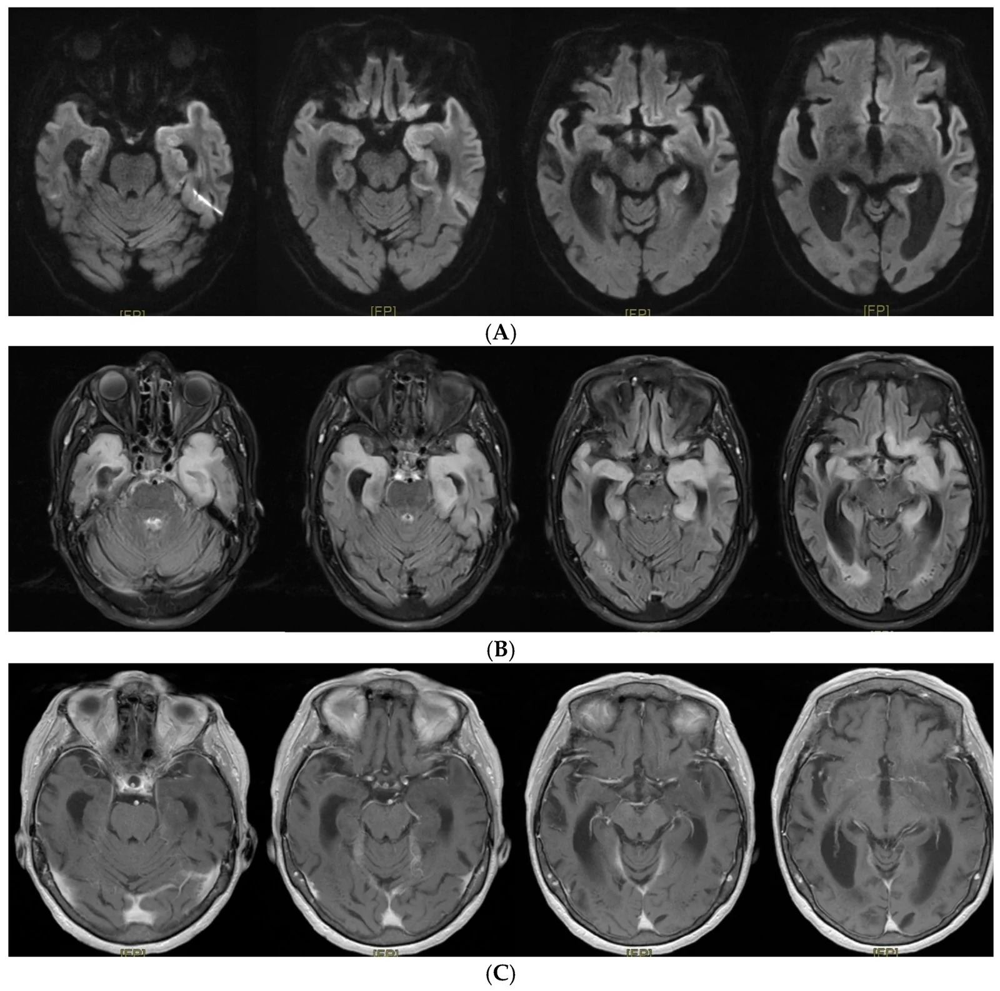
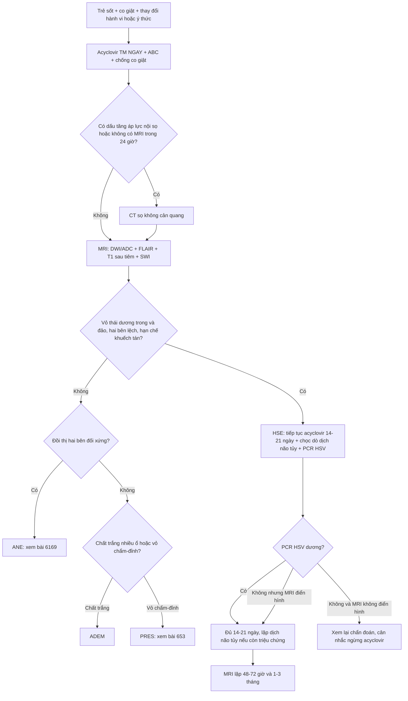
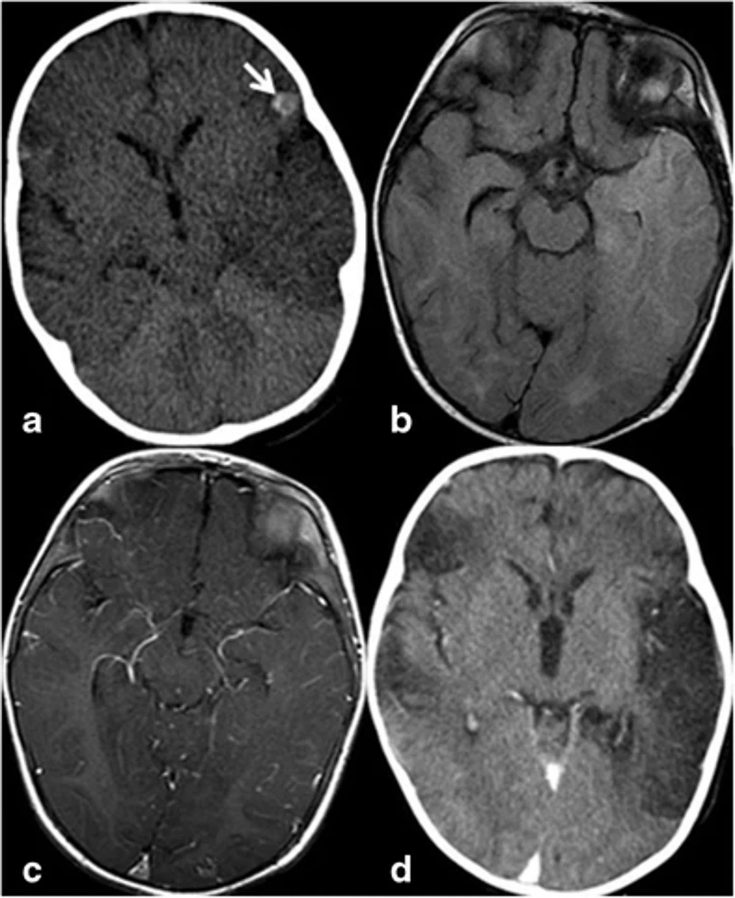

# 6177 — Viêm não do herpes simplex (HSE) ở trẻ: đọc MRI TRƯỚC khi T2 rõ và không chờ PCR

**Tags:** `pattern:viem-nao-thai-duong` `pattern:han-che-khuếch-tán` `pattern:xuat-huyet-diem` `pattern:mot-ben` `vung:nao` `vung:nao-that` `protocol:MRI-so-nao` `protocol:DWI-ADC` `protocol:SWI` `incidentaloma:khong`
**Mức chắc chắn (certainty):** tổng hợp y văn (literature synthesis) — ghép **đoàn hệ 17 năm/58 trẻ viêm não cấp ở PICU** (*BMC Pediatr* 2026, PMCID **PMC13617808**, CC BY-NC-ND 4.0), **nghiên cứu toàn quốc 6.788 ca HSE** (*J Epidemiol* 2026, PMCID **PMC13349789**, CC BY 4.0), **ca người lớn 85 tuổi có dịch não tủy KHÔNG tăng tế bào** (*J Clin Med* 2026, PMCID **PMC13565770**, CC BY 4.0). Không có ca do nhóm tự chụp.

> **Câu chốt:** trẻ **sốt + co giật + thay đổi hành vi/ý thức**, hình ảnh **vỏ thuỳ thái dương trong – đảo – trán dưới, HAI BÊN nhưng không đối xứng, hạn chế khuếch tán**, **không theo lãnh thổ mạch**, **giữ nguyên nhân bền (basal ganglia)** = **HSE cho tới khi chứng minh khác**. Ba con số định khung: **CT chỉ bất thường 46,0% trong khi MRI 76,1%** (PMC13617808), **tử vong nội viện 6,0%** dù đã dùng acyclovir (PMC13349789), và **tử vong 20,7%** ở trẻ viêm não cấp nằm PICU (PMC13617808). **Acyclovir phải bắt đầu trước khi có MRI/PCR.**

## 1. Tổng quan bệnh học – cơ chế hình ảnh (TẠI SAO)

### 1.1. Đường vào và vì sao tổn thương chọn thuỳ thái dương – đảo

- HSV-1 lây qua đường mũi → **hành khứu** → **vỏ não khứu/trán dưới** → lan theo **đường rãnh, sợi trục và lan dịch não tủy** tới **thuỳ thái dương trong (hồi hải mã, hạch hạnh nhân) và đảo**. Vì vậy mẫu hình không theo lãnh thổ mạch và **hay gặp hai bên, lệch một bên** — đây là điểm khác cốt lõi với **nhồi máu não**.
- **TẠI SAO DWI sáng sớm hơn T2:** virus gây **phù độc tế bào (cytotoxic edema)** — nước vào trong tế bào → **ADC giảm**, DWI sáng **trong 24–48 giờ đầu**; T2/FLAIR chỉ sáng rõ khi phù đủ lớn (thường chậm hơn **1–2 ngày**). Đó là lý do **MRI âm tính ngày 1 không loại trừ**, và **phải chụp lại 48–72 giờ** nếu bệnh cảnh tiếp tục.
- **TẠI SAO có máu:** HSV gây **viêm hoại tử xuất huyết** ở vỏ thái dương — xuất huyết dạng **chấm (petechial)** làm **tăng tỷ trọng trên CT không cản quang** (ảnh mục 6, mũi tên) và **blooming trên SWI**; không phải máu tụ.
- **TẠI SAO để lại di chứng:** hoại tử vỏ + phù lan → **teo não, não mềm hóa (encephalomalacia)** sau vài tuần; trẻ có thể **động kinh kháng trị** và **suy giảm trí nhớ/ngôn ngữ**.

### 1.2. Vì sao CT "bình thường" vẫn phải MRI — vật lý và số liệu

- CT chỉ thấy vùng giảm tỷ trọng khi phù đủ lớn (**giảm 2–5 HU** khó thấy ở trẻ có nhu mô nhiều nước) và **chỉ thấy máu khi đã có xuất huyết**; vì vậy trong đoàn hệ nhi, **CT bất thường 23/50 = 46,0%**, còn **MRI bất thường 35/46 = 76,1%** (PMC13617808).
- **MRI là chốt** vì cùng một lúc trả lời 4 câu: **(1) có hạn chế khuếch tán thật? (2) có xuất huyết? (3) có lan thân não/đối bên? (4) có khối choán chỗ khác (u, áp-xe) không?**
- **TẠI SAO không chờ PCR:** PCR HSV trong dịch não tủy **có thể âm tính trong 72 giờ đầu** và **dịch não tủy có thể KHÔNG tăng tế bào** (ca 85 tuổi trong PMC13565770 — chẩn đoán suýt bị bỏ vì "dịch trong"); trong đoàn hệ nhi, **PCR HSV dương chỉ 6/56 (10,7%) mẫu** vì nhiều ca không lấy được dịch/đã qua giai đoạn.

### 1.3. Ngưỡng định lượng nằm lòng

| Đại lượng | Số liệu | Nguồn |
|---|---|---|
| Trẻ viêm não cấp nằm PICU (17 năm) | **58/2.240 = 2,6%**; trung bình **3,4 ca/năm** | PMC13617808 |
| **MRI bất thường** vs **CT bất thường** | **76,1% (35/46)** vs **46,0% (23/50)** | PMC13617808 |
| Triệu chứng: co giật / rối loạn ý thức / sốt / hôn mê / động kinh liên tục | **82,8%** / **69,0%** / **82,8%** / **53,4%** / **23,9%** | PMC13617808 |
| Tử vong / di chứng thần kinh ở trẻ sống | **20,7% (12/58)** / **19,6% (9/46)** | PMC13617808 |
| Acyclovir theo kinh nghiệm (đoàn hệ) | **86,2% (50/58)**, trung vị **6 ngày** | PMC13617808 |
| Dịch não tủy: tăng tế bào / protein > 0,4 g/L | ngưỡng tăng tế bào **> 10 tế bào/µL**; protein tăng **24,5%** | PMC13617808 |
| HSE toàn quốc (Nhật, 2010–2023) | **6.788 ca**; **5,7–8,2/100.000 ca nhập viện** | PMC13349789 |
| Tử vong nội viện HSE / kết cục xấu (chết hoặc rối loạn ý thức) | **6,0%** / **29,6%** | PMC13349789 |
| Di chứng chức năng ở người sống | **Barthel ≤ 90: 36,0%**; **rối loạn ý thức: 25,1%** | PMC13349789 |
| Thời gian acyclovir (khi dùng) | trung vị **10 ngày** (IQR **6–15**) | PMC13349789 |
| Tử vong cấp HSE dù điều trị (y văn) | **5–20%** | PMC13349789 (phần bàn luận) |

- **Chưa rõ — cần tra:** không có **ngưỡng ADC (×10⁻⁶ mm²/s)** hay **ngưỡng thể tích tổn thương** được thẩm định cho HSE; phân tầng dựa vào **ý thức, động kinh liên tục, tổn thương hai bên/thân não**, không dựa vào một con số trên ảnh.

## 2. Mẫu hình + chẩn đoán phân biệt theo vị trí (Gamut)

- **Thái dương trong + đảo + trán dưới, hai bên lệch:** **HSE**; **viêm não tự miễn/limbic** (không sốt, kháng thể); **u thần kinh đệm cấp thấp** (không sốt, không hạn chế khuếch tán mạnh, ngấm thuốc); **trạng thái động kinh** (phù vỏ thoáng qua sau cơn).
- **Đồi thị hai bên đối xứng:** **ANE** (bài **6169**), **CVST**, **HIE**, hạ đường huyết — **không** phải HSE điển hình.
- **Vỏ não sau/chẩm–đỉnh hai bên:** **PRES** (bài **653**), tăng huyết áp/thuốc.
- **Chất trắng, nhiều ổ, không theo vỏ:** **ADEM**; **viêm màng não–não do enterovirus**.
- **Ổ viền ngấm thuốc + hạn chế khuếch tán trung tâm:** **áp-xe não** (bài **236**).
- **Một bên, theo lãnh thổ mạch, có/không xuất huyết, không sốt:** **nhồi máu MCA** — HSE **hiếm khi** tôn trọng ranh giới mạch và **thường có sốt + co giật**.
- Gợi nhớ **HSE** = **H**ippocampus/insula, **S**eizure + fever, **E**dema–restricted diffusion.

## 3. Bảng so sánh phân biệt (ma trận đối chiếu)

| Thực thể (entity) | Hình ảnh điển hình (CT/MRI) | Chốt vào (rule-in) | Chốt loại (rule-out) | Gợi ý xác nhận |
|---|---|---|---|---|
| **HSE** | **Vỏ thái dương trong + đảo + trán dưới**, hai bên lệch, **DWI sáng/ADC thấp**, **xuất huyết chấm**, **giữ nguyên thể vân** | **Sốt + co giật + thay đổi hành vi**; **MRI 76,1% bất thường** dù CT chỉ 46,0% | Tổn thương **đồi thị hai bên đối xứng** → nghĩ ANE; **một ổ viền ngấm** → áp-xe | MRI DWI/FLAIR + SWI; **PCR HSV (có thể âm 72 giờ đầu)**; **acyclovir ngay** |
| **ANE do cúm (6169)** | **Đồi thị hai bên**, thân não, chất trắng quanh não thất; dấu ba lớp | **Đồi thị hai bên + sốt + transaminase tăng, ammonia bình thường** | Tổn thương **thái dương–đảo một bên** → HSE | MRI lặp 48–72 giờ; PCR cúm |
| **Nhồi máu MCA** | Vỏ + chất trắng **theo lãnh thổ**, bờ rõ, không sốt | **Khởi phát đột ngột, khuyết thiếu thần kinh khu trú**, mạch máu tắc trên MRA | Tổn thương **hai bên thái dương trong** hoặc **có sốt** → không điển hình | MRA/CTA, siêu âm tim nếu trẻ |
| **Trạng thái động kinh (phù sau cơn)** | **Vỏ não hạn chế khuếch tán thoáng qua** đúng vùng khởi phát, có thể tăng tín hiệu T2 nhẹ | **Cơn được ghi trên EEG** ngay trước đó; tổn thương **giảm dần sau 48–72 giờ** | Tồn tại **> 1 tuần**, có xuất huyết, teo vỏ → không phải phù sau cơn | EEG + MRI lặp; đừng mặc định "HSE" |
| **Viêm não tự miễn/limbic** | **Hai bên thái dương trong**, không xuất huyết, teo hải mã muộn | **Thay đổi hành vi ± động kinh, không sốt**, kháng thể (anti-NMDAR, anti-LGI1) | **Có sốt cao + xuất huyết** → nghi HSE trước | Kháng thể huyết thanh/dịch não tủy; EEG |
| **PRES (653)** | **Vỏ chẩm–đỉnh hai bên**, phù mạch, không hạn chế khuếch tán mạnh | **Tăng huyết áp/thuốc ức chế miễn dịch/suy thận**, đau đầu, mờ mắt | **Thái dương trong + đảo** → không phải PRES | MRI, kiểm soát huyết áp |
| **Áp-xe não (236)** | **Ổ dịch viền ngấm thuốc**, DWI hạn chế ở **trung tâm ổ**, phù quanh | **Sốt + tăng áp lực nội sọ + ổ viền**; nguồn tai xoang/răng | Tổn thương **vỏ não lan theo rãnh, không tạo ổ** → HSE | CT/MRI cản quang, cấy; dẫn lưu nếu ổ lớn |
| **ADEM** | **Chất trắng nhiều ổ**, không đối xứng, có thể đồi thị | **Sau nhiễm/vaccine 1–3 tuần**, nhiều ổ, không sốt cao | Tổn thương **vỏ đơn thuần** → không phải ADEM | MRI sọ + tủy, kháng thể MOG |

*Ca **người lớn 85 tuổi** (minh hoạ mẫu hình, không phải trẻ): (A) DWI — **hạn chế khuếch tán vỏ thái dương, đảo, trán dưới và hồi đai hai bên**, ưu thế trái; (B) FLAIR — tăng tín hiệu tương ứng **hồi hải mã, hạch hạnh nhân, vỏ não khứu**; (C) T1 sau tiêm — **không ngấm thuốc bệnh lý**. Ảnh nguyên bản, không crop. Nguồn: *J Clin Med* 2026, PMCID PMC13565770, CC BY 4.0.*

## 4. Protocol chụp + phân tầng xử trí

### 4.1. Thứ tự hành động (không chờ hình ảnh)

1. **Acyclovir tĩnh mạch NGAY** khi nghi HSE (sốt + co giật + thay đổi hành vi/ý thức): **10 mg/kg mỗi 8 giờ** (trẻ ≥ 12 tuổi/người lớn) hoặc **20 mg/kg mỗi 8 giờ** ở trẻ nhỏ theo nhiều phác đồ — **đối chiếu phác đồ địa phương**; thời gian **14–21 ngày** (tối thiểu **14 ngày**, **21 ngày** nếu còn suy giảm ý thức/PCR còn dương).
2. **CT sọ không cản quang** chỉ khi: dấu tăng áp lực nội sọ, chấn thương, hoặc **không có MRI trong 24 giờ**. **CT bình thường KHÔNG loại trừ** (chỉ 46,0% bất thường).
3. **MRI sọ ≤ 24 giờ**: **DWI + ADC + FLAIR + T2 + T1 sau tiêm + SWI**, **lát mỏng coronal qua hải mã**; đọc theo thứ tự: **vỏ thái dương trong → đảo → trán dưới → hồi đai → thể vân (phải giữ nguyên) → đối bên**.
4. **Chọc dò dịch não tủy** sau khi loại trừ tăng áp lực nội sọ: tế bào, protein, glucose, **PCR HSV**, PCR enterovirus; **lặp PCR sau 72 giờ** nếu lần đầu âm mà hình ảnh/lâm sàng điển hình.
5. **EEG** khi có rối loạn ý thức kéo dài hoặc nghi động kinh không co giật.
6. **MRI lặp** sau **48–72 giờ** nếu lần đầu bình thường; **1–3 tháng** để đánh giá teo/não mềm hóa và tiên lượng.

### 4.2. Phân tầng và điều trị

| Mức | Lâm sàng – hình ảnh | Xử trí |
|---|---|---|
| **Nghi HSE, chưa có kết quả** | Sốt + co giật + thay đổi hành vi, MRI chưa làm | **Acyclovir ngay**, không chờ PCR/MRI |
| **HSE xác định/điển hình** | MRI thái dương–đảo + PCR dương hoặc MRI điển hình | Acyclovir **14–21 ngày**; chống co giật; theo dõi Na⁺/chức năng thận (độc thận của acyclovir) |
| **HSE nặng** | Hôn mê, tổn thương hai bên/thân não, động kinh liên tục | ICU, EEG liên tục, chống phù não; **mổ giải áp** khi thoát vị (bài học từ ca nhi trong PMC12640269) |
| **Sau HSE** | Teo hải mã, động kinh muộn, chậm phát triển | Phục hồi chức năng, theo dõi động kinh, **cảnh giác viêm não anti-NMDAR sau HSE** (thay đổi hành vi trở lại sau giai đoạn ổn định) |

- **Không có thang điểm hình ảnh** cho HSE; quyết định dựa vào **mức ý thức + động kinh liên tục + lan hai bên/thân não**, không dựa vào kích thước ổ.

## 5. Biến thể bình thường và cạm bẫy

- **Cạm bẫy 1 — "CT bình thường":** 54% trẻ viêm não có CT bình thường (PMC13617808); **không** dừng chẩn đoán.
- **Cạm bẫy 2 — "dịch não tủy trong thì không phải viêm não":** ca 85 tuổi có **không tăng tế bào, không CRP** mà vẫn HSE (PMC13565770); **protein tăng chỉ 24,5%** trong đoàn hệ nhi.
- **Cạm bẫy 3 — PCR âm tính sớm:** PCR **có thể âm trong 72 giờ đầu**; **âm một lần không đủ để ngừng acyclovir** khi MRI điển hình.
- **Cạm bẫy 4 — "một bên nên không phải HSE":** HSE **thường hai bên nhưng lệch**; tổn thương một bên hoàn toàn có thể gặp ở giai đoạn sớm.
- **Cạm bẫy 5 — phù vỏ sau cơn động kinh:** hạn chế khuếch tán **thoáng qua 48–72 giờ**, đúng vùng ổ khởi phát, không xuất huyết → **không** mặc định HSE; cần EEG.
- **Cạm bẫy 6 — thể vân bị tổn thương:** HSE điển hình **giữ nguyên thể vân**; nếu **đồi thị/thể vân hai bên đối xứng** → nghĩ **ANE** hoặc bệnh chuyển hóa.
- **Cạm bẫy 7 — teo não muộn bị đọc là "tổn thương mới":** sau 1–3 tháng, **não mềm hóa + teo** là di chứng, không phải tái phát; so chuỗi phim.
- **Cạm bẫy 8 — hội chứng anti-NMDAR sau HSE:** trẻ hồi phục rồi **thay đổi hành vi, cử động bất thường, co giật lại** → không phải "tái phát HSE" mà là **viêm não tự miễn sau nhiễm**; cần kháng thể và điều trị miễn dịch.

*Ca minh hoạ trong đoàn hệ nhi (trẻ **7 tháng**): (a) CT không cản quang — **giảm tỷ trọng thuỳ thái dương trái rõ, phải nhẹ**, **ổ tăng tỷ trọng ở trán trái (mũi tên) = xuất huyết chấm**; (b) FLAIR — **tăng tín hiệu hai thuỳ thái dương, trái > phải**; (c) T1 sau tiêm — **ngấm thuốc màng mềm lan toả**; (d) CT muộn — **não mềm hóa và mất thể tích hai bên thái dương–trán**. Ảnh nguyên bản 4 panel, không crop. Nguồn: *BMC Pediatr* 2026, PMCID PMC13617808, CC BY-NC-ND 4.0.*

## 6. Tự lượng giá — Blind Quiz

**Ca 1 — Bé 7 tháng, sốt 2 ngày, co giật nửa người phải, li bì. CT sọ không cản quang tại tuyến đầu:**

- Hỏi: (1) Dấu hiệu nào trên CT gợi HSE? (2) Vì sao phải MRI? (3) Bắt đầu thuốc gì, trước hay sau khi có PCR?

<b>Bấm để hiện đáp án (findings + chẩn đoán)</b>

- **CT:** giảm tỷ trọng **thuỳ thái dương trái** rõ + phải nhẹ, **ổ tăng tỷ trọng trán trái = xuất huyết chấm** — mẫu hình HSE.
- **Vì sao MRI:** CT chỉ bất thường **46,0%**, MRI **76,1%**; MRI xác định **vỏ thái dương–đảo, hai bên, hạn chế khuếch tán**, loại trừ áp-xe/nhồi máu.
- **Thuốc:** **acyclovir tĩnh mạch NGAY** (10 mg/kg mỗi 8 giờ; trẻ nhỏ 20 mg/kg theo phác đồ) — **trước** PCR, không chờ.
- **Bước tiếp:** chọc dò dịch não tủy sau khi loại trừ tăng áp lực nội sọ, EEG, MRI lặp 48–72 giờ nếu cần.
- Nguồn ảnh: *BMC Pediatr* 2026, PMCID PMC13617808, CC BY-NC-ND 4.0.

**Ca 2 — Bé 3 tuổi, động kinh co giật–co cứng liên tục 40 phút, sau cơn vẫn lơ mơ. MRI 6 giờ sau cơn: hạn chế khuếch tán vỏ hải mã phải, không xuất huyết; MRI lặp 72 giờ: gần như bình thường.**

- Hỏi: đây là HSE hay phù sau cơn? Có cần acyclovir 14–21 ngày không?

<b>Bấm để hiện đáp án</b>

- **Chẩn đoán:** **phù vỏ sau trạng thái động kinh (post-ictal cortical change)** — hạn chế khuếch tán **thoáng qua 48–72 giờ**, đúng vùng ổ khởi phát, **không xuất huyết, không lan đảo/trán dưới**.
- **Vì sao không phải HSE:** tổn thương **mất dần** trên MRI lặp; HSE thường **tồn tại và tiến triển** (phù, xuất huyết, teo muộn).
- **Xử trí:** vẫn **bắt đầu acyclovir** cho tới khi loại trừ (an toàn), nhưng **ngừng sớm** khi MRI lặp bình thường + PCR âm; điều trị chính là **kiểm soát cơn**.
- Nguồn số liệu: PMC13617808 (CT 46,0% / MRI 76,1%).

**Ca 3 — Bé 10 tuổi, sốt, nói nhảm, co giật một cơn. Dịch não tủy: 3 tế bào/µL, protein 0,52 g/L; PCR HSV ngày 1 âm tính. MRI: tăng tín hiệu FLAIR + hạn chế khuếch tán hồi hải mã và đảo TRÁI.**

- Hỏi: có ngừng acyclovir vì PCR âm + dịch não tủy "trong" không?

<b>Bấm để hiện đáp án</b>

- **KHÔNG ngừng:** PCR **có thể âm trong 72 giờ đầu**; dịch não tủy **có thể không tăng tế bào** (ca PMC13565770) và protein chỉ tăng ở **24,5%** trẻ.
- **Chẩn đoán:** **HSE** dựa trên **MRI điển hình (thái dương trong + đảo, hạn chế khuếch tán)**; làm **PCR lặp ngày 4–7**.
- **Điều trị:** đủ **14–21 ngày** acyclovir; theo dõi chức năng thận, Na⁺; **không** dùng corticoid thường quy.
- Nguồn: PMC13349789, PMC13565770, PMC13617808.

## Bài liên quan chéo
- [6169 – Bệnh não do cúm (ANE) ở trẻ](../6169-benh-nao-do-cum-o-tre/lesson.md) (đồi thị hai bên đối xứng — hàng phân biệt chính)
- [653 – PRES/RCVS ở trẻ](../653-pres-rcvs-tre-em/lesson.md) (phù vỏ chẩm–đỉnh hai bên)
- [236 – Viêm tai xương chũm biến chứng nội sọ](../236-viem-tai-xuong-chum-bien-chung-noi-so/lesson.md) (áp-xe não/tụ mủ — ổ viền ngấm thuốc, đường vào từ tai)
- [3101 – Hội chứng CHANTER sau opioid](../3101-hoi-chung-chanter-opioid/lesson.md) (tổn thương hai bên sau thuốc)
- [3062 – Viêm màng não tái diễn ở trẻ có dị tật tai trong](../3062-viem-mang-nao-tai-dien-di-tat-tai-trong/lesson.md) (nhiễm trùng thần kinh trung ương đường vào từ tai)
- [212 – Xuất huyết sọ não](../212-xuat-huyet-so-nao/lesson.md) (loại trừ máu tụ trên CT)

## Ảnh
- `6177_viem-nao-hsv_CT-MRI_PMC13617808-F5.jpg` — 4 panel CT/FLAIR/T1+C/CT muộn ở nhũ nhi 7 tháng; *BMC Pediatr* 2026, PMCID PMC13617808, CC BY-NC-ND 4.0.
- `6177_viem-nao-hsv_DWI-FLAIR_PMC13565770-F2.jpg` — DWI/FLAIR/T1+C ở người lớn 85 tuổi (minh hoạ mẫu hình); *J Clin Med* 2026, PMCID PMC13565770, CC BY 4.0.
- Chi tiết nguồn, giấy phép, phái sinh: `images/CREDITS.md`; link bài gốc: `sources.md`.

> Không dùng để chẩn đoán độc lập khi chưa có người hướng dẫn.
