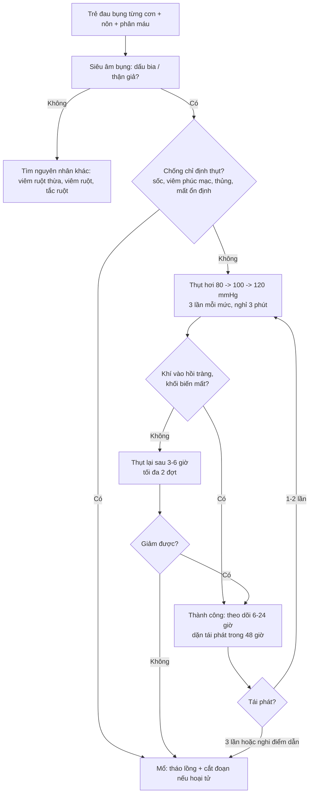
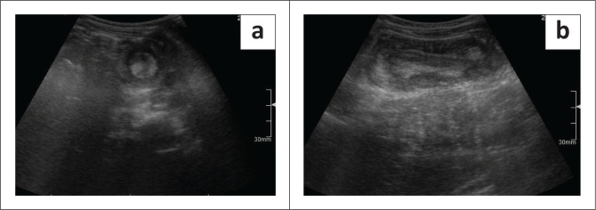
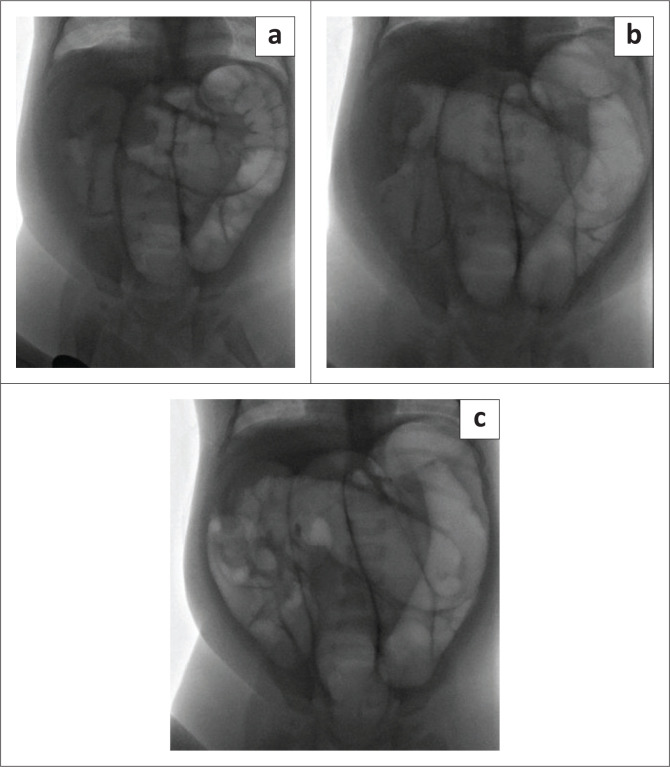
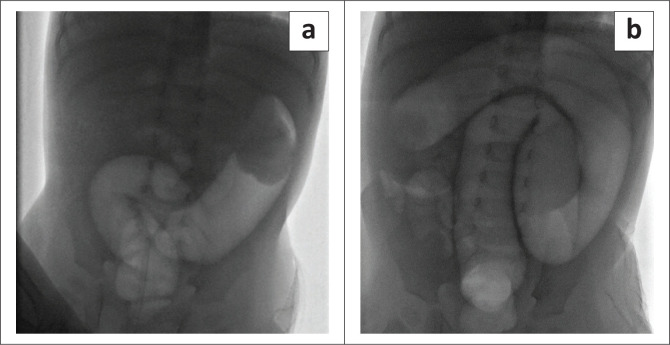
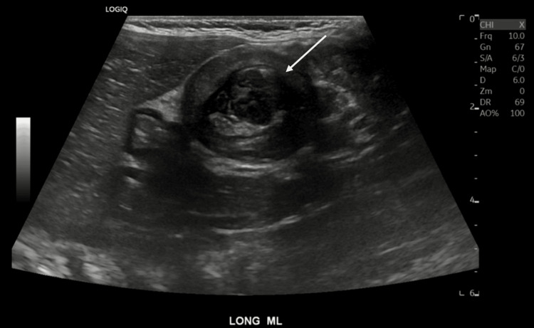

# 6178 — Lồng ruột ở trẻ: dấu bia trên siêu âm và quyết định thụt hơi hay mổ / Intussusception in children

**Tags:** `pattern:long-ruot` `pattern:ruot-trong-ruot` `pattern:dau-bia` `pattern:than-gia` `pattern:tac-ruot` `vung:ruot-non` `vung:dai-trang` `vung:o-bung` `anatomy:hoi-manh-trang` `protocol:sieu-am-bung` `protocol:thut-hoi` `protocol:XR-bung` `score:FGAR`

**Mức chắc chắn (certainty):** tổng hợp y văn (literature synthesis) — ghép **110 trẻ** lồng ruột tại một bệnh viện Nam Phi 2016–2022 (**PMC12506581**), tổng quan hệ thống độ chính xác siêu âm (**PMC12892616**), tổng quan phạm vi lồng ruột tái phát **26.731 trẻ / 3.164 ca tái phát** (**PMC11957851**), và 3 ca nguyên văn có ảnh (**PMC12506581**, **PMC13110127**). Không có thử nghiệm ngẫu nhiên so sánh **áp lực thụt hơi**; các ngưỡng 80–120 mmHg là thực hành đơn vị, chỗ suy luận được ghi rõ.

> **Câu chốt:** lồng ruột là **tắc ruột cấp cứu số 1 ở trẻ 6 tháng–2 tuổi**, và câu hỏi của bác sĩ CĐHA chỉ có hai vế: **(1) có lồng ruột không** — siêu âm là chốt, gộp **độ nhạy 96,3% / độ đặc hiệu 95,7%** (**PMC12892616**), dấu **bia** trên mặt cắt ngang và **thận giả** trên mặt cắt dọc; **(2) có thụt được không** — thụt hơi thành công **60–90%** ở nơi đến sớm, nhưng chỉ **42,5%** ở đoàn hệ đến muộn (**PMC12506581**), và **3/73 (4,1%)** thủng trong lúc thụt. Hai con số quyết định thái độ: **đường kính ngoài > 30 mm** và **có dịch tự do** làm thụt thất bại nhiều hơn; **tái phát 7–15%**, phần lớn **trong 48 giờ**.

> **Phân vai với bài khác:** [3128](../3128-long-ruot-non-non-nguoi-lon/lesson.md) phủ **lồng ruột non–non ở người lớn** (70–90% có điểm dẫn, 3,2 cm/5,0 cm = mổ); bài này **chỉ đi sâu lồng ruột ở trẻ**: cơ chế hạch bạch huyết, dấu siêu âm, chỉ định và kỹ thuật thụt, theo dõi tái phát. Bài [161](../161-viem-ruot-thua-cap/lesson.md) phủ **viêm ruột thừa** — kẻ bắt chước số 1 khi lồng ruột nằm hố chậu phải.

## 1. Tổng quan bệnh học – cơ chế hình ảnh (TẠI SAO thấy dấu bia)

### 1.1 Cơ chế: hạch bạch huyết phì đại kéo đoạn ruột vào trong

- Sau một đợt **nhiễm virus đường ruột/hô hấp** (adenovirus, rotavirus, enterovirus), **mảng Peyer** ở hồi tràng cuối **phì đại** thành một khối mềm trong lòng ruột. Nhu động mạnh của hồi tràng đẩy khối này — cùng đoạn ruột chứa nó — **lồng vào manh tràng**: đoạn lồng vào (**intussusceptum**) bị đoạn nhận (**intussuscipiens**) bọc quanh. Đoàn hệ Nam Phi ghi **29,1%** có tiền sử nhiễm virus trong **2 tuần** trước (**PMC12506581**).
- **Mạc treo bị kéo vào theo** → mô mỡ và mạch máu mạc treo nằm **lệch một bên** trong khối lồng. Đây chính là **cơ sở vật lý của mọi dấu hiệu siêu âm**: các lớp ruột **đồng tâm** (mucosa – cơ – mucosa) tạo vòng tròn, còn **mỡ mạc treo** (tăng âm) nằm ở **trung tâm lệch** hoặc chen giữa hai lớp.
- **Sinh lý bệnh theo giờ:** ứ tĩnh mạch → **phù thành ruột** → chèn ép mao mạch → **thiếu máu/hoại tử**. Đoàn hệ trên: **60,8% (48/79)** ca mổ có **hoại tử ruột** phải cắt đoạn. Vì vậy **thời gian triệu chứng** là biến số tiên lượng: trung vị **2 ngày** ở nhóm thụt thành công vs **3 ngày** ở nhóm mổ ngay (p = 0,0007).

### 1.2 TẠI SAO dấu bia / thận giả xuất hiện (vật lý siêu âm)

| Mặt cắt | Hình ảnh | Giải thích lớp | Tên dấu |
|---|---|---|---|
| **Ngang** (vuông góc trục ruột) | Vòng **đồng tâm**: viền giảm âm dày, lõi tăng âm | Thành ruột ngoài (giảm âm) bọc đoạn ruột trong; lõi tăng âm = **mỡ mạc treo + niêm mạc** bị kéo vào | **Dấu bia / bánh vòng / bò mắt** (target, doughnut, bull's eye) |
| **Dọc** (song song trục ruột) | Khối **hình thận**: vỏ giảm âm, tủy tăng âm | Ống ruột lồng vào nằm trong ống ruột nhận, mỡ mạc treo ở giữa giống **xoang thận** | **Dấu thận giả** (pseudokidney), **sandwich**, **hayfork** |
| **Ngang, có mỡ lệch tâm** | Vòng tăng âm hình **lưỡi liềm** trong vòng giảm âm | Mỡ mạc treo bị kéo **một bên** | **Crescent-in-doughnut** |

- **Vì sao có giá trị:** cấu trúc này **không tồn tại ở ruột bình thường** — ruột bình thường là ống có thành **một lớp**, không có "ruột trong ruột". Vì vậy khi thấy **ruột trong ruột** thì chẩn đoán gần như chắc, và độ chính xác gộp của siêu âm rất cao: **Se 96,3% (CrI 94,9–97,5%), Sp 95,7% (CrI 93,3–97,5%)**, AUC 0,81–0,82 (**PMC12892616**, 2026).
- **Vì sao KHÔNG dùng X-quang để chẩn đoán:** dấu **target** và **meniscus** trên phim bụng chỉ là **khối mô mềm + khí mỏng viền**, độ nhạy thấp. Trong chính đoàn hệ trên, **0/49** phim bụng ghi nhận được dấu target/meniscus; X-quang chỉ có giá trị **loại trừ thủng** (khí tự do) và tắc ruột rõ.

### 1.3 Ngưỡng định lượng phải nhớ

| Mốc | Con số | Nguồn / ý nghĩa |
|---|---|---|
| Tần suất | **1–4 / 2.000 trẻ** | PMC12506581 — cấp cứu bụng thường gặp nhất < 2 tuổi |
| Tuổi | Trung vị **7 tháng** (IQR 2–48); đỉnh **4–9 tháng**; giảm sau **18 tháng** | PMC12506581 |
| Vị trí | **Hồi–manh tràng** chiếm phần lớn; đoàn hệ: **100%** ileocolic | PMC12506581 |
| Đường kính ngoài trên siêu âm | Thụt thành công **26 mm** vs thất bại **30 mm**; **> 30 mm** = yếu tố thất bại (p = 0,0026) | PMC12506581 |
| Lồng ruột ruột non thoáng qua | **< 2,5 cm**, không có điểm dẫn, tự hết | PMC12506581 (dẫn một nghiên cứu thứ cấp về đường kính ngoài) |
| Dịch tự do | **42,5%** ở nhóm thất bại vs **16,1%** ở nhóm thành công (p = 0,0172) | PMC12506581 |
| Thụt hơi thành công | **60–90%** (y văn) · **42,5%** (đoàn hệ đến muộn) | PMC12506581 |
| Thủng khi thụt | **0–5%** (y văn) · **4,1%** (3/73) | PMC12506581 |
| Tái phát | **7–15%** · gộp **11,8%** (3.164/26.731) · đoàn hệ **6/31 (19%)**, **5/6 trong 48 giờ** | PMC11957851, PMC12506581 |
| Điểm dẫn bệnh lý (PLP) | **~10%** chung (0,3–20%); **3,95%** ở ca tái phát | PMC11957851 |

## 2. Mẫu hình + chẩn đoán phân biệt theo vị trí (gamut)

### 2.1 Gamut theo **vị trí khối lồng**

1. **Hồi–manh tràng (ileocolic)** — thể điển hình, khối ở **hố chậu phải** hoặc **giữa bụng**, dài **3–5 cm**; đây là thể **thụt được** và cũng là thể gây **tắc ruột non**.
2. **Hồi–hồi / ruột non–ruột non (ileoileal)** — thường **nhỏ < 2,5 cm**, **thoáng qua**, gặp ở celiac, viêm ruột do rotavirus, sau mổ; **không thụt**, theo dõi.
3. **Đại tràng–đại tràng (colocolic)** — trẻ lớn hơn; **điểm dẫn** hay gặp (polyp, lymphoma, HSP); khối lớn, thụt dễ thất bại.
4. **Ruột thừa lồng vào manh tràng (appendiceal intussusception)** — hiếm, dễ bị đọc là "viêm ruột thừa"; thấy **cấu trúc ống lồng trong manh tràng**, có thể kèm viêm ruột thừa.
5. **Sau mổ / ngược chiều (retrograde)** — sau mổ tim bẩm sinh, sau nối Roux-en-Y; lồng **hồi–hồi**, thường không có "khối bụng" điển hình.
6. **Lồng ruột thoáng qua trong bệnh toàn thân** — HSP (ban xuất huyết dạng thấp), Peutz–Jeghers, xơ nang; đau bụng + lồng ruột **tái diễn** là dấu hiệu bệnh nền.

### 2.2 Gamut theo **cơ chế** (để quyết định có mổ không)

- **Vô căn (lymphoid hyperplasia):** chiếm đa số trẻ < 2 tuổi, **không có điểm dẫn**, thụt là điều trị.
- **Có điểm dẫn bệnh lý (PLP):** Meckel, polyp (Peutz–Jeghers, juvenile), nang trùng lặp, lymphoma, u mỡ; **~10%** chung nhưng **cao hơn nhiều ở trẻ > 2 tuổi và ở ca tái phát**. Đoàn hệ Nam Phi: 3 ca thất bại thụt có PLP (Meckel, Waugh syndrome).
- **Bệnh nền viêm:** HSP, Crohn, celiac — điều trị bệnh nền song song.

## 3. Bảng so sánh phân biệt (ma trận đối chiếu)

| Thực thể (entity) | Hình ảnh điển hình | Chốt vào (rule-in) | Chốt loại (rule-out) | Gợi ý xác nhận |
|---|---|---|---|---|
| **Lồng ruột hồi–manh tràng vô căn** | Dấu **bia** ngang + **thận giả** dọc, khối **3–5 cm**, có **mỡ mạc treo lệch tâm**; Doppler còn tín hiệu | **Ruột trong ruột + khối > 2,5 cm + đau từng cơn + tuổi 4–18 tháng** | Ruột non < 2,5 cm, không có mỡ mạc treo kéo vào, tự hết khi chụp lại → **lồng thoáng qua** | Siêu âm đầu tay; thụt hơi điều trị |
| **Lồng ruột có điểm dẫn (Meckel, polyp, lymphoma)** | Khối **không đều**, có **cấu trúc đặc/nang** ở đầu khối; **> 2 tuổi** hoặc **tái phát** | **Điểm dẫn thấy được trong khối + tái phát + tuổi > 2** | Khối đều, thuần "ruột trong ruột", trẻ < 1 tuổi → ít nghĩ PLP | Siêu âm kỹ đầu khối; mổ khi nghi |
| **Lồng ruột ruột non thoáng qua** | **< 2,5 cm**, vỏ mỏng, không dịch, không điểm dẫn; có thể nhiều ổ | **Nhỏ, tự hết trong vài phút, bệnh cảnh celiac/viêm ruột** | > 3 cm, có mỡ mạc treo dày, có dịch → không phải thể thoáng qua | Chụp lại sau 5–10 phút; không thụt |
| **Viêm ruột thừa cấp** | Ống ruột thừa **> 6 mm**, không đè xẹp, tăng âm mỡ quanh, có sỏi | **Cấu trúc ống mù tận, không đè xẹp + sỏi + đau hố chậu phải** | Thấy **ruột trong ruột** lồng qua manh tràng → lồng ruột, không phải viêm ruột thừa | Siêu âm đè; CT khi không rõ |
| **Viêm hồi tràng / viêm ruột nhiễm trùng** | Thành hồi tràng **dày > 3 mm**, tăng tưới máu, **không có lớp đồng tâm** | **Dày thành lan tỏa + tiêu chảy + không có khối lồng** | Có **vòng đồng tâm** và mỡ mạc treo kéo vào → lồng ruột | Siêu âm + cấy phân |
| **Lồng ruột sau mổ (hồi–hồi)** | Khối nhỏ, gần miệng nối, có thể **ngược chiều** | **Tiền sử mổ bụng/mổ tim + khối nhỏ + tắc ruột sớm** | Không tiền sử mổ, khối lớn hố chậu phải → thể vô căn | Siêu âm; CT nếu bụng chướng nhiều |

### 3.1 Ba dấu hiệu định vị giúp đọc đúng trên mặt cắt

- **Khối lồng vs quai ruột dày:** khối lồng có **vòng đồng tâm hoàn chỉnh 360°**; quai ruột viêm chỉ dày **một phía**, mất lớp niêm mạc.
- **Vị trí trong ổ bụng:** ileocolic đi từ **hố chậu phải lên trên**; nếu khối ở **trái** phải nghĩ **đại tràng–đại tràng** hoặc **malrotation** (Waugh syndrome — ca 3 dưới đây).
- **Mỡ mạc treo:** luôn nằm **lệch một bên** trong khối; nếu mỡ nằm **giữa** hoàn toàn thì đó là **lồng ruột non–non** nhỏ.

## 4. Protocol chụp + phân độ/điểm chuẩn hóa

### 4.1 Thứ tự thực hành (không chụp thừa)

1. **Siêu âm bụng là đầu tay**, không cần chuẩn bị, không cần nhịn ăn: đầu dò **linear 7–12 MHz** ở trẻ nhỏ, **convex** ở trẻ lớn; quét **toàn ổ bụng** theo 4 góc + **dọc theo đại tràng**.
2. Đo **đường kính ngoài–ngoài trên mặt cắt ngang** (mm) — đây là biến số dự báo thụt thất bại. Ghi **có/không dịch tự do**, **Doppler màu** (mất tín hiệu = nghi thiếu máu), và **tìm điểm dẫn** ở đầu khối.
3. **X-quang bụng** chỉ khi nghi **thủng** (bụng cứng, sốc, khí tự do) hoặc **tắc ruột rõ** — không dùng để chẩn đoán lồng ruột.
4. **Thụt hơi dưới fluoroscopy** (hoặc thụt nước dưới siêu âm nếu đơn vị làm được) khi **không có chống chỉ định**.
5. **CT** chỉ khi: chẩn đoán không rõ, nghi biến chứng (thủng/hoại tử), hoặc nghi **điểm dẫn ác tính** ở trẻ lớn.

### 4.2 Kỹ thuật thụt hơi (theo đơn vị trong đoàn hệ)

- **Chống chỉ định tuyệt đối:** **nhiễm khuẩn huyết/sốc**, **viêm phúc mạc**, **thủng ruột** (khí tự do), **mất ổn định huyết động**.
- **Áp lực:** **80 → 100 → 120 mmHg**, mỗi mức **3 lần**, nghỉ **3 phút** giữa các lần; tổng **tối đa 9 lần**.
- **Lặp lại có trì hoãn:** nếu chưa giảm hết, **thụt lại sau 3–6 giờ** (cho phù giảm) — đơn vị trong bài làm **tối đa 2 đợt trì hoãn** trước khi mổ.
- **Theo dõi trong lúc thụt:** khí vào **hồi tràng** = giảm thành công; **ngừng ngay** khi bụng căng đột ngột, khí vào ổ bụng, hoặc khối **không di chuyển** qua 3 lần.
- **Dấu hiệu thất bại:** khối **dừng lại** (không tiến thêm) dù áp lực tăng — ca 3 dưới đây dừng ở **góc gan** và mổ thấy **ruột thiếu máu**.
- **Sau thụt:** theo dõi **6–24 giờ**, cho ăn lại khi hết đau; **dặn tái phát trong 48 giờ** (5/6 ca tái phát của đoàn hệ rơi vào cửa sổ này).

### 4.3 Sơ đồ quyết định (Mermaid)

### 4.4 Phân tầng theo dữ liệu đo được

| Nhóm | Đặc điểm | Thái độ |
|---|---|---|
| **Thuận lợi** | Tuổi **7 tháng**, đau **2 ngày**, đường kính **26 mm**, không dịch, không mất nước | Thụt hơi, khả năng thành công cao |
| **Khó** | Tuổi **< 6 tháng**, **mất nước**, **dịch tự do**, đường kính **30 mm**, đau **3 ngày** | Chuẩn bị mổ song song; thụt vẫn thử nếu không chống chỉ định |
| **Rất khó** | **Sốc, viêm phúc mạc, khí tự do**, hoại tử trên siêu âm | **Mổ ngay**, không thụt |

## 5. Biến thể bình thường và cạm bẫy

1. **Lồng ruột ruột non thoáng qua** — thấy khối **< 2,5 cm** ở trẻ celiac/viêm ruột, **không có mỡ mạc treo dày**, tự hết. **Không thụt, không mổ**; chụp lại sau 5–10 phút để chứng minh.
2. **"Siêu âm âm tính vì nhiều hơi"** — không loại trừ. Quét **theo trục đại tràng** và **đè từng vùng**; hơi nhiều thì đổi tư thế, dùng đầu dò convex, hoặc chụp lại sau khi đặt sonde trực tràng (nếu chỉ định thụt).
3. **X-quang bình thường không loại trừ** — trong đoàn hệ, **0/49** phim có dấu target/meniscus. X-quang chỉ để tìm **khí tự do**.
4. **Phân máu "thạch anh đào" là dấu MUỘN** — đoàn hệ Nam Phi ghi **88,2%**, nhưng đây là nơi đến muộn; ở trẻ đến sớm, dấu này **vắng** và không được dùng để loại trừ.
5. **Đau bụng + li bì/hôn mê** — lồng ruột có thể biểu hiện **thần kinh** (li bì, co giật) do mất nước/độc tố; đừng chỉ nghĩ viêm màng não.
6. **Thụt "thành công" nhưng bỏ sót điểm dẫn** — giảm hết trên fluoroscopy không có nghĩa hết bệnh; nếu **tái phát sớm** hoặc trẻ **> 2 tuổi**, phải **tìm PLP** và hội chẩn mổ.
7. **Bỏ sót lồng ruột thứ hai** — **3,1%** ca lồng ruột người lớn có hai ổ (bài 3128); ở trẻ cũng phải quét **toàn bộ** ruột, nhất là khi khối ở vị trí bất thường.
8. **Nhầm với viêm ruột thừa** — lồng ruột hồi–manh tràng nằm đúng hố chậu phải, đau + sốt nhẹ; điểm khác biệt là **ruột trong ruột**, không phải **ống mù tận**.

> **Phản biện trung thực:** tỷ lệ **thụt thành công 42,5%** và **hoại tử 60,8%** đến từ **một bệnh viện tuyến cuối ở Nam Phi** với bệnh nhân đến **trung vị 2 ngày** — không đại diện cho nơi phát hiện sớm (60–90%). Ngưỡng **> 30 mm** cũng chỉ từ **một đoàn hệ hồi cứu** (p = 0,0026) và chưa được xác nhận độc lập; không nên dùng một mình để từ chối thụt.

## 6. Tự lượng giá — Blind Quiz

**Ca 1 — Bé trai 7 tháng, đau bụng từng cơn 12 giờ, nôn ra dịch xanh, phân lẫn máu nhầy. Nhìn siêu âm trước khi đọc đáp án.** *(Kịch bản dựng quanh ảnh minh họa của bài tổng quan; số đo trong "Gợi ý" là của kịch bản, không phải số liệu ca gốc.)*

- Gợi ý: khối ở giữa bụng, đường kính ngoài **28 mm**, không có dịch tự do, Doppler còn tín hiệu.
- Câu hỏi: hai dấu siêu âm trong (a) và (b) tên gì? Cấu trúc tăng âm ở giữa khối là gì? Bước tiếp theo?

<b>Bấm để hiện đáp án (findings + chẩn đoán)</b>

- Dấu hiệu: (a) **dấu bia/bánh vòng** — vòng **đồng tâm** giảm âm bao quanh lõi tăng âm; (b) **dấu thận giả** — khối hình thận, vỏ giảm âm, "xoang" tăng âm ở giữa.
- Cấu trúc tăng âm trung tâm = **mỡ mạc treo + niêm mạc** bị kéo vào theo đoạn ruột lồng — đây là lý do dấu hiệu này **không thể có ở ruột bình thường**.
- Chẩn đoán: **lồng ruột hồi–manh tràng** (ileocolic intussusception).
- Bước tiếp: đánh giá **chống chỉ định thụt** (không sốc, không viêm phúc mạc, không khí tự do) → **thụt hơi**; khối **28 mm** và không dịch là nhóm thuận lợi.
- Nguồn ảnh: *SA Journal of Radiology* 2025 (**PMC12506581**), CC BY — Hình 3, hai khung a–b.

**Ca 2 — Bé gái 9 tháng, lồng ruột hồi–manh tràng trên siêu âm. Xem ba khung fluoroscopy của một lần thụt hơi.** *(Tuổi là của kịch bản; kỹ thuật và mốc áp lực lấy đúng theo Hình 2 của bài gốc.)*

- Gợi ý: khởi đầu **80 mmHg**, sau đó **100 mmHg**; không có khí ngoài lòng ruột.
- Câu hỏi: dấu trong (a) gọi là gì? (b) chứng tỏ điều gì? (c) có phải giảm thành công không, dựa vào dấu nào?

<b>Bấm để hiện đáp án (findings + chẩn đoán)</b>

- (a) **Dấu meniscus** — khí trong đại tràng viền quanh **đầu khối mô mềm** (đỉnh khối lồng), tạo hình lưỡi liềm.
- (b) Khối **di chuyển** từ đại tràng ngang tới **góc gan** → chứng tỏ khối còn **trượt được**, chưa dính/hoại tử; đây là dấu hiệu **tiên lượng thụt thành công**.
- (c) **Giảm thành công**: mất dấu meniscus, **khí tràn vào hồi tràng** (quai ruột non chứa khí), áp lực cuối **100 mmHg**.
- Ý nghĩa: khí vào **ruột non** là tiêu chuẩn "giảm hoàn toàn" trên fluoroscopy; sau đó theo dõi **6–24 giờ** và dặn tái phát **trong 48 giờ**.
- Nguồn ảnh: *SA Journal of Radiology* 2025 (**PMC12506581**), CC BY — Hình 2, ba khung a–c.

**Ca 3 — Bé trai 11 tháng, lồng ruột hồi–manh tràng; thụt hơi 3 lần không giảm. Xem hai khung cuối.** *(Diễn biến khối và kết quả mổ lấy đúng theo Hình 4 của bài gốc.)*

- Gợi ý: khối ban đầu ở **góc lách**, di chuyển tới **góc gan** rồi **dừng**; bụng chướng dần.
- Câu hỏi: vì sao phải mổ? Dấu nào trên fluoroscopy báo thất bại? Mổ thấy gì?

<b>Bấm để hiện đáp án (findings + chẩn đoán)</b>

- Dấu hiệu: khối **dừng lại** ở góc gan qua các lần thụt, **không tiến thêm** dù tăng áp lực → thất bại.
- Chẩn đoán: **lồng ruột hồi–manh tràng không giảm được** → chỉ định mổ.
- Mổ thấy **ruột thiếu máu** (đoàn hệ: **60,8%** ca mổ có hoại tử) — đây là lý do **không được** thụt mãi khi khối đã đứng yên.
- Bài học: **theo dõi chuyển động của khối**, không chỉ theo áp lực; và **không có giới hạn tuyệt đối số lần** thụt nếu bệnh nhi ổn định — nhưng **khối đứng yên + bụng chướng** là điểm dừng.
- Nguồn ảnh: *SA Journal of Radiology* 2025 (**PMC12506581**), CC BY — Hình 4, hai khung a–b.

**Ảnh bổ trợ — mặt cắt dọc kinh điển của lồng ruột hồi–manh tràng**

- Mũi tên chỉ **đoạn ruột lồng vào** nằm trong lòng đoạn ruột nhận; mỡ mạc treo tăng âm ở giữa tạo "xoang thận".
- Nguồn: *Cureus* 2026 (**PMC13110127**), CC BY 4.0.

## Bài liên quan chéo
- [600 – Tổng quan Nhi khoa](../600-tong-quan-nhi-khoa/lesson.md)
- [3128 – Lồng ruột non–non ở người lớn](../3128-long-ruot-non-non-nguoi-lon/lesson.md) (khác hoàn toàn: 70–90% có điểm dẫn, 3,2 cm = mổ)
- [161 – Viêm ruột thừa cấp](../161-viem-ruot-thua-cap/lesson.md) (kẻ bắt chước hố chậu phải)
- [622 – Tắc ruột sơ sinh](../622-tac-ruot-so-sinh/lesson.md) (tắc ruột sớm sau sinh)
- [1667 – Tắc ruột non do dính thai phụ](../1667-tac-ruot-non-do-dinh-thai-phu/lesson.md) (tắc ruột cơ học)
- [6171 – Viêm tụy cấp do asparaginase](../6171-viem-tuy-cap-do-asparaginase-tre-all/lesson.md) (đau bụng cấp ở trẻ có bệnh nền)

## Ảnh
- Ảnh tải từ **Europe PMC / PMC** (open access), giấy phép từng file trong `images/CREDITS.md`.
- Tên file: `6178_long-ruot_Modality_SourceID.jpg`.

> Không dùng để chẩn đoán độc lập khi chưa có người hướng dẫn.
