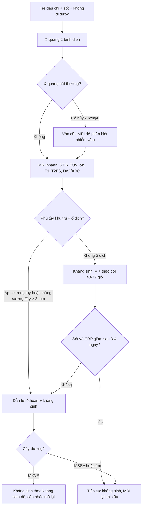
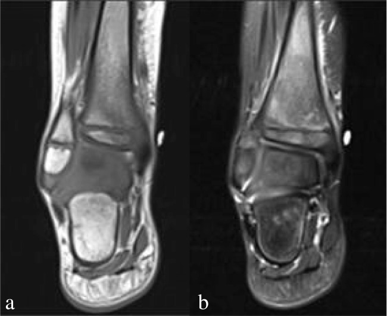
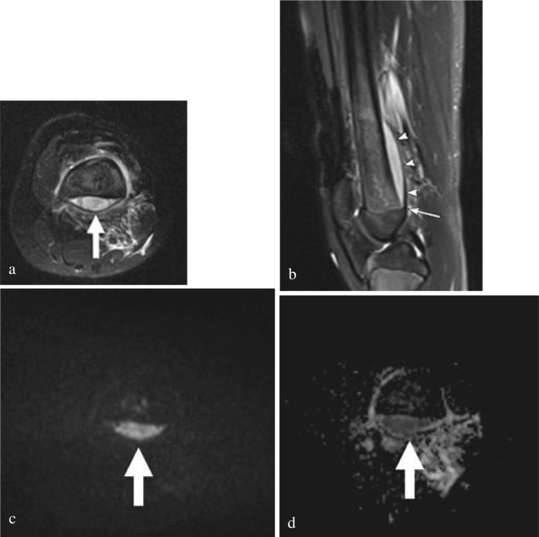
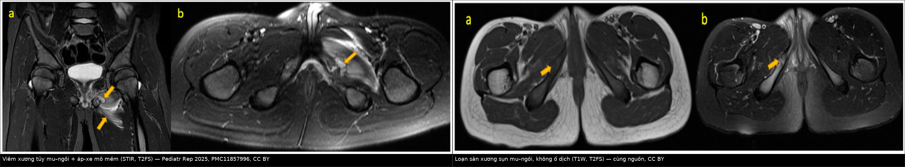

# 6179 — Viêm xương tủy cấp ở trẻ: MRI sớm, áp-xe dưới màng xương và cái bẫy "u Ewing" / Acute haematogenous osteomyelitis in children

**Tags:** `pattern:phu-tuy-xuong` `pattern:ap-xe-duoi-mang-xuong` `pattern:ap-xe-trong-tuy` `pattern:day-mang-xuong` `pattern:ngam-thuoc` `pattern:han-che-khuech-tan` `vung:xuong-dai` `vung:khop` `vung:khung-chau` `anatomy:metaphysis` `protocol:XR-xuong` `protocol:MRI-xuong` `protocol:DWI` `score:Jansson-CRMO`

**Mức chắc chắn (certainty):** tổng hợp y văn (literature synthesis) — ghép tổng quan **protocol MRI nhanh** ở trẻ (*Pediatric Radiology* 2026, **PMC13134995**), đoàn hệ **105 trẻ** viêm xương tủy cấp (AHO) có **áp-xe định nghĩa trên MRI** (**PMC13395681**), đoàn hệ **218 trẻ** về chỉ định mổ (**PMC11887127**), tổng quan hình ảnh nhiễm trùng cơ xương nhi (**PMC11166598**), bài học **CRMO** (**PMC13475068**) và 4 ca nguyên văn có ảnh (**PMC13134995**, **PMC11857996**). Chỗ dựa vào y văn kinh điển (mốc X-quang 10–14 ngày) được ghi rõ.

> **Câu chốt:** AHO là cấp cứu nhiễm khuẩn xương, và **X-quang bình thường ở ngày 3–5 KHÔNG loại trừ** — trong khi **MRI là chốt** (protocol nhanh có **giá trị tiên đoán âm 97%** khi làm đúng, **PMC13134995**). Ba con số định hình thái độ: **(1)** áp-xe trong tủy/dưới màng xương gặp ở **42,9%** trẻ AHO, và nhóm này **75,6% phải mổ** (**PMC13395681**); **(2)** chỉ định mổ thực hành là **áp-xe trong tủy** hoặc **màng xương bị đẩy > 2 mm**, hoặc **không đáp ứng kháng sinh 3–4 ngày** (**PMC11887127**); **(3)** **MRSA** tạo áp-xe **71%** và cần mổ **91%** ca, so với **62%** ở MSSA (một nghiên cứu được dẫn trong **PMC11887127**; không ghi tên vì chỉ đọc qua bài thứ cấp).

> **Phân vai với bài khác:** [370](../370-nhiem-trung-msk/lesson.md) phủ **nhiễm trùng cơ xương khớp nói chung**; [6105](../6105-hoai-tu-xuong-o-tre-dieu-tri-ALL/lesson.md) phủ **hoại tử xương vô khuẩn** ở trẻ điều trị ALL; [6178](../6178-long-ruot-o-tre/lesson.md) phủ **đau bụng cấp** — bài này chỉ đi sâu **chuỗi quyết định của AHO**: MRI lúc nào, đọc gì, khi nào chọc/dẫn lưu, và phân biệt với **Ewing – CRMO – LCH**.

## 1. Tổng quan bệnh học – cơ chế hình ảnh (TẠI SAO MRI thấy trước X-quang)

### 1.1 Cơ chế: vòng mao mạch chậm ở hành xương

- **Hành xương (metaphysis)** ở trẻ có **mao mạch tận cùng dạng vòng** (hairpin capillary loops) chảy rất chậm, ngay sát **sụn tiếp hợp**. Khi có **nhiễm khuẩn huyết** (thường từ ổ niêm mạc), vi khuẩn **dừng lại ở đây** và sinh sôi trong tủy xương — đó là lý do AHO **luôn bắt đầu ở hành xương**, không phải ở thân xương.
- **Màng xương ở trẻ lỏng lẻo**, dễ bị mủ **bóc tách** → **áp-xe dưới màng xương**. Ở trẻ **< 18 tháng**, còn **mạch xuyên sụn** nối hành xương với đầu xương → nhiễm có thể lan **vào đầu xương/khớp**; đây là lý do **trẻ nhỏ cần cản quang** để không bỏ sót ổ ở phần sụn chưa cốt hóa (**PMC13134995**).
- **TẠI SAO MRI thấy trước X-quang:** phù tủy xương là **nước tự do tăng trong tủy**, và nước **kéo dài cả T1 lẫn T2** → tủy **tối trên T1, sáng trên T2/STIR**. X-quang chỉ thấy khi đã **mất 30–50% khoáng xương** hoặc có **phản ứng màng xương** — theo kinh điển phải **10–14 ngày** sau khởi phát. Vì vậy **phim bình thường ở ngày 5 là chuyện bình thường**, không phải bằng chứng loại trừ.
- **TẠI SAO áp-xe sáng trên DWI và tối trên ADC:** mủ đặc, tế bào nhiều → **khuếch tán nước bị hạn chế** → tín hiệu cao ở **b = 800–1.000 s/mm²** và **thấp trên bản đồ ADC**. Đây là cơ sở để **thay cản quang bằng DWI** trong protocol nhanh — nhưng phải xem **ADC**, vì phù mô mềm cũng có thể "sáng" trên DWI do hiệu ứng T2 shine-through.
- **Sinh hóa hỗ trợ:** CRP tăng sớm và **giảm nhanh** (nửa đời 24–48 giờ); trong đoàn hệ 105 trẻ, **CRP trung vị 63,5 mg/L** ở nhóm có áp-xe so với nhóm không áp-xe (**PMC13395681**); hạ albumin và **tỷ lệ CRP/lymphocyte cao** là dấu hiệu áp-xe. Ngưỡng **CRP 10,3 mg/dL (103 mg/L)** có **Se 67,7% / Sp 77,6%** cho áp-xe dưới màng xương (một nghiên cứu được dẫn trong **PMC11887127**; không ghi tên vì chỉ đọc qua bài thứ cấp) — **không đủ** để chẩn đoán, chỉ để ưu tiên MRI.

### 1.2 Ngưỡng định lượng phải nhớ

| Mốc | Con số | Nguồn / ý nghĩa |
|---|---|---|
| Tần suất AHO | **2–20 / 100.000 trẻ/năm** | PMC13134995 |
| Vị trí hay gặp | **Xương đùi 46,5%**, **xương chày 31,0%** (nhóm mổ đơn) | PMC11887127 |
| Áp-xe trên MRI | **42,9%** (45/105) | PMC13395681 |
| Mổ ở nhóm có áp-xe | **75,6%** (34/45) so với nhóm không áp-xe | PMC13395681 |
| Chỉ định mổ | **Áp-xe trong tủy** hoặc **màng xương đẩy > 2 mm**; **không đáp ứng kháng sinh 3–4 ngày** | PMC11887127 |
| MRSA | Áp-xe **71%** vs MSSA; mổ **91%** vs **62%** | Nghiên cứu thứ cấp, dẫn trong PMC11887127 |
| CRP cho áp-xe dưới màng xương | **10,3 mg/dL** — Se **67,7%**, Sp **77,6%** | Nghiên cứu thứ cấp, dẫn trong PMC11887127 |
| Protocol MRI nhanh | **NPV 97%** khi dùng đúng | PMC13134995 |
| X-quang có thay đổi | Kinh điển **10–14 ngày** (cần mất **30–50%** khoáng xương) | Y văn kinh điển, không trích từ bài OA đã tải |
| CRMO | **1/250.000–1/1.000.000** trẻ | PMC13475068 |

## 2. Mẫu hình + chẩn đoán phân biệt theo vị trí (gamut)

### 2.1 Gamut theo **vị trí tổn thương**

1. **Hành xương xương dài (đùi, chày, xương cánh tay):** thể điển hình — phù tủy **khu trú sát sụn tiếp hợp**, mô mềm cạnh xương phù, áp-xe dưới màng xương.
2. **Khung chậu — gai ngồi–mu (ischiopubic synchondrosis):** trẻ tuổi học đường (ca trong bài: **8 và 11 tuổi**); **bất đối xứng** và **loạn sản xương sụn (osteochondrosis)** là bẫy lớn — phù tủy nhẹ quanh sụn **hơi to**, **không có ổ dịch**, không phù mô mềm lan rộng (ảnh đối chiếu dưới đây).
3. **Cột sống:** viêm đĩa–đốt sống; đau lưng + sốt, đĩa đệm hẹp, phù hai đốt kề.
4. **Xương đòn:** vị trí **ưa thích của CRMO** (viêm xương tủy đa ổ tái phát mạn), không phải AHO điển hình.
5. **Mấu chậu trước trên / gai chậu:** viêm xương vùng mấu (apophysis) ở trẻ vận động nhiều; dễ nhầm **bong gân/avulsion**.
6. **Xương bàn–ngón chân:** AHO bàn chân ở trẻ nhỏ; X-quang rất dễ âm tính, MRI là chốt.

### 2.2 Gamut theo **có/không có ổ dịch** (quyết định mổ)

- **Không ổ dịch:** AHO phù tủy đơn thuần, viêm tủy xương mạn, CRMO, LCH, bạch cầu cấp, phù do bất động/stress — **kháng sinh ± theo dõi**.
- **Có ổ dịch:** **áp-xe trong tủy**, **áp-xe dưới màng xương**, **áp-xe mô mềm/pyomyositis**, **viêm khớp mủ kèm theo** — **dẫn lưu** là điều trị chính, kháng sinh đơn thuần thất bại.
- **Ổ dịch giả:** mô u hoại tử (Ewing), ổ xuất huyết, nang xương — **không dẫn lưu mù**.

## 3. Bảng so sánh phân biệt (ma trận đối chiếu)

| Thực thể (entity) | Hình ảnh điển hình | Chốt vào (rule-in) | Chốt loại (rule-out) | Gợi ý xác nhận |
|---|---|---|---|---|
| **AHO không áp-xe** | Phù tủy **khu trú hành xương**, T1 thấp, T2/STIR cao, phù mô mềm cạnh xương, **không ổ dịch** | **Đau + sốt + CRP tăng + phù tủy khu trú sát sụn tiếp hợp** | Phù **lan tỏa cả thân xương, đối xứng nhiều xương**, CRP gần bình thường → nghĩ CRMO | MRI + cấy máu trước kháng sinh |
| **AHO có áp-xe dưới màng xương** | **Ổ dịch dưới màng xương**, màng xương bị đẩy, **DWI cao / ADC thấp**; màng xương đẩy **> 2 mm** | **Ổ dịch hạn chế khuếch tán + màng xương đẩy > 2 mm** | Ổ dịch không hạn chế khuếch tán, không đẩy màng xương → phù/máu tụ | MRI + DWI/ADC; CRP **> 103 mg/L** hỗ trợ |
| **U Ewing** | **Tổn thương thấm xuyên (permeative)**, vỏ xương mất liên tục, **khối mô mềm lớn**, có **mineral hóa mô mềm**, không ổ mủ | **Khối mô mềm lớn + phá vỏ + không ổ dịch hạn chế khuếch tán** | Ổ dịch đơn thuần, màng xương còn liền, CRP cao đơn thuần → nghĩ nhiễm | Sinh thiết **sau** khi hội chẩn; tránh corticoid trước chẩn đoán |
| **CRMO (viêm xương tủy đa ổ tái phát mạn)** | **Nhiều ổ, đối xứng**, hành xương, **xương đòn**, không áp-xe; tái phát > 6 tháng | **≥ 2 ổ xương + sinh thiết vô khuẩn + đáp ứng tiêu chuẩn Jansson** | Một ổ đơn độc có ổ dịch + cấy dương → AHO | Jansson: **2 tiêu chuẩn chính** hoặc **1 chính + 3 phụ** |
| **LCH (tế bào Langerhans)** | Tiêu xương **bờ rõ**, có thể **lún đốt sống**, không phù mô mềm nhiều | **Tiêu xương bờ rõ + tổn thương nhiều xương + không ổ dịch** | Phù tủy lan tỏa, màng xương đẩy, CRP rất cao → nghĩ nhiễm | Sinh thiết; CD1a/langerin |
| **Viêm khớp mủ / viêm khớp nhiễm** | **Tràn dịch khớp lớn + dày màng hoạt dịch**, có thể kèm AHO sát khớp | **Tràn dịch + không chịu cử động + CRP cao** | Không tràn dịch, không đau khớp → loại | Siêu âm khớp + chọc hút đếm tế bào/cấy |
| **Loạn sản xương sụn gai ngồi–mu** | Sụn **hơi to**, phù tủy **nhẹ quanh sụn**, **không ổ dịch**, không phù mô mềm lan | **Đau khu trú, không sốt, CRP bình thường, không ổ dịch** | **Ổ dịch + phù mô mềm + sốt** → AHO, không phải loạn sản | MRI; so bên đối diện |

### 3.1 Ba dấu hiệu định vị giúp đọc đúng trên mặt cắt

- **Tủy xương vs mô mềm:** phù tủy **nằm trong vỏ xương**, giới hạn bởi vỏ; phù mô mềm **ở ngoài vỏ**. AHO điển hình có **cả hai**, nhưng **ổ dịch trong tủy** mới quyết định.
- **Dưới màng xương vs trong tủy:** ổ dịch **dưới màng xương** nằm **giữa vỏ xương và màng xương bị bóc**, hình **thấu kính**, **thuôn về hai đầu** và **không vượt qua sụn tiếp hợp** (trừ trẻ < 18 tháng). Ổ **trong tủy** nằm **trong lòng xương**, không đẩy màng xương.
- **Sụn tiếp hợp là hàng rào:** ổ dịch **dừng ở sụn** ở trẻ > 18 tháng; nếu thấy tổn thương **qua sụn vào đầu xương** → nghĩ trẻ nhỏ hoặc **không phải AHO** (Ewing, LCH).

## 4. Protocol chụp + phân độ/tiêu chuẩn

### 4.1 Thứ tự thực hành

1. **X-quang 2 bình diện** ngay: rẻ, loại trừ **gãy xương/u xương**, nhưng **bình thường không loại trừ AHO**.
2. **Siêu âm** khi có khớp gần: phát hiện **tràn dịch khớp**, **áp-xe dưới màng xương** (dịch dưới màng xương dày), **áp-xe mô mềm**; hướng dẫn chọc hút.
3. **MRI là chốt** — protocol **nhanh, không an thần, không cản quang** khi trẻ hợp tác và > 18 tháng:
   - **STIR coronal FOV lớn** (hai chi dưới) để **định vị ổ** khi triệu chứng không khu trú;
   - **T1 coronal** (không fat-sat) — phát hiện **thay thế tủy**;
   - **T2 fat-sat axial + coronal + sagittal** — phù tủy, ổ dịch, mô mềm;
   - **DWI b = 800–1.000 + ADC** — phát hiện **áp-xe** thay cản quang.
4. **Cản quang** khi: trẻ **< 18 tháng** (phần sụn chưa cốt hóa), ổ dịch **không rõ** trên chuỗi không cản quang, hoặc nghi **viêm khớp/áp-xe mô mềm**.
5. **Cấy máu trước kháng sinh**; chọc hút/dẫn lưu ổ dịch gửi **cấy + tế bào + tinh thể** (cạm bẫy giả gout — xem bài gối).

### 4.2 Chỉ định can thiệp (bằng số)

| Tình huống | Ngưỡng / tiêu chí | Hành động |
|---|---|---|
| **Áp-xe trong tủy** | Ổ dịch hạn chế khuếch tán trong lòng xương | **Dẫn lưu/khoan giảm áp** + kháng sinh |
| **Áp-xe dưới màng xương** | Màng xương bị đẩy **> 2 mm** | **Rạch dẫn lưu** (đặc biệt nếu MRSA) |
| **Không đáp ứng nội khoa** | Sốt/viêm khu trú kéo dài **3–4 ngày** dù kháng sinh đúng | Chụp lại MRI → **mổ** |
| **Nguy cơ cao MRSA** | CRP **> 103 mg/L**, albumin thấp, ANC cao | Ưu tiên MRI sớm + hội chẩn mổ |
| **CRMO** | **2 tiêu chuẩn chính** hoặc **1 chính + 3 phụ** (Jansson) | **Không dẫn lưu**; NSAID ± bisphosphonate, theo dõi |

### 4.3 Sơ đồ quyết định (Mermaid)

## 5. Biến thể bình thường và cạm bẫy

1. **X-quang ngày 3–5 bình thường** — không loại trừ; đừng chờ phim đổi (10–14 ngày) mới chụp MRI.
2. **CRMO bị điều trị như nhiễm khuẩn** — trẻ **đau nhiều xương, tái phát, CRP chỉ tăng nhẹ**, MRI **nhiều ổ đối xứng, không áp-xe**; dẫn lưu/kháng sinh dài **không giúp**, cần **NSAID** và theo dõi. Phân biệt bằng **cấy vô khuẩn + Jansson**.
3. **Ewing bị gọi là "viêm xương tủy"** — khối mô mềm **lớn**, phá vỏ, **mineral hóa**, **không ổ dịch**; sinh thiết **trước** khi dùng corticoid liều cao, và **không dẫn lưu mù**.
4. **Gai ngồi–mu hai bên không đối xứng ở trẻ tuổi học đường** — **loạn sản xương sụn** là bình thường; chỉ lo khi có **ổ dịch + phù mô mềm + sốt** (ảnh đối chiếu dưới đây).
5. **DWI "sáng" không đồng nghĩa mủ** — luôn xem **ADC**; phù mô mềm và máu tụ có thể sáng trên DWI.
6. **Bỏ sót viêm khớp mủ kèm theo** — AHO sát khớp ở trẻ < 18 tháng dễ lan vào khớp; **luôn đánh giá khớp kề** trên MRI và siêu âm.
7. **Trẻ < 18 tháng không cản quang dễ bỏ sót ổ ở đầu xương** — phần sụn chưa cốt hóa; đây là ngoại lệ được khuyến cáo **dùng cản quang**.
8. **Bất động kéo dài gây phù tủy** (đau do nguyên nhân khác) — so bên đối diện, đối chiếu lâm sàng; đừng điều trị "viêm xương" chỉ vì phù tủy.

> **Phản biện trung thực:** tỷ lệ **42,9% áp-xe / 75,6% phải mổ** đến từ **một đoàn hệ hồi cứu hai trung tâm 105 trẻ** đã được chọn chụp MRI — **không** phải tần suất áp-xe của mọi ca AHO. Ngưỡng **CRP 103 mg/L** có **Se/Sp chỉ 67,7/77,6%** nên **không dùng để loại trừ**. Mốc **10–14 ngày của X-quang** là **kinh điển**, không lấy từ bài OA đã tải.

## 6. Tự lượng giá — Blind Quiz

**Ca 1 — Bé trai 5 tuổi, sốt 5 ngày, đau mắt cá trong phải, không đi được. X-quang chưa có gì. Nhìn hai ảnh MRI trước.**

- Gợi ý (kịch bản dựng quanh ảnh): CRP tăng, bạch cầu bình thường; không có ổ dịch, phù mô mềm ít.
- Câu hỏi: dấu hiệu chính? Vì sao X-quang âm tính vẫn phải điều trị? Có cần mổ không?

<b>Bấm để hiện đáp án (findings + chẩn đoán)</b>

- Dấu hiệu: **(a) T1 giảm tín hiệu loang lổ** và **(b) T2 tăng tín hiệu tương ứng** ở **hành–thân xương chày**, phù mô mềm quanh xương, **không có ổ dịch**.
- Chẩn đoán: **viêm xương tủy cấp không áp-xe** (AHO phù tủy).
- Không mổ: **không có áp-xe trong tủy, không có màng xương đẩy > 2 mm**; bệnh nhi được **điều trị nội khoa** và ra viện.
- Vì sao X-quang âm tính: cần **mất 30–50% khoáng xương** mới thấy — thường **10–14 ngày** sau khởi phát.
- Nguồn ảnh: *Pediatric Radiology* 2026 (**PMC13134995**), CC BY 4.0 — Hình 3, khung a–b.

**Ca 2 — Bé gái 11 tuổi, đau gối không rõ vị trí 3 ngày, sốt. Xem bốn khung MRI.**

- Gợi ý: màng xương bị đẩy, ổ dịch **thuôn về hai đầu** và **dừng ở mức sụn sụn**; CRP rất cao.
- Câu hỏi: ổ dịch nằm ở khoang nào? Vì sao nói đây là mủ chứ không phải phù? Thái độ điều trị?

<b>Bấm để hiện đáp án (findings + chẩn đoán)</b>

- (a) **Ổ dịch tăng tín hiệu sau xương đùi**; (b) **màng xương giảm tín hiệu bị đẩy lên** (mũi tên đầu), ổ dịch **thuôn và dừng ở mức sụn sụn** — không vượt sụn.
- (c) **DWI b = 800 sáng**, (d) **ADC thấp** = **hạn chế khuếch tán** → dịch đặc/mủ, không phải phù đơn thuần.
- Chẩn đoán: **viêm xương tủy cấp + áp-xe dưới màng xương** (subperiosteal abscess).
- Điều trị: **rạch dẫn lưu** (màng xương đẩy > 2 mm) + kháng sinh; đây là ca **đã được mổ dẫn lưu** trong bài gốc.
- Nguồn ảnh: *Pediatric Radiology* 2026 (**PMC13134995**), CC BY 4.0 — Hình 4, khung a–d.

**Ca 3 — Hai trẻ đau vùng bẹn, không sốt. Nhìn ảnh ghép: bên trái có ổ dịch, bên phải thì không. Đoán trước khi mở đáp án.**

- Gợi ý: bên trái **sốt + CRP tăng**, đi khập khiễng; bên phải **không sốt, CRP bình thường**, đau tăng khi vận động. Hai ca trong bài gốc: bé trai **8 tuổi** (trái) và bé gái **11 tuổi** (phải).
- Câu hỏi: vì sao bên phải **không** phải viêm xương tủy? Dấu nào quyết định? Có cần dẫn lưu bên phải không?

<b>Bấm để hiện đáp án (findings + chẩn đoán)</b>

- Trái: **phù tủy + áp-xe mô mềm** quanh gai ngồi–mu, **phù cơ bịt trong** — **viêm xương tủy gai ngồi–mu** (kèm viêm cơ mủ).
- Phải: sụn **hơi to**, phù tủy **nhẹ và chỉ quanh sụn**, **không có ổ dịch**, **không phù mô mềm lan** — **loạn sản xương sụn (osteochondrosis)**, biến thể lành tính ở trẻ 8–12 tuổi.
- Dấu quyết định: **có/không ổ dịch + phù mô mềm lan + CRP**. Bên phải **không dẫn lưu**, chỉ giảm vận động và theo dõi.
- Cạm bẫy: hai bên gai ngồi–mu **vốn không đối xứng**; đừng gọi mọi phù tủy ở đây là nhiễm.
- Nguồn ảnh: *Pediatric Reports* 2025 (**PMC11857996**), CC BY 4.0 — Hình 1 (trái) và Hình 2 (phải); ảnh ghép letterbox, giữ nguyên khung.

## Bài liên quan chéo
- [600 – Tổng quan Nhi khoa](../600-tong-quan-nhi-khoa/lesson.md)
- [300 – Tổng quan Hệ Cơ xương khớp](../300-tong-quan-he-co-xuong-khop/lesson.md)
- [370 – Nhiễm trùng cơ xương khớp](../370-nhiem-trung-msk/lesson.md)
- [6105 – Hoại tử xương ở trẻ điều trị ALL](../6105-hoai-tu-xuong-o-tre-dieu-tri-ALL/lesson.md) (hoại tử vô khuẩn — không phải nhiễm)
- [6178 – Lồng ruột ở trẻ](../6178-long-ruot-o-tre/lesson.md) (đau bụng cấp — phân biệt đau chi do bệnh bụng)
- [1986 – Viêm mô hoại tử ở trẻ](../1986-viem-mo-hoai-tu-o-tre/lesson.md) (nhiễm mô mềm cấp)

## Ảnh
- Ảnh tải từ **Europe PMC / PMC** (open access), giấy phép từng file trong `images/CREDITS.md`.
- Tên file: `6179_slug_Modality_SourceID.jpg`.

> Không dùng để chẩn đoán độc lập khi chưa có người hướng dẫn.
