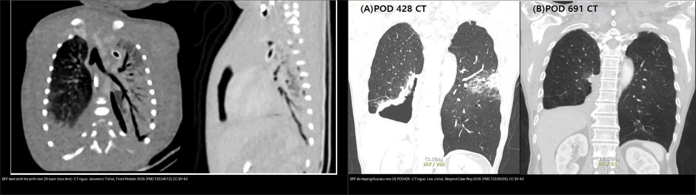
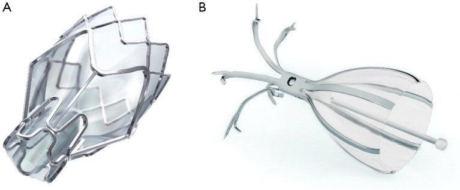
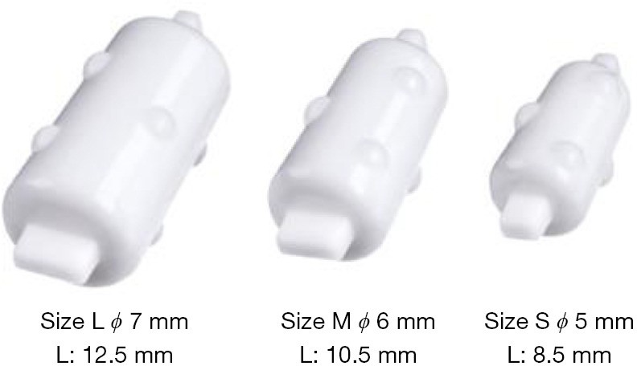
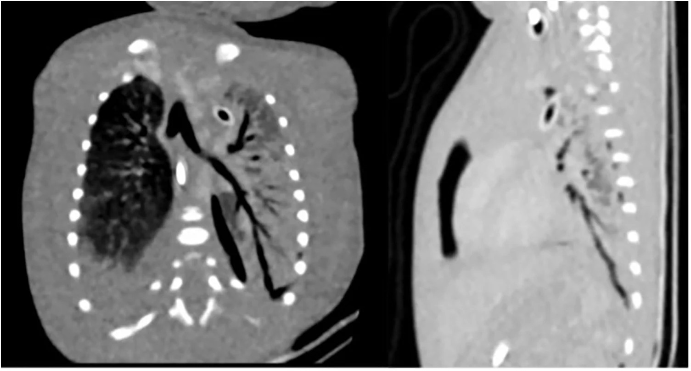
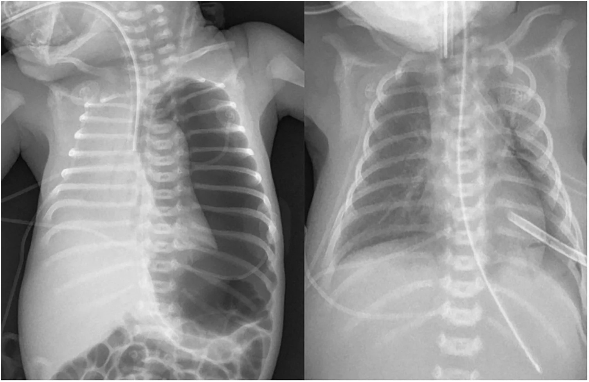
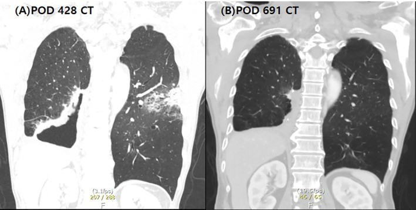
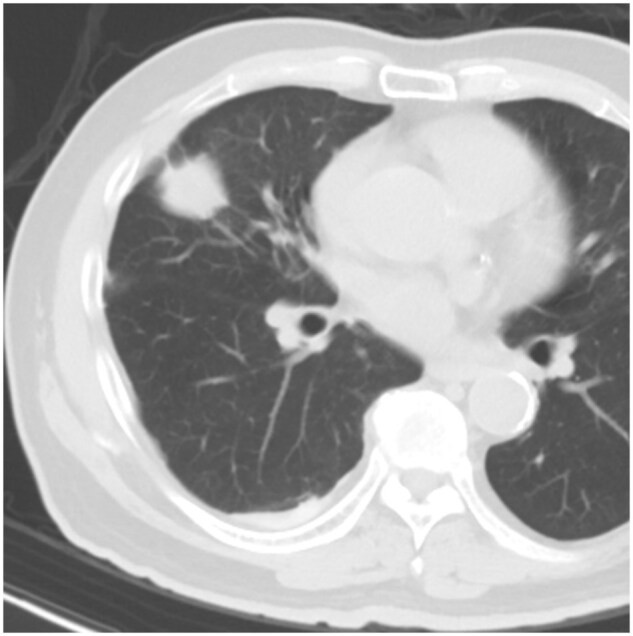
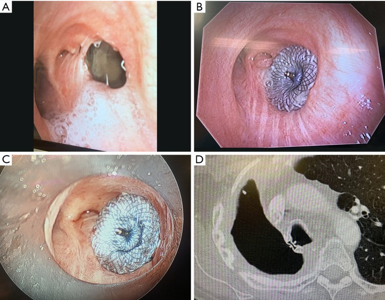
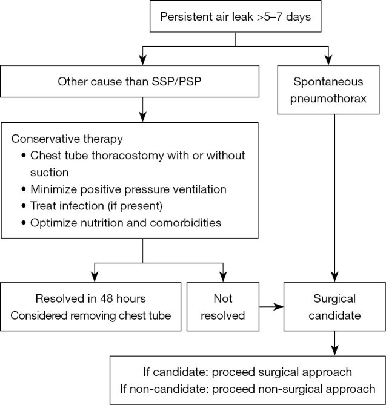

# 618 — Rò phế quản–màng phổi & rò khí dai dẳng ở trẻ: van một chiều nội phế quản, pleurodesis, khi nào mổ / Bronchopleural fistula & persistent air leak in children

**Tags:** `pattern:ro-khi` `pattern:ro-phe-quan-mang-phoi` `pattern:ro-khi-dai-dang` `vung:phoi` `vung:mang-phoi` `protocol:CT-nguc` `protocol:EBV`
**Mức chắc chắn (certainty):** tổng hợp y văn (literature synthesis) — nhóm tự biên từ y văn mở (CC BY 4.0 và CC BY-NC-ND 4.0); các ca minh họa là **ca nguyên văn** của bài gốc (giữ đúng tuổi/thời điểm trong chú thích).

> Đây là **bước tiếp theo của [617 – Hội chứng rò khí ở nhũ nhi](../617-hoi-chung-ro-khi-o-nhu-nhi/lesson.md)** và [616 – Biến chứng viêm phổi nhi (empyema, hoại tử)](../616-bien-chung-viem-phoi-nhi-empyema-hoai-tu/lesson.md): khi **rò khí KHÔNG tự đóng sau vài ngày**, câu hỏi đổi từ "có tràn khí không" sang **"rò ở đâu, do đâu, và chọn can thiệp nào (van một chiều, pleurodesis, hay mổ)"**.

## 1. Tổng quan bệnh học – cơ chế hình ảnh

- **Rò khí (air leak)** là khí đi từ phổi vào khoang màng phổi. Khi rò **kéo dài**, gọi là **rò khí dai dẳng (persistent air leak – PAL)**. Ngưỡng hay dùng: **rò > 5–7 ngày**; theo **BTS 2023** định lượng bằng dẫn lưu kỹ thuật số: **thể tích rò > 15–20 mL/phút kéo dài > 5 ngày** [J Thorac Dis 2024, PMC11228722].
- **Phân loại theo vị trí giải phẫu (rất quan trọng vì quyết định can thiệp):**
  - **Rò phế nang–màng phổi (alveolar-pleural fistula – APF)** và **rò tiểu phế quản ngoại vi–màng phổi (peripheral bronchiolar-pleural)** — nguồn **ngoại vi**, thường **đáp ứng van một chiều nội phế quản (endobronchial valve – EBV)**.
  - **Rò phế quản–màng phổi (bronchopleural fistula – BPF)** — nguồn **phế quản lớn/gốc phế quản (bronchial stump)**, thường sau cắt phổi, dễ **nhiễm trùng màng phổi (pleural sepsis)**, phù hợp **mổ/van chuyên biệt** [J Thorac Dis 2026, PMC13460219].
  - **Phụ thuộc dẫn lưu:** **DDPAL (drainage-dependent)** — hết rò khi kẹp ống; **DIPAL (drainage-independent)** — rò ngay cả khi kẹp.
- **TẠI SAO ở trẻ nhỏ (cơ chế + hình ảnh):**
  - **Thông khí áp lực dương (mechanical ventilation)** là cơ chế hàng đầu ở trẻ sơ sinh: phế nang/tiểu phế quản vỡ do **barotrauma/volutrauma** → khí lan theo **vỏ mạch (Macklin)** ra trung thất rồi màng phổi. **Rò khí bẩm sinh** (không do thông khí, không do nhiễm trùng) **cực hiếm** [Front Pediatr 2026, PMC13534012].
  - **Sau cắt phổi (lobectomy)**, **gốc phế quản xì (dehiscence)** → BPF; khí đi thẳng vào màng phổi → **tràn khí + ổ khí–dịch trong khoang màng phổi**. Trên **CT**, dấu chốt là **thấy đường thông trực tiếp giữa phế quản và khoang màng phổi** (rãnh khí xuyên thành) [J Thorac Dis 2026, PMC11228722].
  - **Nhiễm nấm (Aspergillus)** ở gốc phế quản → **hoại tử + cản trở liền sẹo** → BPF **xuất hiện muộn**; trên CT là **hang có mức khí–dịch sát gốc phế quản**, tồn tại **dù đã dẫn lưu** [Respirol Case Rep 2026, PMC13328205].
  - **Cạm bẫy hình ảnh:** rò khí **nhỏ** có thể không thấy trên X-quang/CT tĩnh; phải dùng **bơm khí/occlusion test** (Chartis) hoặc **xạ hình khí (99mTc-DTPA)** để định vị.
- **Ngưỡng định lượng nổi lòng:**
  - **Sau cắt thùy phổi**: BPF gặp **43/7.550 = 0,57%**; **tử vong 90 ngày 29,2% ở nhóm bảo tồn** so với **thấp hơn rõ ở nhóm can thiệp tích cực** [BMC Pulm Med 2026, PMC13238005].
  - **PAL theo phẫu thuật** (người lớn, tham chiếu): **LVRS 46%**, **lobectomy 8,3%**, **wedge 3,3%**; **sinh thiết phế quản xuyên thành ngực gây tràn khí chỉ 0,009%** [J Thorac Dis 2024, PMC11228722].
  - **EBV ở bệnh nặng**: rút ống dẫn lưu tích lũy **60,5% / 71,1% / 94,7%** tại ngày **10 / 14 / 20**; **tử vong nội viện 10,5%** (4/38) [Front Med 2026, PMC13457204].
  - **Phân độ Cerfolio (mức rò)**: độ **3** (rò thì hít vào) **37%**, độ **4** (rò liên tục cả hít vào–thở ra) **63%** trong loạt bệnh nặng trên.
  - **Trẻ sơ sinh rò cực mạnh**: ca 29 tuần/1.360 g có **rò ~800 mL/phút = toàn bộ thông khí phút** → đe dọa sống còn, buộc can thiệp [Front Pediatr 2026, PMC13534012].
  - **Nấm Aspergillus** kèm BPF có thể đáp ứng **kháng nấm kéo dài ± dẫn lưu** mà không cần mổ thêm [Respirol Case Rep 2026, PMC13328205].


*Trái: **BPF bẩm sinh** ở trẻ sinh non 29 tuần — CT ngực, mũi tên chỉ đường rò (Janowicz T et al., Front Pediatr 2026, PMC13534012). Phải: **BPF do Aspergillus** sau mổ, ngày hậu phẫu 428 — hang + đường rò ở đáy phổi phải (Lee J et al., Respirol Case Rep 2026, PMC13328205). Cả hai CC BY 4.0 — ảnh ghép letterbox.*

## 2. Mẫu hình + chẩn đoán phân biệt theo cơ chế (Gamut)

- **Theo NGUỒN rò (định vị):** **trung tâm/gốc phế quản = BPF** (sau cắt phổi, sau đặt stent phế quản, hoại tử do nấm/lao) so với **ngoại vi = APF/tiểu phế quản** (bóng khí vỡ, sau sinh thiết/đốt u, sau chấn thương).
- **Theo BỐI CẢNH trẻ em:**
  - **Sơ sinh**: **thông khí áp lực dương (RDS/bệnh màng trong)** → barotrauma; **nhiễm trùng** (viêm phổi, kể cả nấm); **do thủ thuật** (đặt ống nội khí quản, hút dịch, đặt catheter); **bẩm sinh (rất hiếm)**.
  - **Trẻ lớn**: **sau cắt thùy phổi/cắt phổi** (nhất là sau hóa trị), **hoại tử phổi (tụ cầu/liên cầu)**, **dị vật bỏ sót**, **sau sinh thiết/đốt u**, **tràn khí tự phát bóng khí**.
- **Theo HẬU QUẢ:** **DDPAL** (nhẹ, thường tự đóng khi đúng dẫn lưu) so với **DIPAL/BPF** (nặng, nguy cơ viêm màng phổi mủ, suy hô hấp, thất bại thông khí).
- **4 câu hỏi khi đọc hình:** (1) rò **trung tâm hay ngoại vi**? (2) rò **phụ thuộc dẫn lưu** không (kẹp ống)? (3) có **nhiễm trùng/hoại tử** (nấm, mủ, mảnh hoại tử) không? (4) **trẻ có đủ điều kiện mổ** không?

## 3. Bảng so sánh phân biệt (ma trận đối chiếu)

| Thực thể (entity) | Hình ảnh điển hình | Chốt vào (rule-in) | Chốt loại (rule-out) | Gợi ý xác nhận |
|---|---|---|---|---|
| **BPF sau cắt phổi** | Hang/ổ khí–dịch **sát gốc phế quản**, khí trong khoang màng phổi dai dẳng, ± mảnh hoại tử | **Đường thông phế quản–màng phổi trên CT + rò ngay khi kẹp ống (DIPAL)** | Rò chỉ khi hít mạnh/có bóng khí vỡ ngoại vi → nghĩ **APF**, không phải gốc phế quản | CT ngực lát mỏng; nội soi phế quản (thấy lỗ xì, thử occlusion) |
| **APF / rò tiểu phế quản ngoại vi** | Tràn khí/ít dịch, **bóng khí ngoại vi** vỡ; **không hang gốc phế quản** | **Rò ngoại vi + đáp ứng khi bịt thử (occlusion test) làm giảm rò > 50%** | **Hang + đường thông gốc phế quản** → BPF | Chartis/occlusion test; 99mTc-DTPA; kẹp ống |
| **BPF do nấm (Aspergillus)** | **Hang có mức khí–dịch** không liền sẹo, xuất hiện **muộn** sau mổ | **Hang tồn tại dai dẳng + nấm trong dịch/bệnh phẩm + thất bại liền sẹo** | Hang **co nhỏ dần theo thời gian** → lành thường, không cần mổ | Cấy/nhuộm nấm; CT chuỗi; kháng nấm ± dẫn lưu |
| **BPF bẩm sinh (sơ sinh)** | Trẻ sơ sinh **rò khí cực mạnh** dù đã ≥ 2 ống dẫn lưu, không phế quản nguồn rõ | **Rò liên tục lượng lớn ≈ toàn bộ thông khí phút + không tìm thấy nguyên nhân thông khí/nhiễm trùng** | Rò giảm sau khi tối ưu thông khí → **barotrauma**, không phải bẩm sinh | CT ngực; nội soi phế quản; thông khí bảo vệ phổi |
| **Rò khí áp lực (tension) trên nền BPF** | **Trung thất lệch**, tim đè, khí lan mô mềm; rò tiếp diễn | **Suy hô hấp/huyết động cấp + lệch trung thất** → **chọc giải áp ngay** rồi can thiệp gốc rò | Rò nhẹ, không lệch trung thất → theo dõi dẫn lưu | X-quang nằm; siêu âm; lâm sàng |
| **Viêm màng phổi mủ do BPF** | Dịch khu trú **đục/mức khí–dịch** (đôi khi liên tục với đường thông), split pleura | **Dịch mủ + khí vào khoang màng phổi + rò khí** | Dịch **trong** không khí, không rò → không mủ do rò | Chọc hút/cấy; CT; dẫn lưu tối ưu |

### Ảnh minh họa cơ chế & can thiệp

*Hai hệ van một chiều nội phế quản: **(A) Zephyr** (một chiều, dùng cho rò khí và giảm thể tích phổi) và **(B) Spiration/IBV** (hình ô – “umbrella”). Van chặn luồng khí vào vùng rò nhưng cho phép khí/thận dịch thoát ra. Ruenwilai P et al., J Thorac Dis 2024 (PMC11228722), CC BY-NC-ND 4.0 (nguyên bản).*


*Nút bịt phế quản **Watanabe (endobronchial Watanabe spigot – EWS)** ba cỡ **L, M, S** — giải pháp thay thế van ở đường thở nhỏ/khó đặt van; gỡ nút khi rò hết, thường **3–4 tuần**. Ruenwilai P et al., J Thorac Dis 2024 (PMC11228722), CC BY-NC-ND 4.0 (nguyên bản).*

## 4. Protocol + phân độ + xử trí + flowchart

- **Đọc cơ bản trước can thiệp:** **X-quang ngực** (mức khí–dịch, lệch trung thất) + **CT ngực lát mỏng** (định vị rò trung tâm/ngoại vi, hang, hoại tử, mủ). **Nội soi phế quản** để thấy lỗ xì và thử **occlusion test**.
- **Chẩn đoán nguồn rò:** **kẹp ống dẫn lưu** phân biệt **DDPAL vs DIPAL**; **occlusion test/Chartis** — **giảm rò > 50%** gợi ý phân thùy đích phù hợp van, **khe liên thùy toàn vẹn > 90%** = ít thông khí bàng hệ, khả năng van thành công cao [J Thorac Dis 2024, PMC11228722].
- **Phân độ rò Cerfolio (mức rò khí):** **độ 1** chỉ khi thở ra gắng sức; **độ 2** khi thở ra thì tự nhiên; **độ 3** khi hít vào; **độ 4** rò liên tục cả hít vào–thở ra. **Độ cao** gợi ý theo dõi sát và cân nhắc can thiệp sớm [Front Med 2026, PMC13457204].
- **Lựa chọn can thiệp (từ ít xâm lấn đến mổ):**
  - **Tối ưu dẫn lưu + tối ưu thông khí (lung-protective)** và **kháng sinh/nhiễm nấm** — bước nền.
  - **Pleurodesis hóa học:** **máu tự thân (blood patch)**, **huyết tương tươi đông lạnh (FFP)** như chất keo sinh học — hiệu quả ở người lớn cao tuổi/kém thuận lợi mổ [Respir Med Case Rep 2026, PMC13498975].
  - **Van một chiều nội phế quản (EBV)**: đầu tay khi **rò ngoại vi/APF** và **khe toàn vẹn**; rút ống được phần lớn trong **2 tuần**; van thường gỡ khi hết rò (**6–8 tuần**) [PMC11228722, PMC13457204].
  - **Nút bịt Watanabe (EWS)** cho đường thở nhỏ; **occluder/van chuyên biệt** cho **BPF gốc phế quản** [PMC13460219].
  - **Mổ** khi **rò gốc phế quản lớn, thất bại nội soi, viêm màng phổi mủ, hoặc toàn trạng cho phép** — can thiệp tích cực liên quan **giảm tử vong 90 ngày** [BMC Pulm Med 2026, PMC13238005].

```mermaid
flowchart TD
  A[Rò khí > 5-7 ngày hoặc rò lượng lớn] --> B[X-quang + CT ngực lát mỏng + nội soi phế quản]
  B --> C{Rò TRUNG TÂM (gốc phế quản) hay NGOẠI VI?}
  C -->|Ngoại vi - APF| D{Khe liên thùy toàn vẹn > 90% + occlusion test giảm > 50%?}
  D -->|Có| E[Van một chiều EBV / nút Watanabe]
  D -->|Không| F[Pleurodesis: máu tự thân / FFP; tối ưu dẫn lưu + thông khí]
  C -->|Trung tâm - BPF| G{Có nhiễm trùng/hoại tử (nấm, mủ)?}
  G -->|Có| H[Kháng nấm/kháng sinh + dẫn lưu tối ưu; can thiệp gốc rò nếu cần]
  G -->|Không| I[Van/occluder chuyên biệt hoặc mổ khâu lại gốc phế quản]
  A --> J{Suy hô hấp/huyết động + lệch trung thất?}
  J -->|Có| K[Chọc giải áp cấp cứu TRƯỚC, rồi xử lý gốc rò]
  J -->|Không| B
```

## 5. Biến thể bình thường và cạm bẫy

- **"Tràn khí đã hết" trên X-quang không đồng nghĩa "rò đã hết":** phải **kẹp ống thử** và đo **thể tích rò kỹ thuật số** (ngưỡng **> 15–20 mL/phút/5 ngày**).
- **Rò khí nhỏ/ngắt quãng có thể âm tính giả** trên ảnh tĩnh → dùng **occlusion test** hoặc xạ hình khí để định vị.
- **Ở trẻ sơ sinh, rò lượng lớn có thể do barotrauma chứ không "bẩm sinh":** trước khi kết luận BPF bẩm sinh, phải loại trừ **thông khí áp lực/do thủ thuật/nhiễm trùng** [Front Pediatr 2026, PMC13534012].
- **Nhiễm nấm/lao ở gốc phế quản** làm **hang không liền sẹo** → đừng vội mổ khi chưa kiểm soát nhiễm trùng.
- **Cạm bẫy mặt cắt:** ổ khí–dịch trong **khoang màng phổi khu trú** dễ bị đọc nhầm là **hang phổi/áp-xe**; dấu phân biệt là **vị trí trong khoang màng phổi (đẩy phổi, đổi theo tư thế)** và **đường thông tới gốc phế quản**.
- **Van một chiều có thể thất bại** nếu **thông khí bàng hệ lớn** (khe liên thùy không toàn vẹn) → phải đánh giá **fissure integrity** trước.

## 6. Tự lượng giá — Blind Quiz

**Ca 1 — Trẻ sinh non 29 tuần, 1.360 g, suy hô hấp ngay sau sinh, hai bên tràn khí (trái có áp lực), hai ống dẫn lưu vẫn rò liên tục. CT:**



- Hỏi: mũi tên chỉ gì? Vì sao "rò khí ở trẻ sơ sinh" phần lớn không phải bẩm sinh?

<details><summary><b>Bấm để hiện đáp án (findings + chẩn đoán)</b></summary>

- **Dấu hiệu:** CT ngực — mũi tên chỉ **đường rò phế quản–màng phổi (BPF)**.
- **Chẩn đoán:** **BPF bẩm sinh** (rất hiếm). **Rò ~800 mL/phút ≈ toàn bộ thông khí phút**. Ở trẻ sơ sinh, đa số BPF là do **thông khí áp lực dương, nhiễm trùng, hoặc can thiệp** — chỉ chẩn đoán "bẩm sinh" sau khi loại trừ các nguyên nhân trên. Nguồn: Janowicz T et al., Front Pediatr 2026 (PMC13534012), CC BY 4.0.
</details>

**Ca 2 — Cùng bệnh nhân, X-quang ngực trước và sau khi dẫn lưu khoang màng phổi:**



- Hỏi: dẫn lưu có giải quyết được vấn đề không? Dấu hiệu nào cho thấy còn rò?

<details><summary><b>Bấm để hiện đáp án (findings + chẩn đoán)</b></summary>

- **Dấu hiệu:** X-quang **trước** (tràn khí hai bên, phổi xẹp) và **sau** dẫn lưu; rò vẫn tiếp diễn cần can thiệp.
- **Chẩn đoán:** **BPF gây rò dai dẳng** — dẫn lưu đơn thuần **không đủ** khi có đường thông phế quản; cần nội soi phế quản/xử lý gốc rò. Nguồn: Janowicz T et al., Front Pediatr 2026 (PMC13534012), CC BY 4.0.
</details>

**Ca 3 — BN sau cắt phổi, 14 tháng sau xuất hiện hang có mức khí–dịch dai dẳng, không liền sẹo, cấy Aspergillus:**



- Hỏi: (A) ngày hậu phẫu 428 có gì? (B) ngày 691 thay đổi thế nào và nhờ đâu?

<details><summary><b>Bấm để hiện đáp án (findings + chẩn đoán)</b></summary>

- **Dấu hiệu:** (A) POD 428 — **hang/đường rò BPF ở đáy phổi phải**; (B) POD 691 — sau **voriconazole kéo dài**, **hang nhỏ đi rõ và mức khí–dịch hết**, rút được catheter.
- **Chẩn đoán:** **BPF do Aspergillus** — quản lý **kháng nấm + dẫn lưu** có thể lành **không cần mổ**. Nguồn: Lee J et al., Respirol Case Rep 2026 (PMC13328205), CC BY 4.0.
</details>

**Ca 4 — BN đã đặt van một chiều nội phế quản vì rò dai dẳng, theo dõi sau 3 tháng:**



- Hỏi: dấu hiệu nào cho thấy rò đã lành? Cơ chế của "co vùng đốt" là gì?

<details><summary><b>Bấm để hiện đáp án (findings + chẩn đoán)</b></summary>

- **Dấu hiệu:** CT sau 3 tháng — **BPF lành hoàn toàn** kèm **co kéo vùng đốt (ablation zone contraction)**.
- **Chẩn đoán:** **BPF sau đốt u bằng vi sóng qua nội soi (TMWA)** đã lành; tỉ lệ BPF trong loạt này **4/173 = 1,9%**; xử trí gồm **keo fibrin trong mổ** và/hoặc **van một chiều**. Nguồn: Chang ATC et al., Eur J Cardiothorac Surg 2026 (PMC13155452), CC BY 4.0.
</details>

**Ca 5 — BN BPF sau cắt phổi toàn bộ, gốc phế quản xì, đặt occluder qua nội soi:**



- Hỏi: (A)–(D) là các bước gì? Vì sao dùng "occluder" thay vì chỉ khâu mổ?

<details><summary><b>Bấm để hiện đáp án (findings + chẩn đoán)</b></summary>

- **Dấu hiệu:** (A) gốc phế quản **hở/xì (dehiscence)** sau cắt phổi; (B) **đặt occluder ASD** (lưới nitinol) bít lỗ rò; (C) đặt qua ống soi cứng; (D) CT xác nhận occluder tại vị trí.
- **Chẩn đoán:** **BPF gốc phế quản** — can thiệp **nội soi qua ống soi cứng bằng occluder** là lựa chọn khi mổ lại không thuận lợi. Nguồn: Jain A et al., J Thorac Dis 2026 (PMC13460219), CC BY-NC-ND 4.0 (nguyên bản).
</details>

**Ca 6 — Trẻ có rò khí dai dẳng, cần quyết định bước tiếp theo. Thuật toán:**



- Hỏi: thuật toán phân nhánh theo những yếu tố nào? Khi nào chuyển sang can thiệp?

<details><summary><b>Bấm để hiện đáp án (findings + chẩn đoán)</b></summary>

- **Dấu hiệu:** **thuật toán xử trí rò khí dai dẳng** (PAL) phân theo loại tràn khí (**PSP vs SSP**), mức rò và đáp ứng điều trị.
- **Chẩn đoán/xử trí:** khởi đầu **tối ưu dẫn lưu + thông khí**; nếu rò **> 5–7 ngày** (định lượng **> 15–20 mL/phút**) → cân nhắc **can thiệp nội soi (van/nút/pleurodesis)** và **mổ** khi thất bại. Nguồn: Ruenwilai P et al., J Thorac Dis 2024 (PMC11228722), CC BY-NC-ND 4.0 (nguyên bản).
</details>

## Bài liên quan chéo
- [600 – Tổng quan Hệ Nhi khoa](../600-tong-quan-nhi-khoa/lesson.md)
- [617 – Hội chứng rò khí ở nhũ nhi (tràn khí màng phổi & tràn khí trung thất)](../617-hoi-chung-ro-khi-o-nhu-nhi/lesson.md) (bước trước: nhận diện rò khí cấp)
- [616 – Biến chứng viêm phổi nhi: empyema & hoại tử phổi](../616-bien-chung-viem-phoi-nhi-empyema-hoai-tu/lesson.md) (mủ màng phổi đi kèm BPF)
- [613 – Viêm tiểu phế quản ở nhũ nhi (RSV)](../613-viem-tieu-phe-quan-nhi/lesson.md) (biến chứng tràn khí 0,5–2%)
- [610 – Suy hô hấp sơ sinh & dị dạng phổi](../610-suy-ho-hap-so-sinh-va-di-dang-phoi/lesson.md) (thông khí áp lực → barotrauma)
- [041 – Tràn khí màng phổi](../041-tran-khi-mang-phoi/lesson.md) (dấu tạng phổi, deep sulcus)
- [614 – Bệnh tiểu phế quản tắc nghẽn (BO) & Swyer–James](../614-benh-tieu-phe-quan-tac-nghen-BO-Swyer-James/lesson.md) (di chứng đường thở một bên)

## Ảnh
- Xem `images/CREDITS.md`. Ảnh **CC BY 4.0** được phép ghép letterbox (composite); **CC BY-NC-ND 4.0 giữ nguyên bản**, không crop/ghép.

> Không dùng để chẩn đoán độc lập khi chưa có người hướng dẫn.
