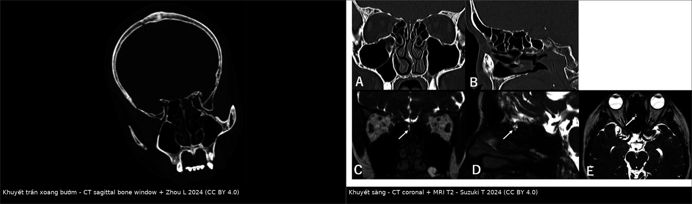
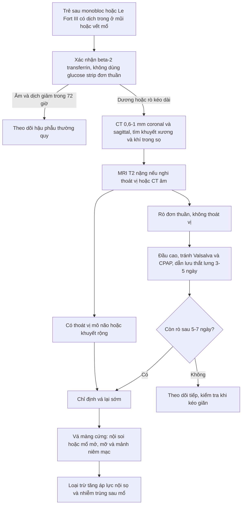
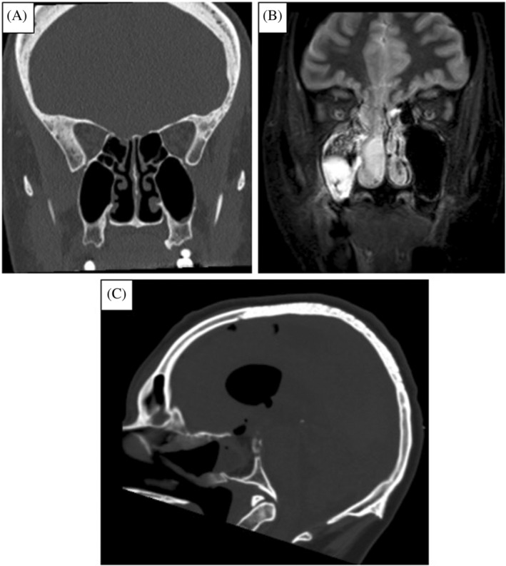
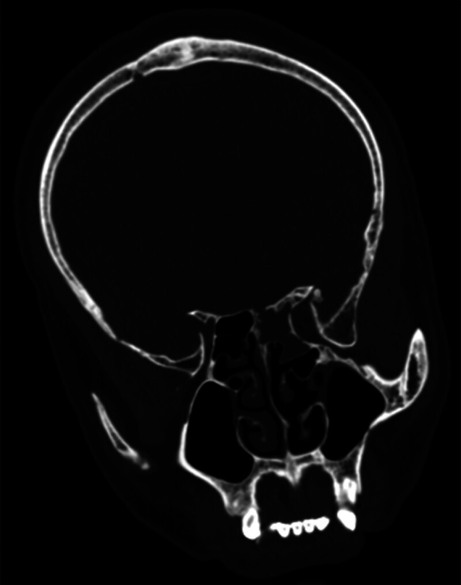
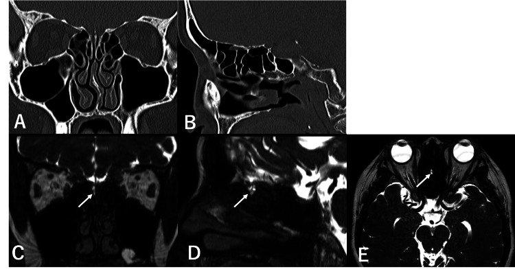

# 6181 — Rò dịch não tủy sau mổ sọ mặt nâng–tiến ra trước ở trẻ / Postoperative CSF leak after monobloc and Le Fort III advancement

**Tags:** `pattern:ro-dich-nao-tuy` `pattern:ro-sau-mo` `pattern:khuyet-xuong-tran-so` `pattern:thoat-vi-mang-nao` `pattern:tran-khi-nao` `vung:so-mat` `vung:xoang` `protocol:CT-lat-mong` `protocol:beta-2-transferrin` `protocol:dan-luu-that-lung` `score:Clavien-Dindo`

**Mức chắc chắn (certainty):** tổng hợp y văn (literature synthesis) — số liệu từ **275 trẻ mổ monobloc/Le Fort III đa trung tâm** (PMC11584185), **47 trẻ Crouzon mổ Le Fort III** (PMC13260441), **18 trẻ vá rò nội soi** (PMC10030683) và **bài tổng quan xác nhận–định vị rò** (PMC11129547). Phần **thời gian dẫn lưu thắt lưng** và **kháng sinh dự phòng** không có thử nghiệm ngẫu nhiên — ghi rõ là **suy luận/thực hành**.

> **Câu chốt:** rò dịch não tủy là biến chứng **thường gặp nhất của chính đường mổ** — **22%** sau monobloc/Le Fort III, và **36% sau monobloc so với 10% sau Le Fort III**. Vì vậy mọi trẻ sau mổ sọ mặt có **nước trong chảy ra mũi/vết mổ** phải được coi là **rò cho tới khi loại trừ**, và điều trị khác hẳn "chảy dịch sau mổ": **không bơm rửa mũi, không CPAP, không đặt nội khí quản đường mũi**, xác nhận bằng **beta-2 transferrin**, hạ áp lực bằng **dẫn lưu thắt lưng**, và **mổ lại vá màng cứng** nếu không tự đóng.

## 1. Tổng quan bệnh học – cơ chế hình ảnh

### 1.1 Vì sao đường mổ sọ mặt đi qua khoang dưới nhện

- **Monobloc** cắt rời **khối xương trán–mũi–gò má** và **Le Fort III** cắt rời **khối mặt giữa** ở **trần sàng, trần xoang sàng, trần ổ mắt** — những nơi **màng cứng dính sát xương** và chỉ cách **vài mm**. Đường cắt vì vậy **luôn có nguy cơ rách màng cứng**, dù không thấy rách đại thể.
- **Sau khi nâng–tiến ra trước**, khoang mổ mở rộng, **xoang mũi thông với khoang ngoài màng cứng**; nếu màng cứng không kín nước, dịch não tủy đi theo **đường áp lực thấp** ra **mũi hoặc vết mổ**.
- **Trẻ khác người lớn:** xương **mỏng, màng cứng mỏng**, xoang **chưa khí hóa hết** (đường rò ngắn), và **dụng cụ nâng–kéo** tạo lực xé trên màng cứng; đồng thời trẻ **khó hợp tác** nên **ho, khóc, bú** làm tăng áp lực trong ổ mổ những ngày đầu.
- **Vì sao quan trọng:** đường rò là **cửa vào của vi khuẩn mũi** → **viêm màng não, áp-xe não, viêm não thất**; trong loạt 18 trẻ rò, **61,1% (11/18)** đã có **viêm màng não trước khi vá** (PMC10030683).

### 1.2 Vật lý hình ảnh: TẠI SAO dịch não tủy không phân biệt được bằng mắt

- **Dịch não tủy = nước + điện giải, gần như không đạm/tế bào** → trên CT **0–15 HU**, **không phân biệt được với nước rửa, niêm dịch loãng hoặc nước mắt**; trên MRI **T1 giảm, T2 tăng mạnh**.
- **Chỉ có hai thứ giúp phân biệt:** (1) **thành phần protein đặc hiệu** — **beta-2 transferrin** (dạng transferrin **mất acid sialic**, chỉ có trong **dịch não tủy, dịch tai trong, thủy dịch, dịch kính**) với ngưỡng phát hiện **2 µg/mL**; (2) **vị trí giải phẫu** — **khuyết xương đúng đường cắt** trên CT lát mỏng.
- **Thoát vị màng não–não** trên MRI: **mô não đồng tín hiệu vỏ não** + **dịch màng não tăng tín hiệu** chui qua khuyết xương — khác **mô sẹo/niêm mạc phì đại** (tín hiệu trung gian, không liên tục với khoang dưới nhện).
- **Khí trong sọ (pneumocephalus/pneumoventricle):** khí **−1.000 HU**, **tối trên mọi chuỗi MRI**; khí **trong não thất** sau mổ sọ mặt là **dấu hiệu gián tiếp của thông thương còn hoạt động**.

### 1.3 Ngưỡng định lượng phải nhớ

| Chỉ số | Con số | Nguồn |
|---|---|---|
| Rò dịch não tủy sau monobloc/Le Fort III | **22% (61/275)** | PMC11584185 |
| Theo loại mổ | **monobloc 36% (46/129)** vs **Le Fort III 10% (15/146)** | PMC11584185 |
| Viêm màng não sau mổ | **1% (3/275)** | PMC11584185 |
| Nhiễm vết mổ / viêm phổi sau mổ | **9% / 9%** | PMC11584185 |
| Rò dịch não tủy sau Le Fort III (loạt 47 trẻ Crouzon) | **4,3% (2/47)**, xếp **Clavien–Dindo II** | PMC13260441 |
| Định nghĩa rò trong nghiên cứu đó | chảy dịch **trong** từ vết mổ/mũi/tai + **glucose > 30 mg/dL** | PMC13260441 |
| Beta-2 transferrin (điện di miễn dịch) | ngưỡng **2 µg/mL**; **Sn 87–100% / Sp 71–94%** | PMC11129547 |
| Glucose dịch mũi | **Sn tới 100% nhưng Sp chỉ 45%** | PMC11129547 |
| CT định vị lỗ rò | **70%** ca đã xác nhận | PMC11129547 |
| Trẻ rò được vá nội soi | **sàng 66,7%**, lỗ trung vị **8 mm**, **thoát vị 77,8%**, **đóng kín 100%** | PMC10030683 |

## 2. Mẫu hình + chẩn đoán phân biệt theo thời điểm sau mổ (Gamut)

- **Ngay trong 24 giờ — "thì hậu phẫu sớm":** dịch **lẫn máu**, khó phân biệt với **nước rửa/niêm dịch**; nếu **chảy thành giọt trong**, **tăng khi cúi/khóc** → nghi rò thật.
- **Ngày 2–7 — "thì rò rõ":** dịch **trong, không màu**, **một bên**, **không đáp ứng thuốc co mạch/kháng histamine**; có thể kèm **đau đầu tăng khi ngồi**, **buồn nôn**.
- **Sau khi bắt đầu kéo giãn (distraction) vài tuần — "thì muộn":** lực kéo làm **mở rộng khe cắt** → rò **xuất hiện hoặc tái phát**; đây là lý do phải **theo dõi cả trong giai đoạn kéo giãn**, không chỉ những ngày nằm viện.
- **Theo đường ra:**
  - **Qua mũi** (hay gặp): từ **trần sàng/trần xoang sàng** ra khe khứu hoặc khe giữa.
  - **Qua vết mổ trán–thái dương:** dịch **thấm băng liên tục**, dễ bị cho là **tụ dịch dưới da (pseudomeningocele)**.
  - **Qua tai:** chỉ khi đường cắt/ chấn thương lan tới **xương đá** (bài 244 bàn mặt chấn thương).
- **Biến chứng sớm phải loại trừ song song:** **viêm màng não** (sốt, cứng gáy, li bì), **áp-xe não**, **pneumocephalus căng**, **tụ máu ngoài/dưới màng cứng**.

## 3. Bảng so sánh phân biệt (ma trận đối chiếu)

| Thực thể (entity) | Hình ảnh/lâm sàng điển hình | Chốt vào (rule-in) | Chốt loại (rule-out) | Gợi ý xác nhận |
|---|---|---|---|---|
| **Rò dịch não tủy sau mổ** | Dịch **trong, một bên**, chảy giọt khi cúi/khóc; CT: **khuyết xương đúng đường cắt**, có thể **khí trong sọ** | **Rò sau mổ + beta-2 transferrin dương + khuyết xương đúng vị trí** | Dịch **đục, vàng, có mủ**, không tăng khi cúi → nghĩ niêm dịch/nhiễm | Beta-2 transferrin; CT 0,6–1 mm; MRI T2 nặng |
| **Dịch mũi hậu phẫu bình thường** | **Lẫn máu**, giảm dần **48–72 giờ**, không liên quan tư thế, niêm mạc phù | **Giảm nhanh, không trong, không tái phát khi cúi** | **Trong, tăng khi cúi, kéo dài > 72 giờ** → phải loại trừ rò | Theo dõi 48–72 giờ; B2T nếu còn nghi |
| **Thoát vị màng não–não qua đường cắt** | MRI: **mô não + dịch màng não** qua khuyết xương; lâm sàng có thể **tắc mũi một bên**, không chảy dịch | **MRI thấy mô não trong đường rò** | MRI chỉ có **mô sẹo/niêm mạc**, không liên tục khoang dưới nhện | MRI T2 nặng + T1 sau tiêm; **không sinh thiết** |
| **Pseudomeningocele (tụ dịch dưới da)** | Khối **dịch dưới da, căng, không đỏ**, không chảy ra mũi | **Khối dịch dưới da + MRI thấy túi dịch ngoài màng cứng** | **Chảy dịch ra ngoài** hoặc **khí trong sọ** → có thông thương | MRI/CT; theo dõi áp lực |
| **Viêm màng não sau mổ** | Sốt, cứng gáy, li bì; **dịch não tủy qua chọc dò: tế bào tăng, glucose thấp** | **Sốt + màng não + cấy/B2T dương** | Không sốt, không màng não → ít nghĩ | Chọc dò khi an toàn; kháng sinh sớm |
| **Rò muộn sau kéo giãn** | Dịch trong xuất hiện **sau khi tăng lực kéo** vài tuần; CT: **khe cắt rộng ra** | **Rò xuất hiện đúng giai đoạn distraction + khuyết xương rộng** | Rò ngay sau mổ, đã xử lý → nghĩ tái phát tại chỗ vá | CT so sánh; giảm/ngừng kéo giãn |
| **Chảy nước mắt tràn** | Mắt **chảy nước liên tục**, không phải mũi; phù mi sau mổ | **Nước mắt chảy qua mi, không qua lỗ mũi** | Dịch **từ mũi** khi bịt mắt → không phải nước mắt | Khám mắt; test bịt |

*Ảnh minh hoạ cơ chế **khuyết xương trần sọ + đường rò** (từ ca chấn thương và rò tự phát ở người lớn, không phải ca hậu phẫu sọ mặt). Trái: khuyết **trần xoang bướm** trên CT sagittal (Zhou L 2024, CC BY 4.0). Phải: (A–B) khuyết **sàng/trần sàng** trên CT, (C–E) MRI T1/T2 với **mũi tên chỉ đường rò** (Suzuki T 2024, CC BY 4.0). Ảnh ghép letterbox, giữ nguyên tỷ lệ.*

## 4. Protocol hậu phẫu + ngưỡng xử trí

### 4.1 Ngày 0–7: nhận diện và xác nhận

| Bước | Việc làm | Ngưỡng/lưu ý |
|---|---|---|
| **1. Theo dõi băng/gạc** | Ghi **số lần thấm ướt**, màu dịch, **có trong không** | Dịch **trong, thấm liên tục** hoặc **chảy giọt khi cúi** = nghi rò |
| **2. Xác nhận** | **Beta-2 transferrin** trên dịch (lấy **ống sạch**, không lấy trên gạc) | ngưỡng **2 µg/mL**, **Sn 87–100% / Sp 71–94%**; **glucose strip không đủ** (**Sp 45%**) |
| **3. Định vị** | **CT 0,6–1 mm** cửa sổ xương, dựng **coronal + sagittal**, FOV giới hạn | tìm được **70%** lỗ rò; đánh giá **khí trong sọ**, **khe cắt**, **mảnh ghép** |
| **4. Đánh giá mô mềm** | **MRI T2 nặng (CISS/FIESTA)** khi nghi **thoát vị** hoặc CT âm | thấy **mô não trong túi**, **túi dịch ngoài màng cứng** |
| **5. Loại trừ nhiễm** | Cấy dịch, CRP, khám màng não; **chọc dò khi đã loại trừ tăng áp lực** | **viêm màng não 1%** sau mổ nhưng **61%** ở trẻ rò kéo dài |

### 4.2 Điều trị: hạ áp lực trước, vá sau

- **Bảo vệ đường rò ngay:** **đầu cao 30°**, **không xì mũi/bơm rửa mũi**, **không đặt nội khí quản đường mũi**, **không CPAP mask** (thổi khí vào đường rò), tránh **Valsalva/khóc nhiều**; nới **khung kéo giãn** nếu rò xuất hiện trong giai đoạn distraction.
- **Dẫn lưu thắt lưng (CSF diversion):** **5–10 mL/giờ (≈ 120–240 mL/ngày) trong 3–5 ngày** — **thực hành/suy luận**, không có RCT ở trẻ; theo dõi **quá dẫn lưu** (đau đầu thế đứng, pneumocephalus căng, tụ máu dưới màng cứng).
- **Thời điểm vá lại:** **vá sớm (≤ 7 ngày)** khi **rò kéo dài > 5–7 ngày**, **tái phát**, **có thoát vị mô não**, **có viêm màng não**, hoặc **khí trong sọ tăng**; có thể **vá nội soi** nếu đường rò ở trần sàng/trần bướm, **mổ mở** nếu đường rò nằm trong **khoang mổ sọ mặt/trần ổ mắt**.
- **Kỹ thuật vá ở trẻ:** **mỡ/chất tiêu bịt lỗ (bath-plug)** + **mảnh niêm mạc cuốn giữa** + keo fibrin — trong **18 trẻ**, **100% đóng kín**, **không tái phát** trong **50–70 tháng**, và **không cần dẫn lưu thắt lưng thường quy** ở nhóm chọn lọc này (PMC10030683).
- **Kháng sinh:** điều trị khi **có nhiễm**; **kháng sinh dự phòng kéo dài không chứng minh giảm viêm màng não** và làm **chọn lọc vi khuẩn kháng** — đây là **suy luận/thực hành**, không phải số liệu từ hai đoàn hệ trên.
- **Trước mổ lại:** xác nhận **không tăng áp lực nội sọ** (nếu có, phải **dẫn lưu/shunt** song song), vì vá mà còn tăng áp lực → **tái rò**.

## 5. Biến thể bình thường và cạm bẫy

- **Glucose strip dương không chốt được:** **Sp 45%** — máu, nước mắt, niêm dịch đều dương; định nghĩa "glucose > 30 mg/dL" trong một nghiên cứu là **tiêu chuẩn nghiên cứu**, không phải tiêu chuẩn chẩn đoán.
- **"Chảy dịch sau mổ là bình thường":** đúng với **dịch lẫn máu giảm trong 48–72 giờ**; **dịch trong, tăng khi cúi, kéo dài** là **rò** — đừng chờ đến khi có sốt.
- **Rò xuất hiện muộn trong giai đoạn kéo giãn:** theo dõi **cả vài tuần sau xuất viện**, đặc biệt khi **tăng lực kéo**; CT so sánh khe cắt.
- **Viêm màng não có thể là dấu hiệu đầu tiên:** trẻ **sốt, li bì, cứng gáy** sau mổ sọ mặt phải **cấy + chọc dò khi an toàn**, không chờ thấy rò rõ.
- **Khí trong sọ:** một ít khí **vài ngày đầu** có thể tồn dư; khí **tăng lên** hoặc **trong não thất** = thông thương hoạt động.
- **Bơm rửa/xịt mũi, hút mũi, đặt sonde mũi** đều có thể **mở lại đường rò** hoặc **đẩy vi khuẩn vào màng não** — ghi rõ trong y lệnh hậu phẫu.
- **Satisfaction of search:** đường cắt **hai bên** có thể có **hai chỗ rò**; thấy một chỗ vẫn phải xem **toàn bộ trần sọ** trên CT.
- **Tụ dịch dưới da (pseudomeningocele) không phải "ổ áp-xe":** **không chọc mù** khi chưa loại trừ thông thương; chọc có thể **tạo đường rò mới**.

## 6. Tự lượng giá — Blind Quiz

**Ca 1 — Bé gái 6 tuổi sau monobloc, ngày hậu phẫu 3: băng mũi thấm ướt liên tục, dịch trong, chảy giọt khi cúi đầu. Bé không sốt. Bước tiếp theo?**

- Câu hỏi: (A) CT và (B) MRI minh hoạ tổn thương gì? Vì sao **không được bơm rửa mũi** và **không dùng CPAP**? Xác nhận bằng xét nghiệm nào?

<b>Bấm để hiện đáp án</b>

- (A) **khuyết trần sọ**; (B) **thoát vị màng não–não** qua khuyết xương — cơ chế giống đường rò sau mổ sọ mặt.
- Bơm rửa/hút mũi và **CPAP** làm **tăng áp lực** và **thổi khí/dịch qua đường rò**, tăng nguy cơ **pneumocephalus** và **viêm màng não**.
- Xác nhận: **beta-2 transferrin** (ngưỡng **2 µg/mL**); **glucose strip không đủ** (Sp 45%). Định vị: **CT 0,6–1 mm**.
- Nguồn ảnh: Torabi SJ et al., *Laryngoscope Investig Otolaryngol* 2024 (PMC11129547), CC BY-NC-ND 4.0 — nguyên bản.

**Ca 2 — Bé trai 8 tuổi sau Le Fort III, ngày 5: dịch mũi trong đã giảm, nhưng đau đầu tăng khi ngồi dậy và buồn nôn. CT sagittal dưới đây (ca khác) cho thấy khuyết trần bướm. Nên làm gì?**

- Câu hỏi: Vì sao **đau đầu tăng khi ngồi** lại phù hợp với rò? Hai nguy cơ phải loại trừ trước khi tăng dẫn lưu?

<b>Bấm để hiện đáp án</b>

- **Đau đầu tăng khi ngồi, giảm khi nằm** = **giảm áp lực nội sọ** do mất dịch — gợi ý rò còn hoạt động, dù chảy mũi ít.
- Loại trừ **pneumocephalus căng** (khí tăng, tri giác xấu) và **tụ máu dưới/ngoài màng cứng** trước khi tăng tốc độ dẫn lưu.
- Hướng: **dẫn lưu thắt lưng 5–10 mL/giờ, 3–5 ngày**, đầu cao, tránh Valsalva; **vá lại** nếu còn rò sau **5–7 ngày** hoặc có thoát vị.
- Nguồn ảnh: Zhou L et al., *Medicine (Baltimore)* 2024 (PMC11608663), CC BY 4.0.

**Ca 3 — Bé gái 5 tuổi sau mổ sọ mặt 3 tuần, đang kéo giãn: xuất hiện lại nước trong một bên mũi. CT coronal và MRI dưới đây (ca rò tự phát ở người lớn) minh hoạ lỗ rò sàng. Xử trí?**

- Câu hỏi: Vì sao rò **xuất hiện lại đúng lúc kéo giãn**? Nên **giảm lực kéo** hay **mổ vá ngay**? Cần kiểm tra gì trước khi vá?

<b>Bấm để hiện đáp án</b>

- Lực kéo làm **khe cắt rộng ra** và **màng cứng bị căng** → đường vá **bung** hoặc rách mới; đây là cơ chế rò **muộn** đặc thù của distraction.
- Trước hết **giảm/ngừng kéo giãn** và **hạ áp lực** (đầu cao, dẫn lưu thắt lưng); nếu vẫn rò → **vá lại** (nội soi nếu ở sàng/bướm, mổ mở nếu trong khoang mổ).
- Kiểm tra: **beta-2 transferrin**, **CT 0,6–1 mm** tìm khuyết và **khí trong sọ**, **MRI** loại trừ **thoát vị mô não**, và **loại trừ tăng áp lực nội sọ**.
- Nguồn ảnh: Suzuki T et al., *Cureus* 2024 (PMC11234242), CC BY 4.0.

## Bài liên quan chéo

- [244 – Rò dịch não tủy sau chấn thương nền sọ ở trẻ: HRCT/MRI & chỉ định vá](../244-ro-dich-nao-tuy-nen-so/lesson.md)
- [3092 – Nhiễm trùng mảnh ghép sau nắn gò má ở trẻ](../3092-nhiem-manh-ghep-sau-nan-go-ma-o-tre/lesson.md)
- [3105 – Tràn khí ổ mắt sau chấn thương gò má](../3105-tran-khi-o-mat-sau-cham-thuong-go-ma/lesson.md)
- [3026 – Tụt não nghịch lý sau chọc dò/shunt mở sọ](../3026-tut-nao-nghich-ly-sau-choc-do-shunt-mo-so/lesson.md)

> Không dùng để chẩn đoán độc lập khi chưa có người hướng dẫn.
