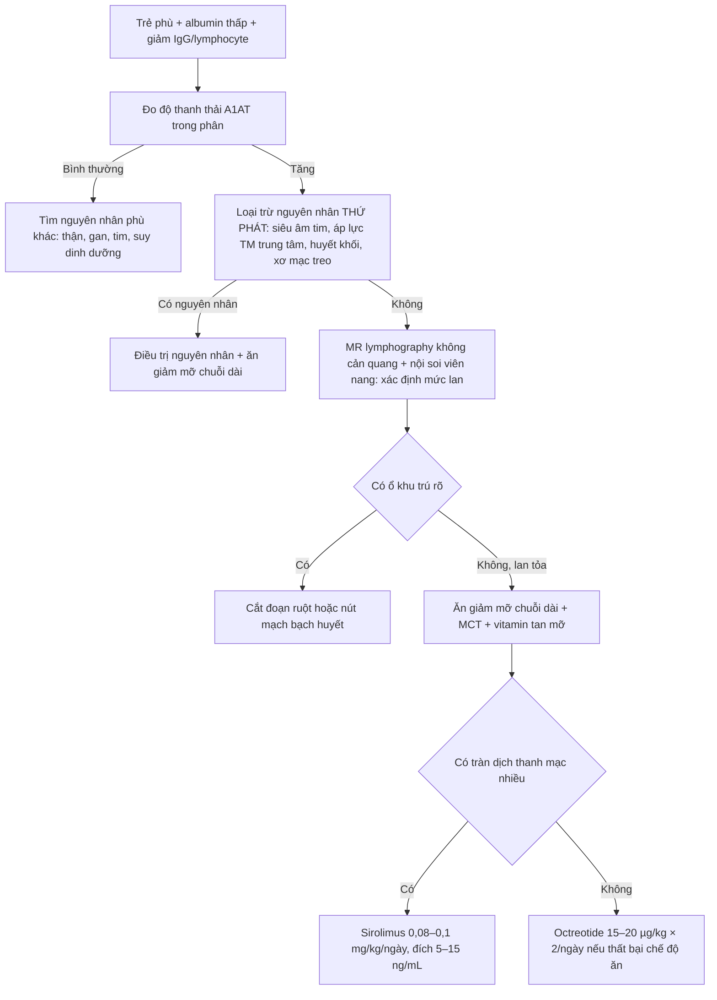
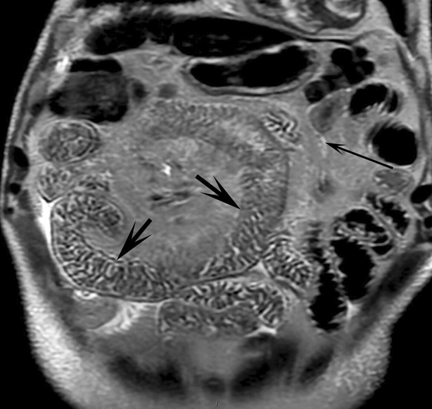
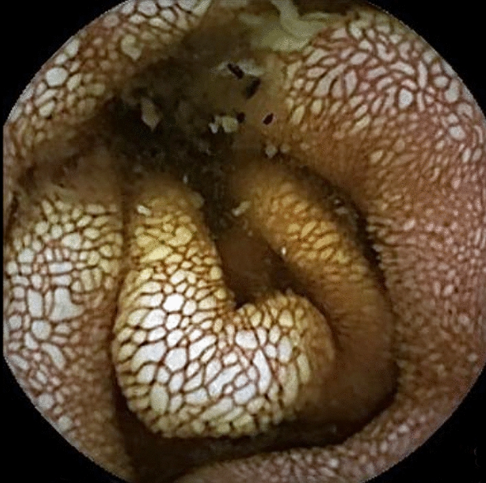
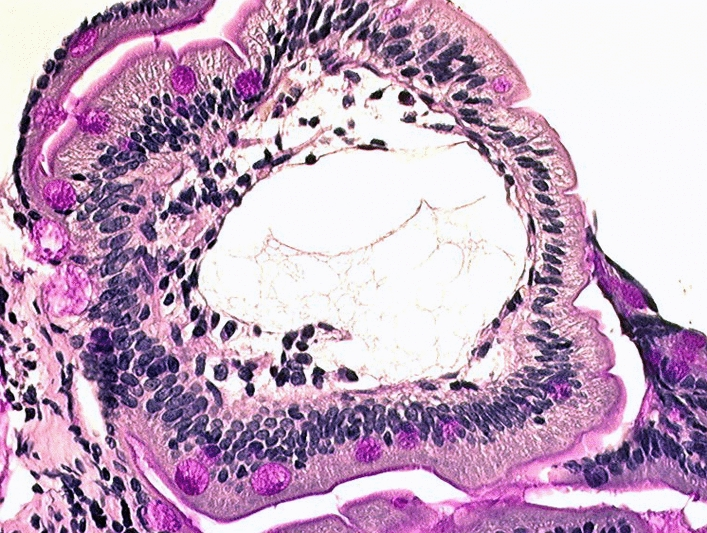

# 6182 — Lymphangiectasia ruột nguyên phát ở trẻ / Primary intestinal lymphangiectasia (Waldmann disease)

**Tags:** `pattern:day-thanh-ruot` `pattern:phu` `pattern:giam-albumin` `pattern:giai-mach-bach-huyet` `pattern:phu-mac-treo` `vung:ruot-non` `vung:o-bung` `vung:mac-treo` `score:A1AT-clearance` `protocol:MRI-lymphography` `protocol:noi-soi-vien-nang` `protocol:CT-enterography` `incidentaloma:khong`

**Mức chắc chắn (certainty):** tổng hợp y văn (literature synthesis) — dựa trên **phác đồ quốc gia Pháp PNDS 2025** (*Orphanet J Rare Dis* 2025, **PMC12247264**, CC BY 4.0), **đoàn hệ hồi cứu 34 trẻ** (*J Pediatr Gastroenterol Nutr* 2026, **PMC12864169**, CC BY 4.0) và các ca có ảnh minh họa trong cùng bài PNDS. Nhóm **không có bệnh nhân của mình**; phần chưa có nguồn đủ chắc được ghi rõ "chưa rõ", không bịa. **Không ghi tên tác giả** — attribution dùng tạp chí + năm + PMCID.

> **Câu chốt:** Lymphangiectasia ruột nguyên phát (PIL, bệnh Waldmann, ORPHA 90362) là **rò dịch bạch huyết (chyle) vào lòng ruột** vì mạch bạch huyết nhung mao giãn và tắc dẫn lưu — nên bộ ba kinh điển là **giảm albumin + giảm IgG + giảm lymphocyte**, chứ không phải "bệnh ruột" đơn thuần. Ba con số phải thuộc: **(1)** xác định mất protein qua ruột bằng **độ thanh thải alpha-1 antitrypsin (A1AT): bình thường < 24 mL/24 giờ ở trẻ, < 15 mL/24 giờ ở người lớn** (PMC12247264); **(2)** bệnh khởi phát **thường trước 3 tuổi** — đoàn hệ Pháp: trung vị **7 tháng (3–29,5)**, phù **79%**, tiêu chảy mạn **50%**, cổ trướng **35%**, và **81% đáp ứng chế độ ăn giảm mỡ chuỗi dài nhưng chỉ 26% "khỏi" hoàn toàn** (PMC12864169); **(3)** trên hình ảnh, **MR lymphography không cản quang** là chuỗi xung nhìn trực tiếp mạch bạch huyết giãn: **thành ruột non dày + ổ tăng tín hiệu T2 rất mạnh trong nang bạch huyết dưới niêm mạc**, còn **X-quang/CT thường không đặc hiệu**.

## 1. Tổng quan bệnh học – cơ chế hình ảnh

### 1.1 Vì sao mất albumin lại kéo theo mất IgG, lymphocyte và cholesterol

- **Giải phẫu – sinh lý:** mỗi nhung mao ruột non có **mạch bạch huyết trung tâm (lacteal)**. Dịch trong lacteal là **chyle**: giàu **albumin, globulin (đặc biệt IgG), lymphocyte, cholesterol và chylomicron** (sản phẩm hấp thu mỡ chuỗi dài). Bình thường chyle đi **hạch mạc treo → bể dưỡng chấp → ống ngực → tĩnh mạch dưới đòn trái**.
- **Cơ chế bệnh:** khi dẫn lưu bạch huyết **bị tắc hoặc loạn sản**, áp lực trong lacteal tăng → **giãn (lymphangiectasia)** → thành mạch mỏng vỡ vào lòng ruột. Kết quả là **mất protein không chọn lọc**: albumin, IgG, IgA, lymphocyte, cholesterol và acid béo thiết yếu cùng ra phân.
- **TẠI SAO là "bộ ba" chứ không chỉ albumin:** ba thành phần này **cùng nằm trong một túi dịch** là chyle, nên rò chyle làm giảm cả ba. Đây là điểm phân biệt với **bệnh thận mất protein**: mất albumin nhưng **IgG và lymphocyte thường bình thường**, kèm protein niệu lượng lớn. Trong PIL, **IgG giảm chủ yếu (IgG1, IgG2, IgG4)**; **IgA và IgM cũng giảm nhưng ít hơn**; có **lymphopenia với tỉ lệ CD4/CD8 thấp** (PMC12247264).
- **TẠI SAO giảm cholesterol và thiếu vitamin tan trong mỡ:** chyle mang cholesterol và vitamin A/D/E/K; rò chyle → **hạ cholesterol máu**, thiếu vitamin A–D–E–K, có thể **hạ calci máu gây co giật, tetany, nhuyễn xương** (PMC12247264).
- **Vòng xoắn miễn dịch:** giảm IgG + lymphopenia → **nhiễm trùng tái phát** (đặc biệt *Cryptosporidium*, CMV, nhiễm khuẩn hô hấp) → mỗi đợt nhiễm làm tăng mất protein → bệnh nặng thêm. Đây là lý do **PIL được xếp vào nhóm suy giảm miễn dịch kết hợp thứ phát**, dù bản chất không phải bệnh của tế bào miễn dịch.

### 1.2 TẠI SAO hình ảnh nhìn thấy được (vật lý chuỗi xung)

- **MR lymphography không cản quang — vì sao sáng:** kỹ thuật dựa trên **tín hiệu T2 rất cao của dịch chuyển động chậm** so với mô đặc (PMC12247264). Dùng **chuỗi xung T2 rất nặng (heavily T2-weighted, 3D, echo time dài, fat-sat)** thì **nước tự do và chyle** (T2 hàng trăm mili giây đến > 1 giây) vẫn sáng, còn **mô đặc, mỡ, máu** bị triệt. Vì thế:
  - **thành ruột non dày** vì **phù (nước tự do) dưới niêm mạc** → dải sáng;
  - **mạch bạch huyết giãn** trong lớp dưới niêm mạc/mạc treo → **ổ tăng tín hiệu dạng nang, đa ổ, "hypersignal"** nằm ngay trong thành ruột;
  - **mạng ống bạch huyết giãn** thấy được như **đường sáng nối các nang**.
- **Vì sao KHÔNG dùng cản quang:** gadolinium không vào lòng mạch bạch huyết bằng đường tĩnh mạch, nên **không thêm thông tin cho lymphangiectasia** mà lại có nguy cơ ở bệnh nhân đái tháo đường/suy thận — trong khi trẻ PIL thường cần chụp lặp lại nhiều lần.
- **Vì sao CT chỉ thấy "dày thành + quầng sáng":** phù dưới niêm mạc tạo **lớp nhược sắc kẹp giữa niêm mạc và thanh mạc ngấm thuốc** = **dấu quầng (halo sign)** hoặc dày thành dạng nốt (PMC12247264). Nhưng **dày thành ruột non lan tỏa là dấu hiệu hoàn toàn không đặc hiệu** (thiếu máu, tăng áp cửa, phù toàn thân, viêm ruột, bệnh mạch máu mạc treo) → **CT dùng để LOẠI TRỪ nguyên nhân khác** (khối chèn ép, huyết khối tĩnh mạch cửa/mạc treo, xoắn), **không dùng để chẩn đoán PIL**.
- **Vì sao nội soi viên nang thấy "hạt trắng":** nhung mao ruột non **phình lên vì lacteal đầy chyle trắng đục**, nên trên hình nội soi là **đốm trắng milimet, phẳng hoặc gồ, có thể hợp dòng**; **cho nạp mỡ (bơ, dầu ô liu) trước soi làm tăng độ nhạy** vì tăng dòng chyle (PMC12247264).
- **Vì sao sinh thiết tá tràng là "chuẩn vàng":** mô học thấy **mạch bạch huyết giãn trong nhung mao**; nhuộm **D2-40 (podoplanin)** đánh dấu nội mô bạch huyết giúp xác nhận.

### 1.3 Ngưỡng định lượng nằm lòng

| Chỉ số | Ngưỡng / giá trị | Nguồn |
|---|---|---|
| **Độ thanh thải A1AT** | **< 24 mL/24 giờ** (trẻ), **< 15 mL/24 giờ** (người lớn) là bình thường → tăng = mất protein qua ruột | PMC12247264 |
| Tuổi khởi phát | **thường < 3 tuổi**; đoàn hệ Pháp: trung vị **7 tháng (3–29,5)** | PMC12247264; PMC12864169 |
| Triệu chứng chính (34 trẻ) | phù **79%**, tiêu chảy mạn **50%**, cổ trướng **35%** | PMC12864169 |
| Đáp ứng chế độ ăn giảm LCT | **25/31 = 81%** (15 đáp ứng một phần, 10 hoàn toàn — albumin về **> 35 g/L**) | PMC12864169 |
| "Khỏi" (ăn bình thường, không tái phát) | **9/34 = 26%**; **14/34 = 45%** ăn lại bình thường được | PMC12864169 |
| Cần thuốc bậc 2 | **4/34 = 12%** | PMC12864169 |
| Yếu tố dự báo dai dẳng | **có phù bạch huyết chi** hoặc **có biến thể gen** → đáp ứng chỉ một phần (p < 0,05) | PMC12864169 |
| Lymphoscintigraphy | chỉ thấy phóng xạ trong ruột ở **< 50%** ca đã chứng minh mô học → **âm không loại trừ** | PMC12247264 |
| Octreotide | trẻ **15–20 µg/kg × 2 lần/ngày**; dạng phóng thích chậm **20–30 mg/4 tuần** (người lớn) | PMC12247264 |
| Sirolimus | trẻ **0,08–0,1 mg/kg/ngày** (2 lần), đích **5–15 ng/mL**; người lớn khởi đầu **2 mg/ngày** | PMC12247264 |

## 2. Mẫu hình + chẩn đoán phân biệt theo vị trí (gamut)

- **Mẫu hình (pattern):** **dày thành ruột non lan tỏa hoặc dạng nốt + phù mạc treo + nang tăng tín hiệu T2 trong thành ruột**, kèm **phù mô mềm chi, cổ trướng, tràn dịch màng phổi/màng tim**.
- **Gamut theo vị trí:**
  - **Tá tràng – hỗng tràng:** vị trí điển hình của PIL (lacteal lớn, hấp thu mỡ mạnh) — cũng là nơi *Giardia*, bệnh celiac và lymphangiectasia thứ phát khu trú.
  - **Hồi tràng:** Crohn, lao ruột, lymphoma, tăng sinh mô bạch huyết (lymphoid hyperplasia).
  - **Dạ dày:** bệnh Ménétrier (dày nếp gấp khổng lồ, mất protein) — **hiếm khi có lymphangiectasia**.
  - **Toàn bộ ruột non + hạch mạc treo + hệ bạch huyết sau phúc mạc/ngực/chi:** gợi ý **bệnh hệ thống** (PIL kèm dị tật bạch huyết, Hennekam, phù bạch huyết bẩm sinh).
- **Gamut theo cơ chế (quan trọng hơn gamut theo vị trí):**
  1. **Tắc dẫn lưu trung tâm** → lymphangiectasia **thứ phát**: sau phẫu thuật Fontan, viêm màng ngoài tim co thắt, huyết khối tĩnh mạch chủ trên/dưới đòn, xơ hóa sau phúc mạc sau xạ/hóa trị.
  2. **Loạn sản/tăng sinh mạch bạch huyết nguyên phát** → PIL đơn độc, **Hennekam (CCBE1)**, RASopathy (Noonan, PTPN11/RIT1/SOS1), Turner.
  3. **Viêm/tăng sinh niêm mạc** → celiac, viêm ruột ái toan, lao ruột, Crohn, *Whipple*, nhiễm *Giardia*.
  4. **Thâm nhiễm** → lymphoma ruột non, amyloidosis, bệnh Waldenström, histiocytosis.
- **Mnemonic "TẮC – LOẠN – VIÊM – U – THẤM"** (5 nhóm phải loại trừ trước khi gọi "nguyên phát"): **TẮC** dẫn lưu trung tâm, **LOẠN** sản mạch bạch huyết (PIL, Hennekam, RASopathy), **VIÊM** niêm mạc (celiac, ái toan, lao, *Whipple*), **U** (lymphoma ruột non), **THẤM** (amyloid, Waldenström, histiocytosis).

## 3. Bảng so sánh phân biệt (ma trận đối chiếu)

| Thực thể (entity) | Hình ảnh điển hình | Chốt vào (rule-in) | Chốt loại (rule-out) | Gợi ý xác nhận |
|---|---|---|---|---|
| **PIL (nguyên phát)** | Thành ruột non dày lan tỏa (ưu thế hỗng tràng) + **nang tăng tín hiệu T2** trong thành; phù mạc treo; **không có nguyên nhân tắc trung tâm** | **Bộ ba giảm albumin + giảm IgG + lymphopenia**, A1AT clearance tăng, **không tìm được nguyên nhân thứ phát** | Có huyết khối/tăng áp lực tĩnh mạch trung tâm, có bệnh tim (Fontan) → **thứ phát, không phải PIL** | Nội soi + sinh thiết tá tràng (D2-40); MR lymphography toàn bụng |
| **PLE do tăng áp lực bạch huyết trung tâm** (Fontan, viêm màng ngoài tim co thắt) | Cùng kiểu dày thành + nang bạch huyết, **nhưng có dấu hiệu tim**: gan to, TM chủ giãn, dày màng tim ± vôi hóa, "septal bounce" | **Bệnh tim nền + tăng áp lực tĩnh mạch trung tâm**; PLE xuất hiện sau mổ Fontan | Không có bệnh tim, không tăng áp lực TM → nghĩ PIL | Siêu âm tim + đo áp lực; MRI tim |
| **CVID có lymphangiectasia** | Dày thành ruột non ± nang bạch huyết; **hạch mạc treo nhỏ**, không khối | **Giảm IgG đơn thuần kéo dài, đáp ứng kém với vaccine**, nhiễm trùng hô hấp tái phát từ nhỏ | Có giảm lymphocyte + mất protein qua ruột rõ (A1AT tăng) → nghiêng PIL | Định lượng Ig, phân nhóm lymphocyte, đáp ứng kháng thể |
| **Bệnh celiac** | Dày niêm mạc tá tràng, **dấu "mạch máu nổi"**, lồng ruột lồng ruột non; teo nhung mao | **IgA antitransglutaminase dương**, teo nhung mao + tăng lymphocyte nội biểu mô | MR lymphography không có nang bạch huyết dưới niêm mạc | Sinh thiết tá tràng, kháng thể |
| **Viêm ruột ái toan** | Dày thành ruột non **từng đoạn**, phù mạc treo, **cổ trướng ái toan** | **Tăng bạch cầu ái toan máu + dịch cổ trướng**, đáp ứng corticoid | Không giảm IgG/lymphocyte kiểu chyle | Sinh thiết (≥ 20 tế bào ái toan/HPF), thử corticoid |
| **Lymphoma ruột non** | **Khối/thành dày khu trú, hạch lớn, có thể lồng ruột**, mất phân lớp thành ruột | **Khối khu trú + hạch > 1 cm + sụt cân**, A1AT có thể tăng | Dày thành **lan tỏa đối xứng, không khối** → nghĩ PIL | Sinh thiết, PET-CT, nội soi |
| **Lymphangioma/lymphangiectasia khu trú** | Nang bạch huyết **một vùng**, ranh giới rõ, không lan tỏa | **Tổn thương khu trú** trên MR/capsule, phần còn lại bình thường | Lan tỏa toàn ruột non → PIL | Cắt đoạn/nút mạch nếu khu trú |

- **Ảnh ghép đối chiếu:** không tạo composite — 3 ảnh dưới đây thuộc **cùng một bài tổng quan, nhưng khác bối cảnh** (MR, nội soi viên nang, mô học); ghép sẽ làm mất chú giải hình gốc.

### Ba dấu hiệu hình ảnh cốt lõi — đọc đúng từng cái

- **MR lymphography (không cản quang):** **thành ruột non dày** + **ổ tăng tín hiệu dạng nang ("hypersignal")** trong thành và **mạng ống bạch huyết giãn** — đây là **dấu hiệu trực tiếp duy nhất** của lymphangiectasia trên hình ảnh mặt cắt (PMC12247264).
- **Điểm mấu chốt của "nguyên phát" không nằm ở ruột:** PNDS nhấn mạnh **không phân biệt được nguyên phát/thứ phát chỉ bằng hình ảnh ruột**; lập luận ủng hộ PIL là **phối hợp với bất thường bạch huyết ngoài ruột** (sau phúc mạc, lách, ngực, chi) (PMC12247264).
- **Nội soi viên nang:** đốm trắng milimet, phẳng/gồ, hợp dòng; **đánh giá mức lan** và theo dõi khi bệnh xấu đi; ở trẻ **< 6–8 tuổi phải đặt viên nang qua nội soi dạ dày** vì không nuốt được.

## 4. Protocol chụp + hệ phân độ/điểm chuẩn hóa

### 4.1 Protocol

- **MR lymphography không cản quang (ưu tiên số 1 khi cần đánh giá mức lan):**
  - **FOV toàn bụng–chậu** (bệnh có thể lan cả ruột non), **3D heavily T2-weighted TSE + fat-sat**, **lát ≤ 3 mm**, không cần gadolinium.
  - Kèm **T1W + T2W axial** bụng để đọc thành ruột, mạc treo, hạch, dịch tự do.
  - Trẻ nhỏ: **an thần/ngủ** (PNDS nêu rõ có thể cần) — vì chuỗi xung dài và cần bất động.
- **CT bụng–chậu có cản quang / CT enterography:** dùng **dung dịch mannitol đường uống** để làm căng lòng ruột (tránh "dày thành giả" do ruột xẹp); đọc **halo sign** và **loại trừ chèn ép, huyết khối, xoắn** (PMC12247264).
- **Nội soi tiêu hóa trên + sinh thiết tá tràng:** chuẩn vàng; **nội soi viên nang** để đánh giá mức lan (nhớ nạp mỡ trước soi).
- **Siêu âm tim + MRI tim** khi nghi tắc dẫn lưu trung tâm (Fontan, viêm màng ngoài tim co thắt) — **bắt buộc trên lý thuyết trước khi gọi "nguyên phát"**.
- **Lymphoscintigraphy 99mTc-HSA/ASC:** định vị chỗ rò và phân loại mạch bạch huyết chi (giảm sản/bất sản/loạn sản); **nhưng chỉ dương ở < 50%** ca PIL đã chứng minh → không dùng để loại trừ.

### 4.2 Phân tầng xử trí (thay cho "score" — PIL không có RADS)

- **Chế độ ăn là điều trị gốc:** **giảm mạnh mỡ chuỗi dài + bổ sung MCT** (MCT hấp thu trực tiếp vào tĩnh mạch cửa, **không qua lacteal** nên không làm tăng rò), **acid béo thiết yếu + vitamin tan trong mỡ**; trẻ rất nhỏ cần **truyền lipid + vitamin hàng tháng**.
- **Sirolimus trước octreotide khi có tràn dịch thanh mạc** (tác dụng kháng tạo mạch) — theo PNDS.
- **Phẫu thuật/nút mạch chỉ cho thể khu trú**; thể lan tỏa **không cắt ruột** (nguy cơ ruột ngắn).

## 5. Biến thể bình thường và cạm bẫy

- **"Dày thành giả" do ruột xẹp:** thành ruột non bình thường chỉ **1–2 mm** khi lòng ruột căng, nhưng **3–5 mm** khi xẹp — nguyên nhân hàng đầu của chẩn đoán dày thành sai. Luôn làm căng lòng ruột (mannitol/nước) trước khi kết luận.
- **Phù mạc treo đơn thuần ("misty mesentery") + hạch nhỏ ≤ 5 mm** ở người lớn tuổi/gầy là **bình thường**, không phải lymphoma; đừng "leo thang" chẩn đoán chỉ vì mạc treo đục.
- **Lymphoscintigraphy âm không loại trừ PIL** (< 50% dương) — bẫy hay gặp vì xét nghiệm "nghe rất chuyên khoa".
- **Đừng chẩn đoán PIL bằng CT một mình:** CT chỉ thấy phù thành ruột — dấu hiệu của hàng chục bệnh khác. Chuỗi chốt là **A1AT clearance → loại trừ thứ phát → mô học**.
- **Cạm bẫy "bệnh gan/thận":** trẻ phù + albumin thấp thường bị quy cho viêm cầu thận hoặc xơ gan; **chức năng gan/thận bình thường + protein niệu âm** phải nghĩ ngay tới mất protein qua ruột.
- **Cạm bẫy "chỉ số vàng" (yellow nail, Hennekam):** khi có phù bạch huyết chi + móng vàng + tràn dịch màng phổi, đó là **hội chứng phối hợp** — tiên lượng dai dẳng hơn (khớp với phát hiện "phù bạch huyết → đáp ứng một phần" của đoàn hệ Pháp).
- **Elastase phân thấp trong PLE nặng:** có thể **thấp giả do pha loãng dịch ruột** (xem [6168](../6168-suy-tuy-ngoai-tiet-tre-elastase-1/lesson.md)) — đừng chẩn đoán suy tụy ngoại tiết chỉ dựa vào elastase ở trẻ đang mất protein.

## 6. Tự lượng giá — Blind Quiz ngay trên trang tĩnh

**Ca 1 — Bé gái 3 tuổi, phù hai chân và bụng to 2 tháng, albumin thấp, IgG thấp, lymphocyte thấp. Nhìn ảnh trước, mô tả trước.**

- Gợi ý lâm sàng: bé **không sốt, không protein niệu**, men gan và chức năng thận bình thường, không có bệnh tim.
- Câu hỏi: Dấu hiệu chính trong ảnh? Đây là chuỗi xung gì và vì sao nang sáng? 3 chẩn đoán phân biệt? Dấu hiệu nào chốt?

<b>Bấm để hiện đáp án (findings + chẩn đoán)</b>

- **Dấu hiệu:** các quai ruột non **thành dày**, mô dưới niêm mạc **tăng tín hiệu rất mạnh** thành dải/vệt; **ổ tăng tín hiệu dạng nang** trong thành ruột (mũi tên ngắn) và **mạng ống bạch huyết giãn** (mũi tên dài).
- **Chuỗi xung:** **MR lymphography không cản quang** (T2 rất nặng, fat-sat) — chỉ dịch chuyển động chậm (chyle) còn sáng; mỡ và mô đặc bị triệt. Nang sáng vì **chyle là nước tự do, T2 rất dài**.
- **Chẩn đoán:** **lymphangiectasia ruột nguyên phát (PIL)** — bộ ba giảm albumin/giảm IgG/lymphopenia + A1AT clearance tăng + không có nguyên nhân tắc trung tâm.
- **Phân biệt:** PLE do tăng áp lực bạch huyết trung tâm (Fontan/viêm màng ngoài tim co thắt), CVID, lymphoma ruột non.
- **Chốt:** nội soi + **sinh thiết tá tràng** (mạch bạch huyết giãn trong nhung mao, D2-40 dương).
- Nguồn ảnh: *Orphanet J Rare Dis* 2025, PMC12247264, Fig. 3, **CC BY 4.0** (nguyên bản).

**Ca 2 — Bé trai 5 tuổi, tiêu chảy mạn + phù, nội soi viên nang ruột non:**

- Câu hỏi: Mô tả niêm mạc? Vì sao nhung mao trắng và phù? Có cần sinh thiết không?

<b>Bấm để hiện đáp án</b>

- **Dấu hiệu:** niêm mạc hỗng tràng **phù nề**, **nhung mao trắng, gồ lên, đốm milimet**, một số chỗ hợp dòng — "hạt trắng như tuyết".
- **Vì sao:** lacteal giãn chứa đầy **chyle trắng đục** làm nhung mao căng phồng; nạp mỡ trước soi làm dấu hiệu rõ hơn.
- **Vẫn cần sinh thiết:** hình nội soi **gợi ý mạnh nhưng không chốt**; phải có mô học (và loại trừ lymphoma, lao, *Whipple*).
- Nguồn ảnh: *Orphanet J Rare Dis* 2025, PMC12247264, Fig. 2, **CC BY 4.0** (nguyên bản).

**Ca 3 — Trẻ 2 tuổi, phù + tiêu chảy; sinh thiết tá tràng:**

- Câu hỏi: Cấu trúc nào giãn trong nhung mao? Nhuộm gì để xác nhận nội mô bạch huyết?

<b>Bấm để hiện đáp án</b>

- **Dấu hiệu:** trong **trục nhung mao** có **khoang rỗng giãn rộng** (mạch bạch huyết giãn), biểu mô phủ còn nguyên, không loét.
- **Chẩn đoán:** **lymphangiectasia ruột** — cần khớp lâm sàng (phù, albumin thấp, A1AT tăng) để gọi "nguyên phát".
- **Xác nhận:** **D2-40/podoplanin** dương tính ở nội mô mạch giãn.
- **Phản biện:** mô học giãn bạch huyết **không phân biệt được nguyên phát với thứ phát** — phải loại trừ nguyên nhân tắc trung tâm trên lâm sàng/tim.
- Nguồn ảnh: *Orphanet J Rare Dis* 2025, PMC12247264, Fig. 1, **CC BY 4.0** (nguyên bản).

## Bài liên quan chéo
- [6158 – Protein-losing enteropathy do bạch huyết ở trẻ](../6158-ple-bach-huyet-tre/lesson.md) (bộ ba phù – albumin thấp – giảm IgG; PLE sau Fontan)
- [921 – Nút mạch bạch huyết trong PLE](../921-nut-mach-bach-huyet-ple/lesson.md) (can thiệp khi rò khu trú)
- [1808 – Sirolimus trong dị dạng bạch huyết: theo dõi và ngừng thuốc](../1808-sirolymus-di-dang-bach-huyet-theo-doi-ngung-thuoc/lesson.md) (đích 5–15 ng/mL)
- [1762 – Hội chứng ruột ngắn ở người lớn](../1762-hoi-chung-ruot-ngan-nguoi-lon/lesson.md) (biến chứng nếu cắt ruột quá mức)
- [600 – Tổng quan Nhi khoa](../600-tong-quan-nhi-khoa/lesson.md)

## Ảnh
- Tên file theo quy ước `6182_pil_<Modality>_<PMCID>-f<so>.jpg`; nguồn + giấy phép từng ảnh ở `images/CREDITS.md`.
- Cả 3 ảnh đều **CC BY 4.0** từ *Orphanet J Rare Dis* 2025 (**PMC12247264**), tải từ PMC CDN, **nguyên bản** (không crop, không đổi nhãn).

> Không dùng để chẩn đoán độc lập khi chưa có người hướng dẫn.
