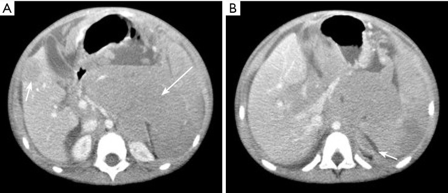
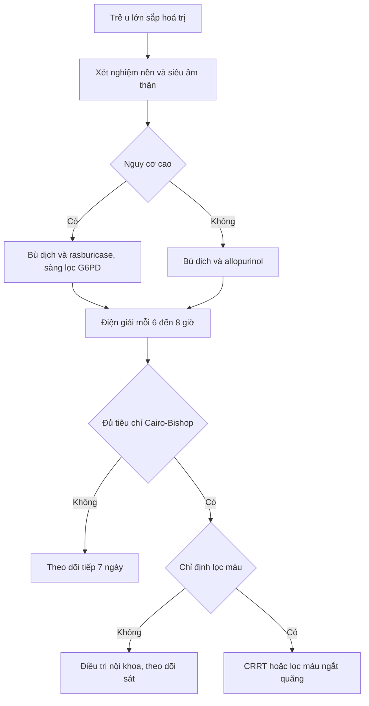
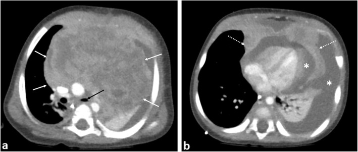
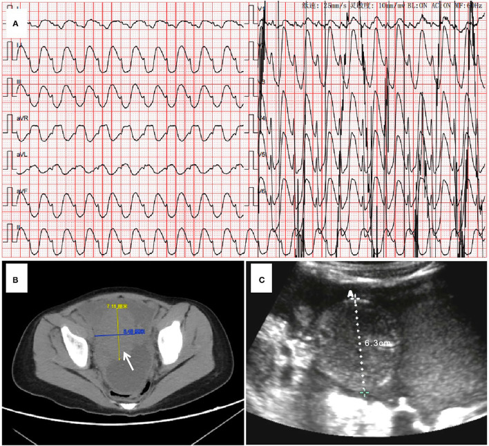

# 6183 — Hội chứng ly giải u ở trẻ: ngưỡng Cairo–Bishop và khi nào lọc máu / Paediatric tumour lysis syndrome

**Tags:** `pattern:than-to` `pattern:vo-than-tang-am` `pattern:hoai-tu-ong-than` `vung:than` `vung:o-bung` `vung:trung-that` `protocol:sieu-am-than` `protocol:CT-bung` `score:Cairo-Bishop` `score:CTCAE`

**Mức chắc chắn (certainty):** tổng hợp y văn (literature synthesis) — ngưỡng lấy từ **Cairo–Bishop 2004 (trích qua CMAJ 2023, PMC10089626)**, số liệu nhi từ **đoàn hệ TLS ở trẻ ung thư huyết học 2026** (Front Oncol, PMC13008734), **đoàn hệ CKRT nhi 2023** (Front Oncol, PMC10471890), **đoàn hệ NHL nhi 2024** (BMC Pediatr, PMC10829167) và **tổng quan rasburicase liều đơn 2025** (Hematol Rep, PMC12732761). Ba ca có ảnh đều là bệnh nhi.

> **Câu chốt:** TLS là **cấp cứu chuyển hoá, không phải cấp cứu hình ảnh** — phim **thường bình thường** trong khi **K⁺/phosphate/acid uric quyết định sống còn trong 24–48 giờ**. Vai trò thật của CĐHA chỉ có ba: (1) **đo gánh nặng u** trước điều trị (Burkitt ổ bụng, u trung thất, gan lách hạch to, thâm nhiễm thận) để phân tầng nguy cơ; (2) **loại trừ ứ nước** khi trẻ vô niệu; (3) **theo dõi di chứng** (thận teo, calci hoá thận muộn). Chỉ số dự báo AKI nặng tốt nhất trong một đoàn hệ nhi là **mức tăng phosphate mỗi 24 giờ > 2,6 mg/dL** (AUC 0,839) — **không phải** acid uric.

## 1. Tổng quan bệnh học – cơ chế hình ảnh

### 1.1 TẠI SAO TLS gây suy thận và loạn nhịp

- Tế bào u (đặc biệt **Burkitt, B-ALL, lymphoma tế bào T, AML**) phân chia nhanh, nhân giàu acid nucleic → khi **hoá trị hiệu quả** (hoặc **tự phát** — 56% trong đoàn hệ nhi ở PMC13008734), hàng tỷ tế bào vỡ cùng lúc.
- **K⁺** đổ ra → **loạn nhịp/tử vong nhanh nhất** (đỉnh trong vài giờ).
- **Phosphate** đổ ra → kết hợp **Ca²⁺** thành **calcium phosphate** lắng trong ống thận → **AKI + hạ calci** (hạ calci gây co giật, QT dài).
- **Acid nucleic → hypoxanthine → xanthine → acid uric.** Acid uric ít tan, đặc biệt trong **nước tiểu toan** → **tinh thể urat** bít ống thận + co mạch thận → **AKI**.
- **AKI dẫn đến ứ K⁺, ứ phosphate, ứ acid** → vòng xoáy; **quá tải dịch** khi bù dịch nhiều → phù phổi (nguyên nhân tử vong đã ghi nhận trong đoàn hệ nhi).

### 1.2 TẠI SAO hình ảnh thường "bình thường" (vật lý)

| Phương thức | Vì sao thấy/không thấy tổn thương |
|---|---|
| **Siêu âm thận** | Tinh thể vi thể **không tạo tín hiệu**; chỉ khi phù nhu mô do AKI mới thấy **thận to, vỏ tăng âm** (nước thay vỏ — cùng lý do với mọi AKI nhu mô), **RI ≥ 0,70**. **Không ứ nước** là điểm phân biệt với nguyên nhân tắc nghẽn |
| **CT không cản quang** | Tinh thể không làm thay đổi đậm độ đáng kể ở giai đoạn cấp; chỉ **calci hoá thận** muộn mới tăng đậm độ (> 100 HU). CT có giá trị **đo gánh nặng u** và **tìm chèn ép niệu quản**, không để chẩn đoán TLS |
| **MRI** | Phù nhu mô thận → **T2 tăng, T1 giảm**, thận to; **không đặc hiệu**. MRI hữu ích để **đánh giá thâm nhiễm thận do u** và **không dùng gadolinium khi AKI** |
| **X-quang ngực** | Trung thất rộng, khối — **dấu hiệu gánh nặng u** (nguy cơ TLS cao), không phải dấu hiệu TLS |
| **Siêu âm muộn** | **Bóng tăng âm ở tháp thận ± bóng lưng** = **calci hoá thận** sau TLS (di chứng, thường sau nhiều tuần–tháng) |

**Điểm cốt lõi:** TLS là **biến chứng sinh hoá**; một CT/siêu âm bình thường **không loại trừ** và một thận "hơi to" **không xác nhận**. Chẩn đoán nằm ở **4 xét nghiệm máu**.

### 1.3 Ngưỡng định lượng bắt buộc nhớ

| Đại lượng | Ngưỡng / con số | Nguồn |
|---|---|---|
| **Cairo–Bishop — TLS xét nghiệm** (≥ 2 tiêu chí trong **3 ngày trước** đến **7 ngày sau** hoá trị) | **Acid uric ≥ 476 µmol/L (8 mg/dL)** hoặc tăng 25% · **K⁺ ≥ 6,0 mmol/L** hoặc tăng 25% · **Phosphate ≥ 1,45 mmol/L** hoặc tăng 25% · **Ca²⁺ ≤ 1,75 mmol/L** hoặc giảm 25% | Cairo–Bishop 2004, qua PMC10089626 |
| **TLS lâm sàng** | TLS xét nghiệm **+** creatinin **≥ 1,5 × ULN** **hoặc** co giật **hoặc** loạn nhịp | Cairo–Bishop 2004 |
| Tỷ lệ TLS | **3–30%** leukemia/NHL; **3–40%** ở ung thư huyết học nguy cơ cao; **4,4–53%** ở các đoàn hệ NHL nhi | PMC13008734 · PMC10089626 · PMC10829167 |
| AKI trong TLS | **5–40%**, tới **75%** khi gánh nặng u lớn | PMC13008734 |
| Tần suất tiêu chí xét nghiệm (đoàn hệ nhi) | **Tăng phosphate 94%** > tăng acid uric > **tăng K⁺ chỉ 14%** | PMC13008734 (Howard–Pui) |
| Lọc máu | **2–4%** chung; nhưng **62%** (31/50) trong đoàn hệ nhi có TLS nặng/ AKI nặng | PMC13008734 |
| Tử vong do TLS | **~1,7%** ở nhóm nguy cơ cao; lịch sử **15–35%** | PMC13008734 · PMC10471890 |
| **Δ phosphate/24 giờ** | **> 2,6 mg/dL** → AKI nặng (pRIFLE-F): **AUC 0,839**, Se **75%**, Sp **85,7%** | PMC13008734 |
| Phosphate đỉnh (AKI nặng vs nhẹ) | **15 vs 9,35 mg/dL**; mức tăng **271% vs 92%** | PMC13008734 |
| CKRT ở trẻ | **20/222 (9%)**; chỉ định hay gặp nhất là **tăng phosphate**; điện giải về bình thường trong **6–12 giờ**; trung vị **2 ngày**; sống 1 năm **90%** | PMC10471890 |
| Nước tiểu mục tiêu | **100 mL/m²/giờ** (≈ 2,4 L/m²/ngày) | PMC10089626 |
| Rasburicase | Liều cấp phép **0,2 mg/kg/ngày × 5 ngày**; **liều đơn 0,15–0,2 mg/kg** (hoặc liều cố định **≥ 3 mg**, 6 mg đáp ứng tốt hơn) | PMC12732761 |
| Chống chỉ định | **Thiếu G6PD** — phải sàng lọc **trước** liều đầu (tan máu cấp, methaemoglobin) | PMC12732761 |

## 2. Mẫu hình + chẩn đoán phân biệt theo vị trí (gamut)

**Mẫu hình chung:** trẻ **mới chẩn đoán u lympho/leukemia gánh nặng lớn** (hoặc 24–48 giờ sau liều hoá trị đầu) → **vô niệu/thiểu niệu, K⁺ cao, phosphate cao, Ca²⁺ thấp, acid uric cao, creatinin tăng** → siêu âm **thận to hai bên, vỏ tăng âm, không ứ nước**.

| Vị trí / mẫu hình | Gamut theo bối cảnh |
|---|---|
| **Thận to hai bên, không ứ nước** | **TLS/hoại tử ống thận do tinh thể** · thâm nhiễm thận do leukemia/lymphoma · AKI trước thận (nôn, sepsis, rò mao mạch) · AKI do thuốc (cisplatin, ifosfamide, aminoglycoside, cản quang) |
| **Thận to + ứ nước hai bên** | Chèn ép niệu quản bởi **khối sau phúc mạc** (Burkitt, neuroblastoma) · sỏi acid uric · cục máu đông · bàng quang thần kinh |
| **Khối ổ bụng lớn (Burkitt, mạc treo, hồi manh tràng)** | **Gánh nặng u → TLS nguy cơ cao** · lồng ruột do lymphoma (bài 6178) · áp-xe ruột thừa · nang mạc treo |
| **Trung thất trước rộng** | **Lymphoma lymphoblastic/ Hodgkin → TLS + hội chứng tĩnh mạch chủ trên** · u tế bào mầm · u tuyến ức · đám rối thần kinh |
| **Tháp thận tăng âm ± bóng lưng (muộn)** | **Calci hoá thận sau TLS** · nephrocalcinosis do cường cận giáp · tổn thương thận do thuốc · tăng oxalate |

## 3. Bảng so sánh phân biệt (ma trận đối chiếu)

| Thực thể (entity) | Hình ảnh điển hình | Chốt vào (rule-in) | Chốt loại (rule-out) | Gợi ý xác nhận |
|---|---|---|---|---|
| **TLS (ly giải u)** | Thận **to hai bên, vỏ tăng âm, không ứ nước**; u/hạch lớn ở ổ bụng hoặc trung thất; CT/MRI **không có tổn thương đặc hiệu** | **≥ 2 tiêu chí Cairo–Bishop** trong cửa sổ ± và **Δ phosphate > 2,6 mg/dL/24 giờ** | Không có tăng K⁺/phosphate/acid uric và không có creatinin tăng → không phải TLS | Điện giải **6–8 giờ/lần**, LDH, acid uric, creatinin |
| **Thâm nhiễm thận do leukemia/lymphoma** | Thận **to, bờ múi, có thể không đối xứng**, giảm tín hiệu T1/tăng T2, ngấm thuốc; **không có tinh thể** | Thận to **kèm hạch/gan lách to**, tế bào non trong máu/tuỷ, **không rối loạn điện giải kiểu TLS** | Điện giải bình thường, thận giảm kích thước sau hoá trị → nghĩ thâm nhiễm | CT/MRI bụng, tuỷ đồ |
| **Tắc nghẽn đường niệu** | **Ứ nước – giãn bể thận – niệu quản giãn** đến chỗ hẹp | **Giãn bể thận > 10 mm** hoặc giãn niệu quản; giải quyết tắc → creatinin giảm | Không giãn bể thận hai bên → loại tắc nghẽn | Siêu âm + Doppler; CT nếu cần |
| **AKI trước thận** | Thận **bình thường hoặc hơi to**, tĩnh mạch chủ xẹp, RI cao | **Bù dịch → nước tiểu tăng, creatinin giảm**, Na⁺ niệu thấp | Không đáp ứng bù dịch, có tinh thể/trụ → không phải trước thận | Đáp ứng dịch, bilan dịch |
| **Hoại tử ống thận do thuốc/cản quang** | Thận to, vỏ tăng âm; **không có tăng acid uric/phosphate** | **Thuốc/cản quang trong 7 ngày**, creatinin tăng sau 24–72 giờ | Có tăng K⁺/phosphate/acid uric cùng lúc → nghĩ TLS | Ngưng thuốc, theo dõi |
| **Calci hoá thận sau TLS** | **Tháp thận tăng âm, có bóng lưng**, thận có thể teo | Tiền sử TLS, calci hoá xuất hiện **sau nhiều tuần–tháng** | tăng âm **lan toả vỏ** không bóng lưng → phù nhu mô cấp | Siêu âm định kỳ, calci/miễn dịch |

*Gánh nặng u lớn = nguy cơ TLS cao. Bệnh nhi Burkitt có TLS **tự phát** khởi phát sau sinh thiết nội soi; khối **123 × 105 × 61 mm**. Nguồn: AME Case Rep 2026, PMC13062841, CC BY-NC-ND 4.0 (nguyên bản, không cắt).*

## 4. Protocol chụp + hệ phân độ

- **Trước điều trị (mọi trẻ có khối lớn):** xét nghiệm nền **K⁺, phosphate, Ca²⁺, acid uric, creatinin, LDH, công thức máu**; **siêu âm thận – bụng** (kích thước thận, ứ nước, gan lách hạch); **X-quang ngực**; CT/MRI để **phân giai đoạn và đo gánh nặng u** — **tránh cản quang iod khi creatinin chưa rõ**.
- **Trong 48–72 giờ đầu hoá trị:** điện giải **mỗi 6–8 giờ** (không phải mỗi ngày) — đỉnh K⁺ đến trước khi có triệu chứng.
- **Phân tầng nguy cơ:** Burkitt/ALL tế bào B/lymphoma tế bào T gánh nặng lớn + **LDH cao, WBC cao, gan lách hạch to, thâm nhiễm thận** = **nguy cơ cao** → dự phòng bằng **rasburicase**, không chờ TLS.
- **Dự phòng/điều trị:** bù dịch **2–3 L/m²/ngày**, mục tiêu nước tiểu **100 mL/m²/giờ**; **allopurinol** chỉ chặn tạo acid uric mới (không hạ acid uric đã có) → dùng dự phòng nguy cơ thấp–trung bình; **rasburicase** cho nguy cơ cao/đã có tăng acid uric (**sàng lọc G6PD trước**).
- **Không dùng kiềm hoá nước tiểu thường quy** (không cải thiện kết cục, gây lắng calci phosphate).
- **Chỉ định lọc máu (KRT) trong TLS:** **K⁺ > 6,5 mmol/L** hoặc loạn nhịp do K⁺ **không đáp ứng điều trị**; **phosphate > 3,2 mmol/L (10 mg/dL)**; **hạ calci có triệu chứng**; **vô niệu/thiểu niệu nặng**; **quá tải dịch**; urê tăng nhanh. CRRT ưu tiên khi huyết động không ổn định.
- **Sau đợt:** siêu âm thận theo dõi **teo thận/calci hoá**; đo creatinin/eGFR sau 1–3 tháng.

## 5. Biến thể bình thường và cạm bẫy

- **Hạ calci "giả" do albumin thấp:** hiệu chỉnh **Ca = Ca đo được + 0,02 × (40 − albumin g/L)**; nếu không hiệu chỉnh sẽ bỏ sót hoặc chẩn đoán oan TLS.
- **Acid uric bình thường lúc nhập viện** không loại trừ TLS (chưa ly giải) — **đo lại sau 6–8 giờ** khi bắt đầu hoá trị.
- **Đừng chờ K⁺ cao:** trong đoàn hệ nhi, **tăng K⁺ chỉ 14%** trong khi **tăng phosphate 94%** — phosphate và Δ phosphate mới là dấu hiệu sớm.
- **Tăng giả K⁺** (tan máu mẫu, bạch cầu cực cao) — lấy lại mẫu, nhưng **không được trì hoãn** điều trị nếu ECG bất thường.
- **Hình ảnh bình thường là bình thường:** đừng chờ "thận to/tinh thể" để chẩn đoán; ngược lại **thận to đơn thuần** không đồng nghĩa TLS.
- **Cản quang khi đang AKI:** có thể làm nặng thêm và làm mờ nguyên nhân; chỉ chụp khi kết quả đổi điều trị.
- **TLS tự phát** (trước hoá trị) gặp **nhiều hơn ở trẻ** — trẻ Burkitt đau bụng + vô niệu **trước khi** bắt đầu điều trị vẫn có thể TLS.
- **Bẫy "sỏi acid uric" trên siêu âm:** sỏi urat **cản quang kém** trên X-quang/CT, dễ bỏ sót; siêu âm chỉ thấy khi sỏi đủ lớn.

## 6. Tự lượng giá — Blind Quiz

**Ca 1 — Bé trai 6 tuổi, bụng to, thiếu máu, LDH rất cao. CT bụng có cản quang trước sinh thiết.**

- Hỏi: mô tả khối và hai đặc điểm khiến nguy cơ TLS cao? Vì sao **không** lấy acid uric làm mốc duy nhất?

<b>Bấm để hiện đáp án (findings + chẩn đoán)</b>

- **Dấu hiệu:** khối **sau phúc mạc lớn 123 × 105 × 61 mm**, giảm đậm độ, bờ không rõ, đè đẩy quai ruột; **ổ giảm đậm độ gan phải** (mũi tên ngắn) gợi ý di căn; tràn dịch màng phổi trái dày.
- **Chẩn đoán:** **Burkitt lymphoma** — gánh nặng u lớn, LDH cao → **nguy cơ TLS cao**; ca này TLS **tự phát** khởi phát sau sinh thiết nội soi, phải **CRRT** và có lúc cần **ECPR**.
- **Vì sao không chỉ dựa acid uric:** acid uric có thể còn bình thường lúc đầu; **Δ phosphate/24 giờ > 2,6 mg/dL** dự báo AKI nặng tốt hơn (AUC 0,839).
- Nguồn ảnh: AME Case Rep 2026, PMC13062841, CC BY-NC-ND 4.0 (nguyên bản).

**Ca 2 — Bé trai 8 tháng, khó thở, trung thất trước rộng; CT có cản quang.**

- Hỏi: khối ở khoang nào, xâm lấn gì? Hai cấp cứu song song phải chuẩn bị trước khi gây mê/sinh thiết?

<b>Bấm để hiện đáp án (findings + chẩn đoán)</b>

- **Dấu hiệu:** khối **trung thất trước** lớn, không đồng nhất, **xâm lấn màng ngoài tim** (mũi tên đứt), chèn ép tim/phổi; tràn dịch màng phổi hai bên.
- **Chẩn đoán:** **lymphoma lymphoblastic tế bào T** — nguy cơ **TLS** và **hội chứng tĩnh mạch chủ trên/ngạt đường thở khi gây mê**.
- **Chuẩn bị:** (1) **dự phòng TLS** (bù dịch + rasburicase, điện giải 6–8 giờ); (2) **an toàn đường thở/tư thế** — sinh thiết khi còn thức hoặc trong điều kiện có ECMO; tránh gây mê làm mất trương lực cơ hô hấp.
- Nguồn ảnh: Insights Imaging 2019, PMC6920284, CC BY 4.0.

**Ca 3 — Bé gái 4 tuổi lymphoma, 24 giờ sau hoá trị: vô niệu, K⁺ 6,8 mmol/L, phosphate 11 mg/dL. Ảnh: ECG + CT bụng + siêu âm cạnh giường.**

- Hỏi: chẩn đoán? Hai chỉ định lọc máu ở đây là gì? Vì sao phải lọc **liên tục** chứ không ngắt quãng?

<b>Bấm để hiện đáp án (findings + chẩn đoán)</b>

- **Dấu hiệu:** (A) **nhịp nhanh thất** do tăng K⁺; (B) CT bụng: **dịch tự do + khối chậu** (mũi tên); (C) siêu âm cạnh giường: dịch/khối **6,3 cm**.
- **Chẩn đoán:** **TLS lâm sàng có loạn nhịp đe doạ tử vong** — chỉ định lọc máu vì **K⁺ > 6,5 không đáp ứng** và **phosphate > 3,2 mmol/L**, cộng vô niệu.
- **Vì sao CRRT:** huyết động không ổn định (sốc tim do K⁺/loạn nhịp) → CRRT kiểm soát K⁺/phosphate **liên tục 6–12 giờ** mà không gây tụt áp; ca này cần **ECLS + CRRT**.
- Nguồn ảnh: Front Med 2022, PMC8764359, CC BY 4.0.

## Bài liên quan chéo

- [6165 – Phù phổi do CRS sau CAR-T/blinatumomab](../6165-phu-phoi-crs-sau-car-t-blinatumomab-o-tre/lesson.md)
- [6176 – Tiêu cơ vận và AKI trong CRS ở trẻ](../6176-tieu-co-van-aki-trong-crs-o-tre/lesson.md) (bộ ba K⁺/phosphate/Ca giống TLS)
- [6171 – Viêm tụy cấp do asparaginase](../6171-viem-tuy-cap-do-asparaginase-tre-all/lesson.md)
- [6153 – Hạch tồn dư sau điều trị lymphoma](../6153-hach-ton-du-sau-dieu-tri-lymphoma-tre/lesson.md)
- [6178 – Lồng ruột ở trẻ](../6178-long-ruot-o-tre/lesson.md) (lymphoma là điểm dẫn)
- [6179 – Viêm xương tủy cấp ở trẻ](../6179-viem-xuong-tuy-cap-o-tre/lesson.md)

## Ảnh

- `6183_ly-giai-u_CT-burkitt_PMC13062841.jpg` — AME Case Rep 2026, PMC13062841, **CC BY-NC-ND 4.0** (nguyên bản).
- `6183_ly-giai-u_CT-echo_PMC8764359.jpg` — Front Med 2022, PMC8764359, **CC BY 4.0**.
- `6183_ly-giai-u_CT-trung-that_PMC6920284.jpg` — Insights Imaging 2019, PMC6920284, **CC BY 4.0**.

> Không dùng để chẩn đoán độc lập khi chưa có người hướng dẫn.
