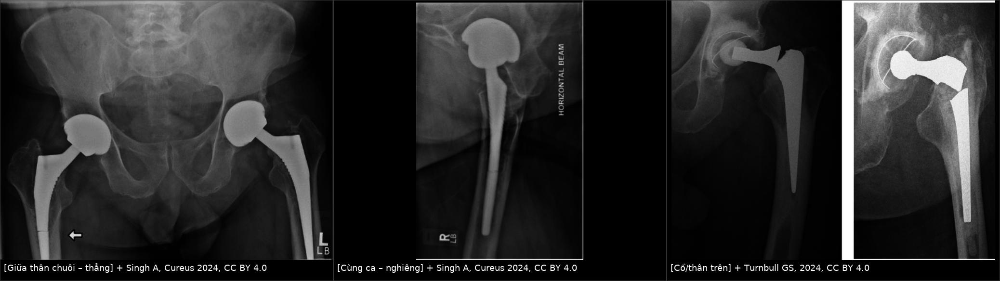
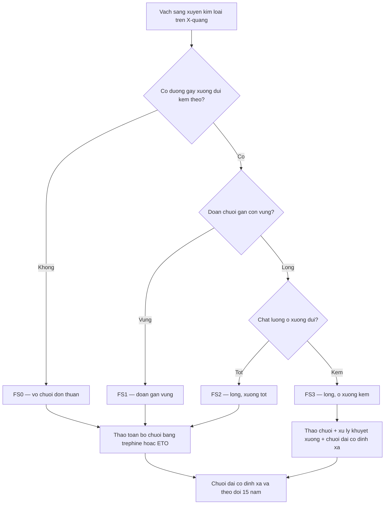
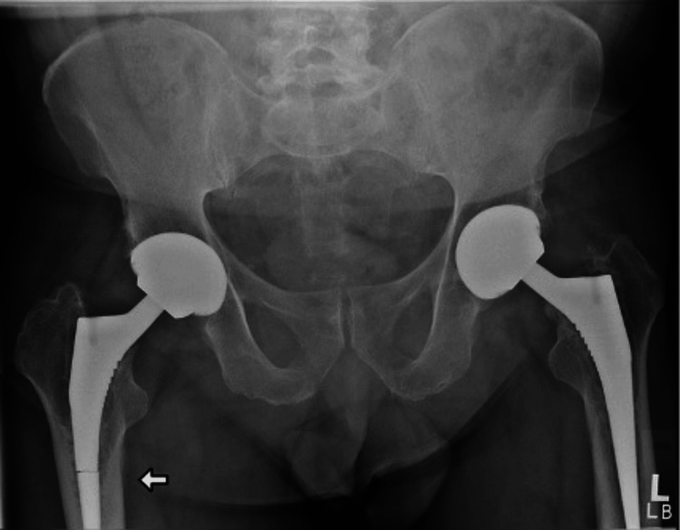
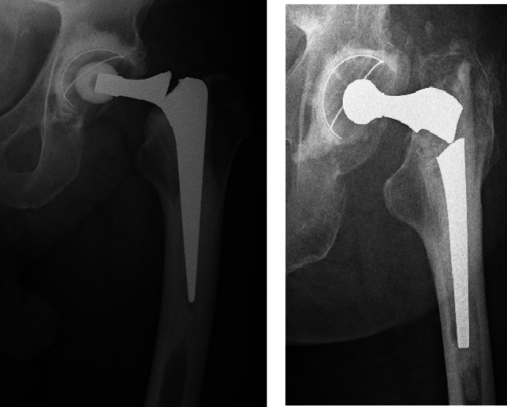
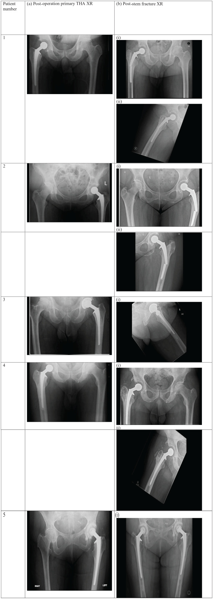

# 6185 — Vỡ chuôi khớp háng nhân tạo / Femoral stem fracture (implant fatigue failure)

**Tags:** `pattern:gay-implant` `pattern:gay-ngang` `vung:khop-hang` `vung:xuong` `protocol:xquang-2-tu-the` `protocol:CT-giam-artifact` `score:UCS-FS`
**Mức chắc chắn (certainty):** tổng hợp y văn (literature synthesis) — dựa trên **phân tích gộp 15 nghiên cứu, 402 ca vỡ chuôi/49.723 THA** (Arch Orthop Trauma Surg 2024, PMC11093816), **loạt 5 ca Lubinus SP II** (SAGE Open Med Case Rep 2025, PMC12394862), **ca Corail tháo bằng trephine** (Cureus 2024, PMC10896462) và **bản sửa đổi UCS 2018 thêm nhóm FS** (J Orthop Sci 2018, PMID 30104103). Không có ca do nhóm tự chụp.

> **Câu hỏi thực hành:** nam **67 tuổi**, BMI **35**, đặt **THA không xi măng hai bên cách đây 12 năm**, đau mặt trước đùi phải **tăng dần vài tuần**, **không chấn thương**. X-quang khung chậu: một **vạch sáng ngang 1–2 mm xuyên qua chuôi phải ở 1/2 thân**, đoạn chuôi trên **nghiêng nhẹ vào varus**. Đây là gãy xương quanh chuôi hay vỡ chuôi, và cần làm gì?
> Bài chốt **ba quyết định**: **(1)** vạch sáng **xuyên qua kim loại** = **vỡ chuôi (implant fracture)**, **không phải** gãy xương quanh chuôi — Vancouver/UCS **B1–B3 không dùng được**, đây là nhóm **FS** của UCS cải tiến 2018; **(2)** mọi vỡ chuôi đều **phải lấy toàn bộ chuôi** (không nẹp giữ phần chuôi, không "theo dõi") — phần chuôi xa thường **cố định chắc trong xương** nên cần **trephine/ETO**; **(3)** đọc **2 tư thế thẳng + nghiêng**, vì vạch gãy **< 1 mm** có thể chỉ thấy trên phim nghiêng.

## 1. Tổng quan bệnh học – cơ chế hình ảnh

- **Bản chất:** vỡ chuôi là **thất bại mỏi (fatigue failure)** của kim loại, **không** phải chấn thương. Chuôi bị uốn lặp lại hàng triệu chu kỳ đi bộ; khi **mất chỗ tựa xương đoạn gần** (stress shielding, tiêu xương quanh chuôi, lỏng chuôi, hoặc đặt chuôi nhỏ trong ống tủy rộng) mà **đoạn xa vẫn cố định chắc**, toàn bộ mô-men uốn dồn vào **tiết diện giữa thân chuôi** → **nứt khởi phát (crack initiation)** ở nơi có **điểm tập trung ứng suất (stress riser)**: khắc laser/nhãn chìm, chỗ chuyển tiếp tiết diện, hoặc **khớp nối chuôi–cổ (modular junction)** nơi có **ăn mòn cọ xát (fretting corrosion)**.
- **TẠI SAO vạch gãy nhìn thấy được:** kim loại **cản quang hoàn toàn**, nên không có "tín hiệu" để so sánh; cái ta thấy là **khe hở vài phần mười mm + di lệch/ngoặt góc của đoạn gãy trên**. Vì vậy **độ nhạy phụ thuộc góc tia**: khe gãy **song song chùm tia** thì gần như biến mất trên phim thẳng, chỉ lộ ra trên **phim nghiêng trùng mặt phẳng gãy** — loạt Lubinus chụp thêm **phim nghiêng "đồng mặt phẳng với chuôi gãy"** cho từng ca.
- **TẠI SAO hay ở 1/2 thân chuôi:** mô-men uốn lớn nhất ở đoạn giữa (càng xa điểm tựa càng lớn) trong khi **tiết diện chuôi nhỏ nhất** cũng ở đó. Trong loạt Lubinus, **4/5 ca (80%) gãy giữa thân**, **1/5 gãy đoạn xa** ở bệnh nhân có **varus −6°** và **restrictor xi măng 15 mm**.
- **Số liệu nền:** tần suất vỡ chuôi **0,1–3,4%** ở chuôi hiện đại (báo cáo lịch sử **> 10%**). Phân tích gộp: **402 ca vỡ / 49.723 THA**, **trung vị 68 tháng** (IQR **42,5–118**) từ mổ đến vỡ, **cửa sổ nguy cơ 15 năm**; loạt Lubinus: **5/4.240 = 0,1%** ở theo dõi trung bình **7,5 năm**, thời gian tới vỡ trung bình **6,4 năm**, cân nặng trung bình **109 kg** (88–128), BMI **36,5**.
- **Yếu tố nguy cơ định lượng (OR, KTC 95%):** **varus chuôi 5,77** (3,83–8,70) > **cân nặng > 80 kg 3,55** (2,88–4,37) ≈ **mổ lại/chỉnh sửa 3,33** (2,70–4,10) ≈ **nam 3,27** (2,59–4,13) > **chuôi module 1,95** (1,56–2,44) > **tuổi < 63 1,22** (1,01–1,49). Đây là bộ số dùng để **phân tầng theo dõi**, không phải để tiên đoán cá nhân.
- **Hệ quả:** vỡ chuôi gần như luôn **phải mổ lại**, và **lấy chuôi gãy khó hơn** tháo chuôi nguyên vẹn: đoạn xa thường **liền xương chắc** nên phải khoan rỗng bằng **trephine** hoặc **mở xương mấu chuyển (ETO)**. Ca Corail: đoạn gần lỏng, lấy ra dễ; đoạn xa lấy bằng **trephine lớn hơn đường kính đoạn gãy 0,5 mm**, có **bơm nước muối ngắt quãng** để tránh **hoại tử nhiệt**.

## 2. Mẫu hình + chẩn đoán phân biệt theo vị trí (gamut)

- **Mẫu hình chung:** **vạch sáng ngang, bờ rõ, xuyên hết bề dày kim loại** ± **ngoặt góc** đoạn chuôi trên ± **đau đùi kiểu "đau dai dẳng tăng dần"** trước khi phát hiện (ca Corail: **đau acute-on-chronic**).
- **Gamut theo vị trí gãy (quyết định cách tháo và loại chuôi thay):**
  1. **Cổ chuôi/chỗ nối cổ–thân (neck–stem junction, trunnion):** vạch gãy ngay dưới cổ; thường liên quan **module/ăn mòn**, đoạn gãy trên **rời hẳn**; dễ nhầm với **tháo khớp đầu–cổ (head–neck dissociation)**.
  2. **1/3 trên thân:** hiếm hơn, hay kèm **varus** và **ống tủy hẹp**.
  3. **1/2 thân (thường nhất, ~80% trong loạt Lubinus):** vạch ngang giữa chuôi, đoạn trên nghiêng vào varus.
  4. **1/3 dưới/đoạn xa:** hay gặp ở **chuôi dài, chuôi mổ lại, ống tủy rộng**, restrictor nhỏ.
  5. **Vỡ chuôi + gãy xương quanh chuôi (thể phối hợp):** loạt Malhotra 2021 gồm **11 ca** dạng này (tuổi trung bình **56,8**), **không xếp được vào UCS gốc** — chính là lý do sinh ra nhóm **FS**.
- **Gamut theo cơ chế (để không chỉ nghĩ "chấn thương"):** mỏi kim loại đơn thuần (đa số) · mỏi + ăn mòn/fretting tại khớp nối · khiếm khuyết chế tạo/khắc laser · mất xương đoạn gần do **stress shielding** · **varus** làm lệch trục tải · chuôi **quá nhỏ** trong ống tủy rộng.

## 3. Bảng so sánh phân biệt (ma trận đối chiếu)

| Thực thể (entity) | Hình ảnh điển hình | Chốt vào (rule-in) | Chốt loại (rule-out) | Gợi ý xác nhận |
|---|---|---|---|---|
| **Vỡ chuôi do mỏi — giữa thân** | Vạch sáng ngang **xuyên kim loại** ở 1/2 chuôi, đoạn trên nghiêng **varus**, không có vạch sáng quanh chuôi | **Vạch xuyên hết bề dày kim loại + bậc thềm ở bờ chuôi** | Vạch chỉ nằm trên bề mặt, không qua bờ đối diện → **khắc laser/giả ảnh** | X-quang thẳng + nghiêng; so phim cũ; đo góc varus |
| **Vỡ cổ/chỗ nối cổ–thân** | Vạch ngay dưới cổ; đầu chỏm có thể **lệch trục** so với thân; khoảng trống giữa cổ và thân | **Mất liên tục kim loại tại junction** | Chỏm rời khỏi cổ nhưng **cổ còn nguyên** → tháo khớp, không phải vỡ chuôi | Phim nghiêng, phóng đại vùng cổ; CT ít giá trị vì artifact |
| **Vỡ chuôi + gãy xương quanh chuôi (FS1–FS3)** | Đường gãy xương đùi **+** đường gãy xuyên chuôi; đoạn chuôi trên **vững (FS1)** hay **lỏng (FS2/FS3)** | **Hai đường gãy cùng tồn tại** trên 2 bình diện | Chỉ có đường gãy xương → xếp **Vancouver/UCS B1–B3**, không phải FS | X-quang 2 tư thế; CT giảm artifact khi cần đánh giá ổ xương |
| **Gãy xương quanh chuôi (Vancouver B1/B2/B3)** | Đường gãy trong **xương**, chuôi còn **nguyên**; B2/B3 có dấu lỏng chuôi | **Chuôi liên tục** + đường gãy xương | Có vạch xuyên kim loại → chuyển nhóm **FS** | X-quang, CT; so phim cũ tìm lún chuôi |
| **Nới lỏng vô khuẩn (aseptic loosening)** | **Vạch sáng quanh chuôi ≥ 2 mm**, vùng tối hình nêm, **lún chuôi**, bệ xương dưới đầu chuôi | **Vạch sáng quanh chuôi tiến triển + lún** | Không có vạch xuyên kim loại; đau kiểu khởi động | So phim theo thời gian; CT đánh giá tích hợp xương |
| **Tháo khớp / đầu–cổ rời (dissociation)** | Chỏm **lệch hẳn** khỏi cổ, khoảng trống rộng, chuôi nguyên | **Chỏm–cổ mất tiếp xúc, chuôi nguyên vẹn** | Cổ gãy → vỡ chuôi nhóm cổ | Phim nghiêng; hỏi đau "bật" đột ngột |
| **Giả tổn thương (etch mark, lưới, mép chồng hình)** | Vạch **mảnh, thẳng, không qua bờ đối diện**, lặp lại ở nhiều phim, không đổi theo tư thế | **Không có bậc thềm, không ngoặt góc** | Xuất hiện đúng một vị trí và **có bậc thềm** → vỡ thật | Đổi tư thế/góc, chụp lại, xem phim cũ cùng góc |

*Trái: vạch sáng ngang 1–2 mm xuyên chuôi phải ở 1/2 thân, đoạn trên nghiêng vào varus. Giữa: cùng ca trên phim nghiêng — khe gãy rõ hơn. Phải: hai ca vỡ ở **cổ/chỗ nối cổ–thân**, đoạn chuôi trên đã tách rời. Nguồn: Singh A (Cureus 2024, PMC10896462) và Turnbull GS (Arch Orthop Trauma Surg 2024, PMC11093816), **CC BY 4.0**. Ảnh ghép letterbox, không crop.*

### Ba dấu hiệu đọc chuẩn trên phim

- **Dấu bậc thềm (step-off):** bờ ngoài của đoạn chuôi trên **lệch ra/vào** so với đoạn dưới — dấu **chắc nhất** khi khe gãy < 1 mm.
- **Dấu ngoặt góc (angulation):** đoạn trên **nghiêng vào varus**; ở loạt Lubinus, varus trung bình **−2,2°** nhưng ca gãy **đoạn xa** có **−6°** — góc càng lớn càng gợi ý trục tải lệch.
- **Dấu "mất liên tục viền" (cortical discontinuity of the stem):** viền cản quang của chuôi **đứt** tại một điểm, dù chỉ 1–2 mm — khác với **vạch khắc laser** vốn không làm đứt viền đối diện.

## 4. Protocol chụp + hệ phân độ chuẩn hóa

- **X-quang là chuẩn chẩn đoán, không cần MRI:** khung chậu thẳng **+** khớp háng thẳng **+** khớp háng **nghiêng trùng mặt phẳng chuôi**. Ghi rõ **tầng gãy** (cổ/1-3 trên/giữa/1-3 dưới), **góc varus** đo trên phim thẳng, và **so phim cũ** để phát hiện **lún chuôi** hoặc **thay đổi góc**.
- **CT giảm artifact kim loại (MAR)** khi cần: đánh giá **tích hợp xương đoạn xa**, **khuyết xương**, mức độ **lỏng chuôi**, và quy hoạch **đường tháo** (trephine vs ETO). Không dùng CT để "tìm khe gãy" khi phim đã rõ.
- **Không dùng MRI làm chuẩn** ở chuôi kim loại (artifact); **PET/CT** cũng bị artifact — nếu nghi **nhiễm trùng**, dựa vào **CRP/ESR + chọc hút**, không dựa vào hình ảnh.
- **Hệ phân độ dùng đúng:** **UCS cải tiến 2018** (Huang và cs, J Orthop Sci) thêm **nhóm FS** cho vỡ chuôi, sau khi **46/402 ca (11,4%)** không xếp được vào UCS gốc:
  - **FS0** — vỡ chuôi **đơn thuần**.
  - **FS1** — vỡ chuôi + gãy xương, **đoạn chuôi gần còn vững**.
  - **FS2** — đoạn chuôi gần **lỏng**, **chất lượng xương quanh còn tốt**.
  - **FS3** — đoạn chuôi gần **lỏng**, **ổ xương kém**.
  - Trong 46 ca đó: **35 B2PALT, 2 B2PAGT, 3 FS0, 1 FS1, 2 FS2, 3 FS3**; bản sửa đổi cũng **bỏ type F** vì không áp dụng cho xương đùi.
- **Nguyên tắc điều trị (dùng cho mọi FS):** **chuôi đã gãy thì không thể giữ** — phải **lấy toàn bộ chuôi** rồi **thay chuôi dài cố định xa** (hoặc chuôi module có rãnh); **FS1** khó tháo vì đoạn gần vẫn chắc (cần trephine/ETO), **FS2/FS3** thêm phần **xử lý khuyết xương**. Đây là lý do phân độ theo **độ vững đoạn gần + chất lượng ổ xương**, không theo vị trí gãy.

## 5. Biến thể bình thường và cạm bẫy

- **Vạch khắc laser/nhãn chìm trên chuôi:** đường **mảnh, đều, không xuyên bờ đối diện**, xuất hiện ở **cùng một vị trí trên mọi phim**. Đừng gọi là gãy — tìm **bậc thềm** và **ngoặt góc**.
- **Chỉ đọc phim thẳng:** khe gãy **< 1 mm** có thể **hoàn toàn khuất**. Ca Corail được chẩn đoán nhờ **thêm phim nghiêng**; loạt Lubinus chụp **nghiêng đồng mặt phẳng** cho từng ca.
- **Satisfaction of search:** thấy **gãy xương quanh chuôi** rồi dừng — loạt 11 ca của Malhotra cho thấy **gãy xương + vỡ chuôi cùng tồn tại**, và **UCS gốc xếp sai** những ca này. Luôn **nhìn dọc toàn bộ chiều dài chuôi** sau khi thấy đường gãy xương.
- **Gọi "lỏng chuôi" cho ca vỡ chuôi:** khi đã có vạch xuyên kim loại thì **không** mô tả là nới lỏng; mô tả **vị trí + độ vững đoạn gần + khuyết xương** theo FS.
- **Bỏ sót "vỡ chuôi thể ẩn" ở bệnh nhân đau đùi không rõ nguyên nhân:** nếu đau **tăng dần khi đi bộ** và có **yếu tố nguy cơ** (nam, > 80 kg, varus, chuôi nhỏ, mổ lại) → **chụp lại 2 tư thế**, so phim cũ, đừng chỉ dựa một phim thẳng.
- **Chuôi bị uốn cong (plastic deformation) không có vạch gãy:** nhìn **trục chuôi** so với trục ống tủy và so phim cũ; đây vẫn là thất bại implant, xử trí như vỡ.

## 6. Tự lượng giá — Blind Quiz

**Ca 1 — Nam 67 tuổi, BMI 35, THA không xi măng hai bên 12 năm, đau mặt trước đùi phải tăng dần, không chấn thương. Nhìn phim thẳng, mô tả trước.**

- Hỏi: có đường gãy nào **xuyên qua kim loại** không? Nó ở tầng nào của chuôi? Có dấu ngoặt góc? Chẩn đoán phân biệt 3 khả năng và bước tiếp theo?

<b>Bấm để hiện đáp án (findings + chẩn đoán)</b>

- **Dấu hiệu:** vạch sáng **ngang, 1–2 mm**, xuyên hết bề dày chuôi phải ở **1/2 thân**, kèm **bậc thềm** ở bờ chuôi và **nghiêng nhẹ varus** của đoạn trên (mũi tên). Chuôi trái nguyên.
- **Chẩn đoán:** **vỡ chuôi do mỏi (FS0)** — chuôi Corail không xi măng. Không phải gãy xương quanh chuôi: đường gãy nằm **trong kim loại**, không trong xương.
- **Vì sao:** mất tựa xương đoạn gần + đoạn xa cố định chắc → toàn bộ mô-men uốn dồn vào giữa thân; BMI 35 và 12 năm là đúng cửa sổ nguy cơ (trung vị 68 tháng, cửa sổ 15 năm).
- **Bước tiếp theo:** phim **nghiêng** khẳng định, rồi **mổ tháo toàn bộ chuôi**: đoạn gần lỏng lấy dễ, đoạn xa lấy bằng **trephine lớn hơn 0,5 mm** so với đường kính đo được, **bơm nước muối ngắt quãng** tránh hoại tử nhiệt.
- Nguồn: Singh A và cs, *Cureus* 2024 (PMC10896462), **CC BY 4.0**.

**Ca 2 — Hai bệnh nhân đau háng, mỗi người một phim thẳng khác kiểu gãy. So sánh trước khi mở đáp án.**

- Hỏi: đường gãy ở **cổ chuôi** khác gì vỡ **giữa thân** về cơ chế và về cách tháo? Có cần phân độ Vancouver không?

<b>Bấm để hiện đáp án (findings + chẩn đoán)</b>

- **Dấu hiệu:** vạch gãy **ngay dưới cổ chuôi**, đoạn chuôi trên **tách rời** và **lệch trục** so với thân; viền kim loại đứt hoàn toàn.
- **Chẩn đoán:** **vỡ cổ/chỗ nối cổ–thân** — cơ chế thường là **ăn mòn cọ xát tại khớp nối (fretting/trunnionosis)** hoặc **điểm tập trung ứng suất** ở chuyển tiếp tiết diện, chứ không phải uốn giữa thân.
- **Khác biệt xử trí:** đoạn gãy trên **rời tự do** nên dễ lấy; khó là phần **chuôi còn lại trong ống tủy** (thường vẫn chắc) — vẫn **phải lấy toàn bộ** rồi thay chuôi dài; **không** dùng Vancouver (Vancouver chỉ mô tả **gãy xương** quanh chuôi còn nguyên).
- Nguồn: Turnbull GS và cs, *Arch Orthop Trauma Surg* 2024 (PMC11093816), **CC BY 4.0**.

**Ca 3 — Loạt 5 bệnh nhân cùng một loại chuôi (Lubinus SP II): cột trái là phim sau mổ nguyên chuôi, cột phải là phim khi nhập viện vì vỡ.**

- Hỏi: ca nào gãy **giữa thân**, ca nào gãy **đoạn xa**? Yếu tố nào trong bài giải thích vị trí gãy? Vì sao phải chụp **nghiêng** ở từng ca?

<b>Bấm để hiện đáp án (findings + chẩn đoán)</b>

- **Dấu hiệu:** **4/5 ca (80%)** gãy **giữa thân**; **1/5** gãy **đoạn xa** — ca này có **varus −6°** và **restrictor 15 mm** (đường kính ống tủy lớn hơn, chuôi tương đối nhỏ). Cột phải có cả **phim nghiêng đồng mặt phẳng** vì khe gãy mảnh.
- **Vì sao:** mô-men uốn lớn nhất ở giữa thân, tiết diện nhỏ nhất cũng ở đó; **varus** và **cân nặng lớn** (trung bình **109 kg**, BMI **36,5** ở loạt này; OR **3,55** cho > 80 kg) làm tăng tải.
- **Bài học:** cùng một loại chuôi vẫn gãy nhiều tầng → luôn **đo tầng gãy và góc varus**, ghi vào báo cáo để so lần sau.
- Nguồn: Panzures A và cs, *SAGE Open Med Case Rep* 2025 (PMC12394862), **CC BY 4.0**.

## Bài liên quan chéo
- [6155 – Gãy xương quanh chuôi đùi sau THA / PPFF & Vancouver–UCS](../6155-gay-xuong-quanh-chuoi-dui-sau-tha/lesson.md) (phân biệt **gãy xương** với **vỡ chuôi**)
- [6140 – Lỏng vỏ khớp quanh khớp háng nhân tạo](../6140-long-vo-khuan-quanh-khop-hang-nhan-tao/lesson.md) (vạch sáng quanh chuôi, không xuyên kim loại)
- [6110 – Nhiễm trùng quanh khớp nhân tạo sau thay](../6110-nhiem-trung-quanh-khop-nhan-tao-sau-tha/lesson.md) (khi cần phân biệt với đau do nhiễm)
- [6151 – Trật khớp háng nhân tạo tái diễn](../6151-trat-khop-hang-nhan-tao-tai-dien/lesson.md) (tháo khớp, lệch trục chỏm–cổ)
- [6141 – Vôi hóa quanh khớp háng nhân tạo](../6141-voi-hoa-quanh-khop-hang-nhan-tao/lesson.md)
- [310 – Giải phẫu xương khớp và biến thể](../310-giai-phau-xuong-khop-va-bien-the/lesson.md)

> Không dùng để chẩn đoán độc lập khi chưa có người hướng dẫn.
