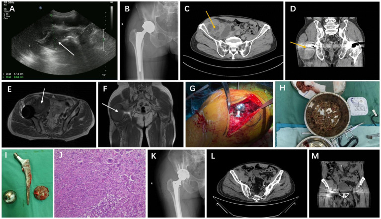
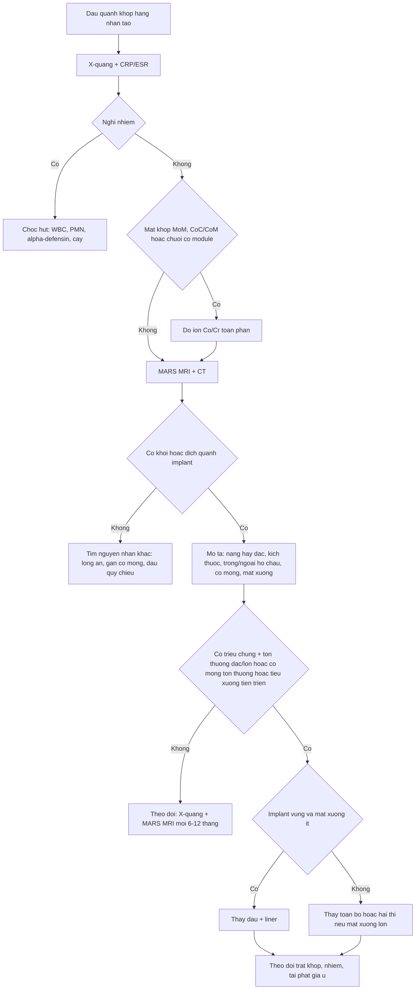
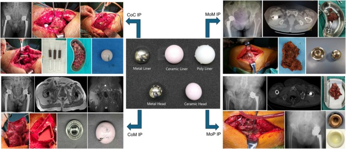
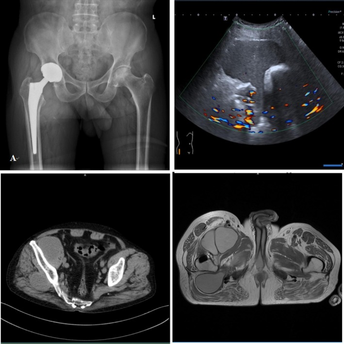

# 6186 — Phản ứng bất lợi với mảnh kim loại sau thay khớp háng: giả u quanh khớp & MARS MRI / Adverse reaction to metal debris (ARMD) & pseudotumor after THA

**Tags:** `pattern:gia-u-quanh-implant` `pattern:tieu-xuong-quanh-implant` `pattern:dich-quanh-khop` `pattern:long-khop` `vung:khop-hang` `protocol:MRI-MARS` `protocol:CT-khop-hang` `score:Anderson` `score:PCS` `incidentaloma:gia-u-quanh-implant`

**Mức chắc chắn (certainty):** tổng hợp y văn (literature synthesis) — ghép 4 nguồn mở toàn văn: (a) tổng quan giả u viêm sau THA (**Pambayi STL, Zhao Z, Peng H** et al., *Orthop Surg* 2026, PMC13327051, **CC BY 4.0**); (b) kỹ thuật & hình ảnh MRI khớp háng nhân tạo (**Albano D, Pansa S, Messina C** et al., *Insights Imaging* 2024, PMC11189891, **CC BY 4.0**); (c) ca giả u tái phát sau MoM-THA có ảnh đa phương thức (**Min M, Xing C, Xu P** et al., *Front Med* 2024, PMC11269118, **CC BY 4.0**); (d) 39 ca mổ giả u + phân loại PCS (**Stimolo D, Muratori F, Cucurullo L** et al., *Arch Orthop Trauma Surg* 2025, PMC11839790, **CC BY 4.0**). Số nào nguồn không đưa thì ghi "chưa rõ".

> **Bài này trả lời 4 câu hỏi của ca "đau quanh khớp háng nhân tạo 8 năm, X-quang bình thường, CRP bình thường":**
> (1) **Vì sao X-quang bình thường không loại trừ gì?** (2) **Khi nào đo cobalt/chromium và ngưỡng nào là "đáng lo"?** (3) **MARS MRI đọc gì — và vì sao "có giả u" chưa chắc phải mổ?** (4) **Khi nào thay đầu/liner, khi nào thay cả cặp đôi, khi nào mổ hai thì?**
> Đây là mặt **sinh học/vật liệu** của khớp nhân tạo; mặt **cơ học** ở [6140 – Lỏng khớp quanh khớp háng nhân tạo](../6140-long-vo-khuan-quanh-khop-hang-nhan-tao/lesson.md) và [6185 – Vỡ chuôi](../6185-vo-chuoi-khop-hang-nhan-tao/lesson.md); mặt **nhiễm** ở [6110 – Nhiễm trùng quanh khớp nhân tạo](../6110-nhiem-trung-quanh-khop-nhan-tao-sau-tha/lesson.md).

## 1. Tổng quan bệnh học – cơ chế hình ảnh

### 1.1 Vì sao có "giả u" quanh khớp háng nhân tạo

- **Định nghĩa:** **giả u viêm (inflammatory pseudotumor — IP) / phản ứng bất lợi với mảnh kim loại (adverse reaction to metal debris — ARMD) / phản ứng mô mềm quanh implant (adverse local tissue reaction — ALTR)** = khối **không ung thư, không nhiễm**, gồm **dịch, mô hạt, xơ, tế bào viêm**, bao quanh khớp nhân tạo (PMC11839790).
- **Ba nguồn mảnh vụn:** (1) **mặt khớp** (MoM, CoC, CoM); (2) **chỗ nối hình nón (taper/trunnion)** giữa **cổ chuôi và đầu xoay** — nguồn chính ở **MoP** (trunnionosis) và ở **chuôi có cổ module (dual-taper modular neck)**; (3) **polyethylene** (hạt PE gây phản ứng kiểu "bệnh polyethylene").
- **Hai kiểu phản ứng mô học, hai kiểu hình ảnh:**
  - **Nồng độ ion cao → độc tế bào** → **hoại tử + đại thực bào** dọn mảnh (kiểu "bệnh polyethylene"), hay gặp **khối dịch lớn, thành mỏng, hoại tử cơ**.
  - **Nồng độ ion thấp → phản ứng quá mẫn typ IV do tế bào T** (**ALVAL** — aseptic lymphocyte-dominated vasculitis-associated lesion) → **mô hạt dày, xơ hóa, thâm nhiễm lympho quanh mạch** → **khối đặc/ngấm viền dày**, **có thể xảy ra dù mòn rất ít** (PMC10624517).
- **TẠI SAO phải dùng MARS/SEMAC/MAVRIC (vật lý, không phải "chọn chuỗi cho đẹp"):**
  - Kim loại tạo **bất đồng cảm từ cục bộ** quanh implant → **T2\* dephasing** → **"đám mây" mất tín hiệu** và **biến dạng trong mặt phẳng (in-plane distortion)**; từ trường không đồng nhất còn làm **bão hòa mỡ thất bại**.
  - Cách khắc phục: **băng thông thu nhận rộng**, **lát mỏng 3–4 mm**, **ma trận lớn**, **echo spacing ngắn**, **gradient mạnh**, và **xoay hướng gradient mã hóa tần số theo trục implant**; **bão hòa mỡ dùng STIR** (ít bị ảnh hưởng bởi kim loại hơn CHESS) (PMC11189891).
  - **Hệ quả:** đây là lý do **CT không thay được MRI** khi cần đánh giá **mô mềm** (bao khớp, cơ mông, gân), còn **CT tốt hơn cho xương** (mất xương, tiêu xương) — hai phương thức **bổ sung**, không thay thế.

### 1.2 Số liệu định lượng bắt buộc nhớ

| Đại lượng | Con số | Nguồn |
|---|---|---|
| Tần suất giả u **trên lâm sàng** (ước tính thật) | **0,5–4,6%** (bị đánh giá thấp vì ca không triệu chứng) | PMC11839790 |
| Tần suất **phát hiện trên MARS MRI** | **MoM THA 40–60%** (43–53% ở các đoàn hệ sàng lọc); **MoP 21,8–41%**; **CoP 33–34%** ở 16,9 năm | PMC13327051 |
| Giả u **không triệu chứng** | **15%** (Kwon, chuôi cổ module) — **36%** toàn đoàn hệ có chuôi dual-taper | PMC13327051 |
| Giả u **có triệu chứng** | **21%** (chuôi dual-taper); **36%** trong 83 ca có cobalt cao | PMC13327051 |
| Ngưỡng **ion cobalt/toàn phần > 7 µg/L** | Ngưỡng "đáng lo" **đặc hiệu cao** cho ALTR — nhưng **43% ca ARMD đã xác nhận có ion < 7 µg/L** | PMC13327051; PMC10624517 |
| Kích thước giả u khi phải mổ (39 ca) | trung bình **13,1 cm** (3,3–37,2); **89,7% có triệu chứng** | PMC11839790 |
| Vị trí giả u | **ngoài hố chậu 61,5%**, **trong hố chậu 7,7%**, **cả hai 30,8%** | PMC11839790 |
| Mặt khớp trong nhóm mổ giả u | **MoM 69,2%**, **MoP 23,1%**, **CoP 5,1%**, **CoC 2,6%** | PMC11839790 |
| Mất xương ổ cối khi mổ | nhẹ (I–IIA) **51,3%**, **nặng (IIB–IIIB) 48,7%** | PMC11839790 |
| Thất bại sau mổ giả u | **17,9%** (chủ yếu **trật khớp**); mổ lại sau mổ ARMD **10–25%** (so với **14%** mổ lại vì nguyên nhân khác) | PMC11839790 |
| Tỷ lệ **sống của implant** | **94%** (5 năm) → **82,9%** (14,6 năm); **55,9%** ca mổ lại do ARMD | PMC13327051 |
| Biến chứng sau mổ giả u | **23,8%** (nhiễm **14,2%**, tái phát giả u) | PMC13327051 |
| Độ tin cậy phân loại giữa người đọc (κ) | **Anderson 0,58**; **Matthies 0,23**; **Hauptfleisch 0,34**; **PCS 0,43** | PMC11839790 |

- **Hệ quả:** **"thấy giả u" ≠ "phải mổ"**. Tần suất trên ảnh **cao gấp hàng chục lần** tần suất có triệu chứng → chỉ mổ khi **có triệu chứng + tổn thương tiến triển/đặc/ăn cơ/tiêu xương**, không mổ vì con số trên phim.

## 2. Mẫu hình + chẩn đoán phân biệt theo cơ chế và vị trí (Gamut)

- **Mẫu hình 1 — "đau + X-quang bình thường":** **ARMD/giả u** · **nhiễm quanh khớp (PJI) ẩn** · **lỏng ẩn** · **đau quy chiếu cột sống** · **bệnh gân cơ mông** · **gãy chuôi sớm (chưa thấy trên phim)**.
- **Mẫu hình 2 — "khối quanh khớp, có thể sờ thấy ở bẹn/mông":** **giả u ARMD** · **máu tụ mạn** · **lymphocele/seroma** · **áp-xe** · **u phần mềm** · **thoát vị bẹn** (khi khối ở nếp bẹn).
- **Gợi nhớ ALTR:** **A**RMD · **L**ỏng (aseptic loosening) · **T**runnionosis (mòn chỗ nối) · **R**upture/gãy chuôi · **R**eaction quá mẫn (ALVAL).
- **Theo vị trí giả u — quyết định triệu chứng và độ khó mổ:**
  - **Ngoài hố chậu** (cơ mông, túi hoạt dịch cơ chậu–thắt lưng): hay **sờ thấy, đau khi duỗi háng**; dễ lấy.
  - **Trong hố chậu**: **chèn ép bàng quang/trực tràng, mạch chậu, thần kinh** → nguy cơ **mổ khó, chảy máu, tổn thương thần kinh**; đây là lý do **phân loại phải ghi vị trí**, không chỉ kích thước.
  - **Quanh mạch đùi**: có ca **giả u chèn ép/ăn mòn mạch** — phải CTA/duplex trước mổ.
- **Theo mặt khớp:** **MoM (THA, hip resurfacing)** — ARMD nhiều nhất; **MoP có chuôi cổ module** — trunnionosis; **CoC/CoM** — giả u do mảnh ceramic (ít hơn nhưng **có**); **CoP** — chủ yếu do hạt polyethylene.
- **Theo hình thái trên MARS MRI:** **thể nang (cystic)** — thành mỏng, dịch; **thể hỗn hợp**; **thể đặc (solid)** — mô hạt/xơ. **Càng nhiều thành phần đặc → càng nhiều triệu chứng và càng dễ phải mổ** (PMC11839790).

## 3. Bảng so sánh phân biệt (ma trận đối chiếu)

| Thực thể (entity) | Hình ảnh điển hình (X-quang/CT/MARS MRI) | Chốt vào (rule-in) | Chốt loại (rule-out) | Gợi ý xác nhận |
|---|---|---|---|---|
| **ARMD/giả u (thể nang)** | X-quang **thường bình thường**; MRI: **khối dịch có vỏ xơ**, **T2 tăng**, vỏ **tín hiệu thấp cả T1 và T2**, ± **ổ tối "blooming"** do mảnh kim loại | **Khối quanh implant + tiền sử MoM/chuôi module + ion tăng** | Không khối, không dịch → loại | MARS MRI 2 bên; siêu âm; ion Co/Cr |
| **ARMD/giả u (thể đặc)** | MRI: **khối T2 thấp/trung bình, T1 trung bình–cao**, **vỏ xơ dày**, ngấm viền; ± **teo/nứt cơ mông** | **Thành phần đặc + đau + ion tăng** | Thuần dịch, không vỏ, ổn định nhiều năm → thể nang lành tính | MARS MRI + so chuỗi; sinh thiết chỉ khi nghi u |
| **Nhiễm quanh khớp (PJI)** | **Dịch + phù mô lan, ngấm màng hoạt dịch ngoài bao**, **khí**, đường rò; X-quang có thể **đường sáng** | **Đường rò / 2 cấy cùng loài / mủ / khí trong khớp** | Không rò, không khí, CRP/ESR thấp → ít nghĩ PJI | Chọc hút: **WBC, %PMN, alpha-defensin, cấy** |
| **Lỏng vô khuẩn** | **Đường sáng ≥ 2 mm tiến triển** quanh cúp/chuôi (theo vùng DeLee–Charnley/Gruen); CT: **đường sáng rộng, di lệch** | **Đường sáng tiến triển + đau khi tải** | Đường sáng < 1 mm, ổn định → không lỏng | So phim cũ; **CT di động**; MRI MARS |
| **Bệnh polyethylene (particle disease)** | **Tiêu xương dạng nang quanh implant**, **không khối mô mềm lớn**, MRI: **tổn thương nang viền ngấm** | **Tiêu xương + mòn liner + không ion tăng** | Khối mô mềm lớn + ion tăng → ARMD | CT khảo sát xương; so chuỗi |
| **Máu tụ mạn/seroma** | Khối **T1 sáng (methemoglobin)**, T2 thay đổi theo tuổi máu, **vỏ mỏng**, không blooming | **T1 sáng không mất tín hiệu trên fat-sat** (máu) + không ion tăng | T1 trung bình + ion tăng → ARMD | MRI ± siêu âm; theo dõi |
| **U phần mềm/di căn** | Khối **đặc, không liên quan mặt khớp**, không mảnh kim loại, **ngấm không đồng nhất** | **Khối đặc xa implant + không ion tăng** | Bám sát implant + mảnh kim loại → ARMD | Sinh thiết có định hướng |
| **Trunnionosis (MoP, cổ module)** | MRI: **giả u nhỏ quanh chỗ nối cổ–đầu**, **teo cơ mông**; X-quang **bình thường** | **MoP + chuôi cổ module + đau + ion tăng nhẹ** | Không mòn chỗ nối, ion bình thường → loại | MARS MRI; đo ion; **thay đầu/liner** |

*Giả u viêm tái phát sau MoM-THA: (A) siêu âm — ổ dịch; (B) X-quang — **không thấy tổn thương**; (C, D) CT có/không cản quang — khối quanh khớp; (E, F) MRI — **khối nang T2 cao** cạnh implant; (G–J) trong mổ + đại thể + mô học. Nguồn: Min M et al., Front Med 2024, PMC11269118, CC BY 4.0.*

## 4. Protocol chụp + phân loại + ngưỡng can thiệp

### 4.1 Trình tự chẩn đoán (đừng nhảy vào MRI khi chưa loại nhiễm)

1. **X-quang khung chậu + khớp háng hai bên** (thẳng, nghiêng): tìm **đường sáng, di lệch, gãy chuôi, tiêu xương** — nhưng nhớ: **X-quang bình thường vẫn có thể có giả u lớn**.
2. **CRP/ESR + chọc hút khớp** nếu nghi nhiễm (bài 6110). **Không mổ "giả u" khi chưa loại PJI** — vì mổ vào ổ nhiễm mà không có kháng sinh/dẫn lưu đúng sẽ làm nhiễm toàn thân.
3. **Ion Co/Cr toàn phần trong máu** (nếu MoM, CoC/CoM, hoặc chuôi cổ module): **> 7 µg/L = ngưỡng đáng lo**; nhưng **43% ca ARMD có ion < 7** → **ion thấp không loại trừ**.
4. **MARS MRI khớp háng (nên chụp cả hai bên để so):** axial + coronal **T1, T2, STIR**, lát **3–4 mm**, ± cản quang; đọc theo **4 câu hỏi**: (a) có khối/dịch quanh implant? (b) **nang hay đặc**, kích thước? (c) **trong hay ngoài hố chậu**? (d) **cơ mông/gân còn hay đứt**, **mất xương** bao nhiêu?
5. **CT khung chậu** khi cần **đánh giá mất xương (Paprosky)** và lập kế hoạch mổ; **siêu âm** hữu ích cho khối nang nông và để **hút dịch dưới hướng dẫn**.

### 4.2 Phân loại dùng trong thực hành (và giới hạn của chúng)

| Hệ | Dựa trên | Dùng để | Giới hạn |
|---|---|---|---|
| **Anderson** (MRI) | Tỉ lệ **nang/đặc**: **C1** thể nang, **C2** hỗn hợp, **C3** thể đặc; kèm **kích thước A/B/C** | Tiên lượng triệu chứng, chọn mổ | κ **0,58** (yếu); chỉ mô tả giả u, **không nói tình trạng implant/xương** |
| **Matthies** | Hình thái + mức độ tổn thương mô mềm (I–III) | Nghiên cứu | κ **0,23** (kém) |
| **Hauptfleisch** | Thể nang/đặc + **mức độ tổn thương cơ–gân** | Tiên lượng chức năng | κ **0,34** (kém–yếu) |
| **PCS** (2025) | **P** giả u (triệu chứng, **trong/ngoài hố chậu**, ion cao) · **C** tình trạng cúp · **S** mức mất xương | **Quyết định mổ và kiểu mổ**, giao tiếp ê-kíp | κ **0,43**; mới, chưa kiểm chứng tiến cứu |
| **Paprosky** (xương ổ cối) | Vị trí di lệch + mất xương | Chọn cúp/mảnh ghép | Cần CT, không phản ánh mô mềm |

- **Ngưỡng can thiệp (thực hành):** **giả u thể nang nhỏ, không triệu chứng, ion thấp, implant vững** → **theo dõi** (PCS nhóm "Pae – C1 – S1"); **giả u thể đặc/lớn, đau, teo–đứt cơ mông, tiêu xương tiến triển, ion tăng** → **mổ**.
- **Kiểu mổ:** **thay đầu + liner (bearing exchange)** khi **implant vững, mất xương ít**; **thay toàn bộ** khi **lỏng/mất xương nhiều**; **hai thì** khi **mất xương khung chậu/đùi lớn (P C3 S3)** — vì thì một **không đủ xương để cố định** và nguy cơ **nhiễm/tái phát cao** (PMC11839790).
- **Sau mổ:** theo dõi **trật khớp** (biến chứng số 1, đặc biệt khi **cơ mông đã mất**), **nhiễm (14,2%)**, **tái phát giả u**; hẹn **X-quang + khám** 6 tuần, 3 tháng, 1 năm.

## 5. Biến thể bình thường và cạm bẫy

- **Cạm bẫy 1 — tin vào X-quang:** giả u **lớn 10 cm vẫn có thể có X-quang bình thường** (đúng ca PMC11269118). X-quang chỉ loại được **lỏng/gãy/di lệch**, không loại được ARMD.
- **Cạm bẫy 2 — mổ vì "có giả u":** **15–53%** người mang MoM-THA **có giả u không triệu chứng** trên MARS MRI. Mổ theo ảnh sẽ đưa **nguy cơ trật khớp 10–25% + nhiễm 14,2%** cho người đang không đau.
- **Cạm bẫy 3 — ion bình thường nên loại ARMD:** **43%** ca ARMD xác nhận có **Co < 7 µg/L**. Ion là **một phần** của bức tranh, không phải cửa ải duy nhất.
- **Cạm bẫy 4 — nhầm ARMD với PJI:** cả hai đều **dịch + ngấm màng hoạt dịch**. Khác biệt: PJI có **đường rò, khí, phù lan ngoài bao, 2 cấy cùng loài**; ARMD có **mảnh kim loại "blooming", vỏ xơ, tiền sử MoM/chuôi module**.
- **Cạm bẫy 5 — bỏ qua cơ mông:** **teo/đứt cơ mông** quyết định **nguy cơ trật khớp sau mổ** và có thể cần **liner có ràng buộc (constrained liner)**. Trong báo cáo phải ghi rõ **gân cơ mông còn/đứt**.
- **Cạm bẫy 6 — giả u trong hố chậu đọc như "nang buồng trứng/nang tiểu khung":** vị trí **sát cúp ổ cối**, liên tục với bao khớp là chốt; ca **trong hố chậu** dễ **chèn ép mạch chậu/niệu quản** và cần **can thiệp sớm hơn** dù kích thước nhỏ.
- **Cạm bẫy 7 — nhiễu kim loại "che mất" tổn thương rồi kết luận bình thường:** nếu ảnh bị **"đám mây" mất tín hiệu lan rộng**, phải **chụp lại bằng MARS/MAVRIC** hoặc **đổi hướng gradient tần số**; "không thấy gì" trên ảnh nhiễu **không đồng nghĩa không có gì**.
- **Biến thể bình thường:** **nếp gấp bao khớp**, **dịch khớp lượng ít (< 5 mm)**, **dày bao khớp đối xứng hai bên ở người vận động nhiều**, **mô hạt quanh chỗ nối** — đều **không có vỏ xơ dày, không tiêu xương, không tiến triển**.

## 6. Tự lượng giá — Blind Quiz

**Ca 1 — Nam 64 tuổi, MoM-THA phải 9 năm, khối bẹn phải to dần. Nhìn ảnh đa phương thức.**

- Gợi ý: X-quang không thấy bất thường; CRP bình thường; cobalt máu tăng.
- Câu hỏi: (1) Vì sao X-quang âm tính? (2) Ba chẩn đoán phân biệt? (3) Bước xác nhận và ngưỡng mổ?

<b>Bấm để hiện đáp án (findings + chẩn đoán)</b>

- **Findings:** (A) siêu âm — **ổ dịch có vách**; (B) X-quang — **không tổn thương**; (C, D) CT — **khối quanh khớp**, không khí, không vôi; (E, F) MRI — **khối nang T2 cao**, vỏ xơ tín hiệu thấp.
- **Chẩn đoán:** **giả u viêm (ARMD) tái phát sau MoM-THA** — mảnh kim loại → phản ứng miễn dịch → khối dịch/xơ.
- **Vì sao X-quang âm:** giả u là **tổn thương mô mềm**; X-quang chỉ thấy **xương và kim loại**. Đây là lý do **MARS MRI là chuẩn** cho mô mềm quanh implant.
- **Phân biệt:** **PJI** (loại bằng CRP + chọc hút + không rò), **máu tụ mạn** (T1 sáng), **u phần mềm** (không bám implant).
- **Ngưỡng mổ:** **có triệu chứng + khối lớn/đặc + ion tăng + tiêu xương/teo cơ** → **thay đầu–liner hoặc thay toàn bộ**; ca này đã mổ và **tái phát** — cho thấy **cần lấy hết bao giả u + thay đúng cặp đôi**.
- **Nguồn:** Min M et al., *Front Med* 2024, PMC11269118, CC BY 4.0 (Hình 1).

**Ca 2 — Nữ 69 tuổi, THA trái 6 năm, đau mông khi leo cầu thang, X-quang bình thường. Nhìn MARS MRI.**

- Câu hỏi: (1) Ảnh cho thấy gì quanh implant? (2) Có phải mọi mặt khớp đều gây giả u? (3) Điều gì quyết định mổ?

<b>Bấm để hiện đáp án (findings + chẩn đoán)</b>

- **Findings:** các ô ảnh cho thấy **giả u quanh implant** ở **nhiều loại mặt khớp khác nhau** (MoM, CoC, CoM, MoP): khối mô mềm, tổn thương cơ–gân, mảnh kim loại; kèm ảnh đại thể/mô học.
- **Chẩn đoán:** **giả u viêm quanh khớp háng nhân tạo** — **không chỉ ở MoM**: **MoP 21,8–41%**, **CoP 33–34%** trên ảnh; nguồn mảnh vụn có thể là **polyethylene** hoặc **chỗ nối cổ–đầu**.
- **Quyết định mổ dựa trên:** **triệu chứng** + **thành phần đặc/kích thước** + **tổn thương cơ mông** + **tiêu xương tiến triển** + **ion tăng**; **không** dựa trên việc "có giả u" đơn thuần (15–53% người không triệu chứng vẫn có).
- **Nguồn:** Pambayi STL et al., *Orthop Surg* 2026, PMC13327051, CC BY 4.0 (Hình 3).

**Ca 3 — Nam 71 tuổi, MoP-THA, đau đùi 1 năm, MARS MRI có khối dịch và vỏ dày. Nhìn ảnh.**

- Gợi ý: CRP 6 mg/L, không rò; cobalt 4,1 µg/L (dưới ngưỡng 7).
- Câu hỏi: (1) Ion dưới ngưỡng có loại ARMD? (2) Cần thêm gì trước khi mổ? (3) Nguy cơ sau mổ?

<b>Bấm để hiện đáp án (findings + chẩn đoán)</b>

- **Findings:** (A) X-quang — **không thấy tổn thương rõ**; (B) siêu âm — **khối dịch có vách, tín hiệu Doppler ngoại vi**; (C) CT — **khối tỉ trọng dịch quanh cúp**; (D) MRI — **khối dịch T2 cao, vỏ xơ tín hiệu thấp**.
- **Chẩn đoán:** **ARMD thể nang/hỗn hợp** — **ion 4,1 µg/L không loại trừ** (43% ca ARMD có Co < 7 µg/L).
- **Trước khi mổ:** **chọc hút loại PJI** (WBC/PMN/alpha-defensin/cấy), **CT đánh giá mất xương (Paprosky)**, **đánh giá cơ mông trên MRI**, và **kế hoạch thay đầu–liner vs thay toàn bộ**.
- **Nguy cơ sau mổ:** **trật khớp (biến chứng số 1)**, **nhiễm 14,2%**, **tái phát giả u**; tỷ lệ thất bại chung **17,9%**.
- **Nguồn:** Pambayi STL et al., *Orthop Surg* 2026, PMC13327051, CC BY 4.0 (Hình 4).

## 7. Câu hỏi nghiên cứu & điểm chưa đồng thuận (tính đến 11/2026)

1. **[Tranh cãi] Ngưỡng cobalt/chromium huyết thanh nào đủ chẩn đoán ARMD và dự báo tiến triển?**
   - **Đã biết:** ARMD xảy ra cả với dual mobility/ceramic head; ion tăng; ngưỡng cũ từ MoM đường kính lớn không chắc áp dụng cho cấu hình mới.
   - **Chưa rõ:** ngưỡng theo từng cấu hình implant, tương quan với MRI và mô học.
   - **Hướng nghiên cứu:** cohort tiến cứu ion + MRI + mô học; xây ngưỡng theo thiết bị.
   - **Nguồn:** PMC13476736 (2026); PMC13325570 (2026).

2. **[Khoảng trống] Mắt không triệu chứng nhưng ion tăng/MRI có tổn thương: theo dõi định kỳ hay chỉ theo triệu chứng?**
   - **Đã biết:** ca loạt khuyến cáo surveillance ion + MRI; chưa có RCT.
   - **Chưa rõ:** khoảng cách theo dõi, lợi ích/chi phí và ngưỡng can thiệp.
   - **Hướng nghiên cứu:** mô hình quyết định + registry.
   - **Nguồn:** PMC13476736 (2026); PMC13668027 (2026) — bằng chứng kim loại cấy ghép nói chung còn yếu.

3. **[Khác biệt thực hành] Tiêu chuẩn mổ lại: đau, tổn thương tiến triển, ion tăng hay di lệch?**
   - **Đã biết:** thực hành khác nhau; ca loạt mổ lại khi có tổn thương mô mềm.
   - **Chưa rõ:** thời điểm, loại revision và tiên lượng.
   - **Hướng nghiên cứu:** Delphi đồng thuận + registry.
   - **Nguồn:** PMC13325570 (2026); PMC13476736 (2026).

## Bài liên quan chéo
- [300 – Tổng quan hệ Cơ – Xương – Khớp](../300-tong-quan-he-co-xuong-khop/lesson.md)
- [6140 – Lỏng khớp quanh khớp háng nhân tạo](../6140-long-vo-khuan-quanh-khop-hang-nhan-tao/lesson.md) (mặt cơ học; cùng bộ phân độ Paprosky/Gruen)
- [6110 – Nhiễm trùng quanh khớp nhân tạo sau THA](../6110-nhiem-trung-quanh-khop-nhan-tao-sau-tha/lesson.md) (chẩn đoán phân biệt bắt buộc loại trừ)
- [6185 – Vỡ chuôi khớp háng nhân tạo](../6185-vo-chuoi-khop-hang-nhan-tao/lesson.md)
- [6107 – Thay khớp háng ở người sống sót ung thư nhi](../6107-thay-khop-hang-nguoi-song-sot-ung-thu-nhi/lesson.md) (nhóm implant lâu năm)
- [3844 – Dị vật sót trong mô mềm chi](../3844-di-vat-sot-mo-mem-chi/lesson.md) (nguyên lý "X-quang âm không loại trừ")

## Ảnh
- `images/6186_armd_gia-u-tai-phat_PMC11269118-F1.jpg` — ca giả u tái phát: US, X-quang, CT, MRI, đại thể, mô học — *Front Med* 2024, PMC11269118, **CC BY 4.0**.
- `images/6186_armd_MRI-CT-US_PMC13327051-F3.jpg` — giả u ở nhiều loại mặt khớp (MoM/CoC/CoM/MoP) — *Orthop Surg* 2026, PMC13327051, **CC BY 4.0**.
- `images/6186_armd_da-phuong-thuc_PMC13327051-F4.jpg` — cùng một bệnh nhân: X-quang âm, US/CT/MRI thấy giả u — PMC13327051, **CC BY 4.0**.
- Chi tiết nguồn + giấy phép: `images/CREDITS.md`.

> Không dùng để chẩn đoán độc lập khi chưa có người hướng dẫn.
